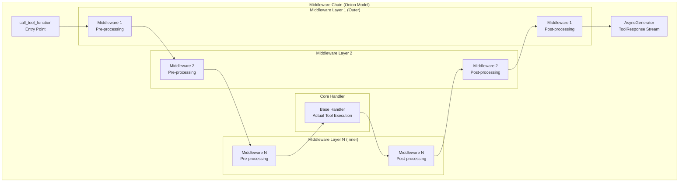
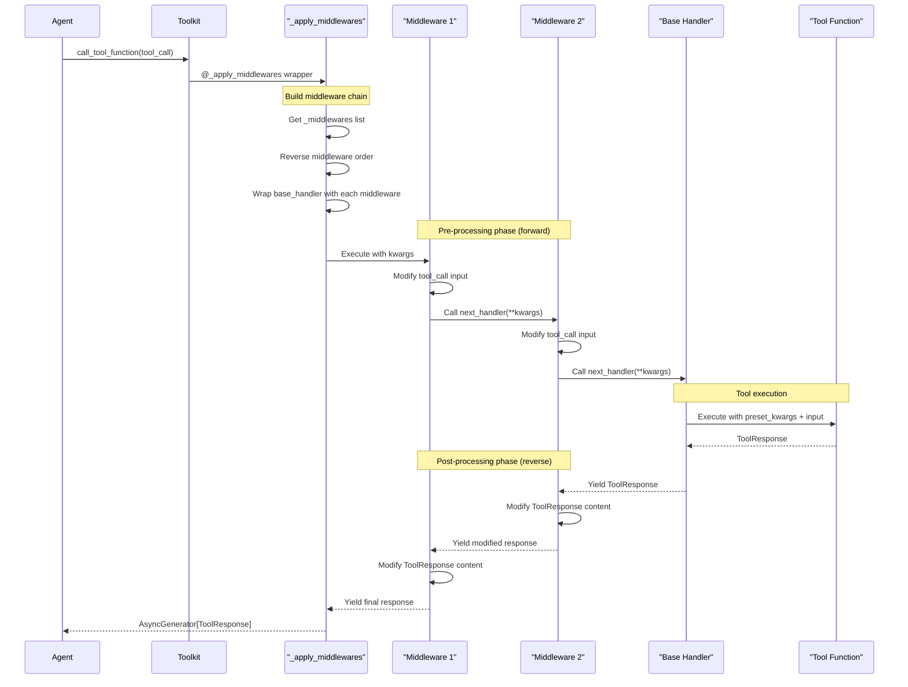
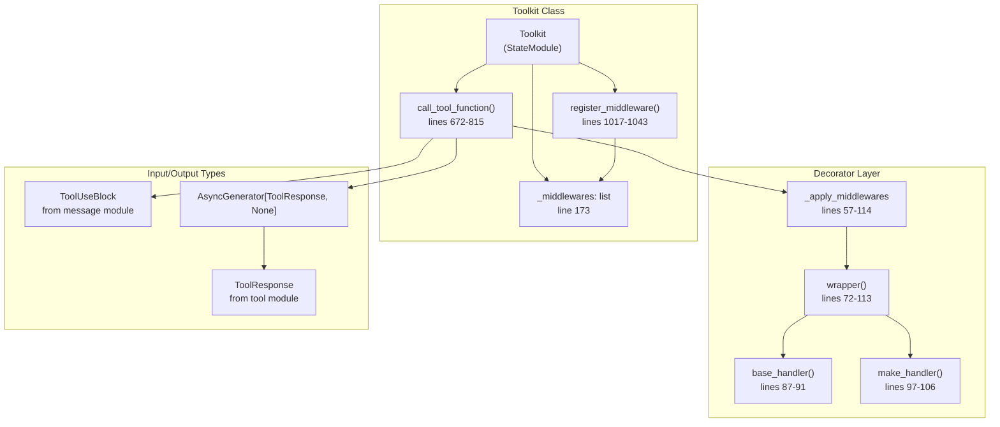
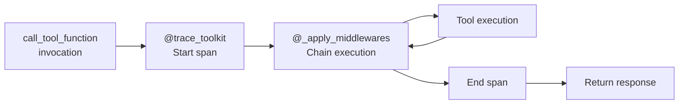

<!-- source: DeepWiki mcp.deepwiki.com · repo modelscope/agentscope · page 4.6 Middleware System · fetched 2026-10-26 -->

# Middleware System

<details>
<summary>Relevant source files</summary>

The following files were used as context for generating this wiki page:

- [docs/tutorial/en/src/task_middleware.py](docs/tutorial/en/src/task_middleware.py)
- [docs/tutorial/zh_CN/src/task_middleware.py](docs/tutorial/zh_CN/src/task_middleware.py)
- [src/agentscope/tracing/_trace.py](src/agentscope/tracing/_trace.py)
- [tests/toolkit_middleware_test.py](tests/toolkit_middleware_test.py)

</details>


The middleware system in AgentScope provides an extensible mechanism for intercepting and modifying tool execution. Currently implemented for the `Toolkit` class, it follows an **onion model** architecture where each middleware wraps around the previous one, forming layers that enable pre-processing, post-processing, and conditional execution control.

For general information about the tool system, see [Toolkit Core Architecture](#4.1). For tool registration and execution details, see [Tool Registration and Execution](#4.2).

---

## Architecture Overview

The middleware system is built on an async generator pattern, where each middleware can intercept tool calls, modify inputs, process responses, and optionally skip execution entirely.

### Onion Model Structure



**Sources:** [src/agentscope/tool/_toolkit.py:57-114](), [docs/tutorial/en/src/task_middleware.py:10-21]()

---

## Middleware Signature and Requirements

### Function Signature

All middleware functions must conform to this async generator signature:

```python
async def middleware(
    kwargs: dict,
    next_handler: Callable[..., Coroutine[Any, Any, AsyncGenerator[ToolResponse, None]]],
) -> AsyncGenerator[ToolResponse, None]:
    # Implementation
    pass
```

### Parameter Specifications

| Parameter | Type | Description |
|-----------|------|-------------|
| `kwargs` | `dict` | Context dictionary containing `tool_call` (`ToolUseBlock`). Future versions may include additional context. |
| `next_handler` | `Callable` | Callable that accepts `**kwargs` and returns a coroutine yielding `AsyncGenerator[ToolResponse, None]`. Invokes the next middleware or base handler. |
| **Returns** | `AsyncGenerator[ToolResponse, None]` | Async generator yielding `ToolResponse` objects, potentially modified by the middleware. |

**Sources:** [src/agentscope/tool/_toolkit.py:57-114](), [docs/tutorial/en/src/task_middleware.py:36-73]()

---

## Middleware Registration and Execution

### Registration Method

The `Toolkit` class provides the `register_middleware` method to register middleware functions:

```python
toolkit = Toolkit()
toolkit.register_middleware(logging_middleware)
toolkit.register_middleware(authorization_middleware)
```

Middleware is stored in the `self._middlewares` list attribute and applied in registration order during pre-processing (reversed during post-processing).

**Sources:** [src/agentscope/tool/_toolkit.py:173](), [src/agentscope/tool/_toolkit.py:1017-1043]()

### Execution Flow



**Sources:** [src/agentscope/tool/_toolkit.py:57-114](), [src/agentscope/tool/_toolkit.py:672-815]()

---

## Implementation Details

### The `_apply_middlewares` Decorator

The decorator dynamically constructs the middleware chain at invocation time by reading from `self._middlewares`:

| Line Range | Component | Purpose |
|------------|-----------|---------|
| [57-62]() | Decorator definition | Wraps the `call_tool_function` method with middleware support |
| [78-84]() | No-middleware path | Direct execution when `_middlewares` is empty |
| [87-91]() | `base_handler` | Innermost handler that calls the original tool function |
| [93-108]() | Chain construction | Wraps each middleware in reverse order using `make_handler` |
| [111-112]() | Execution | Invokes the complete middleware chain starting from the outermost layer |

**Sources:** [src/agentscope/tool/_toolkit.py:57-114]()

### Integration with `call_tool_function`

The `call_tool_function` method is decorated with both `@trace_toolkit` (for observability) and `@_apply_middlewares`:

```python
@trace_toolkit                    # Outer decorator (tracing)
@_apply_middlewares               # Inner decorator (middleware)
async def call_tool_function(...) -> AsyncGenerator[ToolResponse, None]
```

This ordering ensures that tracing encompasses the entire middleware chain execution.

**Sources:** [src/agentscope/tool/_toolkit.py:672-673](), [src/agentscope/tracing/_trace.py:322-364]()

---

## Pre-Processing and Post-Processing Patterns

### Pre-Processing Pattern

Pre-processing occurs before calling `next_handler`, allowing middleware to:
- Modify `tool_call["input"]` arguments
- Validate or sanitize inputs
- Add authentication/authorization checks
- Skip execution by returning early without calling `next_handler`

```python
async def pre_processing_middleware(kwargs: dict, next_handler: Callable):
    tool_call = kwargs["tool_call"]
    # Modify input before execution
    tool_call["input"]["query"] = transform(tool_call["input"]["query"])
    async for response in await next_handler(**kwargs):
        yield response
```

**Sources:** [docs/tutorial/en/src/task_middleware.py:165-182](), [tests/toolkit_middleware_test.py:10-25]()

### Post-Processing Pattern

Post-processing occurs after receiving responses from `next_handler`, allowing middleware to:
- Modify `response.content` fields
- Filter or transform output
- Add metrics or logging

```python
async def post_processing_middleware(kwargs: dict, next_handler: Callable):
    async for response in await next_handler(**kwargs):
        # Modify response after execution
        response.content[0]["text"] += " [MODIFIED]"
        yield response
```

**Sources:** [docs/tutorial/en/src/task_middleware.py:165-182](), [tests/toolkit_middleware_test.py:10-25]()

---

## Code Entity Mapping



**Sources:** [src/agentscope/tool/_toolkit.py:117-138](), [src/agentscope/tool/_toolkit.py:57-114](), [src/agentscope/tool/_toolkit.py:672-815]()

---

## Common Use Cases

### Logging and Monitoring

Track tool invocations with execution time and result status.

**Sources:** [docs/tutorial/en/src/task_middleware.py:81-101]()

### Authorization and Access Control

Restrict tool access based on permissions. If unauthorized, the middleware can yield a `ToolResponse` with an error message and return immediately without calling `next_handler`.

**Sources:** [docs/tutorial/en/src/task_middleware.py:216-244]()

### Input/Output Transformation

Sanitize inputs (e.g., removing sensitive data) or format outputs to meet specific agent requirements.

**Sources:** [docs/tutorial/en/src/task_middleware.py:165-182]()

---

## Integration with Observability

The middleware system integrates with AgentScope's tracing infrastructure via the `trace_toolkit` decorator.



This ensures that:
- Total execution time includes all middleware overhead.
- Middleware modifications to inputs/outputs are captured in the trace if they occur within the span.

**Sources:** [src/agentscope/tool/_toolkit.py:672-673](), [src/agentscope/tracing/_trace.py:322-364]()

---

## Execution Order with Multiple Middleware

When multiple middleware are registered, the execution follows a strict order:

| Phase | Middleware Execution Order | Explanation |
|-------|---------------------------|-------------|
| Pre-processing | M1 → M2 → ... → MN | Forward order (as registered) |
| Tool execution | `base_handler` executes tool | Innermost layer |
| Post-processing | MN → ... → M2 → M1 | Reverse order (inside-out) |

This is verified in the toolkit middleware unit tests where the final text output follows the registration sequence.

**Sources:** [src/agentscope/tool/_toolkit.py:93-108](), [tests/toolkit_middleware_test.py:68-86]()

---

## Future Extensions

The middleware system is currently implemented for toolkit operations. Future versions of AgentScope are expected to expand this support to other components:

- **Agents**: Intercepting `reply` methods.
- **Models**: Intercepting model calls for prompt injection or response filtering.

**Sources:** [docs/tutorial/en/src/task_middleware.py:19]()

---

