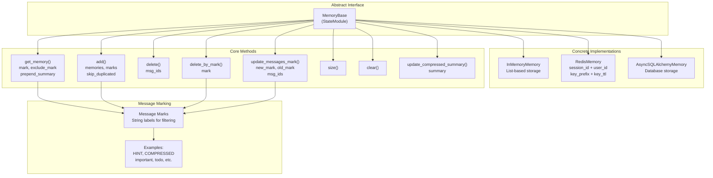
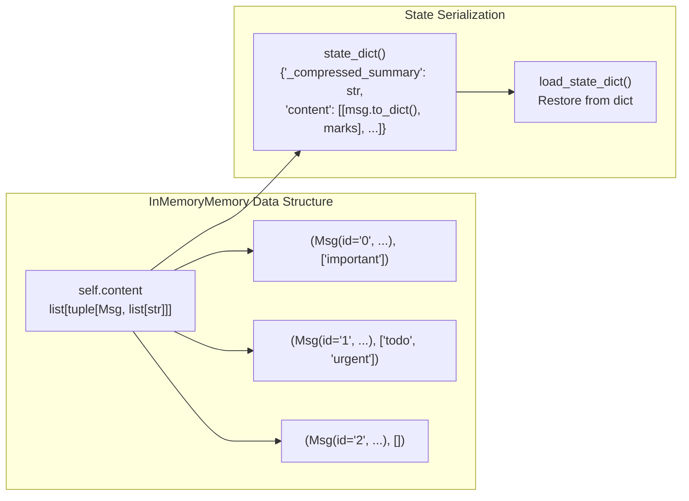
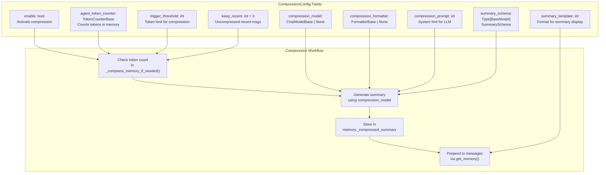
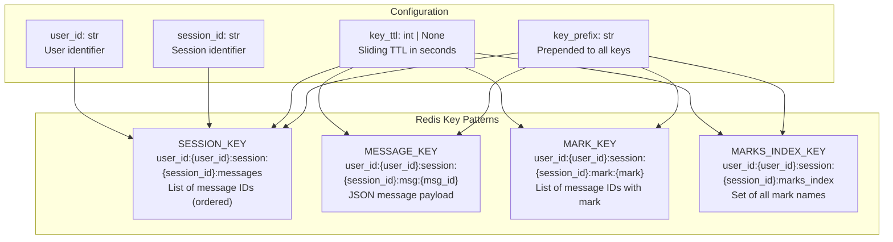
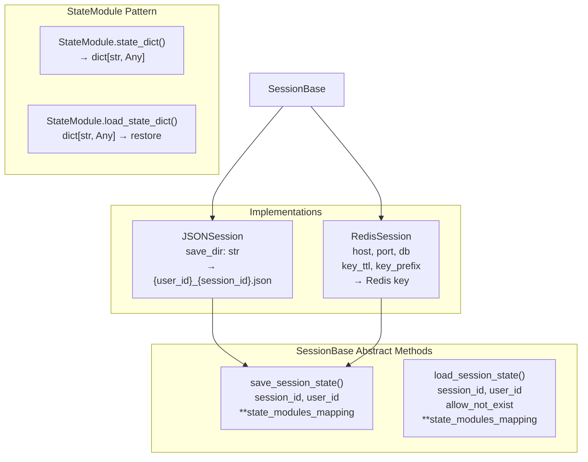
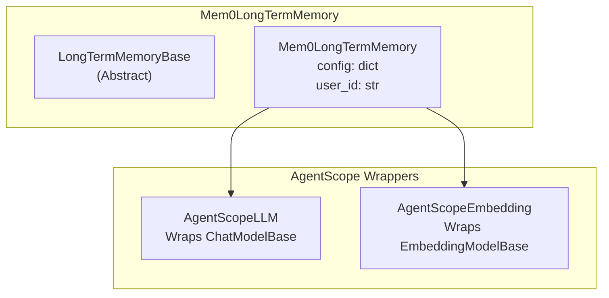
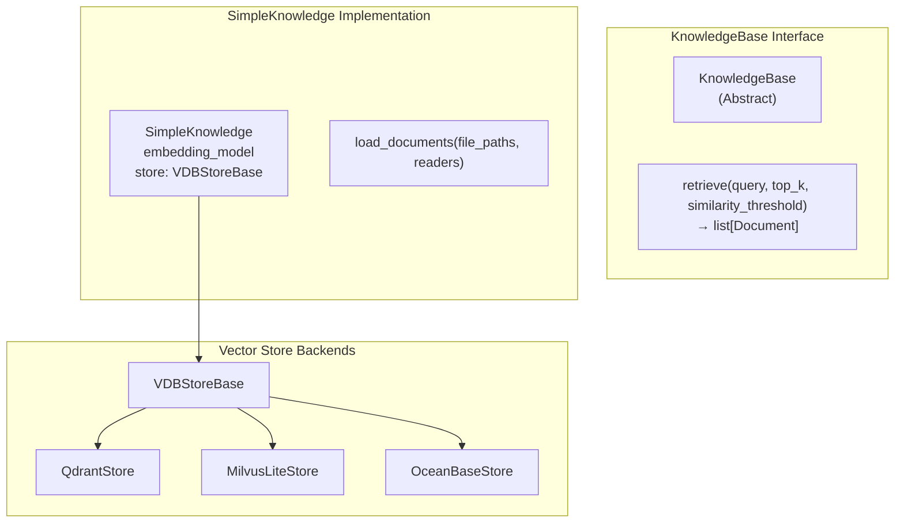

<!-- source: DeepWiki mcp.deepwiki.com · repo modelscope/agentscope · page 5 Memory and Knowledge Systems · fetched 2026-10-26 -->

# Memory and Knowledge Systems

Relevant source files

The following files were used as context for generating this wiki page:

- [docs/tutorial/en/src/task_agent.py](docs/tutorial/en/src/task_agent.py)
- [docs/tutorial/en/src/task_long_term_memory.py](docs/tutorial/en/src/task_long_term_memory.py)
- [docs/tutorial/en/src/task_memory.py](docs/tutorial/en/src/task_memory.py)
- [docs/tutorial/zh_CN/src/task_agent.py](docs/tutorial/zh_CN/src/task_agent.py)
- [docs/tutorial/zh_CN/src/task_long_term_memory.py](docs/tutorial/zh_CN/src/task_long_term_memory.py)
- [docs/tutorial/zh_CN/src/task_memory.py](docs/tutorial/zh_CN/src/task_memory.py)
- [examples/functionality/long_term_memory/reme/README.md](examples/functionality/long_term_memory/reme/README.md)
- [examples/functionality/short_term_memory/memory_compression/README.md](examples/functionality/short_term_memory/memory_compression/README.md)
- [src/agentscope/memory/__init__.py](src/agentscope/memory/__init__.py)

This document covers the memory and knowledge management infrastructure in AgentScope, including short-term (working) memory, memory compression, session state persistence, long-term semantic memory, and retrieval-augmented generation (RAG) systems. 

For information about the planning system that helps agents decompose complex tasks, see [Planning System with PlanNotebook](#2.5). For agent-specific memory integration, see [ReActAgent Implementation](#2.2).

---

## Overview and Scope

AgentScope provides a multi-layered memory architecture designed to support conversational agents with:

1. **Working Memory**: Temporary conversation history storage with multiple backends (`InMemoryMemory`, `RedisMemory`, `AsyncSQLAlchemyMemory`). [src/agentscope/memory/_working_memory/__init__.py:4-9]()
2. **Memory Compression**: Automatic summarization when token limits are exceeded, specifically implemented in `ReActAgent`. [docs/tutorial/en/src/task_agent.py:119-123]()
3. **Session State Management**: Persistence and restoration of complete agent state via `SessionBase` implementations. [src/agentscope/session/_session_base.py:1-49]()
4. **Long-Term Memory**: Semantic memory using `Mem0` or `ReMe` libraries for persistent knowledge. [src/agentscope/memory/_long_term_memory/__init__.py:10-16]()
5. **RAG Systems**: Document retrieval using vector stores (`VDBStoreBase`) for knowledge-enhanced generation. [docs/tutorial/en/src/task_agent.py:25-40]()

The memory system is built on abstraction layers that enable swapping implementations without changing agent code. All memory operations are asynchronous to support scalable, non-blocking I/O.

**Sources:** [src/agentscope/memory/__init__.py:1-31](), [docs/tutorial/en/src/task_memory.py:8-26](), [docs/tutorial/en/src/task_agent.py:13-37]()

---

## Working Memory Architecture

### MemoryBase Interface

The `MemoryBase` class defines the abstract interface for all working memory implementations. It provides methods for adding, retrieving, filtering, and managing messages with marks. [docs/tutorial/en/src/task_memory.py:44-80]()

**Key Methods:**

| Method | Purpose | Parameters |
|--------|---------|------------|
| `get_memory()` | Retrieve messages, optionally filtered by mark | `mark`, `exclude_mark`, `prepend_summary` |
| `add()` | Add message(s) to memory | `memories`, `marks` |
| `delete()` | Remove messages by ID | `msg_ids` |
| `delete_by_mark()` | Remove messages by mark | `mark` |
| `update_messages_mark()` | Add/remove/change marks | `new_mark`, `old_mark`, `msg_ids` |
| `update_compressed_summary()` | Set compressed summary text | `summary` |

The base class also inherits from `StateModule`, enabling serialization via `state_dict()` and `load_state_dict()` for session persistence. [docs/tutorial/en/src/task_memory.py:129-132]()

**Sources:** [docs/tutorial/en/src/task_memory.py:44-80](), [src/agentscope/memory/_working_memory/_base.py:1-100]()

---

### InMemoryMemory Implementation

`InMemoryMemory` is a simple in-memory implementation of memory storage. [docs/tutorial/en/src/task_memory.py:34-35]() It persists content across users and sessions when combined with the state module. [docs/tutorial/en/src/task_memory.py:99-101]()

**Key Features:**
- Simple, fast, local storage without external dependencies. [docs/tutorial/en/src/task_memory.py:34-35]()
- Supports all marking operations via `update_messages_mark`. [docs/tutorial/en/src/task_memory.py:71-75]()
- Full state serialization for persistence via `state_dict()`. [docs/tutorial/en/src/task_memory.py:129-130]()

**Sources:** [docs/tutorial/en/src/task_memory.py:96-144](), [src/agentscope/memory/_working_memory/_in_memory_memory.py:1-50]()

---

## Memory Compression

Memory compression in `ReActAgent` automatically generates summaries when conversation history exceeds token limits. [docs/tutorial/en/src/task_agent.py:122-124]()

### CompressionConfig

To enable memory compression, provide a `CompressionConfig` instance when initializing the `ReActAgent`. [docs/tutorial/en/src/task_agent.py:127-128]()

**Compression Trigger Logic:**
1. Monitor token count using `agent_token_counter`. [docs/tutorial/en/src/task_agent.py:148]()
2. Once it exceeds `trigger_threshold`, identify uncompressed messages. [docs/tutorial/en/src/task_agent.py:149-151]()
3. Keep the most recent `keep_recent` messages uncompressed. [docs/tutorial/en/src/task_agent.py:152]()
4. Generate structured summary using LLM and mark compressed messages with `MemoryMark.COMPRESSED`. [docs/tutorial/en/src/task_agent.py:153-154]()
5. Store the summary in memory via `update_compressed_summary`. [docs/tutorial/en/src/task_agent.py:155]()

**Sources:** [docs/tutorial/en/src/task_agent.py:119-175](), [docs/tutorial/zh_CN/src/task_agent.py:111-165]()

---

## Redis Memory and Multi-Tenancy

`RedisMemory` provides distributed, multi-tenant memory storage using Redis. [docs/tutorial/en/src/task_memory.py:39-40]()

### Key Design Patterns

**Multi-Tenant Isolation:**
Isolation is achieved through key prefixing using `user_id` and `session_id`. [src/agentscope/memory/_working_memory/_redis_memory.py:1-100]() AgentScope also provides `AsyncSQLAlchemyMemory` for relational database storage supporting SQLite, PostgreSQL, and MySQL. [docs/tutorial/en/src/task_memory.py:37-38]()

**Sources:** [docs/tutorial/en/src/task_memory.py:147-153](), [src/agentscope/memory/_working_memory/_redis_memory.py:1-100]()

---

## Session State Management

Session management enables saving and restoring complete agent state. Agents inherit from `StateModule` to support this. [docs/tutorial/en/src/task_agent.py:35-36]()

### SessionBase Interface

**Sources:** [src/agentscope/session/_session_base.py:1-49](), [docs/tutorial/en/src/task_agent.py:35-36]()

---

## Long-Term Memory with Mem0

AgentScope provides `Mem0LongTermMemory` based on the `mem0` library. [docs/tutorial/en/src/task_long_term_memory.py:8]()

### Mem0LongTermMemory Architecture

**Modes of Operation:**
- `agent_control`: Agent autonomously manages memory via tool calls. [docs/tutorial/en/src/task_long_term_memory.py:11]()
- `static_control`: Developer explicitly controls operations. [docs/tutorial/en/src/task_long_term_memory.py:12]()

**Sources:** [docs/tutorial/en/src/task_long_term_memory.py:8-14](), [src/agentscope/memory/_long_term_memory/_mem0_memory.py:1-100]()

---

## Long-Term Memory with ReME

ReMe (Reflection Memory) provides three specialized types of persistent memory storage. [examples/functionality/long_term_memory/reme/README.md:5]()

| Memory Type | Implementation Class | Purpose |
|-------------|----------------------|---------|
| **Personal Memory** | `ReMePersonalLongTermMemory` | Records user preferences, habits, and facts. [examples/functionality/long_term_memory/reme/README.md:14]() |
| **Task Memory** | `ReMeTaskLongTermMemory` | Learns from task execution trajectories. [examples/functionality/long_term_memory/reme/README.md:15]() |
| **Tool Memory** | `ReMeToolLongTermMemory` | Records tool execution results and usage patterns. [examples/functionality/long_term_memory/reme/README.md:16]() |

**Key Features:**
- Dual Interface: Tool functions for agents and direct methods for programmatic use. [examples/functionality/long_term_memory/reme/README.md:68]()
- Vector-based Retrieval: Efficient semantic search using embedding models. [examples/functionality/long_term_memory/reme/README.md:69]()

**Sources:** [examples/functionality/long_term_memory/reme/README.md:12-17](), [docs/tutorial/en/src/task_long_term_memory.py:145-173]()

---

## RAG System Overview

AgentScope supports Retrieval-Augmented Generation through a `KnowledgeBase` abstraction. [docs/tutorial/en/src/task_agent.py:30-34]()

### KnowledgeBase Architecture

**Sources:** [docs/tutorial/en/src/task_agent.py:25-40](), [src/agentscope/knowledge/__init__.py:1-50]()

---

## Vector Store Integrations

AgentScope provides multiple vector store backends through the `VDBStoreBase` abstraction. [src/agentscope/knowledge/_vdb_store_base.py:1-50]()

| Store | Implementation Class | typical Use Case |
|-------|----------------------|------------------|
| Qdrant | `QdrantStore` | High-performance production search. |
| Milvus | `MilvusLiteStore` | Lightweight local development. |
| OceanBase | `OceanBaseStore` | Enterprise-scale SQL+Vector storage. |
| MongoDB | `MongoDBStore` | Integrated document and vector search. |

**Sources:** [src/agentscope/knowledge/__init__.py:1-50](), [examples/functionality/long_term_memory/reme/README.md:8-9]()

---

