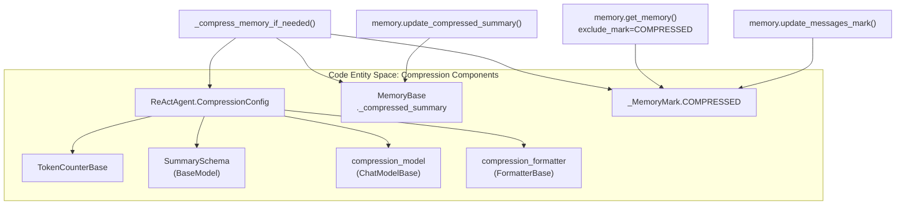
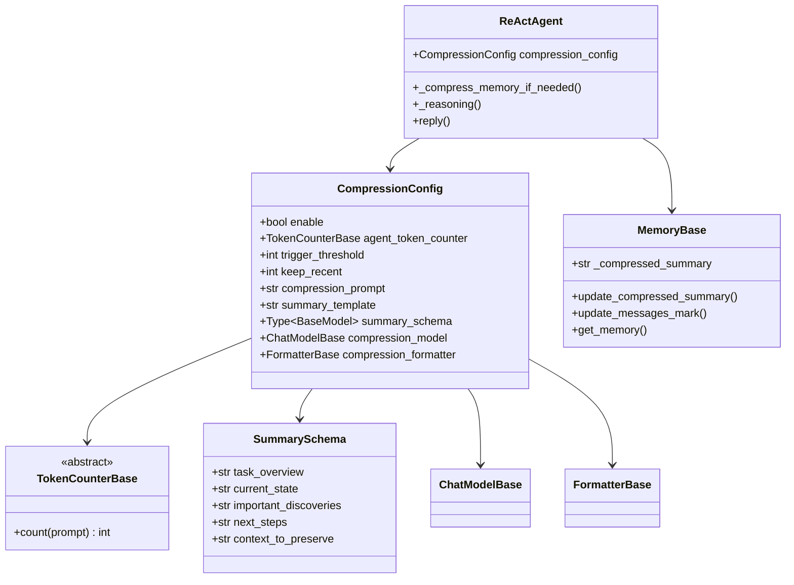
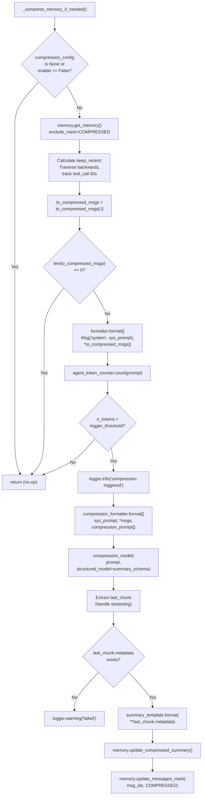
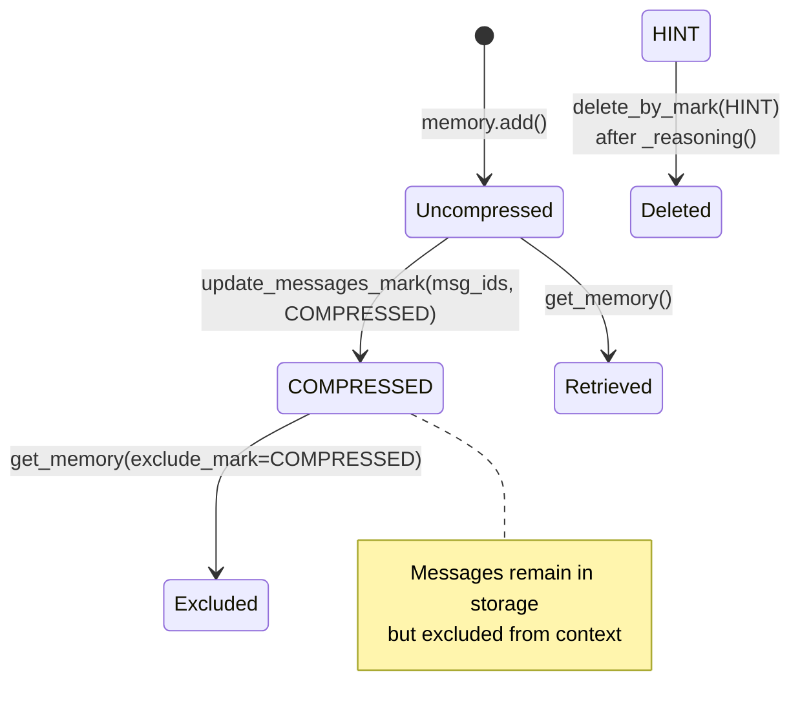

<!-- source: DeepWiki mcp.deepwiki.com · repo modelscope/agentscope · page 5.2 Memory Compression · fetched 2026-10-26 -->

# Memory Compression

Relevant source files

The following files were used as context for generating this wiki page:

- [src/agentscope/_utils/_common.py](src/agentscope/_utils/_common.py)
- [src/agentscope/agent/_react_agent.py](src/agentscope/agent/_react_agent.py)
- [src/agentscope/memory/_working_memory/_in_memory_memory.py](src/agentscope/memory/_working_memory/_in_memory_memory.py)
- [src/agentscope/model/_anthropic_model.py](src/agentscope/model/_anthropic_model.py)
- [src/agentscope/model/_dashscope_model.py](src/agentscope/model/_dashscope_model.py)
- [src/agentscope/model/_gemini_model.py](src/agentscope/model/_gemini_model.py)
- [src/agentscope/model/_model_usage.py](src/agentscope/model/_model_usage.py)
- [src/agentscope/model/_ollama_model.py](src/agentscope/model/_ollama_model.py)
- [src/agentscope/model/_openai_model.py](src/agentscope/model/_openai_model.py)
- [tests/memory_compression_test.py](tests/memory_compression_test.py)
- [tests/model_anthropic_test.py](tests/model_anthropic_test.py)
- [tests/model_dashscope_test.py](tests/model_dashscope_test.py)
- [tests/model_ollama_test.py](tests/model_ollama_test.py)
- [tests/model_openai_test.py](tests/model_openai_test.py)

Memory compression in AgentScope automatically summarizes older conversation messages when token count exceeds a configurable threshold, preventing context window overflow while maintaining task continuity.

Related: [5.1 Working Memory Architecture]() for the underlying storage interface, [5.3 Redis Memory and Multi-Tenancy]() for distributed memory, [5.6 Long-Term Memory with ReME]() for semantic memory persistence.

## Overview

The memory compression subsystem condenses conversation history into structured summaries when token count exceeds `trigger_threshold`. The system is implemented in `ReActAgent._compress_memory_if_needed()` and executes before each reasoning step in the agent loop at [src/agentscope/agent/_react_agent.py:434]().

**Code Entity Space to Natural Language Space Mapping**

| Code Entity | Role in Compression System |
|:---|:---|
| `ReActAgent.CompressionConfig` | Configuration container for thresholds, models, and prompts. |
| `SummarySchema` | Pydantic model defining the structure of the generated summary. |
| `_MemoryMark.COMPRESSED` | Enum value used to tag messages that have been summarized. |
| `TokenCounterBase` | Interface for calculating token usage to trigger compression. |
| `MemoryBase._compressed_summary` | Storage field for the latest generated summary string. |

**Core Mechanisms:**
- **Token Counting**: Uses `TokenCounterBase.count()` against the formatted prompt to determine if compression is necessary [src/agentscope/agent/_react_agent.py:1052-1060]().
- **Recent Message Preservation**: Keeps a specified number of recent messages uncompressed via `keep_recent` [src/agentscope/agent/_react_agent.py:125-127]().
- **Tool Pair Integrity**: Detects tool use/result pairs to prevent splitting them during compression [src/agentscope/agent/_react_agent.py:1026-1045]().
- **Structured Summarization**: Generates summaries using a Pydantic `BaseModel` (`SummarySchema`) with length constraints [src/agentscope/agent/_react_agent.py:43-86]().

**Execution Context:**
Compression check occurs at [src/agentscope/agent/_react_agent.py:434]() within the `reply()` reasoning-acting loop. When triggered, the system calls the compression model with `structured_model=summary_schema`, extracts fields from `ChatResponse.metadata`, and formats the final summary via `summary_template` [src/agentscope/agent/_react_agent.py:1111-1113]().

Sources: [src/agentscope/agent/_react_agent.py:107-172](), [src/agentscope/agent/_react_agent.py:1011-1134](), [src/agentscope/agent/_react_agent.py:432-434]()

## CompressionConfig Class

The `ReActAgent.CompressionConfig` class (Pydantic `BaseModel`) configures compression behavior. It is defined at [src/agentscope/agent/_react_agent.py:107-172]().

**CompressionConfig Fields**

| Field | Type | Default | Description |
|-------|------|---------|-------------|
| `enable` | `bool` | Required | Activates compression checks in `_compress_memory_if_needed()` |
| `agent_token_counter` | `TokenCounterBase` | Required | Token counter instance matching agent's model tokenizer |
| `trigger_threshold` | `int` | Required | Token count at which compression executes |
| `keep_recent` | `int` | `3` | Minimum uncompressed messages to preserve |
| `compression_prompt` | `str` | See [line 129-137]() | Prompt used to guide summary generation |
| `summary_template` | `str` | See [line 142-155]() | String template for formatting the structured output |
| `summary_schema` | `Type[BaseModel]` | `SummarySchema` | Pydantic model for structured compression output |
| `compression_model` | `ChatModelBase \| None` | `None` | Optional alternative model for compression |
| `compression_formatter` | `FormatterBase \| None` | `None` | Formatter for `compression_model` |

The `model_config = {"arbitrary_types_allowed": True}` at [src/agentscope/agent/_react_agent.py:110]() allows non-Pydantic types like `TokenCounterBase` and `ChatModelBase` as fields.

Sources: [src/agentscope/agent/_react_agent.py:107-172](), [src/agentscope/agent/_react_agent.py:1111-1113]()

## SummarySchema BaseModel

The `SummarySchema` class at [src/agentscope/agent/_react_agent.py:43-86]() defines the structured output schema for compression summaries.

**Schema Field Definitions**

| Field | Type | max_length | Description |
|-------|------|-----------|-------------|
| `task_overview` | `str` | 300 | User's core request and success criteria |
| `current_state` | `str` | 300 | What has been completed so far (files, outputs) |
| `important_discoveries` | `str` | 300 | Technical constraints, decisions, and errors |
| `next_steps` | `str` | 200 | Specific actions needed to complete the task |
| `context_to_preserve` | `str` | 300 | User preferences and style requirements |

The schema is passed to the compression model call at [src/agentscope/agent/_react_agent.py:1096]() as `structured_model=self.compression_config.summary_schema`.

Sources: [src/agentscope/agent/_react_agent.py:43-86](), [src/agentscope/agent/_react_agent.py:1094-1096]()

## Trigger Logic and Execution Flow

The `_compress_memory_if_needed()` method at [src/agentscope/agent/_react_agent.py:1011-1134]() implements the trigger logic.

**Trigger Decision Flowchart**

**Tool Pair Preservation Algorithm**
The keep_recent calculation at [src/agentscope/agent/_react_agent.py:1026-1045]() prevents splitting tool use/result pairs by traversing `to_compressed_msgs` backwards and tracking tool call IDs. It only increments the count of "kept" messages when all tool calls have corresponding results.

Sources: [src/agentscope/agent/_react_agent.py:1011-1134](), [src/agentscope/agent/_react_agent.py:1026-1045]()

## Memory Marking and Summary Storage

The `_MemoryMark` enum at [src/agentscope/agent/_react_agent.py:88-96]() defines marks used to tag messages.

**Mark Usage**
- `_MemoryMark.COMPRESSED` (`"compressed"`): Applied after successful compression [src/agentscope/agent/_react_agent.py:1118-1120]().
- `_MemoryMark.HINT` (`"hint"`): Temporary messages like plan hints or structured output prompts [src/agentscope/agent/_react_agent.py:91-92]().

**Summary Prepending**
In `InMemoryMemory.get_memory()`, if a compressed summary exists, it is prepended as a user message to the returned history [src/agentscope/memory/_working_memory/_in_memory_memory.py:81-89]().

Sources: [src/agentscope/agent/_react_agent.py:88-96](), [src/agentscope/memory/_working_memory/_in_memory_memory.py:81-89]()

## ReActAgent Integration

Memory compression is integrated into `ReActAgent.reply()` and executed via `_compress_memory_if_needed()` at [src/agentscope/agent/_react_agent.py:434]().

**Execution Sequence**
1. **Message Retrieval**: `memory.get_memory(exclude_mark=_MemoryMark.COMPRESSED)` [src/agentscope/agent/_react_agent.py:1020-1022]().
2. **Token Counting**: The formatted prompt (including system prompt) is counted [src/agentscope/agent/_react_agent.py:1052-1060]().
3. **Model Selection**: Defaults to the agent's model if no specific `compression_model` is provided [src/agentscope/agent/_react_agent.py:1091-1093]().
4. **Memory Updates**:
   - `memory.update_compressed_summary(formatted_summary)` stores the summary [src/agentscope/agent/_react_agent.py:1110]().
   - `memory.update_messages_mark(msg_ids, _MemoryMark.COMPRESSED)` marks the messages [src/agentscope/agent/_react_agent.py:1117-1120]().

Sources: [src/agentscope/agent/_react_agent.py:177-278](), [src/agentscope/agent/_react_agent.py:375-537](), [src/agentscope/agent/_react_agent.py:1011-1134]()

---

