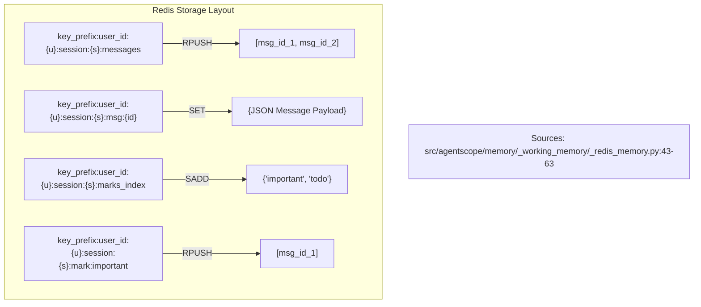
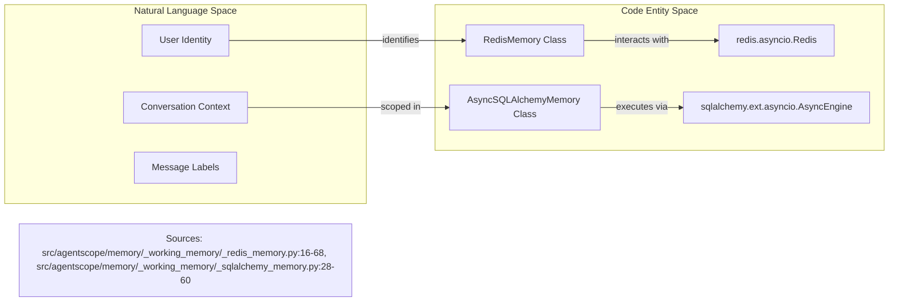
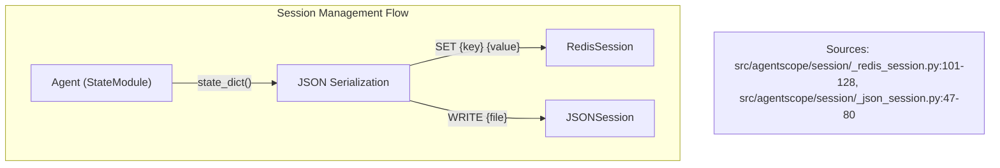

<!-- source: DeepWiki mcp.deepwiki.com · repo modelscope/agentscope · page 5.3 Redis Memory and Multi-Tenancy · fetched 2026-10-26 -->

# Redis Memory and Multi-Tenancy

Relevant source files

The following files were used as context for generating this wiki page:

- [src/agentscope/memory/_working_memory/_redis_memory.py](src/agentscope/memory/_working_memory/_redis_memory.py)
- [src/agentscope/session/__init__.py](src/agentscope/session/__init__.py)
- [src/agentscope/session/_json_session.py](src/agentscope/session/_json_session.py)
- [src/agentscope/session/_redis_session.py](src/agentscope/session/_redis_session.py)
- [src/agentscope/session/_session_base.py](src/agentscope/session/_session_base.py)
- [tests/memory_test.py](tests/memory_test.py)
- [tests/session_test.py](tests/session_test.py)

## Purpose and Scope

This document covers the `RedisMemory` implementation, which provides distributed, persistent working memory storage backed by Redis. It focuses on the multi-tenancy architecture, key namespacing patterns, and production deployment features that enable horizontal scaling and session isolation. Additionally, it introduces `AsyncSQLAlchemyMemory` as an alternative for SQL-backed storage.

For general memory concepts and the `MemoryBase` interface, see [Working Memory](./5.1). For session state persistence that complements memory storage, see [Session State Management](./5.4).

**Sources:** [src/agentscope/memory/_working_memory/_redis_memory.py:1-42](), [src/agentscope/memory/_working_memory/_sqlalchemy_memory.py:1-25]()

---

## RedisMemory Overview

`RedisMemory` is a Redis-backed implementation of `MemoryBase` that provides persistent, distributed working memory storage. Unlike `InMemoryMemory` which stores messages in process memory, `RedisMemory` persists all messages and metadata to a Redis server, enabling:

- **Multi-tenant isolation**: Separate memory spaces per user and session. [src/agentscope/memory/_working_memory/_redis_memory.py:17-24]()
- **Distributed deployment**: Multiple agent instances sharing the same memory.
- **Persistence**: Memory survives process restarts.
- **Automatic expiration**: Optional sliding TTL for temporary sessions. [src/agentscope/memory/_working_memory/_redis_memory.py:102-107]()
- **Environment isolation**: Key prefixes for multi-application deployments. [src/agentscope/memory/_working_memory/_redis_memory.py:98-101]()

The class operates asynchronously and uses the `redis.asyncio` client. [src/agentscope/memory/_working_memory/_redis_memory.py:126-134]()

**Sources:** [src/agentscope/memory/_working_memory/_redis_memory.py:16-135]()

---

## Key Structure and Namespacing

`RedisMemory` uses hierarchical key patterns to isolate data. All Redis keys follow a consistent structure that embeds identity information directly into the key name.

### Complete Key Patterns

The class defines these key pattern constants used to generate final keys:

| Constant | Pattern | Purpose |
|----------|---------|---------|
| `SESSION_KEY` | `user_id:{user_id}:session:{session_id}:messages` | Ordered list of message IDs. [src/agentscope/memory/_working_memory/_redis_memory.py:43-46]() |
| `MESSAGE_KEY` | `user_id:{user_id}:session:{session_id}:msg:{msg_id}` | Individual message payload data. [src/agentscope/memory/_working_memory/_redis_memory.py:57-58]() |
| `MARK_KEY` | `user_id:{user_id}:session:{session_id}:mark:{mark}` | Message IDs associated with a specific mark. [src/agentscope/memory/_working_memory/_redis_memory.py:52-55]() |
| `MARKS_INDEX_KEY` | `user_id:{user_id}:session:{session_id}:marks_index` | Set of all mark names for fast lookup. [src/agentscope/memory/_working_memory/_redis_memory.py:60-63]() |
| `SESSION_PATTERN` | `user_id:{user_id}:session:{session_id}:*` | Scan pattern for session-wide operations (e.g., TTL refresh). [src/agentscope/memory/_working_memory/_redis_memory.py:48-50]() |

### Marks Index System

To efficiently track all marks within a session without scanning keys, `RedisMemory` maintains a `marks_index` (Redis Set). When a mark is created via `add_mark()`, the mark name is added to this set. [src/agentscope/memory/_working_memory/_redis_memory.py:29-40]()

**Sources:** [src/agentscope/memory/_working_memory/_redis_memory.py:29-63]()

---

## Multi-Tenancy and Isolation

`RedisMemory` achieves isolation through its key structure. Each combination of `user_id` and `session_id` creates an independent namespace.

- **Cross-session isolation**: Operations like `clear()` or `delete()` only affect keys matching the specific `session_id`. [src/agentscope/memory/_working_memory/_redis_memory.py:20-24]()
- **Environment isolation**: The `key_prefix` parameter allows multiple applications to share a Redis instance by prepending a string (e.g., `"prod:"`, `"staging:"`) to every key. [src/agentscope/memory/_working_memory/_redis_memory.py:98-101]()

### TTL Management

The `key_ttl` parameter enables a sliding expiration window. If provided, the expiration of all session-related keys is refreshed on every access. [src/agentscope/memory/_working_memory/_redis_memory.py:102-107]()

The `_refresh_session_ttl` method uses the `SESSION_PATTERN` to find all keys for the current user/session and applies the TTL. [src/agentscope/memory/_working_memory/_redis_memory.py:277-313]()

**Sources:** [src/agentscope/memory/_working_memory/_redis_memory.py:16-107](), [src/agentscope/memory/_working_memory/_redis_memory.py:277-313]()

---

## SQL-Backed Memory: AsyncSQLAlchemyMemory

For environments where a relational database is preferred over Redis, AgentScope provides `AsyncSQLAlchemyMemory`. It uses `SQLAlchemy` with an asynchronous engine to store messages. [src/agentscope/memory/_working_memory/_sqlalchemy_memory.py:28-56]()

### Database Schema

The implementation relies on a `MessageModel` table with the following structure:
- `id`: Primary key (String)
- `user_id`: For multi-tenant isolation
- `session_id`: For session isolation
- `message`: JSON-serialized message content
- `timestamp`: Message creation time
- `marks`: JSON-serialized list of marks

### Key Features
- **Persistence**: Messages are stored in SQL tables (SQLite, MySQL, PostgreSQL, etc.).
- **Async Execution**: Uses `create_async_engine` and `AsyncSession`. [tests/memory_test.py:11-13]()
- **Filtering**: Supports retrieval by `mark` and `exclude_mark` using SQL queries. [src/agentscope/memory/_working_memory/_sqlalchemy_memory.py:214-290]()

**Sources:** [src/agentscope/memory/_working_memory/_sqlalchemy_memory.py:28-100](), [tests/memory_test.py:6-13]()

---

## Session State Persistence

While `RedisMemory` stores message history, `RedisSession` (and its counterpart `JSONSession`) handles the persistence of agent configurations and module states.

### RedisSession
`RedisSession` stores a serialized dictionary of `StateModule` objects. It uses a specific key pattern: `user_id:{user_id}:session:{session_id}:state`. [src/agentscope/session/_redis_session.py:20-23]()

### JSONSession
`JSONSession` provides a file-based alternative, saving state to `{user_id}_{session_id}.json`. [src/agentscope/session/_json_session.py:41-45]()

### Data Flow for Session Saving
1. Agent calls `save_session_state`. [src/agentscope/session/_session_base.py:12-17]()
2. `RedisSession` or `JSONSession` iterates through the `state_modules_mapping`. [src/agentscope/session/_redis_session.py:117-120]()
3. Each module's `state_dict()` is called. [src/agentscope/session/_redis_session.py:118-119]()
4. The resulting dictionary is JSON-serialized and saved to the backend. [src/agentscope/session/_redis_session.py:123-125]()

**Sources:** [src/agentscope/session/_redis_session.py:17-128](), [src/agentscope/session/_json_session.py:12-80](), [src/agentscope/session/_session_base.py:8-49]()

---

