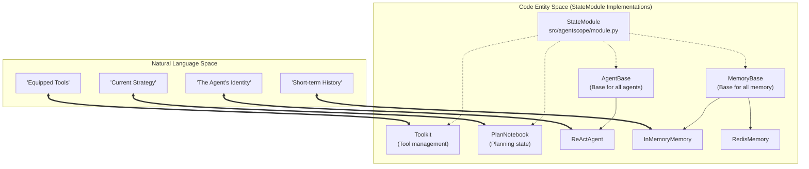
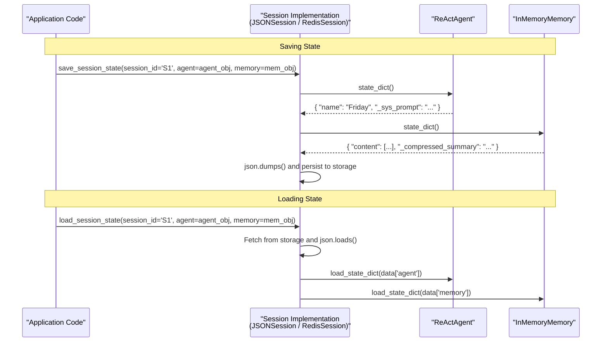
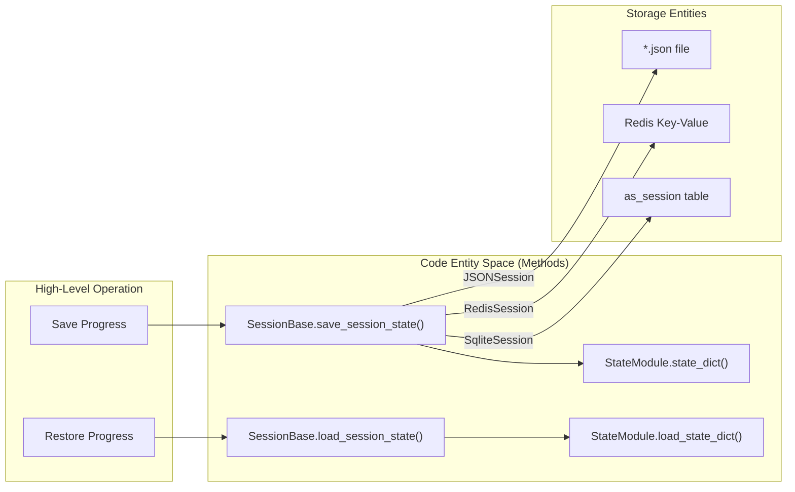

<!-- source: DeepWiki mcp.deepwiki.com · repo modelscope/agentscope · page 5.4 Session State Management · fetched 2026-10-26 -->

# Session State Management

<details>
<summary>Relevant source files</summary>

The following files were used as context for generating this wiki page:

- [docs/tutorial/en/src/task_state.py](docs/tutorial/en/src/task_state.py)
- [docs/tutorial/zh_CN/src/task_state.py](docs/tutorial/zh_CN/src/task_state.py)
- [examples/functionality/session_with_sqlite/README.md](examples/functionality/session_with_sqlite/README.md)
- [examples/functionality/session_with_sqlite/main.py](examples/functionality/session_with_sqlite/main.py)
- [examples/functionality/session_with_sqlite/sqlite_session.py](examples/functionality/session_with_sqlite/sqlite_session.py)
- [src/agentscope/memory/_working_memory/_redis_memory.py](src/agentscope/memory/_working_memory/_redis_memory.py)
- [src/agentscope/session/__init__.py](src/agentscope/session/__init__.py)
- [src/agentscope/session/_json_session.py](src/agentscope/session/_json_session.py)
- [src/agentscope/session/_redis_session.py](src/agentscope/session/_redis_session.py)
- [src/agentscope/session/_session_base.py](src/agentscope/session/_session_base.py)
- [tests/memory_test.py](tests/memory_test.py)
- [tests/session_test.py](tests/session_test.py)

</details>


## Purpose and Scope

Session State Management provides persistence and restoration capabilities for AgentScope components, enabling conversation continuity, experiment reproducibility, and production deployment scenarios. This system allows saving and loading the complete state of agents, memory, toolkits, and other stateful components across sessions.

**Scope**: This page covers the `StateModule` interface for serialization, the `SessionBase` abstraction, and concrete implementations including `JSONSession`, `RedisSession`, and custom SQLite implementations.

**Sources**: [src/agentscope/session/_session_base.py:1-49](), [src/agentscope/session/__init__.py:1-12]()

---

## StateModule Interface

The `StateModule` class is the foundation for state management in AgentScope. Any component inheriting from this class can participate in session persistence through a standardized dictionary-based serialization pattern.

### Core Methods

| Method | Arguments | Description |
|--------|-----------|-------------|
| `register_state` | `attr_name`, `custom_to_json`, `custom_from_json` | Registers an attribute as part of the state, with optional custom hooks. |
| `state_dict` | - | Returns a dictionary containing the serialized state of the object. |
| `load_state_dict`| `state_dict`, `strict` | Restores the object's state from the provided dictionary. |

### Automatic and Nested State
Within a `StateModule` object, the following attributes are automatically treated as part of its state:
- Attributes that themselves inherit from `StateModule` (enabling **nested** serialization).
- Attributes explicitly registered via `register_state`.

**Sources**: [docs/tutorial/en/src/task_state.py:30-60](), [docs/tutorial/zh_CN/src/task_state.py:30-60]()

### StateModule Implementation Pattern

The following diagram bridges the natural language concept of "Stateful Entities" to the specific code classes that implement `StateModule`.



**Title**: Mapping Concepts to StateModule Code Entities

**Sources**: [docs/tutorial/en/src/task_state.py:92-95](), [tests/session_test.py:16-28](), [src/agentscope/session/_session_base.py:5-9]()

---

## SessionBase Architecture

`SessionBase` defines the abstract interface for session persistence backends. It provides two core operations: saving state snapshots and loading state from storage.

### Interface Definition

The interface accepts a variable number of `StateModule` instances identified by keyword arguments, which allows for saving multiple agents or components in a single call.

```python
class SessionBase:
    @abstractmethod
    async def save_session_state(
        self,
        session_id: str,
        user_id: str = "",
        **state_modules_mapping: StateModule,
    ) -> None:
        """Save session state"""

    @abstractmethod
    async def load_session_state(
        self,
        session_id: str,
        user_id: str = "",
        allow_not_exist: bool = True,
        **state_modules_mapping: StateModule,
    ) -> None:
        """Load session state"""
```

**Sources**: [src/agentscope/session/_session_base.py:8-48]()

### Session Save/Load Flow

The following diagram illustrates the data flow when an application saves its state using a session implementation.



**Title**: Session State Serialization Flow

**Sources**: [src/agentscope/session/_json_session.py:47-74](), [src/agentscope/session/_redis_session.py:101-125](), [tests/session_test.py:76-91]()

---

## JSONSession Implementation

`JSONSession` persists session state to local JSON files. It is primarily used for development and local testing.

### Configuration and File Naming
- **`save_dir`**: The directory where JSON files are stored (default: `"./"`). [src/agentscope/session/_json_session.py:15-25]()
- **Naming Convention**: 
    - If `user_id` is provided: `{user_id}_{session_id}.json`
    - Otherwise: `{session_id}.json` [src/agentscope/session/_json_session.py:41-45]()

**Sources**: [src/agentscope/session/_json_session.py:15-45]()

### Implementation Details
- Uses `aiofiles` for asynchronous I/O during save operations. [src/agentscope/session/_json_session.py:68-74]()
- Uses `json.dumps` with `ensure_ascii=False` to support non-ASCII characters. [src/agentscope/session/_json_session.py:74-74]()
- Implements `load_session_state` by reading the file and iterating through the `state_modules_mapping` to call `load_state_dict` on each module. [src/agentscope/session/_json_session.py:101-114]()

**Sources**: [src/agentscope/session/_json_session.py:47-114]()

---

## RedisSession Implementation

`RedisSession` provides a distributed state management solution using Redis, supporting multi-tenant isolation and automatic state expiration.

### Redis Key Pattern
The session state is stored in Redis using the following key pattern:
`user_id:{user_id}:session:{session_id}:state` [src/agentscope/session/_redis_session.py:20-23]()

**Sources**: [src/agentscope/session/_redis_session.py:20-23]()

### Sliding TTL Mechanism
`RedisSession` supports an optional `key_ttl` parameter. When set:
- **Save**: The `SET` command includes an `ex` (expiration) value. [src/agentscope/session/_redis_session.py:125-125]()
- **Load**: Uses the `getex` command to retrieve the data and simultaneously refresh the expiration time, implementing a "sliding TTL" where active sessions remain persisted. [src/agentscope/session/_redis_session.py:151-154]()

**Sources**: [src/agentscope/session/_redis_session.py:125-154]()

### Multi-Tenant Isolation
Isolation is achieved through `key_prefix` (for environment/app isolation) and `user_id` (for user isolation). [src/agentscope/session/_redis_session.py:90-99]()

| Parameter | Level | Example Resulting Key |
|-----------|-------|-----------------------|
| `key_prefix` | Application/Environment | `prod:user_id:default:session:S1:state` |
| `user_id` | User | `user_id:alice:session:S1:state` |

**Sources**: [src/agentscope/session/_redis_session.py:33-56](), [src/agentscope/session/_redis_session.py:90-99]()

---

## SQLite Session (Example Implementation)

While not part of the core library, AgentScope provides an example `SqliteSession` to demonstrate how to implement `SessionBase` for relational databases. [examples/functionality/session_with_sqlite/sqlite_session.py:12-168]()

### Schema and Logic
- **Table**: `as_session` [examples/functionality/session_with_sqlite/sqlite_session.py:45-45]()
- **Fields**: `session_id` (PK), `session_data` (JSON), `created_at`, `updated_at`. [examples/functionality/session_with_sqlite/sqlite_session.py:46-51]()
- **Upsert Pattern**: Uses `INSERT INTO ... ON CONFLICT(session_id) DO UPDATE` to save state. [examples/functionality/session_with_sqlite/sqlite_session.py:57-65]()

**Sources**: [examples/functionality/session_with_sqlite/sqlite_session.py:12-66]()

---

## Memory vs. Session State

It is important to distinguish between **Working Memory Storage** (how messages are stored during a run) and **Session State** (how the component configurations and summaries are persisted).

| Component | State Dict Content (`state_dict`) | Persistent Storage (e.g., `RedisMemory`) |
|-----------|----------------------------------|------------------------------------------|
| `InMemoryMemory` | Full message list + summary | None (volatile) |
| `RedisMemory` | Compressed summary ONLY | Messages stored in Redis Lists/Hashes |
| `AsyncSQLAlchemyMemory` | Compressed summary ONLY | Messages stored in SQL Tables |

**Rationale**: For distributed memory types like `RedisMemory`, the messages are already persistent in Redis via specific patterns like `user_id:{user_id}:session:{session_id}:messages`. [src/agentscope/memory/_working_memory/_redis_memory.py:43-46]() The `state_dict` only needs to capture metadata like the `_compressed_summary` to maintain context continuity.

**Sources**: [src/agentscope/memory/_working_memory/_redis_memory.py:43-63](), [tests/memory_test.py:454-493]()

---

## Usage Summary

The following diagram maps the high-level session management operations to the underlying code functions.



**Title**: Operation Mapping to Code Methods and Storage

**Sources**: [src/agentscope/session/_session_base.py:12-48](), [docs/tutorial/en/src/task_state.py:145-150](), [examples/functionality/session_with_sqlite/sqlite_session.py:12-31]()

---

