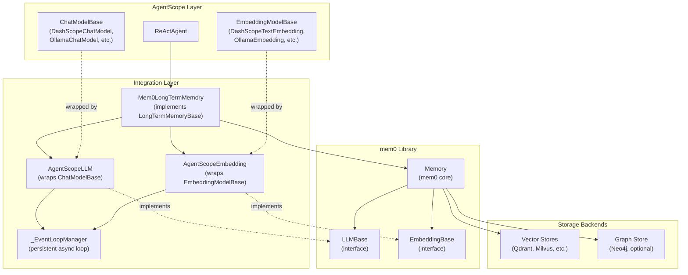
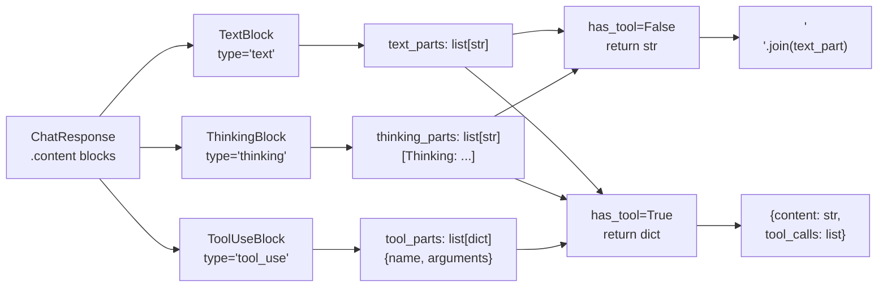
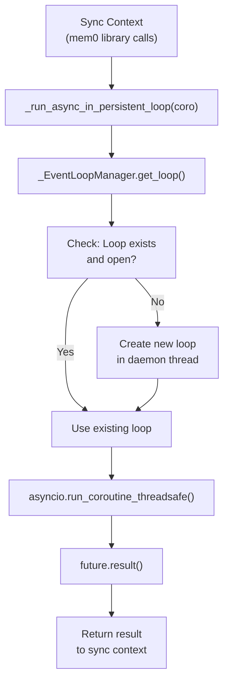
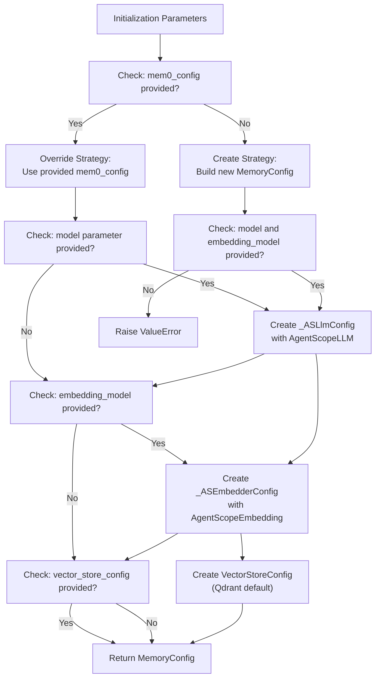
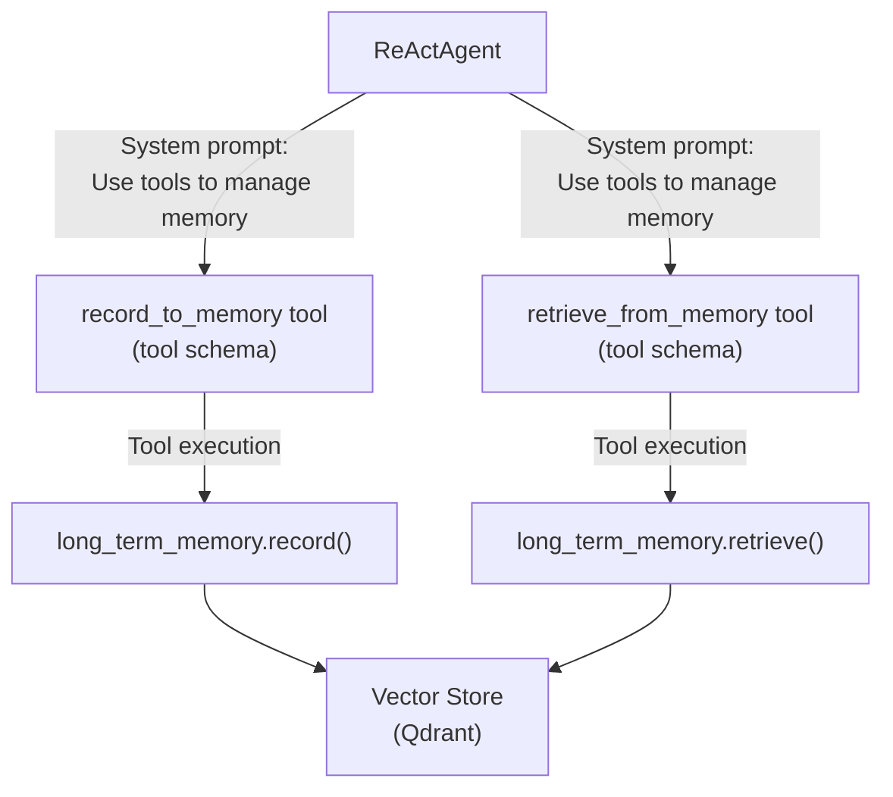
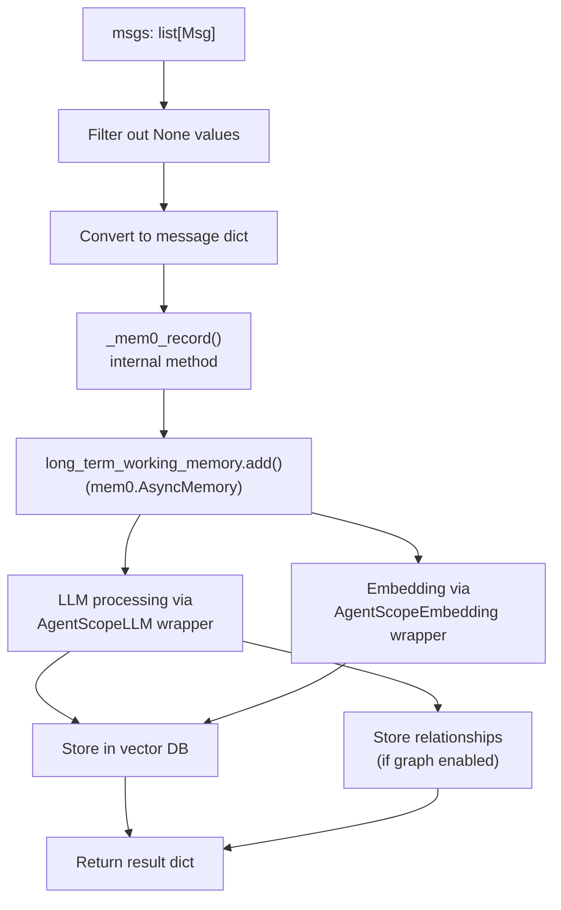
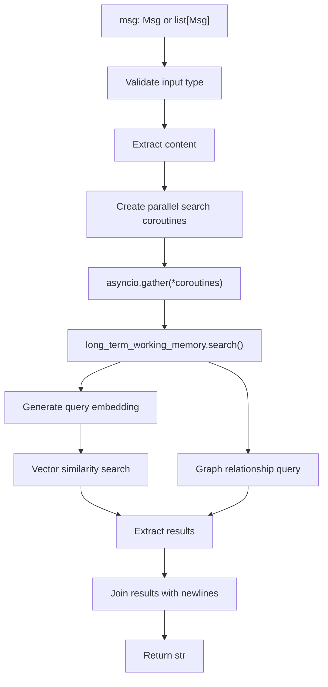
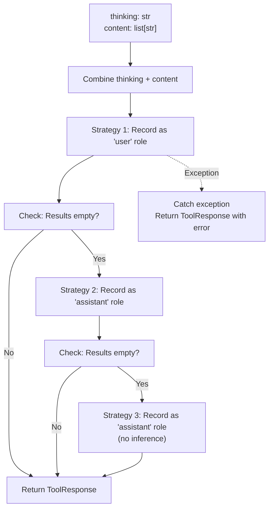
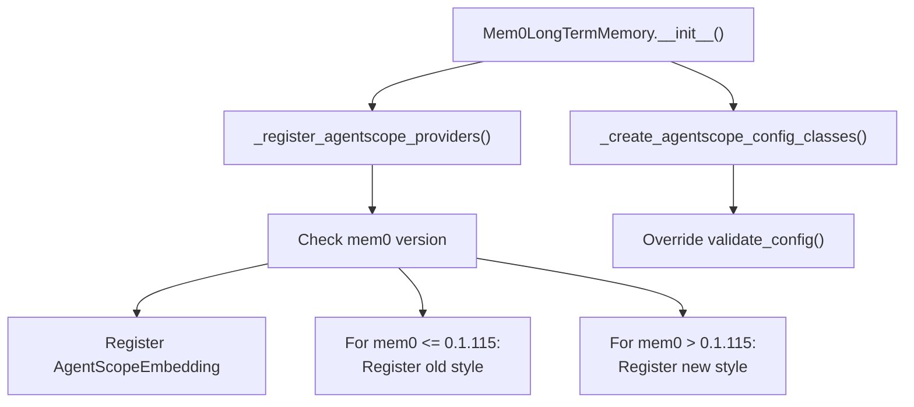

<!-- source: DeepWiki mcp.deepwiki.com · repo modelscope/agentscope · page 5.5 Long-Term Memory with Mem0 · fetched 2026-10-26 -->

# Long-Term Memory with Mem0

<details>
<summary>Relevant source files</summary>

The following files were used as context for generating this wiki page:

- [.gitignore](.gitignore)
- [docs/tutorial/en/src/task_prompt.py](docs/tutorial/en/src/task_prompt.py)
- [docs/tutorial/zh_CN/src/task_prompt.py](docs/tutorial/zh_CN/src/task_prompt.py)
- [examples/functionality/long_term_memory/mem0/README.md](examples/functionality/long_term_memory/mem0/README.md)
- [examples/functionality/long_term_memory/mem0/memory_example.py](examples/functionality/long_term_memory/mem0/memory_example.py)
- [src/agentscope/memory/_long_term_memory/_long_term_memory_base.py](src/agentscope/memory/_long_term_memory/_long_term_memory_base.py)
- [src/agentscope/memory/_long_term_memory/_mem0/_mem0_long_term_memory.py](src/agentscope/memory/_long_term_memory/_mem0/_mem0_long_term_memory.py)
- [src/agentscope/memory/_long_term_memory/_mem0/_mem0_utils.py](src/agentscope/memory/_long_term_memory/_mem0/_mem0_utils.py)
- [tests/mem0_utils_test.py](tests/mem0_utils_test.py)

</details>


This document describes the integration of the [mem0 library](https://github.com/mem0ai/mem0) into AgentScope's long-term memory system. The `Mem0LongTermMemory` class implements `LongTermMemoryBase` by wrapping mem0's semantic memory storage, enabling persistent memory across agent sessions with vector-based retrieval and optional graph-based relationship tracking.

For information about short-term memory management, see [Working Memory Architecture](#5.1). For the long-term memory abstraction interface, see [Long-Term Memory Integration](#5.7). For RAG-based knowledge retrieval, see [RAG System Overview](#5.8).

## Architecture Overview

The mem0 integration bridges AgentScope's model abstractions to mem0's memory system through wrapper classes that handle async operations and format conversions.

Title: Mem0 Integration Architecture

Sources: [src/agentscope/memory/_long_term_memory/_mem0/_mem0_utils.py:1-364](), [examples/functionality/long_term_memory/mem0/memory_example.py:1-186](), [src/agentscope/memory/_long_term_memory/_mem0/_mem0_long_term_memory.py:1-72]()

## Wrapper Classes

The integration uses three wrapper components to bridge AgentScope abstractions to mem0's interfaces.

### AgentScopeLLM Wrapper

The `AgentScopeLLM` class wraps `ChatModelBase` to implement mem0's `LLMBase` interface [src/agentscope/memory/_long_term_memory/_mem0/_mem0_utils.py:133-155](). It handles message format conversion and response parsing.

| Method | Purpose | Input | Output |
|--------|---------|-------|--------|
| `generate_response()` | Call LLM for memory processing | `List[Dict[str, str]]` messages | `str` or `dict` with content/tool_calls |
| `_parse_response()` | Convert ChatResponse to mem0 format | `ChatResponse`, `bool` has_tool | `str` or `dict` |

The wrapper converts between mem0's message format (role/content dicts) and AgentScope's `ChatResponse` format (content blocks including `TextBlock`, `ThinkingBlock`, `ToolUseBlock`).

Title: AgentScopeLLM Response Parsing Logic

Sources: [src/agentscope/memory/_long_term_memory/_mem0/_mem0_utils.py:157-238]()

### AgentScopeEmbedding Wrapper

The `AgentScopeEmbedding` class wraps `EmbeddingModelBase` to implement mem0's `EmbeddingBase` interface [src/agentscope/memory/_long_term_memory/_mem0/_mem0_utils.py:284-311]().

**Key Implementation:**

- Converts single strings to lists for batch processing: [src/agentscope/memory/_long_term_memory/_mem0/_mem0_utils.py:336]()
- Extracts embedding vectors from `EmbeddingResponse.embeddings[0]`: [src/agentscope/memory/_long_term_memory/_mem0/_mem0_utils.py:354]()
- Returns `List[float]` vector representation

Sources: [src/agentscope/memory/_long_term_memory/_mem0/_mem0_utils.py:313-363]()

### Event Loop Management

The `_EventLoopManager` class solves a critical async binding problem: many model clients (e.g., Ollama's `AsyncClient`) bind to a specific event loop and fail when that loop closes. The manager maintains a persistent background event loop across all memory operations [src/agentscope/memory/_long_term_memory/_mem0/_mem0_utils.py:21-40]().

Title: Event Loop Management for Sync Contexts

Sources: [src/agentscope/memory/_long_term_memory/_mem0/_mem0_utils.py:42-131](), [tests/mem0_utils_test.py:1-208]()

## Configuration

The `Mem0LongTermMemory` class accepts configuration for vector stores, graph stores, and mem0-specific settings [src/agentscope/memory/_long_term_memory/_mem0/_mem0_long_term_memory.py:160-261]().

### Vector Store Configuration

Vector stores enable semantic search over stored memories using embeddings.

**Qdrant Configuration Example:**
[examples/functionality/long_term_memory/mem0/memory_example.py:42-49]()
```python
from mem0.vector_stores.configs import VectorStoreConfig

vector_store_config = VectorStoreConfig(
    provider="qdrant",
    config={
        "on_disk": True,
        "path": "./qdrant_data",
        "embedding_model_dims": 1024
    }
)
```

**Supported Providers:**

| Provider | Configuration Keys | Notes |
|----------|-------------------|-------|
| Qdrant | `on_disk`, `path`, `embedding_model_dims` | Local or remote deployment |
| Milvus | Connection details | See mem0 documentation |

**Important:** The `embedding_model_dims` must match the embedding model's output dimension. Changing embedding models requires a new storage path or database deletion: [examples/functionality/long_term_memory/mem0/README.md:91]()

Sources: [examples/functionality/long_term_memory/mem0/memory_example.py:42-49](), [examples/functionality/long_term_memory/mem0/README.md:80-91]()

### Graph Store Configuration

Graph stores enable relationship tracking between entities in memory.

**Neo4j Configuration Example:**
[examples/functionality/long_term_memory/mem0/memory_example.py:52-89]()
```python
from mem0.configs.base import MemoryConfig
from mem0.graphs.configs import GraphStoreConfig

mem0_config = MemoryConfig(
    graph_store=GraphStoreConfig(
        provider="neo4j",
        config={
            "url": "neo4j://localhost:7687",
            "username": "neo4j",
            "password": "password",
            "database": "neo4j"
        }
    )
)

long_term_memory = Mem0LongTermMemory(
    agent_name="Friday",
    user_name="user_123",
    mem0_config=mem0_config,
    # ... other parameters
)
```
Sources: [examples/functionality/long_term_memory/mem0/memory_example.py:52-89]()

### Model Configuration

Both LLM and embedding models are required for mem0 integration unless a complete `mem0_config` is provided.

Title: Mem0 Configuration Strategy

Sources: [src/agentscope/memory/_long_term_memory/_mem0/_mem0_long_term_memory.py:160-261](), [examples/functionality/long_term_memory/mem0/memory_example.py:29-50]()

## Integration with ReActAgent

The `Mem0LongTermMemory` integrates with `ReActAgent` through the `long_term_memory` parameter and supports three modes via `long_term_memory_mode`.

### Integration Modes

| Mode | Description | Tool Functions Added | Behavior |
|------|-------------|---------------------|----------|
| `"agent_control"` | Agent automatically manages memory | None | Agent calls `record()` and `retrieve()` on every conversation turn |
| `"static_control"` | Manual control via API | None | Application code must explicitly call `record()` and `retrieve()` |
| `"both"` | Agent + tool access | `record_to_memory`, `retrieve_from_memory` | Agent can selectively use memory tools based on reasoning |

### Tool-Based Integration ("both" mode)

When `long_term_memory_mode="both"`, the agent receives two tool functions:

Title: ReActAgent Tool-Based Memory Interaction

Sources: [examples/functionality/long_term_memory/mem0/memory_example.py:136-174](), [src/agentscope/memory/_long_term_memory/_long_term_memory_base.py:48-94]()

## Core Operations

### Developer API: record() and retrieve()

#### record() Operation

Stores conversation messages to long-term memory with semantic processing [src/agentscope/memory/_long_term_memory/_mem0/_mem0_long_term_memory.py:573-618]().

Title: Developer record() Workflow

Sources: [src/agentscope/memory/_long_term_memory/_mem0/_mem0_long_term_memory.py:573-618]()

#### retrieve() Operation

Retrieves relevant memories using semantic search based on query messages [src/agentscope/memory/_long_term_memory/_mem0/_mem0_long_term_memory.py:683-746]().

Title: Developer retrieve() Workflow

Sources: [src/agentscope/memory/_long_term_memory/_mem0/_mem0_long_term_memory.py:683-746]()

### Tool API: record_to_memory() and retrieve_from_memory()

#### record_to_memory() Tool

Agent-callable tool for recording important information [src/agentscope/memory/_long_term_memory/_mem0/_mem0_long_term_memory.py:380-505]().

Title: Multi-Strategy Recording System

Sources: [src/agentscope/memory/_long_term_memory/_mem0/_mem0_long_term_memory.py:380-505]()

## Implementation Details

### Provider Registration

AgentScope models are integrated into mem0 through a dynamic provider registration system [src/agentscope/memory/_long_term_memory/_mem0/_mem0_long_term_memory.py:92-132]().

Title: Mem0 Provider Registration Flow

Sources: [src/agentscope/memory/_long_term_memory/_mem0/_mem0_long_term_memory.py:30-69](), [src/agentscope/memory/_long_term_memory/_mem0/_mem0_long_term_memory.py:92-132]()

### Identity Management and Metadata

The `Mem0LongTermMemory` uses three optional identity parameters to scope memories:

| Parameter | Purpose | Used in mem0 As |
|-----------|---------|-----------------|
| `agent_name` | Identifies agent instance | `agent_id` |
| `user_name` | Identifies user/session | `user_id` |
| `run_name` | Identifies run/session | `run_id` |

Sources: [src/agentscope/memory/_long_term_memory/_mem0/_mem0_long_term_memory.py:134-158](), [src/agentscope/memory/_long_term_memory/_mem0/_mem0_long_term_memory.py:263-378]()

### Logging Suppression

The `suppress_mem0_logging` parameter (default: `True`) suppresses mem0 validation error messages that can occur with certain vector stores [src/agentscope/memory/_long_term_memory/_mem0/_mem0_long_term_memory.py:76-90]().

Sources: [src/agentscope/memory/_long_term_memory/_mem0/_mem0_long_term_memory.py:76-90](), [src/agentscope/memory/_long_term_memory/_mem0/_mem0_long_term_memory.py:322-335]()

---

