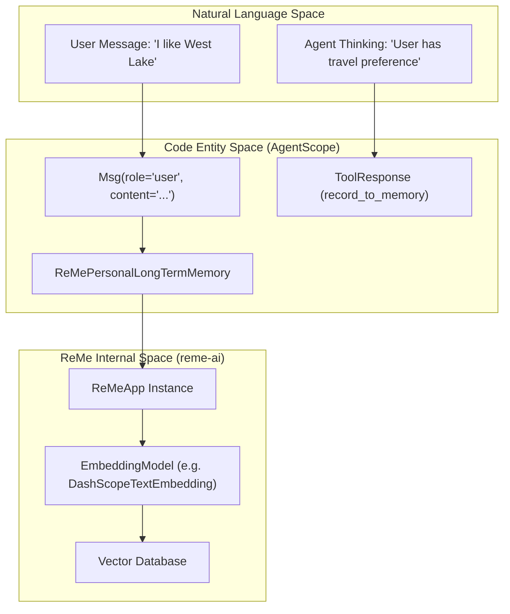
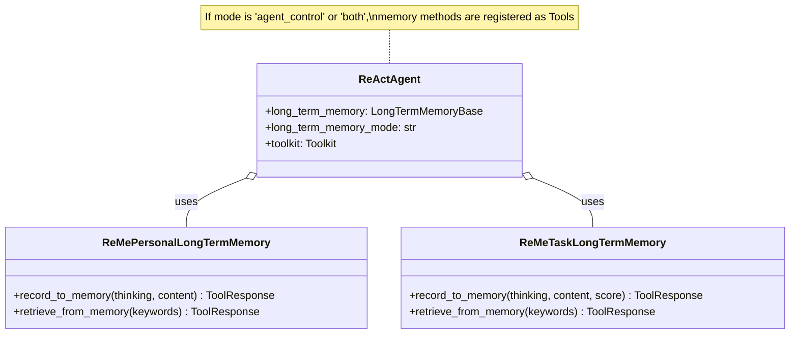

<!-- source: DeepWiki mcp.deepwiki.com · repo modelscope/agentscope · page 5.6 Long-Term Memory with ReME · fetched 2026-10-26 -->

# Long-Term Memory with ReME

<details>
<summary>Relevant source files</summary>

The following files were used as context for generating this wiki page:

- [docs/tutorial/en/src/task_long_term_memory.py](docs/tutorial/en/src/task_long_term_memory.py)
- [docs/tutorial/zh_CN/src/task_long_term_memory.py](docs/tutorial/zh_CN/src/task_long_term_memory.py)
- [examples/functionality/long_term_memory/reme/README.md](examples/functionality/long_term_memory/reme/README.md)
- [examples/functionality/long_term_memory/reme/personal_memory_example.py](examples/functionality/long_term_memory/reme/personal_memory_example.py)
- [examples/functionality/long_term_memory/reme/task_memory_example.py](examples/functionality/long_term_memory/reme/task_memory_example.py)
- [examples/functionality/long_term_memory/reme/tool_memory_example.py](examples/functionality/long_term_memory/reme/tool_memory_example.py)
- [examples/functionality/short_term_memory/reme/README.md](examples/functionality/short_term_memory/reme/README.md)
- [examples/functionality/short_term_memory/reme/reme_short_term_memory.py](examples/functionality/short_term_memory/reme/reme_short_term_memory.py)
- [examples/functionality/short_term_memory/reme/short_term_memory_example.py](examples/functionality/short_term_memory/reme/short_term_memory_example.py)
- [src/agentscope/memory/__init__.py](src/agentscope/memory/__init__.py)
- [tests/memory_reme_test.py](tests/memory_reme_test.py)

</details>


The ReMe (Reflection Memory) system in AgentScope provides a suite of specialized long-term memory components designed to help agents persist information, learn from past experiences, and improve tool-calling accuracy across multiple sessions. Unlike standard working memory, ReMe components utilize embedding models and vector-based retrieval to manage persistent storage via the `reme-ai` library.

## Overview of ReMe Memory System

ReMe is integrated into AgentScope through a hierarchy of classes that extend `LongTermMemoryBase`. It provides three distinct types of memory, each optimized for a specific domain of agent behavior:

| Memory Type | Class Name | Purpose |
| :--- | :--- | :--- |
| **Personal** | `ReMePersonalLongTermMemory` | Stores user preferences, habits, and personal facts. |
| **Task** | `ReMeTaskLongTermMemory` | Learns from task execution trajectories (success/failure) and past experiences. |
| **Tool** | `ReMeToolLongTermMemory` | Records tool execution results to generate usage guidelines for better future calling. |

Sources: `[src/agentscope/memory/__init__.py:10-31]()`, `[examples/functionality/long_term_memory/reme/README.md:10-17]()`, `[examples/functionality/long_term_memory/reme/README.md:76-83]()`

## Architecture and Data Flow

The ReMe memory system acts as a bridge between the agent's conversational space and a persistent vector-based storage. It requires an asynchronous context manager (`async with`) to initialize the underlying `ReMeApp` session.

### Natural Language to Code Entity Mapping

The following diagram illustrates how natural language interactions are transformed into structured memory entities within the ReMe framework.

**Diagram: Memory Transformation Flow**

Sources: `[docs/tutorial/en/src/task_long_term_memory.py:153-169]()`, `[examples/functionality/long_term_memory/reme/personal_memory_example.py:40-57]()`, `[examples/functionality/short_term_memory/reme/reme_short_term_memory.py:144-152]()`

### ReMeLongTermMemoryBase and Initialization

All ReMe memory types share a common initialization pattern requiring a chat model for reflection and an embedding model for vectorization.

**Key Initialization Parameters:**
- `model`: A `DashScopeChatModel` or `OpenAIChatModel` used for memory reflection and summarization.
- `embedding_model`: An `EmbeddingModelBase` implementation (e.g., `DashScopeTextEmbedding`) for vectorization.
- `agent_name`: Identifier for the agent.
- `user_name`: Identifier for the user (mapped to `workspace_id` in the underlying store).

Sources: `[examples/functionality/long_term_memory/reme/personal_memory_example.py:116-129]()`, `[tests/memory_reme_test.py:88-96]()`, `[examples/functionality/short_term_memory/reme/reme_short_term_memory.py:41-51]()`

## Specialized Memory Types

### 1. Personal Memory (`ReMePersonalLongTermMemory`)
Used for recording and retrieving persistent personal information. It provides tool functions that a `ReActAgent` can call autonomously to manage its own knowledge about the user.

**Interfaces:**
- `record_to_memory(thinking, content)`: A tool function returning a `ToolResponse`.
- `retrieve_from_memory(keywords)`: A tool function for keyword-based search.
- `record(msgs)`: Direct method for recording `Msg` objects.
- `retrieve(msg)`: Direct method for query-based retrieval.

Sources: `[examples/functionality/long_term_memory/reme/personal_memory_example.py:7-13]()`, `[examples/functionality/long_term_memory/reme/personal_memory_example.py:40-57]()`, `[examples/functionality/long_term_memory/reme/personal_memory_example.py:69-79]()`

### 2. Task Memory (`ReMeTaskLongTermMemory`)
Focuses on "trajectories"—sequences of actions and results that led to a successful or failed task. It allows agents to reuse successful strategies and avoid past mistakes.

**Interfaces:**
- `record_to_memory(thinking, content, score)`: Includes an optional `score` (default 1.0) to indicate the quality of the trajectory.
- `retrieve_from_memory(keywords)`: Keyword-based retrieval of task experiences.
- `record(msgs, score)`: Direct method for recording message conversations with a success score.
- `retrieve(msg)`: Returns past experiences relevant to the current task description.

Sources: `[examples/functionality/long_term_memory/reme/task_memory_example.py:7-14]()`, `[examples/functionality/long_term_memory/reme/task_memory_example.py:42-59]()`, `[examples/functionality/long_term_memory/reme/task_memory_example.py:164-182]()`

### 3. Tool Memory (`ReMeToolLongTermMemory`)
Specifically designed to improve tool-calling accuracy by recording the `input`, `output`, `success` status, and `time_cost` of tool executions.

**Usage Pattern:**
1. **Record**: Developers or agents record tool execution history as JSON strings containing `tool_name`, `input`, `output`, and `success` status.
2. **Retrieve**: Before a task, the agent retrieves "guidelines" (summarized past behaviors) for specific tools.
3. **Inject**: These guidelines are typically injected into the agent's `sys_prompt` to influence future decisions.

Sources: `[examples/functionality/long_term_memory/reme/tool_memory_example.py:4-12]()`, `[examples/functionality/long_term_memory/reme/tool_memory_example.py:109-151]()`, `[examples/functionality/long_term_memory/reme/tool_memory_example.py:204-216]()`

## Integration with ReActAgent

ReMe memory components are integrated into `ReActAgent` via the `long_term_memory` and `long_term_memory_mode` parameters.

**Code Entity Association**


**Memory Modes:**
- `agent_control`: The agent calls `record_to_memory` and `retrieve_from_memory` as tools.
- `static_control`: The developer calls `record()` and `retrieve()` methods in the application logic.
- `both`: Enables both autonomous tool usage and manual developer control.

Sources: `[docs/tutorial/en/src/task_long_term_memory.py:85-93]()`, `[examples/functionality/long_term_memory/reme/personal_memory_example.py:174-187]()`

## Implementation Details

### Data Recording (record_to_memory)
When an agent calls `record_to_memory`, the ReMe implementation:
1. Receives `thinking` (the rationale) and `content` (the facts/steps).
2. Uses the `ReMeApp.async_execute` method to process and reflect on the data.
3. Returns a `ToolResponse` indicating how many items were successfully recorded.

Sources: `[tests/memory_reme_test.py:162-185]()`, `[examples/functionality/long_term_memory/reme/personal_memory_example.py:40-57]()`

### Data Retrieval (retrieve_from_memory)
Retrieval is performed via semantic search:
1. The `keywords` or query `msg` are converted into embeddings using the configured `embedding_model`.
2. The `ReMeApp` queries the vector store (e.g., local storage or a remote VDB).
3. Results are formatted back into a string or `ToolResponse` for the agent's context.

Sources: `[examples/functionality/long_term_memory/reme/personal_memory_example.py:69-79]()`, `[examples/functionality/long_term_memory/reme/task_memory_example.py:164-182]()`

### Context Management
ReMe components must be used within an `async with` block to ensure that the `ReMeApp` is started and cleaned up properly.

```python
memory = ReMePersonalLongTermMemory(...)
async with memory:
    # Operations here
    await memory.record(...)
```

Sources: `[examples/functionality/long_term_memory/reme/personal_memory_example.py:131-160]()`, `[examples/functionality/short_term_memory/reme/reme_short_term_memory.py:156-164]()`

---

