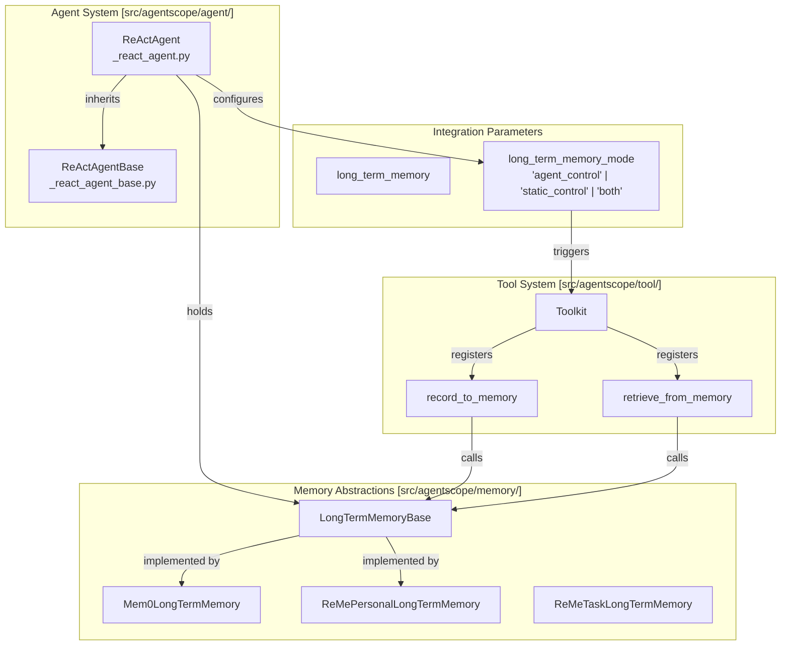
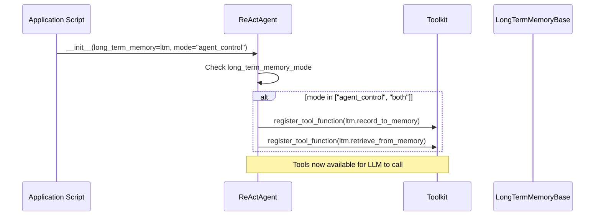
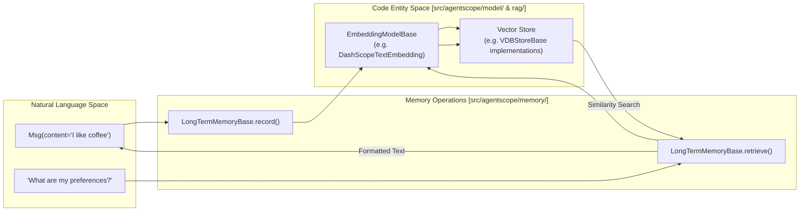

<!-- source: DeepWiki mcp.deepwiki.com · repo modelscope/agentscope · page 5.7 Long-Term Memory Integration · fetched 2026-10-26 -->

# Long-Term Memory Integration

<details>
<summary>Relevant source files</summary>

The following files were used as context for generating this wiki page:

- [docs/tutorial/en/src/task_long_term_memory.py](docs/tutorial/en/src/task_long_term_memory.py)
- [docs/tutorial/zh_CN/src/task_long_term_memory.py](docs/tutorial/zh_CN/src/task_long_term_memory.py)
- [examples/functionality/long_term_memory/reme/README.md](examples/functionality/long_term_memory/reme/README.md)
- [src/agentscope/_utils/_common.py](src/agentscope/_utils/_common.py)
- [src/agentscope/agent/_react_agent.py](src/agentscope/agent/_react_agent.py)
- [src/agentscope/memory/__init__.py](src/agentscope/memory/__init__.py)
- [src/agentscope/model/_anthropic_model.py](src/agentscope/model/_anthropic_model.py)
- [src/agentscope/model/_dashscope_model.py](src/agentscope/model/_dashscope_model.py)
- [src/agentscope/model/_gemini_model.py](src/agentscope/model/_gemini_model.py)
- [src/agentscope/model/_model_usage.py](src/agentscope/model/_model_usage.py)
- [src/agentscope/model/_ollama_model.py](src/agentscope/model/_ollama_model.py)
- [src/agentscope/model/_openai_model.py](src/agentscope/model/_openai_model.py)
- [tests/model_anthropic_test.py](tests/model_anthropic_test.py)
- [tests/model_dashscope_test.py](tests/model_dashscope_test.py)
- [tests/model_ollama_test.py](tests/model_ollama_test.py)
- [tests/model_openai_test.py](tests/model_openai_test.py)

</details>


## Purpose and Scope

This page documents the integration patterns for long-term semantic memory in AgentScope. While short-term memory (Working Memory) handles the immediate conversation context, long-term memory enables agents to persist and retrieve semantic knowledge across sessions. The framework supports multiple implementations, including `Mem0LongTermMemory` and the `ReMe` (Reflection Memory) suite.

Integration is primarily achieved through `ReActAgent`, which provides automated management modes and tool-based operations for memory persistence and retrieval.

**Sources:** [src/agentscope/memory/__init__.py:10-16](), [src/agentscope/agent/_react_agent.py:184-190]()

## Integration Architecture

The long-term memory system integrates with `ReActAgent` through a specialized lifecycle. The agent can either manage memory automatically based on its configuration mode or interact with it dynamically using registered tool functions.

### Code Entity Space Mapping

The following diagram maps the high-level memory concepts to specific classes in the `agentscope` codebase.



**Diagram: Long-Term Memory Code Entity Integration**

**Sources:** [src/agentscope/agent/_react_agent.py:98-215](), [docs/tutorial/en/src/task_long_term_memory.py:85-96]()

## Integration Modes in ReActAgent

The `long_term_memory_mode` parameter in `ReActAgent` determines how the agent interacts with the provided `LongTermMemoryBase` instance.

| Mode | Behavior | Implementation Detail |
| :--- | :--- | :--- |
| `static_control` | Developer-led operations. | The agent does not automatically call memory tools; the developer must call `record()` or `retrieve()` manually in the application logic. |
| `agent_control` | Autonomous agent management. | Registers `record_to_memory` and `retrieve_from_memory` tools in the agent's `Toolkit`. The agent decides when to use them. |
| `both` | Hybrid management. | Combines developer-led explicit calls with autonomous tool-calling capabilities for the agent. |

**Sources:** [src/agentscope/agent/_react_agent.py:186-190](), [docs/tutorial/en/src/task_long_term_memory.py:10-14]()

## Tool-Based Memory Operations

When `long_term_memory_mode` is set to `agent_control` or `both`, the `ReActAgent` constructor automatically registers memory-management tools. This allows the agent to treat its long-term memory as an external resource it can query or update during its reasoning loop.

### Tool Registration Flow

The registration process happens during the `ReActAgent.__init__` call, where the agent checks the `long_term_memory_mode` and equips the `Toolkit` with memory-specific functions.



**Diagram: Automatic Tool Registration Sequence**

### Registered Function Signatures

1.  **`record_to_memory`**: Typically used by the agent to store user preferences, facts, or task outcomes discovered during the session.
2.  **`retrieve_from_memory`**: Used by the agent to perform semantic search or keyword-based lookup for relevant past context.

**Sources:** [docs/tutorial/en/src/task_long_term_memory.py:89-96](), [docs/tutorial/zh_CN/src/task_long_term_memory.py:160-163]()

## Memory Implementation Details

### Mem0 Integration
`Mem0LongTermMemory` provides a wrapper around the `mem0` library. It supports basic `record` and `retrieve` methods that take lists of `Msg` objects. It is often used for general user preference tracking.

**Sources:** [docs/tutorial/en/src/task_long_term_memory.py:37-54](), [docs/tutorial/en/src/task_long_term_memory.py:57-62]()

### ReMe (Reflection Memory) Suite
The ReMe system provides specialized memory types for different agentic needs:

*   **`ReMePersonalLongTermMemory`**: Focuses on user profiles, habits, and persistent facts.
*   **`ReMeTaskLongTermMemory`**: Learns from task execution trajectories to improve future problem-solving.
*   **`ReMeToolLongTermMemory`**: Records tool execution results to generate usage guidelines, improving future tool-calling accuracy.

**Sources:** [examples/functionality/long_term_memory/reme/README.md:12-17](), [docs/tutorial/zh_CN/src/task_long_term_memory.py:141-157]()

## Data Flow: Memory Recording and Retrieval

The following diagram bridges the Natural Language Space (User messages and queries) to the Code Entity Space (Models and Vector Databases).



**Diagram: Semantic Memory Data Flow**

**Sources:** [docs/tutorial/en/src/task_long_term_memory.py:46-52](), [examples/functionality/long_term_memory/reme/README.md:66-70]()

## Configuration Example

Integrating long-term memory requires providing an embedding model for vectorization and a chat model for memory summarization/reflection (in the case of ReMe/Mem0).

```python
# Initialize Memory
long_term_memory = Mem0LongTermMemory(
    agent_name="Friday",
    user_name="user_123",
    model=chat_model,
    embedding_model=embed_model
)

# Initialize Agent with Integration
agent = ReActAgent(
    name="Friday",
    sys_prompt="You are an assistant with long-term memory.",
    model=chat_model,
    formatter=formatter,
    toolkit=Toolkit(),
    memory=InMemoryMemory(), # Short-term
    long_term_memory=long_term_memory, # Long-term
    long_term_memory_mode="agent_control" # Autonomous tool use
)
```

**Sources:** [docs/tutorial/en/src/task_long_term_memory.py:98-111](), [src/agentscope/agent/_react_agent.py:177-190]()

---

