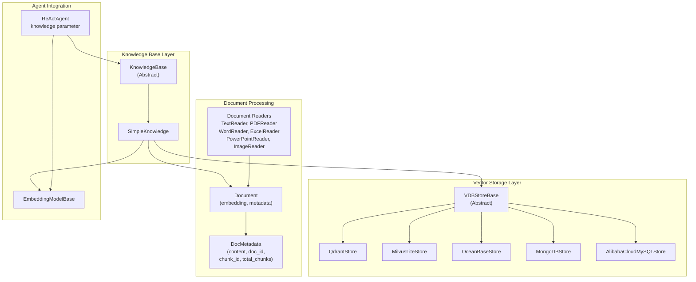
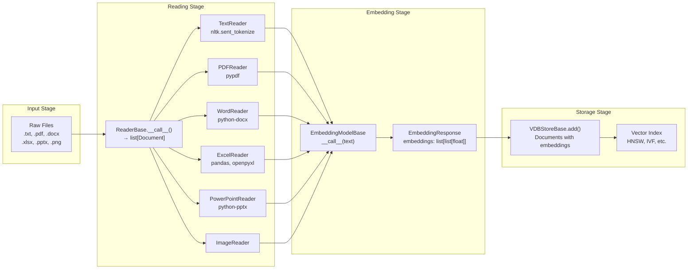
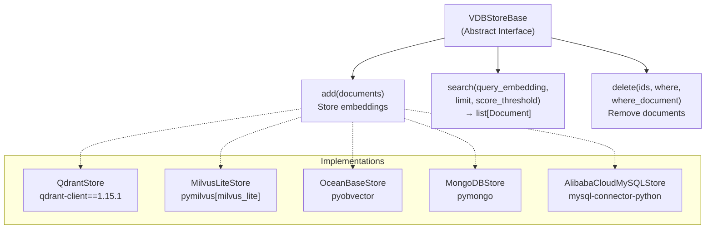
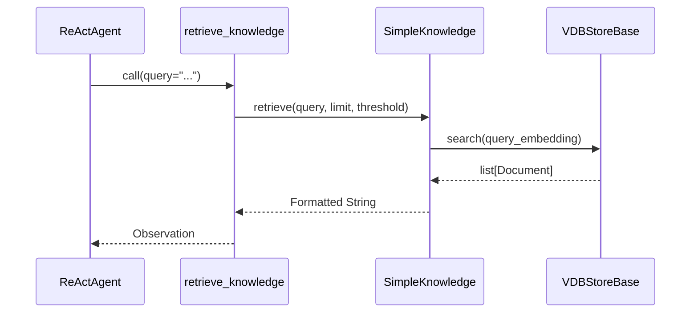

<!-- source: DeepWiki mcp.deepwiki.com · repo modelscope/agentscope · page 5.8 RAG System Overview · fetched 2026-10-26 -->

# RAG System Overview

<details>
<summary>Relevant source files</summary>

The following files were used as context for generating this wiki page:

- [docs/tutorial/en/src/task_embedding.py](docs/tutorial/en/src/task_embedding.py)
- [docs/tutorial/en/src/task_rag.py](docs/tutorial/en/src/task_rag.py)
- [docs/tutorial/zh_CN/src/task_embedding.py](docs/tutorial/zh_CN/src/task_embedding.py)
- [docs/tutorial/zh_CN/src/task_rag.py](docs/tutorial/zh_CN/src/task_rag.py)
- [examples/functionality/rag/README.md](examples/functionality/rag/README.md)
- [examples/functionality/rag/agentic_usage.py](examples/functionality/rag/agentic_usage.py)
- [examples/functionality/rag/basic_usage.py](examples/functionality/rag/basic_usage.py)
- [examples/functionality/vector_store/oceanbase/README.md](examples/functionality/vector_store/oceanbase/README.md)
- [examples/functionality/vector_store/oceanbase/main.py](examples/functionality/vector_store/oceanbase/main.py)
- [pyproject.toml](pyproject.toml)
- [src/agentscope/hooks/_studio_hooks.py](src/agentscope/hooks/_studio_hooks.py)
- [src/agentscope/rag/__init__.py](src/agentscope/rag/__init__.py)
- [src/agentscope/rag/_reader/__init__.py](src/agentscope/rag/_reader/__init__.py)
- [src/agentscope/rag/_reader/_excel_reader.py](src/agentscope/rag/_reader/_excel_reader.py)
- [src/agentscope/rag/_reader/_ppt_reader.py](src/agentscope/rag/_reader/_ppt_reader.py)
- [src/agentscope/rag/_reader/_utils.py](src/agentscope/rag/_reader/_utils.py)
- [src/agentscope/rag/_reader/_word_reader.py](src/agentscope/rag/_reader/_word_reader.py)
- [src/agentscope/rag/_store/__init__.py](src/agentscope/rag/_store/__init__.py)
- [src/agentscope/rag/_store/_oceanbase_store.py](src/agentscope/rag/_store/_oceanbase_store.py)
- [tests/rag_knowledge_test.py](tests/rag_knowledge_test.py)
- [tests/rag_reader_test.py](tests/rag_reader_test.py)
- [tests/rag_store_test.py](tests/rag_store_test.py)
- [tests/test.docx](tests/test.docx)
- [tests/test.pptx](tests/test.pptx)
- [tests/test.xlsx](tests/test.xlsx)

</details>


This document describes the Retrieval-Augmented Generation (RAG) system in AgentScope, which enables agents to retrieve relevant information from external knowledge bases during conversation. The RAG system provides document readers, vector storage backends, and a knowledge base abstraction that integrates seamlessly with `ReActAgent`.

For information about long-term memory persistence, see [5.5 Long-Term Memory with Mem0](). For embedding model integration, see [3.10 Embedding Models]().

**Sources**: [src/agentscope/rag/__init__.py:1-48]()

## Core Components

The RAG system consists of three main layers: knowledge base abstraction, document processing, and vector storage.

### Knowledge Base Architecture



**Sources**: [src/agentscope/rag/__init__.py:1-48](), [src/agentscope/rag/_knowledge_base.py:25-25](), [src/agentscope/rag/_simple_knowledge.py:26-26]()

The `KnowledgeBase` class provides the abstract interface for document retrieval with a single method: `retrieve(query, limit, score_threshold)`. The `SimpleKnowledge` implementation combines an embedding model with a vector store backend to provide semantic search capabilities.

**Sources**: [src/agentscope/rag/_knowledge_base.py:25-25](), [src/agentscope/rag/_simple_knowledge.py:26-26]()

### Document Model

The `Document` class represents a single document chunk with the following structure:

| Field | Type | Description |
|-------|------|-------------|
| `embedding` | `list[float] \| None` | Vector embedding of the document content |
| `score` | `float \| None` | Similarity score (populated during search) |
| `metadata` | `DocMetadata` | Document metadata including content and chunking info |

The `DocMetadata` class contains:

| Field | Type | Description |
|-------|------|-------------|
| `content` | `TextBlock \| dict` | The actual content (text, image, etc.) |
| `doc_id` | `str` | Unique identifier for the source document |
| `chunk_id` | `int` | Index of this chunk (0-based) |
| `total_chunks` | `int` | Total number of chunks in the document |

**Sources**: [src/agentscope/rag/_document.py:5-38](), [tests/rag_store_test.py:39-66]()

## Document Processing Pipeline

The RAG system processes documents through a multi-stage pipeline from raw files to searchable vectors.

### Pipeline Flow



**Sources**: [src/agentscope/rag/_reader/__init__.py:1-21](), [pyproject.toml:88-115]()

### Document Readers

AgentScope provides six document reader implementations, each handling specific file formats. Advanced readers like `WordReader` and `ExcelReader` support multimodal extraction (images and tables).

**TextReader** ([src/agentscope/rag/_reader/_text_reader.py]()):
- Splits text by character, sentence (using `nltk`), or paragraph.
- Configurable `chunk_size` and `split_by` strategy.
- Requires `nltk` package.

**PDFReader** ([src/agentscope/rag/_reader/_pdf_reader.py]()):
- Uses `pypdf` library for extraction.
- Inherits text chunking logic from `TextReader`.
- Requires `pypdf<=6.5.0` (fixed version due to parsing issues).

**WordReader** ([src/agentscope/rag/_reader/_word_reader.py]()):
- Reads `.docx` files via `python-docx`.
- Supports extracting images as `ImageBlock` [src/agentscope/rag/_reader/_word_reader.py:122-206]() and tables in Markdown or JSON format [src/agentscope/rag/_reader/_word_reader.py:77-119]().
- Preserves paragraph structure and handles text boxes via `_extract_text_from_paragraph` [src/agentscope/rag/_reader/_word_reader.py:29-74]().

**ExcelReader** ([src/agentscope/rag/_reader/_excel_reader.py]()):
- Processes spreadsheets using `pandas` and `openpyxl`.
- Can include cell coordinates (e.g., `[A1]`) in text output [tests/rag_reader_test.py:164-165]().
- Supports image extraction from sheets.

**PowerPointReader** ([src/agentscope/rag/_reader/_ppt_reader.py]()):
- Extracts text from `.pptx` files via `python-pptx`.
- Maintains slide structure and supports image/table extraction.

**ImageReader** ([src/agentscope/rag/_reader/_image_reader.py]()):
- Creates `ImageBlock` metadata for images.
- Typically used for multimodal RAG where images are indexed.

**Sources**: [src/agentscope/rag/_reader/__init__.py:1-21](), [pyproject.toml:88-115](), [src/agentscope/rag/_reader/_word_reader.py:122-209](), [tests/rag_reader_test.py:104-144]()

### Table and Image Utilities

Readers utilize `_utils.py` for standardizing content:
- `_table_to_markdown`: Converts 2D lists to Markdown tables [src/agentscope/rag/_reader/_utils.py:58-94]().
- `_table_to_json`: Converts 2D lists to JSON arrays with a `<system-info>` tag [src/agentscope/rag/_reader/_utils.py:39-56]().
- `_get_media_type_from_data`: Detects image MIME types (PNG, JPEG, WebP, etc.) from binary signatures [src/agentscope/rag/_reader/_utils.py:6-37]().

**Sources**: [src/agentscope/rag/_reader/_utils.py:6-94]()

## Vector Store Backend

The vector store layer provides persistent storage and similarity search for document embeddings.

### VDBStoreBase Interface

All vector store implementations inherit from `VDBStoreBase` and implement core operations:



**Sources**: [src/agentscope/rag/_store/_store_base.py:11-11](), [src/agentscope/rag/_store/__init__.py:1-21]()

### Implementation Comparison

Each vector store implementation has specific characteristics:

**QdrantStore** ([src/agentscope/rag/_store/_qdrant_store.py]()):
- In-memory mode: `location=":memory:"` [tests/rag_store_test.py:34-34]().
- Persistent mode: `location="/path/to/db"`.
- Requires `qdrant-client==1.15.1` [pyproject.toml:121-121]().

**MilvusLiteStore** ([src/agentscope/rag/_store/_milvuslite_store.py]()):
- Embedded database: `uri="./milvus_demo.db"` [tests/rag_store_test.py:89-89]().
- Not supported on Windows [tests/rag_store_test.py:85-86]().
- Requires `pymilvus[milvus_lite]` [pyproject.toml:122-122]().

**OceanBaseStore** ([src/agentscope/rag/_store/_oceanbase_store.py]()):
- Production-grade distributed database.
- Milvus-compatible API via `pyobvector.MilvusLikeClient` [tests/rag_store_test.py:153-153]().
- Supports advanced filtering.

**MongoDBStore** ([src/agentscope/rag/_store/_mongodb_store.py]()):
- Atlas Vector Search integration.
- Async MongoDB client.

**AlibabaCloudMySQLStore** ([src/agentscope/rag/_store/_alibabacloud_mysql_store.py]()):
- MySQL with vector extension.
- Synchronous connector.

**Sources**: [pyproject.toml:117-131](), [tests/rag_store_test.py:31-82,83-136,138-212]()

## SimpleKnowledge Implementation

The `SimpleKnowledge` class combines an embedding model with a vector store to provide end-to-end RAG functionality.

### Initialization and Retrieval

```python
from agentscope.rag import SimpleKnowledge, QdrantStore
from agentscope.embedding import DashScopeTextEmbedding

knowledge = SimpleKnowledge(
    embedding_model=DashScopeTextEmbedding(...),
    embedding_store=QdrantStore(
        location=":memory:",
        collection_name="test_collection",
        dimensions=1024,
    ),
)

# Add documents (automatically embeds if needed)
await knowledge.add_documents(documents)

# Retrieve relevant documents
results = await knowledge.retrieve(
    query="Who is John Doe's father?",
    limit=3,
    score_threshold=0.5,
)
```

**Sources**: [docs/tutorial/en/src/task_rag.py:148-180](), [src/agentscope/rag/_simple_knowledge.py:26-26]()

## ReActAgent Integration

`ReActAgent` supports RAG in two primary modes:

| Mode | Description | Pros | Cons |
| :--- | :--- | :--- | :--- |
| **Agentic** | Integrated as a tool; agent decides when and what to retrieve. | Flexible, query rewriting, context-aware. | Requires high LLM reasoning capability. |
| **Generic** | Retrieve at start of every `reply` and attach to prompt. | Simple, works with weaker LLMs. | Unnecessary retrievals, higher latency. |

**Sources**: [docs/tutorial/en/src/task_rag.py:17-36]()

### Agentic Retrieval Workflow

When using the agentic manner, the knowledge base's `retrieve` functionality is exposed via a tool.



**Sources**: [docs/tutorial/en/src/task_rag.py:227-260](), [src/agentscope/rag/_simple_knowledge.py:26-26]()

### Generic Retrieval Workflow

In generic mode, retrieval is hardcoded into the agent's logic (or a wrapper), adding retrieved content as a `hint` to memory before generating a response.

**Sources**: [docs/tutorial/en/src/task_rag.py:262-300]()

---

