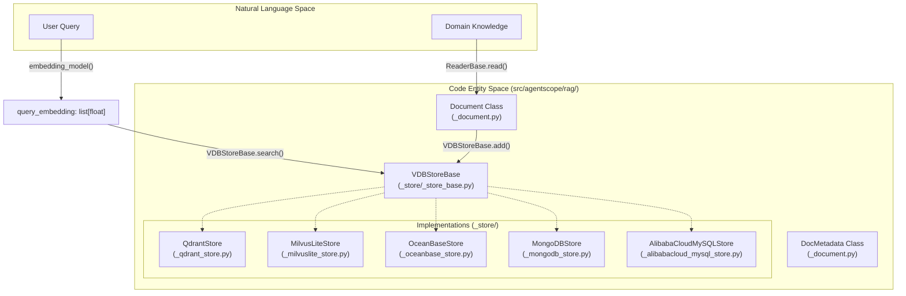
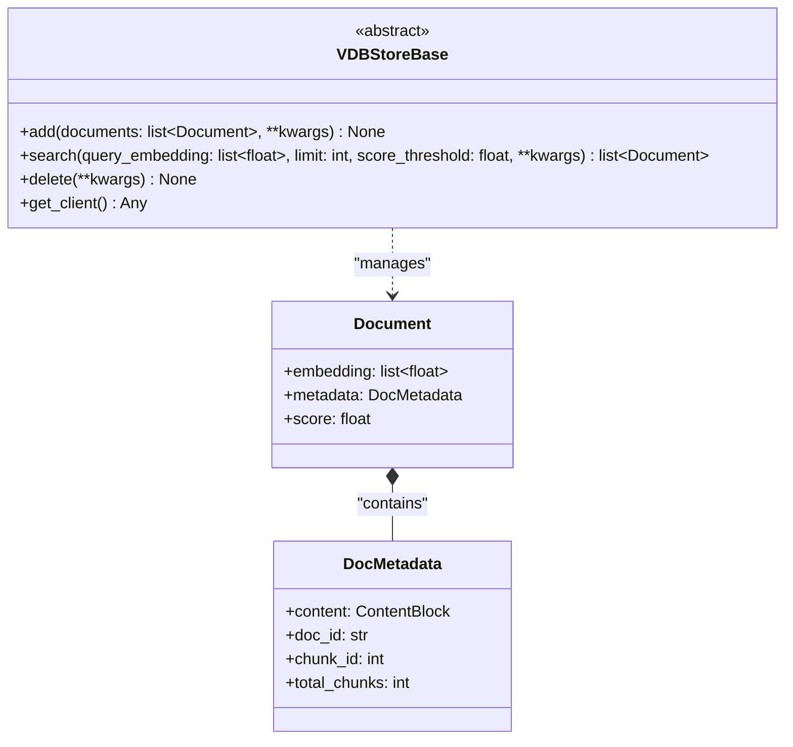
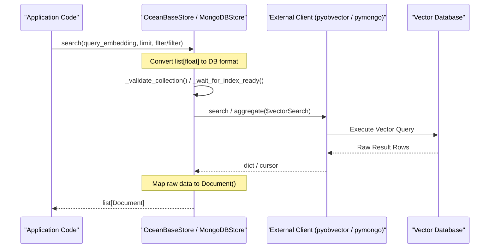

<!-- source: DeepWiki mcp.deepwiki.com · repo modelscope/agentscope · page 5.9 Vector Store Integrations · fetched 2026-10-26 -->

# Vector Store Integrations

<details>
<summary>Relevant source files</summary>

The following files were used as context for generating this wiki page:

- [examples/functionality/vector_store/alibabacloud_mysql_vector/README.md](examples/functionality/vector_store/alibabacloud_mysql_vector/README.md)
- [examples/functionality/vector_store/alibabacloud_mysql_vector/main.py](examples/functionality/vector_store/alibabacloud_mysql_vector/main.py)
- [examples/functionality/vector_store/milvus_lite/README.md](examples/functionality/vector_store/milvus_lite/README.md)
- [examples/functionality/vector_store/milvus_lite/main.py](examples/functionality/vector_store/milvus_lite/main.py)
- [examples/functionality/vector_store/mongodb/README.md](examples/functionality/vector_store/mongodb/README.md)
- [examples/functionality/vector_store/mongodb/main.py](examples/functionality/vector_store/mongodb/main.py)
- [examples/functionality/vector_store/oceanbase/README.md](examples/functionality/vector_store/oceanbase/README.md)
- [examples/functionality/vector_store/oceanbase/main.py](examples/functionality/vector_store/oceanbase/main.py)
- [pyproject.toml](pyproject.toml)
- [src/agentscope/rag/__init__.py](src/agentscope/rag/__init__.py)
- [src/agentscope/rag/_store/__init__.py](src/agentscope/rag/_store/__init__.py)
- [src/agentscope/rag/_store/_alibabacloud_mysql_store.py](src/agentscope/rag/_store/_alibabacloud_mysql_store.py)
- [src/agentscope/rag/_store/_milvuslite_store.py](src/agentscope/rag/_store/_milvuslite_store.py)
- [src/agentscope/rag/_store/_mongodb_store.py](src/agentscope/rag/_store/_mongodb_store.py)
- [src/agentscope/rag/_store/_oceanbase_store.py](src/agentscope/rag/_store/_oceanbase_store.py)
- [tests/rag_knowledge_test.py](tests/rag_knowledge_test.py)
- [tests/rag_store_test.py](tests/rag_store_test.py)

</details>


Vector stores provide persistent storage for embeddings and enable semantic similarity search in AgentScope's RAG system. This page documents the `VDBStoreBase` abstraction and its concrete implementations: `QdrantStore`, `MilvusLiteStore`, `OceanBaseStore`, `MongoDBStore`, and `AlibabaCloudMySQLStore`.

---

## Architecture Overview

Vector stores implement a unified `VDBStoreBase` interface that abstracts vector database operations. All implementations support CRUD operations (add, search, delete) on `Document` objects containing embeddings and metadata.

### System to Code Entity Mapping

The following diagram maps the high-level RAG components to their specific code entities within the `agentscope.rag` module.



**Sources:** [src/agentscope/rag/__init__.py:1-47](), [src/agentscope/rag/_store/__init__.py:1-21]()

---

## VDBStoreBase Interface

`VDBStoreBase` defines the abstract interface that all vector store implementations must fulfill. It provides core operations for managing the lifecycle of embedded documents.

| Method | Signature | Purpose |
|--------|-----------|---------|
| `add` | `async def add(documents: list[Document], **kwargs) -> None` | Insert documents with embeddings |
| `search` | `async def search(query_embedding: Embedding, limit: int, score_threshold: float \| None, **kwargs) -> list[Document]` | Find similar documents |
| `delete` | `async def delete(**kwargs) -> None` | Remove documents |
| `get_client` | `def get_client() -> Any` | Access underlying database client |



**Sources:** [src/agentscope/rag/_store/_store_base.py:1-30](), [src/agentscope/rag/_document.py:1-50]()

---

## Document and Metadata Structure

All vector stores operate on `Document` objects. The metadata is strictly structured via `DocMetadata` to ensure compatibility across different backends.

```python
from agentscope.rag import Document, DocMetadata
from agentscope.message import TextBlock

# Example Document Creation
doc = Document(
    embedding=[0.1, 0.2, 0.3],
    metadata=DocMetadata(
        content=TextBlock(type="text", text="This is a test document."),
        doc_id="doc1",
        chunk_id=0,
        total_chunks=1,
    ),
)
```

**Sources:** [tests/rag_store_test.py:39-64](), [src/agentscope/rag/_document.py:5-40]()

---

## Concrete Implementations

### QdrantStore
Supports in-memory and persistent storage using the Qdrant engine.
- **Initialization:** `location` (e.g., `":memory:"`), `collection_name`, `dimensions`.
- **Distance Metrics:** Supports standard Qdrant metrics like Cosine and Euclidean.

**Sources:** [tests/rag_store_test.py:31-37](), [src/agentscope/rag/_store/_qdrant_store.py:1-100]()

### MilvusLiteStore
A lightweight, file-based version of Milvus using `pymilvus[milvus_lite]`.
- **Note:** Not supported on Windows [tests/rag_store_test.py:85-86]().
- **Initialization:** `uri` (local file path), `collection_name`, `dimensions`.

**Sources:** [tests/rag_store_test.py:88-92](), [src/agentscope/rag/_store/_milvuslite_store.py:1-120]()

### OceanBaseStore
Uses `pyobvector` to interface with OceanBase or `seekdb`.
- **Features:** Supports native vector search with `COSINE`, `L2`, or `IP` metrics [src/agentscope/rag/_store/_oceanbase_store.py:20-26]().
- **Filtering:** Supports complex SQLAlchemy-style filters passed via the `flter` parameter (note the spelling to avoid Python built-in conflicts) [examples/functionality/vector_store/oceanbase/main.py:193-197]().
- **Schema:** Automatically handles table creation with `VECTOR` type columns and `HNSW` indices [src/agentscope/rag/_store/_oceanbase_store.py:155-168]().

**Sources:** [src/agentscope/rag/_store/_oceanbase_store.py:38-114](), [examples/functionality/vector_store/oceanbase/README.md:36-45]()

### MongoDBStore
Leverages MongoDB Atlas Vector Search via `pymongo.AsyncMongoClient`.
- **Automatic Setup:** Automatically creates the database, collection, and vector search index on the first `add()` or `search()` call [src/agentscope/rag/_store/_mongodb_store.py:34-36]().
- **Index Readiness:** Includes a `_wait_for_index_ready` mechanism to ensure search operations don't fail during background index builds [src/agentscope/rag/_store/_mongodb_store.py:164-191]().
- **Filtering:** Supports metadata filtering using MongoDB's `$vectorSearch` filter syntax for fields defined in `filter_fields` [src/agentscope/rag/_store/_mongodb_store.py:69-74]().

**Sources:** [src/agentscope/rag/_store/_mongodb_store.py:38-108](), [examples/functionality/vector_store/mongodb/main.py:21-27]()

### AlibabaCloudMySQLStore
Utilizes AlibabaCloud RDS MySQL's native `VECTOR` data type (MySQL 8.0+).
- **Native Functions:** Uses `VEC_DISTANCE_COSINE` and `VEC_DISTANCE_EUCLIDEAN` for database-level distance calculation [src/agentscope/rag/_store/_alibabacloud_mysql_store.py:120-128]().
- **Schema:** Automatically creates a table with a `VECTOR INDEX` using the HNSW algorithm [src/agentscope/rag/_store/_alibabacloud_mysql_store.py:155-168]().

**Sources:** [src/agentscope/rag/_store/_alibabacloud_mysql_store.py:1-100](), [examples/functionality/vector_store/alibabacloud_mysql_vector/main.py:78-92]()

---

## Data Flow and Operations

The following diagram illustrates the internal data flow during a search operation, highlighting how Python entities interact with external database clients.



**Sources:** [src/agentscope/rag/_store/_oceanbase_store.py:260-320](), [src/agentscope/rag/_store/_mongodb_store.py:260-320]()

### Key Operations Summary

| Operation | Implementation Detail | Source |
|-----------|-----------------------|--------|
| **Add** | Bulk inserts documents; handles metadata serialization to JSON/String. | [src/agentscope/rag/_store/_oceanbase_store.py:215-258]() |
| **Search** | Performs ANN (Approximate Nearest Neighbor) search; populates `doc.score`. | [src/agentscope/rag/_store/_mongodb_store.py:260-339]() |
| **Delete** | Removes entries by primary key or complex WHERE clauses. | [examples/functionality/vector_store/oceanbase/main.py:102-105]() |
| **Filter** | Metadata-based pre-filtering (e.g., `doc_id` matching). | [examples/functionality/vector_store/mongodb/main.py:188-192]() |

---

## Configuration and Dependencies

Vector stores are optional components. Dependencies must be installed via specific extras:

```bash
# Install all VDB dependencies
pip install agentscope[vdbs]

# Or individual stores
pip install agentscope[qdrant]
pip install agentscope[milvus]
pip install agentscope[oceanbase]
pip install agentscope[mongodb]
pip install agentscope[ali_mysql]
```

**Sources:** [pyproject.toml:118-131]()

---

