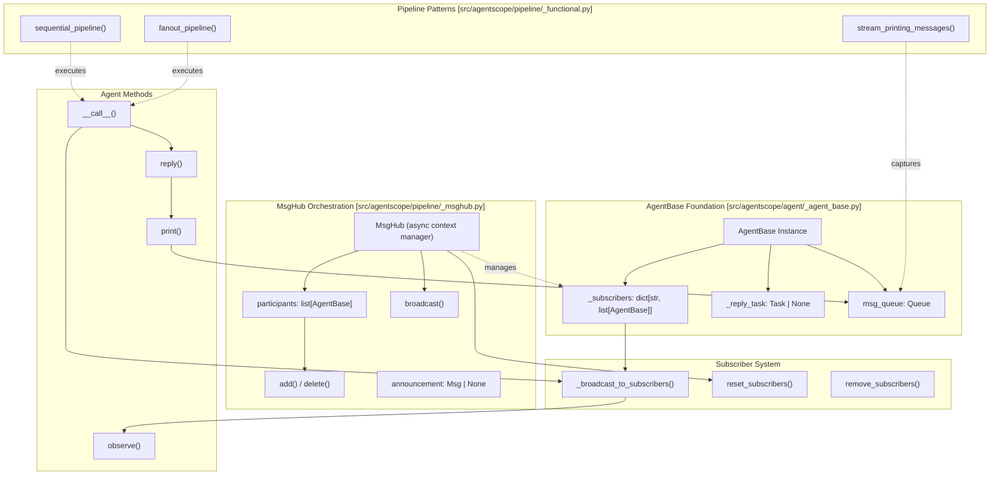
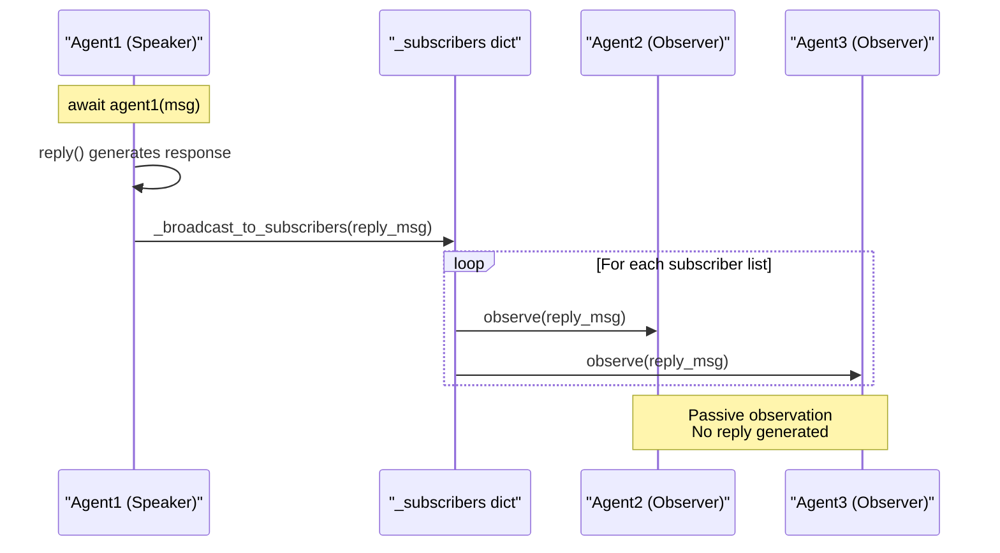
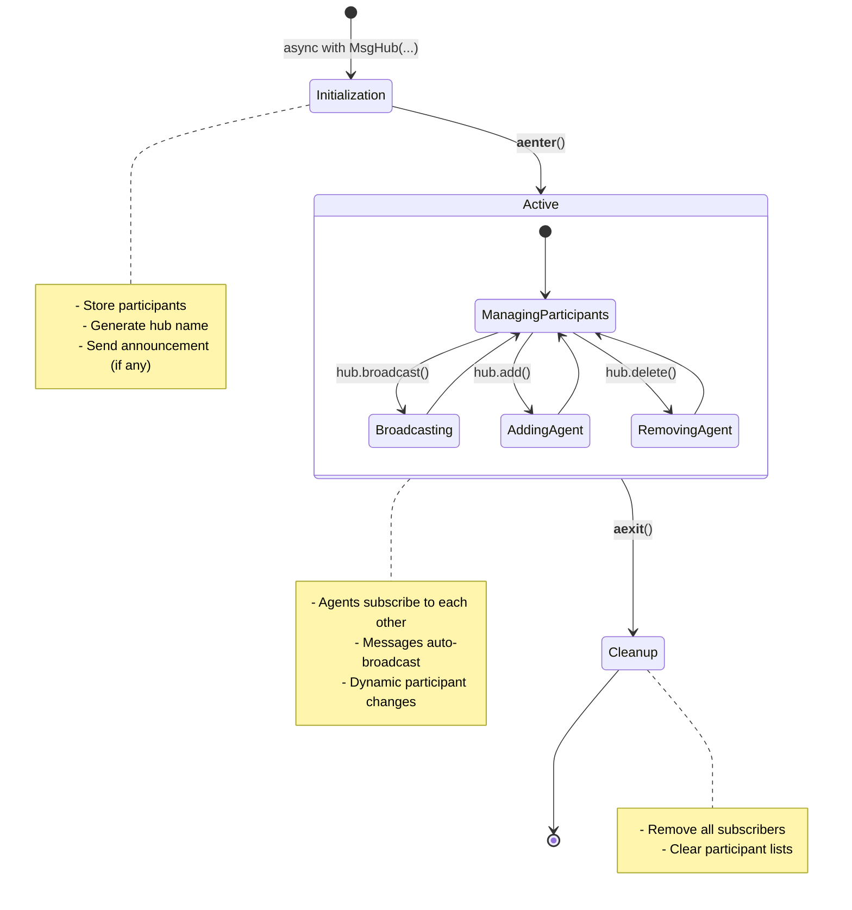
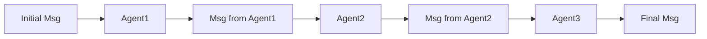
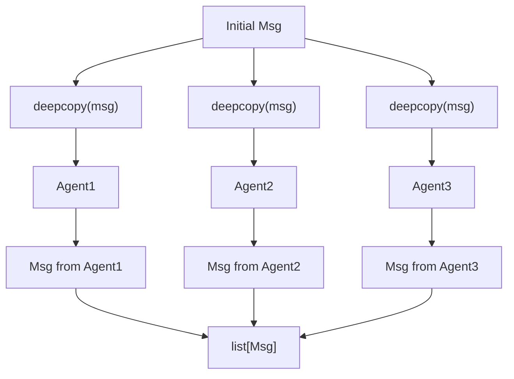
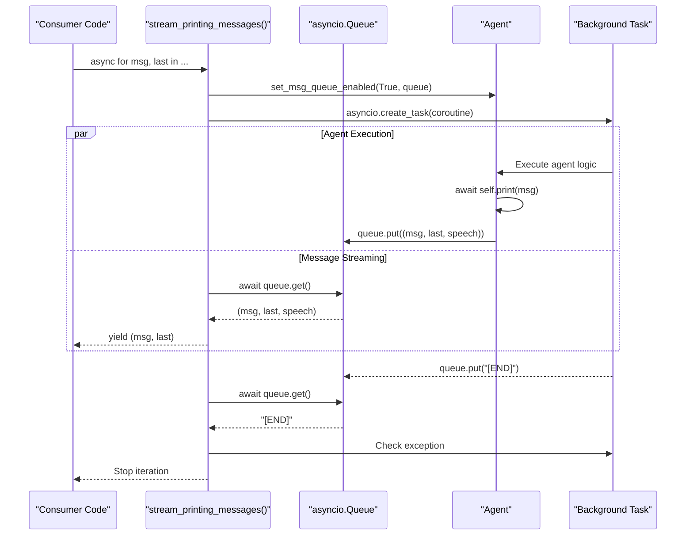

<!-- source: DeepWiki mcp.deepwiki.com · repo modelscope/agentscope · page 6 Multi-Agent Orchestration · fetched 2026-10-26 -->

# Multi-Agent Orchestration

<details>
<summary>Relevant source files</summary>

The following files were used as context for generating this wiki page:

- [src/agentscope/agent/_agent_base.py](src/agentscope/agent/_agent_base.py)
- [src/agentscope/pipeline/__init__.py](src/agentscope/pipeline/__init__.py)
- [src/agentscope/pipeline/_class.py](src/agentscope/pipeline/_class.py)
- [src/agentscope/pipeline/_functional.py](src/agentscope/pipeline/_functional.py)
- [src/agentscope/pipeline/_msghub.py](src/agentscope/pipeline/_msghub.py)
- [tests/pipeline_test.py](tests/pipeline_test.py)

</details>


This page documents AgentScope's multi-agent orchestration capabilities, which enable coordination and communication between multiple agents in complex workflows. The framework provides three primary mechanisms for multi-agent collaboration: the **subscriber system** for automatic message broadcasting, **MsgHub** for centralized message routing, and **pipeline patterns** for structured execution flows.

For individual agent implementation details, see [Agent System](#2). For inter-process communication protocols like A2A and MCP, see [Agent Communication Protocols](#9.4).

---

## Overview

Multi-agent orchestration in AgentScope is built on several core abstractions:

| Component | Purpose | Location |
|-----------|---------|----------|
| **Subscriber System** | Automatic message broadcasting from one agent to multiple observers | [src/agentscope/agent/_agent_base.py:168-169]() |
| **MsgHub** | Centralized message router for multi-agent conversations | [src/agentscope/pipeline/_msghub.py:14-40]() |
| **Pipeline Patterns** | Structured execution flows (sequential, fanout) | [src/agentscope/pipeline/_functional.py:10-106]() |
| **observe() vs reply()** | Passive reception vs active response | [src/agentscope/agent/_agent_base.py:185-203]() |

These mechanisms can be composed to create sophisticated multi-agent applications, from simple sequential workflows to complex concurrent interactions.

Sources: [src/agentscope/pipeline/__init__.py:1-22](), [src/agentscope/agent/_agent_base.py:30-31]()

---

## Architecture Overview



**Diagram: Multi-Agent Orchestration Architecture**

This diagram shows how AgentScope's orchestration components interact. The `AgentBase` class maintains a `_subscribers` dictionary that maps `MsgHub` names to lists of subscriber agents [src/agentscope/agent/_agent_base.py:168-169](). When an agent's `__call__()` method completes, it automatically broadcasts the reply message to all subscribers [src/agentscope/agent/_agent_base.py:448-477](). `MsgHub` manages subscriber lifecycles within an async context [src/agentscope/pipeline/_msghub.py:73-88](), while pipeline functions provide structured execution patterns.

Sources: [src/agentscope/agent/_agent_base.py:140-184](), [src/agentscope/agent/_agent_base.py:448-477](), [src/agentscope/pipeline/_msghub.py:14-157](), [src/agentscope/pipeline/_functional.py:10-193]()

---

## Subscriber System

The subscriber system enables automatic message broadcasting from one agent to multiple observers without explicit coordination logic. For details, see [Subscriber Broadcasting](#6.3).

### Implementation Details

Each `AgentBase` instance maintains a `_subscribers` dictionary where:
- **Key**: `msghub_name` (str) - identifier of the `MsgHub` managing the subscription.
- **Value**: `list[AgentBase]` - agents that will receive messages via their `observe()` method [src/agentscope/agent/_agent_base.py:165-168]().



**Diagram: Subscriber Broadcasting Flow**

Sources: [src/agentscope/agent/_agent_base.py:448-476](), [src/agentscope/agent/_agent_base.py:165-168]()

### Key Methods

| Method | Purpose | Signature |
|--------|---------|-----------|
| `reset_subscribers()` | Set subscriber list for a MsgHub | `(msghub_name: str, subscribers: list[AgentBase])` [src/agentscope/agent/_agent_base.py:663-677]() |
| `remove_subscribers()` | Remove all subscribers for a MsgHub | `(msghub_name: str)` [src/agentscope/agent/_agent_base.py:679-692]() |
| `_broadcast_to_subscribers()` | Internal method to broadcast messages | `(msg: Msg \| list[Msg] \| None)` [src/agentscope/agent/_agent_base.py:469-476]() |

Sources: [src/agentscope/agent/_agent_base.py:663-692](), [src/agentscope/agent/_agent_base.py:469-476]()

---

## MsgHub: Central Message Router

`MsgHub` is an async context manager that orchestrates multi-agent conversations by managing participant subscriptions and providing broadcast capabilities. For detailed implementation, see [MsgHub Communication](#6.1).

### Key Features

1. **Participant Management**: Dynamically add/remove agents using `add()` and `delete()` [src/agentscope/pipeline/_msghub.py:95-129]().
2. **Automatic Subscription**: Sets up subscriber relationships on entry via `__aenter__` [src/agentscope/pipeline/_msghub.py:73-81]().
3. **Broadcast Mechanism**: Send messages to all participants simultaneously using `broadcast()` [src/agentscope/pipeline/_msghub.py:130-139]().
4. **Announcement**: Optional initial message to all participants [src/agentscope/pipeline/_msghub.py:54-56]().
5. **Cleanup**: Removes subscribers on context exit via `__aexit__` [src/agentscope/pipeline/_msghub.py:83-88]().



**Diagram: MsgHub Lifecycle**

Sources: [src/agentscope/pipeline/_msghub.py:14-157](), [src/agentscope/pipeline/__init__.py:5]()

---

## Pipeline Patterns

AgentScope provides both functional and class-based pipeline implementations for structured multi-agent execution. For detailed examples, see [Pipeline Patterns](#6.2).

### Sequential Pipeline

Executes agents in order, passing the output of each agent as input to the next [src/agentscope/pipeline/_functional.py:10-13]().



**Diagram: Sequential Pipeline Flow**

**Implementation**: [src/agentscope/pipeline/_functional.py:10-44]()
The `SequentialPipeline` class provides a re-usable object-oriented wrapper for this logic [src/agentscope/pipeline/_class.py:10-41]().

Sources: [src/agentscope/pipeline/_functional.py:10-44](), [src/agentscope/pipeline/_class.py:10-41]()

### Fanout Pipeline

Distributes the same input to multiple agents, executing them either concurrently or sequentially [src/agentscope/pipeline/_functional.py:47-57]().



**Diagram: Fanout Pipeline Flow**

**Implementation**: [src/agentscope/pipeline/_functional.py:47-104]()
**Key Parameters**:
- `enable_gather=True`: Concurrent execution using `asyncio.gather()` [src/agentscope/pipeline/_functional.py:96-102]().
- `enable_gather=False`: Sequential execution [src/agentscope/pipeline/_functional.py:103-104]().

Sources: [src/agentscope/pipeline/_functional.py:47-104](), [src/agentscope/pipeline/_class.py:43-91]()

### Stream Printing Messages

Captures and yields messages printed by agents during execution, enabling real-time output streaming [src/agentscope/pipeline/_functional.py:107-116]().



**Diagram: Stream Printing Messages Flow**

**Implementation**: [src/agentscope/pipeline/_functional.py:107-193]()
**Key Features**:
1. **Non-blocking**: Agents execute in background while consumer processes messages [src/agentscope/pipeline/_functional.py:165-171]().
2. **Chunk Indicators**: `last` boolean indicates final chunk of a streaming message [src/agentscope/pipeline/_functional.py:122-126]().
3. **Speech Support**: Optionally yields audio blocks with `yield_speech=True` [src/agentscope/pipeline/_functional.py:144-149]().

Sources: [src/agentscope/pipeline/_functional.py:107-193](), [src/agentscope/agent/_agent_base.py:205-236]()

---

## Agent Collaboration Patterns

### observe() vs reply()

AgentScope distinguishes between passive observation and active response:

| Method | Purpose | Returns | Side Effects |
|--------|---------|---------|--------------|
| `observe()` | Receive messages without responding | `None` | Updates internal state only [src/agentscope/agent/_agent_base.py:185-195]() |
| `reply()` | Generate response to input | `Msg` | Triggers subscriber broadcast [src/agentscope/agent/_agent_base.py:197-203]() |

Sources: [src/agentscope/agent/_agent_base.py:185-203](), [src/agentscope/agent/_agent_base.py:448-477]()

### Message Queue for Streaming

Agents can stream output messages to consumers using the message queue system:

**Enabling Message Queue**: [src/agentscope/agent/_agent_base.py:712-736]()
```python
agent.set_msg_queue_enabled(
    enabled=True,
    queue=asyncio.Queue()
)
```

**Printing to Queue**: [src/agentscope/agent/_agent_base.py:205-236]()
When `_disable_msg_queue` is false, `print()` puts messages into `msg_queue` [src/agentscope/agent/_agent_base.py:223-225]().

Sources: [src/agentscope/agent/_agent_base.py:205-236](), [src/agentscope/agent/_agent_base.py:712-736]()

---

## Summary

AgentScope's multi-agent orchestration provides:

1. **Flexible Communication**: Subscriber system for automatic broadcasting, `MsgHub` for structured coordination.
2. **Execution Patterns**: Sequential for ordered workflows, fanout for parallel processing.
3. **Real-Time Streaming**: Message queue system for progressive output.
4. **Composability**: All patterns can be combined and nested.

For implementation details of specific components:
- [MsgHub Communication](#6.1)
- [Pipeline Patterns](#6.2)
- [Subscriber Broadcasting](#6.3)

Sources: [src/agentscope/pipeline/__init__.py:1-22](), [src/agentscope/pipeline/_functional.py:10-193]()

---

