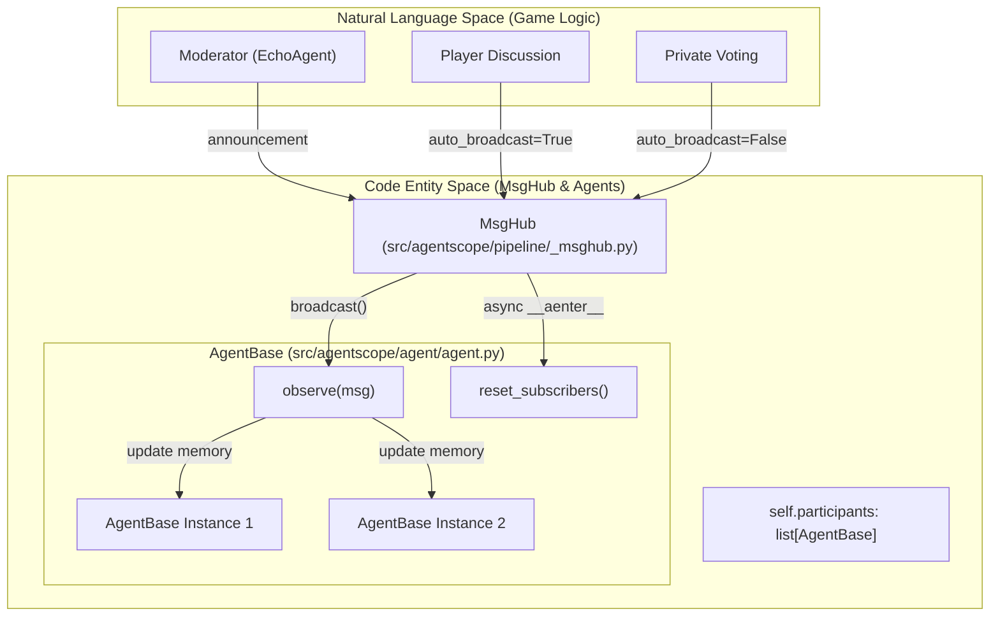
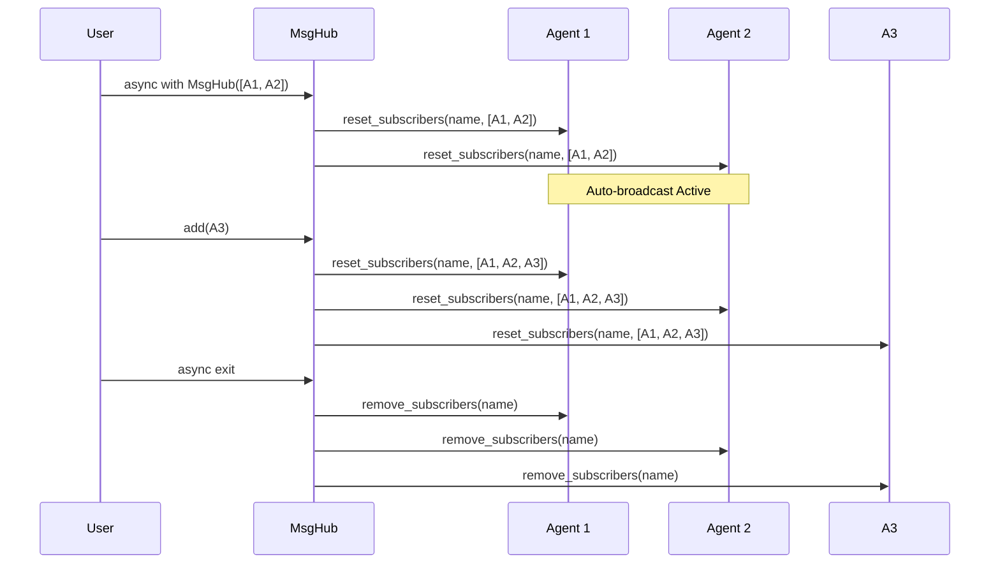

<!-- source: DeepWiki mcp.deepwiki.com · repo modelscope/agentscope · page 6.1 MsgHub Communication · fetched 2026-10-26 -->

# MsgHub Communication

<details>
<summary>Relevant source files</summary>

The following files were used as context for generating this wiki page:

- [examples/game/werewolves/README.md](examples/game/werewolves/README.md)
- [examples/game/werewolves/game.py](examples/game/werewolves/game.py)
- [examples/game/werewolves/main.py](examples/game/werewolves/main.py)
- [examples/game/werewolves/prompt.py](examples/game/werewolves/prompt.py)
- [examples/game/werewolves/utils.py](examples/game/werewolves/utils.py)
- [src/agentscope/pipeline/_class.py](src/agentscope/pipeline/_class.py)
- [src/agentscope/pipeline/_msghub.py](src/agentscope/pipeline/_msghub.py)

</details>


This page documents the `MsgHub` class, AgentScope's central message broadcasting system for multi-agent communication. `MsgHub` enables efficient message routing between multiple agents, supporting both automatic and manual broadcast modes, dynamic participant management, and nested communication scopes.

**Scope:** This page covers the `MsgHub` communication mechanism for coordinating message flow between agents. For sequential and parallel execution patterns that work with `MsgHub`, see [Pipeline Patterns](6.2). For the underlying subscriber system, see [Subscriber Pattern and Broadcasting](6.3).

---

## Overview

`MsgHub` serves as a centralized message broker that manages communication between multiple agents in multi-agent scenarios. It provides two core broadcasting modes and supports dynamic participant management through a context manager interface.

### Core Features

| Feature | Description |
|---------|-------------|
| **Auto-broadcast Mode** | Messages from any participant are immediately broadcast to all other participants via `observe()`. |
| **Manual Broadcast Mode** | Messages are stored locally until explicitly broadcast via the `broadcast()` method. |
| **Dynamic Participants** | Add or remove agents during execution using `add()` and `delete()` methods. |
| **Context Manager** | Automatic setup and teardown with `async with` syntax, handling subscriber registration. |
| **Announcement System** | Send initial messages to all participants upon entering the hub context. |
| **Nested Hubs** | Create role-specific communication channels (e.g., "werewolves") within larger conversations. |

Sources: [src/agentscope/pipeline/_msghub.py:14-40](), [src/agentscope/pipeline/_msghub.py:42-66]()

---

## MsgHub Architecture

The following diagram illustrates how `MsgHub` bridges the gap between high-level orchestration and the low-level `AgentBase` subscriber system.

### Communication Flow Diagram



**MsgHub to AgentBase Mapping**

Sources: [src/agentscope/pipeline/_msghub.py:14-154](), [examples/game/werewolves/game.py:86-91](), [examples/game/werewolves/utils.py:48-75]()

---

## Creating and Configuring MsgHub

### Basic Initialization

`MsgHub` is implemented as an asynchronous context manager. When entering the context (`__aenter__`), it automatically configures the subscribers of all participating agents.

```python
async with MsgHub(
    participants=[agent1, agent2, agent3],
    enable_auto_broadcast=True,
    announcement=Msg("Moderator", "Game Start!", "assistant"),
    name="game_hub"
) as hub:
    # Agents communicate within this scope
    await agent1() # Message automatically sent to agent2 and agent3
```

### Implementation Details

| Parameter | Type | Default | Description |
|-----------|------|---------|-------------|
| `participants` | `Sequence[AgentBase]` | Required | List of agents participating in the hub. [src/agentscope/pipeline/_msghub.py:52-53]() |
| `announcement` | `list[Msg] \| Msg \| None` | `None` | Message broadcast to all when entering the hub. [src/agentscope/pipeline/_msghub.py:54-56]() |
| `enable_auto_broadcast` | `bool` | `True` | If True, `AgentBase.reply()` results are automatically sent to others. [src/agentscope/pipeline/_msghub.py:57-62]() |
| `name` | `str \| None` | `None` | Unique ID for the hub; defaults to a random `shortuuid`. [src/agentscope/pipeline/_msghub.py:63-68]() |

Sources: [src/agentscope/pipeline/_msghub.py:42-71](), [src/agentscope/pipeline/_msghub.py:73-81]()

---

## Broadcasting Modes

### Auto-broadcast Mode

In this mode, `MsgHub` calls `agent.reset_subscribers(self.name, self.participants)` for every participant [src/agentscope/pipeline/_msghub.py:91-93](). This ensures that whenever an agent produces a message, the underlying framework automatically triggers the `observe()` method on all other agents in the hub.

**Example: Werewolf Discussion**
```python
async with MsgHub(
    players.werewolves,
    enable_auto_broadcast=True, # Werewolves hear each other's lies
    announcement=await moderator(Prompts.to_wolves_discussion.format(...)),
    name="werewolves",
) as werewolves_hub:
    for _ in range(MAX_DISCUSSION_ROUND):
        # Result of agent call is automatically broadcast to others
        await players.werewolves[i]() 
```
Sources: [examples/game/werewolves/game.py:125-145](), [src/agentscope/pipeline/_msghub.py:89-93]()

### Manual Broadcast Mode

When `enable_auto_broadcast` is `False`, the hub removes itself from the agents' subscriber lists [src/agentscope/pipeline/_msghub.py:155-157](). Messages are only shared when the user explicitly calls `hub.broadcast(msg)`.

**Example: Private Voting**
```python
# Disable auto broadcast to avoid following other's votes
werewolves_hub.set_auto_broadcast(False)
msgs_vote = await fanout_pipeline(
    players.werewolves,
    msg=await moderator(content=Prompts.to_wolves_vote),
    enable_gather=False,
)
# Reveal all votes simultaneously to the hub participants
await werewolves_hub.broadcast(msgs_vote)
```
Sources: [examples/game/werewolves/game.py:149-167](), [src/agentscope/pipeline/_msghub.py:140-157]()

---

## Dynamic Participant Management

`MsgHub` allows agents to join or leave a communication channel dynamically. This is crucial for games where players are eliminated or join mid-session.

### Key Functions

- **`add(new_participant)`**: Adds one or more agents to `self.participants` and re-triggers `_reset_subscriber()` to update the underlying subscriber network [src/agentscope/pipeline/_msghub.py:95-107]().
- **`delete(participant)`**: Removes agents from the hub. It also triggers `_reset_subscriber()` to ensure removed agents no longer receive or broadcast messages within this hub [src/agentscope/pipeline/_msghub.py:109-128]().

### Lifecycle Management



**Dynamic Subscription Lifecycle**

Sources: [src/agentscope/pipeline/_msghub.py:73-88](), [src/agentscope/pipeline/_msghub.py:95-128]()

---

## Integration with Pipelines

`MsgHub` is designed to wrap AgentScope pipelines to provide a communication context.

### Sequential and Fanout Interaction

The `SequentialPipeline` [src/agentscope/pipeline/_class.py:10-40]() and `FanoutPipeline` [src/agentscope/pipeline/_class.py:43-90]() do not handle broadcasting themselves; they rely on the `MsgHub` context they are executed within.

| Pipeline | MsgHub Setting | Result |
|----------|----------------|--------|
| `sequential_pipeline` | `enable_auto_broadcast=True` | A multi-agent conversation where each agent hears the previous one immediately. [src/agentscope/pipeline/_class.py:37-40]() |
| `fanout_pipeline` | `enable_auto_broadcast=False` | Parallel execution where agents generate responses in isolation (e.g., voting). [src/agentscope/pipeline/_class.py:85-90]() |

Sources: [examples/game/werewolves/game.py:138-155](), [src/agentscope/pipeline/_class.py:10-90]()

---

## Summary of Key Methods

| Method | Description | File:Line |
|--------|-------------|-----------|
| `__aenter__` | Initializes subscribers and broadcasts the `announcement`. | [src/agentscope/pipeline/_msghub.py:73-81]() |
| `__aexit__` | Cleans up subscribers from all participants. | [src/agentscope/pipeline/_msghub.py:83-87]() |
| `add` | Dynamically adds agents to the hub and refreshes subscriptions. | [src/agentscope/pipeline/_msghub.py:95-108]() |
| `delete` | Removes agents from the hub and refreshes subscriptions. | [src/agentscope/pipeline/_msghub.py:109-129]() |
| `broadcast` | Manually sends a `Msg` or `list[Msg]` to all participants' `observe()` method. | [src/agentscope/pipeline/_msghub.py:130-138]() |
| `set_auto_broadcast` | Dynamically toggles between automatic and manual broadcasting. | [src/agentscope/pipeline/_msghub.py:140-157]() |

Sources: [src/agentscope/pipeline/_msghub.py:1-157]()

---

