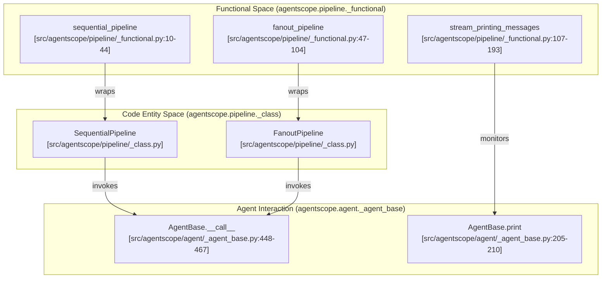
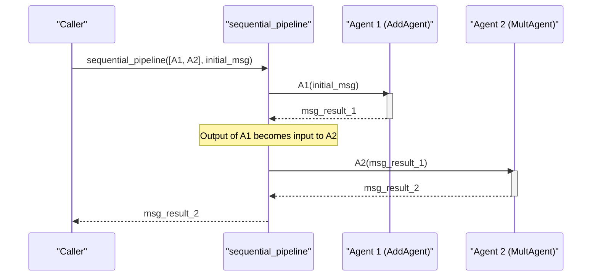
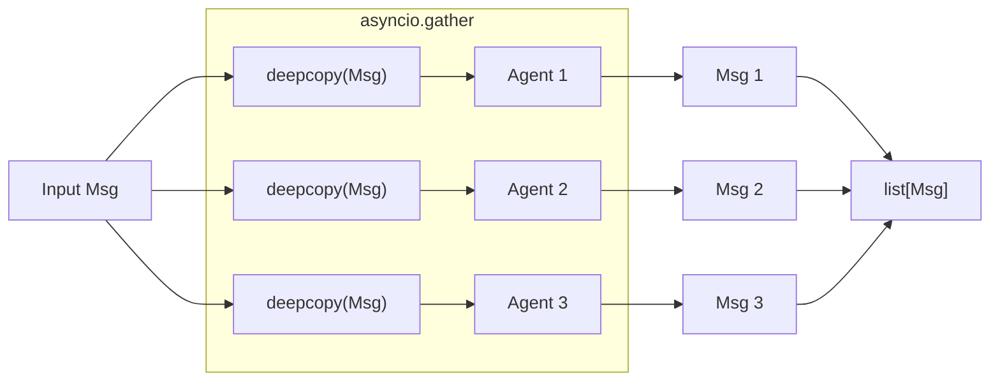
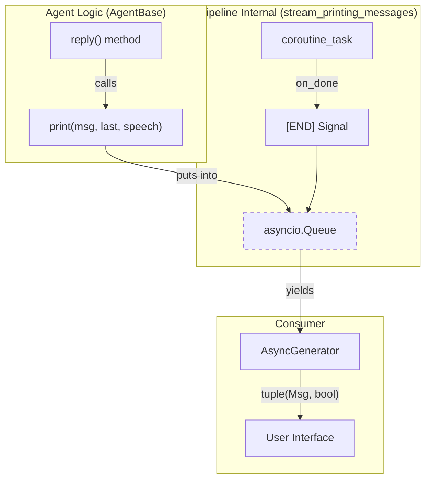

<!-- source: DeepWiki mcp.deepwiki.com · repo modelscope/agentscope · page 6.2 Pipeline Patterns · fetched 2026-10-26 -->

# Pipeline Patterns

<details>
<summary>Relevant source files</summary>

The following files were used as context for generating this wiki page:

- [docs/tutorial/en/src/task_pipeline.py](docs/tutorial/en/src/task_pipeline.py)
- [docs/tutorial/zh_CN/src/task_pipeline.py](docs/tutorial/zh_CN/src/task_pipeline.py)
- [examples/functionality/stream_printing_messages/README.md](examples/functionality/stream_printing_messages/README.md)
- [examples/functionality/stream_printing_messages/multi_agent.py](examples/functionality/stream_printing_messages/multi_agent.py)
- [examples/workflows/multiagent_conversation/README.md](examples/workflows/multiagent_conversation/README.md)
- [examples/workflows/multiagent_conversation/main.py](examples/workflows/multiagent_conversation/main.py)
- [examples/workflows/multiagent_debate/README.md](examples/workflows/multiagent_debate/README.md)
- [src/agentscope/agent/_agent_base.py](src/agentscope/agent/_agent_base.py)
- [src/agentscope/pipeline/__init__.py](src/agentscope/pipeline/__init__.py)
- [src/agentscope/pipeline/_functional.py](src/agentscope/pipeline/_functional.py)
- [src/agentscope/tool/_multi_modality/_dashscope_tools.py](src/agentscope/tool/_multi_modality/_dashscope_tools.py)
- [src/agentscope/tool/_multi_modality/_openai_tools.py](src/agentscope/tool/_multi_modality/_openai_tools.py)
- [tests/pipeline_test.py](tests/pipeline_test.py)

</details>


## Purpose and Scope

This document explains the pipeline execution patterns in AgentScope for orchestrating multi-agent workflows. The framework provides functional and class-based utilities to manage agent execution order, data flow, and output capture. These patterns include `sequential_pipeline` for chained reasoning, `fanout_pipeline` for parallel distribution, and `stream_printing_messages` for real-time output monitoring.

Sources: [src/agentscope/pipeline/__init__.py:1-23](), [src/agentscope/pipeline/_functional.py:1-9]()

---

## Overview of Pipeline Patterns

AgentScope provides three primary pipeline utilities that define how messages flow between agents. These functions are asynchronous and can be used independently or within a `MsgHub` context to simplify complex multi-agent interactions.

**Pipeline Architecture and Entity Association**



**Pipeline Pattern Characteristics**

| Pattern | Implementation | Data Flow | Execution Mode |
| :--- | :--- | :--- | :--- |
| **Sequential** | `sequential_pipeline` | $Output_{n} \rightarrow Input_{n+1}$ | Serial |
| **Fanout** | `fanout_pipeline` | $Input \rightarrow \{Agent_1, Agent_2, ...\}$ | Concurrent (default) or Serial |
| **Streaming** | `stream_printing_messages` | $Agent.print() \rightarrow Queue \rightarrow Generator$ | Asynchronous Monitoring |

Sources: [src/agentscope/pipeline/_functional.py:1-193](), [src/agentscope/pipeline/__init__.py:1-23](), [docs/tutorial/en/src/task_pipeline.py:8-16]()

---

## Sequential Pipeline

The `sequential_pipeline` executes a list of agents in order. The output `Msg` from the previous agent is passed as the input to the next agent's `__call__` method.

### Implementation Details
The functional implementation simply iterates through the provided list of `AgentBase` objects:

```python
# src/agentscope/pipeline/_functional.py:42-44
for agent in agents:
    msg = await agent(msg)
return msg
```

### Data Flow Diagram



Sources: [src/agentscope/pipeline/_functional.py:10-44](), [tests/pipeline_test.py:150-168]()

---

## Fanout Pipeline

The `fanout_pipeline` distributes the same input message to multiple agents simultaneously (or sequentially) and collects all their responses into a list.

### Implementation Details
It supports two modes via the `enable_gather` parameter:
1.  **Concurrent (Default)**: Uses `asyncio.gather` to execute agents in parallel. Each agent receives a `deepcopy` of the input message to prevent cross-contamination of metadata. [src/agentscope/pipeline/_functional.py:96-102]()
2.  **Sequential**: Iterates through agents one by one, still providing a `deepcopy` of the original message to each. [src/agentscope/pipeline/_functional.py:103-104]()

```python
# src/agentscope/pipeline/_functional.py:96-104
if enable_gather:
    tasks = [
        asyncio.create_task(agent(deepcopy(msg), **kwargs))
        for agent in agents
    ]
    return await asyncio.gather(*tasks)
else:
    return [await agent(deepcopy(msg), **kwargs) for agent in agents]
```

### Concurrent Execution Flow



Sources: [src/agentscope/pipeline/_functional.py:47-104](), [docs/tutorial/en/src/task_pipeline.py:178-212]()

---

## Stream Printing Messages

This utility converts messages printed by agents (via `self.print`) into an asynchronous generator. This is particularly useful for real-time UIs where intermediate steps or thinking processes need to be displayed as they happen.

### Implementation Logic
1.  **Queue Injection**: It enables the message queue for each target agent using `agent.set_msg_queue_enabled(True, queue)`. [src/agentscope/pipeline/_functional.py:161-163]()
2.  **Task Execution**: It wraps the provided `coroutine_task` in an `asyncio.Task`. [src/agentscope/pipeline/_functional.py:166]()
3.  **Signal Management**: An `end_signal` (default `"[END]"`) is added to the queue once the task completes via a callback. [src/agentscope/pipeline/_functional.py:168-171]()
4.  **Consumption Loop**: It continuously yields items from the `asyncio.Queue` until the `end_signal` is encountered. [src/agentscope/pipeline/_functional.py:174-181]()

### Data Flow: Agent to Generator



Sources: [src/agentscope/pipeline/_functional.py:107-193](), [src/agentscope/agent/_agent_base.py:205-210](), [examples/functionality/stream_printing_messages/multi_agent.py:55-60]()

---

## Pipeline Composition

Pipelines can be nested or combined with `MsgHub` to create complex orchestration logic.

### Pattern: Sequential Fanout
A common pattern is to have one agent prepare a task, multiple agents execute it in parallel, and a final agent aggregate the results.

```python
# Example logic derived from pipeline patterns
async def workflow(prepper, workers, aggregator, initial_input):
    # Step 1: Sequential
    task_msg = await prepper(initial_input)
    
    # Step 2: Fanout
    worker_responses = await fanout_pipeline(workers, task_msg)
    
    # Step 3: Sequential (Aggregation)
    # Note: Sequential pipeline expects a Msg or None
    final_result = await aggregator(worker_responses)
    return final_result
```

### Integration with MsgHub
When pipelines are used inside a `MsgHub`, the `sequential_pipeline` handles the *order* of execution, while `MsgHub` handles the *broadcasting* of results to all participants' memory via their `observe` methods. [docs/tutorial/en/src/task_pipeline.py:31-35]()

```python
# examples/workflows/multiagent_conversation/main.py:48-58
async with MsgHub(participants=[alice, bob, charlie]) as hub:
    # sequential_pipeline ensures alice -> bob -> charlie
    # MsgHub ensures bob observes alice's output before his turn
    await sequential_pipeline([alice, bob, charlie])
```

Sources: [examples/workflows/multiagent_conversation/main.py:48-58](), [docs/tutorial/en/src/task_pipeline.py:213-215](), [src/agentscope/agent/_agent_base.py:185-195]()

---

