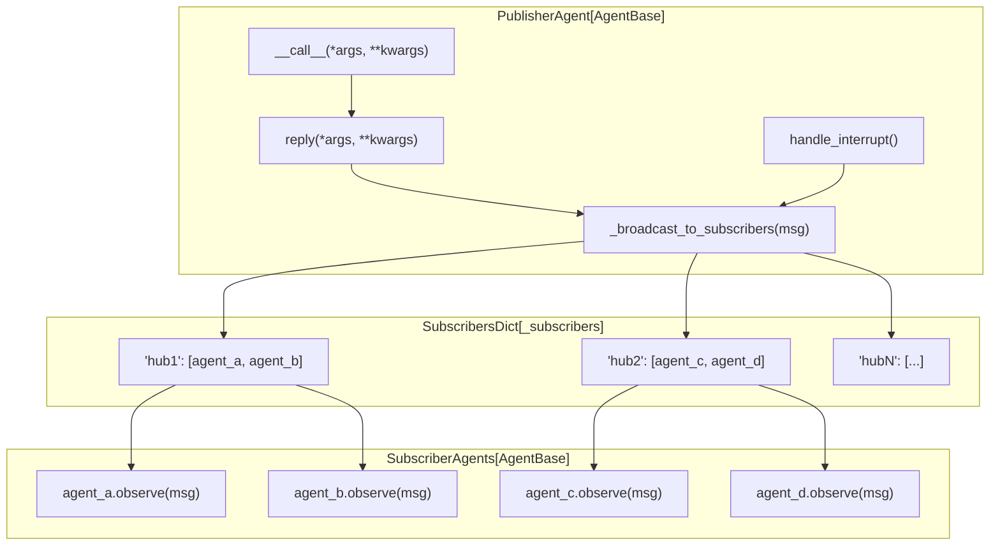
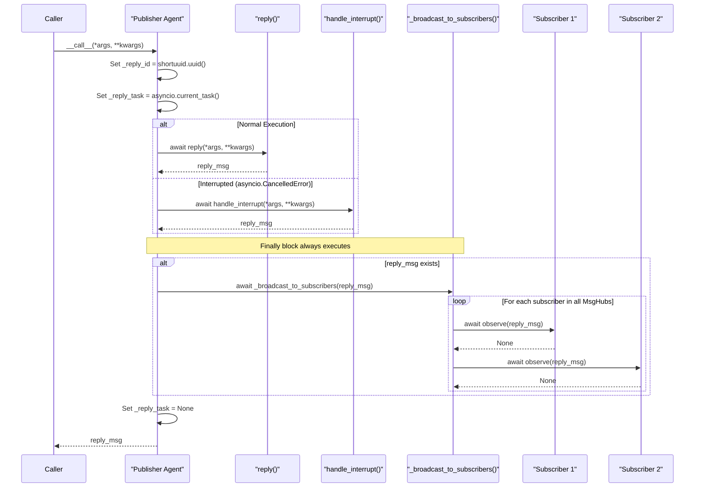
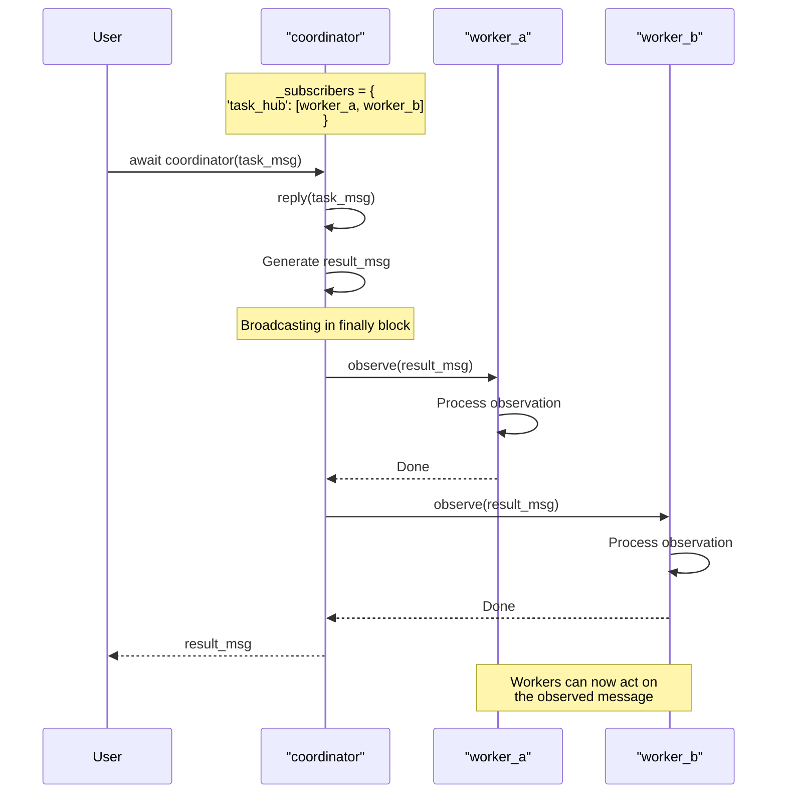
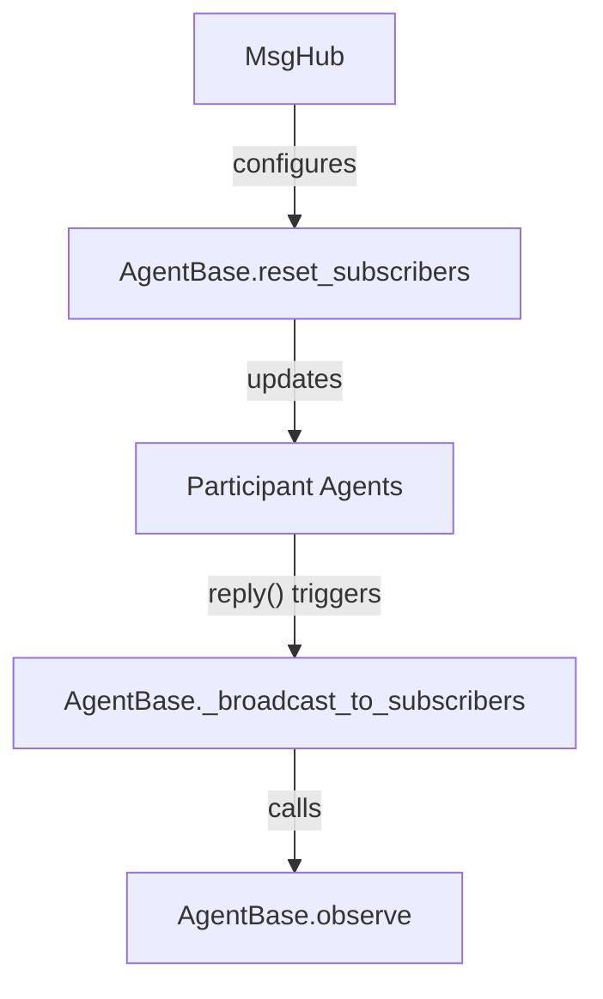

<!-- source: DeepWiki mcp.deepwiki.com · repo modelscope/agentscope · page 6.3 Subscriber Broadcasting · fetched 2026-10-26 -->

# Subscriber Broadcasting

<details>
<summary>Relevant source files</summary>

The following files were used as context for generating this wiki page:

- [examples/workflows/multiagent_concurrent/README.md](examples/workflows/multiagent_concurrent/README.md)
- [examples/workflows/multiagent_concurrent/main.py](examples/workflows/multiagent_concurrent/main.py)
- [src/agentscope/agent/_agent_base.py](src/agentscope/agent/_agent_base.py)
- [src/agentscope/pipeline/__init__.py](src/agentscope/pipeline/__init__.py)
- [src/agentscope/pipeline/_functional.py](src/agentscope/pipeline/_functional.py)
- [tests/pipeline_test.py](tests/pipeline_test.py)

</details>


## Purpose and Scope

This document describes the subscriber broadcasting system in AgentScope, which implements a publish-subscribe pattern for automatic message propagation between agents. The system allows agents to observe messages produced by other agents without explicit message passing, enabling reactive multi-agent architectures.

For message hub-based communication patterns, see [6.1 MsgHub Communication](). For pipeline-based orchestration, see [6.2 Pipeline Patterns]().

---

## Overview

The subscriber broadcasting system is built into `AgentBase` [src/agentscope/agent/_agent_base.py:30]() and provides automatic message distribution from publisher agents to subscriber agents. When an agent completes its reply, the resulting message is automatically broadcast to all registered subscribers via their `observe` method [src/agentscope/agent/_agent_base.py:469-476](). This implements a one-to-many communication pattern organized by MsgHub identifiers.

**Key characteristics:**
- **Automatic**: Broadcasting occurs automatically after each agent reply [src/agentscope/agent/_agent_base.py:462-464]().
- **Asynchronous**: All subscriber observations execute concurrently within the publisher's execution flow [src/agentscope/agent/_agent_base.py:469-476]().
- **Organized by MsgHub**: Subscribers are grouped by MsgHub name for isolation [src/agentscope/agent/_agent_base.py:168]().
- **Observer pattern**: Subscribers passively receive messages without blocking the publisher's core logic.

**Sources:** [src/agentscope/agent/_agent_base.py:30](), [src/agentscope/agent/_agent_base.py:165-168](), [src/agentscope/agent/_agent_base.py:469-476]()

---

## Subscriber Data Structure

### The `_subscribers` Dictionary

Each `AgentBase` instance maintains a `_subscribers` dictionary that maps MsgHub names to lists of subscriber agents [src/agentscope/agent/_agent_base.py:168]():

```python
self._subscribers: dict[str, list[AgentBase]] = {}
```

**Structure:**
| Component | Type | Description |
|-----------|------|-------------|
| **Key** | `str` | MsgHub name identifier |
| **Value** | `list[AgentBase]` | List of agents that will receive broadcasts |

This structure allows a single agent to participate in multiple subscriber groups simultaneously, each identified by a distinct MsgHub name. When broadcasting, the agent iterates through all MsgHub groups and notifies all subscribers in each group [src/agentscope/agent/_agent_base.py:473-475]().

**Sources:** [src/agentscope/agent/_agent_base.py:165-168](), [src/agentscope/agent/_agent_base.py:473-475]()

---

## Subscription Management API

### `reset_subscribers` Method

The `reset_subscribers` method configures the subscriber list for a specific MsgHub [src/agentscope/agent/_agent_base.py:663-677]():

```python
def reset_subscribers(
    self,
    msghub_name: str,
    subscribers: list["AgentBase"],
) -> None
```

**Parameters:**
| Parameter | Type | Description |
|-----------|------|-------------|
| `msghub_name` | `str` | MsgHub identifier for subscriber group |
| `subscribers` | `list[AgentBase]` | Agents to receive broadcasts |

**Behavior:**
- Replaces any existing subscriber list for the given MsgHub.
- Automatically filters out `self` to prevent self-subscription [src/agentscope/agent/_agent_base.py:677]().
- Creates a new list copy to avoid external mutations.

**Sources:** [src/agentscope/agent/_agent_base.py:663-677]()

### `remove_subscribers` Method

The `remove_subscribers` method removes an entire subscriber group [src/agentscope/agent/_agent_base.py:679-692]():

```python
def remove_subscribers(self, msghub_name: str) -> None
```

**Parameters:**
| Parameter | Type | Description |
|-----------|------|-------------|
| `msghub_name` | `str` | MsgHub identifier to remove |

**Behavior:**
- Removes the MsgHub entry from the `_subscribers` dictionary [src/agentscope/agent/_agent_base.py:692]().
- Logs a warning if the MsgHub name is not found [src/agentscope/agent/_agent_base.py:686-690]().
- Does not raise an exception for missing entries.

**Sources:** [src/agentscope/agent/_agent_base.py:679-692]()

---

## Broadcasting Mechanism

### Architecture Overview



**Sources:** [src/agentscope/agent/_agent_base.py:448-467](), [src/agentscope/agent/_agent_base.py:469-476]()

### The `_broadcast_to_subscribers` Method

```python
async def _broadcast_to_subscribers(
    self,
    msg: Msg | list[Msg] | None,
) -> None:
    """Broadcast the message to all subscribers."""
    for subscribers in self._subscribers.values():
        for subscriber in subscribers:
            await subscriber.observe(msg)
```

**Broadcasting logic:**
1. Iterates through all MsgHub groups in `_subscribers.values()` [src/agentscope/agent/_agent_base.py:473]().
2. For each group, iterates through subscriber agents [src/agentscope/agent/_agent_base.py:474]().
3. Calls `observe(msg)` on each subscriber asynchronously [src/agentscope/agent/_agent_base.py:475]().
4. Executes sequentially (each `observe` awaits completion before the next).

**Sources:** [src/agentscope/agent/_agent_base.py:469-476]()

### Integration with Agent Execution Flow



**Key execution points:**
1. **Line 450:** Reply ID generated for tracking [src/agentscope/agent/_agent_base.py:450]().
2. **Line 454:** Reply task set to current asyncio task [src/agentscope/agent/_agent_base.py:454]().
3. **Line 455:** Reply method invoked [src/agentscope/agent/_agent_base.py:455]().
4. **Line 458-459:** Interruption caught and handled [src/agentscope/agent/_agent_base.py:458-459]().
5. **Line 462-464:** Broadcasting occurs in `finally` block (always executes) [src/agentscope/agent/_agent_base.py:462-464]().
6. **Line 465:** Reply task cleared [src/agentscope/agent/_agent_base.py:465]().

The `finally` block ensures broadcasting happens even if the reply completes successfully, is interrupted, or raises an exception [src/agentscope/agent/_agent_base.py:462-464]().

**Sources:** [src/agentscope/agent/_agent_base.py:448-467]()

---

## Message Flow Example

### Multi-Agent Broadcasting Workflow

Consider three agents: `coordinator`, `worker_a`, and `worker_b`, where workers subscribe to the coordinator's messages.



**Sources:** [src/agentscope/agent/_agent_base.py:469-476]()

---

## Typical Usage Patterns

### Pattern 1: MsgHub-Managed Subscriptions

The most common usage is through `MsgHub`, which automatically manages subscriber relationships. When using `MsgHub`, it calls `reset_subscribers(msghub_name, other_participants)` for each participant [src/agentscope/agent/_agent_base.py:663-677](), ensuring that broadcasts are automatically distributed to all other participants in the hub.

**Sources:** [src/agentscope/agent/_agent_base.py:663-677]()

### Pattern 2: Manual Subscription Management

For custom communication patterns without `MsgHub`:

| Step | Method | Purpose |
|------|--------|---------|
| **Setup** | `publisher.reset_subscribers('custom_channel', [sub1, sub2])` | Configure subscribers [src/agentscope/agent/_agent_base.py:663-677](). |
| **Runtime** | `await publisher(msg)` | Automatic broadcast on reply [src/agentscope/agent/_agent_base.py:462-464](). |
| **Cleanup** | `publisher.remove_subscribers('custom_channel')` | Remove subscription group [src/agentscope/agent/_agent_base.py:679-692](). |

**Sources:** [src/agentscope/agent/_agent_base.py:663-692]()

### Pattern 3: Multiple Subscription Groups

A single agent can broadcast to multiple independent subscriber groups. When the publisher completes a reply, all subscribers across all groups receive the message sequentially [src/agentscope/agent/_agent_base.py:473-475]().

**Sources:** [src/agentscope/agent/_agent_base.py:469-476]()

---

## Relationship with Other Communication Patterns

### Comparison with Pipeline Patterns

| Aspect | Subscriber Broadcasting | Pipeline Patterns |
|--------|------------------------|-------------------|
| **Initiation** | Automatic on reply | Explicit orchestration |
| **Direction** | One-to-many | Sequential or fanout |
| **Message flow** | Push (publisher → subscribers) | Pull (pipeline calls agents) |
| **Coupling** | Loose (via `observe`) | Tight (direct calls) |
| **Use case** | Reactive notifications | Structured workflows |

Subscriber broadcasting complements pipelines:
- **Pipelines** ([6.2 Pipeline Patterns]()) orchestrate explicit agent sequences like `sequential_pipeline` [src/agentscope/pipeline/_functional.py:10-44]() or `fanout_pipeline` [src/agentscope/pipeline/_functional.py:47-105]().
- **Subscribers** provide implicit notification side-effects.

**Sources:** [src/agentscope/pipeline/_functional.py:10-105](), [src/agentscope/agent/_agent_base.py:469-476]()

### Integration with MsgHub

The subscriber system is the underlying mechanism for `MsgHub` communication:



**Sources:** [src/agentscope/agent/_agent_base.py:663-677](), [src/agentscope/agent/_agent_base.py:469-476]()

---

## Implementation Details

### Self-Exclusion

The `reset_subscribers` method automatically filters out the publisher agent:
`self._subscribers[msghub_name] = [_ for _ in subscribers if _ != self]` [src/agentscope/agent/_agent_base.py:677](). This prevents infinite loops and redundant processing.

### Error Handling

- `remove_subscribers` logs a warning for missing MsgHub names but does not raise exceptions [src/agentscope/agent/_agent_base.py:686-690]().
- Broadcasting exceptions from individual `observe` calls will propagate and halt remaining broadcasts because they are awaited sequentially [src/agentscope/agent/_agent_base.py:475]().
- There are no built-in retry mechanisms for failed observations.

**Sources:** [src/agentscope/agent/_agent_base.py:686-690](), [src/agentscope/agent/_agent_base.py:475]()

---

