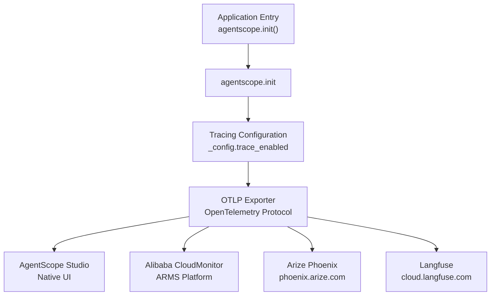
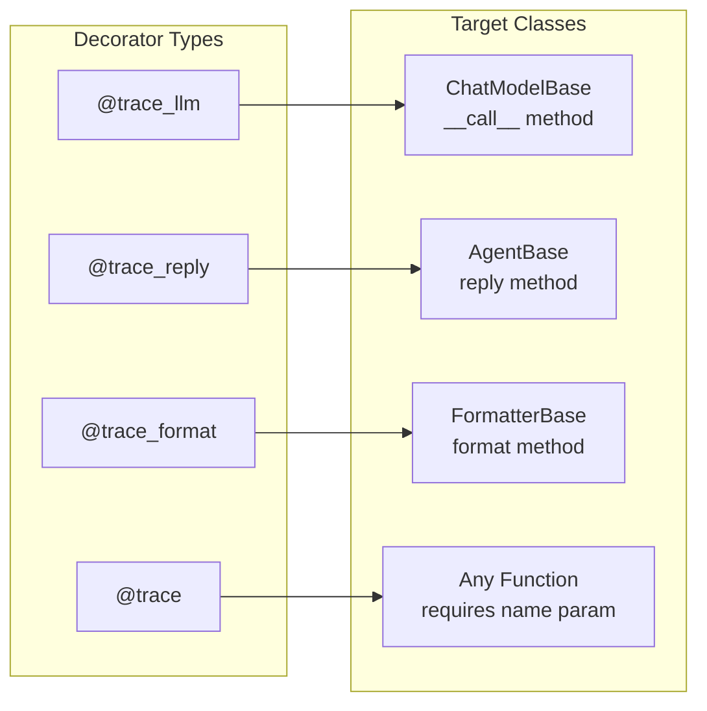
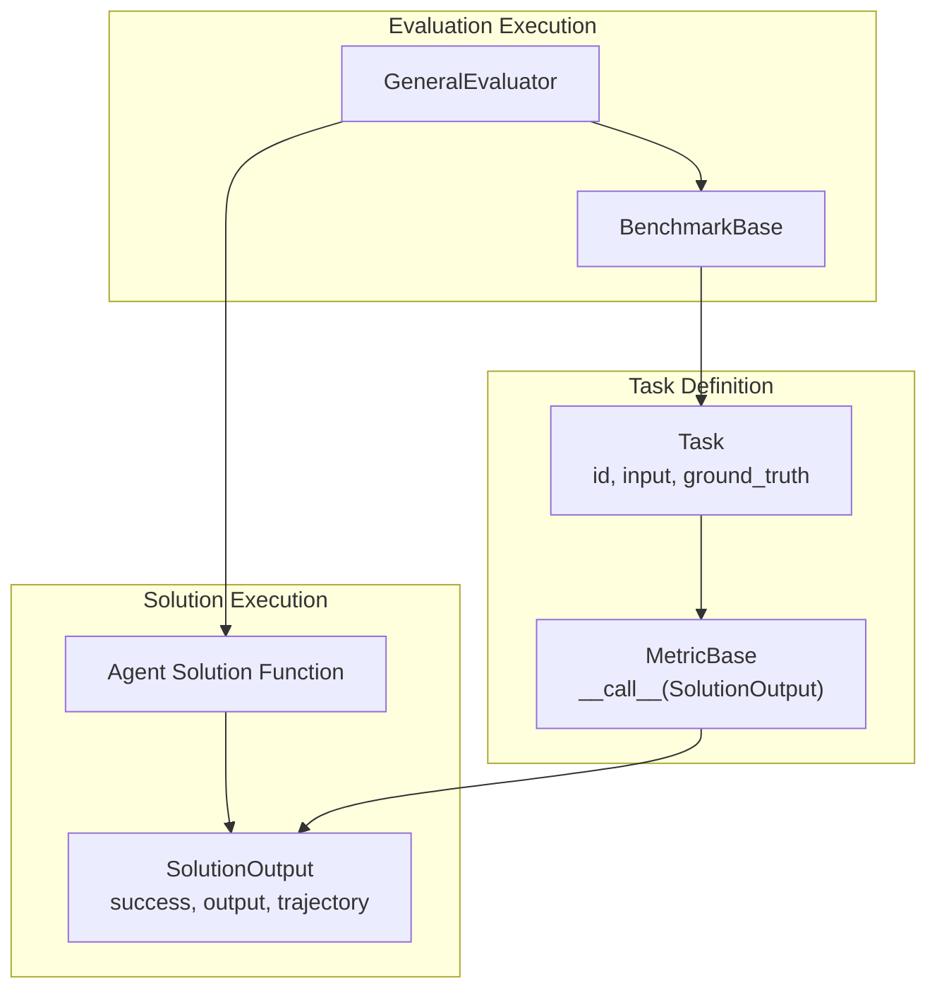

<!-- source: DeepWiki mcp.deepwiki.com · repo modelscope/agentscope · page 7 Observability and Evaluation · fetched 2026-10-26 -->

# Observability and Evaluation

<details>
<summary>Relevant source files</summary>

The following files were used as context for generating this wiki page:

- [README.md](README.md)
- [README_zh.md](README_zh.md)
- [assets/images/agentscope.png](assets/images/agentscope.png)
- [docs/tutorial/en/index.rst](docs/tutorial/en/index.rst)
- [docs/tutorial/en/src/task_eval_openjudge.py](docs/tutorial/en/src/task_eval_openjudge.py)
- [docs/tutorial/en/src/task_tracing.py](docs/tutorial/en/src/task_tracing.py)
- [docs/tutorial/zh_CN/index.rst](docs/tutorial/zh_CN/index.rst)
- [docs/tutorial/zh_CN/src/task_eval_openjudge.py](docs/tutorial/zh_CN/src/task_eval_openjudge.py)
- [docs/tutorial/zh_CN/src/task_tracing.py](docs/tutorial/zh_CN/src/task_tracing.py)

</details>


This page documents AgentScope's monitoring, tracing, and quality assessment infrastructure. For information about planning and task decomposition, see [Planning System with PlanNotebook](#2.5). For memory and state persistence, see [Memory and Knowledge Systems](#5).

## Overview

AgentScope provides two complementary systems for production-grade agent applications:

1.  **Observability**: OpenTelemetry-based tracing for monitoring execution flow, debugging errors, and analyzing performance [docs/tutorial/en/src/task_tracing.py:8-14]().
2.  **Evaluation**: A framework for systematic quality assessment through benchmarks, metrics, and integration with evaluation libraries like OpenJudge [docs/tutorial/en/src/task_eval_openjudge.py:6-8]().

Both systems integrate with the core agent architecture through decorators and abstract base classes.

## Tracing Architecture

### Configuration and Initialization

Tracing is configured globally through `agentscope.init` at application startup [docs/tutorial/en/src/task_tracing.py:19-20](). The system supports two primary categories of endpoints:

| Parameter | Purpose | Example |
| :--- | :--- | :--- |
| `studio_url` | Connect to AgentScope Studio for native visualization | `"http://localhost:5000"` [docs/tutorial/en/src/task_tracing.py:38-39]() |
| `tracing_url` | Connect to OTLP-compatible backends (CloudMonitor, Phoenix, Langfuse) | `"https://your-tracing-backend:port/traces"` [docs/tutorial/en/src/task_tracing.py:52-53]() |


**Tracing Configuration Flow**

Sources: [docs/tutorial/en/src/task_tracing.py:32-101](), [README.md:67-70]()

### Tracing Decorators

AgentScope provides specialized decorators to instrument framework components. Each decorator captures relevant execution context using attributes defined in the tracing module.


**Decorator-to-Component Mapping**

| Decorator | Target | Requirement |
| :--- | :--- | :--- |
| `@trace_llm` | `ChatModelBase.__call__` | Must inherit from `ChatModelBase` [docs/tutorial/en/src/task_tracing.py:123-143]() |
| `@trace_reply` | `AgentBase.reply` | Must inherit from `AgentBase` [docs/tutorial/en/src/task_tracing.py:148-162]() |
| `@trace_format` | `FormatterBase.format` | Must inherit from `FormatterBase` [docs/tutorial/en/src/task_tracing.py:166-179]() |
| `@trace` | Any function | Requires `name` parameter [docs/tutorial/en/src/task_tracing.py:184-212]() |

For details, see [Tracing Decorators and Usage](#7.2).

## Evaluation Framework

### Core Architecture

The evaluation system is built around abstractions that define and execute quality assessments, moving beyond simple success/failure checks to semantic analysis [docs/tutorial/en/src/task_eval_openjudge.py:20-27]().


**Evaluation Framework Component Flow**

Sources: [docs/tutorial/en/src/task_eval_openjudge.py:68-89](), [docs/tutorial/zh_CN/src/task_eval_openjudge.py:67-89]()

### Component Specifications

*   **`MetricBase`**: A generic unit of evaluation that accepts a `SolutionOutput` and returns a `MetricResult` [docs/tutorial/en/src/task_eval_openjudge.py:74-89]().
*   **`SolutionOutput`**: Container for agent execution results passed to metrics, including `success`, `output`, and optional `trajectory` [docs/tutorial/en/src/task_eval_openjudge.py:120-136]().
*   **`BenchmarkBase`**: Abstract base for defining collections of evaluation tasks.

For details, see [Evaluation Framework](#7.3).

## OpenJudge Integration

OpenJudge provides 50+ pre-built evaluation graders for semantic quality assessment (e.g., `RelevanceGrader`, `CorrectnessGrader`) [docs/tutorial/en/src/task_eval_openjudge.py:25-26](). The `OpenJudgeMetric` adapter bridges OpenJudge's grader system with AgentScope's metric interface [docs/tutorial/en/src/task_eval_openjudge.py:92-117]().

### Mapper Pattern

The `mapper` dictionary transforms AgentScope data structures into OpenJudge grader inputs (like `query`, `response`, `context`) [docs/tutorial/en/src/task_eval_openjudge.py:139-154]().

**Mapping Specification Example:**
```python
mapper = {
    "query": "data.question",
    "response": "solution.output",
    "context": "data.reference_output",
}
```

Sources: [docs/tutorial/en/src/task_eval_openjudge.py:128-154](), [docs/tutorial/zh_CN/src/task_eval_openjudge.py:137-154]()

For details, see [OpenJudge Integration](#7.4).

---

