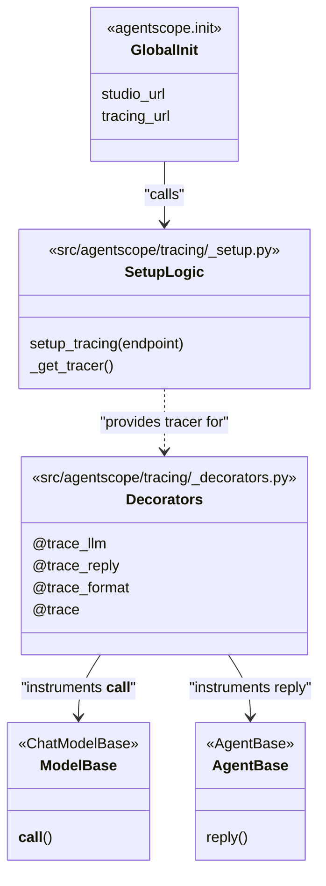

<!-- source: DeepWiki mcp.deepwiki.com · repo modelscope/agentscope · page 7.1 OpenTelemetry Integration · fetched 2026-10-26 -->

# OpenTelemetry Integration

<details>
<summary>Relevant source files</summary>

The following files were used as context for generating this wiki page:

- [README.md](README.md)
- [README_zh.md](README_zh.md)
- [assets/images/agentscope.png](assets/images/agentscope.png)
- [docs/tutorial/en/src/task_studio.py](docs/tutorial/en/src/task_studio.py)
- [docs/tutorial/en/src/task_tracing.py](docs/tutorial/en/src/task_tracing.py)
- [docs/tutorial/zh_CN/src/task_studio.py](docs/tutorial/zh_CN/src/task_studio.py)
- [docs/tutorial/zh_CN/src/task_tracing.py](docs/tutorial/zh_CN/src/task_tracing.py)
- [src/agentscope/tracing/_setup.py](src/agentscope/tracing/_setup.py)

</details>


AgentScope implements OpenTelemetry-based distributed tracing to monitor and debug the execution of agent applications. The tracing system captures execution flows across agents, models, tools, and formatters, exporting telemetry data via the OTLP (OpenTelemetry Protocol) to compatible backends.

This page documents the tracing configuration via `agentscope.init()`, the OTLP protocol implementation, and supported backends including AgentScope Studio, Alibaba Cloud CloudMonitor, Arize Phoenix, and Langfuse.

Sources: [src/agentscope/tracing/_setup.py:1-50](), [docs/tutorial/en/src/task_tracing.py:8-15](), [README.md:68-70]()

---

## Tracing Architecture

The tracing system is built on the OpenTelemetry SDK and provides automatic instrumentation for core framework components. The architecture separates initialization from span collection, with tracing configured globally during the environment setup.

**Tracing System Data Flow**

```mermaid
graph TB
    subgraph "Initialization_Layer"
        [AppCode] --> [AS_Init]
        [AS_Init] --> [SetupTracing]
    end
    
    subgraph "OpenTelemetry_SDK_Core"
        [SetupTracing] --> [TracerProvider]
        [TracerProvider] --> [BatchProcessor]
        [BatchProcessor] --> [OTLPExporter]
    end
    
    subgraph "Instrumentation_Layer"
        direction LR
        [TraceLLM]
        [TraceReply]
        [TraceFormat]
        [TraceGen]
    end
    
    subgraph "Execution_Entities"
        [Model]
        [Agent]
        [Formatter]
    end
    
    subgraph "Observability_Backends"
        [OTLPExporter] --> [Studio]
        [OTLPExporter] --> [CloudMonitor]
        [OTLPExporter] --> [Phoenix]
        [OTLPExporter] --> [Langfuse]
    end

    [TraceLLM] -.-> [Model]
    [TraceReply] -.-> [Agent]
    [TraceFormat] -.-> [Formatter]
    
    [Model] -- "Spans" --> [TracerProvider]
    [Agent] -- "Spans" --> [TracerProvider]
    [Formatter] -- "Spans" --> [TracerProvider]
    [TraceGen] -- "Spans" --> [TracerProvider]
```

### Implementation Details
The core logic resides in `src/agentscope/tracing/_setup.py`. The `setup_tracing` function [src/agentscope/tracing/_setup.py:11-39]() configures the global `TracerProvider`. It uses lazy loading for OpenTelemetry dependencies to keep the core framework lightweight.

- **Tracer Selection**: The internal `_get_tracer()` function [src/agentscope/tracing/_setup.py:41-49]() retrieves a tracer named "agentscope" associated with the current framework version.
- **Span Processing**: It utilizes `BatchSpanProcessor` [src/agentscope/tracing/_setup.py:28-28]() to aggregate spans before exporting, reducing network overhead.
- **Exporter**: The system defaults to `OTLPSpanExporter` [src/agentscope/tracing/_setup.py:27-27](), which sends data over HTTP/protobuf.

Sources: [src/agentscope/tracing/_setup.py:11-49](), [docs/tutorial/en/src/task_tracing.py:107-117]()

---

## Configuration via agentscope.init

Tracing is enabled by passing either `studio_url` or `tracing_url` to the `agentscope.init` function. These parameters are mutually exclusive in their primary purpose but both trigger the underlying OpenTelemetry setup.

| Parameter | Type | Description |
|-----------|------|-------------|
| `studio_url` | `str` | The URL of the local or remote AgentScope Studio instance. |
| `tracing_url` | `str` | The OTLP/HTTP endpoint of a third-party tracing backend. |

### Connecting to AgentScope Studio
AgentScope Studio provides native visualization for traces, including model invocations and token usage [docs/tutorial/en/src/task_studio.py:51-61]().

```python
import agentscope
# Connect to local Studio
agentscope.init(studio_url="http://localhost:3000")
```

Sources: [docs/tutorial/en/src/task_studio.py:40-46](), [docs/tutorial/en/src/task_tracing.py:32-38]()

### Connecting to Third-Party OTLP Backends
The `tracing_url` should point to an OTLP-compatible collector or backend.

```python
import agentscope
# Connect to a generic OTLP collector
agentscope.init(tracing_url="https://your-backend-endpoint:port/v1/traces")
```

Sources: [docs/tutorial/en/src/task_tracing.py:44-53]()

---

## Supported Backends & Authentication

Different backends require specific environment variables for authentication and identification. These are typically passed via the `OTEL_EXPORTER_OTLP_HEADERS` standard OpenTelemetry variable.

### Alibaba Cloud CloudMonitor
CloudMonitor (ARMS) provides enterprise-grade observability. It supports zero-code instrumentation via the LoongSuite agent [docs/tutorial/en/src/task_tracing.py:63-67]().

```python
import agentscope
import os

# Optional: Set service name
os.environ["OTEL_SERVICE_NAME"] = "my_agent_app"

# Endpoint from ARMS Console
agentscope.init(tracing_url="https://tracing-cn-hangzhou.arms.aliyuncs.com/adapt_xxx/api/otlp/traces")
```

Sources: [docs/tutorial/en/src/task_tracing.py:56-67]()

### Arize Phoenix
Phoenix requires an API key in the headers [docs/tutorial/en/src/task_tracing.py:69-71]().

```python
import os
import agentscope

PHOENIX_API_KEY = os.environ.get("PHOENIX_API_KEY")
os.environ["OTEL_EXPORTER_OTLP_HEADERS"] = f"api_key={PHOENIX_API_KEY}"

agentscope.init(tracing_url="https://app.phoenix.arize.com/v1/traces")
```

Sources: [docs/tutorial/en/src/task_tracing.py:69-80]()

### Langfuse
Langfuse uses Basic Auth constructed from a public and secret key [docs/tutorial/en/src/task_tracing.py:82-84]().

```python
import os, base64
import agentscope

auth = f"{os.environ['LANGFUSE_PUBLIC_KEY']}:{os.environ['LANGFUSE_SECRET_KEY']}"
encoded_auth = base64.b64encode(auth.encode("utf-8")).decode("ascii")

os.environ["OTEL_EXPORTER_OTLP_HEADERS"] = f"Authorization=Basic {encoded_auth}"
agentscope.init(tracing_url="https://cloud.langfuse.com/api/public/otel/v1/traces")
```

Sources: [docs/tutorial/en/src/task_tracing.py:82-101]()

---

## Code Entity Association

The following diagram maps the logical tracing concepts to specific code entities within the `agentscope` package.

**Tracing Logic to Code Entity Mapping**



### Key Classes and Functions
- **`setup_tracing(endpoint)`**: The entry point for OTLP configuration [src/agentscope/tracing/_setup.py:11-11]().
- **`_get_tracer()`**: Ensures all spans are attributed to the "agentscope" library with the correct version [src/agentscope/tracing/_setup.py:41-41]().
- **`OTLPSpanExporter`**: The specific OpenTelemetry exporter used for HTTP/Proto communication [src/agentscope/tracing/_setup.py:22-24]().
- **`TracerProvider`**: The SDK component that manages tracer instances and span processors [src/agentscope/tracing/_setup.py:30-30]().

Sources: [src/agentscope/tracing/_setup.py:1-50](), [docs/tutorial/en/src/task_tracing.py:107-117]()

---

