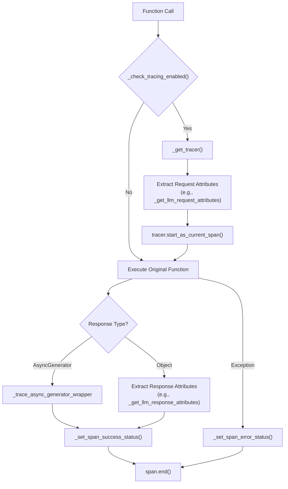
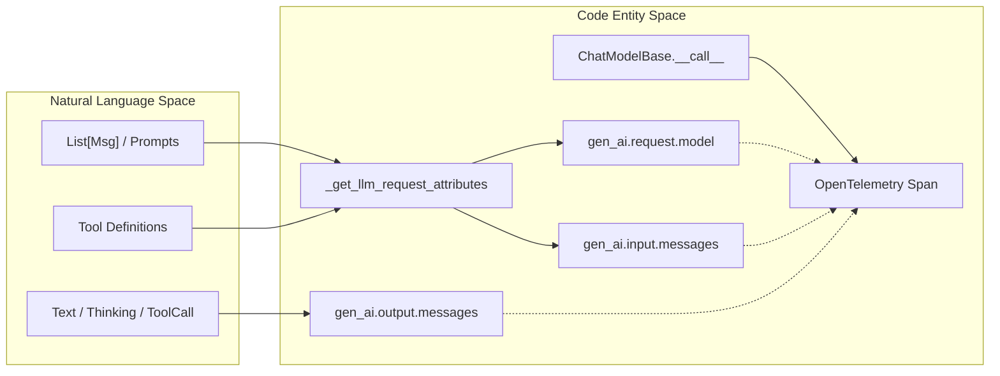
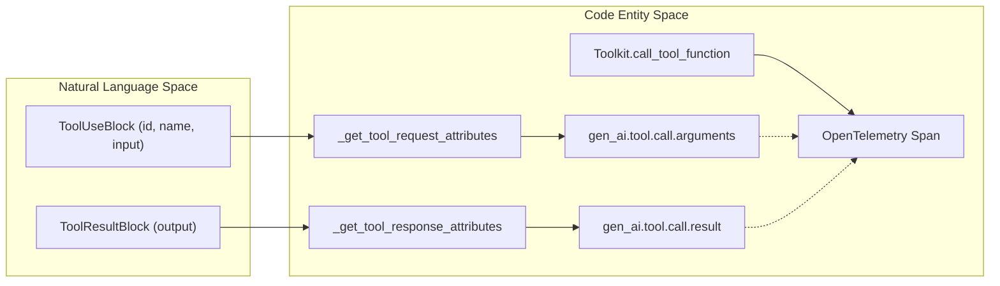

<!-- source: DeepWiki mcp.deepwiki.com · repo modelscope/agentscope · page 7.2 Tracing Decorators and Usage · fetched 2026-10-26 -->

# Tracing Decorators and Usage

<details>
<summary>Relevant source files</summary>

The following files were used as context for generating this wiki page:

- [docs/tutorial/en/src/task_middleware.py](docs/tutorial/en/src/task_middleware.py)
- [docs/tutorial/zh_CN/src/task_middleware.py](docs/tutorial/zh_CN/src/task_middleware.py)
- [src/agentscope/tracing/_attributes.py](src/agentscope/tracing/_attributes.py)
- [src/agentscope/tracing/_converter.py](src/agentscope/tracing/_converter.py)
- [src/agentscope/tracing/_extractor.py](src/agentscope/tracing/_extractor.py)
- [src/agentscope/tracing/_trace.py](src/agentscope/tracing/_trace.py)
- [src/agentscope/tracing/_utils.py](src/agentscope/tracing/_utils.py)
- [tests/toolkit_middleware_test.py](tests/toolkit_middleware_test.py)
- [tests/tracing_converter_test.py](tests/tracing_converter_test.py)
- [tests/tracing_extractor_test.py](tests/tracing_extractor_test.py)
- [tests/tracing_test.py](tests/tracing_test.py)

</details>


This document describes the tracing decorator system in AgentScope, which provides OpenTelemetry-based instrumentation for observability. These decorators automatically create spans with structured attributes for monitoring agent execution, LLM calls, tool usage, and message formatting by bridging the gap between Natural Language Space and Code Entity Space.

For information about configuring tracing backends and visualization, see [OpenTelemetry Integration (7.1)]().

---

## Overview

AgentScope provides specialized tracing decorators that wrap key framework operations. These decorators are responsible for extracting semantic attributes from the Natural Language Space (messages, prompts) and mapping them into the Code Entity Space (span attributes, operation names).

| Decorator | Target Component | Purpose |
|-----------|------------------|---------|
| `@trace_llm` | `ChatModelBase` | Traces LLM API calls with token usage and response attributes |
| `@trace_reply` | `AgentBase` | Traces agent reasoning and message generation |
| `@trace_format` | `FormatterBase` | Traces message serialization to API-specific formats |
| `@trace_toolkit` | `Toolkit` | Traces tool execution with input/output tracking |
| `@trace_embedding`| `EmbeddingModelBase`| Traces embedding generation requests |
| `@trace` | Generic Functions | General-purpose decorator for custom components |

**Sources:** [src/agentscope/tracing/_trace.py:1-45](), [src/agentscope/tracing/_attributes.py:131-152]()

---

## Decorator Architecture

The tracing decorators follow a consistent execution flow. They intercept function calls, extract attributes using specialized extractors, manage the OpenTelemetry span lifecycle, and handle complex response types like async generators.

### Execution Flow Diagram



**Sources:** [src/agentscope/tracing/_trace.py:69-190](), [src/agentscope/tracing/_trace.py:223-319]()

---

## Natural Language to Code Entity Mapping

The tracing system bridges the gap between high-level agent interactions and low-level execution data by mapping `Msg` objects and `ContentBlock` types to OpenTelemetry attributes.

### LLM Tracing Bridge (`@trace_llm`)

This diagram shows how natural language inputs (messages) and outputs (responses) are associated with code entities during a `ChatModelBase` call.



**Sources:** [src/agentscope/tracing/_extractor.py:198-320](), [src/agentscope/tracing/_attributes.py:71-76](), [src/agentscope/tracing/_trace.py:321-365]()

### Tool Execution Bridge (`@trace_toolkit`)

This diagram illustrates how tool calls are instrumented within the `Toolkit` component.



**Sources:** [src/agentscope/tracing/_extractor.py:495-561](), [src/agentscope/tracing/_attributes.py:91-105](), [src/agentscope/tracing/_trace.py:460-515]()

---

## Specialized Decorators

### Agent Reply Tracing: `@trace_reply`
Applied to `AgentBase.reply`, this decorator captures the agent's identity and the conversation context. It extracts attributes like `gen_ai.agent.id` and `gen_ai.agent.name` from the agent instance [src/agentscope/tracing/_extractor.py:440-460](). It also records the `run_id` as the conversation ID [src/agentscope/tracing/_extractor.py:52-64]().

### Toolkit Tracing: `@trace_toolkit`
Applied to `Toolkit.call_tool_function`. It records the tool name and arguments as `gen_ai.tool.name` and `gen_ai.tool.call.arguments` [src/agentscope/tracing/_extractor.py:495-515](). Notably, it interacts with the middleware system; the decorator wraps the execution which may include a chain of middlewares that modify inputs or outputs before they are recorded in the span [docs/tutorial/en/src/task_middleware.py:33-73]().

### Formatter Tracing: `@trace_format`
Applied to `FormatterBase.format`. It tracks how messages are transformed for specific providers, recording the target provider (e.g., "openai", "dashscope") in the `agentscope.format.target` attribute by inspecting the class name [src/agentscope/tracing/_extractor.py:66-86]().

---

## Implementation Details

### Attribute Extraction
The `_extractor.py` module contains logic to convert AgentScope internal objects into OpenTelemetry-compliant attributes. For example, `_get_provider_name` determines the provider by inspecting the `ChatModelBase` class name and, in the case of `OpenAIChatModel`, the `base_url` of the client [src/agentscope/tracing/_extractor.py:88-133]().

### Content Block Conversion
AgentScope uses a `ContentBlock` system (text, image, tool_use, etc.). The `_converter.py` module transforms these into the standardized GenAI "part" format used in tracing spans [src/agentscope/tracing/_converter.py:57-125]().

```python
# Example conversion logic for a ToolUseBlock in _converter.py
part = {
    "type": "tool_call",
    "id": block.get("id", ""),
    "name": block.get("name", ""),
    "arguments": block.get("input", {}),
}
```
**Sources:** [src/agentscope/tracing/_converter.py:94-100]()

### Streaming and Generators
For streaming components, AgentScope uses wrapper functions to intercept yields and ensure the span remains open until the stream completes.
- `_trace_sync_generator_wrapper`: Handles standard Python generators [src/agentscope/tracing/_trace.py:107-132]().
- `_trace_async_generator_wrapper`: Handles `AsyncGenerator` types, common in LLM streaming. It uses `aioitertools` to iterate over chunks [src/agentscope/tracing/_trace.py:134-190]().

These wrappers accumulate the "last chunk" of a stream to set the final response attributes (like token usage or final text) on the span before it closes [src/agentscope/tracing/_trace.py:167-189]().

### Error Handling
The `_set_span_error_status` function ensures that if a component fails, the span is marked as `StatusCode.ERROR`, the exception is recorded via `record_exception`, and the span is closed [src/agentscope/tracing/_trace.py:92-104]().

**Sources:** [src/agentscope/tracing/_trace.py:80-104](), [src/agentscope/tracing/_extractor.py:1-600]()

---

