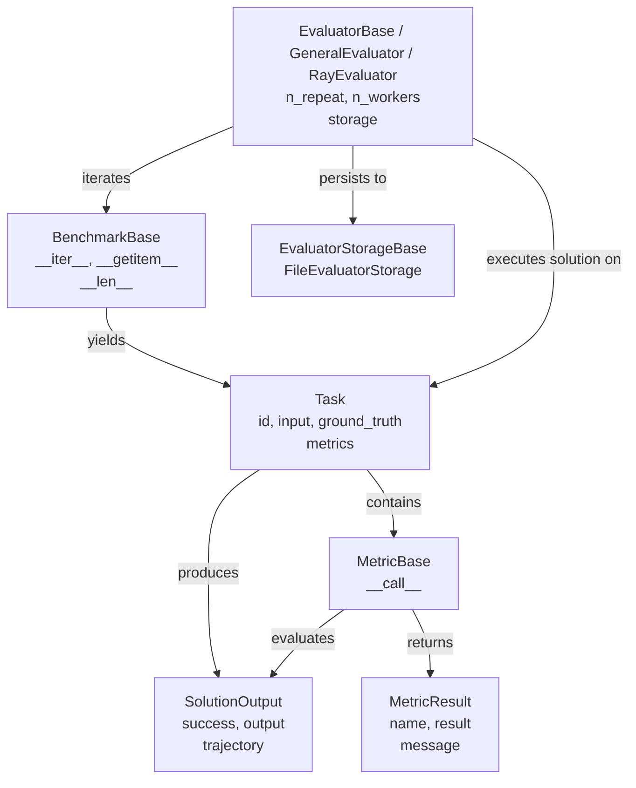
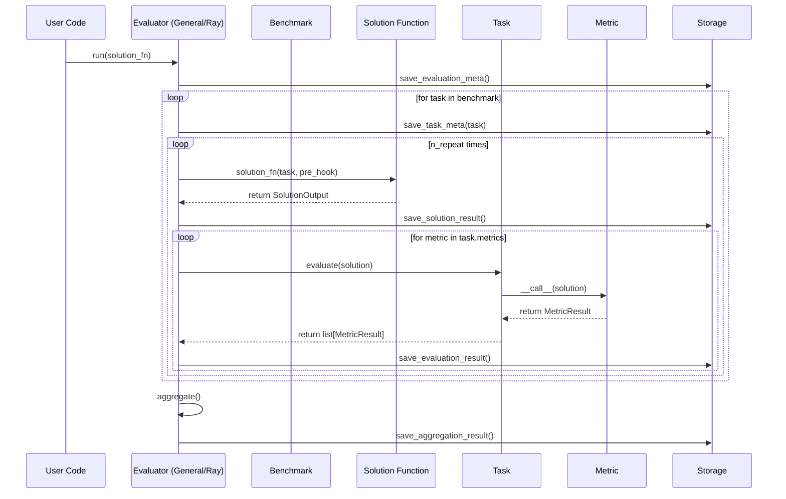
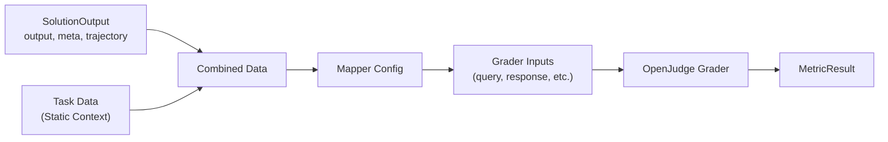
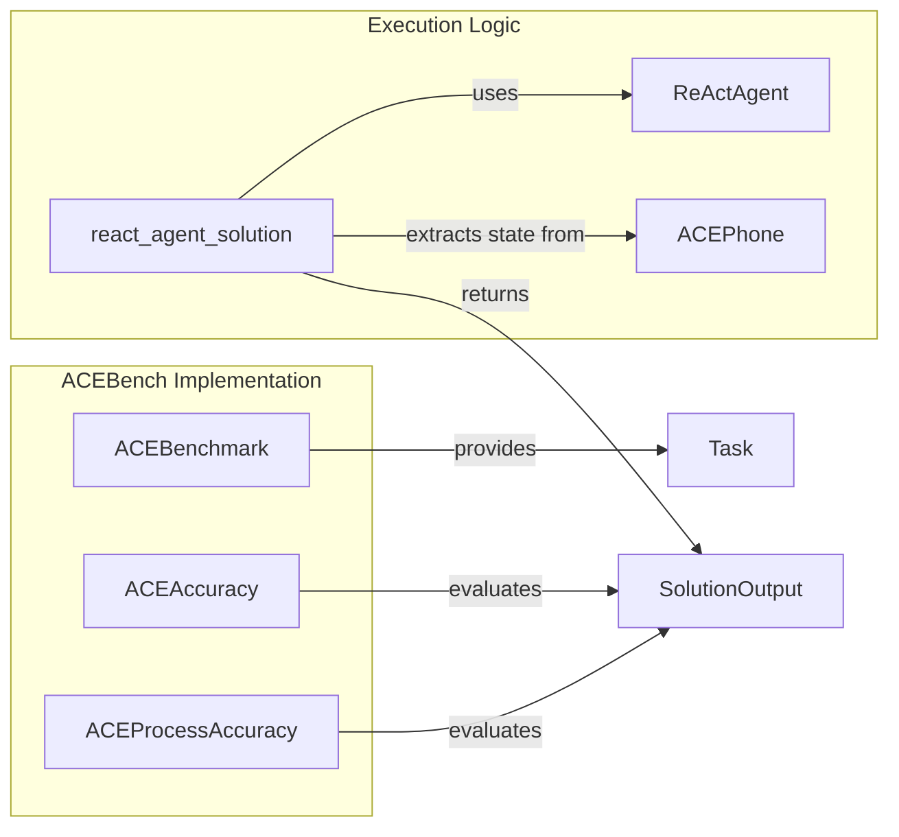

<!-- source: DeepWiki mcp.deepwiki.com · repo modelscope/agentscope · page 7.3 Evaluation Framework · fetched 2026-10-26 -->

# Evaluation Framework

Relevant source files

The following files were used as context for generating this wiki page:

- [docs/tutorial/en/index.rst](docs/tutorial/en/index.rst)
- [docs/tutorial/en/src/task_eval.py](docs/tutorial/en/src/task_eval.py)
- [docs/tutorial/en/src/task_eval_openjudge.py](docs/tutorial/en/src/task_eval_openjudge.py)
- [docs/tutorial/zh_CN/index.rst](docs/tutorial/zh_CN/index.rst)
- [docs/tutorial/zh_CN/src/task_eval.py](docs/tutorial/zh_CN/src/task_eval.py)
- [docs/tutorial/zh_CN/src/task_eval_openjudge.py](docs/tutorial/zh_CN/src/task_eval_openjudge.py)
- [examples/evaluation/ace_bench/main.py](examples/evaluation/ace_bench/main.py)
- [src/agentscope/evaluate/_ace_benchmark/_ace_metric.py](src/agentscope/evaluate/_ace_benchmark/_ace_metric.py)
- [src/agentscope/evaluate/_evaluator/_evaluator_base.py](src/agentscope/evaluate/_evaluator/_evaluator_base.py)
- [src/agentscope/evaluate/_evaluator/_general_evaluator.py](src/agentscope/evaluate/_evaluator/_general_evaluator.py)
- [src/agentscope/evaluate/_evaluator/_in_memory_exporter.py](src/agentscope/evaluate/_evaluator/_in_memory_exporter.py)
- [src/agentscope/evaluate/_evaluator/_ray_evaluator.py](src/agentscope/evaluate/_evaluator/_ray_evaluator.py)
- [src/agentscope/evaluate/_evaluator_storage/_evaluator_storage_base.py](src/agentscope/evaluate/_evaluator_storage/_evaluator_storage_base.py)
- [src/agentscope/evaluate/_evaluator_storage/_file_evaluator_storage.py](src/agentscope/evaluate/_evaluator_storage/_file_evaluator_storage.py)
- [src/agentscope/evaluate/_metric_base.py](src/agentscope/evaluate/_metric_base.py)
- [src/agentscope/evaluate/_task.py](src/agentscope/evaluate/_task.py)
- [tests/evaluation_test.py](tests/evaluation_test.py)

The Evaluation Framework in AgentScope provides a structured system for assessing agent performance against benchmarks. It defines abstractions for benchmarks, tasks, metrics, and evaluators, enabling systematic quality measurement of agent solutions. The framework supports parallel execution, result persistence, and distributed evaluation using Ray.

---

## Core Architecture

The evaluation framework consists of several primary components that work together to execute and measure agent performance.

### Component Overview

**Sources:** [src/agentscope/evaluate/_evaluator/_evaluator_base.py:18-46](), [src/agentscope/evaluate/_task.py:12-37](), [src/agentscope/evaluate/_metric_base.py:47-62](), [src/agentscope/evaluate/_evaluator_storage/_evaluator_storage_base.py:13-15]()

---

## Evaluator Implementations

Evaluators orchestrate the evaluation process by iterating through benchmarks and executing user-defined solution functions.

### GeneralEvaluator
The `GeneralEvaluator` is designed for local debugging and sequential execution. It runs tasks one by one, making it easier to trace issues during development. [src/agentscope/evaluate/_evaluator/_general_evaluator.py:14-42]()

### RayEvaluator
The `RayEvaluator` supports distributed and parallel evaluation by leveraging the Ray framework. It uses `RaySolutionActor` and `RayEvaluationActor` to distribute the workload across multiple workers. [src/agentscope/evaluate/_evaluator/_ray_evaluator.py:39-192]()

### Evaluation Execution Flow

**Sources:** [src/agentscope/evaluate/_evaluator/_general_evaluator.py:124-179](), [src/agentscope/evaluate/_evaluator/_ray_evaluator.py:96-188](), [src/agentscope/evaluate/_task.py:38-53]()

---

## Task and Solution

The `Task` and `SolutionOutput` classes represent the input and output of an agent's problem-solving process.

### Task Structure
A `Task` contains the unique `id`, `input` data, optional `ground_truth`, and a list of `MetricBase` objects used to evaluate the agent's performance on this specific instance. [src/agentscope/evaluate/_task.py:12-37]()

### SolutionOutput Structure
The `SolutionOutput` encapsulates the result of the agent's execution. [src/agentscope/evaluate/_solution.py:11-13]()

| Field | Type | Description |
|-------|------|-------------|
| `success` | `bool` | Whether the agent successfully completed the task execution logic. |
| `output` | `Any` | The final answer or state produced by the agent. |
| `trajectory` | `list` | A record of intermediate steps (e.g., tool calls, thought blocks). |
| `meta` | `dict` | Metadata about the solution execution. |

**Sources:** [src/agentscope/evaluate/_solution.py:11-30](), [examples/evaluation/ace_bench/main.py:78-83]()

---

## Metrics and Evaluation Results

Metrics define how to measure the quality of a `SolutionOutput`.

### MetricBase
All metrics inherit from `MetricBase` and must implement the async `__call__` method. [src/agentscope/evaluate/_metric_base.py:47-102]()

### MetricResult
The output of a metric is a `MetricResult`, which includes:
- `name`: The metric identifier.
- `result`: The numerical or categorical score.
- `message`: Optional reasoning or feedback.
- `metadata`: Additional structured data.

**Sources:** [src/agentscope/evaluate/_metric_base.py:15-33]()

### Metric Types
- `MetricType.NUMERICAL`: For scores like accuracy or completion rate. [src/agentscope/evaluate/_metric_base.py:42-43]()
- `MetricType.CATEGORY`: For labels like "pass" or "fail". [src/agentscope/evaluate/_metric_base.py:39-40]()

---

## Evaluator Storage

`EvaluatorStorageBase` defines the interface for persisting evaluation data, allowing for interrupted evaluations to be resumed. [src/agentscope/evaluate/_evaluator_storage/_evaluator_storage_base.py:13-15]()

### FileEvaluatorStorage
The `FileEvaluatorStorage` implements file-system persistence with the following structure:
- `save_dir/`
    - `evaluation_result.json`: Aggregated summary. [src/agentscope/evaluate/_evaluator_storage/_file_evaluator_storage.py:35]()
    - `evaluation_meta.json`: Benchmark and evaluator settings. [src/agentscope/evaluate/_evaluator_storage/_file_evaluator_storage.py:36]()
    - `{repeat_id}/{task_id}/`
        - `solution.json`: The `SolutionOutput` data. [src/agentscope/evaluate/_evaluator_storage/_file_evaluator_storage.py:32]()
        - `stats.json`: Token usage and execution statistics. [src/agentscope/evaluate/_evaluator_storage/_file_evaluator_storage.py:33]()
        - `logging.txt`: Agent's printed logs via pre-print hook. [src/agentscope/evaluate/_evaluator_storage/_file_evaluator_storage.py:38]()
        - `evaluation/{metric_name}.json`: Individual metric results. [src/agentscope/evaluate/_evaluator_storage/_file_evaluator_storage.py:34]()

**Sources:** [src/agentscope/evaluate/_evaluator_storage/_file_evaluator_storage.py:16-39]()

---

## Observability and Statistics

The framework uses OpenTelemetry to track resource consumption during evaluation.

### _InMemoryExporter
The `_InMemoryExporter` captures spans during the `solution` execution to count:
- **LLM Usage**: Number of calls and token counts (input/output) per model. [src/agentscope/evaluate/_evaluator/_in_memory_exporter.py:57-83]()
- **Agent Invocation**: Count of agent `reply` calls. [src/agentscope/evaluate/_evaluator/_in_memory_exporter.py:85-86]()
- **Tool Execution**: Usage frequency of specific tools. [src/agentscope/evaluate/_evaluator/_in_memory_exporter.py:88-93]()
- **Embeddings**: Number of embedding model calls. [src/agentscope/evaluate/_evaluator/_in_memory_exporter.py:95-100]()

**Sources:** [src/agentscope/evaluate/_evaluator/_in_memory_exporter.py:14-102]()

### Usage in Execution
Evaluators wrap the solution call in an OpenTelemetry context, attaching `task_id` and `repeat_id` as baggage so the exporter can attribute usage correctly. [src/agentscope/evaluate/_evaluator/_ray_evaluator.py:124-161](), [src/agentscope/evaluate/_evaluator/_general_evaluator.py:74-107]()

---

## OpenJudge Integration

AgentScope supports semantic evaluation by wrapping [OpenJudge](https://github.com/agentscope-ai/OpenJudge) graders as metrics.

### OpenJudgeMetric Adapter
The `OpenJudgeMetric` class acts as a bridge between the AgentScope `MetricBase` and OpenJudge's `BaseGrader`. It uses a `mapper` to extract required fields (like `query`, `response`, `context`) from the `SolutionOutput`. [docs/tutorial/en/src/task_eval_openjudge.py:92-176]()

### Data Mapping Flow

**Sources:** [docs/tutorial/en/src/task_eval_openjudge.py:127-156](), [docs/tutorial/zh_CN/src/task_eval_openjudge.py:127-156]()

---

## Implementation Example: ACEBench

ACEBench is a benchmark integrated into AgentScope for evaluating agentic capabilities on mobile devices.

**Sources:** [examples/evaluation/ace_bench/main.py:23-83](), [src/agentscope/evaluate/_ace_benchmark/_ace_metric.py:8-132]()

---

