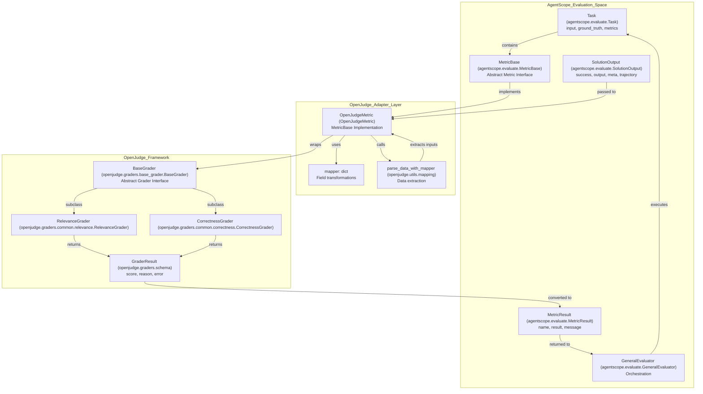
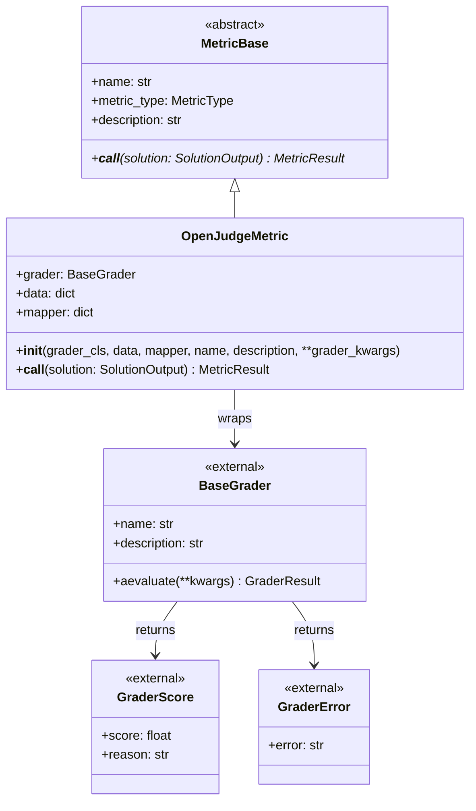
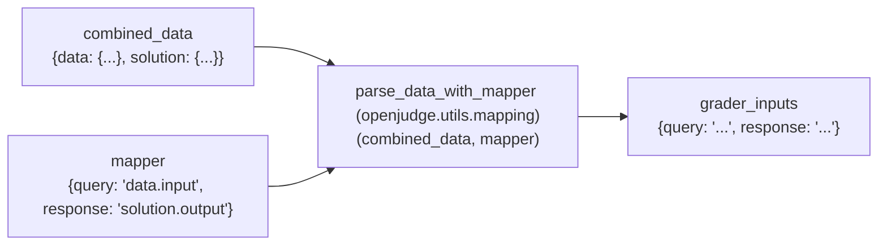
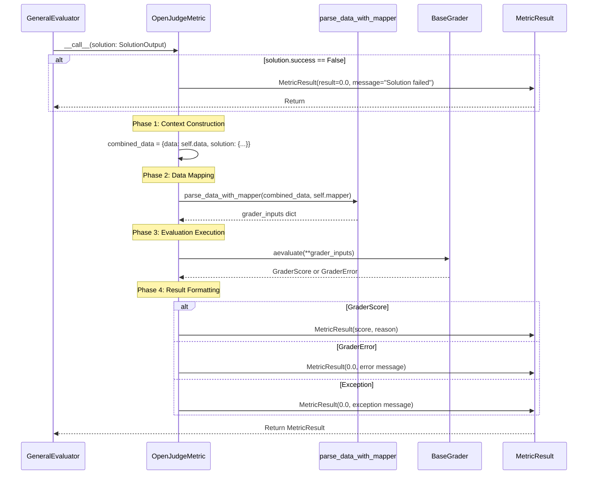
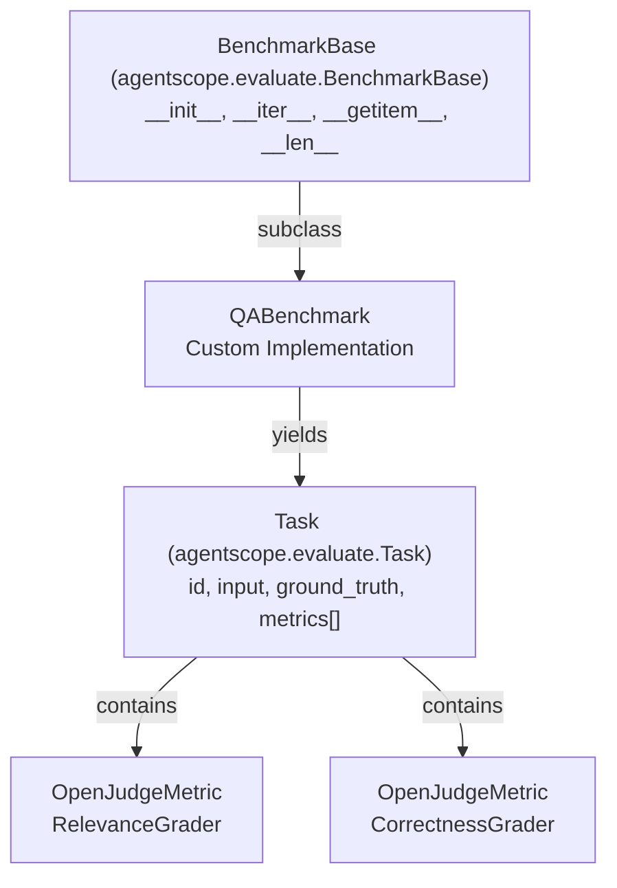
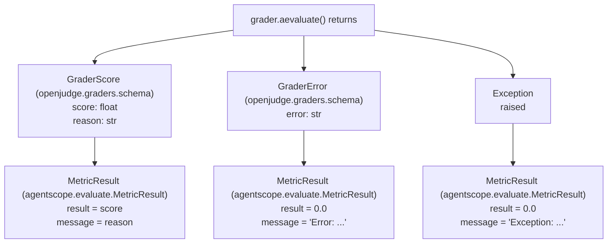
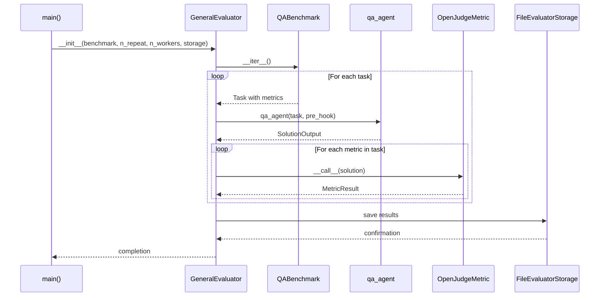

<!-- source: DeepWiki mcp.deepwiki.com · repo modelscope/agentscope · page 7.4 OpenJudge Integration · fetched 2026-10-26 -->

# OpenJudge Integration

<details>
<summary>Relevant source files</summary>

The following files were used as context for generating this wiki page:

- [docs/tutorial/en/index.rst](docs/tutorial/en/index.rst)
- [docs/tutorial/en/src/task_eval_openjudge.py](docs/tutorial/en/src/task_eval_openjudge.py)
- [docs/tutorial/zh_CN/index.rst](docs/tutorial/zh_CN/index.rst)
- [docs/tutorial/zh_CN/src/task_eval_openjudge.py](docs/tutorial/zh_CN/src/task_eval_openjudge.py)

</details>


## Purpose and Scope

This document describes the integration between AgentScope's evaluation framework and [OpenJudge](https://github.com/agentscope-ai/OpenJudge), an external evaluation system for LLM applications. The integration enables AgentScope users to leverage OpenJudge's 50+ pre-built graders as metrics within AgentScope's evaluation pipeline, extending evaluation capabilities from basic execution checks to semantic quality assessment across multiple dimensions (relevance, correctness, hallucination, safety, etc.).

For general evaluation concepts and the base evaluation framework, see [Evaluation Framework](#7.3). For observability and tracing, see [OpenTelemetry Integration](#7.1).

**Sources:** [docs/tutorial/en/src/task_eval_openjudge.py:1-34](), [docs/tutorial/zh_CN/src/task_eval_openjudge.py:1-32]()

## Architecture Overview

The OpenJudge integration uses an adapter pattern to bridge AgentScope's `MetricBase` abstraction with OpenJudge's `BaseGrader` interface. The adapter, `OpenJudgeMetric`, translates between AgentScope's `SolutionOutput` format and OpenJudge's grader-specific input requirements, then transforms `GraderResult` objects back into `MetricResult` objects.

### Evaluation Space Mapping

The following diagram bridges the AgentScope evaluation entities with the OpenJudge grading logic.



**Adapter Pattern Flow:**
The `OpenJudgeMetric` class implements `MetricBase.__call__(solution: SolutionOutput) -> MetricResult` and internally delegates to `BaseGrader.aevaluate(**grader_inputs) -> GraderResult`. The mapper dictionary defines field transformations from AgentScope data structures to OpenJudge input parameters.

**Sources:** [docs/tutorial/en/src/task_eval_openjudge.py:68-77](), [docs/tutorial/zh_CN/src/task_eval_openjudge.py:66-76]()

## OpenJudgeMetric Adapter Class

The `OpenJudgeMetric` class serves as the adapter implementation, providing the following architecture:



**Initialization Parameters:**
- `grader_cls`: The OpenJudge grader class (e.g., `RelevanceGrader`, `CorrectnessGrader`) [docs/tutorial/en/src/task_eval_openjudge.py:99]().
- `data`: Static task data (question, reference output, ground truth) [docs/tutorial/en/src/task_eval_openjudge.py:100]().
- `mapper`: Dictionary defining field transformations from combined data to grader inputs [docs/tutorial/en/src/task_eval_openjudge.py:101]().
- `name`: Optional metric name (defaults to `grader.name`) [docs/tutorial/en/src/task_eval_openjudge.py:102]().
- `description`: Optional metric description (defaults to `grader.description`) [docs/tutorial/en/src/task_eval_openjudge.py:103]().
- `**grader_kwargs`: Additional arguments passed to grader initialization (typically model configuration) [docs/tutorial/en/src/task_eval_openjudge.py:104]().

**Sources:** [docs/tutorial/en/src/task_eval_openjudge.py:92-116](), [docs/tutorial/zh_CN/src/task_eval_openjudge.py:89-125]()

## Data Mapping System

The mapper system transforms AgentScope's data structures into OpenJudge grader input parameters using a dot-notation path syntax.

### Mapper Structure

The mapper is a dictionary where keys are OpenJudge grader parameter names and values are dot-notation paths into the combined data structure:

```python
mapper = {
    "query": "data.input",              # Maps to static task input
    "response": "solution.output",       # Maps to agent's response
    "context": "data.ground_truth",     # Maps to static ground truth
    "reference_response": "data.reference_output"  # Maps to reference answer
}
```

### Combined Data Structure

The `OpenJudgeMetric.__call__` method constructs a combined data dictionary merging static task data with dynamic solution output:

```python
combined_data = {
    "data": self.data,                    # Static task data
    "solution": {
        "output": solution.output,        # Agent response text
        "meta": solution.meta,            # Solution metadata
        "trajectory": getattr(solution, "trajectory", [])  # Execution trace
    }
}
```

### Field Extraction Process

The `parse_data_with_mapper` function from OpenJudge extracts grader inputs using the mapper paths:



**Example Transformation:**
```
Input mapper: {"query": "data.input", "response": "solution.output"}
Input data: {"data": {"input": "What is AI?"}, "solution": {"output": "AI is..."}}
Output: {"query": "What is AI?", "response": "AI is..."}
```

**Sources:** [docs/tutorial/en/src/task_eval_openjudge.py:127-153](), [docs/tutorial/zh_CN/src/task_eval_openjudge.py:136-153]()

## Evaluation Execution Flow

The complete evaluation flow involves four distinct phases executed within the `OpenJudgeMetric.__call__` method:



### Phase Implementations

**Phase 1: Context Construction** [docs/tutorial/en/src/task_eval_openjudge.py:129-137]()
Combines static task data with dynamic agent solution into unified structure.

**Phase 2: Data Mapping** [docs/tutorial/en/src/task_eval_openjudge.py:139-144]()
Extracts grader-specific inputs using mapper paths and `parse_data_with_mapper`.

**Phase 3: Evaluation Execution** [docs/tutorial/en/src/task_eval_openjudge.py:146-147]()
Invokes `grader.aevaluate()` asynchronously with extracted inputs.

**Phase 4: Result Formatting** [docs/tutorial/en/src/task_eval_openjudge.py:149-175]()
Converts `GraderScore` (score + reason) or `GraderError` into `MetricResult` format.

**Sources:** [docs/tutorial/en/src/task_eval_openjudge.py:118-176](), [docs/tutorial/zh_CN/src/task_eval_openjudge.py:127-184]()

## Grader Types and Configuration

OpenJudge provides multiple grader categories. The integration supports all graders through the same adapter pattern.

### Common Graders

| Grader Class | Purpose | Required Inputs | Output Range |
|--------------|---------|-----------------|--------------|
| `RelevanceGrader` | Response relevance to query | `query`, `response` | 0.0 - 1.0 |
| `CorrectnessGrader` | Factual accuracy vs. reference | `query`, `response`, `reference_response`, `context` | 0.0 - 1.0 |
| `HallucinationGrader` | Detection of hallucinated content | `query`, `response`, `context` | 0.0 - 1.0 |
| `SafetyGrader` | Content safety assessment | `response` | 0.0 - 1.0 |

### Model Configuration

Graders that use LLMs for evaluation require model configuration passed via `**grader_kwargs`:

```python
model_config = {
    "model": "qwen3-32b",
    "api_key": os.environ.get("DASHSCOPE_API_KEY"),
    "base_url": "https://dashscope.aliyuncs.com/compatible-mode/v1"
}

metric = OpenJudgeMetric(
    grader_cls=RelevanceGrader,
    data=task_data,
    mapper=mapper,
    model=model_config  # Passed to grader initialization
)
```

**Sources:** [docs/tutorial/en/src/task_eval_openjudge.py:220-224](), [docs/tutorial/zh_CN/src/task_eval_openjudge.py:220-229]()

## Integration with BenchmarkBase

OpenJudge metrics integrate into AgentScope benchmarks through the `Task` object's `metrics` parameter:



### Benchmark Implementation Pattern

The typical pattern for creating a benchmark with OpenJudge metrics:

1. **Subclass `BenchmarkBase`** [docs/tutorial/en/src/task_eval_openjudge.py:206-215]()
2. **Load dataset** in `_load_data()` method
3. **Configure model** for LLM-based graders
4. **Define mapper** for each task type
5. **Instantiate metrics** via `OpenJudgeMetric` wrapper
6. **Create tasks** with metrics attached
7. **Implement iteration** methods (`__iter__`, `__getitem__`, `__len__`)

**Example Implementation:**

```python
class QABenchmark(BenchmarkBase):
    def __init__(self):
        super().__init__(
            name="QA Quality Benchmark",
            description="Benchmark using OpenJudge graders"
        )
        self.dataset = self._load_data()
    
    def _load_data(self):
        tasks = []
        model_config = {...}  # LLM configuration
        
        for data in DATASET:
            mapper = {
                "query": "data.input",
                "response": "solution.output",
                "context": "data.ground_truth"
            }
            
            metrics = [
                OpenJudgeMetric(RelevanceGrader, data, mapper, model=model_config),
                OpenJudgeMetric(CorrectnessGrader, data, mapper, model=model_config)
            ]
            
            tasks.append(Task(id=data["id"], input=data["question"], 
                            ground_truth=data["ground_truth"], metrics=metrics))
        
        return tasks
```

**Sources:** [docs/tutorial/en/src/task_eval_openjudge.py:206-276](), [docs/tutorial/zh_CN/src/task_eval_openjudge.py:213-278]()

## Result Structure and Interpretation

The `MetricResult` objects returned from OpenJudge graders contain three key fields:

### MetricResult Fields

| Field | Type | Description |
|-------|------|-------------|
| `name` | `str` | Metric name (e.g., "Relevance", "Correctness") |
| `result` | `float` | Numerical score (0.0-1.0 for most graders) |
| `message` | `str` | Detailed reasoning or error message from grader |

### Result Type Handling



The `message` field preserves OpenJudge's detailed reasoning, enabling qualitative analysis alongside quantitative scoring.

**Sources:** [docs/tutorial/en/src/task_eval_openjudge.py:149-175](), [docs/tutorial/zh_CN/src/task_eval_openjudge.py:158-184]()

## Dependencies and Installation

The OpenJudge integration requires two packages:

```bash
pip install agentscope py-openjudge
```

**Package Roles:**
- `agentscope`: Provides evaluation framework (`MetricBase`, `BenchmarkBase`, `GeneralEvaluator`)
- `py-openjudge`: Provides grader implementations and utility functions

**Required Imports:**

```python
# OpenJudge components
from openjudge.graders.base_grader import BaseGrader
from openjudge.graders.schema import GraderScore, GraderError
from openjudge.utils.mapping import parse_data_with_mapper

# Specific graders (examples)
from openjudge.graders.common.relevance import RelevanceGrader
from openjudge.graders.common.correctness import CorrectnessGrader

# AgentScope components
from agentscope.evaluate import (
    MetricBase, MetricType, MetricResult, SolutionOutput,
    Task, BenchmarkBase, GeneralEvaluator
)
```

**Sources:** [docs/tutorial/en/src/task_eval_openjudge.py:10-16](), [docs/tutorial/en/src/task_eval_openjudge.py:81-89](), [docs/tutorial/en/src/task_eval_openjudge.py:198-203]()

## Execution with GeneralEvaluator

The complete evaluation execution uses `GeneralEvaluator` to run benchmarks with OpenJudge metrics:



**Evaluator Configuration:**

| Parameter | Type | Purpose |
|-----------|------|---------|
| `name` | `str` | Evaluation session name |
| `benchmark` | `BenchmarkBase` | Benchmark containing tasks with metrics |
| `n_repeat` | `int` | Number of repetitions per task |
| `n_workers` | `int` | Parallel worker count |
| `storage` | `EvaluatorStorage` | Results persistence (e.g., `FileEvaluatorStorage`) |

**Example Usage:**

```python
async def main():
    evaluator = GeneralEvaluator(
        name="OpenJudge Integration Demo",
        benchmark=QABenchmark(),
        n_repeat=1,
        storage=FileEvaluatorStorage(save_dir="./results"),
        n_workers=1
    )
    
    await evaluator.run(qa_agent)
```

**Sources:** [docs/tutorial/en/src/task_eval_openjudge.py:328-342](), [docs/tutorial/zh_CN/src/task_eval_openjudge.py:326-340]()

---

