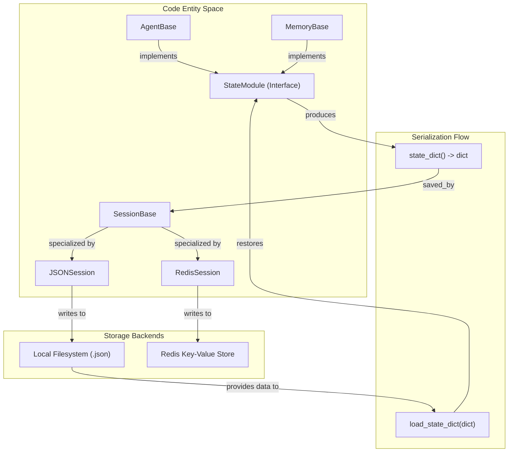
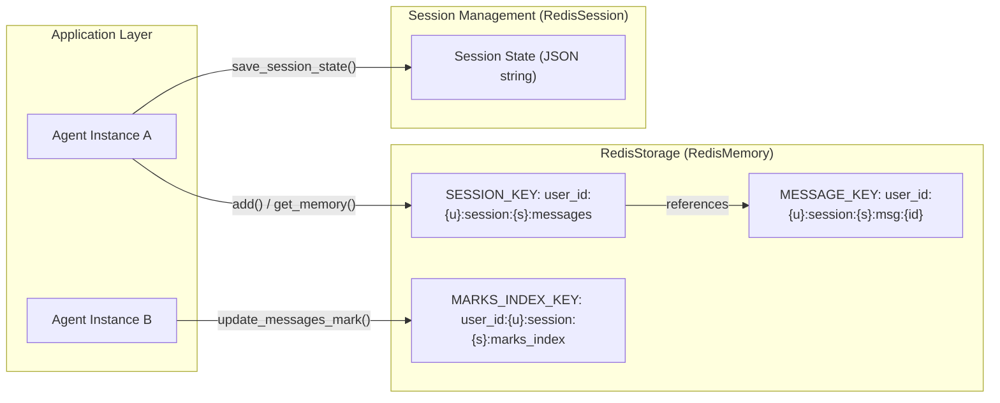

<!-- source: DeepWiki mcp.deepwiki.com · repo modelscope/agentscope · page 8 Production and Deployment · fetched 2026-10-26 -->

# Production and Deployment

<details>
<summary>Relevant source files</summary>

The following files were used as context for generating this wiki page:

- [examples/functionality/vector_store/oceanbase/README.md](examples/functionality/vector_store/oceanbase/README.md)
- [examples/functionality/vector_store/oceanbase/main.py](examples/functionality/vector_store/oceanbase/main.py)
- [pyproject.toml](pyproject.toml)
- [src/agentscope/memory/_working_memory/_redis_memory.py](src/agentscope/memory/_working_memory/_redis_memory.py)
- [src/agentscope/rag/__init__.py](src/agentscope/rag/__init__.py)
- [src/agentscope/rag/_store/__init__.py](src/agentscope/rag/_store/__init__.py)
- [src/agentscope/rag/_store/_oceanbase_store.py](src/agentscope/rag/_store/_oceanbase_store.py)
- [src/agentscope/session/__init__.py](src/agentscope/session/__init__.py)
- [src/agentscope/session/_json_session.py](src/agentscope/session/_json_session.py)
- [src/agentscope/session/_redis_session.py](src/agentscope/session/_redis_session.py)
- [src/agentscope/session/_session_base.py](src/agentscope/session/_session_base.py)
- [tests/memory_test.py](tests/memory_test.py)
- [tests/rag_knowledge_test.py](tests/rag_knowledge_test.py)
- [tests/rag_store_test.py](tests/rag_store_test.py)
- [tests/session_test.py](tests/session_test.py)

</details>


This page provides high-level guidance for transitioning AgentScope applications from development to production environments. It covers state management, package organization, and distributed deployment patterns.

Production-ready systems require robust state persistence, optimized dependency management, and scalable infrastructure. AgentScope addresses these needs through a modular architecture supporting various backends and serialization protocols.

---

## State Serialization and Checkpointing

To ensure reliability and support long-running agentic workflows, AgentScope provides a standardized state management system based on the `StateModule` interface. This allows components to save and restore their internal configurations, memory, and history.

### Serialization Architecture

The core of AgentScope's persistence is the `state_dict` and `load_state_dict` pattern, similar to popular deep learning frameworks. This pattern is implemented across agents, memory modules, and session managers to provide a consistent checkpointing API.

**Code Entity Mapping Diagram**
This diagram bridges the high-level persistence concepts to the specific code entities that implement them.



**Sources:** [src/agentscope/session/_session_base.py:8-49](), [src/agentscope/session/_json_session.py:12-131](), [src/agentscope/session/_redis_session.py:17-182]()

For details on implementing custom stateful modules and using checkpointing strategies, see [State Serialization and Checkpointing](#8.1).

---

## Package Structure and Dependencies

AgentScope is designed with a "lean core" philosophy. While the framework supports a vast array of models, vector databases, and tools, these are organized into optional dependency groups in `pyproject.toml` to keep production images small and minimize security attack surfaces.

### Dependency Groups

Production deployments should only install the necessary extras. For example, a RAG-enabled production service using Redis for memory would use a specific installation command:

```bash
pip install agentscope[rag,redis_memory]
```

| Group | Key Dependencies | Purpose |
| :--- | :--- | :--- |
| `core` | `openai`, `dashscope`, `anthropic`, `mcp` | Base framework and primary LLM clients |
| `rag` | `pypdf`, `qdrant-client`, `pymilvus` | Document parsing and vector database support |
| `memory` | `redis`, `mem0ai`, `reme-ai` | Distributed and long-term memory backends |
| `realtime` | `websockets`, `scipy` | Low-latency voice and multimodal interactions |
| `vdbs` | `qdrant-client`, `pymilvus`, `pyobvector` | Specialized vector database drivers |

**Sources:** [pyproject.toml:22-165](), [src/agentscope/rag/__init__.py:1-47]()

For details on the package organization and a full list of dependency groups, see [Package Structure and Dependencies](#8.2).

---

## Production Deployment Patterns

In production, agents often need to handle multiple users simultaneously across distributed instances. AgentScope supports this through Redis-backed memory and session management, providing multi-tenancy and horizontal scalability.

### Multi-Tenant Redis Architecture

The `RedisMemory` and `RedisSession` classes use structured key patterns to isolate data between different users and sessions. This allows a single Redis cluster to serve a fleet of agent instances.

**Distributed State Mapping Diagram**
This diagram maps the logical multi-tenant structure to the specific Redis key patterns used in the codebase.



**Key Features for Production:**
- **Sliding TTL**: The `key_ttl` parameter in `RedisMemory` allows for automatic cleanup of inactive sessions by refreshing expiration on every access [src/agentscope/memory/_working_memory/_redis_memory.py:102-107]().
- **Prefix Isolation**: The `key_prefix` argument supports isolating multiple applications or environments (e.g., "prod", "staging") within the same Redis instance [src/agentscope/memory/_working_memory/_redis_memory.py:98-101]().
- **Mark Indexing**: `RedisMemory` maintains a `marks_index` (Redis Set) to efficiently track session marks without expensive key scanning [src/agentscope/memory/_working_memory/_redis_memory.py:29-35]().
- **VDB Scalability**: Production RAG setups can utilize distributed vector stores like `OceanBaseStore` or `MilvusLiteStore` [src/agentscope/rag/_store/__init__.py:1-20]().

**Sources:** [src/agentscope/memory/_working_memory/_redis_memory.py:16-107](), [src/agentscope/session/_redis_session.py:17-182](), [tests/memory_test.py:106-227](), [src/agentscope/rag/_store/_oceanbase_store.py:38-107]()

For details on scaling, TTL management, and Redis-based multi-tenancy, see [Production Deployment Patterns](#8.3).

---

