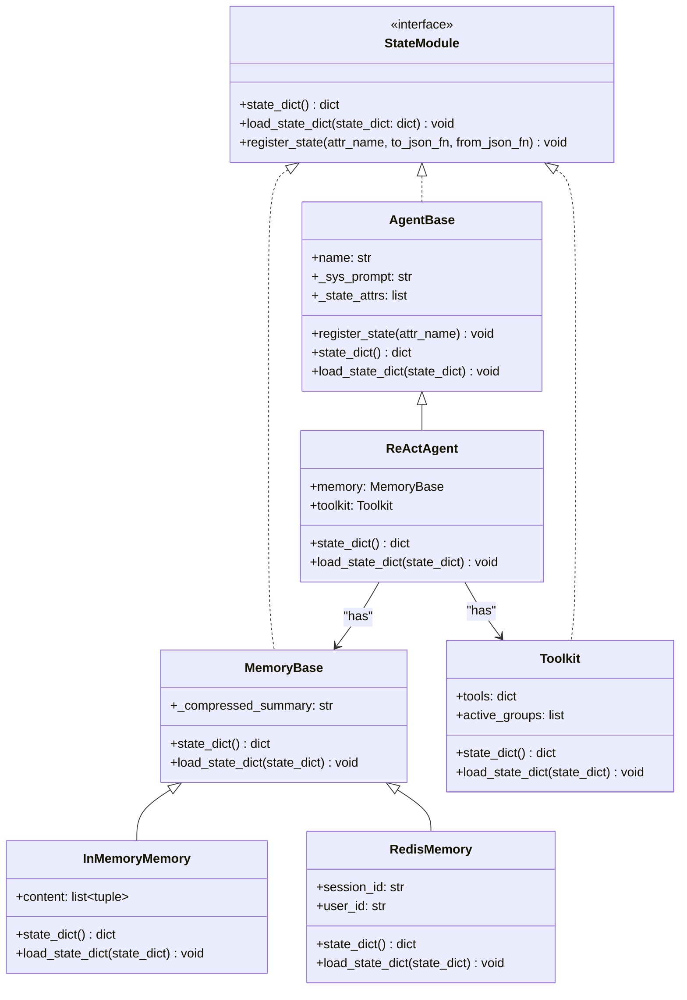
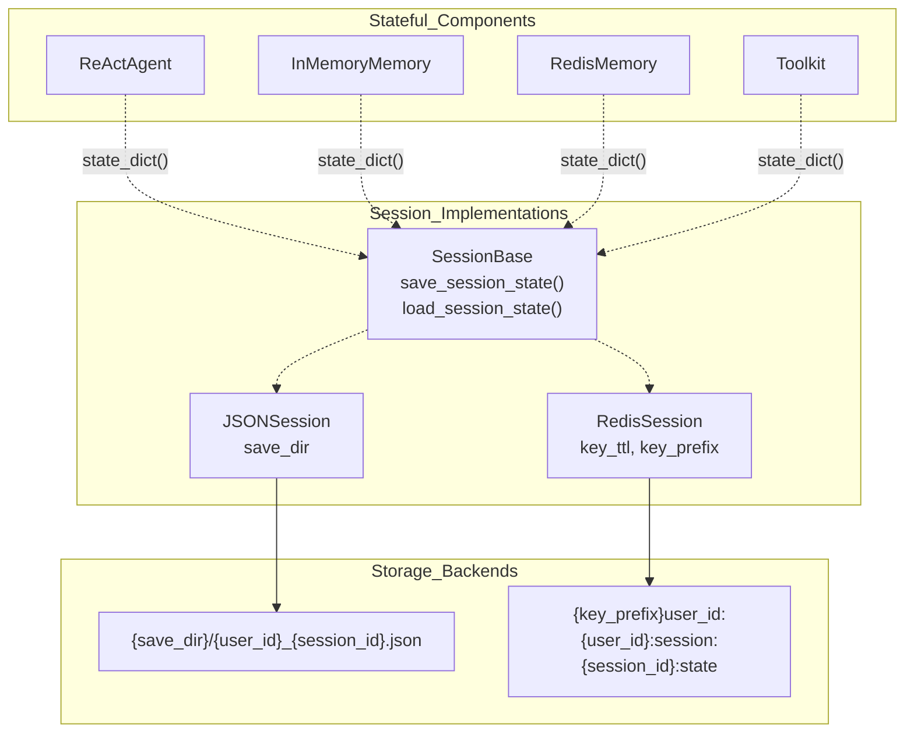
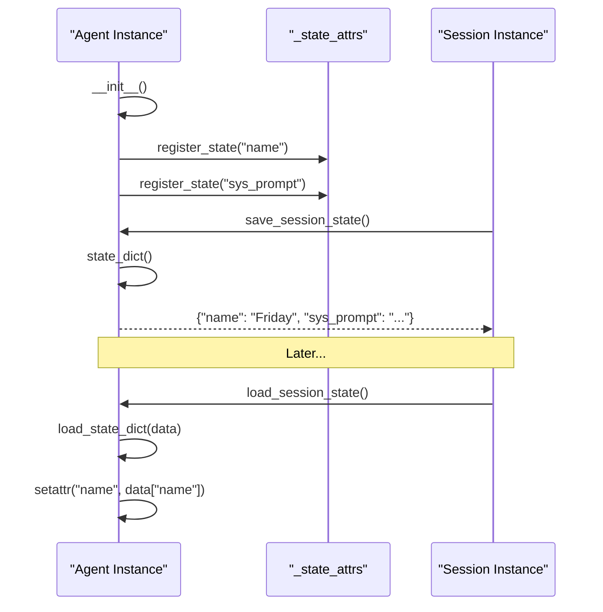
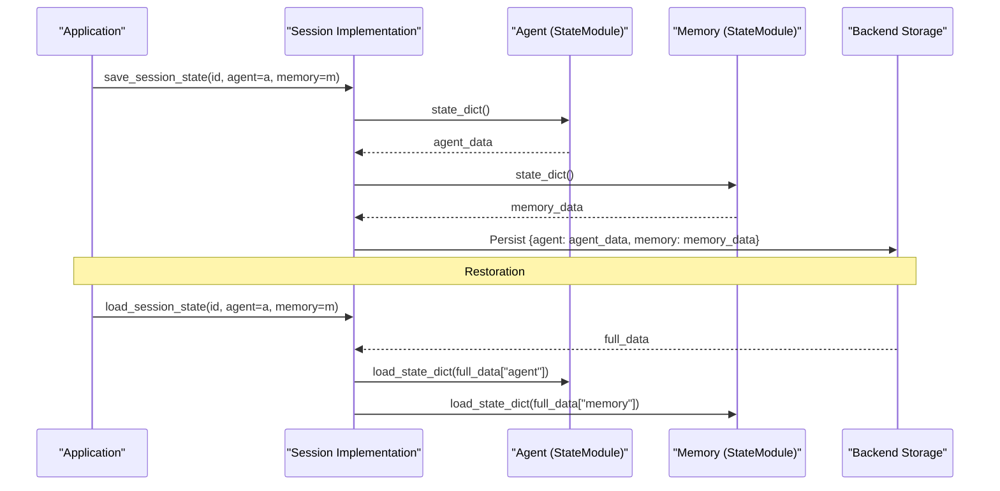

<!-- source: DeepWiki mcp.deepwiki.com · repo modelscope/agentscope · page 8.1 State Serialization and Checkpointing · fetched 2026-10-26 -->

# State Serialization and Checkpointing

<details>
<summary>Relevant source files</summary>

The following files were used as context for generating this wiki page:

- [docs/tutorial/en/src/task_state.py](docs/tutorial/en/src/task_state.py)
- [docs/tutorial/zh_CN/src/task_state.py](docs/tutorial/zh_CN/src/task_state.py)
- [examples/functionality/session_with_sqlite/README.md](examples/functionality/session_with_sqlite/README.md)
- [examples/functionality/session_with_sqlite/main.py](examples/functionality/session_with_sqlite/main.py)
- [examples/functionality/session_with_sqlite/sqlite_session.py](examples/functionality/session_with_sqlite/sqlite_session.py)
- [src/agentscope/memory/_working_memory/_redis_memory.py](src/agentscope/memory/_working_memory/_redis_memory.py)
- [src/agentscope/session/__init__.py](src/agentscope/session/__init__.py)
- [src/agentscope/session/_json_session.py](src/agentscope/session/_json_session.py)
- [src/agentscope/session/_redis_session.py](src/agentscope/session/_redis_session.py)
- [src/agentscope/session/_session_base.py](src/agentscope/session/_session_base.py)
- [tests/memory_test.py](tests/memory_test.py)
- [tests/session_test.py](tests/session_test.py)

</details>


State serialization and checkpointing in AgentScope enables experiment reproducibility, conversation resumption, and failure recovery by persisting agent configurations, memory contents, and execution state. This page documents the `StateModule` interface, session management classes (`JSONSession`, `RedisSession`), and how components like agents, memory, and toolkits implement state persistence.

For runtime observability and tracing of agent executions, see [OpenTelemetry Integration](#7.1). For managing conversation history in memory, see [Working Memory Architecture](#5.1) and [Session State Management](#5.4).

## StateModule Interface

The `StateModule` interface defines a standardized pattern for state serialization across all AgentScope components. Any class implementing this interface can be persisted and restored via session management. [src/agentscope/module.py]() (Note: `StateModule` is imported in [src/agentscope/session/_json_session.py:9]()).

**StateModule Class Hierarchy**



**Core Methods:**

- **`state_dict()`**: Returns a dictionary containing all serializable state. The returned dictionary must contain only JSON-serializable types. [docs/tutorial/en/src/task_state.py:46-48]()
- **`load_state_dict(state_dict)`**: Restores state from a dictionary previously returned by `state_dict()`. [docs/tutorial/en/src/task_state.py:49-52]()
- **`register_state(attr_name)`**: Explicitly registers an attribute to be included in the state dictionary. [docs/tutorial/en/src/task_state.py:41-45]()

**Sources:** [src/agentscope/session/_session_base.py:1-49](), [docs/tutorial/en/src/task_state.py:33-60](), [tests/session_test.py:16-41]()

## Session Management Architecture

Sessions provide the top-level abstraction for saving and loading state from multiple components simultaneously. AgentScope provides `JSONSession` for file-based persistence and `RedisSession` for distributed, TTL-aware persistence.

**Session Architecture**



**SessionBase Interface:**

[src/agentscope/session/_session_base.py:8-49]() defines two abstract methods:

| Method | Parameters | Purpose |
|--------|-----------|---------|
| `save_session_state` | `session_id`, `user_id`, `**state_modules_mapping` | Save state from multiple components. [src/agentscope/session/_session_base.py:12-27]() |
| `load_session_state` | `session_id`, `user_id`, `allow_not_exist`, `**state_modules_mapping` | Load state into multiple components. [src/agentscope/session/_session_base.py:29-48]() |

**Sources:** [src/agentscope/session/_session_base.py:1-49](), [src/agentscope/session/_json_session.py:12-131](), [src/agentscope/session/_redis_session.py:17-210]()

### JSONSession Implementation

`JSONSession` persists state to JSON files on the local filesystem. The file path is constructed as `{save_dir}/{user_id}_{session_id}.json`. [src/agentscope/session/_json_session.py:27-45]()

**Serialization Process:**
[src/agentscope/session/_json_session.py:47-74]() shows the save operation:
1. Call `state_dict()` on each provided `StateModule`.
2. Map module names to their state dictionaries.
3. Write the resulting nested dictionary to a JSON file using `aiofiles`. [src/agentscope/session/_json_session.py:68-74]()

**Sources:** [src/agentscope/session/_json_session.py:1-131](), [tests/session_test.py:52-88]()

### RedisSession Implementation

`RedisSession` persists state to Redis with optional TTL support, enabling distributed session management. [src/agentscope/session/_redis_session.py:17-35]()

**Redis Key Structure:**
The key pattern is defined in [src/agentscope/session/_redis_session.py:20-23]():
`user_id:{user_id}:session:{session_id}:state`

**TTL Behavior:**
[src/agentscope/session/_redis_session.py:49-52]() documents the sliding TTL mechanism:
- On `save_session_state`: Sets key with `ex=key_ttl`. [src/agentscope/session/_redis_session.py:125]()
- On `load_session_state`: Uses `GETEX` to refresh TTL while retrieving. [src/agentscope/session/_redis_session.py:152]()

**Sources:** [src/agentscope/session/_redis_session.py:1-210](), [tests/session_test.py:104-161]()

### Custom SQLite Session Implementation

Users can implement custom backends by inheriting from `SessionBase`. The codebase provides an example `SqliteSession` that stores JSON-serialized state in an `as_session` table. [examples/functionality/session_with_sqlite/sqlite_session.py:12-168]()

**Sources:** [examples/functionality/session_with_sqlite/sqlite_session.py:1-168](), [examples/functionality/session_with_sqlite/main.py:1-77]()

## Memory State Serialization

Memory classes implement `StateModule` to persist conversation history and compressed summaries.

### InMemoryMemory vs RedisMemory

- **`InMemoryMemory`**: Serializes the full message history and the `_compressed_summary`. [tests/session_test.py:64-75]()
- **`RedisMemory`**: While it inherits from `MemoryBase`, its primary state is stored directly in Redis keys rather than a local dictionary. The `RedisMemory` implementation maintains a `marks_index` (Redis Set) and `SESSION_KEY` (Redis List) for efficient message tracking. [src/agentscope/memory/_working_memory/_redis_memory.py:29-63]()

**RedisMemory Key Patterns:**
| Key Type | Pattern |
|----------|---------|
| Session Messages | `user_id:{user_id}:session:{session_id}:messages` | [src/agentscope/memory/_working_memory/_redis_memory.py:43]() |
| Individual Message | `user_id:{user_id}:session:{session_id}:msg:{msg_id}` | [src/agentscope/memory/_working_memory/_redis_memory.py:57]() |
| Marks Index | `user_id:{user_id}:session:{session_id}:marks_index` | [src/agentscope/memory/_working_memory/_redis_memory.py:60]() |

**Sources:** [src/agentscope/memory/_working_memory/_redis_memory.py:16-192](), [tests/memory_test.py:106-227]()

## Agent State Registration

Agents use `register_state()` to declare which attributes should be persisted. [docs/tutorial/en/src/task_state.py:63-80]()



**Sources:** [tests/session_test.py:16-41](), [docs/tutorial/en/src/task_state.py:63-138]()

## Complete Save/Load Flow

The sequence for checkpointing an entire multi-agent system involves the session class coordinating `state_dict()` calls across all registered modules.

**Complete Save/Load Sequence**



**Sources:** [src/agentscope/session/_json_session.py:47-118](), [src/agentscope/session/_redis_session.py:101-178](), [tests/session_test.py:52-95]()

## Usage Patterns

### Checkpointing with JSONSession
```python
session = JSONSession(save_dir="./checkpoints")
# Save
await session.save_session_state(session_id="user_1", agent=my_agent)
# Load
await session.load_session_state(session_id="user_1", agent=my_agent)
```
[docs/tutorial/en/src/task_state.py:168-212]()

### Checkpointing with RedisSession
```python
session = RedisSession(host="localhost", key_ttl=3600)
# Save
await session.save_session_state(session_id="session_123", agent=my_agent)
```
[src/agentscope/session/_redis_session.py:36-59]()

**Sources:** [docs/tutorial/en/src/task_state.py:168-212](), [src/agentscope/session/_redis_session.py:101-178](), [tests/session_test.py:122-156]()

---

