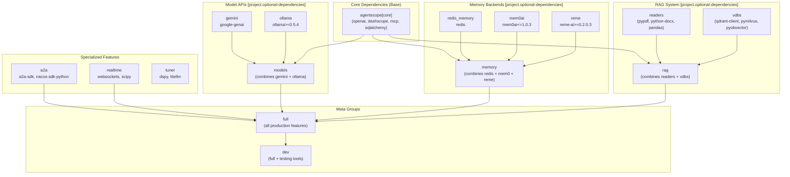
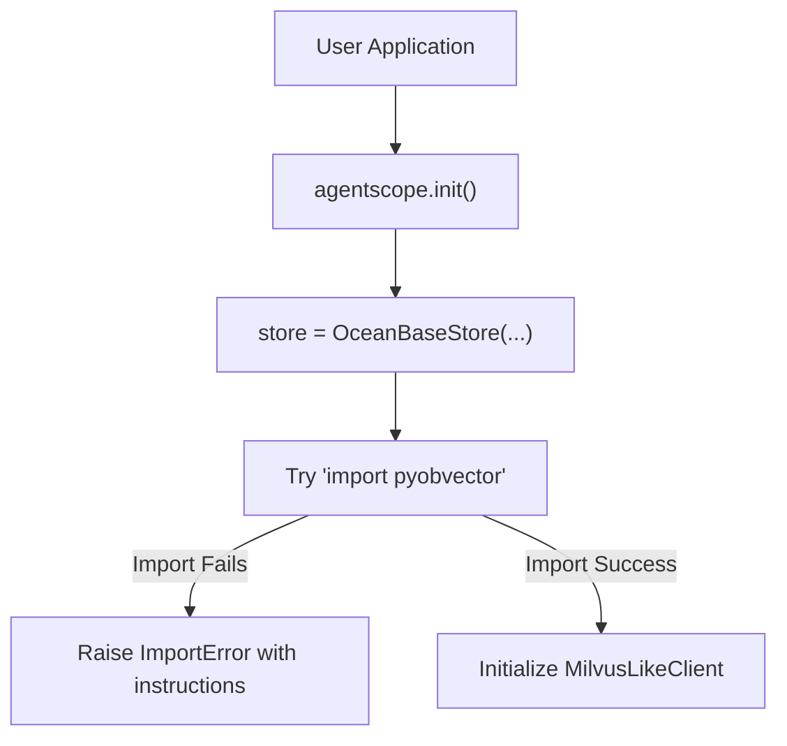

<!-- source: DeepWiki mcp.deepwiki.com · repo modelscope/agentscope · page 8.2 Package Structure and Dependencies · fetched 2026-10-26 -->

# Package Structure and Dependencies

Relevant source files

The following files were used as context for generating this wiki page:

- [.github/workflows/publish-pypi.yml](.github/workflows/publish-pypi.yml)
- [.github/workflows/sphinx_docs.yml](.github/workflows/sphinx_docs.yml)
- [.github/workflows/stale.yml](.github/workflows/stale.yml)
- [.github/workflows/toc.yml](.github/workflows/toc.yml)
- [.pre-commit-config.yaml](.pre-commit-config.yaml)
- [examples/agent/voice_agent/README.md](examples/agent/voice_agent/README.md)
- [examples/functionality/vector_store/oceanbase/README.md](examples/functionality/vector_store/oceanbase/README.md)
- [examples/functionality/vector_store/oceanbase/main.py](examples/functionality/vector_store/oceanbase/main.py)
- [pyproject.toml](pyproject.toml)
- [src/agentscope/model/_model_response.py](src/agentscope/model/_model_response.py)
- [src/agentscope/rag/__init__.py](src/agentscope/rag/__init__.py)
- [src/agentscope/rag/_store/__init__.py](src/agentscope/rag/_store/__init__.py)
- [src/agentscope/rag/_store/_oceanbase_store.py](src/agentscope/rag/_store/_oceanbase_store.py)
- [tests/rag_knowledge_test.py](tests/rag_knowledge_test.py)
- [tests/rag_store_test.py](tests/rag_store_test.py)

This document describes the organization of dependencies in the AgentScope package, including the core dependency structure, optional dependency groups, installation patterns, and the lazy loading principle that keeps the framework lightweight.

## Core Project Structure

The AgentScope project uses a modern Python packaging structure defined in `pyproject.toml` with source code organized under `src/agentscope/`.

### Project Metadata

The project follows these organizational principles:

| Aspect | Configuration |
|--------|--------------|
| **Package Name** | `agentscope` [pyproject.toml:3-3]() |
| **Python Version** | `>=3.10` [pyproject.toml:21-21]() |
| **Source Location** | `src/agentscope/` (using `src` layout) [pyproject.toml:196-196]() |
| **Version Management** | Dynamic, loaded from `agentscope._version.__version__` [pyproject.toml:207-207]() |
| **Build Backend** | `setuptools.build_meta` [pyproject.toml:204-204]() |

**Sources:** [pyproject.toml:1-207]()

## Dependency Architecture

AgentScope employs a **modular dependency architecture** where core functionality requires minimal dependencies, while advanced features are available through optional dependency groups. This design ensures that basic usage remains lightweight while allowing developers to install only the components they need.

### Dependency Group Hierarchy
This diagram shows how optional dependencies are organized into groups in `pyproject.toml`. Leaf nodes represent actual PyPI packages, while intermediate nodes are convenience groups that combine related dependencies.

**Natural Language to Code Entity: Dependency Mapping**

**Sources:** [pyproject.toml:47-188]()

### Core Dependencies

The following dependencies are always installed with AgentScope and provide essential functionality:

| Dependency | Purpose | Version Constraint |
|------------|---------|-------------------|
| `openai` | OpenAI API client & compatible APIs | - |
| `dashscope` | Alibaba DashScope API client | - |
| `anthropic` | Anthropic API client | - |
| `mcp` | Model Context Protocol for tools | `>=1.13` |
| `sqlalchemy` | SQL abstraction for `AsyncSQLAlchemyMemory` | - |
| `opentelemetry-sdk` | Observability and tracing | `>=1.39.0` |
| `json_repair` | Handling malformed LLM JSON outputs | - |
| `tiktoken` | Token counting for OpenAI models | - |
| `aiofiles` | Asynchronous file I/O operations | - |

**Sources:** [pyproject.toml:22-45]()

### Optional Dependency Groups

AgentScope organizes optional dependencies into logical groups to avoid "dependency bloat."

#### Model API Groups
The `models` group adds support for additional providers beyond the core set.
- **`gemini`**: Adds Google Gemini support via `google-genai` [pyproject.toml:60-60]().
- **`ollama`**: Adds local model support via `ollama>=0.5.4` [pyproject.toml:61-61]().

#### Memory Groups
While `InMemoryMemory` is core, specialized backends require optional groups.
- **`redis_memory`**: Enables `RedisMemory` for distributed scenarios [pyproject.toml:75-75]().
- **`mem0ai`**: Integrates `Mem0LongTermMemory` [pyproject.toml:77-80]().
- **`reme`**: Integrates `ReMeLongTermMemoryBase` implementations [pyproject.toml:81-81]().

#### RAG Component Groups
The RAG (Retrieval-Augmented Generation) system separates document readers from vector database stores.

| Group | Dependencies | Code Entity Mapping |
|-------|-------------|---------------------|
| `pdf-reader` | `pypdf<=6.5.0` | `PDFReader` [src/agentscope/rag/__init__.py:11-11]() |
| `docx-reader` | `python-docx` | `WordReader` [src/agentscope/rag/__init__.py:13-13]() |
| `excel-reader` | `pandas`, `openpyxl` | `ExcelReader` [src/agentscope/rag/__init__.py:14-14]() |
| `qdrant` | `qdrant-client==1.15.1` | `QdrantStore` [src/agentscope/rag/_store/__init__.py:7-7]() |
| `milvus` | `pymilvus[milvus_lite]` | `MilvusLiteStore` [src/agentscope/rag/_store/__init__.py:8-8]() |
| `oceanbase` | `pyobvector>=0.2.0,<0.3.0`| `OceanBaseStore` [src/agentscope/rag/_store/__init__.py:9-9]() |

**Sources:** [pyproject.toml:88-137](), [src/agentscope/rag/__init__.py:4-26]()

## Lazy Loading Principle

AgentScope follows a **strict lazy loading principle** for optional dependencies. Libraries are only imported when the specific class (e.g., a Vector Store or a specific Reader) is instantiated or used.

### Implementation Pattern: OceanBaseStore
The `OceanBaseStore` demonstrates how AgentScope handles optional libraries without requiring them at the top-level package import.

**Data Flow: Lazy Driver Loading**

**Code Implementation:**
In `src/agentscope/rag/_store/_oceanbase_store.py`, the `pyobvector` library is imported inside the `__init__` method of the `OceanBaseStore` class [src/agentscope/rag/_store/_oceanbase_store.py:90-96](). If the library is missing, it raises a descriptive `ImportError` [src/agentscope/rag/_store/_oceanbase_store.py:93-96]().

**Sources:** [src/agentscope/rag/_store/_oceanbase_store.py:90-107](), [tests/rag_store_test.py:186-194]()

## Summary of Version Constraints and Conflicts

To ensure stability across a wide range of integrations, AgentScope pins specific versions for certain problematic dependencies in `pyproject.toml`:

- **`qdrant-client==1.15.1`**: Fixed to this version because `>=1.16.0` has conflicts with `pymilvus` [pyproject.toml:119-121]().
- **`pypdf<=6.5.0`**: Fixed temporarily due to issues with parsing in newer versions as of early 2025 [pyproject.toml:93-95]().
- **`pyobvector>=0.2.0,<0.3.0`**: Specific range for OceanBase vector support [pyproject.toml:125-125]().
- **`mem0ai<=1.0.3`**: Version lock for Mem0 integration stability [pyproject.toml:78-78]().

**Sources:** [pyproject.toml:78-125]()

---

