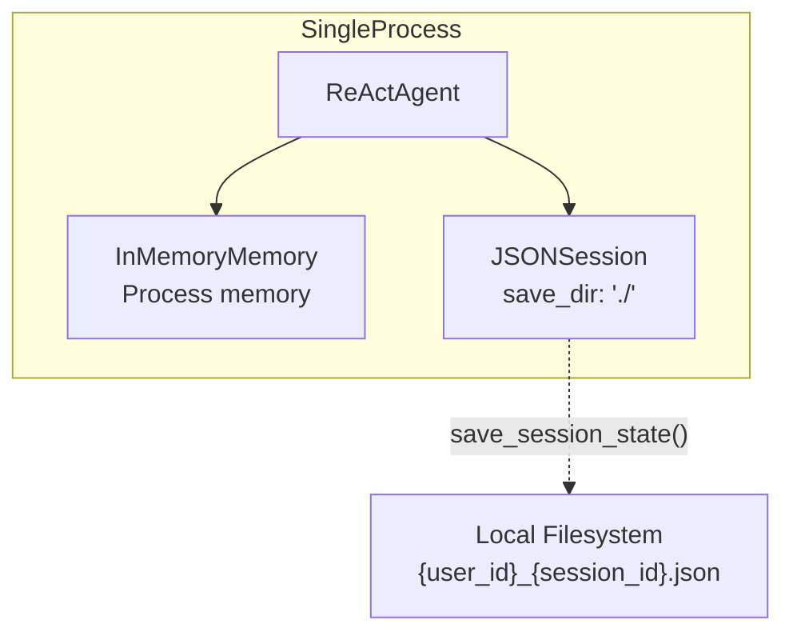
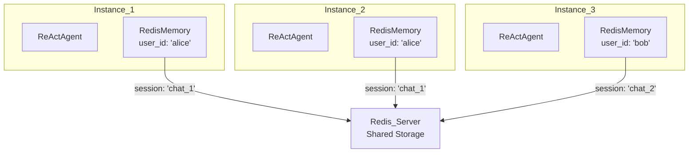
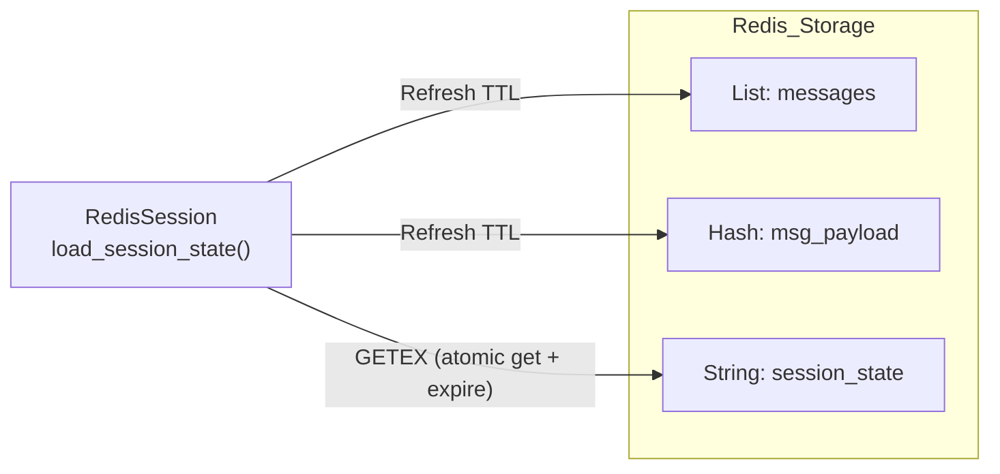
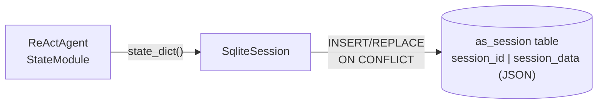
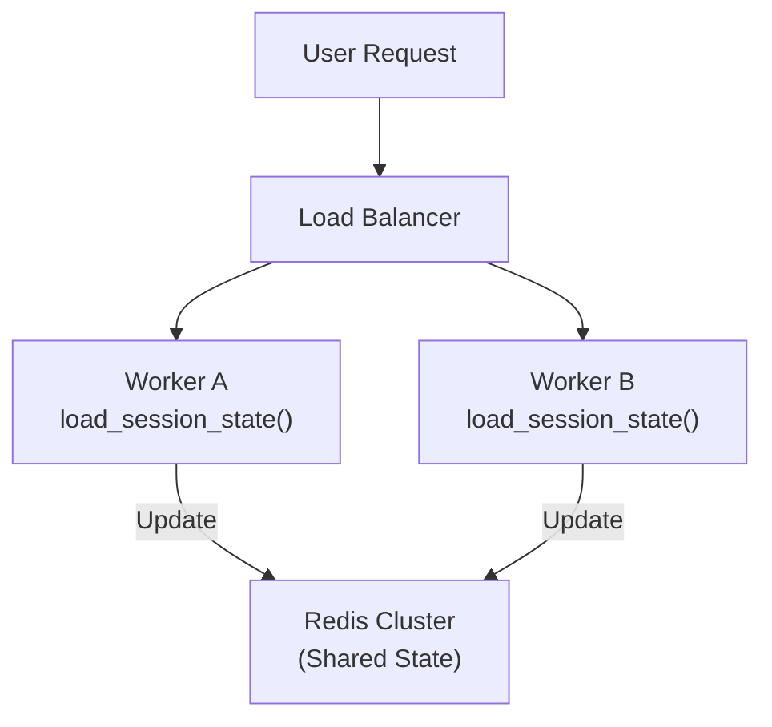

<!-- source: DeepWiki mcp.deepwiki.com · repo modelscope/agentscope · page 8.3 Production Deployment Patterns · fetched 2026-10-26 -->

# Production Deployment Patterns

Relevant source files

The following files were used as context for generating this wiki page:

- [docs/tutorial/en/src/task_state.py](docs/tutorial/en/src/task_state.py)
- [docs/tutorial/zh_CN/src/task_state.py](docs/tutorial/zh_CN/src/task_state.py)
- [examples/functionality/session_with_sqlite/README.md](examples/functionality/session_with_sqlite/README.md)
- [examples/functionality/session_with_sqlite/main.py](examples/functionality/session_with_sqlite/main.py)
- [examples/functionality/session_with_sqlite/sqlite_session.py](examples/functionality/session_with_sqlite/sqlite_session.py)
- [src/agentscope/memory/_working_memory/_redis_memory.py](src/agentscope/memory/_working_memory/_redis_memory.py)
- [src/agentscope/session/__init__.py](src/agentscope/session/__init__.py)
- [src/agentscope/session/_json_session.py](src/agentscope/session/_json_session.py)
- [src/agentscope/session/_redis_session.py](src/agentscope/session/_redis_session.py)
- [src/agentscope/session/_session_base.py](src/agentscope/session/_session_base.py)
- [tests/memory_test.py](tests/memory_test.py)
- [tests/session_test.py](tests/session_test.py)

This page documents production deployment strategies for AgentScope applications, covering distributed memory, session persistence, multi-tenancy, and scaling patterns.

## Overview

AgentScope is designed for production deployments with built-in support for:

- **Distributed memory** via Redis for multi-instance agent deployments.
- **Session persistence** for long-running conversations and checkpointing.
- **Multi-tenancy** with user/session isolation at the storage layer.
- **Horizontal scaling** with shared state across processes.
- **SQL-backed storage** for structured persistence via SQLAlchemy.

The framework supports three primary deployment models: single-instance (local), serverless functions, and container orchestration (Kubernetes).

## Memory Architecture: InMemory vs Redis vs SQL

### Single-Instance Deployments

For local or single-process deployments, `InMemoryMemory` provides fast, process-local storage. This is typically paired with `JSONSession` for local persistence.

**Sources:** [src/agentscope/session/_json_session.py:12-45](), [src/agentscope/session/_session_base.py:8-48](), [docs/tutorial/en/src/task_state.py:168-183]()

### Distributed Deployments

For multi-instance or serverless deployments, `RedisMemory` enables shared state across processes with multi-tenancy support via `user_id` and `session_id` [src/agentscope/memory/_working_memory/_redis_memory.py:16-41](). Alternatively, `AsyncSQLAlchemyMemory` can be used for database-backed persistence [tests/memory_test.py:11-13]().

**Configuration:**
`RedisMemory` supports a `key_prefix` for environment isolation (e.g., "prod", "staging") and a `key_ttl` for sliding window expiration [src/agentscope/memory/_working_memory/_redis_memory.py:65-110]().

**Sources:** [src/agentscope/memory/_working_memory/_redis_memory.py:16-135](), [tests/memory_test.py:11-13]()

## Redis Key Architecture

### Key Structure

Redis keys follow a hierarchical pattern to ensure isolation and efficient lookups [src/agentscope/memory/_working_memory/_redis_memory.py:43-64]():

| Key Pattern | Purpose | Example |
|------------|---------|---------|
| `{prefix}user_id:{user_id}:session:{session_id}:messages` | Ordered list of message IDs | `prod:user_id:alice:session:s1:messages` |
| `{prefix}user_id:{user_id}:session:{session_id}:msg:{msg_id}` | Message payload (JSON) | `prod:user_id:alice:session:s1:msg:m123` |
| `{prefix}user_id:{user_id}:session:{session_id}:mark:{mark}` | IDs for a specific mark | `prod:user_id:alice:session:s1:mark:HINT` |
| `{prefix}user_id:{user_id}:session:{session_id}:marks_index` | Set of all active marks | `prod:user_id:alice:session:s1:marks_index` |
| `{prefix}user_id:{user_id}:session:{session_id}:state` | Serialized session state | `prod:user_id:alice:session:s1:state` |

**Sources:** [src/agentscope/memory/_working_memory/_redis_memory.py:43-64](), [src/agentscope/session/_redis_session.py:20-23]()

### TTL and Expiration Strategy

The `key_ttl` parameter implements a sliding TTL. In `RedisSession`, every load operation uses `GETEX` to get and refresh the expiration in a single atomic operation [src/agentscope/session/_redis_session.py:150-154](). In `RedisMemory`, the expiration is refreshed on every access, but note that for large sessions, this involves scanning keys [src/agentscope/memory/_working_memory/_redis_memory.py:102-107]().

**Sources:** [src/agentscope/session/_redis_session.py:125-154](), [src/agentscope/memory/_working_memory/_redis_memory.py:102-107]()

## Session State Management

### Serialization Pattern

Agents and components inherit from `StateModule`, allowing them to be serialized into a dictionary via `state_dict()` and restored via `load_state_dict()` [src/agentscope/session/_json_session.py:63-66](). `StateModule` supports nested serialization, where a parent object's state automatically includes its `StateModule` children [docs/tutorial/en/src/task_state.py:59-94]().

`SessionBase` defines the interface for saving and loading these mappings [src/agentscope/session/_session_base.py:8-48]().

### Implementation Comparison

| Feature | JSONSession | RedisSession | SqliteSession (Example) |
|---------|------------|--------------|-------------------------|
| **Storage** | Local Filesystem [src/agentscope/session/_json_session.py:27-45]() | Redis Key-Value [src/agentscope/session/_redis_session.py:90-99]() | SQLite Table `as_session` [examples/functionality/session_with_sqlite/sqlite_session.py:43-53]() |
| **Concurrency** | File-based (Single Instance) | Distributed (Multi-Instance) | Multi-process (via SQLite lock) |
| **TTL Support** | Manual cleanup | Native Redis EXPIRE [src/agentscope/session/_redis_session.py:125]() | Manual cleanup |
| **Atomicity** | Depends on OS file write | Atomic GETEX/SET [src/agentscope/session/_redis_session.py:152]() | SQL Transaction [examples/functionality/session_with_sqlite/sqlite_session.py:33-66]() |

**Sources:** [src/agentscope/session/_json_session.py:12-131](), [src/agentscope/session/_redis_session.py:17-210](), [examples/functionality/session_with_sqlite/sqlite_session.py:12-168]()

## Production Deployment Patterns

### Pattern 1: Session Recovery with SQLite

For applications requiring relational persistence, a custom `SessionBase` can be implemented using SQLite or other SQL databases.

**Implementation Details:**
The `SqliteSession` example uses `sqlite3` to store `session_data` as a JSON column [examples/functionality/session_with_sqlite/sqlite_session.py:43-53](). It supports mapping multiple agents to a single session ID [examples/functionality/session_with_sqlite/main.py:52-57]().

**Sources:** [examples/functionality/session_with_sqlite/sqlite_session.py:12-168](), [examples/functionality/session_with_sqlite/main.py:16-57]()

### Pattern 2: Distributed Agent Clusters

In a distributed environment, multiple workers can serve the same session by sharing a `RedisMemory` and `RedisSession` backend.

**Sources:** [src/agentscope/session/_redis_session.py:101-178](), [src/agentscope/memory/_working_memory/_redis_memory.py:16-41]()

## Scaling Considerations

1. **Connection Pooling**: In high-concurrency environments, use the `connection_pool` argument in `RedisMemory` and `RedisSession` to avoid the overhead of creating new connections for every request [src/agentscope/memory/_working_memory/_redis_memory.py:73-134](), [src/agentscope/session/_redis_session.py:31-79]().
2. **Key Prefixing**: Use `key_prefix` to separate different applications or environments (staging vs production) within the same Redis instance [src/agentscope/memory/_working_memory/_redis_memory.py:98-101](), [src/agentscope/session/_redis_session.py:69]().
3. **Graceful Shutdown**: Always call `close()` on Redis-based components or use async context managers (`__aenter__`/`__aexit__`) to release connections back to the pool [src/agentscope/session/_redis_session.py:180-209]().

**Sources:** [src/agentscope/memory/_working_memory/_redis_memory.py:65-135](), [src/agentscope/session/_redis_session.py:17-210]()

---

