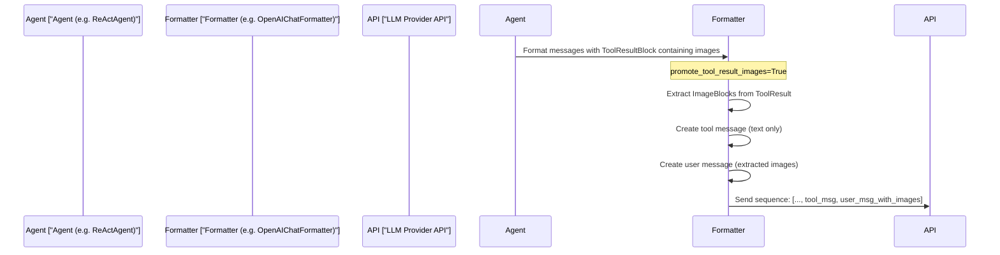
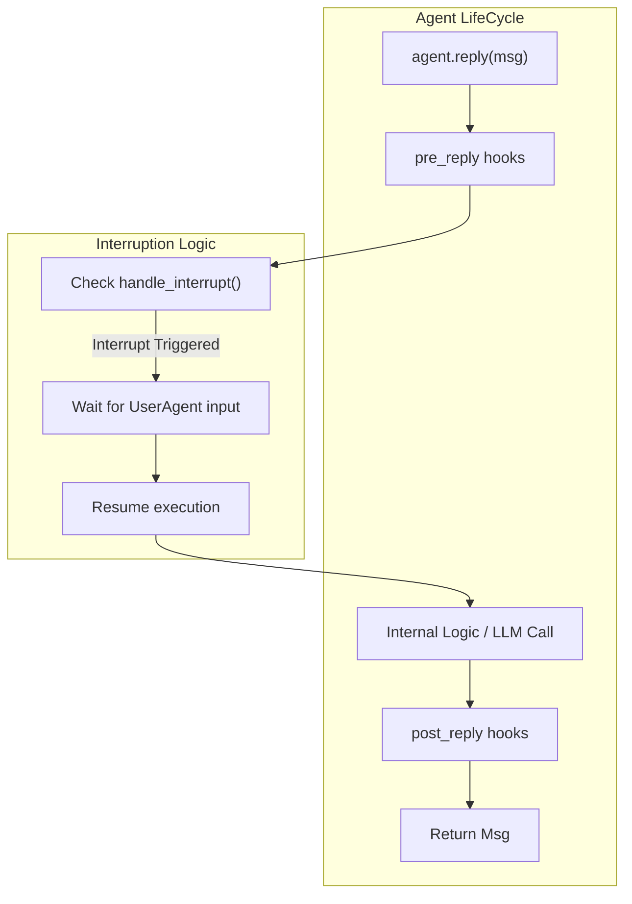
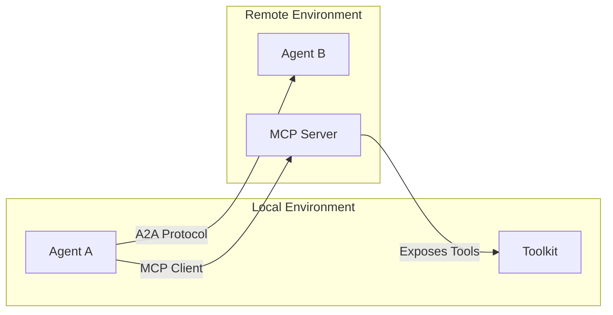

<!-- source: DeepWiki mcp.deepwiki.com · repo modelscope/agentscope · page 9 Advanced Topics · fetched 2026-10-26 -->

# Advanced Topics

<details>
<summary>Relevant source files</summary>

The following files were used as context for generating this wiki page:

- [README.md](README.md)
- [README_zh.md](README_zh.md)
- [assets/images/agentscope.png](assets/images/agentscope.png)
- [docs/tutorial/en/src/task_tracing.py](docs/tutorial/en/src/task_tracing.py)
- [docs/tutorial/zh_CN/src/task_tracing.py](docs/tutorial/zh_CN/src/task_tracing.py)

</details>


This page documents advanced features and extension mechanisms in AgentScope for power users. Topics include multimodal content handling, human intervention patterns, framework extension points, agent communication protocols, and agentic reinforcement learning. For basic agent setup and execution, see [Agent System](#2). For standard tool and memory usage, see [Tool System](#4) and [Memory and Knowledge Systems](#5).

## Multimodal Content Handling

AgentScope provides comprehensive support for multimodal content (images, audio, video) through a unified content block system. The framework handles automatic format conversion between internal representations and provider-specific API formats.

### Content Block Architecture

The message content system supports seven block types defined in the `Msg` structure:

| Block Type | Purpose | Source Types | Provider Support |
|------------|---------|--------------|------------------|
| `TextBlock` | Plain text content | N/A | Universal |
| `ImageBlock` | Image content | URL, Base64 | OpenAI, DashScope, Gemini, Anthropic |
| `AudioBlock` | Audio content | URL, Base64 | OpenAI (input_audio), DashScope |
| `VideoBlock` | Video content | URL, Base64 | DashScope, Gemini |
| `ToolUseBlock` | Tool invocation | N/A | All providers |
| `ToolResultBlock` | Tool execution result | N/A | All providers |
| `ThinkingBlock` | Reasoning traces | N/A | DeepSeek, DashScope |

**Sources**: [README.md:82-86](), [README_zh.md:80-84]()

### Source Type Handling

AgentScope supports two source types for multimodal content:

- **URLSource**: References content by URL (local file paths or web URLs).
- **Base64Source**: Embeds content directly as base64-encoded data.

The formatter layer automatically converts between these representations based on provider requirements. For example, DashScope and OpenAI formatters handle specific multimodal mapping for their respective APIs.

For details, see [Multimodal Agents](#9.1).

**Sources**: [README.md:114-115](), [README_zh.md:112-113]()

### Tool Result Image Promotion

Most LLM APIs do not support images in `tool` role messages. The `promote_tool_result_images` feature (supported in specific formatters like OpenAI and DashScope) extracts images from tool results and appends them as separate user messages to ensure the model can "see" the visual output of a tool execution.



**Sources**: [README.md:68-70](), [README_zh.md:66-68]()

## Human-in-the-Loop and Interruption

AgentScope supports interrupting agent execution for human intervention through the agent lifecycle system. This includes the `handle_interrupt` and `interrupt` methods in the base agent class, allowing users to steer agents during complex tasks.

### Interruption Mechanism

The hook system in `AgentBase` enables interruption at multiple points in the execution lifecycle. `UserAgent` is specifically designed to facilitate this interaction by capturing human input and injecting it into the message flow.



For details, see [Human-in-the-Loop and Interruption](#9.2).

**Sources**: [README.md:68-70](), [README_zh.md:66-68]()

## Extending AgentScope

AgentScope is designed for extensibility through well-defined base classes and protocols. Users can create custom agents, models, formatters, tools, and memory implementations by inheriting from the core abstractions.

### Extension Points Overview

```mermaid
graph LR
    subgraph "Model Space"
        ChatModelBase["ChatModelBase"]
        EmbeddingModelBase["EmbeddingModelBase"]
        TTSModelBase["TTSModelBase"]
    end
    
    subgraph "Agent Space"
        AgentBase["AgentBase"]
        ReActAgent["ReActAgent"]
    end
    
    subgraph "Storage Space"
        MemoryBase["MemoryBase"]
        KnowledgeBase["KnowledgeBase"]
        VDBStoreBase["VDBStoreBase"]
    end
    
    ChatModelBase -.-> ReActAgent
    AgentBase <|-- ReActAgent
    MemoryBase -.-> AgentBase
```

The framework provides specific decorators for tracing custom components to ensure they integrate with the observability suite:
- `@trace_llm`: For `ChatModelBase` implementations [docs/tutorial/en/src/task_tracing.py:113-113]()
- `@trace_reply`: For `AgentBase` implementations [docs/tutorial/en/src/task_tracing.py:114-114]()
- `@trace_format`: For `FormatterBase` implementations [docs/tutorial/en/src/task_tracing.py:115-115]()
- `@trace`: For general utility functions [docs/tutorial/en/src/task_tracing.py:116-116]()

For details, see [Extending AgentScope](#9.3).

**Sources**: [docs/tutorial/en/src/task_tracing.py:107-116](), [docs/tutorial/zh_CN/src/task_tracing.py:107-116]()

## Agent Communication Protocols

AgentScope supports multiple agent communication patterns, including direct A2A (Agent-to-Agent) protocols and MCP (Model Context Protocol) integration for tool sharing.

### A2A and MCP Integration

- **A2A Protocol**: Supports standardized communication between agents across different environments using `AgentCardResolverBase` and service discovery (e.g., Nacos) [README.md:85]().
- **MCP Integration**: Integrates with the Model Context Protocol to provide remote tool capabilities, allowing agents to use tools hosted on MCP servers [README.md:117]().



For details, see [Agent Communication Protocols](#9.4).

**Sources**: [README.md:69-85](), [README_zh.md:67-83]()

## Agentic RL and Tuner

The `agentscope.tuner` module provides infrastructure for agentic reinforcement learning and fine-tuning. It integrates with the Trinity-RFT library to optimize agent performance through automated prompt and model tuning workflows.

### RL Workflow Components

| Component | Role |
|-----------|------|
| `tune` | Main entry point for model fine-tuning via Trinity-RFT [README.md:89]() |
| `tune_prompt` | Optimization of agent system prompts using DSPy MIPROv2 |
| `TunerModelConfig` | Configuration for the model being tuned |
| `JudgeType` | Defines how agent outputs are evaluated (e.g., `select_model`) |

The system supports various `WorkflowType` options, including SFT (Supervised Fine-Tuning) and RLHF (Reinforcement Learning from Human Feedback) patterns adapted for agents.

For details, see [Agentic RL and Tuner](#9.5).

**Sources**: [README.md:89-118](), [README_zh.md:87-116]()

---

