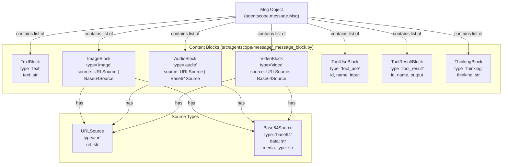
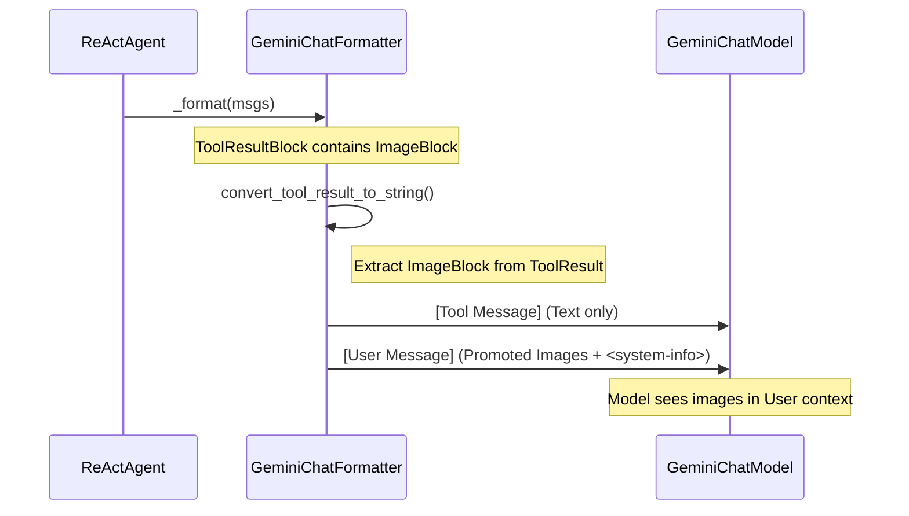

<!-- source: DeepWiki mcp.deepwiki.com · repo modelscope/agentscope · page 9.1 Multimodal Agents · fetched 2026-10-26 -->

# Multimodal Agents

<details>
<summary>Relevant source files</summary>

The following files were used as context for generating this wiki page:

- [src/agentscope/agent/_agent_base.py](src/agentscope/agent/_agent_base.py)
- [src/agentscope/formatter/_gemini_formatter.py](src/agentscope/formatter/_gemini_formatter.py)
- [src/agentscope/pipeline/__init__.py](src/agentscope/pipeline/__init__.py)
- [src/agentscope/pipeline/_functional.py](src/agentscope/pipeline/_functional.py)
- [tests/formatter_anthropic_test.py](tests/formatter_anthropic_test.py)
- [tests/formatter_deepseek_test.py](tests/formatter_deepseek_test.py)
- [tests/formatter_gemini_test.py](tests/formatter_gemini_test.py)
- [tests/formatter_ollama_test.py](tests/formatter_ollama_test.py)
- [tests/model_gemini_test.py](tests/model_gemini_test.py)
- [tests/pipeline_test.py](tests/pipeline_test.py)

</details>


## Overview

Multimodal agents in AgentScope can process and generate content beyond plain text, including images, audio, and video. This capability enables agents to work with rich media inputs from users, generate multimodal tool results, and format content appropriately for different LLM providers.

AgentScope provides a unified interface for handling these modalities through a structured content block system. It supports automatic API selection for multimodal models (like DashScope's Qwen-VL series) and sophisticated formatting strategies to ensure compatibility across different model providers.

**Supported Modalities:**
- **Images**: PNG, JPG, JPEG, GIF, WEBP, HEIC, HEIF [src/agentscope/formatter/_openai_formatter.py:75-81](), [src/agentscope/formatter/_gemini_formatter.py:135-140]()
- **Audio**: MP3, WAV, AIFF, AAC, OGG, FLAC [src/agentscope/formatter/_openai_formatter.py:108-113](), [src/agentscope/formatter/_gemini_formatter.py:147-148]()
- **Video**: MP4, MPEG, MOV, AVI, WebM, 3GPP, WMV [src/agentscope/formatter/_gemini_formatter.py:136-146]()

## Content Block Architecture

AgentScope represents multimodal content using strongly-typed content blocks embedded within `Msg` objects. Each modality has its own block type with a corresponding source specification.

### Content Block Types



**Block Type Definitions:**

| Block Type | Fields | Purpose |
|------------|--------|---------|
| `TextBlock` | `type`, `text` | Plain text content [src/agentscope/message/_message_block.py:9-15]() |
| `ImageBlock` | `type`, `source` | Image data with URL or base64 source [src/agentscope/message/_message_block.py:49-57]() |
| `AudioBlock` | `type`, `source` | Audio data with URL or base64 source [src/agentscope/message/_message_block.py:59-67]() |
| `VideoBlock` | `type`, `source` | Video data with URL or base64 source [src/agentscope/message/_message_block.py:69-77]() |
| `ToolUseBlock` | `type`, `id`, `name`, `input` | Tool call request from LLM [src/agentscope/message/_message_block.py:79-92]() |
| `ToolResultBlock` | `type`, `id`, `name`, `output` | Tool execution result (can contain multimodal blocks) [src/agentscope/message/_message_block.py:94-107]() |
| `ThinkingBlock` | `type`, `thinking` | Reasoning content (Claude, Qwen, Gemini) [src/agentscope/message/_message_block.py:18-24]() |

Sources: [src/agentscope/message/_message_block.py:1-129]()

### Source Type Specifications

**URLSource Structure:**
```python
{
    "type": "url",
    "url": str  # Can be local path, file:// URI, or web URL
}
```
Sources: [src/agentscope/message/_message_block.py:39-47]()

**Base64Source Structure:**
```python
{
    "type": "base64",
    "data": str,          # Base64-encoded data
    "media_type": str     # MIME type (e.g., "image/png", "audio/mpeg")
}
```
Sources: [src/agentscope/message/_message_block.py:26-37]()

## Source Type Processing

AgentScope provides utilities to process different source types and convert between formats as needed by various LLM providers.

### Key Utility Functions

*   **Local File Detection**: `_is_accessible_local_file(url: str)` checks if a URL points to a local file, supporting `file://` prefixes [src/agentscope/_utils/_common.py:72-78]().
*   **Web Content Fetching**: `_get_bytes_from_web_url(url: str)` fetches remote content and returns it as a base64 string if binary [src/agentscope/_utils/_common.py:134-164]().
*   **Base64 Persistence**: `_save_base64_data(media_type: str, base64_data: str)` saves encoded data to a temporary file, useful for tools that require local paths [src/agentscope/_utils/_common.py:167-189]().

## Provider-Specific Handling

### DashScope Multimodality Selection
`DashScopeChatModel` automatically switches between the text-only `Generation` API and the `MultiModalConversation` API based on the model name (e.g., models with `-vl` suffix or starting with `qvq`) or the explicit `multimodality` parameter [src/agentscope/model/_dashscope_model.py:54-69]().

### OpenAI and Compatible Models
The `OpenAIChatModel` handles multimodal inputs through its formatter. For specific models like `qwen-omni`, it applies specialized formatting such as adding the `data:;base64,` prefix to audio data to ensure compatibility with DashScope's OpenAI-compatible endpoint [src/agentscope/model/_openai_model.py:43-67]().

### Gemini Inline Data
`GeminiChatModel` processes multimodal content by converting blocks into `inline_data` objects containing base64 data and MIME types [src/agentscope/formatter/_gemini_formatter.py:25-57](). It supports a wide range of extensions including video (e.g., `.mp4`, `.mov`) and audio (e.g., `.wav`, `.mp3`) [src/agentscope/formatter/_gemini_formatter.py:134-148]().

## Tool Result Image Promotion

Most LLM APIs do not support images directly within `tool` role messages. AgentScope solves this via `promote_tool_result_images`.



When `promote_tool_result_images=True` is set in the formatter (e.g., `GeminiChatFormatter` [src/agentscope/formatter/_gemini_formatter.py:152-175]()), the system:
1.  Extracts images from `ToolResultBlock` [src/agentscope/formatter/_gemini_formatter.py:211-215]().
2.  Converts the tool result to a text-only representation via `convert_tool_result_to_string` [src/agentscope/formatter/_gemini_formatter.py:215]().
3.  Appends a new `user` message containing the extracted images wrapped in `<system-info>` tags to provide context to the model [src/agentscope/formatter/_gemini_formatter.py:236-258]().

## Token Counting

Multimodal token counting is provider-dependent. `AnthropicTokenCounter`, for instance, requires multimodal data to be in base64 format within the messages to accurately calculate input tokens via the `messages.count_tokens` API [src/agentscope/token/_anthropic_token_counter.py:32-62]().

Sources:
- [src/agentscope/message/_message_block.py:1-129]()
- [src/agentscope/model/_dashscope_model.py:50-118]()
- [src/agentscope/model/_openai_model.py:43-82]()
- [src/agentscope/formatter/_openai_formatter.py:27-154]()
- [src/agentscope/formatter/_openai_formatter.py:180-205]()
- [src/agentscope/formatter/_openai_formatter.py:252-314]()
- [src/agentscope/formatter/_gemini_formatter.py:25-258]()
- [src/agentscope/_utils/_common.py:72-189]()
- [src/agentscope/token/_anthropic_token_counter.py:7-63]()

---

