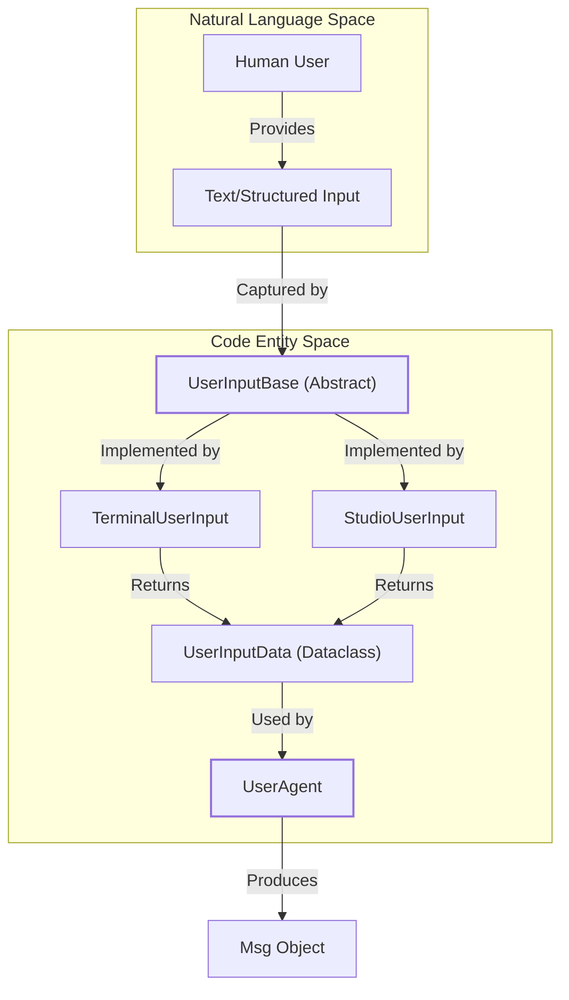
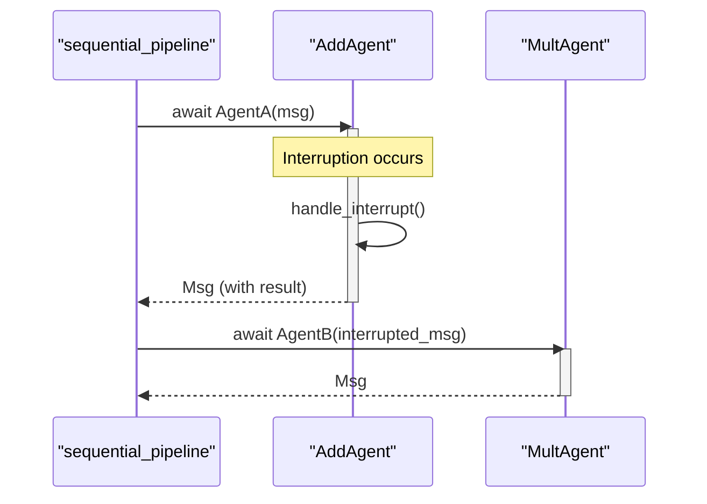
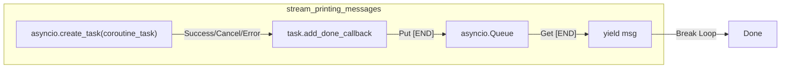

<!-- source: DeepWiki mcp.deepwiki.com · repo modelscope/agentscope · page 9.2 Human-in-the-Loop and Interruption · fetched 2026-10-26 -->

# Human-in-the-Loop and Interruption

Relevant source files

The following files were used as context for generating this wiki page:

- [examples/deployment/README.md](examples/deployment/README.md)
- [examples/deployment/planning_agent/README.md](examples/deployment/planning_agent/README.md)
- [examples/deployment/planning_agent/main.py](examples/deployment/planning_agent/main.py)
- [examples/deployment/planning_agent/test_post.py](examples/deployment/planning_agent/test_post.py)
- [src/agentscope/agent/_agent_base.py](src/agentscope/agent/_agent_base.py)
- [src/agentscope/agent/_user_input.py](src/agentscope/agent/_user_input.py)
- [src/agentscope/pipeline/__init__.py](src/agentscope/pipeline/__init__.py)
- [src/agentscope/pipeline/_functional.py](src/agentscope/pipeline/_functional.py)
- [tests/pipeline_test.py](tests/pipeline_test.py)

This page documents AgentScope's human-in-the-loop capabilities and interruption mechanism. It covers how users can interact with agents during execution through `UserAgent` and `UserInputBase`, and how agent execution can be interrupted and resumed gracefully while preserving conversation state.

---

## Overview

AgentScope provides two mechanisms for human involvement in agent workflows:

1.  **Human Interaction via UserAgent**: A specialized agent that captures user input and participates in agent conversations.
2.  **Real-time Interruption**: The ability to cancel ongoing agent operations (LLM calls, tool executions) and handle the interruption gracefully via the `handle_interrupt` method.

Both mechanisms are designed to work with AgentScope's async execution model and memory system, ensuring no conversation context is lost during human intervention.

Sources: [src/agentscope/agent/_agent_base.py:185-204](), [src/agentscope/agent/_user_input.py:39-40]()

---

## User Interaction Interfaces

Human input is handled by the `UserInputBase` abstraction, which allows different frontends (Terminal, AgentScope Studio) to provide data to agents.

### UserInput Architecture

The following diagram maps the natural language "Human Input" concept to the code entities responsible for capturing it.

**User Input Entity Mapping**

### Implementation Details

*   **`UserInputData`**: A dataclass that holds both raw blocks (text, image, audio, video) and structured data defined by a Pydantic model [src/agentscope/agent/_user_input.py:28-36]().
*   **`TerminalUserInput`**: Uses Python's `input()` to capture strings from the console and can interactively prompt for structured fields based on a JSON schema [src/agentscope/agent/_user_input.py:68-151]().
*   **`StudioUserInput`**: Connects to AgentScope Studio via Socket.IO, allowing users to provide input through a web interface [src/agentscope/agent/_user_input.py:154-225]().

Sources: [src/agentscope/agent/_user_input.py:28-151](), [src/agentscope/agent/_user_input.py:154-225]()

---

## Interruption Mechanism

AgentScope's interruption system allows real-time cancellation of agent operations. This is primarily supported in the `AgentBase` class and specialized implementations like `ReActAgent`.

### Interruption Handling in Pipelines

When agents are executed within a pipeline (e.g., `sequential_pipeline` or `fanout_pipeline`), an interruption in one agent can be propagated or handled to ensure the entire workflow stops or transitions correctly.

**Pipeline Interruption Flow**

Sources: [src/agentscope/pipeline/_functional.py:10-44](), [tests/pipeline_test.py:37-43]()

### The handle_interrupt Method

The `handle_interrupt` method is a lifecycle hook in `AgentBase` that subclasses should implement to define behavior when an execution is cancelled.

*   **Signature**: `async def handle_interrupt(self, *args: Any, **kwargs: Any) -> Msg` [tests/pipeline_test.py:37-43]().
*   **Purpose**: To perform cleanup, log the interruption, or return a specific "interrupted" state message to the caller.

In the provided test agents, `handle_interrupt` is defined to allow graceful exits during pipeline tests [tests/pipeline_test.py:81-87](), [tests/pipeline_test.py:112-118]().

---

## Streaming and Interruption

Interruption is particularly relevant during streaming output. The `stream_printing_messages` pipeline captures messages from agents in real-time. If the underlying `coroutine_task` is cancelled or encounters an exception, the pipeline ensures the end signal is sent to the message queue.

**Streaming Interruption Logic**

If an exception occurs during the task execution, `stream_printing_messages` re-raises it after processing all pending messages in the queue to ensure the caller is aware of the failure [src/agentscope/pipeline/_functional.py:189-192]().

Sources: [src/agentscope/pipeline/_functional.py:107-193]()

---

## Memory Preservation and Consistency

Robust memory preservation is a core design goal. When an agent is interrupted, it is responsible for ensuring its internal state (like `MemoryBase`) remains consistent.

### Deployment Patterns

In production scenarios using `JSONSession`, the session state is saved after the agent execution completes, regardless of whether it was a normal completion or an interruption handled by the agent [examples/deployment/planning_agent/main.py:84-88]().

| Component | Role in Interruption | File Reference |
| :--- | :--- | :--- |
| **AgentBase** | Defines `handle_interrupt` interface | [src/agentscope/agent/_agent_base.py:147-148]() |
| **Pipelines** | Propagate messages from interrupted agents | [src/agentscope/pipeline/_functional.py:42-43]() |
| **Stream Pipeline** | Ensures `[END]` signal is sent on task completion/failure | [src/agentscope/pipeline/_functional.py:168-171]() |
| **JSONSession** | Saves agent state post-execution | [examples/deployment/planning_agent/main.py:85-88]() |

Sources: [src/agentscope/pipeline/_functional.py:10-44](), [examples/deployment/planning_agent/main.py:22-89]()

---

