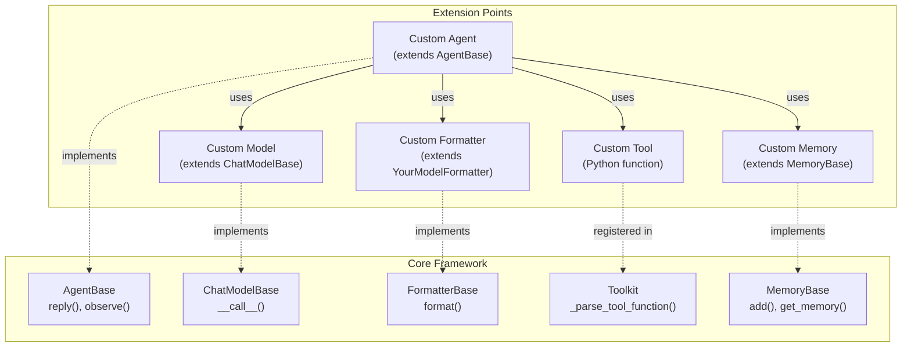
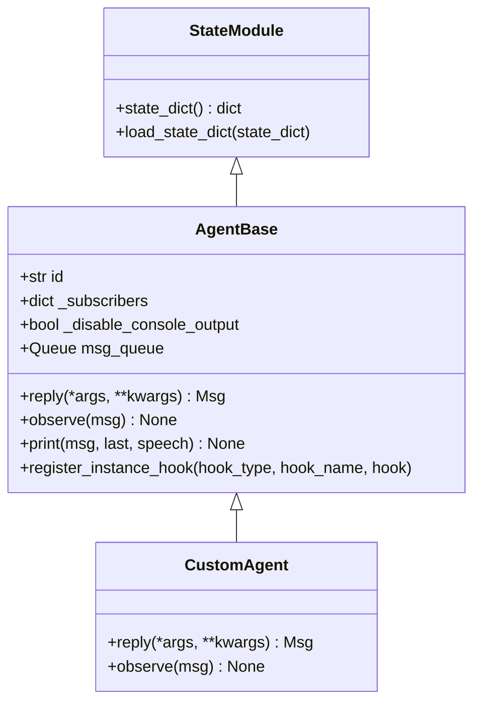
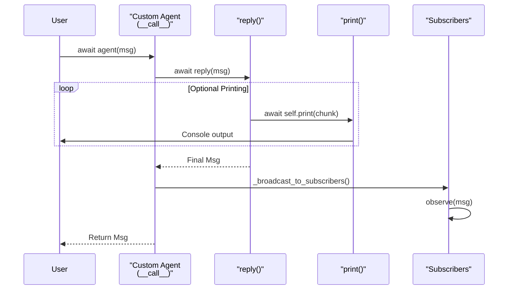
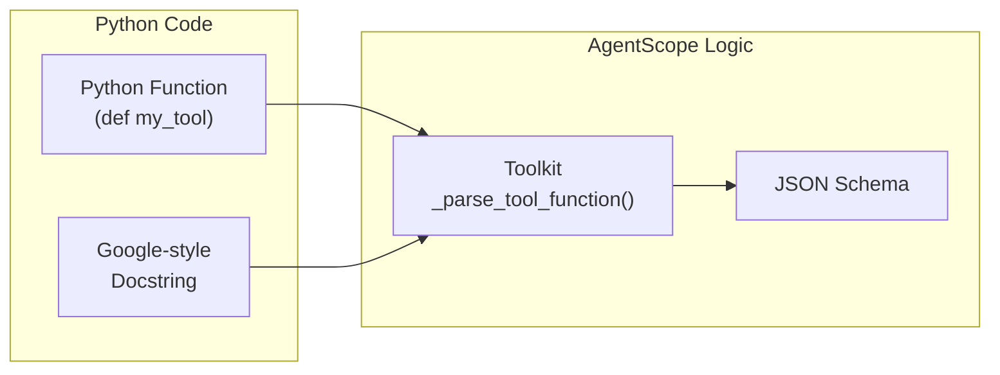

<!-- source: DeepWiki mcp.deepwiki.com · repo modelscope/agentscope · page 9.3 Extending AgentScope · fetched 2026-10-26 -->

# Extending AgentScope

<details>
<summary>Relevant source files</summary>

The following files were used as context for generating this wiki page:

- [.gemini/styleguide.md](.gemini/styleguide.md)
- [.github/PULL_REQUEST_TEMPLATE.md](.github/PULL_REQUEST_TEMPLATE.md)
- [.github/copilot-instructions.md](.github/copilot-instructions.md)
- [.github/workflows/pr-title-check.yml](.github/workflows/pr-title-check.yml)
- [CONTRIBUTING.md](CONTRIBUTING.md)
- [CONTRIBUTING_zh.md](CONTRIBUTING_zh.md)
- [src/agentscope/_version.py](src/agentscope/_version.py)
- [src/agentscope/agent/_agent_base.py](src/agentscope/agent/_agent_base.py)
- [src/agentscope/pipeline/__init__.py](src/agentscope/pipeline/__init__.py)
- [src/agentscope/pipeline/_functional.py](src/agentscope/pipeline/_functional.py)
- [src/agentscope/tool/_toolkit.py](src/agentscope/tool/_toolkit.py)
- [src/agentscope/tool/_types.py](src/agentscope/tool/_types.py)
- [tests/pipeline_test.py](tests/pipeline_test.py)
- [tests/toolkit_async_execution_test.py](tests/toolkit_async_execution_test.py)

</details>


This document provides guidance for extending AgentScope by creating custom components. AgentScope is designed to be extensible at multiple layers, allowing developers to customize agents, models, formatters, tools, memory implementations, and utility functions to meet specific requirements.

For information about using existing AgentScope components, see [Agent System](#2), [Model Integration](#3), [Tool System](#4), and [Memory and Knowledge Systems](#5).

---

## Overview of Extension Points

AgentScope provides five primary extension points:

| Extension Point | Base Class/Interface | Primary Use Cases |
|----------------|---------------------|-------------------|
| **Custom Agents** | `AgentBase` | Implementing new reasoning patterns, specialized behaviors, domain-specific logic |
| **Custom Models** | `ChatModelBase`, `EmbeddingModelBase` | Integrating new LLM providers, custom inference endpoints |
| **Custom Formatters** | `FormatterBase` | Supporting new API formats, custom message transformations |
| **Custom Tools** | Function with docstring or `ToolFunction` type | Adding domain-specific capabilities, external API integrations |
| **Custom Memory** | `MemoryBase`, `LongTermMemoryBase` | Alternative storage backends, custom memory strategies |

Title: AgentScope Extension Architecture


**Sources:** [src/agentscope/agent/_agent_base.py:30-204](), [CONTRIBUTING.md:163-201]()

---

## Creating Custom Agents

Custom agents extend `AgentBase` and implement three required methods: `reply()`, `observe()`, and `handle_interrupt()`. The `reply()` method contains the agent's main logic, while `observe()` handles incoming messages.

### Required Methods

The `AgentBase` class defines the core agent interface:

Title: AgentBase Class Hierarchy


**Sources:** [src/agentscope/agent/_agent_base.py:30-204]()

### Minimal Agent Implementation

A minimal custom agent requires implementing the abstract methods:

```python
from agentscope.agent import AgentBase
from agentscope.message import Msg

class MinimalAgent(AgentBase):
    def __init__(self, name: str) -> None:
        super().__init__()
        self.name = name
    
    async def reply(self, x: Msg | None) -> Msg:
        # Main logic: process input and generate response
        return Msg(
            name=self.name,
            content="Response content",
            role="assistant"
        )
    
    async def observe(self, msg: Msg | list[Msg] | None) -> None:
        # Handle incoming messages without generating reply
        pass
```

The test suite provides concrete examples of custom agents. The `AddAgent` modifies message metadata, while `StreamAgent` demonstrates printing output:

**Sources:** [tests/pipeline_test.py:18-87]()

### Agent Execution Flow

Title: Agent Reply Lifecycle


**Sources:** [src/agentscope/agent/_agent_base.py:448-467]()

### Hook System Integration

Agents support hook types for extending behavior without modifying core logic:

| Hook Type | Trigger Point | Signature |
|-----------|---------------|-----------|
| `pre_reply` | Before `reply()` | `(self, kwargs) -> dict \| None` |
| `post_reply` | After `reply()` | `(self, kwargs, output) -> Msg \| None` |
| `pre_print` | Before `print()` | `(self, kwargs) -> dict \| None` |
| `post_print` | After `print()` | `(self, kwargs, output) -> Any` |

**Sources:** [src/agentscope/agent/_agent_base.py:36-138]()

---

## Creating Custom Models

Custom model wrappers integrate new LLM providers by implementing the `ChatModelBase` interface. As noted in the contribution guidelines, adding a new model also involves formatters and token counters.

### Model-Formatter Architecture

Title: Model Data Flow
```mermaid
graph LR
    subgraph "Natural Language Space"
        Msgs["List[Msg]<br/>(AgentScope Msg objects)"]
    end
    
    subgraph "Code Entity Space"
        CustomFormatter["YourModelFormatter<br/>(extends FormatterBase)"]
        CustomModel["YourChatModel<br/>(extends ChatModelBase)"]
        Response["ChatResponse"]
    end
    
    Msgs -->|format()| CustomFormatter
    CustomFormatter -->|list[dict]| CustomModel
    CustomModel -->|__call__()| Response
```

**Sources:** [CONTRIBUTING.md:163-190]()

### Implementing ChatModelBase

A custom model wrapper must implement the `__call__()` method and handle both streaming and non-streaming modes:

```python
from agentscope.model import ChatModelBase
from agentscope.types import ChatResponse

class YourChatModel(ChatModelBase):
    async def __call__(
        self,
        messages: list[dict],
        **kwargs
    ) -> ChatResponse:
        # Implementation should consider:
        # - Tools API integration
        # - Streaming vs non-streaming
        # - tool_choice argument
        pass
```

**Sources:** [CONTRIBUTING.md:166-178]()

### Creating Custom Formatters

Formatters convert `Msg` objects into the format required by your API provider:

```python
from agentscope.formatter import FormatterBase

class YourModelFormatter(FormatterBase):
    async def format(
        self,
        msgs: list[Msg]
    ) -> list[dict]:
        # Convert Msg objects to provider-specific dicts
        pass
```

**Sources:** [CONTRIBUTING.md:180-191]()

---

## Creating Custom Tools

Tools are Python functions that agents can call. AgentScope handles the registration and schema generation.

### Tool Function Pattern

Title: Tool Schema Generation


**Sources:** [src/agentscope/tool/_toolkit.py:38-48](), [CONTRIBUTING.md:151-152]()

### Async Execution and Middlewares

The `Toolkit` supports advanced features for custom tools:
- **Async Execution**: Tools can be executed in an async manner, allowing the agent to check task status via `view_task` or `wait_task` [src/agentscope/tool/_toolkit.py:182-186]().
- **Middlewares**: You can apply middlewares to tool calls to intercept or modify the execution pipeline [src/agentscope/tool/_toolkit.py:57-114]().

**Sources:** [src/agentscope/tool/_toolkit.py:57-186](), [tests/toolkit_async_execution_test.py:102-161]()

---

## Multi-Agent Pipelines

Extensions often involve creating custom workflows using pipelines. AgentScope provides functional sugars like `sequential_pipeline` and `fanout_pipeline`.

### Pipeline Patterns

| Pipeline | Function | Description |
|----------|----------|-------------|
| **Sequential** | `sequential_pipeline` | Executes agents in order, passing output of one as input to next [src/agentscope/pipeline/_functional.py:10-44]() |
| **Fanout** | `fanout_pipeline` | Distributes same input to multiple agents concurrently [src/agentscope/pipeline/_functional.py:47-104]() |
| **Streaming** | `stream_printing_messages` | Captures and yields `print()` messages from agents during execution [src/agentscope/pipeline/_functional.py:107-193]() |

**Sources:** [src/agentscope/pipeline/_functional.py:10-193]()

### Capturing Custom Agent Output

If a custom agent uses `await self.print(msg)`, it can be integrated into a streaming UI using `stream_printing_messages`:

```python
from agentscope.pipeline import stream_printing_messages

async for msg, is_last in stream_printing_messages([custom_agent], custom_agent(input_msg)):
    print(f"Captured: {msg.content}")
```

**Sources:** [src/agentscope/pipeline/_functional.py:107-157]()

---

## Summary of Guidelines

When extending AgentScope, follow these development principles:

1. **Lazy Imports**: Import heavy libraries only when used in functions to keep `import agentscope` lightweight [CONTRIBUTING.md:114-123]().
2. **Modular Design**: Ensure new agents or models are self-contained. Use the `_` prefix for internal framework files and control exposure through `__init__.py` [.github/copilot-instructions.md:27-30]().
3. **Unit Testing**: All new features must include tests (see `tests/pipeline_test.py` for examples) [CONTRIBUTING.md:125-130]().
4. **Conventional Commits**: Use the `<type>(<scope>): <subject>` format for commits and PRs [CONTRIBUTING.md:30-55]().

**Sources:** [CONTRIBUTING.md:28-130](), [tests/pipeline_test.py:147-168](), [.github/copilot-instructions.md:10-30]()

---

