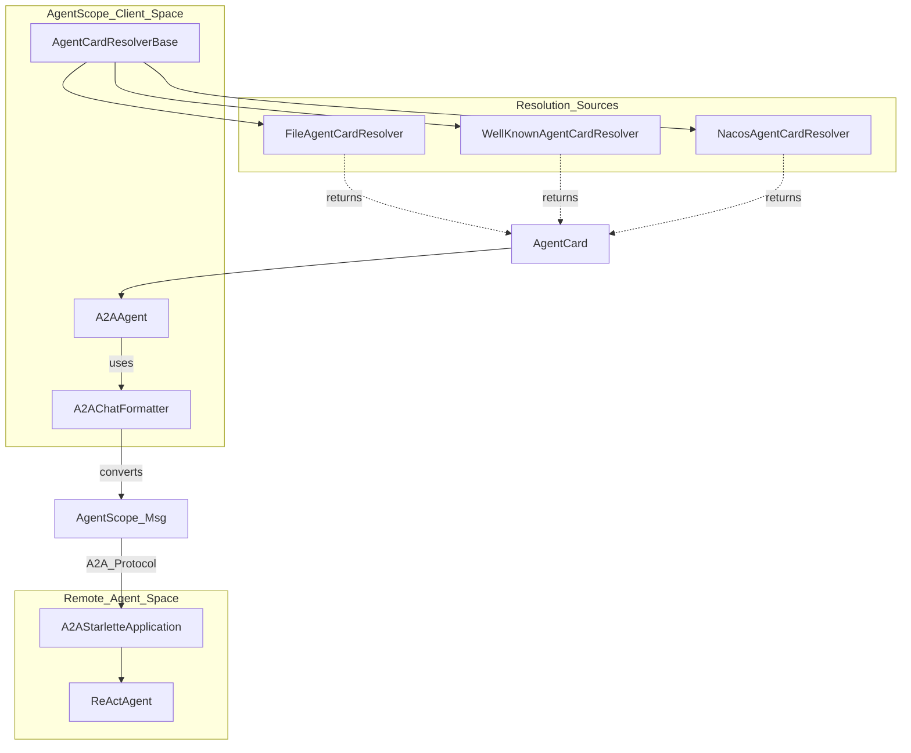
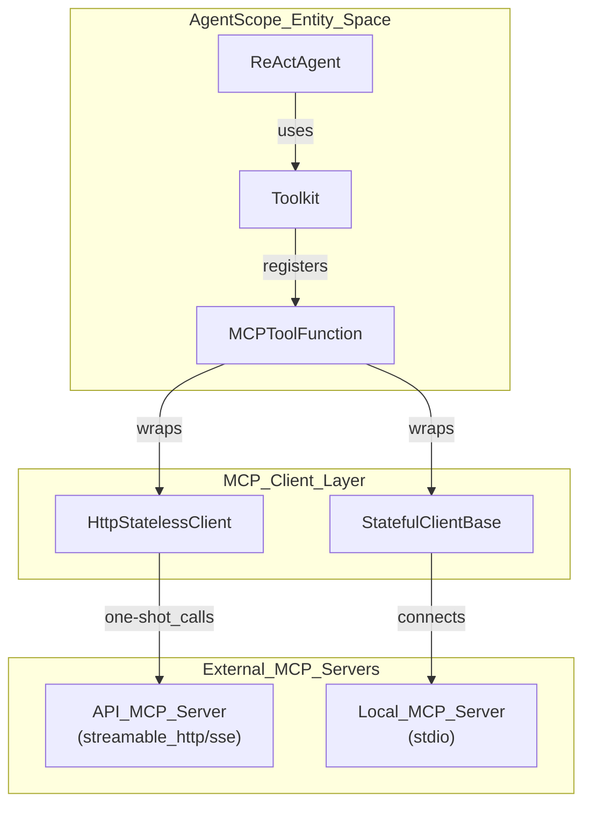

<!-- source: DeepWiki mcp.deepwiki.com · repo modelscope/agentscope · page 9.4 Agent Communication Protocols · fetched 2026-10-26 -->

# Agent Communication Protocols

Relevant source files

The following files were used as context for generating this wiki page:

- [examples/agent/a2a_agent/setup_a2a_server.py](examples/agent/a2a_agent/setup_a2a_server.py)
- [examples/game/werewolves/structured_model.py](examples/game/werewolves/structured_model.py)
- [src/agentscope/mcp/_http_stateless_client.py](src/agentscope/mcp/_http_stateless_client.py)
- [src/agentscope/mcp/_mcp_function.py](src/agentscope/mcp/_mcp_function.py)
- [src/agentscope/mcp/_stateful_client_base.py](src/agentscope/mcp/_stateful_client_base.py)
- [src/agentscope/message/_message_base.py](src/agentscope/message/_message_base.py)
- [tests/formatter_a2a_test.py](tests/formatter_a2a_test.py)

This document covers AgentScope's support for standardized agent communication protocols and integration patterns. It focuses on external protocol implementations (MCP and A2A) that enable agents to interact with external systems and other agents.

---

## Overview

AgentScope implements two primary external communication protocols to extend agent capabilities beyond its internal messaging system:

| Protocol | Purpose | Key Components | Use Cases |
|----------|---------|----------------|-----------|
| **A2A** (Agent-to-Agent) | Standardized inter-agent communication | `A2AAgent`, `A2AChatFormatter`, `AgentCardResolverBase` | Cross-platform agent collaboration, remote agent hosting |
| **MCP** (Model Context Protocol) | Connect agents to external tools and data sources | `StatefulClientBase`, `HttpStatelessClient`, `MCPToolFunction` | File systems, databases, APIs, search engines |

**Sources:** `src/agentscope/mcp/_client_base.py:11-13`(), `src/agentscope/formatter/_a2a_chat_formatter.py:20`()

---

## A2A (Agent-to-Agent) Protocol

A2A is an open standard protocol for interoperable communication between different AI agents. AgentScope provides support for obtaining agent metadata (Agent Cards) and connecting to remote agents.

### A2A Message Formatting

The `A2AChatFormatter` handles the bi-directional conversion between AgentScope `Msg` objects and the A2A standard `Message` format.

*   **AS to A2A**: Converts `Msg` content blocks (e.g., `TextBlock`, `ImageBlock`, `ToolUseBlock`) into A2A `Part` types like `TextPart`, `FilePart`, or `DataPart` [tests/formatter_a2a_test.py:41-96](), [tests/formatter_a2a_test.py:160-212]().
*   **A2A to AS**: Parses incoming A2A messages back into AgentScope's multimodal message structure [tests/formatter_a2a_test.py:97-158](), [examples/agent/a2a_agent/setup_a2a_server.py:81-85]().

### A2A Architecture and Data Flow

The following diagram illustrates how AgentScope resolves remote agent metadata to establish a connection.

**Diagram: A2A Resolution and Communication Flow**

**Sources:** `examples/agent/a2a_agent/setup_a2a_server.py:128-132`(), `tests/formatter_a2a_test.py:20-40`()

### A2A Server Implementation

An A2A server can be hosted using `A2AStarletteApplication` [examples/agent/a2a_agent/setup_a2a_server.py:128-131](). It requires an `agent_card` definition and a handler to process incoming `MessageSendParams` [examples/agent/a2a_agent/setup_a2a_server.py:35-40]().

**Key logic in `setup_a2a_server.py`:**
1.  **Format Conversion**: Use `A2AChatFormatter.format_a2a_message` to convert incoming A2A messages to AgentScope `Msg` objects [examples/agent/a2a_agent/setup_a2a_server.py:81-85]().
2.  **Streaming**: Yield `TaskStatusUpdateEvent` objects to provide real-time updates to the client [examples/agent/a2a_agent/setup_a2a_server.py:87-112]().
3.  **Task Management**: Handles `TaskStatus` transitions from `working` to `completed` [examples/agent/a2a_agent/setup_a2a_server.py:113-119]().

**Sources:** `examples/agent/a2a_agent/setup_a2a_server.py:31-133`()

---

## MCP (Model Context Protocol) Integration

MCP is a standardized protocol for connecting AI assistants to external tools. AgentScope provides native MCP support through client implementations that wrap MCP servers as callable tool functions.

### MCP Integration Architecture

**Diagram: MCP Integration Architecture**

**Sources:** `src/agentscope/mcp/_stateful_client_base.py:16-41`(), `src/agentscope/mcp/_http_stateless_client.py:16-28`(), `src/agentscope/mcp/_mcp_function.py:15-36`()

### Client Types

#### Stateful Clients (`StatefulClientBase`)
Maintains a persistent `ClientSession` across multiple tool calls [src/agentscope/mcp/_stateful_client_base.py:17-22]().
*   **`connect()`**: Establishes the session and initializes it [src/agentscope/mcp/_stateful_client_base.py:46-66]().
*   **`list_tools()`**: Fetches and caches available tools from the server [src/agentscope/mcp/_stateful_client_base.py:97-110]().
*   **`get_callable_function()`**: Retrieves an `MCPToolFunction` from the established session [src/agentscope/mcp/_stateful_client_base.py:112-162]().

#### Stateless Clients (`HttpStatelessClient`)
Creates a new session for every tool call, suitable for HTTP-based transports [src/agentscope/mcp/_http_stateless_client.py:16-23]().
*   **Transport Support**: Supports `streamable_http` and `sse` [src/agentscope/mcp/_http_stateless_client.py:33-35]().
*   **`get_client()`**: Returns a disposable context manager for the client [src/agentscope/mcp/_http_stateless_client.py:79-90]().
*   **`list_tools()`**: Opens a temporary session to fetch tool definitions [src/agentscope/mcp/_http_stateless_client.py:139-153]().

**Sources:** `src/agentscope/mcp/_stateful_client_base.py:16-177`(), `src/agentscope/mcp/_http_stateless_client.py:16-153`()

### MCPToolFunction Wrapper

MCP tools are wrapped as `MCPToolFunction` objects. They can be registered into a `Toolkit` and called by agents.

*   **Schema Extraction**: Automatically extracts JSON schema from MCP tool definitions using `_extract_json_schema_from_mcp_tool` [src/agentscope/mcp/_mcp_function.py:61]().
*   **Execution**: Handles session initialization (for stateless via `client_gen`) or uses existing sessions (for stateful) to call `session.call_tool` [src/agentscope/mcp/_mcp_function.py:82-104]().
*   **Result Wrapping**: If `wrap_tool_result` is True, it converts `mcp.types.CallToolResult` into AgentScope `ToolResponse` blocks [src/agentscope/mcp/_mcp_function.py:106-113]().

**Sources:** `src/agentscope/mcp/_mcp_function.py:15-115`()

---

## Agent Communication Patterns

### Structured Output and Voting
In multi-agent scenarios like the Werewolf game, agents communicate using structured data models to ensure valid state transitions.
*   **Dynamic Models**: Functions like `get_vote_model` or `get_seer_model` generate Pydantic models based on the current list of active `AgentBase` instances [examples/game/werewolves/structured_model.py:17-27](), [examples/game/werewolves/structured_model.py:76-86]().
*   **Validation**: Models use `@model_validator` to enforce logical constraints, such as clearing a target name if a "poison" action is not selected [examples/game/werewolves/structured_model.py:56-71]().

**Sources:** `examples/game/werewolves/structured_model.py:1-124`(), `src/agentscope/message/_message_base.py:21-32`()

---

