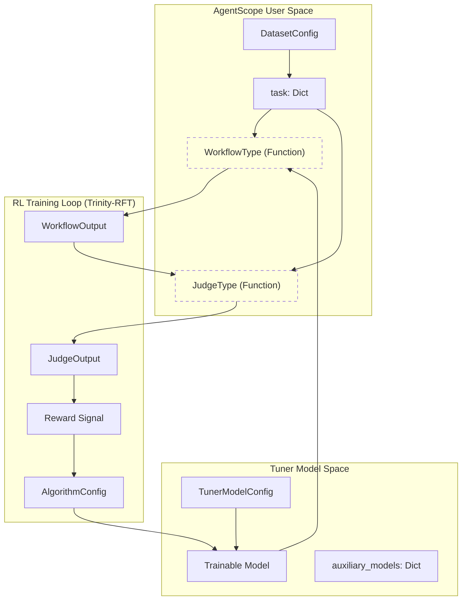
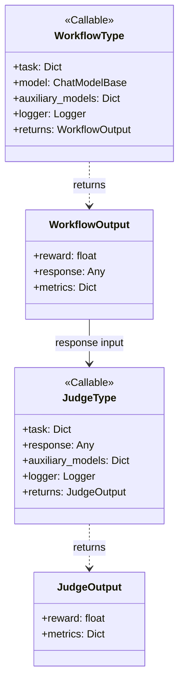

<!-- source: DeepWiki mcp.deepwiki.com · repo modelscope/agentscope · page 9.5 Agentic RL and Tuner · fetched 2026-10-26 -->

# Agentic RL and Tuner

Relevant source files

The following files were used as context for generating this wiki page:

- [docs/tutorial/en/src/task_tuner.py](docs/tutorial/en/src/task_tuner.py)
- [docs/tutorial/zh_CN/src/task_tuner.py](docs/tutorial/zh_CN/src/task_tuner.py)
- [examples/tuner/model_tuning/main.py](examples/tuner/model_tuning/main.py)
- [examples/tuner/prompt_tuning/README.md](examples/tuner/prompt_tuning/README.md)
- [src/agentscope/model/__init__.py](src/agentscope/model/__init__.py)
- [src/agentscope/model/_trinity_model.py](src/agentscope/model/_trinity_model.py)
- [src/agentscope/tune/__init__.py](src/agentscope/tune/__init__.py)
- [src/agentscope/tuner/__init__.py](src/agentscope/tuner/__init__.py)
- [src/agentscope/tuner/_algorithm.py](src/agentscope/tuner/_algorithm.py)
- [src/agentscope/tuner/_config.py](src/agentscope/tuner/_config.py)
- [src/agentscope/tuner/_dataset.py](src/agentscope/tuner/_dataset.py)
- [src/agentscope/tuner/_judge.py](src/agentscope/tuner/_judge.py)
- [src/agentscope/tuner/_model.py](src/agentscope/tuner/_model.py)
- [src/agentscope/tuner/_workflow.py](src/agentscope/tuner/_workflow.py)
- [src/agentscope/tuner/model_selection/__init__.py](src/agentscope/tuner/model_selection/__init__.py)
- [src/agentscope/tuner/model_selection/_built_in_judges.py](src/agentscope/tuner/model_selection/_built_in_judges.py)
- [src/agentscope/tuner/model_selection/_model_selection.py](src/agentscope/tuner/model_selection/_model_selection.py)
- [src/agentscope/tuner/prompt_tune/__init__.py](src/agentscope/tuner/prompt_tune/__init__.py)
- [src/agentscope/tuner/prompt_tune/_config.py](src/agentscope/tuner/prompt_tune/_config.py)
- [src/agentscope/tuner/prompt_tune/_tune_prompt.py](src/agentscope/tuner/prompt_tune/_tune_prompt.py)
- [tests/tuner_test.py](tests/tuner_test.py)

The `agentscope.tuner` module provides a comprehensive framework for optimizing agent performance through model fine-tuning (RL and SFT) and prompt optimization. It leverages [Trinity-RFT](https://github.com/agentscope-ai/Trinity-RFT) to treat the entire agentic process—including multi-step reasoning and tool interactions—as a trainable policy [src/agentscope/tuner/__init__.py:1-12]().

## Overview and Architecture

Agentic RL in AgentScope focuses on three primary components: the **Workflow Function**, the **Judge Function**, and the **Task Dataset** [docs/tutorial/en/src/task_tuner.py:17-21](). Unlike standard LLM fine-tuning which optimizes for single-turn next-token prediction, Agentic RL optimizes the agent's ability to achieve high rewards across a complete trajectory of interactions [docs/tutorial/en/src/task_tuner.py:144-148]().

### Data Flow and System Components

The following diagram illustrates how the `tuner` module bridges high-level agent logic with the underlying RL training engine.

**Tuner System Architecture**

Sources: [docs/tutorial/en/src/task_tuner.py:17-27](), [src/agentscope/tuner/_config.py:20-33]()

## Core Configuration Classes

The `tuner` module utilizes Pydantic-based configuration classes to define the training environment.

### 1. TunerModelConfig
Defines the parameters for the model being tuned. It includes settings for inference engines and specialized parsers for agentic behaviors [src/agentscope/tuner/_model.py:8-9]().
*   **Key Fields**: `model_path`, `max_model_len`, `tensor_parallel_size`, and `inference_engine_num` [src/agentscope/tuner/_model.py:11-53]().
*   **Parsers**: Supports `tool_call_parser` (default: "hermes") and `reasoning_parser` (default: "deepseek_r1") to handle structured agent outputs [src/agentscope/tuner/_model.py:55-69]().
*   **Tinker Integration**: Can include a `TinkerConfig` for parameter-efficient fine-tuning (LoRA), specifying `rank`, `train_mlp`, and `train_attn` [src/agentscope/tuner/_model.py:96-126]().

### 2. DatasetConfig
Manages the loading and split of training/evaluation data using the HuggingFace `datasets` library [src/agentscope/tuner/_dataset.py:8-13]().
*   **Preview**: Provides a `preview(n)` method to inspect data samples before training [src/agentscope/tuner/_dataset.py:38-61]().

### 3. AlgorithmConfig
Specifies the RL or SFT algorithm and its hyperparameters [src/agentscope/tuner/_algorithm.py:7-8]().
*   **Algorithms**: Supports `multi_step_grpo` (recommended for agents) and `sft` [src/agentscope/tuner/_algorithm.py:10-19]().
*   **Hyperparameters**: Includes `learning_rate`, `group_size` (for GRPO), `batch_size`, and `save_interval_steps` [src/agentscope/tuner/_algorithm.py:20-42]().

Sources: [src/agentscope/tuner/_model.py:8-148](), [src/agentscope/tuner/_dataset.py:8-61](), [src/agentscope/tuner/_algorithm.py:7-43]()

## Agentic RL Workflow

To train an agent, developers implement two specific function types that conform to the `tuner` signatures.

### Workflow Function (`WorkflowType`)
The workflow function encapsulates the agent's logic. It receives a `task` dictionary and a trainable `model` [src/agentscope/tuner/_workflow.py:31-33]().
*   **Signature**: `async def workflow(task, model, auxiliary_models, logger) -> WorkflowOutput` [src/agentscope/tuner/_workflow.py:31-50]().
*   **Output**: Returns a `WorkflowOutput` containing a `response` (used as input for the judge) and optional `reward` or `metrics` [src/agentscope/tuner/_workflow.py:7-29]().

### Judge Function (`JudgeType`)
The judge function evaluates the outcome of the workflow. It can be a rule-based script or an LLM-as-a-Judge [src/agentscope/tuner/_judge.py:20-22]().
*   **Signature**: `async def judge(task, response, auxiliary_models, logger) -> JudgeOutput` [src/agentscope/tuner/_judge.py:20-39]().
*   **Output**: Returns a `JudgeOutput` with a `reward` (float) and optional `metrics` [src/agentscope/tuner/_judge.py:7-19]().

**Function Integration and Validation**

Sources: [src/agentscope/tuner/_workflow.py:7-55](), [src/agentscope/tuner/_judge.py:7-40](), [src/agentscope/tuner/_config.py:184-210]()

## Prompt Tuning

AgentScope provides `tune_prompt` as a lightweight alternative to model fine-tuning, optimizing the system prompt without modifying model weights [examples/tuner/prompt_tuning/README.md:3-8]().

### PromptTuneConfig
Configures the prompt optimization process, often utilizing [DSPy](https://github.com/stanfordnlp/dspy) (MIPROv2) under the hood [examples/tuner/prompt_tuning/README.md:204-222]().
*   **Parameters**: `lm_model_name` (the teacher model for proposing prompts), `optimization_level`, and `max_bootstrapped_demos` [examples/tuner/prompt_tuning/README.md:220-223]().

### Workflow
The `tune_prompt` function takes an `init_system_prompt`, a `workflow` function, and a `judge_func`. It iteratively proposes and evaluates prompts to maximize the reward [examples/tuner/prompt_tuning/README.md:16-25]().

Sources: [src/agentscope/tuner/prompt_tune/__init__.py:1-12](), [examples/tuner/prompt_tuning/README.md:1-223]()

## Model Selection

The `select_model` function and `built-in judges` allow for automated selection of the best model among several candidates for a specific task [src/agentscope/tuner/__init__.py:12-29]().

*   **`select_model`**: Evaluates multiple models against a dataset using a specified judge [src/agentscope/tuner/model_selection/_model_selection.py:1-15]().
*   **Built-in Judges**: Provides standard evaluation logic for common tasks like classification or exact match [src/agentscope/tuner/model_selection/_built_in_judges.py:1-10]().

Sources: [src/agentscope/tuner/model_selection/_model_selection.py:1-15](), [src/agentscope/tuner/model_selection/_built_in_judges.py:1-10]()

## Implementation Details: `tune()`

The `tune()` function is the main entry point for starting RL training [src/agentscope/tuner/_tune.py:4-4]().
1.  **Validation**: Calls `check_workflow_function` and `check_judge_function` to verify signatures [src/agentscope/tuner/_config.py:184-210]().
2.  **Config Conversion**: `_to_trinity_config` maps AgentScope configs to Trinity-RFT's `Config`, `TasksetConfig`, and `InferenceModelConfig` [src/agentscope/tuner/_config.py:20-121]().
3.  **Trinity Execution**: Launches the Trinity-RFT engine with the generated configuration [src/agentscope/tuner/_config.py:124-181]().

### Configuration Mapping
| AgentScope Entity | Trinity-RFT Equivalent | File Reference |
| :--- | :--- | :--- |
| `TunerModelConfig` | `InferenceModelConfig` / `TinkerConfig` | [src/agentscope/tuner/_config.py:80-93]() |
| `DatasetConfig` | `TasksetConfig` | [src/agentscope/tuner/_config.py:54-70]() |
| `AlgorithmConfig` | `algorithm.algorithm_type` / `optimizer.lr` | [src/agentscope/tuner/_config.py:114-120]() |
| `WorkflowType` | `workflow_args["workflow_func"]` | [src/agentscope/tuner/_config.py:72-74]() |

Sources: [src/agentscope/tuner/_tune.py:1-15](), [src/agentscope/tuner/_config.py:20-181]()

---

