# Page: Overview

# Overview

<details>
<summary>Relevant source files</summary>

The following files were used as context for generating this wiki page:

- [.github/workflows/unittest.yml](.github/workflows/unittest.yml)
- [README.md](README.md)
- [README_zh.md](README_zh.md)
- [assets/images/agentscope.png](assets/images/agentscope.png)
- [docs/tutorial/en/src/task_tracing.py](docs/tutorial/en/src/task_tracing.py)
- [docs/tutorial/zh_CN/src/task_tracing.py](docs/tutorial/zh_CN/src/task_tracing.py)
- [src/agentscope/__init__.py](src/agentscope/__init__.py)
- [src/agentscope/_run_config.py](src/agentscope/_run_config.py)
- [src/agentscope/model/_model_base.py](src/agentscope/model/_model_base.py)
- [tests/config_test.py](tests/config_test.py)

</details>


This document provides an introduction to AgentScope, its design philosophy, core capabilities, and high-level architecture. It serves as an entry point for understanding how the framework's major subsystems work together to enable the development of production-ready agentic applications.

For installation instructions and initial setup, see [Installation and Setup](#1.1). For detailed architectural concepts, see [Core Concepts and Architecture](#1.2).

**Sources:** [README.md:58-65](), [README_zh.md:58-65]()

---

## What is AgentScope?

AgentScope is a production-ready agent framework that provides flexible abstractions designed to work with evolving large language model capabilities. The framework includes built-in support for model finetuning and emphasizes leveraging models' native reasoning and tool-use abilities rather than constraining them with rigid prompt engineering or opinionated orchestrations.

The current version is **1.0.17**, requiring Python 3.10 or higher.

**Key Design Features:**

| Feature | Description |
|-----------|-------------|
| **Simple** | Build agents in minutes with built-in `ReActAgent`, tools, memory, planning, and evaluation |
| **Extensible** | Large ecosystem integrations for tools, memory, observability; native MCP and A2A protocol support |
| **Production-ready** | Deploy locally, serverless, or on K8s with built-in OpenTelemetry observability |
| **Multimodal** | Native support for Realtime Voice, TTS, and multimodal message blocks |

**Sources:** [README.md:58-71](), [src/agentscope/__init__.py:66](), [README.md:137-138](), [README.md:82-86]()

---

## Design Philosophy

AgentScope is designed for **increasingly agentic LLMs**. The framework's approach prioritizes:

1. **Model-Driven Reasoning**: Leverage models' native reasoning capabilities rather than imposing fixed workflows.
2. **Flexible Tool Integration**: Enable dynamic tool use through `Toolkit` with middleware support, rather than hardcoded function chains.
3. **Adaptive Memory**: Provide multi-tiered memory (short-term, long-term, knowledge bases) that adapts to context needs.
4. **Observable Execution**: Built-in OpenTelemetry tracing for all components without code changes.
5. **Production Deployment**: First-class support for distributed deployment and state management.

This philosophy manifests in the framework's core abstraction: the **`ReActAgent`**, which orchestrates reasoning and action cycles rather than following predefined state machines.

**Sources:** [README.md:62-64](), [README.md:68-70]()

---

## System Initialization

All AgentScope applications begin with the `agentscope.init()` function, which configures global settings including model connections, observability backends, and runtime parameters. This function populates a thread-safe `_ConfigCls` instance.

### Initialization and Observability Flow

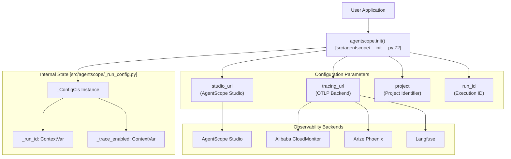

**Initialization Options:**

```python
import agentscope

# Option 1: Connect to AgentScope Studio
agentscope.init(studio_url="http://localhost:5000")

# Option 2: Connect to third-party OTLP backend
agentscope.init(tracing_url="https://your-backend/v1/traces")

# Option 3: No observability
agentscope.init()  # Tracing disabled
```

**Sources:** [src/agentscope/__init__.py:72-158](), [src/agentscope/_run_config.py:6-23](), [docs/tutorial/en/src/task_tracing.py:17-52]()

---

## High-Level Architecture

AgentScope's architecture is organized into major layers, each providing essential capabilities for building production-ready agent applications. The framework emphasizes clear separation of concerns while maintaining tight integration through well-defined interfaces.

### Architecture Overview

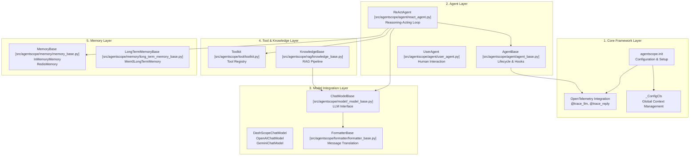

**Architecture Layers:**
1. **Core Framework Layer**: Provides initialization (`agentscope.init`), global context (`_ConfigCls`), and OpenTelemetry-based tracing.
2. **Agent Layer**: Implements core agent abstractions with `AgentBase` and built-in `ReActAgent`.
3. **Model Integration Layer**: Abstracts LLM APIs through `ChatModelBase` and `FormatterBase`.
4. **Tool & Knowledge Layer**: Manages external capabilities through `Toolkit` and RAG via `KnowledgeBase`.
5. **Memory Layer**: Provides short-term (InMemory, Redis) and long-term (Mem0, ReMe) storage.

**Sources:** [src/agentscope/__init__.py:43-60](), [src/agentscope/model/_model_base.py:13-37](), [README.md:58-77]()

---

## Major Subsystems

The following table summarizes AgentScope's major subsystems. Each subsystem is documented in detail in dedicated wiki pages.

| Subsystem | Key Components | Purpose | Wiki Section |
|-----------|----------------|---------|--------------|
| **Agent System** | `AgentBase`, `ReActAgent`, `UserAgent` | Core agent abstractions and lifecycle management | [Agent System](#2) |
| **Model Integration** | `ChatModelBase`, `FormatterBase`, provider implementations | Unified LLM API abstraction with provider-agnostic interfaces | [Model Integration](#3) |
| **Tool System** | `Toolkit`, MCP support, middleware | Extensible tool management with dynamic activation | [Tool System](#4) |
| **Memory & State** | `MemoryBase`, `RedisMemory`, `LongTermMemoryBase` | Multi-tiered memory with short-term and long-term storage | [Memory and Knowledge Systems](#5) |
| **Observability** | `@trace_llm`, `@trace_reply`, OTLP support | Built-in tracing with Studio and third-party platform support | [Observability and Evaluation](#7) |

### Core Components Detail

**Agent Layer** (`AgentBase`, `ReActAgent`)
- `AgentBase` provides lifecycle methods and asynchronous execution support.
- `ReActAgent` implements the Reasoning-Acting paradigm with iterative tool use.
- See [AgentBase Foundation](#2.1) and [ReActAgent Implementation](#2.2).

**Model Integration** (`ChatModelBase`, `FormatterBase`)
- `ChatModelBase` provides a unified `__call__` interface for all LLM providers.
- `FormatterBase` translates between internal `Msg` objects and provider-specific API formats.
- See [Model Integration](#3).

**Sources:** [src/agentscope/model/_model_base.py:13-44](), [docs/tutorial/en/src/task_tracing.py:104-162](), [README.md:172-210]()

---

## Message Protocol

AgentScope uses the `Msg` class as the fundamental communication unit. Messages support multimodal content through typed content blocks such as `TextBlock`, `ImageBlock`, and `ToolUseBlock`.

### Message Structure

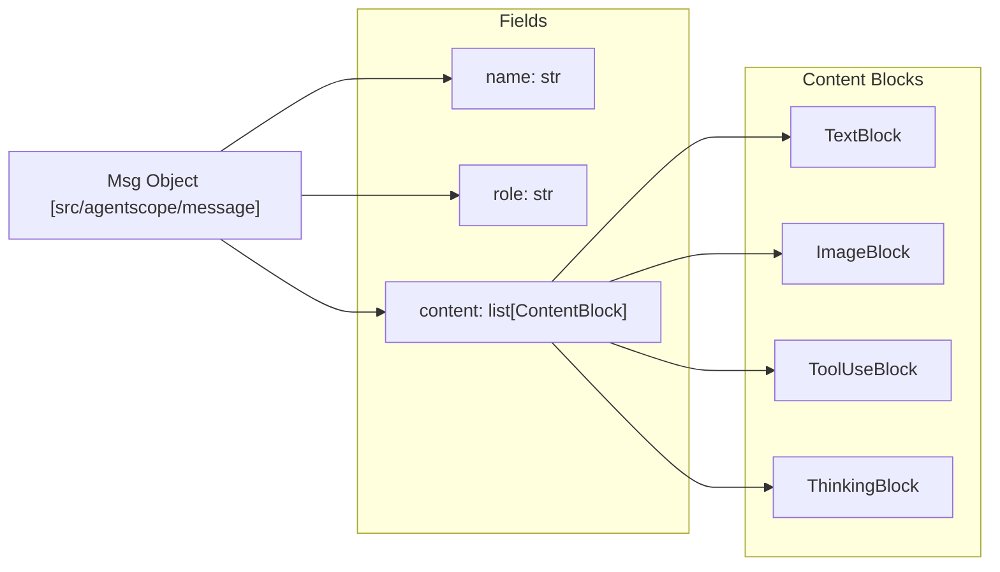

**Key Features:**
- **Multimodal**: Supports text, images, audio, and video via dedicated block types.
- **Tool Integration**: `ToolUseBlock` for function calls and `ToolResultBlock` for results.
- **Reasoning Traces**: `ThinkingBlock` captures model reasoning (e.g., DeepSeek thinking mode).

**Sources:** [README.md:82-86](), [src/agentscope/__init__.py:45]()

---

## Extensibility Points

AgentScope is designed for extension at multiple levels:

| Extension Point | Base Class | Purpose |
|----------------|------------|---------|
| Agents | `AgentBase` | Custom agent implementations |
| Models | `ChatModelBase` | New LLM provider integrations |
| Formatters | `FormatterBase` | Provider-specific message formatting |
| Memory | `MemoryBase` | Alternative storage backends |

For guidance on extending the framework, see [Extending AgentScope](#9.3).

**Sources:** [src/agentscope/model/_model_base.py:13-44](), [docs/tutorial/en/src/task_tracing.py:111-116]()

---

## Getting Started

Building an agent application involves initializing the framework and defining agents with their respective models and tools.

### Quick Start Example

```python
from agentscope.agent import ReActAgent
from agentscope.model import DashScopeChatModel
import agentscope
import os

# Initialize global configuration
agentscope.init(project="MyProject")

# Create a model instance
model = DashScopeChatModel(
    model_name="qwen-max",
    api_key=os.environ.get("DASHSCOPE_API_KEY"),
    stream=True
)

# Initialize an agent
agent = ReActAgent(
    name="Assistant",
    model=model,
    sys_prompt="You are a helpful assistant."
)
```

For detailed installation instructions, see [Installation and Setup](#1.1).

**Sources:** [src/agentscope/__init__.py:72-80](), [README.md:172-210]()

---

## Community and Resources

- **Documentation**: [https://doc.agentscope.io/](https://doc.agentscope.io/)
- **GitHub**: [https://github.com/modelscope/agentscope](https://github.com/modelscope/agentscope)
- **Discord**: [https://discord.gg/eYMpfnkG8h](https://discord.gg/eYMpfnkG8h)
- **License**: Apache 2.0

**Sources:** [README.md:34-45](), [README.md:129]()

---

# Page: Installation and Setup

# Installation and Setup

<details>
<summary>Relevant source files</summary>

The following files were used as context for generating this wiki page:

- [.github/workflows/unittest.yml](.github/workflows/unittest.yml)
- [.pre-commit-config.yaml](.pre-commit-config.yaml)
- [examples/agent/voice_agent/README.md](examples/agent/voice_agent/README.md)
- [examples/functionality/vector_store/oceanbase/README.md](examples/functionality/vector_store/oceanbase/README.md)
- [examples/functionality/vector_store/oceanbase/main.py](examples/functionality/vector_store/oceanbase/main.py)
- [pyproject.toml](pyproject.toml)
- [src/agentscope/__init__.py](src/agentscope/__init__.py)
- [src/agentscope/_run_config.py](src/agentscope/_run_config.py)
- [src/agentscope/model/_model_base.py](src/agentscope/model/_model_base.py)
- [src/agentscope/model/_model_response.py](src/agentscope/model/_model_response.py)
- [src/agentscope/rag/__init__.py](src/agentscope/rag/__init__.py)
- [src/agentscope/rag/_store/__init__.py](src/agentscope/rag/_store/__init__.py)
- [src/agentscope/rag/_store/_oceanbase_store.py](src/agentscope/rag/_store/_oceanbase_store.py)
- [tests/config_test.py](tests/config_test.py)
- [tests/rag_knowledge_test.py](tests/rag_knowledge_test.py)
- [tests/rag_store_test.py](tests/rag_store_test.py)

</details>


This document provides a technical guide to installing AgentScope, configuring its modular dependency system, and initializing the framework for local development or production environments.

---

## Prerequisites

AgentScope requires **Python 3.10** or higher [pyproject.toml:21](). The framework is tested across multiple operating systems (Ubuntu, Windows, macOS) and Python versions (3.10, 3.11, 3.12) [.github/workflows/unittest.yml:11-12]().

**System Requirements:**
- Python 3.10, 3.11, or 3.12
- `pip` (version >= 78.1.1 recommended) or `uv` package manager [.github/workflows/unittest.yml:23]()
- C++ build tools (required for some optional dependencies like `llama-cpp-python` or certain vector stores)

---

## Installation Methods

### Standard Installation via PyPI

The core package includes essential abstractions for agents, models, and messaging.

```bash
pip install agentscope
```

This installs the base requirements defined in `dependencies`, including `openai`, `dashscope`, `anthropic`, `opentelemetry-sdk`, `mcp`, and `sqlalchemy` [pyproject.toml:22-45]().

### Installation from Source

For development or access to the latest features:

```bash
git clone https://github.com/modelscope/agentscope.git
cd agentscope
pip install -e .
```

The `-e` flag performs an editable install, mapping the `src` directory to your environment [pyproject.toml:196]().

---

## Optional Dependencies

AgentScope uses `optional-dependencies` to keep the core footprint small. Users must install specific "extras" based on their use case [pyproject.toml:47-165]().

### Dependency Architecture

The following diagram maps the installation "extras" to the code entities they enable.

**Installation to Code Entity Mapping:**

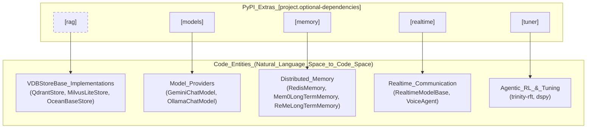

### Common Installation Commands

| Feature Group | Command | Key Enabled Components |
| :--- | :--- | :--- |
| **RAG** | `pip install agentscope[rag]` | `PDFReader`, `QdrantStore`, `MilvusLiteStore`, `OceanBaseStore` [pyproject.toml:121-137]() |
| **Models** | `pip install agentscope[models]` | `GeminiChatModel`, `OllamaChatModel` [pyproject.toml:60-65]() |
| **Memory** | `pip install agentscope[memory]` | `RedisMemory`, `Mem0LongTermMemory`, `ReMeLongTermMemory` [pyproject.toml:75-86]() |
| **Tuner** | `pip install agentscope[tuner]` | `DSPy` integration, `trinity-rft` (RL fine-tuning) [pyproject.toml:143-154]() |
| **Full** | `pip install agentscope[full]` | All optional features excluding dev tools [pyproject.toml:157-165]() |

**Sources:** [pyproject.toml:47-165](), [src/agentscope/rag/__init__.py:8-26]()

---

## Framework Initialization

The `agentscope.init()` function is the entry point for configuring the global runtime state. It populates a thread-safe `_config` object which utilizes `ContextVar` for async safety [src/agentscope/__init__.py:22-41]().

### The init() Function

```python
import agentscope

agentscope.init(
    project="MyProject",
    name="ExperimentalRun",
    logging_level="INFO",
    tracing_url="http://localhost:4318"
)
```

**Key Parameters:**
- `project`: Sets the global project name [src/agentscope/__init__.py:106-107]().
- `name`: Sets the run name (defaults to timestamp) [src/agentscope/__init__.py:109-110]().
- `run_id`: A unique identifier for the execution instance [src/agentscope/__init__.py:112-113]().
- `tracing_url`: The OTLP endpoint for OpenTelemetry traces [src/agentscope/__init__.py:147-151]().
- `studio_url`: Connects the run to AgentScope Studio for monitoring and human-in-the-loop input [src/agentscope/__init__.py:117-145]().

### Data Flow during Initialization

When `init()` is called, it synchronizes the configuration and prepares observability hooks.

**Initialization Sequence:**

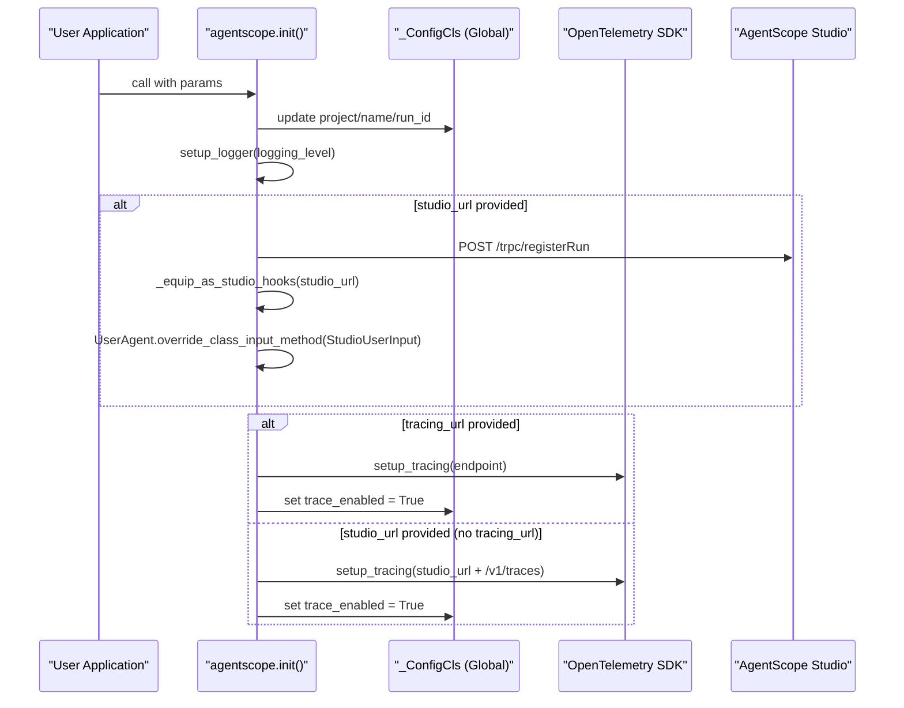

**Sources:** [src/agentscope/__init__.py:72-157](), [src/agentscope/_run_config.py:1-41]()

---

## Observability and Tracing Setup

AgentScope integrates with OpenTelemetry to provide deep visibility into agent execution, model usage, and message flow.

### Tracing Backends

Tracing is enabled by passing an endpoint to `agentscope.init()`.

1.  **AgentScope Studio**: If `studio_url` is provided, AgentScope automatically derives the trace endpoint as `{studio_url}/v1/traces` [src/agentscope/__init__.py:150]().
2.  **Custom OTLP Backends**: If `tracing_url` is provided, it takes precedence [src/agentscope/__init__.py:147-148](). This allows connection to:
    *   **Arize Phoenix**: Use the local or cloud OTLP endpoint.
    *   **Langfuse**: Use the OTLP-compatible ingestion URL.
    *   **CloudMonitor**: Alibaba Cloud monitoring.

### Tracing Implementation

Tracing is implemented via decorators that wrap core methods and export data as `ChatResponse` objects or spans [src/agentscope/model/_model_response.py:20-43]().

- `@trace_llm`: Captures model inputs and `ChatResponse` content blocks including `TextBlock`, `ToolUseBlock`, `ThinkingBlock`, and `AudioBlock` [src/agentscope/model/_model_response.py:23-25]().
- `@trace_reply`: Captures agent `reply()` calls and message exchanges.

When `trace_enabled` is set to `True` in `_config`, the `setup_tracing` function initializes the OpenTelemetry SDK to start exporting spans [src/agentscope/__init__.py:153-157]().

**Sources:** [src/agentscope/__init__.py:147-157](), [src/agentscope/model/_model_response.py:20-43]()

---

## Verification and Testing

### Sanity Check

```python
import agentscope
from agentscope.rag import QdrantStore

print(f"AgentScope Version: {agentscope.__version__}")
# If [rag] is installed, this will initialize a memory-resident store
store = QdrantStore(location=":memory:", collection_name="test", dimensions=3)
print("RAG Store initialized successfully.")
```

### Running Unit Tests

If you installed with `[dev]`, you can run the test suite to verify specific components like RAG stores [pyproject.toml:168-188]().

```bash
pip install -e .[dev]
# Test RAG store implementations (Qdrant, MilvusLite, OceanBase, etc.)
pytest tests/rag_store_test.py
```

The test suite validates vector stores like `OceanBaseStore` using either real instances or mocks provided by `pyobvector` [tests/rag_store_test.py:138-184]().

**Sources:** [pyproject.toml:157-188](), [tests/rag_store_test.py:1-20](), [src/agentscope/_version.py:1-4]()

---

# Page: Core Concepts and Architecture

# Core Concepts and Architecture

<details>
<summary>Relevant source files</summary>

The following files were used as context for generating this wiki page:

- [README.md](README.md)
- [README_zh.md](README_zh.md)
- [assets/images/agentscope.png](assets/images/agentscope.png)
- [docs/tutorial/en/src/task_tracing.py](docs/tutorial/en/src/task_tracing.py)
- [docs/tutorial/zh_CN/src/task_tracing.py](docs/tutorial/zh_CN/src/task_tracing.py)
- [examples/game/werewolves/structured_model.py](examples/game/werewolves/structured_model.py)
- [src/agentscope/agent/_agent_base.py](src/agentscope/agent/_agent_base.py)
- [src/agentscope/message/_message_base.py](src/agentscope/message/_message_base.py)
- [src/agentscope/message/_message_block.py](src/agentscope/message/_message_block.py)
- [src/agentscope/pipeline/__init__.py](src/agentscope/pipeline/__init__.py)
- [src/agentscope/pipeline/_functional.py](src/agentscope/pipeline/_functional.py)
- [tests/formatter_a2a_test.py](tests/formatter_a2a_test.py)
- [tests/pipeline_test.py](tests/pipeline_test.py)

</details>


This page explains the fundamental building blocks of AgentScope and how they work together to create agent applications. You'll learn about the core abstractions—agents, models, tools, memory, and messages—and understand the architectural patterns that enable flexibility and production-readiness.

For installation and basic setup, see [1.1 Installation and Setup](). For detailed implementation guides on specific components, see [2. Agent System](), [3. Model Integration](), [4. Tool System](), and [5. Memory and Knowledge Systems]().

---

## Core Building Blocks

AgentScope is built around five primary abstractions that work together to create agent applications:

### Agents

Agents are the orchestrators that coordinate models, tools, and memory to accomplish tasks. The framework provides:

- **`AgentBase`** - Base class for asynchronous agents, inheriting from `StateModule` [src/agentscope/agent/_agent_base.py:30-31]().
- **`ReActAgent`** - Production-ready implementation using the Reasoning-Acting paradigm [README.md:68]().
- **`UserAgent`** - Special agent for human interaction [README_zh.md:172]().

The `AgentBase` class manages a unique `id` generated via `shortuuid` [src/agentscope/agent/_agent_base.py:144](), instance-level hooks for lifecycle management [src/agentscope/agent/_agent_base.py:150-158](), and a subscriber system for message broadcasting [src/agentscope/agent/_agent_base.py:168]().

**Core Interface**:
- `reply(*args, **kwargs)` - The main logic of the agent, generating a reply based on state [src/agentscope/agent/_agent_base.py:197-203]().
- `observe(msg)` - Receives messages without generating a reply [src/agentscope/agent/_agent_base.py:185-195]().
- `print(msg)` - Handles console output and streaming for the agent [src/agentscope/agent/_agent_base.py:205-210]().

Sources: [src/agentscope/agent/_agent_base.py](), [README.md:68]()

### Models

Models provide the language understanding and generation capabilities. AgentScope abstracts LLM providers behind a unified interface:

- **`ChatModelBase`** - Abstract base class for all chat models [docs/tutorial/en/src/task_tracing.py:113]().
- **`ChatResponse`** - Standardized response format containing content blocks [docs/tutorial/en/src/task_tracing.py:140]().
- **Provider implementations**: `DashScopeChatModel` [README_zh.md:173](), `OpenAIChatModel`, `AnthropicChatModel`, `GeminiChatModel`, `OllamaChatModel`.

All models implement a consistent calling pattern, often traced via `@trace_llm` to monitor execution [docs/tutorial/en/src/task_tracing.py:113-142]().

Sources: [README_zh.md:173](), [docs/tutorial/en/src/task_tracing.py]()

### Messages

Messages (`Msg`) are the fundamental communication units. They carry information between agents, users, and the system [src/agentscope/message/_message_base.py:21-22]().

**Structure**:
A `Msg` object includes `name`, `content`, `role` (user, assistant, or system), and optional `metadata` [src/agentscope/message/_message_base.py:24-50](). It also automatically generates a unique `id` and `timestamp` [src/agentscope/message/_message_base.py:66-72]().

**Content Blocks** - Messages can contain a sequence of typed `ContentBlock` objects [src/agentscope/message/_message_base.py:27]():
- `TextBlock` - Plain text content [src/agentscope/message/_message_block.py:9-16]().
- `ToolUseBlock` - Tool invocation requests [src/agentscope/message/_message_block.py:79-92]().
- `ToolResultBlock` - Tool execution results [src/agentscope/message/_message_block.py:94-107]().
- `ThinkingBlock` - Model reasoning traces [src/agentscope/message/_message_block.py:18-24]().
- `AudioBlock`, `ImageBlock`, `VideoBlock` - Multimodal content [src/agentscope/message/_message_block.py:49-77]().

Sources: [src/agentscope/message/_message_base.py](), [src/agentscope/message/_message_block.py](), [src/agentscope/agent/_agent_base.py:19-26]()

### Tools

The tool system enables agents to take actions in the external world. Tools are registered as Python callables and can be grouped into toolkits.
- **Toolkit** - Manages tool registration and schema generation.
- **Middleware** - Provides an onion-style execution model for logging or authentication.
- **MCP Integration** - Support for Model Context Protocol to connect to external services [README.md:69]().

Sources: [README.md:69](), [README_zh.md:67]()

### Memory

AgentScope provides a multi-tiered memory architecture:

- **Working Memory**: Short-term storage for the current session. Default implementations include `InMemoryMemory`.
- **Persistent Storage**: Support for database-backed memory (e.g., Redis, SQL) [README.md:84]().
- **Memory Compression**: Automatically compresses history when token limits are reached to maintain context within model constraints [README.md:84]().
- **Long-term Memory**: Enhanced storage using systems like `ReMe` or `Mem0` [README.md:90]().

Sources: [README.md:84-90](), [src/agentscope/agent/_agent_base.py:18]()

---

## Component Interaction Architecture

This diagram maps the natural language concepts to their actual code entities in AgentScope:

Title: AgentScope Core Entity Mapping
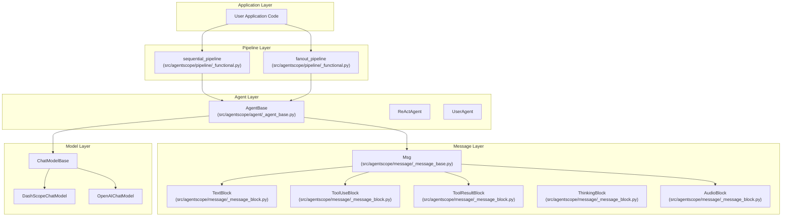

**Core Concepts to Code Entity Mapping**

| Concept | Primary Class | File Path |
|---------|--------------|-----------|
| Agent Base | `AgentBase` | [src/agentscope/agent/_agent_base.py:30]() |
| Message | `Msg` | [src/agentscope/message/_message_base.py:21]() |
| Sequential Flow | `sequential_pipeline` | [src/agentscope/pipeline/_functional.py:10]() |
| Parallel Flow | `fanout_pipeline` | [src/agentscope/pipeline/_functional.py:47]() |
| State Module | `StateModule` | [src/agentscope/module/__init__.py]() (imported in agent_base) |

Sources: [src/agentscope/agent/_agent_base.py](), [src/agentscope/message/_message_base.py](), [src/agentscope/pipeline/_functional.py](), [src/agentscope/message/_message_block.py]()

---

## Message Flow Through Pipelines

AgentScope uses pipelines to manage the flow of `Msg` objects between agents.

Title: Sequential Pipeline Message Flow
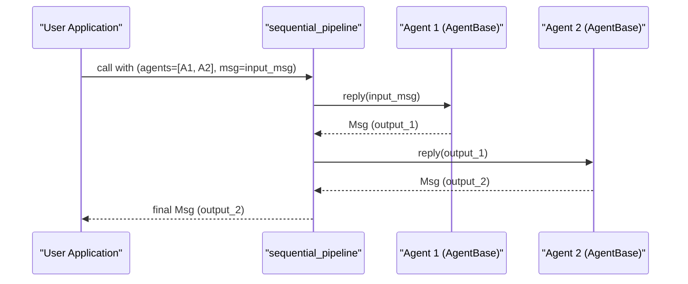

**Key Flow Patterns**:

1. **Sequential**: `sequential_pipeline` executes agents in order, passing the output of one as the input to the next [src/agentscope/pipeline/_functional.py:10-44]().
2. **Fanout**: `fanout_pipeline` distributes the same input to multiple agents concurrently (using `asyncio.gather`) or sequentially [src/agentscope/pipeline/_functional.py:47-104]().
3. **Streaming**: `stream_printing_messages` captures intermediate `print` calls from agents and yields them via an `asyncio.Queue` [src/agentscope/pipeline/_functional.py:107-193]().

Sources: [src/agentscope/pipeline/_functional.py]()

---

## Architecture Layers

AgentScope follows a layered architecture with clear separation of concerns:

Title: AgentScope Layered Architecture
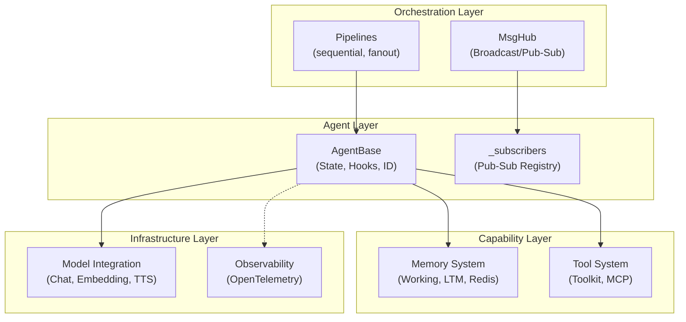

**Layer Responsibilities**:

| Layer | Components | Purpose |
|-------|-----------|---------|
| Orchestration | `sequential_pipeline`, `MsgHub` | Manage multi-agent interaction patterns. |
| Agent | `AgentBase`, `ReActAgent` | Encapsulate state, logic, and lifecycle hooks. |
| Capability | `MemoryBase`, `Toolkit` | Provide agents with tools and context. |
| Infrastructure | `ChatModelBase`, OTel Tracing | Abstract hardware/API dependencies and provide monitoring. |

Sources: [src/agentscope/agent/_agent_base.py](), [src/agentscope/pipeline/_functional.py](), [README.md:60-70]()

---

## Key Architectural Patterns

### Lifecycle Hooks
`AgentBase` implements a comprehensive hook system allowing developers to intercept and modify behavior at specific points: `pre_reply`, `post_reply`, `pre_print`, `post_print`, `pre_observe`, and `post_observe` [src/agentscope/agent/_agent_base.py:36-43](). Hooks can be defined at the class level [src/agentscope/agent/_agent_base.py:46-138]() or instance level [src/agentscope/agent/_agent_base.py:151-158]().

### Publish-Subscribe Communication
Beyond direct pipelines, agents can use a pub-sub model. The `_subscribers` dictionary in `AgentBase` tracks agents that should automatically `observe` the current agent's replies [src/agentscope/agent/_agent_base.py:168]().

### State Management
Agents inherit from `StateModule`, meaning they support `state_dict()` and `load_state_dict()` methods [src/agentscope/agent/_agent_base.py:30](). This is critical for production scenarios requiring session persistence or checkpointing.

### Observability
AgentScope is designed with native OpenTelemetry support. Using decorators like `@trace_llm`, `@trace_reply`, and `@trace_format`, the framework automatically captures execution traces that can be exported to AgentScope Studio or third-party platforms like Langfuse or Arize-Phoenix [docs/tutorial/en/src/task_tracing.py:104-117]().

Sources: [src/agentscope/agent/_agent_base.py](), [docs/tutorial/en/src/task_tracing.py]()

---

# Page: Agent System

# Agent System

<details>
<summary>Relevant source files</summary>

The following files were used as context for generating this wiki page:

- [src/agentscope/_utils/_common.py](src/agentscope/_utils/_common.py)
- [src/agentscope/agent/_agent_base.py](src/agentscope/agent/_agent_base.py)
- [src/agentscope/agent/_react_agent.py](src/agentscope/agent/_react_agent.py)
- [src/agentscope/model/_anthropic_model.py](src/agentscope/model/_anthropic_model.py)
- [src/agentscope/model/_dashscope_model.py](src/agentscope/model/_dashscope_model.py)
- [src/agentscope/model/_gemini_model.py](src/agentscope/model/_gemini_model.py)
- [src/agentscope/model/_model_usage.py](src/agentscope/model/_model_usage.py)
- [src/agentscope/model/_ollama_model.py](src/agentscope/model/_ollama_model.py)
- [src/agentscope/model/_openai_model.py](src/agentscope/model/_openai_model.py)
- [src/agentscope/pipeline/__init__.py](src/agentscope/pipeline/__init__.py)
- [src/agentscope/pipeline/_functional.py](src/agentscope/pipeline/_functional.py)
- [tests/model_anthropic_test.py](tests/model_anthropic_test.py)
- [tests/model_dashscope_test.py](tests/model_dashscope_test.py)
- [tests/model_ollama_test.py](tests/model_ollama_test.py)
- [tests/model_openai_test.py](tests/model_openai_test.py)
- [tests/pipeline_test.py](tests/pipeline_test.py)

</details>


## Overview

The Agent System is the core execution layer of AgentScope, providing the abstractions and implementations for autonomous agents that can reason, act, and communicate. At its foundation is the `AgentBase` class, which defines the universal interface for all agents. The primary concrete implementation is `ReActAgent`, which implements the Reasoning-Acting paradigm with tool calling, memory management, and structured output generation.

This page provides an architectural overview of the agent system. For detailed documentation on specific components, see:
- [AgentBase Foundation](#2.1) — Document the `AgentBase` class, its lifecycle methods (`observe`, `reply`, `print`), asynchronous execution model, and subscriber broadcasting.
- [ReActAgent Implementation](#2.2) — Detail the `ReActAgent` class including initialization parameters, ReAct loop execution, tool integration, and structured output support.
- [Agent Lifecycle and Hooks](#2.3) — Explain the agent execution flow, hook system (`pre_reply`, `post_reply`, etc.), and how to extend agent behavior.
- [Message Protocol and Content Blocks](#2.4) — Document the `Msg` structure, content block types (`TextBlock`, `ImageBlock`, `AudioBlock`, `VideoBlock`, `ToolUseBlock`, `ToolResultBlock`, `ThinkingBlock`), and source types.
- [Planning System with PlanNotebook](#2.5) — Explain the `PlanNotebook`, `Plan` and `SubTask` models, plan tools, state machine, and hint generation.
- [Realtime and UserAgent](#2.6) — Document the `RealtimeAgent` class for voice/realtime interaction scenarios and the `UserAgent` class for human-in-the-loop input.

For related systems, see:
- [Model Integration](#3) — LLM providers and formatters used by agents.
- [Tool System](#4) — Tool registration and execution.
- [Memory and Knowledge Systems](#5) — Working memory, long-term memory, and RAG.
- [Multi-Agent Orchestration](#6) — `MsgHub` and pipeline patterns.

---

## System Architecture

The agent system integrates multiple subsystems to enable autonomous behavior:

**Agent System Architecture**

```mermaid
graph TB
    subgraph "Agent Layer"
        AgentBase["AgentBase<br/>Abstract interface"]
        ReActAgent["ReActAgent<br/>Reasoning-Acting implementation"]
        UserAgent["UserAgent<br/>Human-in-the-loop"]
        RealtimeAgent["RealtimeAgent<br/>Voice interaction"]
    end
    
    subgraph "Core Methods"
        Reply["reply(*args, **kwargs)<br/>Main agent logic"]
        Observe["observe(msg)<br/>Passive listening"]
        HandleInterrupt["handle_interrupt()<br/>Cancellation handling"]
        Print["print(msg, last, speech)<br/>Output display"]
    end
    
    subgraph "Integration Points"
        Model["ChatModelBase<br/>LLM reasoning"]
        Formatter["FormatterBase<br/>Message formatting"]
        Toolkit["Toolkit<br/>Tool execution"]
        Memory["MemoryBase<br/>Conversation history"]
        LongTermMemory["LongTermMemoryBase<br/>Semantic memory"]
        Knowledge["KnowledgeBase<br/>RAG retrieval"]
        PlanNotebook["PlanNotebook<br/>Task decomposition"]
        TTS["TTSModelBase<br/>Speech synthesis"]
    end
    
    subgraph "Cross-Cutting Concerns"
        Hooks["Hook System<br/>pre/post callbacks"]
        Subscribers["Subscriber Pattern<br/>Message broadcasting"]
        StateModule["StateModule<br/>Serialization"]
        Tracing["@trace_reply<br/>Observability"]
    end
    
    AgentBase --> Reply
    AgentBase --> Observe
    AgentBase --> HandleInterrupt
    AgentBase --> Print
    
    ReActAgent --|extends| AgentBase
    UserAgent --|extends| AgentBase
    RealtimeAgent --|extends| AgentBase
    
    ReActAgent --> Model
    ReActAgent --> Formatter
    ReActAgent --> Toolkit
    ReActAgent --> Memory
    ReActAgent --> LongTermMemory
    ReActAgent --> Knowledge
    ReActAgent --> PlanNotebook
    ReActAgent --> TTS
    
    AgentBase --> Hooks
    AgentBase --> Subscribers
    AgentBase --> StateModule
    AgentBase --> Tracing
```

**Sources:** [src/agentscope/agent/_agent_base.py:30-210](), [src/agentscope/agent/_react_agent.py:98-362]()

---

## Agent Types

### AgentBase

`AgentBase` is the abstract foundation defining the core interface:

| Method | Purpose | Implementation Requirement |
|--------|---------|---------------------------|
| `reply()` | Main agent logic | **Required** - Subclasses must implement [src/agentscope/agent/_agent_base.py:197-203]() |
| `observe()` | Receive messages passively | **Required** - Subclasses must implement [src/agentscope/agent/_agent_base.py:185-195]() |
| `handle_interrupt()` | Handle cancellation | **Required** - Subclasses must implement [src/agentscope/agent/_agent_base.py:246-258]() |
| `print()` | Display messages | **Provided** - Terminal output with streaming [src/agentscope/agent/_agent_base.py:205-210]() |
| `__call__()` | Entry point wrapper | **Provided** - Coordinates execution flow [src/agentscope/agent/_agent_base.py:448-467]() |

**Key Features:**

- **Hook System**: Class-level and instance-level hooks for `pre_reply`, `post_reply`, `pre_observe`, `post_observe`, `pre_print`, and `post_print` [src/agentscope/agent/_agent_base.py:36-138]().
- **Subscriber Pattern**: Broadcast outputs to other agents via `_subscribers` and `_broadcast_to_subscribers()` [src/agentscope/agent/_agent_base.py:168-169]().
- **Message Queue**: Optional `asyncio.Queue` for streaming outputs via `set_msg_queue_enabled()` [src/agentscope/agent/_agent_base.py:182-183]().
- **Interruption Support**: Graceful cancellation via `interrupt()` and `handle_interrupt()` [src/agentscope/agent/_agent_base.py:228-258]().
- **State Serialization**: Implements `StateModule` for `state_dict` and `load_state_dict` patterns [src/agentscope/agent/_agent_base.py:30-30]().

**Sources:** [src/agentscope/agent/_agent_base.py:30-258]()

### ReActAgent

`ReActAgent` is the primary agent implementation, following the Reasoning-Acting paradigm:

**ReActAgent Components**

```mermaid
graph TB
    subgraph "ReActAgent Core"
        RA["ReActAgent"]
        SysPrompt["sys_prompt: str"]
        MaxIters["max_iters: int"]
    end
    
    subgraph "Model & Formatting"
        Model["model: ChatModelBase"]
        Formatter["formatter: FormatterBase"]
    end
    
    subgraph "Tool Management"
        Toolkit["toolkit: Toolkit"]
        EnableMeta["enable_meta_tool: bool"]
        ParallelTools["parallel_tool_calls: bool"]
    end
    
    subgraph "Memory Systems"
        Memory["memory: MemoryBase"]
        LTM["long_term_memory: LongTermMemoryBase"]
        LTMMode["long_term_memory_mode:<br/>agent_control | static_control | both"]
        Compression["compression_config: CompressionConfig"]
    end
    
    subgraph "Knowledge & Planning"
        Knowledge["knowledge: list[KnowledgeBase]"]
        EnableRewrite["enable_rewrite_query: bool"]
        PlanNotebook["plan_notebook: PlanNotebook"]
    end
    
    subgraph "Output"
        TTS["tts_model: TTSModelBase"]
        StructuredModel["structured_model parameter"]
    end
    
    RA --> SysPrompt
    RA --> MaxIters
    RA --> Model
    RA --> Formatter
    RA --> Toolkit
    RA --> EnableMeta
    RA --> ParallelTools
    RA --> Memory
    RA --> LTM
    RA --> LTMMode
    RA --> Compression
    RA --> Knowledge
    RA --> EnableRewrite
    RA --> PlanNotebook
    RA --> TTS
    RA --> StructuredModel
```

**Key Capabilities:**

- **Reasoning-Acting Loop**: Iterative reasoning with tool calls (up to `max_iters` iterations) [src/agentscope/agent/_react_agent.py:432-518]().
- **Tool Integration**: Automatic tool schema generation and support for parallel tool calls [src/agentscope/agent/_react_agent.py:298-315]().
- **Memory Management**: Short-term (working memory), long-term (semantic), and automatic compression via `CompressionConfig` [src/agentscope/agent/_react_agent.py:107-171](), [src/agentscope/agent/_react_agent.py:280-296]().
- **RAG Support**: Multiple knowledge bases with optional query rewriting [src/agentscope/agent/_react_agent.py:317-322]().
- **Planning**: Complex task decomposition via `PlanNotebook` [src/agentscope/agent/_react_agent.py:324-354]().
- **Structured Output**: Pydantic model validation via `generate_response` tool [src/agentscope/agent/_react_agent.py:173-175](), [src/agentscope/agent/_react_agent.py:356-362]().
- **Multimodal**: Speech synthesis via `TTSModelBase` [src/agentscope/agent/_react_agent.py:245-246]().

**Sources:** [src/agentscope/agent/_react_agent.py:98-537]()

---

## Agent Lifecycle

The agent lifecycle consists of several distinct phases:

**Agent Lifecycle Phases**

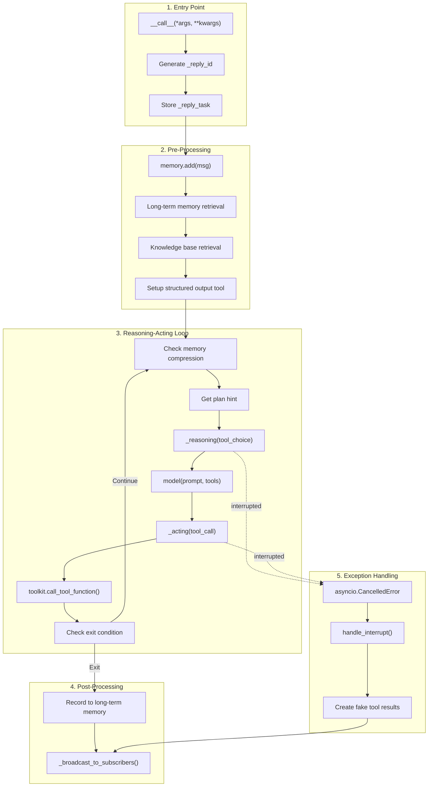

**Sources:** [src/agentscope/agent/_agent_base.py:448-467](), [src/agentscope/agent/_react_agent.py:376-537]()

### Phase 1: Entry Point (`__call__`)

The `__call__` method serves as the entry point and coordination layer:
1. Generate unique `_reply_id` for tracking [src/agentscope/agent/_agent_base.py:450-450]().
2. Store current task in `_reply_task` for interruption support [src/agentscope/agent/_agent_base.py:454-454]().
3. Execute `reply()` within try-except block [src/agentscope/agent/_agent_base.py:456-456]().
4. Catch `asyncio.CancelledError` and call `handle_interrupt()` [src/agentscope/agent/_agent_base.py:458-459]().
5. Broadcast final message to subscribers [src/agentscope/agent/_agent_base.py:463-464]().

### Phase 2: Pre-Processing

Before the reasoning-acting loop in `ReActAgent`:
- **Memory Management**: Add input messages to working memory [src/agentscope/agent/_react_agent.py:396-398]().
- **Long-Term Memory**: Retrieve relevant memories based on `long_term_memory_mode` [src/agentscope/agent/_react_agent.py:400-406]().
- **Knowledge Retrieval**: Query knowledge bases with optional query rewriting [src/agentscope/agent/_react_agent.py:408-418]().
- **Structured Output Setup**: Register `generate_response` tool if `structured_model` is provided [src/agentscope/agent/_react_agent.py:420-427]().

### Phase 3: Reasoning-Acting Loop

The core iterative process in `ReActAgent` (up to `max_iters` iterations):
1. **Memory Compression**: Compress old messages if token count exceeds `trigger_threshold` [src/agentscope/agent/_react_agent.py:433-437]().
2. **Plan Hint**: Get contextual hint from `PlanNotebook` [src/agentscope/agent/_react_agent.py:439-445]().
3. **Reasoning**: Call LLM via `_reasoning()` to generate next action [src/agentscope/agent/_react_agent.py:452-452]().
4. **Acting**: Execute tool calls via `_acting()`, supporting parallel execution [src/agentscope/agent/_react_agent.py:488-490]().
5. **Exit Check**: Stop if the agent calls the finish function or generates a plain text response [src/agentscope/agent/_react_agent.py:513-518]().

### Phase 4: Post-Processing

After the loop completes:
- **Long-Term Memory Recording**: Store conversation results [src/agentscope/agent/_react_agent.py:527-531]().
- **Subscriber Broadcast**: Send final message to all subscribers [src/agentscope/agent/_agent_base.py:463-464]().

### Phase 5: Exception Handling

If interrupted via `agent.interrupt()`:
1. **CancelledError Raised**: Current task raises `asyncio.CancelledError` [src/agentscope/agent/_agent_base.py:458-458]().
2. **Handle Interrupt**: Call `handle_interrupt()` to generate an interruption message [src/agentscope/agent/_react_agent.py:795-823]().
3. **Cleanup**: Create fake tool results for pending tool calls to maintain state consistency [src/agentscope/agent/_react_agent.py:814-818]().

---

## Message Protocol

Agents communicate using structured `Msg` objects with typed content blocks.

**Key Message Components:**
- `Msg.name`: Agent identifier [src/agentscope/message/msg.py:24-24]().
- `Msg.role`: Conversation role (user, assistant, system) [src/agentscope/message/msg.py:25-25]().
- `Msg.content`: Text string or list of typed content blocks [src/agentscope/message/msg.py:26-26]().

**Content Block Types:**
- **TextBlock**: Regular text responses [src/agentscope/message/msg.py:50-50]().
- **ThinkingBlock**: Extended reasoning traces [src/agentscope/message/msg.py:148-148]().
- **ToolUseBlock**: Tool call requests [src/agentscope/message/msg.py:90-90]().
- **ToolResultBlock**: Tool execution results [src/agentscope/message/msg.py:108-108]().

**Sources:** [src/agentscope/message/msg.py:22-160]()

---

## Multi-Agent Communication

Agents support collaboration via subscribers and functional pipelines:

- **Subscriber Pattern**: Broadcast outputs to other agents using `_broadcast_to_subscribers` [src/agentscope/agent/_agent_base.py:469-477]().
- **Sequential Pipeline**: Chain agents in sequence where output of one is input to the next [src/agentscope/pipeline/_functional.py:10-44]().
- **Fanout Pipeline**: Distribute the same input to multiple agents concurrently or sequentially [src/agentscope/pipeline/_functional.py:47-105]().
- **Message Queue**: Capture intermediate outputs for streaming via `stream_printing_messages` [src/agentscope/pipeline/_functional.py:107-193]().

**Sources:** [src/agentscope/agent/_agent_base.py:469-477](), [src/agentscope/pipeline/_functional.py:10-193]()

---

# Page: AgentBase Foundation

# AgentBase Foundation

<details>
<summary>Relevant source files</summary>

The following files were used as context for generating this wiki page:

- [src/agentscope/agent/_agent_base.py](src/agentscope/agent/_agent_base.py)
- [src/agentscope/pipeline/__init__.py](src/agentscope/pipeline/__init__.py)
- [src/agentscope/pipeline/_functional.py](src/agentscope/pipeline/_functional.py)
- [tests/pipeline_test.py](tests/pipeline_test.py)

</details>


This document describes the `AgentBase` class, which serves as the foundational abstract base class for all agents in AgentScope. It defines the core agent interface, provides the hook system for extensibility, implements the subscriber mechanism for multi-agent communication, and handles message printing and interruption.

For information about specific agent implementations like `ReActAgent`, see [ReActAgent Implementation](). For details on agent execution flow and lifecycle, see [Agent Lifecycle and Hooks]().

---

## Class Architecture

The `AgentBase` class is defined in [src/agentscope/agent/_agent_base.py:30-737]() and provides the abstract foundation for all agents in the framework. It inherits from `StateModule` to support state serialization and restoration.

### Inheritance Hierarchy

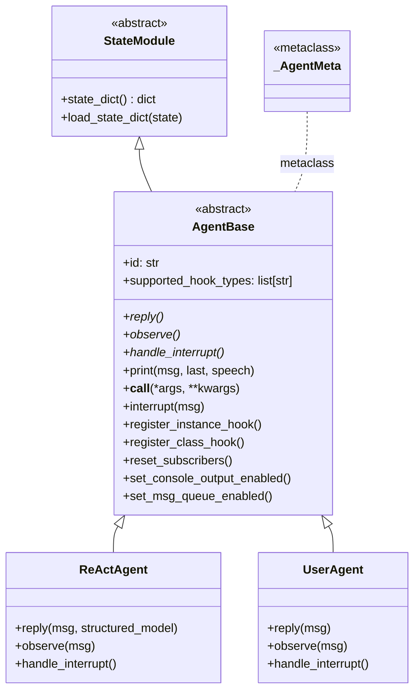

**Sources:** [src/agentscope/agent/_agent_base.py:30-30](), [src/agentscope/module/_state.py:1-40]()

### Key Attributes

The `AgentBase` class maintains several important instance attributes initialized in [src/agentscope/agent/_agent_base.py:140-184]():

| Attribute | Type | Purpose |
|-----------|------|---------|
| `id` | `str` | Unique agent identifier generated using `shortuuid.uuid()` [src/agentscope/agent/_agent_base.py:144-144]() |
| `_reply_task` | `Task \| None` | Current async reply task for interrupt handling [src/agentscope/agent/_agent_base.py:147-147]() |
| `_reply_id` | `str \| None` | Identifier for the current reply operation [src/agentscope/agent/_agent_base.py:148-148]() |
| `_subscribers` | `dict[str, list[AgentBase]]` | Subscribers indexed by MsgHub name [src/agentscope/agent/_agent_base.py:168-168]() |
| `_stream_prefix` | `dict` | Cached streaming data for text and audio blocks [src/agentscope/agent/_agent_base.py:163-163]() |
| `_disable_console_output` | `bool` | Controls whether to print messages to console [src/agentscope/agent/_agent_base.py:172-178]() |
| `_disable_msg_queue` | `bool` | Controls message queue for streaming [src/agentscope/agent/_agent_base.py:182-182]() |
| `msg_queue` | `Queue \| None` | Queue for exporting messages as a generator [src/agentscope/agent/_agent_base.py:183-183]() |

**Sources:** [src/agentscope/agent/_agent_base.py:140-184]()

---

## Core Abstract Methods

`AgentBase` defines three abstract methods that all agent implementations must override to participate in the framework's execution model.

### reply Method

The `reply` method contains the main logic of the agent, typically involving LLM calls or tool usage. It is defined at [src/agentscope/agent/_agent_base.py:197-203]():

```python
async def reply(self, *args: Any, **kwargs: Any) -> Msg:
    """The main logic of the agent, which generates a reply based on the
    current state and input arguments."""
    raise NotImplementedError(...)
```

**Sources:** [src/agentscope/agent/_agent_base.py:197-203]()

### observe Method

The `observe` method allows an agent to receive messages without generating a reply, often used to update internal memory. It is defined at [src/agentscope/agent/_agent_base.py:185-195]():

```python
async def observe(self, msg: Msg | list[Msg] | None) -> None:
    """Receive the given message(s) without generating a reply."""
    raise NotImplementedError(...)
```

**Sources:** [src/agentscope/agent/_agent_base.py:185-195]()

### handle_interrupt Method

This method handles post-processing when a reply is interrupted by the user or system. It is defined at [src/agentscope/agent/_agent_base.py:478-488]():

```python
async def handle_interrupt(self, *args: Any, **kwargs: Any) -> Msg:
    """The post-processing logic when the reply is interrupted."""
    raise NotImplementedError(...)
```

**Sources:** [src/agentscope/agent/_agent_base.py:478-488]()

---

## Hook System

`AgentBase` provides a comprehensive hook system allowing interception and modification of agent behavior at multiple points. The supported hook types are defined at [src/agentscope/agent/_agent_base.py:36-43]():

```python
supported_hook_types: list[str] = [
    "pre_reply", "post_reply", "pre_print", 
    "post_print", "pre_observe", "post_observe"
]
```

### Hook Architecture

Hooks are executed in a specific order: Class-level hooks first, followed by Instance-level hooks.

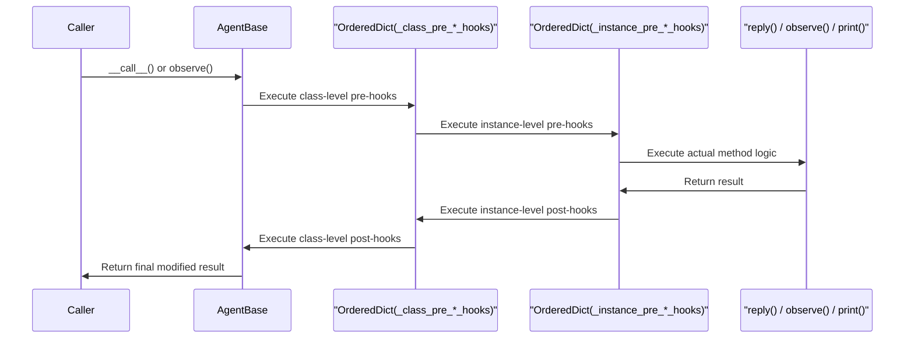

**Sources:** [src/agentscope/agent/_agent_base.py:36-138](), [src/agentscope/agent/_agent_base.py:150-158]()

### Hook Management

| Method | Scope | Purpose |
|--------|-------|---------|
| `register_class_hook()` | Class | Add a hook to all instances of the class [src/agentscope/agent/_agent_base.py:552-607]() |
| `register_instance_hook()` | Instance | Add a hook to a specific instance [src/agentscope/agent/_agent_base.py:495-550]() |
| `remove_class_hook()` | Class | Remove a class-level hook [src/agentscope/agent/_agent_base.py:609-623]() |
| `remove_instance_hook()` | Instance | Remove an instance-level hook [src/agentscope/agent/_agent_base.py:625-639]() |

**Sources:** [src/agentscope/agent/_agent_base.py:495-639]()

---

## Subscriber Mechanism

The subscriber mechanism enables the publish-subscribe pattern for multi-agent communication, allowing agents to automatically observe each other's replies within a shared context (e.g., a `MsgHub`).

### Subscriber Data Structure

The `_subscribers` dictionary at [src/agentscope/agent/_agent_base.py:165-168]() maps `MsgHub` identifiers to lists of agent instances that should receive broadcasted messages.

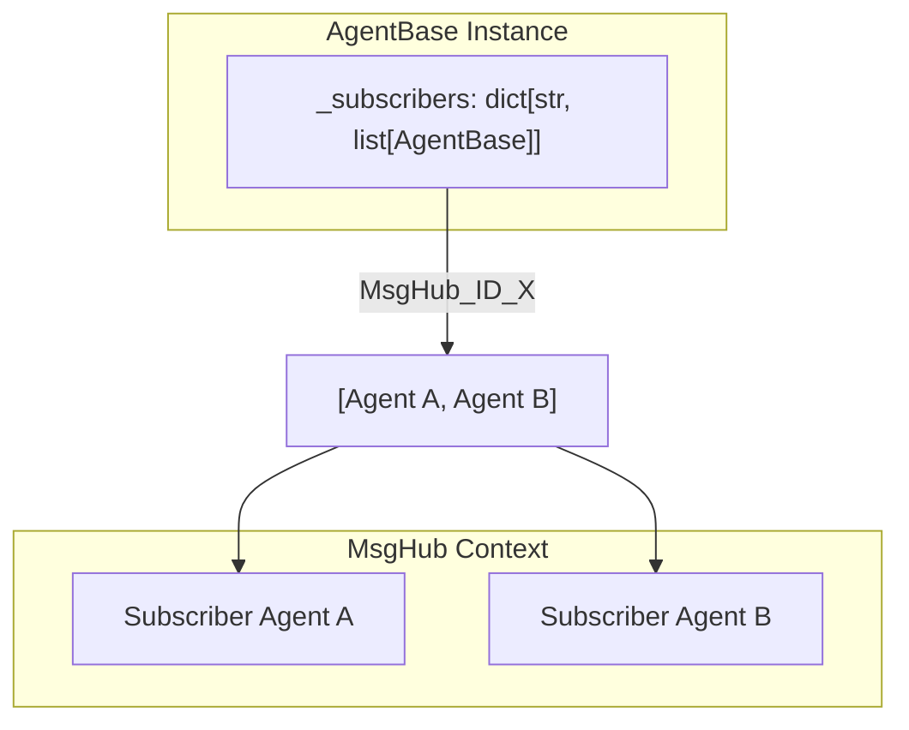

**Sources:** [src/agentscope/agent/_agent_base.py:165-168]()

### Broadcasting Flow

When an agent completes a reply, it automatically calls `_broadcast_to_subscribers` at [src/agentscope/agent/_agent_base.py:469-476](), which invokes the `observe` method of every registered subscriber.

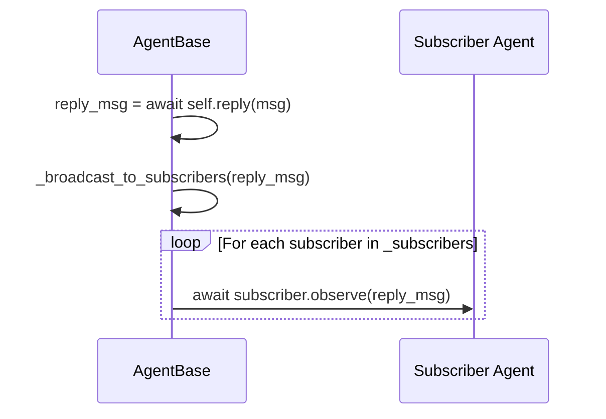

**Sources:** [src/agentscope/agent/_agent_base.py:469-476]()

---

## Message Printing System

`AgentBase` implements a printing system that handles streaming messages, multimodal content (text, audio, thinking), and real-time display.

### print Method

The `print` method at [src/agentscope/agent/_agent_base.py:205-275]() handles message display. It supports streaming by using the `last` flag and can optionally play audio via the `speech` parameter.

| Parameter | Type | Purpose |
|-----------|------|---------|
| `msg` | `Msg` | The message object to be printed |
| `last` | `bool` | Whether this is the final chunk in a streaming message |
| `speech` | `AudioBlock \| list[AudioBlock] \| None` | Optional audio content for playback |

**Sources:** [src/agentscope/agent/_agent_base.py:205-275]()

### Streaming Cache

The `_stream_prefix` dictionary at [src/agentscope/agent/_agent_base.py:160-163]() caches partial streaming data (accumulated text and audio players) for each message ID to ensure smooth real-time updates.

**Sources:** [src/agentscope/agent/_agent_base.py:160-163]()

---

## Interrupt Handling

`AgentBase` supports interrupting ongoing agent replies, which is essential for human-in-the-loop intervention.

### interrupt Method

Defined at [src/agentscope/agent/_agent_base.py:490-493](), the `interrupt` method cancels the current `_reply_task` with an optional message.

```python
async def interrupt(self, msg: Msg | list[Msg] | None = None) -> None:
    """Interrupt the current reply process."""
    if self._reply_task and not self._reply_task.done():
        self._reply_task.cancel(msg)
```

**Sources:** [src/agentscope/agent/_agent_base.py:490-493]()

### Lifecycle of an Interruption

When a task is cancelled, `AgentBase.__call__` catches the `asyncio.CancelledError` and routes the execution to `handle_interrupt` at [src/agentscope/agent/_agent_base.py:448-467]().

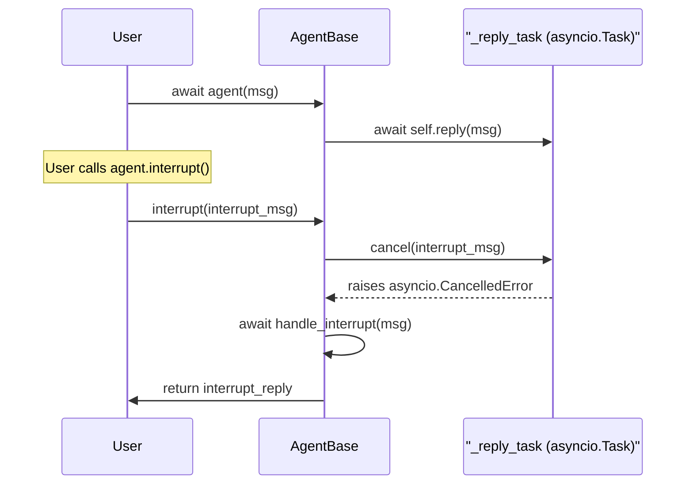

**Sources:** [src/agentscope/agent/_agent_base.py:448-467]()

---

## Integration with Pipeline System

Agents are designed to be used within pipelines. The `__call__` method allows an agent instance to be invoked as an async function, which is the standard interface for all AgentScope pipelines.

### Functional Pipelines

The framework provides syntactic sugar for agent orchestration in [src/agentscope/pipeline/_functional.py]():

- **sequential_pipeline**: Executes agents in a chain where the output of one is the input to the next [src/agentscope/pipeline/_functional.py:10-44]().
- **fanout_pipeline**: Distributes the same message to multiple agents, executing them concurrently via `asyncio.gather` by default [src/agentscope/pipeline/_functional.py:47-104]().

### Stream Printing

The `stream_printing_messages` utility at [src/agentscope/pipeline/_functional.py:107-193]() enables real-time monitoring of agent execution by capturing messages sent to the agent's `msg_queue` (enabled via `set_msg_queue_enabled` [src/agentscope/agent/_agent_base.py:657-674]()).

**Sources:** [src/agentscope/pipeline/_functional.py:10-193](), [src/agentscope/agent/_agent_base.py:657-674]()

---

# Page: ReActAgent Implementation

# ReActAgent Implementation

<details>
<summary>Relevant source files</summary>

The following files were used as context for generating this wiki page:

- [src/agentscope/_utils/_common.py](src/agentscope/_utils/_common.py)
- [src/agentscope/agent/_react_agent.py](src/agentscope/agent/_react_agent.py)
- [src/agentscope/model/_anthropic_model.py](src/agentscope/model/_anthropic_model.py)
- [src/agentscope/model/_dashscope_model.py](src/agentscope/model/_dashscope_model.py)
- [src/agentscope/model/_gemini_model.py](src/agentscope/model/_gemini_model.py)
- [src/agentscope/model/_model_usage.py](src/agentscope/model/_model_usage.py)
- [src/agentscope/model/_ollama_model.py](src/agentscope/model/_ollama_model.py)
- [src/agentscope/model/_openai_model.py](src/agentscope/model/_openai_model.py)
- [tests/model_anthropic_test.py](tests/model_anthropic_test.py)
- [tests/model_dashscope_test.py](tests/model_dashscope_test.py)
- [tests/model_ollama_test.py](tests/model_ollama_test.py)
- [tests/model_openai_test.py](tests/model_openai_test.py)
- [tests/react_agent_test.py](tests/react_agent_test.py)

</details>


This page documents the `ReActAgent` class, the primary agent implementation in AgentScope that combines reasoning and acting in an iterative loop. `ReActAgent` integrates all major subsystems including tool calling, memory management, knowledge retrieval, planning, and structured output generation.

For the abstract agent interface, see [AgentBase Foundation](#2.1). For execution flow details, see [Agent Lifecycle and Hooks](#2.3). For memory systems used by ReActAgent, see [Working Memory Architecture](#5.1) and [Memory Compression](#5.2).

---

## Class Overview and Dependencies

`ReActAgent` is a comprehensive agent implementation that orchestrates multiple subsystems to implement the ReAct (Reasoning + Acting) pattern.

Title: ReActAgent Component Architecture
```mermaid
graph TB
    ReActAgent["ReActAgent<br/>(src/agentscope/agent/_react_agent.py)"]
    ReActAgentBase["ReActAgentBase<br/>(src/agentscope/agent/_react_agent_base.py)"]
    
    subgraph "Core Dependencies"
        ChatModelBase["ChatModelBase<br/>(src/agentscope/model/_model_base.py)"]
        FormatterBase["FormatterBase<br/>(src/agentscope/formatter/_base.py)"]
        MemoryBase["MemoryBase<br/>(src/agentscope/memory/_working_memory/_base.py)"]
        InMemoryMemory["InMemoryMemory<br/>(src/agentscope/memory/_working_memory/_in_memory_memory.py)"]
        Toolkit["Toolkit<br/>(src/agentscope/tool/_toolkit.py)"]
    end
    
    subgraph "Optional Dependencies"
        LongTermMemoryBase["LongTermMemoryBase<br/>(src/agentscope/memory/_long_term_memory/_base.py)"]
        KnowledgeBase["KnowledgeBase<br/>(src/agentscope/rag/_knowledge_base.py)"]
        PlanNotebook["PlanNotebook<br/>(src/agentscope/plan/_plan_notebook.py)"]
        TTSModelBase["TTSModelBase<br/>(src/agentscope/tts/_tts_model.py)"]
        CompressionConfig["ReActAgent.CompressionConfig<br/>(src/agentscope/agent/_react_agent.py)"]
    end
    
    ReActAgent -->|inherits| ReActAgentBase
    ReActAgent -->|uses| ChatModelBase
    ReActAgent -->|uses| FormatterBase
    ReActAgent -->|uses| Toolkit
    ReActAgent -->|uses| MemoryBase
    MemoryBase <|..|default| InMemoryMemory
    
    ReActAgent -.->|optional| LongTermMemoryBase
    ReActAgent -.->|optional| KnowledgeBase
    ReActAgent -.->|optional| PlanNotebook
    ReActAgent -.->|optional| TTSModelBase
    ReActAgent -.->|optional| CompressionConfig
```

**Sources:** [src/agentscope/agent/_react_agent.py:98-262](), [src/agentscope/agent/_react_agent_base.py:12-14]()

---

## Initialization Parameters

The `ReActAgent.__init__` method accepts a comprehensive set of parameters that configure all aspects of agent behavior.

### Core Parameters

| Parameter | Type | Default | Description |
|-----------|------|---------|-------------|
| `name` | `str` | Required | Agent identifier used in message attribution |
| `sys_prompt` | `str` | Required | System prompt defining agent behavior |
| `model` | `ChatModelBase` | Required | LLM for reasoning and response generation |
| `formatter` | `FormatterBase` | Required | Converts `Msg` objects to model-specific format |

### Tool and Memory Parameters

| Parameter | Type | Default | Description |
|-----------|------|---------|-------------|
| `toolkit` | `Toolkit \| None` | `None` | Tool registry; empty `Toolkit` created if not provided |
| `memory` | `MemoryBase \| None` | `None` | Short-term memory; `InMemoryMemory` created if not provided |
| `enable_meta_tool` | `bool` | `False` | Registers `reset_equipped_tools` for dynamic tool management |
| `parallel_tool_calls` | `bool` | `False` | Execute multiple tool calls concurrently vs. sequentially |

### Long-Term Memory Parameters

| Parameter | Type | Default | Description |
|-----------|------|---------|-------------|
| `long_term_memory` | `LongTermMemoryBase \| None` | `None` | Semantic memory across sessions |
| `long_term_memory_mode` | `Literal["agent_control", "static_control", "both"]` | `"both"` | Control mode for LTM operations |

**Long-term memory modes:**
- **`agent_control`**: Two tools (`retrieve_from_memory`, `record_to_memory`) registered for agent-driven memory management [src/agentscope/agent/_react_agent.py:293-296]()
- **`static_control`**: Automatic retrieval before each reply, recording after each reply [src/agentscope/agent/_react_agent.py:289-292]()
- **`both`**: Combines agent-controlled tools with automatic operations [src/agentscope/agent/_react_agent.py:286-288]()

### Knowledge and Planning Parameters

| Parameter | Type | Default | Description |
|-----------|------|---------|-------------|
| `knowledge` | `KnowledgeBase \| list[KnowledgeBase] \| None` | `None` | RAG knowledge bases for document retrieval |
| `enable_rewrite_query` | `bool` | `True` | LLM rewrites user queries before RAG retrieval |
| `plan_notebook` | `PlanNotebook \| None` | `None` | Task decomposition and plan management |

### Execution Control Parameters

| Parameter | Type | Default | Description |
|-----------|------|---------|-------------|
| `max_iters` | `int` | `10` | Maximum reasoning-acting loop iterations |
| `print_hint_msg` | `bool` | `False` | Display system hints (plan guidance, retrieval results) |

### Output and Compression Parameters

| Parameter | Type | Default | Description |
|-----------|------|---------|-------------|
| `tts_model` | `TTSModelBase \| None` | `None` | Text-to-speech model for audio generation |
| `compression_config` | `CompressionConfig \| None` | `None` | Automatic memory compression configuration |

**Sources:** [src/agentscope/agent/_react_agent.py:177-262]()

---

## CompressionConfig Structure

The nested `ReActAgent.CompressionConfig` class configures automatic memory compression to manage context window limits.

Title: CompressionConfig Data Structure
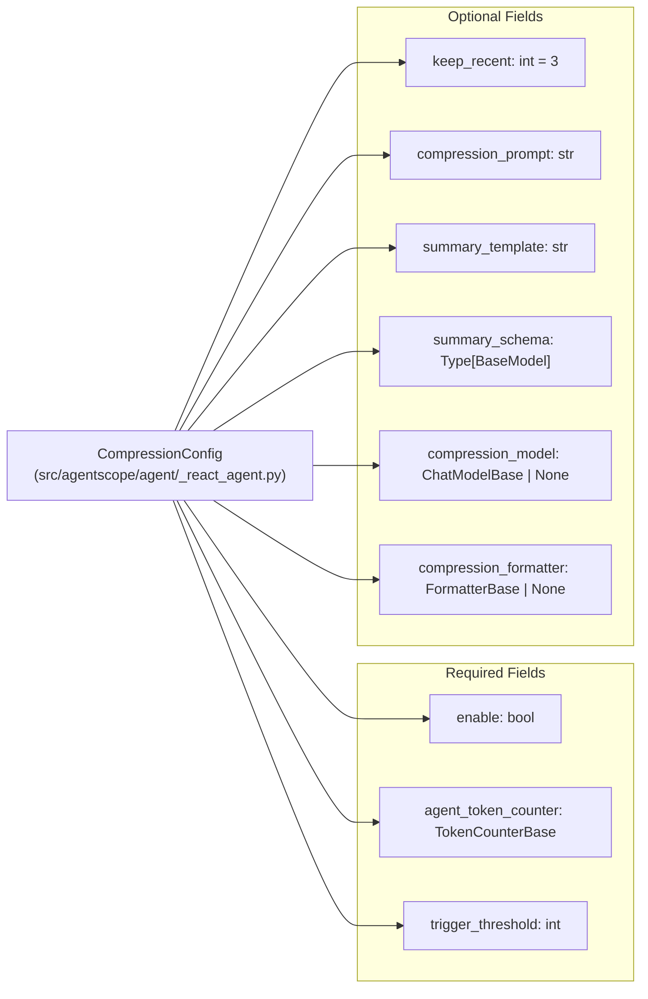

### Configuration Fields

| Field | Type | Description |
|-------|------|-------------|
| `enable` | `bool` | Master switch for compression feature |
| `agent_token_counter` | `TokenCounterBase` | Counts tokens to determine when to trigger compression [src/agentscope/agent/_react_agent.py:116-119]() |
| `trigger_threshold` | `int` | Token count threshold; compression activates when exceeded [src/agentscope/agent/_react_agent.py:120-123]() |
| `keep_recent` | `int` | Number of recent messages to preserve uncompressed (default: 3) [src/agentscope/agent/_react_agent.py:125-127]() |
| `compression_prompt` | `str` | Prompt instructing the LLM to generate summary [src/agentscope/agent/_react_agent.py:129-140]() |
| `summary_template` | `str` | String template formatting compressed summary [src/agentscope/agent/_react_agent.py:142-158]() |
| `summary_schema` | `Type[BaseModel]` | Pydantic model defining summary structure (default: `SummarySchema`) [src/agentscope/agent/_react_agent.py:160-162]() |
| `compression_model` | `ChatModelBase \| None` | Optional dedicated model for compression [src/agentscope/agent/_react_agent.py:164-166]() |
| `compression_formatter` | `FormatterBase \| None` | Formatter for compression model [src/agentscope/agent/_react_agent.py:168-171]() |

### Default SummarySchema

The default `SummarySchema` structures the compressed summary into five sections:

```python
class SummarySchema(BaseModel):
    task_overview: str          # User's core request, success criteria
    current_state: str          # What's completed, files modified, outputs
    important_discoveries: str  # Technical constraints, decisions, errors
    next_steps: str            # Specific actions needed, blockers
    context_to_preserve: str   # User preferences, domain details, promises
```

**Sources:** [src/agentscope/agent/_react_agent.py:107-172](), [src/agentscope/agent/_react_agent.py:43-86]()

---

## Reasoning-Acting Loop Architecture

The `reply` method implements the core ReAct loop that alternates between reasoning (LLM generation) and acting (tool execution).

Title: ReAct Execution Loop
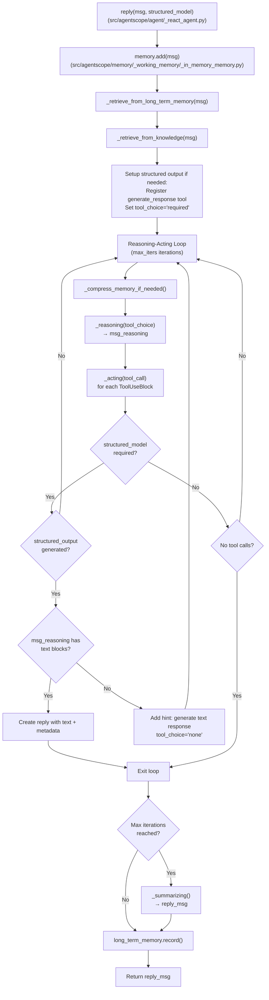

### Loop Execution Flow

1. **Pre-Loop Setup** [src/agentscope/agent/_react_agent.py:396-426]()
   - Add input message(s) to memory.
   - Retrieve from long-term memory (if `static_control`).
   - Retrieve from knowledge bases (if configured).
   - Register `generate_response` tool if `structured_model` provided.

2. **Iteration Loop** [src/agentscope/agent/_react_agent.py:432-518]()
   - Compress memory if token threshold exceeded.
   - **Reasoning Phase**: Call LLM with formatted prompt and tool schemas.
   - **Acting Phase**: Execute tool calls (parallel or sequential based on `parallel_tool_calls`).
   - **Exit Conditions**:
     - Structured output satisfied with text response.
     - No structured output required and no tool calls made.

3. **Post-Loop Cleanup** [src/agentscope/agent/_react_agent.py:520-537]()
   - If max iterations reached, call `_summarizing` to generate final response.
   - Record conversation to long-term memory (if `static_control`).
   - Return final message with metadata.

**Sources:** [src/agentscope/agent/_react_agent.py:375-537]()

---

## Reasoning Phase Implementation

The `_reasoning` method handles LLM invocation with memory, planning hints, and tool schemas.

Title: Reasoning Phase Sequence
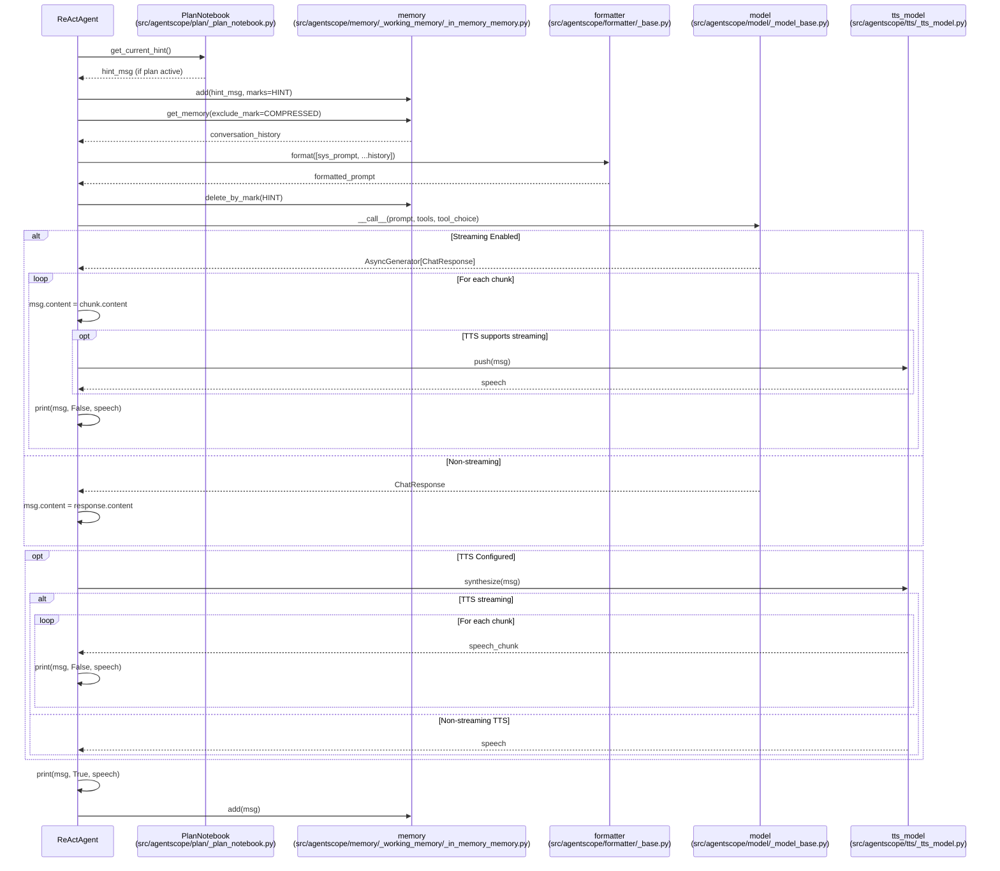

### Key Operations

1. **Planning Integration** [src/agentscope/agent/_react_agent.py:546-551]()
   - If `plan_notebook` configured, retrieves current hint message.
   - Hint provides contextual guidance based on plan state.
   - Added to memory with `_MemoryMark.HINT` and cleared after use.

2. **Memory Formatting** [src/agentscope/agent/_react_agent.py:554-566]()
   - Constructs prompt with system message and conversation history.
   - Excludes messages marked `COMPRESSED` if compression enabled.
   - Clears hint messages after formatting to prevent accumulation.

3. **Model Invocation** [src/agentscope/agent/_react_agent.py:568-572]()
   - Calls model with formatted prompt and tool schemas.
   - Passes `tool_choice` parameter to control tool calling behavior.

4. **Streaming and TTS** [src/agentscope/agent/_react_agent.py:578-622]()
   - Handles both streaming and non-streaming model responses.
   - Integrates TTS for audio generation if configured.
   - Extracts audio blocks from multimodal models.

5. **Interruption Handling** [src/agentscope/agent/_react_agent.py:623-652]()
   - Catches `asyncio.CancelledError` for user interruptions.
   - Ensures memory consistency even when interrupted.

**Sources:** [src/agentscope/agent/_react_agent.py:540-653]()

---

## Acting Phase Implementation

The `_acting` method executes individual tool calls and handles structured output validation.

Title: Acting Phase Execution
```mermaid
graph TB
    acting_entry["_acting(tool_call: ToolUseBlock)<br/>(src/agentscope/agent/_react_agent.py)"]
    create_result_msg["Create ToolResultBlock<br/>(src/agentscope/message/msg.py)"]
    
    call_tool["toolkit.call_tool_function(tool_call)<br/>(src/agentscope/tool/_toolkit.py)"]
    async_gen["AsyncGenerator[ToolResponse]"]
    
    chunk_loop["Iterate through chunks"]
    update_output["Update ToolResultBlock.output"]
    print_chunk["print(tool_res_msg, chunk.is_last)"]
    
    check_interrupted{"chunk.is_interrupted?"}
    raise_cancelled["Raise asyncio.CancelledError"]
    
    check_finish{"tool_call.name ==<br/>finish_function_name?"}
    return_structured["Return chunk.metadata<br/>.structured_output"]
    
    continue_loop["Continue to next chunk"]
    return_none["Return None"]
    add_to_memory["Finally: memory.add(tool_res_msg)"]
    
    acting_entry --> create_result_msg
    create_result_msg --> call_tool
    call_tool --> async_gen
    async_gen --> chunk_loop
    chunk_loop --> update_output
    update_output --> print_chunk
    print_chunk --> check_interrupted
    
    check_interrupted -->|Yes| raise_cancelled
    check_interrupted -->|No| check_finish
    
    check_finish -->|Yes| return_structured
    check_finish -->|No| continue_loop
    continue_loop --> chunk_loop
    chunk_loop -->|Done| return_none
    
    return_structured --> add_to_memory
    return_none --> add_to_memory
```

### Execution Details

1. **Tool Result Structure** [src/agentscope/agent/_react_agent.py:668-680]()
   - Creates `ToolResultBlock` with same `id` and `name` as tool call.

2. **Tool Execution** [src/agentscope/agent/_react_agent.py:682-693]()
   - Calls `toolkit.call_tool_function` which returns `AsyncGenerator[ToolResponse]`.
   - Each chunk updates the tool result output.

3. **Interruption Detection** [src/agentscope/agent/_react_agent.py:696-697]()
   - If `chunk.is_interrupted` is `True`, raises `asyncio.CancelledError`.

4. **Structured Output Extraction** [src/agentscope/agent/_react_agent.py:699-706]()
   - Checks if tool is `generate_response` (finish function).
   - Returns `structured_output` from metadata if validation succeeded.

5. **Memory Recording** [src/agentscope/agent/_react_agent.py:710-712]()
   - Tool result message added to memory in `finally` block.

**Sources:** [src/agentscope/agent/_react_agent.py:655-712]()

---

## Memory Compression System

The memory compression system automatically summarizes old conversation history when token limits approach.

Title: Memory Compression Workflow
```mermaid
graph TB
    compress_entry["_compress_memory_if_needed()<br/>(src/agentscope/agent/_react_agent.py)"]
    check_enabled{"compression_config<br/>enabled?"}
    
    get_uncompressed["memory.get_memory<br/>(exclude_mark=COMPRESSED)"]
    
    calculate_keep["Calculate messages to keep:<br/>Keep recent n messages<br/>Keep tool_use/result pairs"]
    
    format_prompt["formatter.format(...)"]
    count_tokens["agent_token_counter.count(prompt)"]
    
    check_threshold{"tokens ><br/>trigger_threshold?"}
    
    call_compression_model["compression_model(...)"]
    
    update_summary["memory.update_compressed_summary(...)"]
    
    mark_compressed["memory.update_messages_mark<br/>(msg_ids, COMPRESSED)"]
    
    compress_entry --> check_enabled
    check_enabled -->|Yes| get_uncompressed
    get_uncompressed --> calculate_keep
    calculate_keep --> format_prompt
    format_prompt --> count_tokens
    count_tokens --> check_threshold
    check_threshold -->|Yes| call_compression_model
    call_compression_model --> update_summary
    update_summary --> mark_compressed
```

### Compression Algorithm

1. **Recent Message Preservation** [src/agentscope/agent/_react_agent.py:1024-1049]()
   - Identifies `keep_recent` messages to exclude from compression.
   - Ensures paired tool_use/result messages are kept together.

2. **Token Counting** [src/agentscope/agent/_react_agent.py:1051-1062]()
   - Formats messages and counts tokens with `agent_token_counter`.
   - Compares against `trigger_threshold`.

3. **Summary Generation** [src/agentscope/agent/_react_agent.py:1072-1097]()
   - Uses `compression_model` and `summary_schema` to generate structured summary.

4. **Memory Update** [src/agentscope/agent/_react_agent.py:1108-1126]()
   - Updates `_compressed_summary` in memory.
   - Marks compressed messages with `_MemoryMark.COMPRESSED`.

**Sources:** [src/agentscope/agent/_react_agent.py:1011-1134](), [src/agentscope/agent/_react_agent.py:88-96]()

---

## Structured Output Generation

The `generate_response` method enables structured output through tool calling with Pydantic validation.

### Implementation Flow

1. **Tool Registration** [src/agentscope/agent/_react_agent.py:410-426]()
   - Registers `generate_response` method as a tool.
   - Calls `toolkit.set_extended_model` to associate the Pydantic model.
   - Sets `tool_choice="required"` to force the LLM to call a tool.

2. **Validation** [src/agentscope/agent/_react_agent.py:835-857]()
   - `generate_response` receives `**kwargs` from the tool call.
   - Calls `_required_structured_model.model_validate(kwargs)`.
   - Returns `ToolResponse` with `success=False` on `ValidationError`, including details for LLM correction.

3. **Output Extraction** [src/agentscope/agent/_react_agent.py:453-493]()
   - After successful validation, `_acting` returns the `structured_output`.
   - If reasoning message has text blocks, creates reply with metadata.

**Sources:** [src/agentscope/agent/_react_agent.py:825-876](), [src/agentscope/agent/_react_agent.py:173-175]()

---

## Knowledge Retrieval Integration

The `_retrieve_from_knowledge` method implements RAG (Retrieval-Augmented Generation) with optional query rewriting.

### Retrieval Process

1. **Query Extraction** [src/agentscope/agent/_react_agent.py:916-930]()
   - Extracts text content from input message(s).

2. **Query Rewriting** [src/agentscope/agent/_react_agent.py:932-972]()
   - If `enable_rewrite_query=True`, asks LLM to rewrite query using `_QueryRewriteModel`.

3. **Multi-KB Retrieval** [src/agentscope/agent/_react_agent.py:974-979]()
   - Calls `retrieve(query)` on each knowledge base.

4. **Result Formatting** [src/agentscope/agent/_react_agent.py:980-1009]()
   - Sorts documents by relevance score.
   - Creates message with `<retrieved_knowledge>` XML tags and adds to memory.

**Sources:** [src/agentscope/agent/_react_agent.py:904-1009](), [src/agentscope/agent/_react_agent.py:33-41]()

---

## State Management

`ReActAgent` implements the `StateModule` interface for serialization and checkpoint restoration.

### Registered State Variables

```python
self.register_state("name")
self.register_state("_sys_prompt")
```

Only `name` and `_sys_prompt` are registered as state variables. [src/agentscope/agent/_react_agent.py:362-374]()

### Dynamic sys_prompt Property

The `sys_prompt` property dynamically appends agent skill descriptions from the toolkit. [src/agentscope/agent/_react_agent.py:366-373]()

**Sources:** [src/agentscope/agent/_react_agent.py:362-374]()

---

# Page: Agent Lifecycle and Hooks

# Agent Lifecycle and Hooks

<details>
<summary>Relevant source files</summary>

The following files were used as context for generating this wiki page:

- [docs/tutorial/en/src/task_embedding.py](docs/tutorial/en/src/task_embedding.py)
- [docs/tutorial/en/src/task_rag.py](docs/tutorial/en/src/task_rag.py)
- [docs/tutorial/zh_CN/src/task_embedding.py](docs/tutorial/zh_CN/src/task_embedding.py)
- [docs/tutorial/zh_CN/src/task_rag.py](docs/tutorial/zh_CN/src/task_rag.py)
- [examples/functionality/rag/README.md](examples/functionality/rag/README.md)
- [examples/functionality/rag/agentic_usage.py](examples/functionality/rag/agentic_usage.py)
- [examples/functionality/rag/basic_usage.py](examples/functionality/rag/basic_usage.py)
- [src/agentscope/agent/_agent_base.py](src/agentscope/agent/_agent_base.py)
- [src/agentscope/hooks/_studio_hooks.py](src/agentscope/hooks/_studio_hooks.py)
- [src/agentscope/pipeline/__init__.py](src/agentscope/pipeline/__init__.py)
- [src/agentscope/pipeline/_functional.py](src/agentscope/pipeline/_functional.py)
- [tests/pipeline_test.py](tests/pipeline_test.py)

</details>


This page documents the complete execution lifecycle of agents in AgentScope, from invocation through completion or interruption. It covers the asynchronous execution model, hook system, interrupt handling, message streaming, and the ReActAgent's reasoning-acting loop.

## Agent Invocation Pipeline

Every agent execution begins with the `__call__` method in `AgentBase`, which serves as the entry point for all agent interactions. This method orchestrates the complete lifecycle including task tracking, interrupt handling, and subscriber notification.

### Basic Execution Flow

The following diagram bridges the high-level agent invocation to the specific code entities involved in the lifecycle.

**Diagram: Agent Execution and Code Entity Mapping**

```mermaid
sequenceDiagram
    participant U as "User/Caller"
    participant AB as "AgentBase.__call__"
    participant RA as "ReActAgent.reply"
    participant S as "AgentBase._subscribers"
    participant H as "AgentBase.handle_interrupt"
    
    U->>AB: "await agent(msg)"
    activate AB
    Note over AB: [src/agentscope/agent/_agent_base.py:448-467]()
    AB->>AB: "Generate _reply_id"
    AB->>AB: "Set _reply_task"
    
    alt "Normal Execution"
        AB->>RA: "await reply(*args, **kwargs)"
        activate RA
        Note over RA: [src/agentscope/agent/_react_agent.py:375-537]()
        RA->>RA: "Execute reasoning/acting loop"
        RA-->>AB: "Return reply_msg"
        deactivate RA
    else "Interruption Occurs"
        AB->>AB: "Catch asyncio.CancelledError"
        AB->>H: "await handle_interrupt(*args, **kwargs)"
        activate H
        Note over H: [src/agentscope/agent/_agent_base.py:623-652]()
        H-->>AB: "Return reply_msg"
        deactivate H
    end
    
    AB->>S: "_broadcast_to_subscribers(reply_msg)"
    Note over S: [src/agentscope/agent/_agent_base.py:469-476]()
    AB->>AB: "Clean up _reply_task"
    AB-->>U: "Return reply_msg"
    deactivate AB
```

**Sources:** [src/agentscope/agent/_agent_base.py:448-467](), [src/agentscope/agent/_agent_base.py:140-184](), [src/agentscope/agent/_react_agent.py:375-537]()

### Agent State During Execution

| State Variable | Type | Purpose |
|---------------|------|---------|
| `id` | `str` | Unique identifier generated using `shortuuid` [src/agentscope/agent/_agent_base.py:144]() |
| `_reply_task` | `asyncio.Task \| None` | Current asyncio task being executed [src/agentscope/agent/_agent_base.py:147]() |
| `_reply_id` | `str \| None` | Unique identifier for the current reply session [src/agentscope/agent/_agent_base.py:148]() |
| `_stream_prefix` | `dict` | Tracks accumulated text and audio for streaming [src/agentscope/agent/_agent_base.py:163]() |
| `_subscribers` | `dict[str, list[AgentBase]]` | Subscribers grouped by MsgHub name [src/agentscope/agent/_agent_base.py:168]() |
| `msg_queue` | `asyncio.Queue \| None` | Queue for streaming message output [src/agentscope/agent/_agent_base.py:183]() |

**Sources:** [src/agentscope/agent/_agent_base.py:140-184]()

## Hook System Architecture

AgentScope provides a comprehensive hook system that allows interception and modification of agent behavior at critical execution points. Hooks exist at both class-level (affecting all instances) and instance-level (affecting only specific instances).

### Supported Hook Types

The `AgentBase` class defines six hook points in the execution lifecycle [src/agentscope/agent/_agent_base.py:36-43]():

```mermaid
graph LR
    subgraph "Reply Lifecycle"
        PR["pre_reply hooks"] --> R["reply() method"]
        R --> PO["post_reply hooks"]
    end
    
    subgraph "Print Lifecycle"
        PP["pre_print hooks"] --> P["print() method"]
        P --> POP["post_print hooks"]
    end
    
    subgraph "Observe Lifecycle"
        POB["pre_observe hooks"] --> O["observe() method"]
        O --> POOB["post_observe hooks"]
    end
```

**Sources:** [src/agentscope/agent/_agent_base.py:36-138]()

### Hook Execution Order

Hooks are executed in a specific order, with instance-level hooks running before class-level hooks. This is managed by the `register_class_hook` and `register_instance_hook` methods [src/agentscope/agent/_agent_base.py:495-607]().

| Hook Type | Execution Order | Input | Output |
|-----------|----------------|-------|--------|
| `pre_reply` | Instance → Class | `(self, kwargs_dict)` | Modified kwargs or None [src/agentscope/agent/_agent_base.py:46-61]() |
| `post_reply` | Instance → Class | `(self, kwargs, reply_msg)` | Modified reply_msg or None [src/agentscope/agent/_agent_base.py:63-79]() |
| `pre_print` | Instance → Class | `(self, kwargs_dict)` | Modified kwargs or None [src/agentscope/agent/_agent_base.py:81-93]() |
| `post_print` | Instance → Class | `(self, kwargs, output)` | Modified output or None [src/agentscope/agent/_agent_base.py:95-107]() |
| `pre_observe` | Instance → Class | `(self, kwargs_dict)` | Modified kwargs or None [src/agentscope/agent/_agent_base.py:109-124]() |
| `post_observe` | Instance → Class | `(self, kwargs, None)` | None [src/agentscope/agent/_agent_base.py:127-138]() |

### Studio Integration via Hooks

The `_studio_hooks.py` file demonstrates a practical use of hooks. For example, `as_studio_forward_message_pre_print_hook` intercepts the `print` call to forward messages to the AgentScope Studio UI via HTTP POST [src/agentscope/hooks/_studio_hooks.py:12-45](). It handles retries and graceful degradation if the Studio is unreachable [src/agentscope/hooks/_studio_hooks.py:47-58]().

**Sources:** [src/agentscope/agent/_agent_base.py:46-138](), [src/agentscope/hooks/_studio_hooks.py:12-59]()

## ReActAgent Reply Lifecycle

The `ReActAgent.reply` method implements the complete reasoning-acting loop pattern. It executes multiple phases in sequence: memory retrieval, reasoning, acting, and post-processing.

### Complete Reply Flow

```mermaid
graph TD
    Start["reply(msg, structured_model)"] --> AddMem["memory.add(msg)"]
    AddMem --> RetrieveLTM["Retrieve from long_term_memory<br/>(if static_control)"]
    RetrieveLTM --> RetrieveKB["Retrieve from knowledge base(s)<br/>(if available)"]
    RetrieveKB --> SetupStructured["Register generate_response tool<br/>(if structured_model provided)"]
    
    SetupStructured --> LoopStart{"Iteration < max_iters"}
    
    LoopStart -->|Yes| Compress["_compress_memory_if_needed()"]
    Compress --> Reasoning["_reasoning(tool_choice)"]
    Reasoning --> Acting["_acting() for each tool_call"]
    
    Acting --> CheckExit{"Exit condition met?"}
    CheckExit -->|Structured output satisfied| ExitLoop
    CheckExit -->|No tool calls & no struct output| ExitLoop
    CheckExit -->|Continue| LoopStart
    
    LoopStart -->|No| Summarize["_summarizing()<br/>(max iterations reached)"]
    Summarize --> ExitLoop
    
    ExitLoop["Prepare reply_msg"] --> RecordLTM["Record to long_term_memory<br/>(if static_control)"]
    RecordLTM --> Return["Return reply_msg"]
```

**Sources:** [src/agentscope/agent/_react_agent.py:375-537]()

### Reasoning Phase (`_reasoning`)

In the `_reasoning` phase, the agent generates a response using its LLM. It includes inserting hints from the `PlanNotebook` [src/agentscope/agent/_react_agent.py:540-555](), retrieving memory while excluding compressed segments [src/agentscope/agent/_react_agent.py:557-562](), and calling the model with optional streaming [src/agentscope/agent/_react_agent.py:576-630]().

### Acting Phase (`_acting`)

The `_acting` phase handles tool execution. It creates a `ToolUseBlock` for the call and a `ToolResultBlock` for the output [src/agentscope/agent/_react_agent.py:657-662](). It executes the tool via the `toolkit` and processes results, which may include multimodal content [src/agentscope/agent/_react_agent.py:666-708]().

**Sources:** [src/agentscope/agent/_react_agent.py:540-712]()

## Interrupt Handling

Agents can be interrupted during their execution task. `AgentBase` captures `asyncio.CancelledError` and delegates to `handle_interrupt` [src/agentscope/agent/_agent_base.py:456-460]().

### Interrupt Mechanism

The `interrupt` method cancels the active `_reply_task` [src/agentscope/agent/_agent_base.py:490-493](). In `ReActAgent`, this triggers cleanup logic that ensures partial tool results are recorded to memory before the agent returns an interruption message [src/agentscope/agent/_react_agent.py:632-652]().

**Sources:** [src/agentscope/agent/_agent_base.py:490-493](), [src/agentscope/agent/_agent_base.py:623-652](), [src/agentscope/agent/_react_agent.py:795-823]()

## Pipeline Execution Flow

Pipelines provide structured ways to execute multiple agents, leveraging the underlying lifecycle hooks and message queues.

**Diagram: Pipeline to Code Entity Space**

```mermaid
graph TD
    subgraph "Code Entity Space"
        SP["sequential_pipeline"]
        FP["fanout_pipeline"]
        STP["stream_printing_messages"]
        AB["AgentBase.__call__"]
        MQ["AgentBase.msg_queue"]
    end

    subgraph "Execution Patterns"
        Seq["Sequential: Output A -> Input B"]
        Fan["Fanout: Input -> A & B (Gather)"]
        Stream["Stream: Yield chunks via Queue"]
    end

    SP -->|calls| AB
    SP --- Seq
    FP -->|asyncio.gather| AB
    FP --- Fan
    STP -->|subscribes to| MQ
    STP --- Stream
```

### Stream Printing Messages

The `stream_printing_messages` utility allows consumers to asynchronously iterate over message chunks as they are generated [src/agentscope/pipeline/_functional.py:107-157](). It enables the message queue on participating agents via `set_msg_queue_enabled` and yields tuples containing the message and a boolean indicating if it is the last chunk [src/agentscope/pipeline/_functional.py:161-188]().

**Sources:** [src/agentscope/pipeline/_functional.py:10-193](), [tests/pipeline_test.py:147-240]()

---

# Page: Message Protocol and Content Blocks

# Message Protocol and Content Blocks

<details>
<summary>Relevant source files</summary>

The following files were used as context for generating this wiki page:

- [examples/game/werewolves/structured_model.py](examples/game/werewolves/structured_model.py)
- [src/agentscope/message/_message_base.py](src/agentscope/message/_message_base.py)
- [src/agentscope/message/_message_block.py](src/agentscope/message/_message_block.py)
- [tests/formatter_a2a_test.py](tests/formatter_a2a_test.py)

</details>


This document describes the message protocol in AgentScope, focusing on the content block system that enables structured, multimodal communication between agents, models, and tools. Content blocks provide a unified internal representation for text, thinking/reasoning, images, audio, video, tool calls, and tool results.

## Overview

AgentScope uses a content block architecture to represent different types of message content in a structured, type-safe manner. Each content block is a `TypedDict` with a required `type` field that identifies its purpose. This design enables:

- **Multimodal support**: Seamless handling of text, images, audio, and video via standardized source types [src/agentscope/message/_message_block.py:49-77]().
- **Tool integration**: Structured representation of tool calls (`ToolUseBlock`) and results (`ToolResultBlock`) [src/agentscope/message/_message_block.py:79-107]().
- **Reasoning transparency**: Explicit tracking of model thinking/reasoning through `ThinkingBlock` [src/agentscope/message/_message_block.py:18-24]().
- **Provider abstraction**: Unified internal format across different LLM APIs.

All content blocks are defined in [src/agentscope/message/_message_block.py:1-129]().

**Sources**: [src/agentscope/message/_message_block.py:1-129]()

## Content Block Type System

```mermaid
graph TB
    subgraph "Code Entity Space"
        ContentBlock["ContentBlock<br/>(Union Type)"]
        
        ContentBlock --> TextBlock["TextBlock<br/>type='text'"]
        ContentBlock --> ThinkingBlock["ThinkingBlock<br/>type='thinking'"]
        ContentBlock --> ImageBlock["ImageBlock<br/>type='image'"]
        ContentBlock --> AudioBlock["AudioBlock<br/>type='audio'"]
        ContentBlock --> VideoBlock["VideoBlock<br/>type='video'"]
        ContentBlock --> ToolUseBlock["ToolUseBlock<br/>type='tool_use'"]
        ContentBlock --> ToolResultBlock["ToolResultBlock<br/>type='tool_result'"]
        
        ImageBlock --> Source1["source: Base64Source | URLSource"]
        AudioBlock --> Source2["source: Base64Source | URLSource"]
        VideoBlock --> Source3["source: Base64Source | URLSource"]
        
        ToolUseBlock --> ToolFields["id: str<br/>name: str<br/>input: dict<br/>raw_input: str"]
        ToolResultBlock --> ResultFields["id: str<br/>name: str<br/>output: str | List[ContentBlock]"]
    end
```

**Content Block Type Hierarchy**

The `ContentBlock` union type [src/agentscope/message/_message_block.py:110-118]() encompasses all block types, and the `ContentBlockTypes` literal [src/agentscope/message/_message_block.py:120-128]() defines valid type strings. This type system enables static type checking while maintaining flexibility for multimodal content.

**Sources**: [src/agentscope/message/_message_block.py:110-128]()

## Text and Thinking Blocks

### TextBlock

The `TextBlock` represents standard textual content from users, agents, or models.

| Field | Type | Required | Description |
|-------|------|----------|-------------|
| `type` | `Literal["text"]` | Yes | Block type identifier |
| `text` | `str` | Yes | The text content |

**Sources**: [src/agentscope/message/_message_block.py:9-16]()

### ThinkingBlock

The `ThinkingBlock` captures internal reasoning or thinking processes from models that support this feature (e.g., Qwen, DeepSeek-R1, Gemini, Claude).

| Field | Type | Required | Description |
|-------|------|----------|-------------|
| `type` | `Literal["thinking"]` | Yes | Block type identifier |
| `thinking` | `str` | Yes | The reasoning content |

**Sources**: [src/agentscope/message/_message_block.py:18-24]()

## Media Source Types

Multimodal content blocks (images, audio, video) reference media through two source types:

### Base64Source

Inline base64-encoded media data following RFC 2397 format.

| Field | Type | Required | Description |
|-------|------|----------|-------------|
| `type` | `Literal["base64"]` | Yes | Source type identifier |
| `media_type` | `str` | Yes | MIME type (e.g., `"image/jpeg"`, `"audio/wav"`) |
| `data` | `str` | Yes | Base64-encoded data string |

**Sources**: [src/agentscope/message/_message_block.py:26-37]()

### URLSource

Reference to media stored at a URL (local file path or web URL).

| Field | Type | Required | Description |
|-------|------|----------|-------------|
| `type` | `Literal["url"]` | Yes | Source type identifier |
| `url` | `str` | Yes | File path or HTTP(S) URL |

**Sources**: [src/agentscope/message/_message_block.py:39-47]()

## Multimodal Content Blocks

### ImageBlock, AudioBlock, and VideoBlock

These blocks represent multimodal content in messages.

| Block Type | Required `type` | Field | Source Type |
|------------|-----------------|-------|-------------|
| `ImageBlock` | `"image"` | `source` | `Base64Source \| URLSource` |
| `AudioBlock` | `"audio"` | `source` | `Base64Source \| URLSource` |
| `VideoBlock` | `"video"` | `source` | `Base64Source \| URLSource` |

**Sources**: [src/agentscope/message/_message_block.py:49-77]()

## Tool Interaction Blocks

```mermaid
sequenceDiagram
    participant Agent
    participant Model as ChatModelBase
    participant ToolUse as ToolUseBlock
    participant ToolResult as ToolResultBlock
    
    Agent->>Model: Call with tools
    Model-->>Agent: Response with ToolUseBlock
    Note over ToolUse: type="tool_use"<br/>id="call_123"<br/>name="get_weather"<br/>input={"city": "SF"}
    Agent->>Agent: Execute Tool
    Agent->>ToolResult: Create from execution
    Note over ToolResult: type="tool_result"<br/>id="call_123"<br/>name="get_weather"<br/>output="72°F"
    Agent->>Model: Next Call (messages + ToolResult)
```

**Tool Call and Result Flow**

### ToolUseBlock

Represents a tool call request from a model.

| Field | Type | Required | Description |
|-------|------|----------|-------------|
| `type` | `Literal["tool_use"]` | Yes | Block type identifier |
| `id` | `str` | Yes | Unique identifier for the tool call |
| `name` | `str` | Yes | Name of the tool function |
| `input` | `dict[str, object]` | Yes | Parsed JSON arguments for the tool |
| `raw_input` | `str` | No | Original string from API |

**Sources**: [src/agentscope/message/_message_block.py:79-92]()

### ToolResultBlock

Represents the result of executing a tool function.

| Field | Type | Required | Description |
|-------|------|----------|-------------|
| `type` | `Literal["tool_result"]` | Yes | Block type identifier |
| `id` | `str` | Yes | Matches the `id` from corresponding `ToolUseBlock` |
| `name` | `str` | Yes | Name of the tool function |
| `output` | `str \| List[TextBlock \| ImageBlock \| AudioBlock \| VideoBlock]` | Yes | Tool execution result |

**Sources**: [src/agentscope/message/_message_block.py:94-107]()

## The Msg Object

The `Msg` class is the primary container for messages in AgentScope. It can contain a simple string or a sequence of `ContentBlock` objects.

| Method | Role | Citation |
|--------|------|----------|
| `__init__` | Initializes with name, role, and content (string or blocks) | [src/agentscope/message/_message_base.py:24-50]() |
| `to_dict` / `from_dict` | Serialization and deserialization of message objects | [src/agentscope/message/_message_base.py:75-99]() |
| `get_content_blocks` | Extracts specific block types from content | [src/agentscope/message/_message_base.py:198-230]() |
| `get_text_content` | Concatenates all `TextBlock` content into a single string | [src/agentscope/message/_message_base.py:123-147]() |
| `has_content_blocks` | Checks if specific block types exist in the message | [src/agentscope/message/_message_base.py:101-121]() |

**Sources**: [src/agentscope/message/_message_base.py:21-230]()

## Response Parsing Architecture

```mermaid
graph LR
    subgraph "Natural Language Space"
        UserMsg["User Message"]
        LLMResp["LLM Raw Response"]
    end

    subgraph "Code Entity Space"
        MsgObj["Msg Class"]
        ContentBlocks["ContentBlock TypedDicts"]
        
        Formatter["A2AChatFormatter"]
    end

    UserMsg --> MsgObj
    LLMResp --> Formatter
    Formatter --> ContentBlocks
    MsgObj --> ContentBlocks
```

Each model wrapper and formatter is responsible for converting raw API responses into `Msg` objects or standardized structures containing `ContentBlock` instances. For example, the `A2AChatFormatter` maps various block types (Thinking, ToolUse, Image, etc.) between AgentScope and the A2A protocol [tests/formatter_a2a_test.py:41-96]().

**Sources**: [src/agentscope/message/_message_base.py:21-32](), [tests/formatter_a2a_test.py:41-96]()

---

# Page: Planning System with PlanNotebook

# Planning System with PlanNotebook

<details>
<summary>Relevant source files</summary>

The following files were used as context for generating this wiki page:

- [docs/tutorial/_static/images/plan.png](docs/tutorial/_static/images/plan.png)
- [docs/tutorial/en/src/quickstart_agent.py](docs/tutorial/en/src/quickstart_agent.py)
- [docs/tutorial/en/src/task_plan.py](docs/tutorial/en/src/task_plan.py)
- [docs/tutorial/zh_CN/src/quickstart_agent.py](docs/tutorial/zh_CN/src/quickstart_agent.py)
- [docs/tutorial/zh_CN/src/task_plan.py](docs/tutorial/zh_CN/src/task_plan.py)
- [examples/functionality/plan/README.md](examples/functionality/plan/README.md)
- [examples/functionality/plan/main_agent_managed_plan.py](examples/functionality/plan/main_agent_managed_plan.py)
- [src/agentscope/plan/_in_memory_storage.py](src/agentscope/plan/_in_memory_storage.py)
- [src/agentscope/plan/_plan_model.py](src/agentscope/plan/_plan_model.py)
- [src/agentscope/plan/_plan_notebook.py](src/agentscope/plan/_plan_notebook.py)
- [tests/plan_test.py](tests/plan_test.py)
- [tests/toolkit_basic_test.py](tests/toolkit_basic_test.py)
- [tests/toolkit_meta_tool_test.py](tests/toolkit_meta_tool_test.py)

</details>


## Purpose and Scope

The Planning System provides task decomposition and plan management capabilities for agents tackling complex, multi-step tasks. It enables agents to break down high-level goals into manageable, sequential subtasks, track execution progress, and receive contextual guidance throughout the process.

This document covers the `PlanNotebook` class, which serves as the central management interface for plans, and its integration with agents (particularly `ReActAgent`).

**Key capabilities:**
- Structured task decomposition into sequential subtasks [src/agentscope/plan/_plan_model.py:11-130]().
- State tracking for plans and subtasks (todo, in_progress, done, abandoned) [src/agentscope/plan/_plan_model.py:38-41]().
- Tool functions for plan manipulation (create, revise, finish) [src/agentscope/plan/_plan_notebook.py:232-818]().
- Dynamic hint generation to guide agent execution [src/agentscope/plan/_plan_notebook.py:16-170]().
- Historical plan storage and recovery [src/agentscope/plan/_in_memory_storage.py:9-71]().
- Serializable state for checkpoint/restore via `StateModule` [src/agentscope/plan/_plan_notebook.py:172-193]().

Sources: [src/agentscope/plan/_plan_notebook.py:172-193](), [src/agentscope/plan/_plan_model.py:11-130](), [tests/plan_test.py:1-11]()

---

## Core Concepts

### Plan and SubTask Models

The planning system uses two primary data models defined as Pydantic `BaseModel` classes:

| Model | Description | Key Fields |
|-------|-------------|------------|
| `SubTask` | Individual executable step in a plan | `name`, `description`, `expected_outcome`, `state`, `outcome`, `created_at`, `finished_at` |
| `Plan` | Container for sequential subtasks | `id`, `name`, `description`, `expected_outcome`, `subtasks`, `state`, `created_at`, `finished_at`, `outcome` |

**State Values:**
- `"todo"`: Not yet started [src/agentscope/plan/_plan_model.py:40]().
- `"in_progress"`: Currently being executed [src/agentscope/plan/_plan_model.py:38]().
- `"done"`: Successfully completed [src/agentscope/plan/_plan_model.py:54]().
- `"abandoned"`: Discontinued or skipped [src/agentscope/plan/_plan_model.py:38]().

Title: Planning Data Models Structure
```mermaid
graph TB
    Plan["Plan<br/>BaseModel"]
    SubTask["SubTask<br/>BaseModel"]
    
    Plan -->|"contains list of"| SubTask
    
    subgraph "Plan Fields"
        PlanID["id: str"]
        PlanName["name: str"]
        PlanDesc["description: str"]
        PlanExpected["expected_outcome: str"]
        PlanSubtasks["subtasks: list[SubTask]"]
        PlanState["state: Literal"]
        PlanCreated["created_at: str"]
        PlanFinished["finished_at: str | None"]
        PlanOutcome["outcome: str | None"]
    end
    
    subgraph "SubTask Fields"
        SubName["name: str"]
        SubDesc["description: str"]
        SubExpected["expected_outcome: str"]
        SubOutcome["outcome: str | None"]
        SubState["state: Literal"]
        SubCreated["created_at: str"]
        SubFinished["finished_at: str | None"]
    end
    
    Plan -.-> PlanID
    Plan -.-> PlanName
    Plan -.-> PlanDesc
    Plan -.-> PlanExpected
    Plan -.-> PlanSubtasks
    Plan -.-> PlanState
    Plan -.-> PlanCreated
    Plan -.-> PlanFinished
    Plan -.-> PlanOutcome
    
    SubTask -.-> SubName
    SubTask -.-> SubDesc
    SubTask -.-> SubExpected
    SubTask -.-> SubOutcome
    SubTask -.-> SubState
    SubTask -.-> SubCreated
    SubTask -.-> SubFinished
```

Sources: [src/agentscope/plan/_plan_model.py:11-201]()

---

## Architecture Overview

The planning system consists of components that interact with agents through a tool-based interface.

Title: Planning System Code Entity Architecture
```mermaid
graph TB
    ReActAgent["ReActAgent<br/>(agentscope.agent.ReActAgent)"]
    PlanNotebook["PlanNotebook<br/>(agentscope.plan.PlanNotebook)"]
    InMemoryStorage["InMemoryPlanStorage<br/>(agentscope.plan.InMemoryPlanStorage)"]
    DefaultHint["DefaultPlanToHint<br/>(agentscope.plan.DefaultPlanToHint)"]
    PlanModel["Plan<br/>(agentscope.plan.Plan)"]
    SubTaskModel["SubTask<br/>(agentscope.plan.SubTask)"]
    
    ReActAgent -->|"__init__(plan_notebook=...)"| PlanNotebook
    ReActAgent -->|"toolkit.call_tool_function()"| PlanNotebook
    
    PlanNotebook -->|"self.current_plan"| PlanModel
    PlanNotebook -->|"self.storage"| InMemoryStorage
    PlanNotebook -->|"self.plan_to_hint()"| DefaultHint
    
    PlanModel -->|"subtasks: list"| SubTaskModel
    
    PlanNotebook -->|"list_tools() returns"| ToolList["8 async methods:<br/>create_plan()<br/>revise_current_plan()<br/>finish_plan()<br/>update_subtask_state()<br/>finish_subtask()<br/>view_subtasks()<br/>view_historical_plans()<br/>recover_historical_plan()"]
    
    PlanNotebook -->|"get_current_hint() returns Msg"| HintMsg["Msg with <system-hint> content"]
    
    InMemoryStorage -->|"add_plan()/get_plans()"| StoredPlans["stored plans:<br/>OrderedDict[str, Plan]"]
    
    DefaultHint -->|"__call__(plan) analyzes"| PlanStates["plan state:<br/>no_plan/at_beginning/<br/>in_progress/at_end"]
    
    PlanNotebook -->|"state_dict()/<br/>load_state_dict()"| StateDict["dict with:<br/>current_plan + storage.plans"]
    
    PlanNotebook -->|"self._plan_change_hooks"| ChangeHooks["OrderedDict[str, Callable]<br/>_trigger_plan_change_hooks()"]
```

**Key code entity relationships:**
- `PlanNotebook` [src/agentscope/plan/_plan_notebook.py:172]() extends `StateModule` for `state_dict()`/`load_state_dict()` support.
- `ReActAgent` receives `PlanNotebook` instance in `__init__` and registers all 8 tool methods via `toolkit.register_tool_function()` [docs/tutorial/en/src/task_plan.py:146-151]().
- `DefaultPlanToHint.__call__()` [src/agentscope/plan/_plan_notebook.py:101]() generates contextual hints by analyzing `current_plan` state.
- `InMemoryPlanStorage` (default) stores plans in `self.plans: OrderedDict` with serialization via `StateModule` [src/agentscope/plan/_in_memory_storage.py:15-25]().
- `_trigger_plan_change_hooks()` [src/agentscope/plan/_plan_notebook.py:896]() executes registered hooks on every plan modification.

Sources: [src/agentscope/plan/_plan_notebook.py:172-224](), [src/agentscope/plan/_plan_model.py:11-201](), [src/agentscope/plan/_in_memory_storage.py:9-25](), [docs/tutorial/en/src/task_plan.py:146-151]()

---

## PlanNotebook Class

### Initialization Parameters

The `PlanNotebook` class is initialized with the following optional parameters [src/agentscope/plan/_plan_notebook.py:195-224]():

```python
PlanNotebook(
    max_subtasks: int | None = None,
    plan_to_hint: Callable[[Plan | None], str | None] | None = None,
    storage: PlanStorageBase | None = None,
)
```

| Parameter | Type | Default | Description |
|-----------|------|---------|-------------|
| `max_subtasks` | `int \| None` | `None` | Maximum number of subtasks allowed in a plan |
| `plan_to_hint` | `Callable` | `DefaultPlanToHint()` | Function to generate hints from current plan state |
| `storage` | `PlanStorageBase` | `InMemoryPlanStorage()` | Backend for storing historical plans |

Sources: [src/agentscope/plan/_plan_notebook.py:195-224]()

### Tool Functions Interface

`PlanNotebook` exposes eight async tool functions callable by LLMs through function calling [src/agentscope/plan/_plan_notebook.py:820-842]():

Title: PlanNotebook Tool Interface Methods
```mermaid
graph TB
    ListTools["PlanNotebook.list_tools()<br/>returns list of 8 callables"]
    
    subgraph "Plan Management"
        CreatePlan["async create_plan()<br/>[src/agentscope/plan/_plan_notebook.py:232]"]
        RevisePlan["async revise_current_plan()<br/>[src/agentscope/plan/_plan_notebook.py:303]"]
        FinishPlan["async finish_plan()<br/>[src/agentscope/plan/_plan_notebook.py:694]"]
    end
    
    subgraph "Subtask Operations"
        UpdateState["async update_subtask_state()<br/>[src/agentscope/plan/_plan_notebook.py:433]"]
        FinishSubtask["async finish_subtask()<br/>[src/agentscope/plan/_plan_notebook.py:548]"]
        ViewSubtasks["async view_subtasks()<br/>[src/agentscope/plan/_plan_notebook.py:653]"]
    end
    
    subgraph "Historical Plans"
        ViewHistory["async view_historical_plans()<br/>[src/agentscope/plan/_plan_notebook.py:739]"]
        RecoverPlan["async recover_historical_plan()<br/>[src/agentscope/plan/_plan_notebook.py:762]"]
    end
    
    ListTools --> CreatePlan
    ListTools --> RevisePlan
    ListTools --> FinishPlan
    ListTools --> UpdateState
    ListTools --> FinishSubtask
    ListTools --> ViewSubtasks
    ListTools --> ViewHistory
    ListTools --> RecoverPlan
```

Sources: [src/agentscope/plan/_plan_notebook.py:232-818](), [src/agentscope/plan/_plan_notebook.py:820-842](), [tests/plan_test.py:122-135]()

---

## Plan and SubTask State Transitions

### SubTask State Machine

Subtasks follow a sequential progression with validation constraints enforced in `update_subtask_state` [src/agentscope/plan/_plan_notebook.py:433-546]().

Title: SubTask State Machine
```mermaid
stateDiagram-v2
    [*] --> todo: SubTask created
    
    todo --> in_progress: update_subtask_state(idx, "in_progress")
    
    in_progress --> done: finish_subtask(idx, outcome)
    
    todo --> abandoned: update_subtask_state(idx, "abandoned")
    in_progress --> abandoned: update_subtask_state(idx, "abandoned")
    
    done --> [*]
    abandoned --> [*]
    
    note right of in_progress
        Only ONE subtask can be
        in_progress at a time
    end note
```

**Key constraints:**
1. **Sequential execution**: Cannot mark subtask N as `in_progress` if subtask N-1 is still `todo` or `in_progress` [src/agentscope/plan/_plan_notebook.py:469-480]().
2. **Single active subtask**: Only one subtask can be `in_progress` at any time [src/agentscope/plan/_plan_notebook.py:482-494]().
3. **Auto-activation**: When `finish_subtask()` is called, the next subtask is automatically set to `in_progress` [src/agentscope/plan/_plan_notebook.py:628-639]().

Sources: [src/agentscope/plan/_plan_notebook.py:433-651](), [tests/plan_test.py:242-276]()

### Plan State Management

Plan states are derived from subtask states via the `refresh_plan_state()` method [src/agentscope/plan/_plan_model.py:148-168]().

Title: Plan State Derivation Logic
```mermaid
stateDiagram-v2
    [*] --> todo: Plan created
    
    todo --> in_progress: Any subtask becomes in_progress
    
    in_progress --> todo: All subtasks return to todo
    
    in_progress --> done: finish_plan("done", outcome)
    
    in_progress --> abandoned: finish_plan("abandoned", reason)
    
    done --> [*]
    abandoned --> [*]
```

Sources: [src/agentscope/plan/_plan_model.py:148-168](), [src/agentscope/plan/_plan_notebook.py:531-546]()

---

## Tool Functions in Detail

### Plan Creation and Revision

#### `create_plan(name, description, expected_outcome, subtasks)`
Creates a new plan or replaces the existing `current_plan` [src/agentscope/plan/_plan_notebook.py:232-293](). If `current_plan` exists, it is replaced and a warning is issued [src/agentscope/plan/_plan_notebook.py:270-275]().

#### `revise_current_plan(subtask_idx, action, subtask)`
Modifies the current plan via `"add"`, `"revise"`, or `"delete"` actions [src/agentscope/plan/_plan_notebook.py:303-431]().

### Subtask State Management

#### `update_subtask_state(subtask_idx, state)`
Updates subtask state with sequential execution validation [src/agentscope/plan/_plan_notebook.py:433-546]().

#### `finish_subtask(subtask_idx, subtask_outcome)`
Marks a subtask as done, records its outcome, and auto-activates the next subtask [src/agentscope/plan/_plan_notebook.py:548-651]().

Sources: [src/agentscope/plan/_plan_notebook.py:232-651](), [tests/plan_test.py:147-276]()

---

## Hint Generation System

### DefaultPlanToHint

The `DefaultPlanToHint` class generates contextual system hints wrapped in `<system-hint>` tags [src/agentscope/plan/_plan_notebook.py:16-170]().

Title: Hint Generation Logic
```mermaid
graph TB
    CurrentPlan["current_plan: Plan | None"]
    DefaultPlanToHint["DefaultPlanToHint"]
    
    CurrentPlan --> DefaultPlanToHint
    
    DefaultPlanToHint --> CheckState{"Analyze State"}
    
    CheckState -->|"plan is None"| NoPlans["no_plan hint"]
    CheckState -->|"all subtasks todo"| BeginningHint["at_the_beginning hint"]
    CheckState -->|"one subtask in_progress"| InProgressHint["when_a_subtask_in_progress hint"]
    CheckState -->|"some done, none in_progress"| NoActiveHint["when_no_subtask_in_progress hint"]
    CheckState -->|"all done or abandoned"| EndHint["at_the_end hint"]
    
    NoPlans --> WrapHint["Wrap in <system-hint> tags"]
    BeginningHint --> WrapHint
    InProgressHint --> WrapHint
    NoActiveHint --> WrapHint
    EndHint --> WrapHint
```

Sources: [src/agentscope/plan/_plan_notebook.py:16-170](), [src/agentscope/plan/_plan_notebook.py:844-863]()

---

## State Serialization

`PlanNotebook` extends `StateModule` to provide serialization support [src/agentscope/plan/_plan_notebook.py:172]().

**Serialized fields:**
- `storage`: Historical plans from `InMemoryPlanStorage` [src/agentscope/plan/_in_memory_storage.py:18-25]().
- `current_plan`: The active plan being executed [src/agentscope/plan/_plan_notebook.py:225-230]().

Sources: [src/agentscope/plan/_plan_notebook.py:225-230](), [src/agentscope/plan/_in_memory_storage.py:18-25](), [tests/plan_test.py:311-358]()

---

## Plan Change Hooks

`PlanNotebook` supports registering callbacks triggered on plan changes [src/agentscope/plan/_plan_notebook.py:176-183]().

- **Registration**: `register_plan_change_hook(hook_name, hook_func)` [src/agentscope/plan/_plan_notebook.py:865-885]().
- **Trigger**: `_trigger_plan_change_hooks()` is called in `create_plan`, `revise_current_plan`, `update_subtask_state`, `finish_subtask`, `finish_plan`, and `recover_historical_plan` [src/agentscope/plan/_plan_notebook.py:896-911]().

Sources: [src/agentscope/plan/_plan_notebook.py:176-183](), [src/agentscope/plan/_plan_notebook.py:865-911](), [tests/plan_test.py:767-784]()

---

# Page: Realtime and UserAgent

# Realtime and UserAgent

<details>
<summary>Relevant source files</summary>

The following files were used as context for generating this wiki page:

- [docs/tutorial/en/build.sh](docs/tutorial/en/build.sh)
- [docs/tutorial/en/src/task_realtime.py](docs/tutorial/en/src/task_realtime.py)
- [docs/tutorial/zh_CN/build.sh](docs/tutorial/zh_CN/build.sh)
- [docs/tutorial/zh_CN/src/task_realtime.py](docs/tutorial/zh_CN/src/task_realtime.py)
- [examples/agent/realtime_voice_agent/README.md](examples/agent/realtime_voice_agent/README.md)
- [examples/agent/realtime_voice_agent/chatbot.html](examples/agent/realtime_voice_agent/chatbot.html)
- [examples/deployment/README.md](examples/deployment/README.md)
- [examples/deployment/planning_agent/README.md](examples/deployment/planning_agent/README.md)
- [examples/deployment/planning_agent/main.py](examples/deployment/planning_agent/main.py)
- [examples/deployment/planning_agent/test_post.py](examples/deployment/planning_agent/test_post.py)
- [src/agentscope/agent/_user_input.py](src/agentscope/agent/_user_input.py)
- [src/agentscope/realtime/_dashscope_realtime_model.py](src/agentscope/realtime/_dashscope_realtime_model.py)
- [src/agentscope/realtime/_events/_client_event.py](src/agentscope/realtime/_events/_client_event.py)
- [src/agentscope/realtime/_gemini_realtime_model.py](src/agentscope/realtime/_gemini_realtime_model.py)
- [src/agentscope/realtime/_openai_realtime_model.py](src/agentscope/realtime/_openai_realtime_model.py)
- [src/agentscope/tts/_openai_tts_model.py](src/agentscope/tts/_openai_tts_model.py)
- [tests/realtime_event_test.py](tests/realtime_event_test.py)

</details>


This page documents the components in AgentScope designed for low-latency, human-in-the-loop, and voice-based interactions. It covers the `RealtimeAgent` for streaming multimodal conversations and the `UserAgent` for standard human intervention in agentic workflows.

## Realtime Interaction System

The Realtime system in AgentScope is designed to handle bidirectional streaming of audio, text, and images. It bridges the gap between high-level agent logic and low-level WebSocket-based realtime model APIs (e.g., OpenAI Realtime, DashScope Omni, Gemini Live).

### RealtimeAgent Lifecycle and Data Flow

The `RealtimeAgent` acts as a stateful bridge. It manages a persistent WebSocket connection to a `RealtimeModelBase` implementation and translates between internal `ModelEvents` and external `ServerEvents`/`ClientEvents`.

**Key Responsibilities:**
- **Lifecycle Management**: Handling `start()` and `stop()` to initialize and teardown WebSocket connections [docs/tutorial/en/src/task_realtime.py:164-170]().
- **Event Translation**: Converting model-specific signals (like VAD start/end or audio deltas) into a unified protocol [docs/tutorial/en/src/task_realtime.py:175-178]().
- **Queue-based Handling**: Using an `outgoing_queue` (asyncio.Queue) to push events to the frontend or other agents without blocking the model connection [docs/tutorial/en/src/task_realtime.py:107-108]().

#### System Entity Mapping (Realtime)

The following diagram maps the conceptual interaction flow to the specific code entities involved in a Realtime session.

**Realtime Architecture Flow**
```mermaid
graph TD
    subgraph "Frontend (Web/App)"
        "chatbot.html" -- "ClientEvents" --> "FastAPI_Server"
    end

    subgraph "AgentScope Backend"
        "FastAPI_Server" -- "put()" --> "Incoming_Queue"
        "RealtimeAgent" -- "get()" --> "Incoming_Queue"
        "RealtimeAgent" -- "send()" --> "RealtimeModelBase"
        
        subgraph "Models"
            "RealtimeModelBase" <|-- "OpenAIRealtimeModel"
            "RealtimeModelBase" <|-- "DashScopeRealtimeModel"
            "RealtimeModelBase" <|-- "GeminiRealtimeModel"
        end
        
        "RealtimeModelBase" -- "ModelEvents" --> "Outgoing_Queue"
        "Outgoing_Queue" -- "ServerEvents" --> "FastAPI_Server"
    end

    subgraph "External API"
        "RealtimeModelBase" <== "WebSocket" ==> "Model_Provider_API"
    end
```
Sources: [src/agentscope/realtime/_base.py:19-21](), [docs/tutorial/en/src/task_realtime.py:23-30](), [examples/agent/realtime_voice_agent/chatbot.html:1-35]()

### Realtime Models and Protocols

AgentScope provides a unified interface for different realtime providers. While the underlying WebSocket protocols differ, they are abstracted into a common set of methods and events.

| Provider | Implementation Class | Supported Modalities | Tool Support |
| :--- | :--- | :--- | :--- |
| OpenAI | `OpenAIRealtimeModel` | Text, Audio | Yes |
| DashScope | `DashScopeRealtimeModel` | Text, Audio, Image | No |
| Gemini | `GeminiRealtimeModel` | Text, Audio, Image, Tool | Yes |

Sources: [docs/tutorial/en/src/task_realtime.py:42-61](), [src/agentscope/realtime/_openai_realtime_model.py:22-26](), [src/agentscope/realtime/_dashscope_realtime_model.py:23-28]()

#### Key Model Methods
- `connect(outgoing_queue, instructions, tools)`: Establishes the session and configures the model behavior [docs/tutorial/en/src/task_realtime.py:100-101]().
- `send(data)`: Transmits `AudioBlock`, `TextBlock`, or `ImageBlock` to the model [src/agentscope/realtime/_openai_realtime_model.py:151-160]().
- `parse_api_message(message)`: A provider-specific parser that turns raw WebSocket strings into `ModelEvents` [src/agentscope/realtime/_dashscope_realtime_model.py:209-212]().

### Event Protocols

The system uses three layers of events to maintain decoupling:

1.  **ModelEvents**: Internal events generated by the model wrappers (e.g., `ModelResponseAudioDeltaEvent`) [docs/tutorial/en/src/task_realtime.py:126-157]().
2.  **ServerEvents**: Events sent from the backend to the client (e.g., `AgentResponseAudioDeltaEvent`) [src/agentscope/realtime/_events/_server_event.py:1-20]().
3.  **ClientEvents**: Events sent from the client to the backend (e.g., `ClientAudioAppendEvent`, `ClientResponseCancelEvent`) [src/agentscope/realtime/_events/_client_event.py:12-43]().

Sources: [tests/realtime_event_test.py:20-46](), [src/agentscope/realtime/_events/_client_event.py:12-43]()

---

## UserAgent and Human-in-the-Loop

The `UserAgent` is a specialized agent class designed to represent a human user within a multi-agent conversation. Unlike autonomous agents, it blocks execution to wait for standard input or web-based input.

### Implementation and Behavior

The `UserAgent` overrides the `reply` method to facilitate human intervention.

**Execution Flow:**
1.  **Observation**: The agent receives messages from other agents via `observe()`.
2.  **Input Trigger**: When `reply()` is called, the agent prompts the user for input.
3.  **Content Construction**: The user's input is wrapped in a `Msg` object with the agent's name and the `user` role.

#### UserAgent Entity Interaction
```mermaid
sequenceDiagram
    participant A as AssistantAgent
    participant U as UserAgent
    participant H as Human_User
    
    A->>U: Msg("What is your name?")
    Note over U: reply() called
    U->>H: print/display message
    H->>U: "I am Alice" (via stdin/UI)
    U->>A: Msg("I am Alice", role="user")
```
Sources: [src/agentscope/agent/_user_input.py:1-20]() (Note: Class definition usually resides in `agentscope.agent.UserAgent`).

### Key Functions
- **`reply(x)`**: The primary entry point. It displays the message `x` to the user and waits for a response.
- **`input()`**: Depending on the environment (terminal vs. Studio), this captures the raw string or multimodal data from the human.

Sources: [src/agentscope/agent/_user_input.py:1-20]()

## Comparison: Realtime vs. UserAgent

| Feature | RealtimeAgent | UserAgent |
| :--- | :--- | :--- |
| **Interaction Mode** | Streaming (Full-duplex) | Turn-based (Request-Response) |
| **Input Source** | WebSocket / Audio Stream | Standard Input / Web UI |
| **Latency** | Low (Real-time) | High (Human speed) |
| **Modality** | Audio, Text, Image, Video | Primarily Text (Multimodal via Studio) |
| **Primary Use Case** | Voice assistants, Live chat | Human-in-the-loop, Debugging |

Sources: [docs/tutorial/en/src/task_realtime.py:8-15](), [examples/agent/realtime_voice_agent/README.md:1-4]()

---

# Page: Model Integration

# Model Integration

<details>
<summary>Relevant source files</summary>

The following files were used as context for generating this wiki page:

- [src/agentscope/_utils/_common.py](src/agentscope/_utils/_common.py)
- [src/agentscope/agent/_react_agent.py](src/agentscope/agent/_react_agent.py)
- [src/agentscope/model/_anthropic_model.py](src/agentscope/model/_anthropic_model.py)
- [src/agentscope/model/_dashscope_model.py](src/agentscope/model/_dashscope_model.py)
- [src/agentscope/model/_gemini_model.py](src/agentscope/model/_gemini_model.py)
- [src/agentscope/model/_model_usage.py](src/agentscope/model/_model_usage.py)
- [src/agentscope/model/_ollama_model.py](src/agentscope/model/_ollama_model.py)
- [src/agentscope/model/_openai_model.py](src/agentscope/model/_openai_model.py)
- [tests/model_anthropic_test.py](tests/model_anthropic_test.py)
- [tests/model_dashscope_test.py](tests/model_dashscope_test.py)
- [tests/model_ollama_test.py](tests/model_ollama_test.py)
- [tests/model_openai_test.py](tests/model_openai_test.py)

</details>


## Purpose and Scope

This document describes AgentScope's model integration layer, which provides a unified interface for interacting with multiple Large Language Model (LLM) providers. The integration layer abstracts provider-specific API differences while exposing common capabilities like tool calling, streaming, structured output, and multimodal content.

For information about how agents use these models, see [Agent System](#2). For details on message formatting and content blocks, see [Message Protocol and Content Blocks](#2.4). For tool integration with models, see [Tool System](#4).

## Architecture Overview

AgentScope implements a provider abstraction pattern where all LLM integrations inherit from `ChatModelBase` and implement a unified `__call__` interface. Each provider handles its own API communication, response parsing, and feature mapping while presenting a consistent interface to agents.

### Core Model Hierarchy

The diagram below maps the relationship between the base abstraction and specific provider implementations.

```mermaid
graph TB
    subgraph "Base_Abstraction"
        ChatModelBase["ChatModelBase<br/>_model_base.py"]
    end
    
    subgraph "Provider_Implementations"
        DashScope["DashScopeChatModel<br/>_dashscope_model.py"]
        OpenAI["OpenAIChatModel<br/>_openai_model.py"]
        Gemini["GeminiChatModel<br/>_gemini_model.py"]
        Anthropic["AnthropicChatModel<br/>_anthropic_model.py"]
        Ollama["OllamaChatModel<br/>_ollama_model.py"]
    end
    
    subgraph "Response_Entities"
        ChatResponse["ChatResponse<br/>_model_response.py"]
        ChatUsage["ChatUsage<br/>_model_usage.py"]
        ContentBlocks["TextBlock | ThinkingBlock<br/>ToolUseBlock | AudioBlock<br/>_message.py"]
    end
    
    subgraph "Integration_Points"
        trace_llm["@trace_llm<br/>tracing.py"]
        ReActAgent["ReActAgent<br/>_react_agent.py"]
    end
    
    ChatModelBase --> DashScope
    ChatModelBase --> OpenAI
    ChatModelBase --> Gemini
    ChatModelBase --> Anthropic
    ChatModelBase --> Ollama
    
    DashScope --> ChatResponse
    OpenAI --> ChatResponse
    Gemini --> ChatResponse
    Anthropic --> ChatResponse
    Ollama --> ChatResponse
    
    ChatResponse --> ContentBlocks
    ChatResponse --> ChatUsage
    
    trace_llm --> DashScope
    trace_llm --> OpenAI
    trace_llm --> Gemini
    trace_llm --> Anthropic
    
    ReActAgent --> ChatModelBase
```

**Sources:** [src/agentscope/model/_dashscope_model.py:51-51](), [src/agentscope/model/_openai_model.py:70-70](), [src/agentscope/model/_gemini_model.py:115-115](), [src/agentscope/model/_anthropic_model.py:40-40](), [src/agentscope/model/_ollama_model.py:33-33](), [src/agentscope/agent/_react_agent.py:181-181]()

### ChatModelBase Interface

All model implementations inherit from `ChatModelBase` and implement the following interface:

| Method | Signature | Description |
|--------|-----------|-------------|
| `__call__` | `async (messages, tools, tool_choice, structured_model, **kwargs)` | Core method for model invocation |
| `_format_tools_json_schemas` | `(tools: list[dict]) -> list[dict]` | Convert tools to provider format |
| `_format_tool_choice` | `(tool_choice: str) -> dict \| str \| None` | Convert tool_choice to provider format |

All `__call__` methods are decorated with `@trace_llm` for observability integration.

**Sources:** [src/agentscope/model/_dashscope_model.py:162-170](), [src/agentscope/model/_openai_model.py:173-181](), [src/agentscope/model/_gemini_model.py:201-209](), [src/agentscope/model/_anthropic_model.py:136-144]()

## Provider Implementations

### DashScope Integration

The `DashScopeChatModel` class provides integration with Alibaba's DashScope API, supporting both text-only (Generation API) and multimodal (MultiModalConversation API) endpoints.

**Key Features:**

- **Automatic API Selection**: When `multimodality=None` (default), the model automatically selects the appropriate API based on model name patterns (e.g., models with `-vl` suffix or starting with `qvq`) [src/agentscope/model/_dashscope_model.py:63-66]().
- **Thinking Mode**: Supports `enable_thinking` for models like Qwen3, QwQ, and DeepSeek-R1. When enabled, `stream` is automatically set to `True` [src/agentscope/model/_dashscope_model.py:123-128]().
- **Stream Tool Parsing**: When `stream_tool_parsing=True`, incomplete JSON is repaired in real-time during streaming using `_json_loads_with_repair` [src/agentscope/model/_dashscope_model.py:114-119]().

For details, see [DashScope Integration](#3.2).

**Sources:** [src/agentscope/model/_dashscope_model.py:51-122](), [tests/model_dashscope_test.py:33-56]()

### OpenAI and Compatible APIs

The `OpenAIChatModel` class provides integration with OpenAI's Chat Completions API and compatible APIs such as Azure, vLLM, Ollama, and DeepSeek.

**Key Features:**

- **Azure Support**: Set `client_type="azure"` to use `openai.AsyncAzureOpenAI` [src/agentscope/model/_openai_model.py:156-161]().
- **Reasoning Effort**: Supports `reasoning_effort` parameter for o1/o3 models [src/agentscope/model/_openai_model.py:96-101]().
- **Qwen-omni Compatibility**: Automatically formats audio data with `"data:;base64,"` prefix for Qwen-omni models [src/agentscope/model/_openai_model.py:45-69]().
- **Structured Output**: Support via `structured_model` parameter which maps to `response_format` in the OpenAI API [src/agentscope/model/_openai_model.py:179-179]().

For details, see [OpenAI and Compatible APIs](#3.3).

**Sources:** [src/agentscope/model/_openai_model.py:70-171](), [tests/model_openai_test.py:35-57]()

### Gemini Integration

The `GeminiChatModel` class integrates with Google's Gemini API using the `google-genai` SDK.

**Key Features:**

- **Schema Flattening**: Automatically resolves `$ref` and `$defs` in JSON schemas via `_flatten_json_schema` since Gemini doesn't support them natively [src/agentscope/model/_gemini_model.py:36-112]().
- **Thinking Support**: Configurable via `thinking_config` dict with `include_thoughts` and `thinking_budget` [src/agentscope/model/_gemini_model.py:137-148]().
- **Tool ID Handling**: Generates unique IDs for tool calls as Gemini API may return `None` for IDs in certain versions [src/agentscope/model/_gemini_model.py:392-397]().

For details, see [Gemini Integration](#3.4).

**Sources:** [src/agentscope/model/_gemini_model.py:116-159](), [src/agentscope/model/_gemini_model.py:36-112]()

### Anthropic and Other Providers

The `AnthropicChatModel` class integrates with Anthropic's Claude models via the Messages API.

**Key Features:**

- **System Message Extraction**: Automatically extracts system messages from the message list and passes them via the `system` parameter [src/agentscope/model/_anthropic_model.py:248-251]().
- **Thinking Mode**: Supports Claude's internal reasoning with the `thinking` parameter configuration [src/agentscope/model/_anthropic_model.py:66-75]().
- **Tool Schema Conversion**: Converts from standard JSON schemas to Anthropic's specific format [src/agentscope/model/_anthropic_model.py:534-559]().

For details, see [Anthropic and Other Providers](#3.5).

**Sources:** [src/agentscope/model/_anthropic_model.py:40-134](), [tests/model_anthropic_test.py:166-180]()

## Response and Message Structures

### ChatResponse and Content Blocks

All model providers return responses in a unified `ChatResponse` format containing content blocks and usage information.

```mermaid
graph LR
    subgraph "Response_Container"
        CR["ChatResponse<br/>_model_response.py"]
    end
    
    subgraph "Content_Blocks"
        TB["TextBlock<br/>(text)"]
        THB["ThinkingBlock<br/>(reasoning)"]
        TUB["ToolUseBlock<br/>(function_call)"]
        AB["AudioBlock<br/>(voice)"]
    end
    
    subgraph "Usage_Stats"
        CU["ChatUsage<br/>_model_usage.py"]
    end
    
    CR --> TB
    CR --> THB
    CR --> TUB
    CR --> AB
    CR --> CU
```

**Sources:** [src/agentscope/model/_model_response.py:1-20](), [src/agentscope/message:17-33](), [src/agentscope/model/_model_usage.py:9-27]()

### Streaming and Response Handling

AgentScope supports streaming execution where models yield `ChatResponse` objects incrementally.

- **Streaming JSON Repair**: `_json_loads_with_repair` and `_parse_streaming_json_dict` handle partial JSON chunks during tool call streaming [src/agentscope/_utils/_common.py:31-95]().
- **Usage Tracking**: `ChatUsage` tracks input/output tokens and latency [src/agentscope/model/_model_usage.py:9-27]().

For details, see [Streaming and Response Handling](#3.7).

**Sources:** [src/agentscope/_utils/_common.py:31-95](), [src/agentscope/model/_model_usage.py:9-27]()

## Specialized Model Types

### Structured Output and Tool Calling

Models support structured output via Pydantic and tool calling using JSON schemas.

- **Structured Output**: Uses `structured_model` parameter (Type[BaseModel]) to force output into a specific schema [src/agentscope/model/_dashscope_model.py:168]().
- **Tool Choice**: Controls tool invocation with `"auto"`, `"none"`, or `"required"` [src/agentscope/model/_openai_model.py:178]().

For details, see [Structured Output and Tool Calling](#3.8).

**Sources:** [src/agentscope/model/_dashscope_model.py:162-170](), [src/agentscope/model/_openai_model.py:174-181]()

### Realtime, TTS, and Embedding Models

Beyond chat models, AgentScope supports specialized interfaces for multimodal interaction and RAG.

- **Realtime and TTS**: Supports streaming audio I/O and voice agent patterns using `TTSModelBase` [src/agentscope/agent/_react_agent.py:30-30]().
- **Embedding Models**: Provides base abstractions for vector generation and RAG pipelines.

For details, see [Realtime and TTS Models](#3.9) and [Embedding Models](#3.10).

**Sources:** [src/agentscope/agent/_react_agent.py:198-198]()

---

# Page: ChatModelBase and Provider Architecture

# ChatModelBase and Provider Architecture

<details>
<summary>Relevant source files</summary>

The following files were used as context for generating this wiki page:

- [.github/workflows/unittest.yml](.github/workflows/unittest.yml)
- [.pre-commit-config.yaml](.pre-commit-config.yaml)
- [examples/agent/voice_agent/README.md](examples/agent/voice_agent/README.md)
- [src/agentscope/__init__.py](src/agentscope/__init__.py)
- [src/agentscope/_run_config.py](src/agentscope/_run_config.py)
- [src/agentscope/model/_model_base.py](src/agentscope/model/_model_base.py)
- [src/agentscope/model/_model_response.py](src/agentscope/model/_model_response.py)
- [tests/config_test.py](tests/config_test.py)

</details>


This document describes the model integration layer of AgentScope, focusing on the `ChatModelBase` abstract interface and its provider-specific implementations. This architecture enables AgentScope to communicate with various LLM APIs (DashScope, OpenAI, Gemini, Anthropic, etc.) through a unified interface while handling provider-specific formatting, response parsing, and feature support.

## Overview

The model integration layer follows a two-tier abstraction pattern:

1. **ChatModelBase**: Defines the common interface all model providers must implement [src/agentscope/model/_model_base.py:13-14]().
2. **Provider Classes**: Concrete implementations for specific APIs (e.g., `DashScopeChatModel`, `OpenAIChatModel`).

Each provider handles API client initialization, request formatting, response parsing (both streaming and non-streaming), tool schema formatting, and usage tracking.

**ChatModelBase Class Hierarchy**

```mermaid
classDiagram
    class ChatModelBase {
        <<abstract>>
        +model_name: str
        +stream: bool
        +__call__(*args, **kwargs)*
        +_validate_tool_choice(tool_choice, tools)
    }
    
    class DashScopeChatModel {
        +api_key: str
        +enable_thinking: bool
        +multimodality: bool
        +__call__()
    }
    
    class OpenAIChatModel {
        +client: AsyncClient
        +reasoning_effort: str
        +__call__()
    }
    
    class GeminiChatModel {
        +client: genai.Client
        +thinking_config: dict
        +__call__()
    }
    
    ChatModelBase <|-- DashScopeChatModel
    ChatModelBase <|-- OpenAIChatModel
    ChatModelBase <|-- GeminiChatModel
```

Sources: [src/agentscope/model/_model_base.py:13-44](), [src/agentscope/model/_model_response.py:20-43]()

## ChatModelBase Abstract Interface

The `ChatModelBase` class defines the contract that all provider implementations must fulfill [src/agentscope/model/_model_base.py:13-14]().

### Core Methods

| Method | Purpose | Return Type |
|--------|---------|-------------|
| `__call__` | Execute model inference with given messages and tools | `ChatResponse \| AsyncGenerator[ChatResponse, None]` |
| `_validate_tool_choice` | Validate `tool_choice` matches available tools | `None` (raises on invalid) |

The `__call__` method is marked as `@abstractmethod` [src/agentscope/model/_model_base.py:38-44](). The `_validate_tool_choice` method checks if the provided `tool_choice` is either a standard mode (`auto`, `none`, `required`) or a valid function name from the provided tools list [src/agentscope/model/_model_base.py:46-78]().

### Standard Parameters

All provider implementations generally accept these common parameters in their `__call__` method:
- **messages**: List of conversation messages in provider-specific format.
- **tools**: JSON schemas of available tool functions.
- **tool_choice**: Controls which tool (if any) the model should call.
- **kwargs**: Provider-specific generation parameters (temperature, max_tokens, etc.).

Sources: [src/agentscope/model/_model_base.py:22-44](), [src/agentscope/model/_model_base.py:46-78]()

## Provider Implementation Pattern

Each provider follows a consistent implementation pattern for initialization and execution.

**Model Provider Implementation Flow**

```mermaid
flowchart TD
    Init["ChatModelBase.__init__()"] --> StoreConfig["Store model_name & stream status"]
    
    Call["__call__() implementation"] --> ValidateParams["_validate_tool_choice()"]
    ValidateParams --> CallAPI["Call Provider SDK<br/>(e.g. openai.AsyncClient)"]
    
    CallAPI --> StreamCheck{"self.stream?"}
    StreamCheck -->|Yes| ParseStream["Yield ChatResponse chunks"]
    StreamCheck -->|No| ParseCompletion["Return ChatResponse"]
    
    ParseCompletion --> CreateObj["Instantiate ChatResponse"]
    CreateObj --> Usage["Attach ChatUsage"]
```

Sources: [src/agentscope/model/_model_base.py:22-44](), [src/agentscope/model/_model_response.py:20-43]()

### Initialization Pattern

All providers follow this initialization structure:
1. **Initialize parent**: Call `super().__init__(model_name, stream)` to set basic properties [src/agentscope/model/_model_base.py:35-36]().
2. **Create API client**: Instantiate provider SDK client (e.g., OpenAI's `AsyncClient`) with credentials.
3. **Store configuration**: Save generation parameters and provider-specific settings.

Sources: [src/agentscope/model/_model_base.py:22-37]()

## Response and Usage Objects

### ChatResponse

The `ChatResponse` dataclass is the standardized output format for all chat models [src/agentscope/model/_model_response.py:20-21]().

| Field | Type | Description |
|-------|------|-------------|
| `content` | `Sequence[...]` | List of `TextBlock`, `ToolUseBlock`, `ThinkingBlock`, or `AudioBlock` [src/agentscope/model/_model_response.py:23-25]() |
| `id` | `str` | Unique identifier (defaults to timestamp) [src/agentscope/model/_model_response.py:27-28]() |
| `usage` | `ChatUsage` | Token usage information [src/agentscope/model/_model_response.py:36-37]() |
| `metadata` | `dict` | Provider-specific metadata [src/agentscope/model/_model_response.py:39-42]() |

### ChatUsage

Usage tracking is standardized across providers to allow for monitoring and cost estimation.

**ChatUsage Fields**:
- `input_tokens`: Tokens in the prompt.
- `output_tokens`: Tokens generated.
- `total_tokens`: Sum of input and output.

Sources: [src/agentscope/model/_model_usage.py:7](), [src/agentscope/model/_model_response.py:36-37]()

## Observability Integration

The `agentscope.init` function sets up the global configuration which includes tracing settings used by model providers [src/agentscope/__init__.py:72-104]().

- **Tracing**: If `tracing_url` is provided, `setup_tracing` is called and `trace_enabled` is set to `True` [src/agentscope/__init__.py:147-156]().
- **Context Management**: Global settings like `run_id`, `project`, and `name` are managed via `ContextVar` in `_ConfigCls` to ensure thread and async safety [src/agentscope/_run_config.py:6-72]().

Sources: [src/agentscope/__init__.py:72-157](), [src/agentscope/_run_config.py:9-16](), [src/agentscope/__init__.py:22-41]()

## Content Block Types

Model responses are parsed into standardized content block types to support multi-modal and complex outputs [src/agentscope/model/_model_response.py:23-25]().

| Block Type | Description |
|------------|-------------|
| `TextBlock` | Standard text output from the model [src/agentscope/message/__init__.py]() |
| `ThinkingBlock` | Internal reasoning/thought process for reasoning models [src/agentscope/model/_model_response.py:13]() |
| `ToolUseBlock` | Structured information for a tool/function call [src/agentscope/model/_model_response.py:12]() |
| `AudioBlock` | Generated audio data (e.g., from GPT-4o Audio) [src/agentscope/model/_model_response.py:14]() |

Sources: [src/agentscope/model/_model_response.py:10-15](), [src/agentscope/model/_model_response.py:23-25]()

---

# Page: DashScope Integration

# DashScope Integration

<details>
<summary>Relevant source files</summary>

The following files were used as context for generating this wiki page:

- [src/agentscope/_utils/_common.py](src/agentscope/_utils/_common.py)
- [src/agentscope/agent/_react_agent.py](src/agentscope/agent/_react_agent.py)
- [src/agentscope/model/_anthropic_model.py](src/agentscope/model/_anthropic_model.py)
- [src/agentscope/model/_dashscope_model.py](src/agentscope/model/_dashscope_model.py)
- [src/agentscope/model/_gemini_model.py](src/agentscope/model/_gemini_model.py)
- [src/agentscope/model/_model_usage.py](src/agentscope/model/_model_usage.py)
- [src/agentscope/model/_ollama_model.py](src/agentscope/model/_ollama_model.py)
- [src/agentscope/model/_openai_model.py](src/agentscope/model/_openai_model.py)
- [tests/model_anthropic_test.py](tests/model_anthropic_test.py)
- [tests/model_dashscope_test.py](tests/model_dashscope_test.py)
- [tests/model_ollama_test.py](tests/model_ollama_test.py)
- [tests/model_openai_test.py](tests/model_openai_test.py)

</details>


This document covers the DashScope model adapter implementation, which provides integration with Alibaba Cloud's DashScope API. DashScope offers access to Qwen models and other LLMs through two APIs: the text-only Generation API and the multimodal MultiModalConversation API.

For information about the general model integration architecture and `ChatModelBase` interface, see [ChatModelBase and Provider Architecture](). For message formatting specifics, see [Message Formatters](). For tool calling mechanisms, see [Structured Output and Tool Calling]().

---

## Overview and Architecture

The `DashScopeChatModel` class ([src/agentscope/model/_dashscope_model.py:51-84]()) unifies DashScope's two distinct APIs into a single interface, automatically selecting the appropriate endpoint based on model capabilities. This design enables seamless switching between text-only and multimodal models without code changes.

### System Architecture Diagram

Title: DashScope Integration Architecture
```mermaid
graph TB
    subgraph "AgentScope Layer"
        ReActAgent["ReActAgent [src/agentscope/agent/_react_agent.py]"]
        Formatter["DashScopeChatFormatter"]
        Msg["Msg Objects [src/agentscope/message/__init__.py]"]
    end
    
    subgraph "DashScopeChatModel [src/agentscope/model/_dashscope_model.py]"
        ModelClass["DashScopeChatModel<br/>(Unified Interface)"]
        APISelector["API Selection Logic<br/>multimodality parameter"]
        StreamParser["_parse_dashscope_stream_response"]
        NonStreamParser["_parse_dashscope_generation_response"]
    end
    
    subgraph "DashScope SDK"
        GenAPI["dashscope.aigc.generation.AioGeneration<br/>(Text-only API)"]
        MMAPI["dashscope.MultiModalConversation<br/>(Multimodal API)"]
    end
    
    subgraph "Response Objects"
        GenResp["GenerationResponse"]
        MMResp["MultiModalConversationResponse"]
        Unified["ChatResponse [src/agentscope/model/_model_response.py]<br/>(Unified Output)"]
    end
    
    ReActAgent --> Formatter
    Formatter --> Msg
    Msg --> ModelClass
    ModelClass --> APISelector
    
    APISelector -->|"multimodality=False or<br/>text model"| GenAPI
    APISelector -->|"multimodality=True or<br/>-vl/qvq model"| MMAPI
    
    GenAPI --> GenResp
    MMAPI --> MMResp
    
    GenResp --> StreamParser
    GenResp --> NonStreamParser
    MMResp --> StreamParser
    MMResp --> NonStreamParser
    
    StreamParser --> Unified
    NonStreamParser --> Unified
    Unified --> ReActAgent
```

**Sources:** [src/agentscope/model/_dashscope_model.py:51-122](), [src/agentscope/agent/_react_agent.py:98-105]()

---

## API Selection Logic

DashScope provides two distinct APIs with different capabilities. The `DashScopeChatModel` automatically selects the appropriate API based on the `multimodality` parameter and model name conventions.

### Selection Flow

Title: DashScope API Selection Logic
```mermaid
flowchart TD
    Start["__call__ [src/agentscope/model/_dashscope_model.py:163]"]
    CheckParam{"multimodality<br/>parameter set?"}
    CheckTrue{"multimodality<br/>== True?"}
    CheckName{"model_name startswith 'qvq'<br/>OR contains '-vl'?"}
    UseMMAPI["Use MultiModalConversation API<br/>dashscope.AioMultiModalConversation.call"]
    UseGenAPI["Use AioGeneration API<br/>dashscope.aigc.generation.AioGeneration.call"]
    
    Start --> CheckParam
    CheckParam -->|"Yes"| CheckTrue
    CheckParam -->|"No (None)"| CheckName
    CheckTrue -->|"Yes"| UseMMAPI
    CheckTrue -->|"No"| UseGenAPI
    CheckName -->|"Yes"| UseMMAPI
    CheckName -->|"No"| UseGenAPI
```

| Parameter Value | Model Name | API Used | Use Case |
|----------------|------------|----------|----------|
| `multimodality=True` | Any | MultiModalConversation | Force multimodal API for image/video inputs |
| `multimodality=False` | Any | Generation | Force text-only API |
| `multimodality=None` | `qwen-vl-*`, `qvq-*` | MultiModalConversation | Auto-detect based on model name |
| `multimodality=None` | Other models | Generation | Auto-detect: text-only models |

The selection logic is implemented within the `__call__` method ([src/agentscope/model/_dashscope_model.py:264-282]()).

**Sources:** [src/agentscope/model/_dashscope_model.py:51-71](), [src/agentscope/model/_dashscope_model.py:264-282]()

---

## Constructor Parameters

The `DashScopeChatModel.__init__` method ([src/agentscope/model/_dashscope_model.py:73-122]()) accepts the following parameters:

### Parameter Reference Table

| Parameter | Type | Default | Description |
|-----------|------|---------|-------------|
| `model_name` | `str` | Required | Model identifier (e.g., `qwen-turbo`, `qwen-vl-plus`) |
| `api_key` | `str` | Required | DashScope API key for authentication |
| `stream` | `bool` | `True` | Enable streaming responses |
| `enable_thinking` | `bool \| None` | `None` | Enable deep thinking mode (Qwen3, QwQ, DeepSeek-R1) |
| `multimodality` | `bool \| None` | `None` | Force API selection: `True`=multimodal, `False`=text, `None`=auto |
| `generate_kwargs` | `dict \| None` | `None` | Additional API parameters (temperature, seed, etc.) |
| `base_http_api_url` | `str \| None` | `None` | Custom base URL for API requests |
| `stream_tool_parsing` | `bool` | `True` | Parse incomplete JSON in streaming tool calls |

### Thinking Mode Enforcement

When `enable_thinking=True`, the constructor forces `stream=True` because DashScope's thinking mode requires streaming ([src/agentscope/model/_dashscope_model.py:123-128]()):

```python
if enable_thinking and not stream:
    logger.info(
        "In DashScope API, `stream` must be True when "
        "`enable_thinking` is True. ",
    )
    stream = True
```

### Custom Headers Configuration

The model supports custom HTTP headers via the `DASHSCOPE_API_HEADERS` environment variable, which are parsed and merged into `generate_kwargs` ([src/agentscope/model/_dashscope_model.py:144-160]()).

**Sources:** [src/agentscope/model/_dashscope_model.py:73-160]()

---

## Core API Method

The `__call__` method ([src/agentscope/model/_dashscope_model.py:163-297]()) serves as the main entry point for all API requests.

### Request Preparation Flow

Title: DashScope Call Sequence
```mermaid
sequenceDiagram
    participant Agent as ReActAgent [src/agentscope/agent/_react_agent.py]
    participant Model as DashScopeChatModel [src/agentscope/model/_dashscope_model.py]
    participant SDK as DashScope SDK
    
    Agent->>Model: __call__(messages, tools, ...)
    Model->>Model: Build kwargs dict
    
    alt tools provided
        Model->>Model: _format_tools_json_schemas(tools)
        Model->>Model: kwargs["tools"] = formatted_tools
    end
    
    alt tool_choice provided
        Model->>Model: Validate & format tool_choice
        Note over Model: Convert "required" to "auto"<br/>(DashScope limitation)
        Model->>Model: kwargs["tool_choice"] = formatted
    end
    
    alt enable_thinking set
        Model->>Model: kwargs["enable_thinking"] = True
    end
    
    alt structured_model provided
        Model->>Model: _create_tool_from_base_model()
        Model->>Model: Override tools & tool_choice
    end
    
    Model->>Model: Set result_format="message"
    Model->>Model: Set incremental_output=stream
    
    Model->>SDK: Call appropriate API
    SDK-->>Model: Response (stream or complete)
```

### Tool Choice Conversion

DashScope only supports `"auto"` and `"none"` for `tool_choice`. The model automatically converts unsupported values like `"required"` or `"any"` to `"auto"` while issuing a warning ([src/agentscope/model/_dashscope_model.py:228-239]()).

### Structured Output Override

When `structured_model` (a Pydantic `BaseModel`) is provided, it overrides both `tools` and `tool_choice` ([src/agentscope/model/_dashscope_model.py:247-261]()) by creating a synthetic tool via `_create_tool_from_base_model` ([src/agentscope/_utils/_common.py:225-255]()).

**Sources:** [src/agentscope/model/_dashscope_model.py:163-297](), [src/agentscope/_utils/_common.py:225-255]()

---

## Streaming Response Processing

The `_parse_dashscope_stream_response` method ([src/agentscope/model/_dashscope_model.py:300-478]()) handles streaming responses for both text and multimodal APIs.

### Streaming Architecture

Title: DashScope Streaming Flow
```mermaid
graph TB
    subgraph "Accumulation State [src/agentscope/model/_dashscope_model.py]"
        AccContent["acc_content: str"]
        AccThinking["acc_thinking_content: str"]
        AccTools["acc_tool_calls: dict"]
        LastInput["last_input_objs: dict"]
    end
    
    subgraph "Processing Loop"
        ChunkArrival["Chunk arrives"]
        ExtractMsg["Extract message from<br/>chunk.output.choices[0]"]
        
        UpdateThinking["Update acc_thinking_content<br/>from reasoning_content"]
        UpdateText["Update acc_content<br/>from message.content"]
        UpdateTools["Update acc_tool_calls<br/>from tool_calls"]
        
        ParseTool{"stream_tool_parsing<br/>enabled?"}
        RepairJSON["_parse_streaming_json_dict() [src/agentscope/_utils/_common.py]"]
        
        BuildBlocks["Build content blocks:<br/>ThinkingBlock, TextBlock, ToolUseBlock"]
        YieldResponse["Yield ChatResponse"]
    end
    
    ChunkArrival --> ExtractMsg
    ExtractMsg --> UpdateThinking
    ExtractMsg --> UpdateText
    ExtractMsg --> UpdateTools
    
    UpdateTools --> ParseTool
    ParseTool -->|"True"| RepairJSON
    RepairJSON --> BuildBlocks
    BuildBlocks --> YieldResponse
```

### Stream Tool Parsing

When `stream_tool_parsing=True`, incomplete JSON in tool arguments is repaired in real-time using `_parse_streaming_json_dict` and `_json_loads_with_repair` ([src/agentscope/_utils/_common.py:31-94]()). This allows `ToolUseBlock` ([src/agentscope/message/__init__.py:19]()) to contain partially valid inputs for immediate consumption.

**Sources:** [src/agentscope/model/_dashscope_model.py:300-478](), [src/agentscope/_utils/_common.py:72-94](), [src/agentscope/message/__init__.py:17-23]()

---

## Thinking and Reasoning Mode

DashScope supports deep thinking mode (for models like Qwen3 or DeepSeek-R1) via the `enable_thinking` parameter ([src/agentscope/model/_dashscope_model.py:94-98]()).

### Thinking Content Extraction

In streaming mode, reasoning content is captured from the `reasoning_content` field of the API response and stored in a `ThinkingBlock` ([src/agentscope/message/__init__.py:31]()).

```python
# [src/agentscope/model/_dashscope_model.py:350-352]
if isinstance(message.get("reasoning_content"), str):
    acc_thinking_content += message["reasoning_content"]

# [src/agentscope/model/_dashscope_model.py:390-396]
if acc_thinking_content:
    content_blocks.append(
        ThinkingBlock(
            type="thinking",
            thinking=acc_thinking_content,
        ),
    )
```

**Sources:** [src/agentscope/model/_dashscope_model.py:350-396](), [src/agentscope/message/__init__.py:31]()

---

## Usage Tracking

Token usage is tracked using the `ChatUsage` class ([src/agentscope/model/_model_usage.py:10-27]()).

### Usage Extraction

Usage information is extracted from `response.usage` and includes `input_tokens`, `output_tokens`, and total `time` ([src/agentscope/model/_dashscope_model.py:566-573]()). This is mapped to the unified `ChatUsage` object for observability.

**Sources:** [src/agentscope/model/_dashscope_model.py:566-573](), [src/agentscope/model/_model_usage.py:10-27]()

---

# Page: OpenAI and Compatible APIs

# OpenAI and Compatible APIs

<details>
<summary>Relevant source files</summary>

The following files were used as context for generating this wiki page:

- [src/agentscope/_utils/_common.py](src/agentscope/_utils/_common.py)
- [src/agentscope/agent/_react_agent.py](src/agentscope/agent/_react_agent.py)
- [src/agentscope/model/_anthropic_model.py](src/agentscope/model/_anthropic_model.py)
- [src/agentscope/model/_dashscope_model.py](src/agentscope/model/_dashscope_model.py)
- [src/agentscope/model/_gemini_model.py](src/agentscope/model/_gemini_model.py)
- [src/agentscope/model/_model_usage.py](src/agentscope/model/_model_usage.py)
- [src/agentscope/model/_ollama_model.py](src/agentscope/model/_ollama_model.py)
- [src/agentscope/model/_openai_model.py](src/agentscope/model/_openai_model.py)
- [tests/model_anthropic_test.py](tests/model_anthropic_test.py)
- [tests/model_dashscope_test.py](tests/model_dashscope_test.py)
- [tests/model_ollama_test.py](tests/model_ollama_test.py)
- [tests/model_openai_test.py](tests/model_openai_test.py)

</details>


This page documents the OpenAI model integration in AgentScope, including the `OpenAIChatModel` class, Azure OpenAI support, and compatibility with OpenAI-compatible services such as vLLM, Ollama, and DeepSeek. For information about the base model architecture, see [3.1 ChatModelBase and Provider Architecture](). For message formatting details, see [3.6 Message Formatters]().

## Overview

The OpenAI integration provides a unified interface for accessing OpenAI's chat completion APIs, including both standard OpenAI and Azure OpenAI services. The implementation supports features including streaming, tool calling, structured output, multimodal content (text, images, audio), and reasoning capabilities (o3, o4 models).

**Key Components:**

| Component | File Path | Purpose |
|-----------|-----------|---------|
| `OpenAIChatModel` | [src/agentscope/model/_openai_model.py:70-171]() | Main model wrapper class |
| `_format_audio_data_for_qwen_omni` | [src/agentscope/model/_openai_model.py:45-69]() | Helper for Qwen-omni specific audio formatting |
| `_json_loads_with_repair` | [src/agentscope/_utils/_common.py:31-70]() | Robust JSON parsing for streaming tool calls |

Sources: [src/agentscope/model/_openai_model.py:1-662](), [src/agentscope/_utils/_common.py:31-70]()

## OpenAIChatModel Initialization

### Basic Parameters

```python
from agentscope.model import OpenAIChatModel

model = OpenAIChatModel(
    model_name="gpt-4",
    api_key="sk-...",
    stream=True,
    reasoning_effort="medium",  # For o3/o4 models
    organization="org-...",
    stream_tool_parsing=True,
    client_type="openai",  # or "azure"
)
```

**Initialization Parameters:**

| Parameter | Type | Default | Description |
|-----------|------|---------|-------------|
| `model_name` | `str` | Required | Model identifier (e.g., "gpt-4", "gpt-4o") |
| `api_key` | `str \| None` | `None` | API key (reads from `OPENAI_API_KEY` env if not provided) |
| `stream` | `bool` | `True` | Enable streaming responses |
| `reasoning_effort` | `Literal["low", "medium", "high"] \| None` | `None` | Reasoning effort for o3/o4 models |
| `organization` | `str \| None` | `None` | Organization ID (reads from `OPENAI_ORGANIZATION` env if not provided) |
| `stream_tool_parsing` | `bool` | `True` | Parse incomplete tool JSON during streaming with auto-repair |
| `client_type` | `Literal["openai", "azure"]` | `"openai"` | Client type selection |
| `client_kwargs` | `dict \| None` | `None` | Additional arguments for client initialization (e.g., `base_url`) |
| `generate_kwargs` | `dict \| None` | `None` | Default generation parameters (temperature, max_tokens, etc.) |

Sources: [src/agentscope/model/_openai_model.py:73-122]()

### Client Type Architecture

```mermaid
graph TB
    subgraph "OpenAIChatModel.__init__"
        Init["OpenAIChatModel.__init__"]
        ClientType{client_type}
        
        Init --> ClientType
        
        ClientType -->|"openai"| OpenAIClient["openai.AsyncClient"]
        ClientType -->|"azure"| AzureClient["openai.AsyncAzureOpenAI"]
        
        OpenAIClient --> ClientConfig["client_kwargs:<br/>api_key<br/>organization<br/>base_url<br/>timeout<br/>..."]
        AzureClient --> AzureConfig["client_kwargs:<br/>api_key<br/>organization<br/>azure_endpoint<br/>api_version<br/>..."]
    end
    
    subgraph "Endpoints"
        OpenAIClient --> StandardAPI["OpenAI API<br/>api.openai.com"]
        AzureClient --> AzureAPI["Azure OpenAI API<br/>{endpoint}/openai"]
        OpenAIClient --> CompatibleAPI["Compatible APIs<br/>(vLLM, Ollama, DeepSeek)"]
    end
```

**Client Initialization Logic:**

[src/agentscope/model/_openai_model.py:151-167]() implements the client selection:

- **OpenAI Client**: Used for standard OpenAI API and compatible services. It passes `api_key`, `organization`, and `client_kwargs` (which can include `base_url`) to the constructor.
- **Azure Client**: Used for Azure OpenAI deployments, initialized with `AsyncAzureOpenAI`.

Sources: [src/agentscope/model/_openai_model.py:151-167]()

### Reasoning Effort Configuration

The `reasoning_effort` parameter controls the computational resources allocated for reasoning models like `o3-mini`:

```python
model = OpenAIChatModel(
    model_name="o3-mini",
    reasoning_effort="high",  # "low", "medium", or "high"
)
```

When set, this parameter is automatically included in the API call payload at [src/agentscope/model/_openai_model.py:244-245]().

Sources: [src/agentscope/model/_openai_model.py:96-101](), [src/agentscope/model/_openai_model.py:244-245]()

## Compatible API Support

AgentScope supports a wide range of providers that adhere to the OpenAI API specification by utilizing the `client_kwargs` parameter to override the `base_url`.

### vLLM and Ollama Integration

For local or self-hosted services like vLLM or Ollama, set the `base_url` in `client_kwargs`:

```python
# vLLM Example
model = OpenAIChatModel(
    model_name="qwen2.5-7b",
    client_kwargs={"base_url": "http://localhost:8000/v1"}
)

# Ollama Example
model = OpenAIChatModel(
    model_name="llama3.2",
    client_kwargs={"base_url": "http://localhost:11434/v1"}
)
```

Sources: [src/agentscope/model/_openai_model.py:113-116](), [src/agentscope/model/_ollama_model.py:90-94]()

### DeepSeek Integration

DeepSeek models support reasoning content via a specific `reasoning_content` field in the API response. `OpenAIChatModel` automatically extracts this field and converts it into a `ThinkingBlock`.

- **Streaming**: [src/agentscope/model/_openai_model.py:377-387]() checks for `reasoning_content` or `reasoning` attributes in the stream delta.
- **Non-streaming**: [src/agentscope/model/_openai_model.py:549-561]() performs similar checks on the message object.

Sources: [src/agentscope/model/_openai_model.py:377-387](), [src/agentscope/model/_openai_model.py:549-561]()

### Qwen-omni Audio Format

Qwen-omni requires base64 audio data to be prefixed with `data:;base64,`. The `_format_audio_data_for_qwen_omni` function handles this transformation.

```python
# Internal check in OpenAIChatModel.__call__
if "omni" in self.model_name.lower():
    _format_audio_data_for_qwen_omni(messages)
```

Sources: [src/agentscope/model/_openai_model.py:45-69](), [src/agentscope/model/_openai_model.py:234-235]()

## API Call Flow

### Request Pipeline

```mermaid
flowchart TD
    Start["OpenAIChatModel.__call__"] --> Validate["Validate messages<br/>(role, content)"]
    Validate --> OmniCheck{"model_name contains 'omni'?"}
    OmniCheck -- Yes --> OmniFormat["_format_audio_data_for_qwen_omni"]
    OmniCheck -- No --> Kwargs["Build generate_kwargs<br/>(reasoning_effort, tools, tool_choice)"]
    OmniFormat --> Kwargs
    
    Kwargs --> StructCheck{"structured_model?"}
    StructCheck -- Yes --> StructMode["Set response_format<br/>Override tools/tool_choice"]
    StructCheck -- No --> StreamCheck{"stream?"}
    StructMode --> StreamCheck
    
    StreamCheck -- Yes --> StreamCall["client.chat.completions.create(stream=True)"]
    StreamCheck -- No --> SyncCall["client.chat.completions.create(stream=False)"]
    
    StreamCall --> ParseStream["_parse_openai_stream_response"]
    SyncCall --> ParseSync["_parse_openai_completion_response"]
```

Sources: [src/agentscope/model/_openai_model.py:174-305]()

## Response Parsing

### Streaming and Tool Parsing

AgentScope features robust streaming tool parsing that can repair incomplete JSON chunks. This allows agents to begin processing tool inputs before the model has finished generating them.

- **Auto-Repair**: Uses `_json_loads_with_repair` from [src/agentscope/_utils/_common.py:31-70]() to fix strings like `{"location": "Beij` into `{"location": "Beij"}`.
- **Regression Protection**: `_parse_streaming_json_dict` at [src/agentscope/_utils/_common.py:72-95]() ensures that if a repair results in a smaller structure than the previous chunk (e.g., due to a syntax error in the middle of a string), the previous valid state is preserved.

| Feature | Implementation | Line Reference |
|---------|----------------|----------------|
| Content Accumulation | Buffering text, reasoning, and audio chunks | [src/agentscope/model/_openai_model.py:337-417]() |
| Stream Tool Repair | Real-time JSON repair for `tool_use` arguments | [src/agentscope/model/_openai_model.py:460-471]() |
| Final Tool Parsing | Fallback parsing when streaming tool parsing is disabled | [src/agentscope/model/_openai_model.py:497-514]() |

Sources: [src/agentscope/model/_openai_model.py:307-514](), [src/agentscope/_utils/_common.py:31-95]()

### Structured Output Support

When a `structured_model` (Pydantic `BaseModel`) is provided, `OpenAIChatModel` utilizes OpenAI's native structured output feature:

1. It sets the `response_format` to `{"type": "json_schema", "json_schema": ...}` [src/agentscope/model/_openai_model.py:270-280]().
2. For non-streaming, it extracts the parsed object from `choice.message.parsed` [src/agentscope/model/_openai_model.py:614-617]().
3. For streaming, it utilizes the `openai.AsyncStream` helper [src/agentscope/model/_openai_model.py:321-325]().

Sources: [src/agentscope/model/_openai_model.py:262-280](), [src/agentscope/model/_openai_model.py:321-325](), [src/agentscope/model/_openai_model.py:614-617]()

## Usage with Other Providers

### OllamaChatModel

While `OpenAIChatModel` can connect to Ollama via `base_url`, AgentScope also provides a dedicated `OllamaChatModel` that interfaces directly with the `ollama` Python SDK.

- **Initialization**: Configures `host`, `options`, and `keep_alive` [src/agentscope/model/_ollama_model.py:36-99]().
- **Thinking Support**: Supports the `think` parameter for models like DeepSeek-R1 served via Ollama [src/agentscope/model/_ollama_model.py:144-145]().

Sources: [src/agentscope/model/_ollama_model.py:33-172]()

### DashScope Integration (Compatibility Note)

For models hosted on DashScope (like Qwen) that support OpenAI-compatible parameters (e.g., `enable_thinking`), the `DashScopeChatModel` is recommended as it handles specific API requirements such as forcing `stream=True` when thinking is enabled [src/agentscope/model/_dashscope_model.py:123-128]().

Sources: [src/agentscope/model/_dashscope_model.py:51-136]()

---

# Page: Gemini Integration

# Gemini Integration

<details>
<summary>Relevant source files</summary>

The following files were used as context for generating this wiki page:

- [src/agentscope/formatter/_gemini_formatter.py](src/agentscope/formatter/_gemini_formatter.py)
- [tests/formatter_anthropic_test.py](tests/formatter_anthropic_test.py)
- [tests/formatter_deepseek_test.py](tests/formatter_deepseek_test.py)
- [tests/formatter_gemini_test.py](tests/formatter_gemini_test.py)
- [tests/formatter_ollama_test.py](tests/formatter_ollama_test.py)
- [tests/model_gemini_test.py](tests/model_gemini_test.py)

</details>


This page documents the integration of Google's Gemini models into AgentScope. It covers the `GeminiChatModel` wrapper, message formatting for Gemini's API, tool calling mechanics, thinking/reasoning support, and multimodal content handling.

For general model integration patterns, see [ChatModelBase and Provider Architecture](). For formatter architecture details, see [Message Formatters](). For tool calling concepts, see [Structured Output and Tool Calling]().

---

## Overview

The Gemini integration consists of two main components:

- **`GeminiChatModel`**: Model wrapper that communicates with the Google Gemini API using the `google.genai` SDK [src/agentscope/model/_gemini_model.py:115-116]().
- **`GeminiChatFormatter` / `GeminiMultiAgentFormatter`**: Formatters that convert AgentScope messages to Gemini's specific API format [src/agentscope/formatter/_gemini_formatter.py:107-108]().

The integration supports Gemini-specific features including:
- **Thinking mode** for models like Gemini 2.0/2.5 Pro/Flash [src/agentscope/model/_gemini_model.py:137-140]().
- **Multimodal content** (images, audio, video) via `inline_data` format [src/agentscope/formatter/_gemini_formatter.py:25-27]().
- **JSON schema flattening** to work around Gemini's lack of `$ref` support [src/agentscope/model/_gemini_model.py:36-37]().
- **Tool calling** with `thought_signature` identifiers [src/agentscope/model/_gemini_model.py:483-485]().
- **Structured output** via Pydantic models and forced tool calling [src/agentscope/model/_gemini_model.py:261-263]().

Sources: [src/agentscope/model/_gemini_model.py:1-661](), [src/agentscope/formatter/_gemini_formatter.py:1-508]()

---

## GeminiChatModel Architecture

`GeminiChatModel` acts as the primary interface between AgentScope's agentic logic and the Google GenAI SDK.

Title: Gemini Model Interaction Flow
```mermaid
graph TB
    subgraph "Initialization"
        Init["GeminiChatModel.__init__"]
        Client["google.genai.Client"]
        Config["Configuration Parameters"]
    end
    
    subgraph "Call Parameters"
        Messages["messages: list[dict]"]
        Tools["tools: list[dict] | None"]
        ToolChoice["tool_choice: str | None"]
        StructuredModel["structured_model: Type[BaseModel] | None"]
        ConfigKwargs["**kwargs"]
    end
    
    subgraph "API Interaction"
        BuildConfig["Build config dict"]
        FlattenTools["_flatten_json_schema"]
        FormatToolChoice["_format_tool_choice"]
        StreamCall["client.aio.models.generate_content_stream"]
        NonStreamCall["client.aio.models.generate_content"]
    end
    
    subgraph "Response Processing"
        StreamParser["_parse_gemini_stream_generation_response"]
        NonStreamParser["_parse_gemini_generation_response"]
        ExtractUsage["_extract_usage"]
        ChatResponse["ChatResponse with content blocks"]
    end
    
    Init --> Client
    Init --> Config
    
    Messages --> BuildConfig
    Tools --> FlattenTools
    ToolChoice --> FormatToolChoice
    StructuredModel --> FormatToolChoice
    
    BuildConfig --> StreamCall
    BuildConfig --> NonStreamCall
    FlattenTools --> BuildConfig
    FormatToolChoice --> BuildConfig
    
    StreamCall --> StreamParser
    NonStreamCall --> NonStreamParser
    
    StreamParser --> ExtractUsage
    NonStreamParser --> ExtractUsage
    
    StreamParser --> ChatResponse
    NonStreamParser --> ChatResponse
```

**Model Wrapper Flow**

The `GeminiChatModel` wraps the Google Gemini API and handles:
1. **Initialization**: Instantiates `google.genai.Client` with the provided `api_key` and `client_kwargs` [src/agentscope/model/_gemini_model.py:194-197]().
2. **Schema flattening**: Resolves `$ref` references that Gemini doesn't support by inlining definitions [src/agentscope/model/_gemini_model.py:536-541]().
3. **Tool choice formatting**: Maps AgentScope's `tool_choice` to Gemini's `function_calling_config` structure [src/agentscope/model/_gemini_model.py:625-630]().
4. **Response parsing**: Processes `GenerateContentResponse` for both streaming [src/agentscope/model/_gemini_model.py:336-340]() and non-streaming modes [src/agentscope/model/_gemini_model.py:443-447]().
5. **Usage extraction**: Captures token counts and timing information from the response [src/agentscope/model/_gemini_model.py:306-310]().

Sources: [src/agentscope/model/_gemini_model.py:115-304](), [src/agentscope/model/_gemini_model.py:336-534]()

---

## Initialization and Configuration

### Basic Initialization

```python
from agentscope.model import GeminiChatModel

model = GeminiChatModel(
    model_name="gemini-2.5-flash",
    api_key="your-api-key",
    stream=True,
)
```

### Configuration Parameters

| Parameter | Type | Description |
|-----------|------|-------------|
| `model_name` | `str` | Gemini model name (e.g., "gemini-2.5-flash") [src/agentscope/model/_gemini_model.py:131-132]() |
| `api_key` | `str` | Google API key [src/agentscope/model/_gemini_model.py:133-134]() |
| `stream` | `bool` | Enable streaming output (default: `True`) [src/agentscope/model/_gemini_model.py:135-136]() |
| `thinking_config` | `dict \| None` | Thinking mode configuration (keys: `include_thoughts`, `thinking_budget`) [src/agentscope/model/_gemini_model.py:137-140]() |
| `client_kwargs` | `dict \| None` | Extra kwargs for `genai.Client` initialization [src/agentscope/model/_gemini_model.py:150-152]() |
| `generate_kwargs` | `dict \| None` | Extra kwargs for generation (e.g., `temperature`, `top_p`) [src/agentscope/model/_gemini_model.py:153-155]() |

### Thinking Configuration

Models like Gemini 2.5 Pro support a thinking mode for extended reasoning [src/agentscope/model/_gemini_model.py:137-140]():

```python
model = GeminiChatModel(
    model_name="gemini-2.5-pro",
    api_key="your-api-key",
    thinking_config={
        "include_thoughts": True,    # Enable reasoning output
        "thinking_budget": 1024       # Max tokens for reasoning
    }
)
```

The reasoning content appears as `ThinkingBlock` objects with a `type="thinking"` field in the `ChatResponse` [src/agentscope/model/_gemini_model.py:403-405]().

Sources: [src/agentscope/model/_gemini_model.py:118-200](), [tests/model_gemini_test.py:236-287]()

---

## Message Formatting System

Title: AgentScope to Gemini Message Transformation
```mermaid
graph LR
    subgraph "Natural Language Space (Msg)"
        Msg["Msg objects"]
        ContentBlocks["Content Blocks<br/>(TextBlock, ImageBlock,<br/>AudioBlock, VideoBlock,<br/>ToolUseBlock, ToolResultBlock)"]
    end
    
    subgraph "Code Entity Space (Formatters)"
        ChatFormatter["GeminiChatFormatter<br/>(chatbot scenario)"]
        MultiAgentFormatter["GeminiMultiAgentFormatter<br/>(multi-agent)"]
    end
    
    subgraph "Gemini API Space (Parts)"
        GeminiMsg["role: 'user' | 'model'"]
        Parts["parts: list[dict]"]
        TextPart["text: str"]
        FunctionCall["function_call: dict"]
        FunctionResponse["function_response: dict"]
        InlineData["inline_data: {data, mime_type}"]
    end
    
    Msg --> ContentBlocks
    ContentBlocks --> ChatFormatter
    ContentBlocks --> MultiAgentFormatter
    
    ChatFormatter --> GeminiMsg
    MultiAgentFormatter --> GeminiMsg
    
    GeminiMsg --> Parts
    Parts --> TextPart
    Parts --> FunctionCall
    Parts --> FunctionResponse
    Parts --> InlineData
```

**Formatter Architecture**

### GeminiChatFormatter

Used for single-agent scenarios where only a user and assistant are involved [src/agentscope/formatter/_gemini_formatter.py:107-111]():
- Maps `role="assistant"` to `role="model"` [src/agentscope/formatter/_gemini_formatter.py:249-250]().
- Maps `role="user"` and `role="system"` to `role="user"` [src/agentscope/formatter/_gemini_formatter.py:252-253]().
- Formats content as `parts` array with various block types [src/agentscope/formatter/_gemini_formatter.py:188-190]().
- Supports `promote_tool_result_images` to append images from tool results as a separate user message [src/agentscope/formatter/_gemini_formatter.py:152-153]().

### GeminiMultiAgentFormatter

Used for multi-agent conversations [src/agentscope/formatter/_gemini_formatter.py:312-315]():
- Aggregates conversation history into `<history>...</history>` tags [src/agentscope/formatter/_gemini_formatter.py:327-331]().
- Places history in a single user message with the `conversation_history_prompt` [src/agentscope/formatter/_gemini_formatter.py:441-446]().
- Preserves tool calls/results as separate role-appropriate messages [src/agentscope/formatter/_gemini_formatter.py:378-382]().

Sources: [src/agentscope/formatter/_gemini_formatter.py:107-310](), [src/agentscope/formatter/_gemini_formatter.py:312-508]()

---

## Content Block Formatting

### Text Blocks
Formats to standard Gemini text parts [src/agentscope/formatter/_gemini_formatter.py:192-197]().

### Tool Use Blocks
Formats to `function_call` parts. The `thought_signature` field is used to pass the AgentScope `id` through the API [src/agentscope/formatter/_gemini_formatter.py:199-209]().

### Tool Result Blocks
Formats to `function_response` parts. AgentScope wraps the output in a dict under the key `"output"` to satisfy Gemini's JSON requirement for responses [src/agentscope/formatter/_gemini_formatter.py:211-231]().

Sources: [src/agentscope/formatter/_gemini_formatter.py:177-310]()

---

## Multimodal Content Handling

### Supported Media Types
AgentScope supports a wide range of extensions for Gemini multimodal inputs:
- **Image**: `png`, `jpeg`, `webp`, `heic`, `heif` [src/agentscope/formatter/_gemini_formatter.py:135]().
- **Video**: `mp4`, `mpeg`, `mov`, `avi`, etc. [src/agentscope/formatter/_gemini_formatter.py:136-146]().
- **Audio**: `mp3`, `wav`, `aac`, `flac`, etc. [src/agentscope/formatter/_gemini_formatter.py:147]().

### Media Processing Pipeline

Title: Gemini Multimodal Data Processing
```mermaid
graph TD
    subgraph "Code Entity Space"
        IB["ImageBlock"]
        VB["VideoBlock"]
        AB["AudioBlock"]
        URLS["URLSource"]
        B64S["Base64Source"]
        FmtMedia["_format_gemini_media_block"]
        ToInline["_to_gemini_inline_data"]
    end
    
    subgraph "Execution Flow"
        IB --> FmtMedia
        VB --> FmtMedia
        AB --> FmtMedia
        
        FmtMedia -->|source.type == 'base64'| RetB64["Return inline_data"]
        FmtMedia -->|source.type == 'url'| ToInline
        
        ToInline -->|Local file| ReadFile["Read & Base64 Encode"]
        ToInline -->|Web URL| FetchURL["_get_bytes_from_web_url"]
    end
    
    subgraph "Gemini API Space"
        RetB64 --> GeminiInline["inline_data: {data, mime_type}"]
        ReadFile --> GeminiInline
        FetchURL --> GeminiInline
    end
```

The `_to_gemini_inline_data` function automatically detects the MIME type based on file extensions and converts local files or web URLs into the Base64 format required by Gemini's `inline_data` [src/agentscope/formatter/_gemini_formatter.py:60-104]().

Sources: [src/agentscope/formatter/_gemini_formatter.py:25-105]()

---

## Tool Integration

### JSON Schema Flattening

Gemini's API does not support `$defs` and `$ref` in JSON schemas. The `_flatten_json_schema()` function recursively resolves all references inline to ensure compatibility [src/agentscope/model/_gemini_model.py:36-43]().

It includes logic to handle circular references by returning a placeholder object, preventing infinite loops during flattening [src/agentscope/model/_gemini_model.py:77-85]().

### Tool Choice Configuration

AgentScope maps common tool choice modes to Gemini's `function_calling_config` [src/agentscope/model/_gemini_model.py:625-630]().

| AgentScope Value | Gemini Mode | Description |
|------------------|-------------|-------------|
| `"auto"` | `AUTO` | Model decides whether to call tools [src/agentscope/model/_gemini_model.py:637-638]() |
| `"none"` | `NONE` | Model cannot call tools [src/agentscope/model/_gemini_model.py:639-640]() |
| `"required"` | `ANY` | Model must call a tool [src/agentscope/model/_gemini_model.py:641-642]() |
| Specific tool name | `ANY` | Forced call to specific tool via `allowed_function_names` [src/agentscope/model/_gemini_model.py:646-651]() |

Sources: [src/agentscope/model/_gemini_model.py:36-112](), [src/agentscope/model/_gemini_model.py:625-660]()

---

## Response Parsing

### Non-Streaming Responses

The `_parse_gemini_generation_response()` method [src/agentscope/model/_gemini_model.py:443-447]():
1. Iterates through `response.candidates[0].content.parts` [src/agentscope/model/_gemini_model.py:465-467]().
2. Distinguishes between `text` parts and `thought` (reasoning) parts [src/agentscope/model/_gemini_model.py:471-475]().
3. Extracts `function_call` details and maps `thought_signature` back to the AgentScope call ID [src/agentscope/model/_gemini_model.py:480-485]().

### Streaming Responses

The `_parse_gemini_stream_generation_response()` method [src/agentscope/model/_gemini_model.py:336-340]() yields incremental `ChatResponse` objects. It maintains accumulators for `text`, `thinking`, and `tool_calls` to handle partial data across stream chunks [src/agentscope/model/_gemini_model.py:355-357]().

Sources: [src/agentscope/model/_gemini_model.py:336-534]()

---

# Page: Anthropic and Other Providers

# Anthropic and Other Providers

<details>
<summary>Relevant source files</summary>

The following files were used as context for generating this wiki page:

- [src/agentscope/_utils/_common.py](src/agentscope/_utils/_common.py)
- [src/agentscope/agent/_react_agent.py](src/agentscope/agent/_react_agent.py)
- [src/agentscope/formatter/_anthropic_formatter.py](src/agentscope/formatter/_anthropic_formatter.py)
- [src/agentscope/formatter/_deepseek_formatter.py](src/agentscope/formatter/_deepseek_formatter.py)
- [src/agentscope/formatter/_ollama_formatter.py](src/agentscope/formatter/_ollama_formatter.py)
- [src/agentscope/formatter/_openai_formatter.py](src/agentscope/formatter/_openai_formatter.py)
- [src/agentscope/model/_anthropic_model.py](src/agentscope/model/_anthropic_model.py)
- [src/agentscope/model/_dashscope_model.py](src/agentscope/model/_dashscope_model.py)
- [src/agentscope/model/_gemini_model.py](src/agentscope/model/_gemini_model.py)
- [src/agentscope/model/_model_usage.py](src/agentscope/model/_model_usage.py)
- [src/agentscope/model/_ollama_model.py](src/agentscope/model/_ollama_model.py)
- [src/agentscope/model/_openai_model.py](src/agentscope/model/_openai_model.py)
- [src/agentscope/token/_anthropic_token_counter.py](src/agentscope/token/_anthropic_token_counter.py)
- [tests/model_anthropic_test.py](tests/model_anthropic_test.py)
- [tests/model_dashscope_test.py](tests/model_dashscope_test.py)
- [tests/model_ollama_test.py](tests/model_ollama_test.py)
- [tests/model_openai_test.py](tests/model_openai_test.py)

</details>


This document covers the integration of Anthropic's Claude models and other third-party providers into AgentScope. It details the `AnthropicChatModel`, `DashScopeChatModel` (for Qwen/DeepSeek via DashScope), `GeminiChatModel`, and `OllamaChatModel` implementations, including their specific features like extended thinking, multimodal support, and configuration patterns.

## AnthropicChatModel Architecture

The `AnthropicChatModel` class wraps Anthropic's Messages API, providing integration with Claude models. Unlike other providers, Anthropic requires explicit `max_tokens` configuration [src/agentscope/model/_anthropic_model.py:64-65]() and supports extended thinking capabilities through dedicated thinking blocks [src/agentscope/model/_anthropic_model.py:66-75]().

### Anthropic Initialization and Data Flow

```mermaid
graph TB
    subgraph "Natural_Language_Space"
        UserMsg["User_Prompt"]
        SysPrompt["System_Instruction"]
    end

    subgraph "Code_Entity_Space"
        ACM["AnthropicChatModel"]
        Client["anthropic.AsyncAnthropic"]
        CreateMsg["client.messages.create"]
        
        ACM -- "Extract_System_Role" --> CreateMsg
        ACM -- "Pass_max_tokens" --> CreateMsg
        ACM -- "Thinking_Config" --> CreateMsg
    end

    subgraph "API_Response_Space"
        AnthropicResp["anthropic.types.message.Message"]
        ChatResp["ChatResponse"]
        TBlock["TextBlock"]
        ThBlock["ThinkingBlock"]
        
        AnthropicResp --> ACM
        ACM --> ChatResp
        ChatResp --> TBlock
        ChatResp --> ThBlock
    end

    UserMsg --> ACM
    SysPrompt --> ACM
    ACM --> Client
    Client --> CreateMsg
```

**Diagram: AnthropicChatModel data flow from user input to structured response blocks**

Sources: [src/agentscope/model/_anthropic_model.py:40-144](), [src/agentscope/model/_anthropic_model.py:201-240]()

### Initialization Parameters

| Parameter | Type | Required | Description |
|-----------|------|----------|-------------|
| `model_name` | `str` | Yes | Claude model identifier (e.g., "claude-3-5-sonnet-20241022") [src/agentscope/model/_anthropic_model.py:58-59]() |
| `api_key` | `str \| None` | No | Anthropic API key (defaults to environment variable) [src/agentscope/model/_anthropic_model.py:60-61]() |
| `max_tokens` | `int` | Yes | Maximum output token limit (default: 2048) [src/agentscope/model/_anthropic_model.py:64-65]() |
| `stream` | `bool` | No | Enable streaming responses (default: True) [src/agentscope/model/_anthropic_model.py:62-63]() |
| `thinking` | `dict \| None` | No | Extended thinking configuration (budget and status) [src/agentscope/model/_anthropic_model.py:66-75]() |
| `stream_tool_parsing` | `bool` | No | Parse incomplete JSON in streaming mode (default: True) [src/agentscope/model/_anthropic_model.py:77-82]() |

Sources: [src/agentscope/model/_anthropic_model.py:43-92]()

## DashScope Integration (Qwen & DeepSeek)

The `DashScopeChatModel` provides a unified interface for Alibaba's DashScope API, supporting text-only (Generation API) and multimodal (MultiModalConversation API) endpoints.

```mermaid
graph TD
    subgraph "Natural_Language_Space"
        UserReq["User_Request_with_Images"]
        ThinkReq["Reasoning_Request"]
    end

    subgraph "Code_Entity_Space"
        DSCM["DashScopeChatModel"]
        AioGen["dashscope.aigc.generation.AioGeneration"]
        AioMulti["dashscope.AioMultiModalConversation"]
        
        DSCM -- "multimodality=True" --> AioMulti
        DSCM -- "multimodality=False" --> AioGen
        DSCM -- "enable_thinking=True" --> AioGen
    end

    UserReq --> DSCM
    ThinkReq --> DSCM
```

**Diagram: DashScope API selection logic based on multimodality and thinking parameters**

Sources: [src/agentscope/model/_dashscope_model.py:51-120]()

### Thinking Mode in DashScope
For models like Qwen3 or DeepSeek-R1, `enable_thinking` can be set to `True` [src/agentscope/model/_dashscope_model.py:94-98](). Note that in DashScope, `stream` must be `True` when `enable_thinking` is enabled [src/agentscope/model/_dashscope_model.py:123-128]().

## Google Gemini Integration

The `GeminiChatModel` integrates Google's Gemini API, supporting features like thinking configurations and complex tool schemas.

### Schema Flattening
Gemini's API does not natively support `$defs` or `$ref` in JSON schemas [src/agentscope/model/_gemini_model.py:39-43](). AgentScope implements `_flatten_json_schema` to recursively resolve these references before sending tool definitions to the API [src/agentscope/model/_gemini_model.py:36-112]().

```mermaid
graph LR
    subgraph "Input_Schema"
        RefSchema["Schema_with_$ref"]
    end

    subgraph "Processing_Logic"
        FlattenFunc["_flatten_json_schema"]
        ResolveRef["_resolve_ref"]
    end

    subgraph "Gemini_API_Format"
        InlinedSchema["Self_contained_Schema"]
    end

    RefSchema --> FlattenFunc
    FlattenFunc --> ResolveRef
    ResolveRef --> InlinedSchema
```

**Diagram: Tool schema transformation for Gemini API compatibility**

Sources: [src/agentscope/model/_gemini_model.py:36-112]()

## Ollama and Local Models

The `OllamaChatModel` provides a wrapper for local models served via Ollama. It supports the `keep_alive` parameter to control how long models stay in memory and an `enable_thinking` flag for models like DeepSeek-R1 [src/agentscope/model/_ollama_model.py:33-78]().

### Configuration Parameters
- `host`: The address of the Ollama server (defaults to `http://localhost:11434`) [src/agentscope/model/_ollama_model.py:66-68]().
- `keep_alive`: Duration (e.g., "5m") to keep the model loaded [src/agentscope/model/_ollama_model.py:58-61]().
- `options`: Additional parameters like `temperature` passed to the Ollama API [src/agentscope/model/_ollama_model.py:55-57]().

Sources: [src/agentscope/model/_ollama_model.py:36-98]()

## Message Blocks and Content Types

All providers in this category interact with AgentScope's unified message block system.

| Block Type | Class Name | Fields |
|------------|------------|--------|
| Text | `TextBlock` | `type`, `text` [src/agentscope/message/__init__.py:21]() |
| Thinking | `ThinkingBlock` | `type`, `thinking` [src/agentscope/message/__init__.py:31]() |
| Tool Use | `ToolUseBlock` | `type`, `id`, `name`, `input` [src/agentscope/message/__init__.py:19]() |
| Audio | `AudioBlock` | `type`, `source` [src/agentscope/message/__init__.py:22]() |

Sources: [src/agentscope/model/_openai_model.py:27-33](), [src/agentscope/model/_dashscope_model.py:31](), [src/agentscope/model/_anthropic_model.py:28]()

## Response Handling and Tool Parsing

Most modern providers (Anthropic, DashScope, OpenAI, Gemini) support `stream_tool_parsing`. When enabled, AgentScope uses `_json_loads_with_repair` and `_parse_streaming_json_dict` to handle partial JSON chunks during streaming, allowing for immediate tool execution even before the full response is received [src/agentscope/model/_anthropic_model.py:77-82](), [src/agentscope/model/_dashscope_model.py:114-119](), [src/agentscope/model/_openai_model.py:105-110]().

### Model Usage Tracking
The `ChatUsage` class tracks token consumption and latency across all providers [src/agentscope/model/_model_usage.py:9-27]().

Sources: [src/agentscope/model/_model_usage.py:9-27](), [src/agentscope/model/_anthropic_model.py:21](), [src/agentscope/model/_dashscope_model.py:25](), [src/agentscope/_utils/_common.py:31-94]()

---

# Page: Message Formatters

# Message Formatters

<details>
<summary>Relevant source files</summary>

The following files were used as context for generating this wiki page:

- [.gitignore](.gitignore)
- [docs/tutorial/en/src/task_prompt.py](docs/tutorial/en/src/task_prompt.py)
- [docs/tutorial/zh_CN/src/task_prompt.py](docs/tutorial/zh_CN/src/task_prompt.py)
- [src/agentscope/formatter/_anthropic_formatter.py](src/agentscope/formatter/_anthropic_formatter.py)
- [src/agentscope/formatter/_dashscope_formatter.py](src/agentscope/formatter/_dashscope_formatter.py)
- [src/agentscope/formatter/_deepseek_formatter.py](src/agentscope/formatter/_deepseek_formatter.py)
- [src/agentscope/formatter/_formatter_base.py](src/agentscope/formatter/_formatter_base.py)
- [src/agentscope/formatter/_gemini_formatter.py](src/agentscope/formatter/_gemini_formatter.py)
- [src/agentscope/formatter/_ollama_formatter.py](src/agentscope/formatter/_ollama_formatter.py)
- [src/agentscope/formatter/_openai_formatter.py](src/agentscope/formatter/_openai_formatter.py)
- [src/agentscope/mcp/_client_base.py](src/agentscope/mcp/_client_base.py)
- [src/agentscope/memory/_long_term_memory/_long_term_memory_base.py](src/agentscope/memory/_long_term_memory/_long_term_memory_base.py)
- [src/agentscope/memory/_long_term_memory/_mem0/_mem0_long_term_memory.py](src/agentscope/memory/_long_term_memory/_mem0/_mem0_long_term_memory.py)
- [src/agentscope/token/_anthropic_token_counter.py](src/agentscope/token/_anthropic_token_counter.py)
- [src/agentscope/tool/_response.py](src/agentscope/tool/_response.py)
- [tests/formatter_anthropic_test.py](tests/formatter_anthropic_test.py)
- [tests/formatter_dashscope_test.py](tests/formatter_dashscope_test.py)
- [tests/formatter_deepseek_test.py](tests/formatter_deepseek_test.py)
- [tests/formatter_gemini_test.py](tests/formatter_gemini_test.py)
- [tests/formatter_ollama_test.py](tests/formatter_ollama_test.py)
- [tests/mcp_streamable_http_client_test.py](tests/mcp_streamable_http_client_test.py)
- [tests/model_gemini_test.py](tests/model_gemini_test.py)

</details>


## Purpose and Scope

Message Formatters are responsible for converting AgentScope's internal `Msg` objects into the specific message formats required by different LLM provider APIs. This module bridges the gap between AgentScope's multimodal message protocol and the varied requirements of providers like OpenAI, Anthropic, DashScope, and Gemini.

Key responsibilities include:
- **Format Conversion**: Transforming `Msg` objects and their `ContentBlock` sequences into provider-specific JSON structures.
- **Context Management**: Implementing token counting and FIFO (First-In-First-Out) truncation to stay within model context limits.
- **Multi-Agent Support**: Consolidating multi-party conversation history into formats compatible with standard user-assistant chat APIs.
- **Multimodal Handling**: Processing `ImageBlock`, `AudioBlock`, and `VideoBlock` into base64 data or specialized URL formats.

For information about the `Msg` object structure, see [Message Protocol and Content Blocks](#2.4). For details on how formatters are utilized within model calls, see [ChatModelBase and Provider Architecture](#3.1).

---

## Formatter Architecture

AgentScope uses a hierarchical architecture centered around `FormatterBase` and `TruncatedFormatterBase`.

### Formatter Hierarchy and File Locations

```mermaid
graph TB
    subgraph "Base Abstractions"
        FormatterBase["FormatterBase<br/>_formatter_base.py<br/>@trace_format"]
        TruncatedFormatterBase["TruncatedFormatterBase<br/>_truncated_formatter_base.py<br/>FIFO Truncation"]
    end
    
    subgraph "Chat Formatter Implementations"
        OpenAIChatFormatter["OpenAIChatFormatter<br/>_openai_formatter.py:168"]
        DashScopeChatFormatter["DashScopeChatFormatter<br/>_dashscope_formatter.py:147"]
        AnthropicChatFormatter["AnthropicChatFormatter<br/>_anthropic_formatter.py:13"]
        GeminiChatFormatter["GeminiChatFormatter<br/>_gemini_formatter.py:107"]
        OllamaChatFormatter["OllamaChatFormatter<br/>_ollama_formatter.py:71"]
        DeepSeekChatFormatter["DeepSeekChatFormatter<br/>_deepseek_formatter.py:13"]
    end
    
    subgraph "Multi-Agent Formatter Implementations"
        OpenAIMultiAgentFormatter["OpenAIMultiAgentFormatter<br/>_openai_formatter.py:362"]
        DashScopeMultiAgentFormatter["DashScopeMultiAgentFormatter<br/>_dashscope_formatter.py"]
        AnthropicMultiAgentFormatter["AnthropicMultiAgentFormatter<br/>_anthropic_formatter.py:123"]
        GeminiMultiAgentFormatter["GeminiMultiAgentFormatter<br/>_gemini_formatter.py:312"]
        OllamaMultiAgentFormatter["OllamaMultiAgentFormatter<br/>_ollama_formatter.py:266"]
        DeepSeekMultiAgentFormatter["DeepSeekMultiAgentFormatter<br/>_deepseek_formatter.py:123"]
    end
    
    FormatterBase -->|"async format()"| TruncatedFormatterBase
    
    TruncatedFormatterBase -->|"_format()"| OpenAIChatFormatter
    TruncatedFormatterBase --> DashScopeChatFormatter
    TruncatedFormatterBase --> AnthropicChatFormatter
    TruncatedFormatterBase --> GeminiChatFormatter
    TruncatedFormatterBase --> OllamaChatFormatter
    TruncatedFormatterBase --> DeepSeekChatFormatter
    
    TruncatedFormatterBase --> OpenAIMultiAgentFormatter
    TruncatedFormatterBase --> DashScopeMultiAgentFormatter
    TruncatedFormatterBase --> AnthropicMultiAgentFormatter
    TruncatedFormatterBase --> GeminiMultiAgentFormatter
    TruncatedFormatterBase --> OllamaMultiAgentFormatter
    TruncatedFormatterBase --> DeepSeekMultiAgentFormatter
```

### Base Class Responsibilities

| Class | Location | Key Functionality |
|-------|----------|-------------------|
| `FormatterBase` | `_formatter_base.py` | Defines the abstract `format(msgs)` interface. Uses `@trace_format` for observability. |
| `TruncatedFormatterBase` | `_truncated_formatter_base.py` | Implements the main `format` loop. Handles token counting via `TokenCounterBase` and provides the `_truncate()` logic. |

Sources: [src/agentscope/formatter/_openai_formatter.py:168-191](), [src/agentscope/formatter/_gemini_formatter.py:107-132](), [src/agentscope/formatter/_dashscope_formatter.py:147-187](), [docs/tutorial/en/src/task_prompt.py:16-51]()

---

## Formatter Patterns: Chat vs. Multi-Agent

AgentScope distinguishes between two primary formatting scenarios based on how agent identities are represented.

### ChatFormatter: User-Assistant Scenario
Designed for standard chatbot scenarios where the conversation is a dialogue between a `user` and an `assistant`.
- **Identity**: Uses the `role` field (`user`, `assistant`, `system`) to map messages directly to the API's role-based requirements.
- **Conversion**: Messages are converted 1-to-1 into the provider's native list of dictionaries.

### MultiAgentFormatter: Multi-Agent Scenario
Designed for environments where multiple agents (identified by `name`) interact.
- **Identity**: Uses the `name` field to distinguish between different agents (e.g., "Alice", "Bob", "Charlie").
- **Consolidation**: Since most APIs only support `user` and `assistant` roles, this formatter merges sequences of agent messages into a single `user` message wrapped in `<history>` and `</history>` tags.
- **DashScope Example**: `{"role": "user", "content": "<history>\nBob: Hello\nAlice: Hi Bob\n</history>"}`.

Sources: [docs/tutorial/en/src/task_prompt.py:16-51](), [docs/tutorial/en/src/task_prompt.py:133-150]()

---

## Provider Support Matrix

Built-in formatters are provided for all major supported LLM backends.

| Provider | Chat Formatter | Multi-Agent Formatter | Tool Use | Image | Audio | Video | Thinking |
|----------|----------------|-----------------------|----------|-------|-------|-------|----------|
| OpenAI | `OpenAIChatFormatter` | `OpenAIMultiAgentFormatter` | ✅ | ✅ | ✅ | ❌ | - |
| DashScope | `DashScopeChatFormatter` | `DashScopeMultiAgentFormatter` | ✅ | ✅ | ✅ | ❌ | - |
| Gemini | `GeminiChatFormatter` | `GeminiMultiAgentFormatter` | ✅ | ✅ | ✅ | ✅ | - |
| Anthropic | `AnthropicChatFormatter` | `AnthropicMultiAgentFormatter` | ✅ | ✅ | ❌ | ❌ | ✅ |
| Ollama | `OllamaChatFormatter` | `OllamaMultiAgentFormatter` | ✅ | ✅ | ❌ | ❌ | - |
| DeepSeek | `DeepSeekChatFormatter` | `DeepSeekMultiAgentFormatter` | ✅ | ❌ | ❌ | ❌ | - |

**Note on Thinking Blocks**: Anthropic suggests preserving thinking blocks in prompts for extended reasoning [docs/tutorial/en/src/task_prompt.py:131](). Other formatters generally ignore `ThinkingBlock` objects during formatting.

Sources: [docs/tutorial/en/src/task_prompt.py:21-131](), [src/agentscope/formatter/_openai_formatter.py:174-190](), [src/agentscope/formatter/_gemini_formatter.py:113-132](), [src/agentscope/formatter/_dashscope_formatter.py:171-187]()

---

## ReAct-Oriented Formatting Logic

Formatters are optimized for ReAct-style agents that alternate between conversation history and tool execution sequences.

### Message Sequence Processing

The `TruncatedFormatterBase` processes message lists by identifying segments such as standard agent messages and tool sequences (a `tool_use` message followed immediately by a `tool_result` message).

```mermaid
graph TB
    subgraph "Input Msg List Space"
        M1["Msg(system)"]
        M2["Msg(user)"]
        M3["Msg(assistant, [ToolUseBlock])"]
        M4["Msg(system, [ToolResultBlock])"]
        M5["Msg(assistant)"]
    end

    subgraph "Formatter Code Space"
        Group1["_format_agent_message(M1, is_first=True)"]
        Group2["_format_agent_message(M2)"]
        Group3["_format_tool_sequence(M3, M4)"]
        Group4["_format_agent_message(M5)"]
    end

    M1 --> Group1
    M2 --> Group2
    M3 & M4 --> Group3
    M5 --> Group4
```

Sources: [docs/tutorial/en/src/task_prompt.py:133-150](), [src/agentscope/formatter/_openai_formatter.py:183-190]()

---

## Token Truncation and FIFO Strategy

To prevent context overflow, formatters implement an iterative truncation strategy.

### Truncation Flow

```mermaid
graph LR
    subgraph "Iterative Truncation Process"
        Count["TokenCounterBase.count(msgs)"]
        Check{"Tokens > Max?"}
        Remove["Remove Oldest Msg<br/>(Skip System Msg)"]
    end
    
    Count --> Check
    Check -->|Yes| Remove
    Remove --> Count
    Check -->|No| Final["Return Formatted Msgs"]
```

### Key Parameters
- `token_counter`: An instance of `TokenCounterBase` (e.g., `HuggingFaceTokenCounter`).
- `max_tokens`: The hard limit for the formatted prompt.
- `promote_tool_result_images`: If `True`, extracts images from tool results and appends them as separate `user` messages, as most APIs do not support multimodal data within tool-role messages [src/agentscope/formatter/_openai_formatter.py:201-206]().

Sources: [docs/tutorial/zh_CN/src/task_prompt.py:250-289](), [src/agentscope/formatter/_openai_formatter.py:192-217](), [src/agentscope/formatter/_gemini_formatter.py:150-176]()

---

## Provider-Specific Implementations

### OpenAI Formatter
Uses the `name` field in the API to identify different entities [src/agentscope/formatter/_openai_formatter.py:169-172](). It supports multimodal content via `_format_openai_image_block` and `_to_openai_audio_data`.

**Conversion Details**:
- **Images**: Local files are converted to base64 strings; web URLs are passed directly [src/agentscope/formatter/_openai_formatter.py:64-113]().
- **Audio**: Supports `.wav` and `.mp3`. Local files are encoded to base64 [src/agentscope/formatter/_openai_formatter.py:116-165]().

Sources: [src/agentscope/formatter/_openai_formatter.py:27-61](), [src/agentscope/formatter/_openai_formatter.py:168-191]()

### DashScope Formatter
Handles specific DashScope requirements like mandatory `content` fields and `file://` URI prefixes for local files.

**Local File Handling**:
- Uses `_is_accessible_local_file` to detect local paths [src/agentscope/formatter/_dashscope_formatter.py:47]().
- Automatically prepends `file://` and uses absolute paths for the DashScope SDK [src/agentscope/formatter/_dashscope_formatter.py:48]().

Sources: [src/agentscope/formatter/_dashscope_formatter.py:25-65](), [src/agentscope/formatter/_dashscope_formatter.py:152-169]()

### Gemini Formatter
Supports `inline_data` for images, audio, and video [src/agentscope/formatter/_gemini_formatter.py:25-58]().
- **Multimodal Support**: Maps extensions to mime-types (e.g., `.heic`, `.webp` for images; `.mp4`, `.webm` for video) [src/agentscope/formatter/_gemini_formatter.py:134-148]().
- **Tool Use**: Includes `thought_signature` mapping to AgentScope's tool IDs [src/agentscope/formatter/_gemini_formatter.py:208]().

Sources: [src/agentscope/formatter/_gemini_formatter.py:60-105](), [src/agentscope/formatter/_gemini_formatter.py:107-132]()

---

## Implementation Details: Multi-Part Text Consolidation

In DashScope, multiple `TextBlock` entries are often consolidated into a single string to maintain compatibility with standard token counters.

```mermaid
graph TD
    subgraph "Natural Language Input"
        T1["TextBlock: 'Hello'"]
        T2["TextBlock: 'World'"]
    end

    subgraph "Code Entity: _reformat_messages"
        Process["_reformat_messages()"]
        Join["'\n'.join(texts)"]
    end

    T1 & T2 --> Process
    Process --> Join
    Join --> Result["'Hello\nWorld'"]
```

Sources: [src/agentscope/formatter/_dashscope_formatter.py:67-144]()

---

# Page: Streaming and Response Handling

# Streaming and Response Handling

<details>
<summary>Relevant source files</summary>

The following files were used as context for generating this wiki page:

- [.pre-commit-config.yaml](.pre-commit-config.yaml)
- [examples/agent/voice_agent/README.md](examples/agent/voice_agent/README.md)
- [src/agentscope/_utils/_common.py](src/agentscope/_utils/_common.py)
- [src/agentscope/agent/_react_agent.py](src/agentscope/agent/_react_agent.py)
- [src/agentscope/model/_anthropic_model.py](src/agentscope/model/_anthropic_model.py)
- [src/agentscope/model/_dashscope_model.py](src/agentscope/model/_dashscope_model.py)
- [src/agentscope/model/_gemini_model.py](src/agentscope/model/_gemini_model.py)
- [src/agentscope/model/_model_response.py](src/agentscope/model/_model_response.py)
- [src/agentscope/model/_model_usage.py](src/agentscope/model/_model_usage.py)
- [src/agentscope/model/_ollama_model.py](src/agentscope/model/_ollama_model.py)
- [src/agentscope/model/_openai_model.py](src/agentscope/model/_openai_model.py)
- [tests/model_anthropic_test.py](tests/model_anthropic_test.py)
- [tests/model_dashscope_test.py](tests/model_dashscope_test.py)
- [tests/model_ollama_test.py](tests/model_ollama_test.py)
- [tests/model_openai_test.py](tests/model_openai_test.py)

</details>


This document describes how AgentScope handles LLM responses in both streaming and non-streaming modes, including the `ChatResponse` structure, incremental tool call parsing, and provider-specific streaming implementations.

For information about model integration and initialization, see [ChatModelBase and Provider Architecture](src/agentscope/model/_model_base.py). For details on tool execution after responses are parsed, see [Tool Registration and Execution](src/agentscope/tool/toolkit.py). For structured output generation, see [Structured Output and Tool Calling](src/agentscope/model/_model_base.py).

---

## Overview

AgentScope supports two response modes for LLM API calls:

- **Non-streaming mode**: The complete response is generated server-side and returned as a single `ChatResponse` object. [src/agentscope/model/_model_response.py:20-43]()
- **Streaming mode**: The response is generated incrementally, yielding `ChatResponse` objects as chunks arrive. [src/agentscope/model/_dashscope_model.py:170-170]()

All model wrappers (`DashScopeChatModel`, `OpenAIChatModel`, `GeminiChatModel`, `AnthropicChatModel`, `OllamaChatModel`) implement both modes through a unified interface. The mode is controlled by the `stream` parameter during model initialization and affects the return type of the `__call__` method. [src/agentscope/model/_dashscope_model.py:77-130](), [src/agentscope/model/_openai_model.py:77-147](), [src/agentscope/model/_gemini_model.py:122-192](), [src/agentscope/model/_anthropic_model.py:48-125](), [src/agentscope/model/_ollama_model.py:39-88]()

---

## Streaming vs Non-Streaming Execution

### Execution Mode Selection

```mermaid
graph TB
    ModelInit["Model Initialization<br/>(DashScopeChatModel,<br/>OpenAIChatModel, etc.)"]
    StreamParam["stream: bool<br/>(default: True)"]
    Call["model.__call__(...)<br/>@trace_llm decorated"]
    
    StreamCheck{"stream == True?"}
    
    NonStreamAPI["Non-streaming API call<br/>e.g., Generation.call<br/>chat.completions.create"]
    NonStreamParse["Non-streaming parser<br/>_parse_*_completion_response"]
    SingleResponse["Returns: ChatResponse"]
    
    StreamAPI["Streaming API call<br/>e.g., AioGeneration.call<br/>chat.completions.create(stream=True)"]
    StreamParse["Streaming parser<br/>_parse_*_stream_response"]
    AsyncGen["Returns:<br/>AsyncGenerator[ChatResponse, None]"]
    
    ModelInit --> StreamParam
    StreamParam --> Call
    Call --> StreamCheck
    
    StreamCheck -->|No| NonStreamAPI
    NonStreamAPI --> NonStreamParse
    NonStreamParse --> SingleResponse
    
    StreamCheck -->|Yes| StreamAPI
    StreamAPI --> StreamParse
    StreamParse --> AsyncGen
```

**Diagram: Streaming vs Non-Streaming Execution Flow**

The `stream` parameter determines both the API invocation method and the return type. When `stream=False`, the model's `__call__` method returns a single `ChatResponse` object after the complete generation. When `stream=True`, it returns an async generator that yields `ChatResponse` objects as chunks arrive from the API.

**Sources:** [src/agentscope/model/_dashscope_model.py:163-281](), [src/agentscope/model/_openai_model.py:174-264](), [src/agentscope/model/_gemini_model.py:202-304](), [src/agentscope/model/_anthropic_model.py:137-257](), [src/agentscope/model/_ollama_model.py:101-172]()

### Return Type Signatures

| Model Class | Non-Streaming Return | Streaming Return |
|-------------|---------------------|------------------|
| `DashScopeChatModel` | `ChatResponse` | `AsyncGenerator[ChatResponse, None]` |
| `OpenAIChatModel` | `ChatResponse` | `AsyncGenerator[ChatResponse, None]` |
| `GeminiChatModel` | `ChatResponse` | `AsyncGenerator[ChatResponse, None]` |
| `AnthropicChatModel` | `ChatResponse` | `AsyncGenerator[ChatResponse, None]` |
| `OllamaChatModel` | `ChatResponse` | `AsyncGenerator[ChatResponse, None]` |

All model wrappers use the same return type convention defined in their `__call__` method signatures.

**Sources:** [src/agentscope/model/_dashscope_model.py:170](), [src/agentscope/model/_openai_model.py:181](), [src/agentscope/model/_gemini_model.py:208](), [src/agentscope/model/_anthropic_model.py:144](), [src/agentscope/model/_ollama_model.py:108]()

---

## ChatResponse Structure

### Response Object Components

The `ChatResponse` object is the unified response format across all model providers:

```python
@dataclass
class ChatResponse(DictMixin):
    content: Sequence[TextBlock | ToolUseBlock | ThinkingBlock | AudioBlock]
    id: str = field(default_factory=lambda: _get_timestamp(True))
    created_at: str = field(default_factory=_get_timestamp)
    type: Literal["chat"] = field(default_factory=lambda: "chat")
    usage: ChatUsage | None = field(default_factory=lambda: None)
    metadata: dict[str, JSONSerializableObject] | None = field(default_factory=lambda: None)
```

**Content blocks** defined in `agentscope.message` include:
- `TextBlock`: Text content from the model. [src/agentscope/message/__init__.py]()
- `ThinkingBlock`: Reasoning/thinking content (for models like DeepSeek-R1, QwQ, Claude with thinking). [src/agentscope/message/__init__.py]()
- `ToolUseBlock`: Tool/function call requests including `id`, `name`, `input`, and `raw_input`. [src/agentscope/message/__init__.py]()
- `AudioBlock`: Audio output (for models like GPT-4o Audio). [src/agentscope/message/__init__.py]()

**Sources:** [src/agentscope/model/_model_response.py:19-43](), [src/agentscope/message/__init__.py]()

### ChatUsage Structure

```mermaid
graph LR
    ChatUsage["ChatUsage (dataclass)"]
    InputTokens["input_tokens: int"]
    OutputTokens["output_tokens: int"]
    Time["time: float<br/>(seconds)"]
    Type["type: Literal['chat']"]
    Metadata["metadata: dict | None"]
    
    ChatUsage --> InputTokens
    ChatUsage --> OutputTokens
    ChatUsage --> Time
    ChatUsage --> Type
    ChatUsage --> Metadata
```

**Diagram: ChatUsage Structure**

The `ChatUsage` object tracks token consumption and response time. In streaming mode, usage information typically appears in the final chunk. The `metadata` field stores provider-specific usage details.

**Sources:** [src/agentscope/model/_model_usage.py:9-27]()

---

## Stream Tool Parsing

### Incremental JSON Repair Mechanism

The `stream_tool_parsing` parameter (default `True`) controls how tool call arguments are parsed during streaming. This feature enables real-time access to partial tool arguments before the complete JSON arrives.

```mermaid
graph TB
    StreamChunk["Incoming stream chunk<br/>with partial tool JSON"]
    CheckParsing{"stream_tool_parsing<br/>== True?"}
    
    RepairJSON["_parse_streaming_json_dict<br/>(json_str, last_input)"]
    RepairInternal["_json_loads_with_repair<br/>(uses json_repair)"]
    RegressionCheck["Check if new repaired input<br/>is shorter than last"]
    UseLastOrNew{"len(new) >= len(last)?"}
    UpdateLast["last_input_objs[tool_id]<br/>= repaired_input"]
    
    EmptyDict["input = {}"]
    
    CreateBlock["ToolUseBlock(<br/>  id=...,<br/>  name=...,<br/>  input=repaired_input,<br/>  raw_input=json_str<br/>)"]
    
    YieldResponse["Yield ChatResponse<br/>with current state"]
    
    StreamChunk --> CheckParsing
    CheckParsing -->|Yes| RepairJSON
    RepairJSON --> RepairInternal
    RepairInternal --> RegressionCheck
    RegressionCheck --> UseLastOrNew
    UseLastOrNew -->|Yes| UpdateLast
    UseLastOrNew -->|No| UseLastOrNew
    UpdateLast --> CreateBlock
    
    CheckParsing -->|No| EmptyDict
    EmptyDict --> CreateBlock
    
    CreateBlock --> YieldResponse
```

**Diagram: Stream Tool Parsing Logic**

When `stream_tool_parsing=True`, the system attempts to parse incomplete JSON at each chunk using `_parse_streaming_json_dict` and `_json_loads_with_repair`. To prevent regression (where a later chunk has less valid JSON than an earlier one), the system keeps the longest successfully parsed result. The `raw_input` field preserves the original incomplete string.

**Sources:** [src/agentscope/_utils/_common.py:31-95](), [src/agentscope/model/_dashscope_model.py:82-119](), [src/agentscope/model/_openai_model.py:80-110](), [src/agentscope/model/_anthropic_model.py:50-82]()

---

## Provider-Specific Streaming Implementation

### DashScope Streaming

The `DashScopeChatModel` handles both text and multimodal APIs. It accumulated `acc_content` and `acc_thinking_content` (for models like QwQ or DeepSeek-R1) and yields `ChatResponse` objects. It supports `stream_tool_parsing` to repair partial JSON in `tool_calls`.

**Sources:** [src/agentscope/model/_dashscope_model.py:72-122](), [src/agentscope/model/_dashscope_model.py:300-481]()

### OpenAI Streaming

The `OpenAIChatModel` uses `AsyncStream` from the OpenAI SDK. It processes deltas for text, thinking, and tool calls. It handles `reasoning_content` for models like `o1` or `o3`. Audio chunks are also supported for omni models.

**Sources:** [src/agentscope/model/_openai_model.py:308-514](), [src/agentscope/model/_openai_model.py:45-69]()

### Gemini Streaming

The `GeminiChatModel` processes an `AsyncIterator[GenerateContentResponse]`. It distinguishes between `thought` parts and `text` parts. Tool calls are extracted from `part.function_call`.

**Sources:** [src/agentscope/model/_gemini_model.py:336-441]()

### Anthropic Streaming

The `AnthropicChatModel` handles Claude's event-based streaming (`message_start`, `content_block_delta`, etc.). It supports internal reasoning through the `thinking` block and uses buffers to accumulate partial tool use JSON.

**Sources:** [src/agentscope/model/_anthropic_model.py:359-532]()

### Ollama Streaming

The `OllamaChatModel` parses chunks from the Ollama API. It supports thinking blocks and tool calls. It uses `_json_loads_with_repair` to handle structured output parsing from streaming text.

**Sources:** [src/agentscope/model/_ollama_model.py:174-273]()

---

## Content Block Accumulation

All streaming parsers maintain internal state to accumulate content across chunks before yielding a unified `ChatResponse`.

| Provider | Text Accumulator | Thinking Accumulator | Tool Calls Storage |
|----------|-----------------|---------------------|-------------------|
| DashScope | `acc_content` | `acc_thinking_content` | `collections.defaultdict` |
| OpenAI | `text` | `thinking` | `collections.OrderedDict` |
| Gemini | `text` | `thinking` | `list[ToolUseBlock]` |
| Anthropic | `text_buffer` | `thinking_buffer` | `OrderedDict` |
| Ollama | `text` | `thinking` | `list` |

**Sources:** [src/agentscope/model/_dashscope_model.py:337-390](), [src/agentscope/model/_openai_model.py:337-417](), [src/agentscope/model/_gemini_model.py:365-410](), [src/agentscope/model/_anthropic_model.py:388-450](), [src/agentscope/model/_ollama_model.py:210-250]()

---

## Best Practices

### Consuming Streaming Responses

The standard pattern for consuming streaming responses in AgentScope:

```python
model = DashScopeChatModel(model_name="qwen-turbo", api_key="...", stream=True)
result = await model(messages)

# result is an AsyncGenerator[ChatResponse, None]
async for response in result:
    # response is a ChatResponse object containing partial content
    for block in response.content:
        if isinstance(block, TextBlock):
            print(block.text, end="")
        elif isinstance(block, ThinkingBlock):
            print(f"Thinking: {block.thinking}", end="")
```

**Sources:** [tests/model_dashscope_test.py:153-189](), [tests/model_openai_test.py:145-181]()

---

# Page: Structured Output and Tool Calling

# Structured Output and Tool Calling

<details>
<summary>Relevant source files</summary>

The following files were used as context for generating this wiki page:

- [.gemini/styleguide.md](.gemini/styleguide.md)
- [.github/copilot-instructions.md](.github/copilot-instructions.md)
- [src/agentscope/_utils/_common.py](src/agentscope/_utils/_common.py)
- [src/agentscope/_version.py](src/agentscope/_version.py)
- [src/agentscope/agent/_react_agent.py](src/agentscope/agent/_react_agent.py)
- [src/agentscope/model/_anthropic_model.py](src/agentscope/model/_anthropic_model.py)
- [src/agentscope/model/_dashscope_model.py](src/agentscope/model/_dashscope_model.py)
- [src/agentscope/model/_gemini_model.py](src/agentscope/model/_gemini_model.py)
- [src/agentscope/model/_model_usage.py](src/agentscope/model/_model_usage.py)
- [src/agentscope/model/_ollama_model.py](src/agentscope/model/_ollama_model.py)
- [src/agentscope/model/_openai_model.py](src/agentscope/model/_openai_model.py)
- [src/agentscope/tool/_toolkit.py](src/agentscope/tool/_toolkit.py)
- [src/agentscope/tool/_types.py](src/agentscope/tool/_types.py)
- [tests/model_anthropic_test.py](tests/model_anthropic_test.py)
- [tests/model_dashscope_test.py](tests/model_dashscope_test.py)
- [tests/model_ollama_test.py](tests/model_ollama_test.py)
- [tests/model_openai_test.py](tests/model_openai_test.py)
- [tests/toolkit_async_execution_test.py](tests/toolkit_async_execution_test.py)

</details>


## Purpose and Scope

This document explains how AgentScope handles **structured output generation** and **tool calling** across different LLM providers. Structured output refers to forcing models to return data conforming to a Pydantic schema, while tool calling enables models to invoke external functions with typed parameters.

**Scope:**
- Tool schema formatting and JSON schema generation.
- Structured output via Pydantic `BaseModel` conversion.
- Provider-specific tool formatting (OpenAI, DashScope, Gemini, Anthropic).
- Streaming tool call parsing with automatic JSON repair.
- Tool choice modes and their effects on model behavior.

**Related Topics:**
- For tool registration and execution, see [4.1]() and [4.2]().
- For message blocks and content types, see [2.4]().
- For model integration architecture, see [3.1]().

---

## Tool Schema Format

AgentScope uses a **unified JSON schema format** for tool definitions across all model providers. Each tool is represented as a function with typed parameters.

### Standard Tool Schema Structure

```json
{
  "type": "function",
  "function": {
    "name": "tool_name",
    "description": "Tool description",
    "parameters": {
      "type": "object",
      "properties": {
        "param1": {
          "type": "string",
          "description": "Parameter description"
        },
        "param2": {
          "type": "integer",
          "default": 10
        }
      },
      "required": ["param1"]
    }
  }
}
```

### Schema Extraction from Python Functions

The `_parse_tool_function` utility automatically extracts JSON schemas from Python functions by parsing their docstrings and type annotations [src/agentscope/_utils/_common.py:38]().

1. **Docstring Parsing**: Uses `docstring_parser` to extract parameter descriptions [src/agentscope/_utils/_common.py:18]().
2. **Type Annotation**: Converts Python type hints to JSON schema types using Pydantic's `create_model` [src/agentscope/_utils/_common.py:20]().
3. **Title Removal**: Strips `title` fields via `_remove_title_field` [src/agentscope/_utils/_common.py:239-245]() to avoid misleading LLMs.

**Sources:** [src/agentscope/_utils/_common.py:18-40](), [src/agentscope/_utils/_common.py:239-245]()

---

## Structured Output with Pydantic BaseModel

Structured output enables models to return data conforming to a specific Pydantic schema. AgentScope achieves this by **converting the schema into a tool function** or using native provider features.

### Conversion Mechanism

The diagram below shows how a `BaseModel` is transformed into a system entity used by the model APIs.

**Model Schema to Code Entity Mapping**
```mermaid
graph LR
    subgraph "Natural_Language_Space"
        UserPrompt["User Prompt<br/>(Instruction to output JSON)"]
    end

    subgraph "Code_Entity_Space"
        BaseModel["pydantic.BaseModel<br/>(User-defined schema)"]
        ToolDef["dict: tool_definition"]
        ModelCall["ChatModelBase.__call__"]
        ToolUseBlock["agentscope.message.ToolUseBlock"]
        Metadata["ChatResponse.metadata"]
    end
    
    BaseModel -->|"_create_tool_from_base_model()"| ToolDef
    UserPrompt --> ModelCall
    ToolDef --> ModelCall
    ModelCall --> ToolUseBlock
    ToolUseBlock -->|"Extract 'input' field"| Metadata
```
**Sources:** [src/agentscope/_utils/_common.py:29-30](), [src/agentscope/model/_dashscope_model.py:247-261](), [src/agentscope/model/_openai_model.py:267-287]()

### Implementation Details

The `_create_tool_from_base_model` function performs the conversion [src/agentscope/_utils/_common.py:29-30]():

```python
# Simplified flow
schema = structured_model.model_json_schema()
_remove_title_field(schema)  # Remove title fields
tool_definition = {
    "type": "function",
    "function": {
        "name": "generate_structured_output",
        "description": "Generate the required structured output with this function",
        "parameters": schema,
    },
}
```

### Provider-Specific Handling

| Provider | Method | `structured_model` Behavior |
|----------|--------|---------------------------|
| **OpenAI** | `response_format` | Uses native structured output API when `structured_model` is provided [src/agentscope/model/_openai_model.py:267-287](). |
| **DashScope** | Tool call conversion | Converts to tool function, sets `tool_choice` to function name [src/agentscope/model/_dashscope_model.py:247-261](). |
| **Gemini** | `response_schema` | Uses `response_mime_type="application/json"` with flattened schema [src/agentscope/model/_gemini_model.py:261-272](). |
| **Anthropic** | Tool call conversion | Converts to tool function, sets `tool_choice` to function name [src/agentscope/model/_anthropic_model.py:232-246](). |
| **Ollama** | `format` | Passes `model_json_schema()` directly to the `format` parameter [src/agentscope/model/_ollama_model.py:153-154](). |

**Sources:** [src/agentscope/model/_openai_model.py:267-287](), [src/agentscope/model/_dashscope_model.py:247-261](), [src/agentscope/model/_gemini_model.py:261-272](), [src/agentscope/model/_anthropic_model.py:232-246](), [src/agentscope/model/_ollama_model.py:153-154]()

---

## Tool Calling Mechanics

### ToolUseBlock Structure

When a model decides to call a tool, it returns a `ToolUseBlock` [src/agentscope/message/_message_block.py:79-92] (implied by usage in [src/agentscope/model/_dashscope_model.py:31]()):

```python
{
    "type": "tool_use",
    "id": "call_123",           # Unique identifier for this call
    "name": "function_name",    # Tool function name
    "input": {"key": "value"},  # Parsed input dictionary
    "raw_input": '{"key": "value"}'  # Raw JSON string from model
}
```

### Tool Choice Modes

The `tool_choice` parameter controls which tools the model can invoke:

| Mode | Behavior | Provider Support |
|------|----------|-----------------|
| `"auto"` | Model decides whether to call tools | All providers |
| `"none"` | Model cannot call tools | All providers |
| `"required"` | Model must call at least one tool | OpenAI, DashScope, Anthropic |
| `"function_name"` | Model must call specific function | OpenAI, DashScope, Anthropic |

**Sources:** [src/agentscope/model/_openai_model.py:178](), [src/agentscope/model/_dashscope_model.py:167](), [src/agentscope/model/_anthropic_model.py:141](), [src/agentscope/model/_gemini_model.py:206]()

### Response Parsing Flow

**Streaming Tool Parsing Sequence**
```mermaid
sequenceDiagram
    participant Model as Model_API_Cloud
    participant Parser as ModelClass._parse_response
    participant Repair as _json_loads_with_repair
    participant Block as ToolUseBlock
    
    Model->>Parser: Raw partial JSON chunk
    Note over Parser: Accumulate in raw_input
    
    Parser->>Repair: json_str (incomplete)
    Note right of Repair: Uses repair_json()
    Repair-->>Parser: dict (repaired)
    
    Parser->>Parser: Regression check (last_input_objs)
    
    Parser->>Block: Update input field
    Block-->>Parser: Partial ToolUseBlock
```
**Sources:** [src/agentscope/_utils/_common.py:31-69](), [src/agentscope/model/_dashscope_model.py:82-119](), [src/agentscope/model/_openai_model.py:105-110]()

---

## Provider-Specific Tool Formatting

### Gemini Format and Schema Flattening

Gemini requires **flattening nested schemas** to remove `$defs` and `$ref` references. This is handled by `_flatten_json_schema` [src/agentscope/model/_gemini_model.py:36-112]().

**Transformation Logic:**
- Resolves all `$ref` references by inlining definitions.
- Detects circular references to prevent infinite recursion [src/agentscope/model/_gemini_model.py:77-85]().
- Merges additional properties from the original object [src/agentscope/model/_gemini_model.py:97-99]().

**Sources:** [src/agentscope/model/_gemini_model.py:36-112]()

### DashScope and Anthropic Validation

Both `DashScopeChatModel` and `AnthropicChatModel` use the `_create_tool_from_base_model` utility to ensure structured output is requested via a tool-calling interface when native JSON modes are unavailable or less reliable [src/agentscope/model/_dashscope_model.py:29-30](), [src/agentscope/model/_anthropic_model.py:26-27]().

---

## Streaming and Tool Parsing

### JSON Repair and Regression Prevention

The `_json_loads_with_repair` utility [src/agentscope/_utils/_common.py:31-69]() uses `repair_json` to handle malformed or incomplete strings. During streaming, `_parse_streaming_json_dict` ensures that the repaired JSON does not "shrink" or regress compared to previous chunks [src/agentscope/_utils/_common.py:72-94]().

### Control Parameter: `stream_tool_parsing`

The `stream_tool_parsing` parameter (default: `True`) allows real-time access to tool arguments:
- **If `True`**: Partial JSON is repaired and updated in the `input` field of `ToolUseBlock` in real-time [src/agentscope/model/_dashscope_model.py:82-119](), [src/agentscope/model/_openai_model.py:105-110]().
- **If `False`**: The `input` field typically remains empty or unparsed until the final chunk arrives.

**Sources:** [src/agentscope/_utils/_common.py:31-69](), [src/agentscope/_utils/_common.py:72-94](), [src/agentscope/model/_dashscope_model.py:136](), [src/agentscope/model/_openai_model.py:170]()

---

## Summary Table: Provider Comparison

| Feature | OpenAI | DashScope | Gemini | Anthropic | Ollama |
|---------|--------|-----------|--------|-----------|--------|
| **Tool Schema Format** | Standard | Standard | Flattened [src/agentscope/model/_gemini_model.py:36]() | Standard | Standard |
| **Structured Output** | Native [src/agentscope/model/_openai_model.py:267]() | Tool Call [src/agentscope/model/_dashscope_model.py:247]() | Native [src/agentscope/model/_gemini_model.py:261]() | Tool Call [src/agentscope/model/_anthropic_model.py:232]() | Native [src/agentscope/model/_ollama_model.py:153]() |
| **Tool Choice "required"** | ✅ Native | ✅ Native | ✅ Native | ✅ Native | ❌ Ignored [src/agentscope/model/_ollama_model.py:151]() |
| **Streaming Tool Parsing** | ✅ Supported | ✅ Supported | ✅ Supported | ✅ Supported | ✅ Supported |

**Sources:** [src/agentscope/model/_openai_model.py:267-287](), [src/agentscope/model/_dashscope_model.py:247-261](), [src/agentscope/model/_gemini_model.py:261-272](), [src/agentscope/model/_anthropic_model.py:232-246](), [src/agentscope/model/_ollama_model.py:151-154]()

---

# Page: Realtime and TTS Models

# Realtime and TTS Models

<details>
<summary>Relevant source files</summary>

The following files were used as context for generating this wiki page:

- [assets/images/dingtalk_qr_code.png](assets/images/dingtalk_qr_code.png)
- [docs/tutorial/en/build.sh](docs/tutorial/en/build.sh)
- [docs/tutorial/en/src/task_realtime.py](docs/tutorial/en/src/task_realtime.py)
- [docs/tutorial/en/src/task_tts.py](docs/tutorial/en/src/task_tts.py)
- [docs/tutorial/zh_CN/build.sh](docs/tutorial/zh_CN/build.sh)
- [docs/tutorial/zh_CN/src/task_realtime.py](docs/tutorial/zh_CN/src/task_realtime.py)
- [docs/tutorial/zh_CN/src/task_tts.py](docs/tutorial/zh_CN/src/task_tts.py)
- [src/agentscope/realtime/_base.py](src/agentscope/realtime/_base.py)
- [src/agentscope/realtime/_dashscope_realtime_model.py](src/agentscope/realtime/_dashscope_realtime_model.py)
- [src/agentscope/realtime/_gemini_realtime_model.py](src/agentscope/realtime/_gemini_realtime_model.py)
- [src/agentscope/realtime/_openai_realtime_model.py](src/agentscope/realtime/_openai_realtime_model.py)
- [src/agentscope/tts/__init__.py](src/agentscope/tts/__init__.py)
- [src/agentscope/tts/_dashscope_cosyvoice_realtime_tts_model.py](src/agentscope/tts/_dashscope_cosyvoice_realtime_tts_model.py)
- [src/agentscope/tts/_dashscope_cosyvoice_tts_model.py](src/agentscope/tts/_dashscope_cosyvoice_tts_model.py)
- [src/agentscope/tts/_openai_tts_model.py](src/agentscope/tts/_openai_tts_model.py)
- [src/agentscope/tts/_utils.py](src/agentscope/tts/_utils.py)
- [tests/realtime_gemini_test.py](tests/realtime_gemini_test.py)
- [tests/realtime_openai_test.py](tests/realtime_openai_test.py)
- [tests/tts_dashscope_cosyvoice_test.py](tests/tts_dashscope_cosyvoice_test.py)

</details>


This page documents the integration of Realtime multimodal models and Text-to-Speech (TTS) models within AgentScope. These components enable low-latency, bidirectional voice and multimodal interactions, allowing agents to perceive and respond using audio, text, and images in real-time.

## Realtime Models

Realtime models in AgentScope are designed for low-latency, streaming communication, typically over WebSockets. They differ from standard chat models by supporting continuous data flow and event-based interactions.

### RealtimeModelBase Architecture

`RealtimeModelBase` provides the foundation for all realtime model implementations. It manages the WebSocket lifecycle, message queuing, and event parsing.

*   **Initialization**: Sets up the model name and an internal `_incoming_queue` for handling data returned from the API [src/agentscope/realtime/_base.py:34-54]().
*   **Connection Management**: The `connect` method establishes the WebSocket connection using the `websockets` library and starts a background task (`_receive_model_event_loop`) to process incoming messages [src/agentscope/realtime/_base.py:68-93]().
*   **Data Flow**: Data is sent via the `send` method [src/agentscope/realtime/_base.py:57-66]() and received through an `outgoing_queue` provided during connection [src/agentscope/realtime/_base.py:70-78]().

### Supported Realtime Providers

AgentScope provides specialized implementations for major realtime API providers:

| Provider | Class | Supported Modalities | Key Features |
| :--- | :--- | :--- | :--- |
| **DashScope** | `DashScopeRealtimeModel` | text, audio, image | 16kHz input, 16/24kHz output, Server VAD [src/agentscope/realtime/_dashscope_realtime_model.py:23-42]() |
| **OpenAI** | `OpenAIRealtimeModel` | audio, text, tool_result | 24kHz sample rate, native tool support [src/agentscope/realtime/_openai_realtime_model.py:22-38]() |
| **Gemini** | `GeminiRealtimeModel` | audio, text, image, tool_result | Native audio preview support [src/agentscope/realtime/_gemini_realtime_model.py:24-27]() |

**Sources:** [src/agentscope/realtime/_dashscope_realtime_model.py:15-83](), [src/agentscope/realtime/_openai_realtime_model.py:19-79](), [src/agentscope/realtime/_base.py:13-33]()

### Event System and Data Flow

Communication between the model and AgentScope is unified using an event-based system defined in `ModelEvents`. The `parse_api_message` method in each provider converts raw WebSocket frames into structured events [src/agentscope/realtime/_base.py:160-174]().

**Realtime Model Interaction Logic**
```mermaid
sequenceDiagram
    participant App as "Application/Agent"
    participant RM as "RealtimeModelBase"
    participant WS as "websockets.connect"
    participant API as "Model Provider API"

    App->>RM: connect(outgoing_queue, instructions)
    RM->>WS: Open Connection
    RM->>RM: _build_session_config()
    RM->>WS: send(session_update_json)
    
    loop Streaming Data
        App->>RM: send(AudioBlock/TextBlock)
        RM->>WS: send(parsed_payload)
        WS-->>API: WebSocket Frame
    end

    loop _receive_model_event_loop
        API-->>WS: Binary/Text Frame
        WS-->>RM: message
        RM->>RM: parse_api_message(message)
        RM->>App: outgoing_queue.put(ModelEvent)
    end
```
**Sources:** [src/agentscope/realtime/_base.py:68-157](), [src/agentscope/realtime/_dashscope_realtime_model.py:133-207](), [src/agentscope/realtime/_openai_realtime_model.py:151-215]()

---

## Text-to-Speech (TTS) Models

AgentScope provides a unified interface for TTS models, supporting both standard (non-realtime) and realtime streaming synthesis.

### TTSModelBase Interface

The `TTSModelBase` class defines the interface for all TTS providers [src/agentscope/tts/_tts_base.py:14-14]().

*   **`synthesize(msg)`**: The primary method for generating speech from text. In streaming mode (`stream=True`), it returns an `AsyncGenerator` yielding `TTSResponse` objects [src/agentscope/tts/_openai_tts_model.py:76-111]().
*   **Streaming Input**: Indicated by the `supports_streaming_input` attribute. Realtime TTS models (like `DashScopeRealtimeTTSModel`) can accept incremental text chunks via a `push()` method [docs/tutorial/en/src/task_tts.py:156-189]().

### Supported TTS Providers

| Class | Provider | Streaming Input | Streaming Output |
| :--- | :--- | :--- | :--- |
| `DashScopeTTSModel` | DashScope | ❌ | ✅ |
| `DashScopeRealtimeTTSModel` | DashScope | ✅ | ✅ |
| `DashScopeCosyVoiceTTSModel` | DashScope | ❌ | ✅ |
| `OpenAITTSModel` | OpenAI | ❌ | ✅ |
| `GeminiTTSModel` | Gemini | ❌ | ✅ |

**Sources:** [docs/tutorial/en/src/task_tts.py:13-58](), [src/agentscope/tts/_openai_tts_model.py:17-25](), [src/agentscope/tts/__init__.py:4-13]()

### Implementation Detail: OpenAI TTS
The `OpenAITTSModel` uses the `openai.AsyncOpenAI` client [src/agentscope/tts/_openai_tts_model.py:67-71](). When `stream=True`, it calls `with_streaming_response.create` and uses `_parse_into_async_generator` to yield chunks of `AudioBlock` with `Base64Source` [src/agentscope/tts/_openai_tts_model.py:100-184]().

---

## Voice Agent Pattern

The "Voice Agent" pattern integrates a `ChatModel` for reasoning and a `TTSModel` for vocalization.

### Integration with ReActAgent
When a `ReActAgent` is initialized with a `tts_model`, it automatically handles speech synthesis for its responses [docs/tutorial/en/src/task_tts.py:208-226]().

1.  **Generation**: The agent generates text (potentially streamed) via its `model`.
2.  **Synthesis**: The generated text is passed to `tts_model.synthesize()`.
3.  **Attachment**: Synthesized audio is attached to the `speech` field of the `Msg` object [docs/tutorial/en/src/task_tts.py:193-205]().
4.  **Output**: Audio is played or processed during `agent.print()` [docs/tutorial/en/src/task_tts.py:204-205]().

### Realtime Voice Agent Components
For high-performance voice interaction, AgentScope uses a combination of `RealtimeModel` and specific `AudioBlock` structures.

**Voice Agent Architecture**
```mermaid
graph TD
    subgraph "Frontend / Client"
        UI["User Interface"]
        Mic["Audio Input (PCM)"]
        Spk["Audio Playback"]
    end

    subgraph "AgentScope Backend"
        RA["RealtimeAgent"]
        RM["RealtimeModel (e.g. OpenAIRealtimeModel)"]
        TTS["TTSModel (e.g. OpenAITTSModel)"]
    end

    subgraph "Model Provider APIs"
        WSS["WebSocket API (Realtime)"]
        HTTP["REST API (TTS)"]
    end

    Mic -->|AudioBlock| RA
    RA -->|send| RM
    RM <-->|Binary/JSON| WSS
    RM -->|ModelResponseAudioDeltaEvent| RA
    RA -->|ServerEvent| Spk
    
    RA -.->|synthesize| TTS
    TTS -.->|HTTP POST| HTTP
```
**Sources:** [docs/tutorial/en/src/task_tts.py:193-205](), [src/agentscope/realtime/_openai_realtime_model.py:187-194](), [src/agentscope/realtime/_dashscope_realtime_model.py:180-187]()

### Audio Configuration Requirements
Different providers require specific sample rates for audio processing:
*   **DashScope**: 16,000 Hz input [src/agentscope/realtime/_dashscope_realtime_model.py:74-74](). Output is 24,000 Hz for `qwen3-omni-flash-realtime` or 16,000 Hz otherwise [src/agentscope/realtime/_dashscope_realtime_model.py:79-82]().
*   **OpenAI**: Fixed 24,000 Hz for both input and output [src/agentscope/realtime/_openai_realtime_model.py:68-69]().

**Sources:** [src/agentscope/realtime/_dashscope_realtime_model.py:72-82](), [src/agentscope/realtime/_openai_realtime_model.py:67-69]()

---

# Page: Embedding Models

# Embedding Models

<details>
<summary>Relevant source files</summary>

The following files were used as context for generating this wiki page:

- [src/agentscope/embedding/_dashscope_embedding.py](src/agentscope/embedding/_dashscope_embedding.py)
- [src/agentscope/embedding/_dashscope_multimodal_embedding.py](src/agentscope/embedding/_dashscope_multimodal_embedding.py)
- [src/agentscope/embedding/_ollama_embedding.py](src/agentscope/embedding/_ollama_embedding.py)

</details>


The embedding module in AgentScope provides a unified interface for generating vector representations of data. It abstracts different model providers, supports multimodal inputs (text, image, video), and implements a caching layer to optimize performance and reduce API costs. These models are fundamental to the Retrieval-Augmented Generation (RAG) capabilities within the framework.

## Architecture and Base Abstractions

All embedding implementations in AgentScope derive from a common base class, ensuring a consistent interface across different service providers.

### EmbeddingModelBase
`EmbeddingModelBase` defines the core contract for embedding models. It requires subclasses to implement the `__call__` method, which asynchronously processes input data and returns an `EmbeddingResponse`.
- **Key Attributes**: `model_name` (identifier for the API), `dimensions` (size of the resulting vector), and `supported_modalities` (e.g., `["text", "image", "video"]`) [src/agentscope/embedding/_embedding_base.py:9-17]().
- **Data Flow**: The `__call__` method typically accepts a list of input blocks (like `TextBlock`), checks against a cache if provided, calls the underlying provider API, stores the result in the cache, and returns the response [src/agentscope/embedding/_ollama_embedding.py:48-106]().

### EmbeddingResponse and Usage
The output of an embedding call is encapsulated in an `EmbeddingResponse` object, which contains:
- `embeddings`: A list of vectors (lists of floats) [src/agentscope/embedding/_embedding_response.py:10-10]().
- `usage`: An `EmbeddingUsage` object tracking token consumption and execution time [src/agentscope/embedding/_embedding_response.py:7-10]().
- `source`: A string indicating if the result came from the `"api"` or the `"cache"` [src/agentscope/embedding/_ollama_embedding.py:82-89]().

### Embedding Model Hierarchy
The following diagram illustrates the relationship between the base abstraction and specific provider implementations.

**Embedding Model Class Structure**
```mermaid
classDiagram
    class EmbeddingModelBase {
        +str model_name
        +int dimensions
        +list supported_modalities
        +__call__(inputs) EmbeddingResponse
    }
    class DashScopeTextEmbedding {
        +api_key str
        +batch_size_limit int
        +_call_api(kwargs)
    }
    class DashScopeMultiModalEmbedding {
        +supported_modalities ["text", "image", "video"]
    }
    class OpenAITextEmbedding {
        +client AsyncOpenAI
    }
    class OllamaTextEmbedding {
        +client AsyncClient
    }

    EmbeddingModelBase <|-- DashScopeTextEmbedding
    EmbeddingModelBase <|-- DashScopeMultiModalEmbedding
    EmbeddingModelBase <|-- OpenAITextEmbedding
    EmbeddingModelBase <|-- OllamaTextEmbedding
```
Sources: [src/agentscope/embedding/_embedding_base.py:9-17](), [src/agentscope/embedding/_dashscope_embedding.py:14-28](), [src/agentscope/embedding/_dashscope_multimodal_embedding.py:17-22](), [src/agentscope/embedding/_ollama_embedding.py:13-17]()

---

## Provider Implementations

AgentScope supports several major embedding providers with specific handling for their API constraints, such as batch size limits.

| Provider | Class | Supported Modalities | Notes |
| :--- | :--- | :--- | :--- |
| **DashScope** | `DashScopeTextEmbedding` | Text | Handles batching (e.g., limit of 10 for v4) [src/agentscope/embedding/_dashscope_embedding.py:14-58](). |
| **DashScope MM**| `DashScopeMultiModalEmbedding` | Text, Image, Video | Supports URL and Base64 for images; URL only for video [src/agentscope/embedding/_dashscope_multimodal_embedding.py:17-133](). |
| **OpenAI** | `OpenAITextEmbedding` | Text | Compatible with OpenAI and Azure OpenAI endpoints. |
| **Gemini** | `GeminiTextEmbedding` | Text | Integration with Google's Generative AI embedding services. |
| **Ollama** | `OllamaTextEmbedding` | Text | Supports local embedding models via the Ollama API [src/agentscope/embedding/_ollama_embedding.py:13-45](). |

### Multimodal Embeddings
`DashScopeMultiModalEmbedding` supports non-textual data by processing `ImageBlock` and `VideoBlock` objects [src/agentscope/embedding/_dashscope_multimodal_embedding.py:93-108](). 
- **Video**: Specifically requires a URL source; base64 is not supported for video [src/agentscope/embedding/_dashscope_multimodal_embedding.py:127-133](). 
- **Images**: Supports both `url` and `base64` formats [src/agentscope/embedding/_dashscope_multimodal_embedding.py:145-161](). 
- **Model Constraints**: It automatically maps model names to required dimensions (e.g., `tongyi-embedding-vision-plus` defaults to 1152) and enforces strict validation against official documentation [src/agentscope/embedding/_dashscope_multimodal_embedding.py:54-82]().

---

## Embedding Caching

To prevent redundant API calls for the same input, AgentScope provides a caching mechanism.

- **EmbeddingCacheBase**: The abstract base for all cache implementations defining `retrieve` and `store` methods [src/agentscope/embedding/_cache_base.py:9-35]().
- **Implementation**: Models like `OllamaTextEmbedding` and `DashScopeTextEmbedding` check the cache using the request parameters (the `identifier`) before making network calls [src/agentscope/embedding/_ollama_embedding.py:77-81](), [src/agentscope/embedding/_dashscope_embedding.py:63-67]().

**Embedding Execution Flow with Cache**
```mermaid
sequenceDiagram
    participant App as "Application Code"
    participant Model as "OllamaTextEmbedding"
    participant Cache as "EmbeddingCacheBase"
    participant API as "Ollama API"

    App->>Model: __call__(text_list)
    Model->>Cache: retrieve(identifier=kwargs)
    alt Cache Hit
        Cache-->>Model: return cached_embeddings
        Model-->>App: EmbeddingResponse(source="cache")
    else Cache Miss
        Model->>API: client.embed(input=gather_text)
        API-->>Model: return response.embeddings
        Model->>Cache: store(identifier=kwargs, embeddings)
        Model-->>App: EmbeddingResponse(source="api")
    end
```
Sources: [src/agentscope/embedding/_ollama_embedding.py:77-106](), [src/agentscope/embedding/_dashscope_embedding.py:60-105]()

---

## Usage in RAG Pipelines

Embedding models are a critical dependency for the AgentScope RAG system, specifically for the `KnowledgeBase` and `VDBStoreBase` components.

### Integration with Knowledge Systems
The embedding model is used in two phases:
1.  **Indexing**: Converting document chunks into vectors before storage in a vector database.
2.  **Retrieval**: Converting a user's natural language query into a vector to perform a similarity search.

**RAG Data Flow: Text to Vector Space**
```mermaid
graph TD
    subgraph "Natural Language Space"
        UserQuery["'Who is John Doe?'"]
        RawDoc["'John Doe is a software engineer...'"]
    end

    subgraph "Code Entity Space"
        Reader["DocumentReader"]
        DocObj["Document Object"]
        Embedder["EmbeddingModelBase"]
        Knowledge["KnowledgeBase"]
        Store["VDBStoreBase"]
    end

    RawDoc --> Reader
    Reader --> DocObj
    DocObj --> Knowledge
    Knowledge -- "calls __call__" --> Embedder
    Embedder -- "returns EmbeddingResponse" --> Knowledge
    Knowledge -- "stores vector" --> Store
    
    UserQuery --> Knowledge
    Knowledge -- "vectorizes query" --> Embedder
    Embedder --> Store
    Store -- "similarity search" --> DocObj
```
Sources: [src/agentscope/embedding/_embedding_base.py:9-17](), [src/agentscope/embedding/_dashscope_multimodal_embedding.py:91-108]()

### Batching and Efficiency
Providers like DashScope have strict batch size limits (e.g., 10 for text, 1 or 8 for multimodal) [src/agentscope/embedding/_dashscope_embedding.py:58-58](), [src/agentscope/embedding/_dashscope_multimodal_embedding.py:52-74](). AgentScope implementations handle this internally by splitting large input lists into multiple API calls and aggregating the results into a single `EmbeddingResponse` [src/agentscope/embedding/_dashscope_embedding.py:144-169](), [src/agentscope/embedding/_dashscope_multimodal_embedding.py:173-198]().

Sources: [src/agentscope/embedding/_dashscope_embedding.py:129-169](), [src/agentscope/embedding/_dashscope_multimodal_embedding.py:168-198]()

---

# Page: Tool System

# Tool System

<details>
<summary>Relevant source files</summary>

The following files were used as context for generating this wiki page:

- [.gemini/styleguide.md](.gemini/styleguide.md)
- [.github/copilot-instructions.md](.github/copilot-instructions.md)
- [docs/tutorial/en/src/quickstart_agent.py](docs/tutorial/en/src/quickstart_agent.py)
- [src/agentscope/_version.py](src/agentscope/_version.py)
- [src/agentscope/plan/_in_memory_storage.py](src/agentscope/plan/_in_memory_storage.py)
- [src/agentscope/plan/_plan_model.py](src/agentscope/plan/_plan_model.py)
- [src/agentscope/plan/_plan_notebook.py](src/agentscope/plan/_plan_notebook.py)
- [src/agentscope/tool/_toolkit.py](src/agentscope/tool/_toolkit.py)
- [src/agentscope/tool/_types.py](src/agentscope/tool/_types.py)
- [tests/plan_test.py](tests/plan_test.py)
- [tests/toolkit_async_execution_test.py](tests/toolkit_async_execution_test.py)
- [tests/toolkit_basic_test.py](tests/toolkit_basic_test.py)
- [tests/toolkit_meta_tool_test.py](tests/toolkit_meta_tool_test.py)

</details>


The Tool System provides infrastructure for registering, managing, and executing tool functions in AgentScope. It enables agents to extend their capabilities through Python functions, MCP (Model Context Protocol) servers, and agent skills. The system supports dynamic tool activation, middleware interception, streaming execution, and structured output validation.

**Key Capabilities:**

- **Multi-source registration**: Python functions, MCP clients, and partial functions. [src/agentscope/tool/_toolkit.py:269-521]()
- **Hierarchical organization**: Tool groups with activation/deactivation control. [src/agentscope/tool/_toolkit.py:182-266]()
- **Unified execution**: Streaming interface for all tool types (sync/async, generators). [src/agentscope/tool/_toolkit.py:672-815]()
- **Schema management**: Automatic JSON schema generation from docstrings and Pydantic models. [src/agentscope/tool/_types.py:59-128]()
- **Runtime control**: Meta-tools for agent-driven tool management. [src/agentscope/tool/_toolkit.py:545-606]()
- **Extensibility**: Middleware system for execution interception and modification. [src/agentscope/tool/_toolkit.py:57-114]()
- **Async Execution**: Support for long-running tasks with background execution and status tracking. [src/agentscope/tool/_toolkit.py:619-670]()

This page provides an architectural overview. For detailed information, see the subsections:
- **[Toolkit Core Architecture](#4.1)**: `Toolkit` class and `RegisteredToolFunction` data structures.
- **[Tool Registration and Execution](#4.2)**: Registration mechanics and the execution pipeline.
- **[Tool Groups and Meta-Tools](#4.3)**: Hierarchical organization and the `reset_equipped_tools` system.
- **[MCP Integration](#4.4)**: Patterns for connecting to Model Context Protocol servers.
- **[Built-in Tools and Agent Skills](#4.5)**: Pre-defined tools and the `SKILL.md` skill system.
- **[Middleware System](#4.6)**: Architecture for tool execution interception.

## System Architecture

The tool system is centered around the `Toolkit` class, which manages registration, storage, schema generation, and execution of tool functions. It coordinates multiple subsystems to provide a unified interface for agents.

**High-Level Architecture**

```mermaid
graph TB
    subgraph "ToolSources"
        PyFunc["Python Functions"]
        MCPServers["MCP Servers"]
        Skills["Agent Skills"]
    end
    
    subgraph "Toolkit[Toolkit]"
        Registration["Registration Layer:<br/>register_tool_function()<br/>register_mcp_client()<br/>register_agent_skills()"]
        Storage["Storage Layer:<br/>tools: dict[str, RegisteredToolFunction]<br/>groups: dict[str, ToolGroup]<br/>skills: dict[str, AgentSkill]"]
        SchemaGen["Schema Generation:<br/>get_json_schemas()<br/>set_extended_model()"]
        Execution["Execution Layer:<br/>call_tool_function()<br/>Middleware chain"]
    end
    
    subgraph "ToolExecution"
        Normalize["Type Normalization:<br/>AsyncGenerator[ToolResponse]"]
        Middleware["Middleware Pipeline"]
        Tracing["OpenTelemetry Tracing"]
    end
    
    subgraph "AgentIntegration"
        ReActAgent["ReActAgent"]
        ToolChoice["tool_choice parameter"]
        ToolUseBlock["ToolUseBlock"]
        ToolResponse["ToolResponse"]
    end
    
    PyFunc --> Registration
    MCPServers --> Registration
    Skills --> Registration
    
    Registration --> Storage
    Storage --> SchemaGen
    Storage --> Execution
    
    Execution --> Normalize
    Normalize --> Middleware
    Middleware --> Tracing
    
    SchemaGen --> ReActAgent
    ReActAgent --> ToolChoice
    ToolChoice --> ToolUseBlock
    ToolUseBlock --> Execution
    Execution --> ToolResponse
    ToolResponse --> ReActAgent
```

**Core Components**

| Component | File | Description |
|-----------|------|-------------|
| `Toolkit` | [src/agentscope/tool/_toolkit.py:117-1168]() | Central registry and execution engine. |
| `RegisteredToolFunction` | [src/agentscope/tool/_types.py:16-128]() | Tool metadata and schema with extended model support. |
| `ToolGroup` | [src/agentscope/tool/_types.py:132-145]() | Hierarchical organization with activation state. |
| `ToolResponse` | [src/agentscope/tool/_response.py]() | Unified streaming response format. |
| `MCPToolFunction` | [src/agentscope/mcp/_mcp_function.py:15-116]() | Wrapper for MCP server tools. |

Sources: [src/agentscope/tool/_toolkit.py:117-181](), [src/agentscope/tool/_types.py:1-157]()

## Tool Registration

The toolkit accepts tool functions from three primary sources: Python callables, MCP clients, and agent skill directories. Each source follows a different registration path but results in a unified `RegisteredToolFunction` storage format.

**Registration Sources and Flow**

```mermaid
graph TB
    subgraph "InputSources"
        PyFunc["Python Function:<br/>def func(args) -> ToolResponse"]
        PartialFunc["Partial Function:<br/>partial(func, preset_args)"]
        MCPFunc["MCP Server:<br/>MCPToolFunction wrapper"]
        SkillDir["Skill Directory:<br/>skill_name/SKILL.md"]
    end
    
    subgraph "RegistrationMethods"
        RegTool["register_tool_function()"]
        RegMCP["register_mcp_client()"]
        RegSkill["register_agent_skills()"]
    end
    
    subgraph "Processing"
        ParseSchema["Parse JSON Schema:<br/>_parse_tool_function()"]
        ExtractMCP["Extract MCP schema:<br/>from mcp.types.Tool"]
        MergePreset["Merge preset_kwargs:<br/>from partial.keywords"]
        HandleConflict["Handle namesake:<br/>raise/override/skip/rename"]
    end
    
    subgraph "Storage"
        ToolsDict["tools: dict[str, RegisteredToolFunction]"]
        GroupsDict["groups: dict[str, ToolGroup]"]
        SkillsDict["skills: dict[str, AgentSkill]"]
    end
    
    PyFunc --> RegTool
    PartialFunc --> RegTool
    MCPFunc --> RegMCP
    SkillDir --> RegSkill
    
    RegTool --> ParseSchema
    RegTool --> MergePreset
    RegMCP --> ExtractMCP
    
    ParseSchema --> HandleConflict
    MergePreset --> HandleConflict
    ExtractMCP --> HandleConflict
    
    HandleConflict --> ToolsDict
    RegSkill --> SkillsDict
    
    ToolsDict -.belongs to.-> GroupsDict
```

The toolkit provides flexible registration with automatic schema generation, conflict resolution strategies (raise, override, skip, rename), and support for `preset_kwargs` that are hidden from the agent. [src/agentscope/tool/_toolkit.py:269-521]() See **[Tool Registration and Execution](#4.2)** for detailed registration mechanics.

Sources: [src/agentscope/tool/_toolkit.py:269-521](), [src/agentscope/tool/_toolkit.py:817-955](), [src/agentscope/tool/_types.py:29-33]()

## Tool Execution

The `call_tool_function()` method provides a unified streaming interface for all tool types. It accepts a `ToolUseBlock` (containing tool name and input arguments) and returns an `AsyncGenerator[ToolResponse, None]`, regardless of whether the original function is sync/async, generator/non-generator.

**Unified Execution Interface**

```mermaid
graph LR
    subgraph "Input"
        ToolUseBlock["ToolUseBlock:<br/>{name, input, id}"]
    end
    
    subgraph "ExecutionPipeline"
        Lookup["Lookup in tools dict"]
        Validate["Check group.active"]
        Merge["Merge preset_kwargs"]
        Invoke["Invoke original_func"]
    end
    
    subgraph "TypeNormalization"
        TypeCheck{"Function Type"}
        AsyncGen["AsyncGenerator"]
        SyncGen["Generator"]
        AsyncFunc["Coroutine"]
        Normalize["Normalize to<br/>AsyncGenerator[ToolResponse]"]
    end
    
    subgraph "ProcessingLayers"
        Postprocess["postprocess_func<br/>(optional)"]
        Middleware["Middleware chain<br/>(onion model)"]
        Tracing["@trace_toolkit<br/>(OpenTelemetry)"]
    end
    
    subgraph "Output"
        Stream["Stream accumulated<br/>ToolResponse chunks"]
    end
    
    ToolUseBlock --> Lookup
    Lookup --> Validate
    Validate --> Merge
    Merge --> Invoke
    
    Invoke --> TypeCheck
    TypeCheck --> AsyncGen
    TypeCheck --> SyncGen
    TypeCheck --> AsyncFunc
    
    AsyncGen --> Normalize
    SyncGen --> Normalize
    AsyncFunc --> Normalize
    
    Normalize --> Postprocess
    Postprocess --> Middleware
    Middleware --> Tracing
    Tracing --> Stream
```

**Execution Features:**

- **Type flexibility**: Supports sync/async functions and generators via wrappers like `_sync_generator_wrapper` and `_async_generator_wrapper`. [src/agentscope/tool/_async_wrapper.py:50-110]()
- **Streaming**: All tools return streaming responses via `AsyncGenerator`. [src/agentscope/tool/_toolkit.py:672-815]()
- **Interruption**: Handles `asyncio.CancelledError` with graceful termination, yielding an interrupted `ToolResponse`. [src/agentscope/tool/_async_wrapper.py:85-109]()
- **Post-processing**: Optional transformation of tool results via `postprocess_func`. [src/agentscope/tool/_async_wrapper.py:16-35]()
- **Middleware**: Interception at execution boundary via `_apply_middlewares`. [src/agentscope/tool/_toolkit.py:57-114]()
- **Async Execution**: When `async_execution=True` is set during registration, the toolkit returns a Task ID immediately, allowing the agent to manage the task via `view_task`, `wait_task`, and `cancel_task`. [src/agentscope/tool/_toolkit.py:619-670]()

Sources: [src/agentscope/tool/_toolkit.py:672-815](), [src/agentscope/tool/_async_wrapper.py:1-110](), [src/agentscope/tool/_toolkit.py:1148-1168]()

## Tool Groups and Dynamic Activation

Tool groups provide hierarchical organization with runtime activation control. The special `"basic"` group is always active. Custom groups can be toggled by agents using the `reset_equipped_tools` meta-tool or programmatically via `update_tool_groups()`.

**Group-Based Tool Organization**

```mermaid
graph TB
    subgraph "ToolGroup[ToolGroup]"
        GroupName["name: str"]
        GroupDesc["description: str"]
        GroupActive["active: bool"]
        GroupNotes["notes: str | None"]
    end
    
    subgraph "GroupManagement"
        BasicGroup["'basic' group<br/>(always active)"]
        CustomGroups["Custom groups<br/>(toggleable)"]
    end
    
    subgraph "Operations"
        Create["create_tool_group()"]
        Update["update_tool_groups()"]
        Remove["remove_tool_groups()"]
        GetSchemas["get_json_schemas()"]
    end
    
    subgraph "SchemaExport"
        Filter["Filter tools where:<br/>group == 'basic' OR<br/>groups[group].active"]
        Export["Export JSON schemas<br/>for LLM tool calling"]
    end
    
    subgraph "MetaTool"
        ResetTool["reset_equipped_tools"]
        DynamicSchema["Schema with boolean<br/>fields for each group"]
        AgentControl["Agent-driven<br/>activation/deactivation"]
    end
    
    Create --> CustomGroups
    Update --> BasicGroup
    Update --> CustomGroups
    Remove --> CustomGroups
    
    BasicGroup --> Filter
    CustomGroups --> Filter
    
    GetSchemas --> Filter
    Filter --> Export
    
    CustomGroups --> DynamicSchema
    DynamicSchema --> ResetTool
    ResetTool --> AgentControl
    AgentControl --> Update
```

The `reset_equipped_tools` meta-tool is automatically registered when groups exist. Its schema is dynamically generated with boolean parameters for each custom group. [src/agentscope/tool/_toolkit.py:545-606]() See **[Tool Groups and Meta-Tools](#4.3)** for details.

Sources: [src/agentscope/tool/_toolkit.py:182-266](), [src/agentscope/tool/_toolkit.py:545-606](), [src/agentscope/tool/_types.py:132-145]()

## MCP Integration

The toolkit integrates with MCP (Model Context Protocol) servers to dynamically register external tools.

**MCP Client Architecture**

| Client Type | Connection Pattern | Use Case |
|-------------|-------------------|----------|
| `StatefulClientBase` | Persistent session with `connect()`/`close()` | Long-running agents with stateful MCP servers. [src/agentscope/mcp/_stateful_client_base.py:16-177]() |
| `HttpStatelessClient` | Per-call connection via context manager | HTTP-based MCP servers (SSE/streamable HTTP). [src/agentscope/mcp/_http_stateless_client.py:16-153]() |

The `MCPToolFunction` wrapper handles connection management internally, supporting both stateful sessions and disposable clients. [src/agentscope/mcp/_mcp_function.py:15-116]() See **[MCP Integration](#4.4)** for details.

Sources: [src/agentscope/tool/_toolkit.py:817-955](), [src/agentscope/mcp/_mcp_function.py:15-116](), [src/agentscope/mcp/_stateful_client_base.py:16-177](), [src/agentscope/mcp/_http_stateless_client.py:16-153]()

## Agent Skills

Agent skills provide directory-based organization of related tools with semantic documentation via `SKILL.md`.

**Agent Skill Structure**

```mermaid
graph TB
    subgraph "SkillDirectory"
        SkillDir["skill_name/"]
        SkillMD["SKILL.md"]
        ToolFiles["tool_function.py"]
    end
    
    subgraph "AgentSkill[AgentSkill]"
        Name["name: str"]
        Description["description: str"]
        Dir["dir: str"]
    end
    
    subgraph "Registration"
        ScanDirs["register_agent_skills():<br/>Scan directories for SKILL.md"]
        StoreSkill["skills[name] = AgentSkill"]
    end
    
    subgraph "PromptGeneration"
        GetPrompt["get_agent_skill_prompt()"]
        Instruction["_DEFAULT_AGENT_SKILL_INSTRUCTION"]
        Template["_DEFAULT_AGENT_SKILL_TEMPLATE"]
        Output["Formatted system prompt"]
    end
    
    SkillDir --> SkillMD
    SkillMD --> ScanDirs
    ScanDirs --> StoreSkill
    StoreSkill --> GetPrompt
    Instruction --> GetPrompt
    Template --> GetPrompt
    GetPrompt --> Output
```

See **[Built-in Tools and Agent Skills](#4.5)** for detailed skill organization.

Sources: [src/agentscope/tool/_toolkit.py:139-180](), [src/agentscope/tool/_toolkit.py:1003-1146](), [src/agentscope/tool/_types.py:148-157]()

## Middleware System

The middleware system provides an onion-model interception layer. Middlewares are async generator functions that receive `kwargs` and a `handler`.

**Middleware Execution Model**

```mermaid
graph TB
    subgraph "Registration"
        RegMW["register_middleware(func)"]
        List["self._middlewares: list"]
    end
    
    subgraph "ChainConstruction"
        ApplyDec["@_apply_middlewares decorator"]
        BuildChain["Build chain in reverse:<br/>MW3 → MW2 → MW1 → base_handler"]
    end
    
    subgraph "OnionExecution"
        MW1Pre["MW1 pre-process"]
        MW2Pre["MW2 pre-process"]
        Execute["Tool execution"]
        MW2Post["MW2 post-process"]
        MW1Post["MW1 post-process"]
    end
    
    RegMW --> List
    List --> ApplyDec
    ApplyDec --> BuildChain
    BuildChain --> MW1Pre
    MW1Pre --> MW2Pre
    MW2Pre --> Execute
    Execute --> MW2Post
    MW2Post --> MW1Post
```

See **[Middleware System](#4.6)** for implementation details. [src/agentscope/tool/_toolkit.py:57-114]()

Sources: [src/agentscope/tool/_toolkit.py:57-114](), [src/agentscope/tool/_toolkit.py:1148-1168]()

## State Management

The `Toolkit` implements the `StateModule` interface to serialize and restore the activation state of tool groups.

**State Flow**

```mermaid
graph LR
    subgraph "Serialization"
        GetState["state_dict()"]
        StateDict["{'active_groups': [...]"}
    end
    
    subgraph "Deserialization"
        LoadState["load_state_dict(state_dict)"]
        UpdateActive["Update group.active states"]
    end
    
    GetState --> StateDict
    StateDict --> LoadState
    LoadState --> UpdateActive
```

Sources: [src/agentscope/tool/_toolkit.py:957-1001](), [src/agentscope/module/state.py]()

---

# Page: Toolkit Core Architecture

# Toolkit Core Architecture

<details>
<summary>Relevant source files</summary>

The following files were used as context for generating this wiki page:

- [.gemini/styleguide.md](.gemini/styleguide.md)
- [.github/copilot-instructions.md](.github/copilot-instructions.md)
- [src/agentscope/_version.py](src/agentscope/_version.py)
- [src/agentscope/tool/_async_wrapper.py](src/agentscope/tool/_async_wrapper.py)
- [src/agentscope/tool/_toolkit.py](src/agentscope/tool/_toolkit.py)
- [src/agentscope/tool/_types.py](src/agentscope/tool/_types.py)
- [tests/toolkit_async_execution_test.py](tests/toolkit_async_execution_test.py)

</details>


This document describes the architecture of the `Toolkit` class in AgentScope, which serves as the central registry and execution engine for tool functions. The Toolkit manages tool registration, JSON schema generation, execution with middleware support, and dynamic tool group activation.

For information about registering and executing tools, see [Tool Registration and Execution](#4.2). For MCP client integration, see [MCP Integration](#4.4). For middleware implementation patterns, see [Middleware System](#4.6).

---

## Overview

The `Toolkit` class ([src/agentscope/tool/_toolkit.py:117-137]()) provides a unified interface for managing tool functions in AgentScope. It handles:

- **Tool Registry**: Stores and manages registered tool functions, MCP clients, and agent skills.
- **JSON Schema Generation**: Automatically generates function schemas for LLM tool calling, supporting Pydantic model extensions ([src/agentscope/tool/_types.py:62-132]()).
- **Group Management**: Organizes tools into groups with dynamic activation control ([src/agentscope/tool/_toolkit.py:187-215]()).
- **Execution Pipeline**: Executes tools with a unified streaming interface and middleware support ([src/agentscope/tool/_toolkit.py:57-114]()).
- **Async Task Management**: Experimental support for background tool execution with task tracking ([src/agentscope/tool/_toolkit.py:182-185]()).
- **State Persistence**: Supports checkpoint/restore of tool activation state via the `StateModule` interface ([src/agentscope/tool/_toolkit.py:957-1006]()).

Sources: [src/agentscope/tool/_toolkit.py:117-137](), [src/agentscope/tool/_toolkit.py:957-1006](), [src/agentscope/tool/_types.py:62-132]()

---

## Core Class Structure

### Toolkit Data Model

The `Toolkit` class extends `StateModule` and maintains several primary data structures to manage the mapping between "Natural Language Space" (descriptions/schemas) and "Code Entity Space" (callables).

**Toolkit Entity Relationship:**

```mermaid
classDiagram
    class Toolkit {
        +dict~str,RegisteredToolFunction~ tools
        +dict~str,ToolGroup~ groups
        +dict~str,AgentSkill~ skills
        +dict~str,asyncio.Task~ _async_tasks
        +dict~str,ToolResponse~ _async_results
        +list _middlewares
        +create_tool_group(group_name, description)
        +register_tool_function(tool_func)
        +get_json_schemas()
        +call_tool_function(tool_call)
        +view_task(task_id)
        +wait_task(task_id, timeout)
    }
    
    class RegisteredToolFunction {
        +str name
        +str group
        +Literal source
        +ToolFunction original_func
        +dict json_schema
        +dict preset_kwargs
        +Type~BaseModel~ extended_model
        +bool async_execution
        +Callable postprocess_func
    }
    
    class ToolGroup {
        +str name
        +str description
        +str notes
        +bool active
    }
    
    class AgentSkill {
        +str name
        +str description
        +str dir
    }
    
    Toolkit "1" *-- "many" RegisteredToolFunction : "stores in self.tools"
    Toolkit "1" *-- "many" ToolGroup : "stores in self.groups"
    Toolkit "1" *-- "many" AgentSkill : "stores in self.skills"
    Toolkit --|> StateModule
```

**Key Attributes:**

| Attribute | Type | Purpose |
|-----------|------|---------|
| `tools` | `dict[str, RegisteredToolFunction]` | Registry of all registered tool functions indexed by name ([src/agentscope/tool/_toolkit.py:170]()) |
| `groups` | `dict[str, ToolGroup]` | Tool groups for organizing and controlling tool activation ([src/agentscope/tool/_toolkit.py:171]()) |
| `skills` | `dict[str, AgentSkill]` | Agent skills loaded from directories ([src/agentscope/tool/_toolkit.py:172]()) |
| `_async_tasks` | `dict[str, asyncio.Task]` | Registry of running background tool tasks ([src/agentscope/tool/_toolkit.py:184]()) |
| `_middlewares` | `list` | Ordered list of registered middleware functions ([src/agentscope/tool/_toolkit.py:173]()) |

Sources: [src/agentscope/tool/_toolkit.py:170-185](), [src/agentscope/tool/_types.py:16-60](), [src/agentscope/tool/_types.py:136-150]()

---

## Tool Registration Pipeline

### Registration Flow

The registration process transforms various code entities (functions, partials, MCP tools) into a unified `RegisteredToolFunction` object.

```mermaid
flowchart TB
    Input["tool_func: ToolFunction<br/>(Code Entity)"]
    
    CheckType{"Entity Type?"}
    
    MCPFunc["MCPToolFunction<br/>(src/agentscope/mcp/...)<br/>Extract mcp_name<br/>Use tool.json_schema"]
    PartialFunc["functools.partial<br/>Extract kwargs from partial<br/>Generate schema"]
    RegularFunc["Regular Function<br/>Generate schema via<br/>_parse_tool_function"]
    
    HandleName["Apply func_name<br/>if provided"]
    
    OverrideDesc["Override description<br/>if func_description provided"]
    
    RemovePreset["Remove preset_kwargs<br/>from JSON schema"]
    
    CreateObj["Create RegisteredToolFunction<br/>(src/agentscope/tool/_types.py)"]
    
    CheckConflict{"Name exists in<br/>self.tools?"}
    
    HandleConflict["Apply namesake_strategy:<br/>- raise: ValueError<br/>- skip: return<br/>- override: replace<br/>- rename: append suffix"]
    
    Register["Store in self.tools[func_name]"]
    
    Input --> CheckType
    CheckType -->|"isinstance(MCPToolFunction)"| MCPFunc
    CheckType -->|"isinstance(partial)"| PartialFunc
    CheckType -->|"Regular function"| RegularFunc
    
    MCPFunc --> HandleName
    PartialFunc --> HandleName
    RegularFunc --> HandleName
    
    HandleName --> OverrideDesc
    OverrideDesc --> RemovePreset
    RemovePreset --> CreateObj
    CreateObj --> CheckConflict
    
    CheckConflict -->|"Yes"| HandleConflict
    CheckConflict -->|"No"| Register
    HandleConflict --> Register
```

Sources: [src/agentscope/tool/_toolkit.py:269-521](), [src/agentscope/tool/_types.py:16-60]()

### RegisteredToolFunction Schema Extension

A unique feature of the `Toolkit` is the ability to dynamically extend a tool's JSON schema using Pydantic models via the `extended_json_schema` property ([src/agentscope/tool/_types.py:62-132]()). This allows the framework to inject parameters (like group activation flags) into existing tool definitions without modifying the original code.

Sources: [src/agentscope/tool/_types.py:62-132]()

---

## Tool Execution Pipeline

### Execution Architecture with Middleware

Tool execution follows an "Onion Model" where the core execution is wrapped by tracing and a chain of user-defined middlewares.

```mermaid
flowchart TB
    subgraph "Entry Point"
        CallTool["call_tool_function(tool_call: ToolUseBlock)"]
    end
    
    subgraph "Decorator Layer"
        TraceToolkit["@trace_toolkit<br/>(src/agentscope/tracing/_trace.py)"]
        ApplyMiddlewares["@_apply_middlewares<br/>(src/agentscope/tool/_toolkit.py)"]
    end
    
    subgraph "Middleware Chain"
        MW1["Middleware 1<br/>Pre-processing"]
        MWN["Middleware N<br/>Pre-processing"]
    end
    
    subgraph "Base Handler"
        CheckExists{"Tool in self.tools?"}
        CheckActive{"Group active?"}
        CheckAsync{"async_execution?"}
        ExecuteFunc["Execute original_func"]
        SubmitTask["Submit to asyncio.Task<br/>Return Task ID"]
    end
    
    subgraph "Response Wrapping"
        AsyncGen["_async_generator_wrapper"]
        SyncGen["_sync_generator_wrapper"]
        ToolResp["_object_wrapper"]
    end
    
    subgraph "Post-processing"
        PostFunc["_postprocess_tool_response<br/>(src/agentscope/tool/_async_wrapper.py)"]
    end
    
    subgraph "Output"
        Return["AsyncGenerator[ToolResponse, None]"]
    end
    
    CallTool --> TraceToolkit
    TraceToolkit --> ApplyMiddlewares
    ApplyMiddlewares --> MW1
    MW1 --> MWN
    MWN --> CheckExists
    
    CheckExists -->|"Found"| CheckActive
    CheckActive -->|"Active"| CheckAsync
    CheckAsync -->|"False"| ExecuteFunc
    CheckAsync -->|"True"| SubmitTask
    
    ExecuteFunc --> AsyncGen
    ExecuteFunc --> SyncGen
    ExecuteFunc --> ToolResp
    
    AsyncGen --> PostFunc
    SyncGen --> PostFunc
    ToolResp --> PostFunc
    SubmitTask --> ToolResp
    
    PostFunc --> Return
```

Sources: [src/agentscope/tool/_toolkit.py:672-815](), [src/agentscope/tool/_toolkit.py:57-114](), [src/agentscope/tool/_async_wrapper.py:16-110](), [src/agentscope/tracing/_trace.py:53]()

### Async Execution Support

Toolkit supports an `async_execution` mode for long-running tools ([src/agentscope/tool/_types.py:57-60]()). When enabled:
1. The tool is executed in a background `asyncio.Task` ([src/agentscope/tool/_toolkit.py:184]()).
2. `call_tool_function` returns immediately with a **Task ID** ([tests/toolkit_async_execution_test.py:82-91]()).
3. Users can track progress using `view_task`, `wait_task`, or `cancel_task` ([src/agentscope/tool/_toolkit.py:838-955]()).

Sources: [src/agentscope/tool/_toolkit.py:838-955](), [tests/toolkit_async_execution_test.py:19-158]()

### Unified Async Interface

Regardless of whether the underlying tool is a synchronous function, a generator, or an asynchronous coroutine, the `Toolkit` wraps the result into an `AsyncGenerator[ToolResponse, None]` using specialized wrappers:

| Wrapper Function | Input Type | File Reference |
|------------------|------------|----------------|
| `_object_wrapper` | `ToolResponse` | [src/agentscope/tool/_async_wrapper.py:38-47]() |
| `_sync_generator_wrapper` | `Generator[ToolResponse, ...]` | [src/agentscope/tool/_async_wrapper.py:50-61]() |
| `_async_generator_wrapper` | `AsyncGenerator[ToolResponse, ...]` | [src/agentscope/tool/_async_wrapper.py:63-110]() |

Sources: [src/agentscope/tool/_async_wrapper.py:38-110]()

---

## Tool Groups and Dynamic Control

### Group Management System

Tools are organized into `ToolGroup` objects ([src/agentscope/tool/_types.py:136-150]()). The `Toolkit` provides methods to create, update, and remove these groups, which directly impacts which tools are visible to the LLM.

- **`create_tool_group`**: Initializes a group with a name, description, and activation status ([src/agentscope/tool/_toolkit.py:187-215]()).
- **`update_tool_groups`**: Activates or deactivates groups ([src/agentscope/tool/_toolkit.py:217-234]()).
- **`get_json_schemas`**: Filters tools based on group activation. Tools in the "basic" group are always included ([src/agentscope/tool/_toolkit.py:545-606]()).

Sources: [src/agentscope/tool/_toolkit.py:187-266](), [src/agentscope/tool/_toolkit.py:545-606](), [src/agentscope/tool/_types.py:136-150]()

---

## State Management

The `Toolkit` inherits from `StateModule` ([src/agentscope/module/state_module.py]()), allowing it to serialize and restore its internal state—specifically the activation status of tool groups.

- **`state_dict()`**: Captures the list of currently active tool groups ([src/agentscope/tool/_toolkit.py:957-981]()).
- **`load_state_dict()`**: Restores group activation from a provided state dictionary ([src/agentscope/tool/_toolkit.py:983-1006]()).

Sources: [src/agentscope/tool/_toolkit.py:957-1006]()

---

# Page: Tool Registration and Execution

# Tool Registration and Execution

<details>
<summary>Relevant source files</summary>

The following files were used as context for generating this wiki page:

- [.gemini/styleguide.md](.gemini/styleguide.md)
- [.github/copilot-instructions.md](.github/copilot-instructions.md)
- [docs/tutorial/en/src/quickstart_agent.py](docs/tutorial/en/src/quickstart_agent.py)
- [src/agentscope/_version.py](src/agentscope/_version.py)
- [src/agentscope/plan/_in_memory_storage.py](src/agentscope/plan/_in_memory_storage.py)
- [src/agentscope/plan/_plan_model.py](src/agentscope/plan/_plan_model.py)
- [src/agentscope/plan/_plan_notebook.py](src/agentscope/plan/_plan_notebook.py)
- [src/agentscope/tool/_async_wrapper.py](src/agentscope/tool/_async_wrapper.py)
- [src/agentscope/tool/_toolkit.py](src/agentscope/tool/_toolkit.py)
- [src/agentscope/tool/_types.py](src/agentscope/tool/_types.py)
- [tests/plan_test.py](tests/plan_test.py)
- [tests/toolkit_async_execution_test.py](tests/toolkit_async_execution_test.py)
- [tests/toolkit_basic_test.py](tests/toolkit_basic_test.py)
- [tests/toolkit_meta_tool_test.py](tests/toolkit_meta_tool_test.py)

</details>


This page documents the tool registration and execution mechanisms in AgentScope's `Toolkit` class. It covers how tool functions are registered, how their JSON schemas are generated, and how they are executed with a unified streaming interface, including support for asynchronous execution tasks.

For the overall Toolkit architecture and data structures, see [Toolkit Core Architecture](4.1). For tool groups and dynamic activation/deactivation, see [Tool Groups and Meta-Tools](4.3). For MCP client integration, see [MCP Integration](4.4).

## Overview

The `Toolkit` class serves as the central manager for agent capabilities. It handles two primary lifecycle stages for tools:

1.  **Registration** (`register_tool_function`): Normalizes various callables (functions, partials, MCP tools) into `RegisteredToolFunction` objects, extracts docstring-based or Pydantic-based JSON schemas, and manages naming conflicts. [src/agentscope/tool/_toolkit.py:218-460]()
2.  **Execution** (`call_tool_function`): Executes tools with a unified asynchronous generator interface. It supports standard execution, streaming execution, and an experimental **async background execution** mode that returns a Task ID. [src/agentscope/tool/_toolkit.py:610-752]()

## Tool Function Registration

### Registration Flow

The `register_tool_function` method accepts input callables and processes them through several stages to ensure they are ready for agent consumption.

```mermaid
graph TB
    Input["Callable Input"]
    TypeCheck{"Input Type?"}
    MCPFunc["MCPToolFunction"]
    PartialFunc["functools.partial"]
    RegularFunc["Regular Function/Method"]
    
    ExtractName["Determine func_name"]
    ExtractSchema["Generate JSON Schema<br/>(_parse_tool_function)"]
    HandlePreset["Merge preset_kwargs"]
    HandleNamesake{"Name Conflict?"}
    
    Strategies["Namesake Strategy:<br/>raise/skip/override/rename"]
    Register["Create RegisteredToolFunction<br/>Store in self.tools"]
    
    Input --> TypeCheck
    TypeCheck -->|"isinstance(MCPToolFunction)"| MCPFunc
    TypeCheck -->|"isinstance(partial)"| PartialFunc
    TypeCheck -->|"Callable"| RegularFunc
    
    MCPFunc --> ExtractName
    PartialFunc --> ExtractName
    RegularFunc --> ExtractName
    
    ExtractName --> ExtractSchema
    ExtractSchema --> HandlePreset
    HandlePreset --> HandleNamesake
    
    HandleNamesake -->|"Exists"| Strategies
    HandleNamesake -->|"New"| Register
    Strategies --> Register
```

**Sources:** [src/agentscope/tool/_toolkit.py:218-460](), [src/agentscope/tool/_types.py:16-60]()

### Function Type Handling

| Function Type | Detection | Schema Source | Special Handling |
| :--- | :--- | :--- | :--- |
| **MCPToolFunction** | `isinstance(tool_func, MCPToolFunction)` | `tool_func.json_schema` | Captures `mcp_name` for tracking. [src/agentscope/tool/_toolkit.py:309-314]() |
| **partial** | `isinstance(tool_func, partial)` | `_parse_tool_function` | Automatically extracts `partial.keywords` into `preset_kwargs`. [src/agentscope/tool/_toolkit.py:316-332]() |
| **Regular** | Default | `_parse_tool_function` | Parses docstrings for descriptions and parameter types. [src/agentscope/tool/_toolkit.py:343-351]() |

### JSON Schema and Pydantic Extensions

AgentScope uses `_parse_tool_function` to extract OpenAI-compatible function schemas from docstrings. [src/agentscope/_utils/_common.py:313-350]() 

Tools can be dynamically extended using Pydantic models via the `extended_model` parameter. When `RegisteredToolFunction.extended_json_schema` is accessed, it merges the original schema with the Pydantic model's properties and `$defs` (for nested models). [src/agentscope/tool/_types.py:63-132]()

**Sources:** [src/agentscope/tool/_types.py:63-132](), [tests/toolkit_basic_test.py:131-149]()

### Namesake Conflict Resolution

The `namesake_strategy` determines behavior when registering a tool whose name is already taken:

*   **raise** (default): Raises a `ValueError`. [src/agentscope/tool/_toolkit.py:400-405]()
*   **skip**: Keeps the old version and ignores the new one. [src/agentscope/tool/_toolkit.py:407-412]()
*   **override**: Replaces the existing tool with the new one. [src/agentscope/tool/_toolkit.py:414-420]()
*   **rename**: Appends a random 5-character suffix (e.g., `func_a1b2c`) to the new tool's name. [src/agentscope/tool/_toolkit.py:422-449]()

## Tool Execution Pipeline

### Unified Execution Flow

`call_tool_function` transforms any tool result into an `AsyncGenerator[ToolResponse, None]`.

```mermaid
graph TD
    Start["call_tool_function(tool_call)"]
    GetTool["Lookup RegisteredToolFunction"]
    ActiveCheck{"Is Group Active?"}
    
    Prepare["Merge preset_kwargs<br/>Bind postprocess_func"]
    
    ExecMode{"async_execution<br/>Flag?"}
    
    SubTask["Create asyncio.Task<br/>Return Task ID Response"]
    
    Direct["Execute original_func"]
    
    Wrap{"Result Type?"}
    AGen["AsyncGenerator"]
    SGen["Sync Generator"]
    Obj["ToolResponse"]
    
    WrapperA["_async_generator_wrapper"]
    WrapperS["_sync_generator_wrapper"]
    WrapperO["_object_wrapper"]
    
    Finish["Yield ToolResponse chunks"]
    
    Start --> GetTool
    GetTool --> ActiveCheck
    ActiveCheck -->|"Yes"| Prepare
    Prepare --> ExecMode
    
    ExecMode -->|"True"| SubTask
    ExecMode -->|"False"| Direct
    
    Direct --> Wrap
    Wrap -->|"AsyncGen"| AGen --> WrapperA
    Wrap -->|"Generator"| SGen --> WrapperS
    Wrap -->|"Object"| Obj --> WrapperO
    
    WrapperA --> Finish
    WrapperS --> Finish
    WrapperO --> Finish
    SubTask --> Finish
```

**Sources:** [src/agentscope/tool/_toolkit.py:610-752](), [src/agentscope/tool/_async_wrapper.py:38-110]()

### Async Background Execution

When a tool is registered with `async_execution=True`, calling it does not wait for the result. Instead:
1.  A unique `task_id` is generated. [src/agentscope/tool/_toolkit.py:694]()
2.  The tool function is wrapped in an `asyncio.Task` and stored in `self._async_tasks`. [src/agentscope/tool/_toolkit.py:702]()
3.  A `ToolResponse` containing the Task ID is returned immediately to the agent. [src/agentscope/tool/_toolkit.py:705-715]()

Agents can then manage these tasks using built-in toolkit methods:
*   `view_task(task_id)`: Checks if the task is "still running" or returns the result. [src/agentscope/tool/_toolkit.py:516-545]()
*   `wait_task(task_id, timeout)`: Blocks until completion or timeout. [src/agentscope/tool/_toolkit.py:547-580]()
*   `cancel_task(task_id)`: Terminates a running task. [src/agentscope/tool/_toolkit.py:582-608]()

**Sources:** [src/agentscope/tool/_toolkit.py:516-608](), [tests/toolkit_async_execution_test.py:70-96]()

### Middleware and Post-processing

*   **Middlewares**: Applied via the `_apply_middlewares` decorator. It wraps the execution in a chain, allowing interception of the `ToolUseBlock` and modification of the `ToolResponse` stream. [src/agentscope/tool/_toolkit.py:57-114]()
*   **Post-processing**: If a `postprocess_func` is defined in the `RegisteredToolFunction`, it is applied to every chunk yielded by the execution wrappers. [src/agentscope/tool/_async_wrapper.py:16-35]()

## Tracing and Observability

Execution is wrapped with the `@trace_toolkit` decorator. This captures:
*   The tool name and input arguments. [src/agentscope/tool/_toolkit.py:610]()
*   The execution result (once the generator is exhausted or the task completes). [src/agentscope/tracing/_trace.py:220-258]()
*   Any exceptions or interruptions (e.g., `asyncio.CancelledError`). [src/agentscope/tool/_async_wrapper.py:85-109]()

**Sources:** [src/agentscope/tool/_toolkit.py:610](), [src/agentscope/tracing/_trace.py:220-258]()

---

# Page: Tool Groups and Meta-Tools

# Tool Groups and Meta-Tools

<details>
<summary>Relevant source files</summary>

The following files were used as context for generating this wiki page:

- [.gemini/styleguide.md](.gemini/styleguide.md)
- [.github/copilot-instructions.md](.github/copilot-instructions.md)
- [docs/tutorial/en/src/quickstart_agent.py](docs/tutorial/en/src/quickstart_agent.py)
- [src/agentscope/_version.py](src/agentscope/_version.py)
- [src/agentscope/plan/_in_memory_storage.py](src/agentscope/plan/_in_memory_storage.py)
- [src/agentscope/plan/_plan_model.py](src/agentscope/plan/_plan_model.py)
- [src/agentscope/plan/_plan_notebook.py](src/agentscope/plan/_plan_notebook.py)
- [src/agentscope/tool/_toolkit.py](src/agentscope/tool/_toolkit.py)
- [src/agentscope/tool/_types.py](src/agentscope/tool/_types.py)
- [tests/plan_test.py](tests/plan_test.py)
- [tests/toolkit_async_execution_test.py](tests/toolkit_async_execution_test.py)
- [tests/toolkit_basic_test.py](tests/toolkit_basic_test.py)
- [tests/toolkit_meta_tool_test.py](tests/toolkit_meta_tool_test.py)

</details>


## Purpose and Scope

This page documents the tool grouping system and dynamic capability management in AgentScope. Tool groups enable agents to organize tool functions into logical categories and activate/deactivate them at runtime based on task requirements. This reduces context window usage and helps agents manage large tool collections efficiently through the use of meta-tools like `reset_equipped_tools` [src/agentscope/tool/_toolkit.py:937-999]().

For basic tool registration and execution, see **4.2 Tool Registration and Execution**. For MCP client integration, see **4.4 MCP Integration**. For the overall toolkit architecture, see **4.1 Toolkit Core Architecture**.

## Tool Group Fundamentals

### The ToolGroup Dataclass

Tool groups organize related tool functions into logical categories. Each group has an activation state that determines whether its tools are included in the JSON schema presented to the LLM [src/agentscope/tool/_types.py:136-150]().

**Tool System Class Relationships**

```mermaid
classDiagram
    class ToolGroup {
        +str name
        +bool active
        +str description
        +str|None notes
    }
    
    class Toolkit {
        +dict~str,RegisteredToolFunction~ tools
        +dict~str,ToolGroup~ groups
        +dict~str,AgentSkill~ skills
        +create_tool_group(group_name, description, active, notes)
        +update_tool_groups(group_names, active)
        +remove_tool_groups(group_names)
        +reset_equipped_tools(**kwargs)
        +get_json_schemas()
        +get_activated_notes()
    }
    
    class RegisteredToolFunction {
        +str name
        +str group
        +str source
        +ToolFunction original_func
        +dict json_schema
        +dict preset_kwargs
        +Type~BaseModel~|None extended_model
    }
    
    Toolkit "1" *-- "many" ToolGroup : manages
    Toolkit "1" *-- "many" RegisteredToolFunction : contains
    RegisteredToolFunction --> ToolGroup : belongs to
```

**Sources:** [src/agentscope/tool/_types.py:16-61](), [src/agentscope/tool/_types.py:136-150](), [src/agentscope/tool/_toolkit.py:117-186]()

### The "basic" Group

The `"basic"` group is a special reserved group that is always active and cannot be deactivated or removed [src/agentscope/tool/_toolkit.py:209-213](). Tool functions in this group are always included in the JSON schema provided to the agent.

| Group Type | Activation | Can be Removed | Use Case |
|------------|-----------|----------------|----------|
| `"basic"` | Always active | No | Core tools needed for all tasks |
| Named groups | Dynamic | Yes | Specialized tools for specific tasks |

**Sources:** [src/agentscope/tool/_toolkit.py:187-216](), [src/agentscope/tool/_toolkit.py:209-213](), [src/agentscope/tool/_toolkit.py:466-527]()

## Creating and Managing Tool Groups

### Creating Tool Groups

Tool groups are created using `create_tool_group()` before registering tool functions to them [src/agentscope/tool/_toolkit.py:187-216]():

```python
toolkit.create_tool_group(
    group_name="web_search",
    description="Tools for searching the web and retrieving online information",
    active=False,  # Initially inactive
    notes="Use these tools when you need to find current information online."
)
```

**Key Parameters:**
- `group_name`: Unique identifier for the group (cannot be `"basic"`) [src/agentscope/tool/_toolkit.py:209-213]().
- `description`: Explains what the group contains (used by `reset_equipped_tools`) [src/agentscope/tool/_toolkit.py:199-200]().
- `active`: Initial activation state [src/agentscope/tool/_toolkit.py:201-203]().
- `notes`: Usage instructions added to system prompt when group is active [src/agentscope/tool/_toolkit.py:204-207]().

**Sources:** [src/agentscope/tool/_toolkit.py:187-216]()

### Group State Transitions

```mermaid
stateDiagram-v2
    [*] --> Inactive : create_tool_group(active=False)
    [*] --> Active : create_tool_group(active=True)
    
    Inactive --> Active : update_tool_groups(active=True)
    Active --> Inactive : update_tool_groups(active=False)
    
    Inactive --> Active : reset_equipped_tools(group=True)
    Active --> Inactive : reset_equipped_tools(group=False)
    
    Active --> [*] : remove_tool_groups()
    Inactive --> [*] : remove_tool_groups()
    
    note right of Active
        Tools in active groups
        appear in JSON schema
    end note
```

**Sources:** [src/agentscope/tool/_toolkit.py:218-236](), [src/agentscope/tool/_toolkit.py:237-268](), [src/agentscope/tool/_toolkit.py:937-999]()

### Bulk Group Management

The `update_tool_groups()` method changes activation state for multiple groups simultaneously [src/agentscope/tool/_toolkit.py:218-236](). The `remove_tool_groups()` method deletes groups and their associated tool functions from the toolkit [src/agentscope/tool/_toolkit.py:237-268]().

**Sources:** [src/agentscope/tool/_toolkit.py:218-268]()

## Dynamic Tool Control with reset_equipped_tools

### The Meta-Tool Function

The `reset_equipped_tools()` method is the primary mechanism for agentic tool control. When registered as a tool function, it allows agents to dynamically activate/deactivate tool groups based on task requirements [src/agentscope/tool/_toolkit.py:937-999]().

**Meta-Tool Execution Flow**

```mermaid
sequenceDiagram
    participant Agent as "ReActAgent"
    participant LLM as "LLM (Model)"
    participant Toolkit as "Toolkit"
    participant Meta as "reset_equipped_tools"
    
    Agent->>LLM: "I need to search the web"
    LLM-->>Agent: ToolUseBlock(name="reset_equipped_tools", input={"web_search": true})
    Agent->>Toolkit: call_tool_function(tool_call)
    Toolkit->>Meta: Execute meta-tool
    Meta->>Meta: Deactivate ALL groups first
    Meta->>Meta: Activate specified groups (e.g. web_search)
    Meta->>Meta: Collect notes from active groups
    Meta-->>Toolkit: ToolResponse with usage notes
    Toolkit-->>Agent: Tool result
    Agent->>LLM: "Web search tools activated. Notes: [usage instructions]"
    LLM-->>Agent: ToolUseBlock(name="google_search", ...)
```

**Sources:** [src/agentscope/tool/_toolkit.py:937-999](), [src/agentscope/tool/_toolkit.py:593-725]()

### Function Behavior

The `reset_equipped_tools()` function signature is dynamically generated to include all non-basic groups as boolean parameters [src/agentscope/tool/_toolkit.py:504-527]().

**Key Characteristics:**
1. **Absolute State Setting**: Each call deactivates ALL groups first, then activates specified ones [src/agentscope/tool/_toolkit.py:941-943]().
2. **Returns Usage Notes**: Provides instructions for newly activated groups [src/agentscope/tool/_toolkit.py:949-950]().
3. **Boolean Arguments**: Each group becomes a boolean parameter in the schema [src/agentscope/tool/_toolkit.py:511-514]().

**Sources:** [src/agentscope/tool/_toolkit.py:937-999](), [src/agentscope/tool/_toolkit.py:504-527]()

## Dynamic Schema Generation

### Schema Filtering by Active State

Only tools from the `"basic"` group or active groups are included in the JSON schema returned by `get_json_schemas()` [src/agentscope/tool/_toolkit.py:466-527]().

**Schema Generation Logic**

```mermaid
graph TB
    subgraph "Toolkit::get_json_schemas()"
        A["Check if 'reset_equipped_tools' exists"] --> B["Iterate self.groups"]
        B --> C["Add boolean field for each non-basic group"]
        C --> D["Create Pydantic model '_DynamicModel'"]
        D --> E["set_extended_model on 'reset_equipped_tools'"]
        E --> F["Filter self.tools by active group state"]
        F --> G["Return extended_json_schema for active tools"]
    end
```

**Sources:** [src/agentscope/tool/_toolkit.py:504-527](), [src/agentscope/tool/_types.py:63-132]()

### Extended Model System

The `extended_model` field in `RegisteredToolFunction` allows dynamic schema extension [src/agentscope/tool/_types.py:36-38](). This is used by `reset_equipped_tools` to reflect the current set of available groups. The `extended_json_schema` property merges the original tool schema with the Pydantic model's schema [src/agentscope/tool/_types.py:63-132]().

**Sources:** [src/agentscope/tool/_types.py:36-132](), [src/agentscope/tool/_toolkit.py:529-555]()

## Notes and Usage Instructions

### Retrieving Active Notes

The `get_activated_notes()` method collects notes from all active groups, formatted with headers [src/agentscope/tool/_toolkit.py:919-935](). These notes are typically injected into the system prompt or returned by the meta-tool.

**Example Note Structure:**
```markdown
## About Tool Group 'web_search'
1. Use specific queries.
2. Verify information across multiple sources.
```

**Sources:** [src/agentscope/tool/_toolkit.py:919-935](), [src/agentscope/tool/_toolkit.py:978-999]()

## State Management

### Serialization and Persistence

The toolkit inherits from `StateModule` and implements `state_dict()` and `load_state_dict()` to persist the active status of tool groups [src/agentscope/tool/_toolkit.py:867-918]().

| Method | Role | Data Structure |
|--------|------|----------------|
| `state_dict()` | Exports active group names | `{"active_groups": ["group1", "group2"]}` |
| `load_state_dict()` | Restores group activation | Iterates `self.groups` and updates `active` flag |

**Sources:** [src/agentscope/tool/_toolkit.py:867-918](), [src/agentscope/tool/_toolkit.py:117-118]()

## Tool Execution and Group Validation

When a tool is called via `call_tool_function()`, the toolkit verifies that the tool's group is active [src/agentscope/tool/_toolkit.py:631-650]().

**Execution Validation Logic**

```mermaid
graph TD
    A["call_tool_function(tool_call)"] --> B{"Tool exists?"}
    B -- No --> C["Return FunctionNotFoundError"]
    B -- Yes --> D{"Is group 'basic' OR active?"}
    D -- No --> E["Return FunctionInactiveError"]
    D -- Yes --> F["Execute tool"]
```

**Sources:** [src/agentscope/tool/_toolkit.py:593-725](), [src/agentscope/tool/_toolkit.py:631-650]()

---

# Page: MCP Integration

# MCP Integration

<details>
<summary>Relevant source files</summary>

The following files were used as context for generating this wiki page:

- [examples/functionality/mcp/README.md](examples/functionality/mcp/README.md)
- [examples/functionality/mcp/main.py](examples/functionality/mcp/main.py)
- [examples/functionality/mcp/mcp_add.py](examples/functionality/mcp/mcp_add.py)
- [examples/functionality/mcp/mcp_multiply.py](examples/functionality/mcp/mcp_multiply.py)
- [src/agentscope/formatter/_dashscope_formatter.py](src/agentscope/formatter/_dashscope_formatter.py)
- [src/agentscope/formatter/_formatter_base.py](src/agentscope/formatter/_formatter_base.py)
- [src/agentscope/mcp/_client_base.py](src/agentscope/mcp/_client_base.py)
- [src/agentscope/mcp/_http_stateless_client.py](src/agentscope/mcp/_http_stateless_client.py)
- [src/agentscope/mcp/_mcp_function.py](src/agentscope/mcp/_mcp_function.py)
- [src/agentscope/mcp/_stateful_client_base.py](src/agentscope/mcp/_stateful_client_base.py)
- [src/agentscope/tool/_response.py](src/agentscope/tool/_response.py)
- [tests/formatter_dashscope_test.py](tests/formatter_dashscope_test.py)
- [tests/mcp_streamable_http_client_test.py](tests/mcp_streamable_http_client_test.py)

</details>


This page documents AgentScope's integration with the Model Context Protocol (MCP), which enables agents to access external tools and data sources provided by MCP-compatible servers. For general tool registration and execution patterns, see [4.2](). For tool organization and activation, see [4.3]().

## Overview

MCP (Model Context Protocol) is an open protocol for connecting AI applications to external tools and data sources. AgentScope provides native MCP support through:

- **Multiple client types**: Stateful (persistent connections) and stateless (HTTP-based) MCP clients [src/agentscope/mcp/_stateful_client_base.py:16-22](), [src/agentscope/mcp/_http_stateless_client.py:16-23]().
- **Flexible registration**: Register entire MCP servers or individual tools into the `Toolkit` [examples/functionality/mcp/main.py:58-60]().
- **Fine-grained control**: Use MCP tools as local callable functions via `get_callable_function` [src/agentscope/mcp/_client_base.py:32-37]().
- **Seamless integration**: MCP tools work like regular tools in the `Toolkit` by wrapping them into `MCPToolFunction` [src/agentscope/mcp/_mcp_function.py:15-25]().

Sources: [src/agentscope/mcp/_mcp_function.py:1-25](), [src/agentscope/mcp/_client_base.py:1-37](), [examples/functionality/mcp/main.py:37-60]()

## MCP Client Architecture

AgentScope categorizes MCP clients based on their connection lifecycle. `MCPClientBase` defines the common interface for fetching tool definitions and converting content [src/agentscope/mcp/_client_base.py:18-30]().

### Natural Language to Code Entity Mapping

The following diagram illustrates how a natural language request from a user is translated through AgentScope's MCP architecture into a protocol call.

```mermaid
graph TB
    subgraph "Natural Language Space"
        UserReq["'Calculate 2345 * 3456'"]
        AgentIntent["ReActAgent Intent: call_tool_function('multiply')"]
    end

    subgraph "Code Entity Space (AgentScope)"
        ReActAgent["ReActAgent (src/agentscope/agent/react_agent.py)"]
        Toolkit["Toolkit (src/agentscope/tool/_toolkit.py)"]
        MCPFunc["MCPToolFunction (src/agentscope/mcp/_mcp_function.py)"]
        Client["HttpStatelessClient (src/agentscope/mcp/_http_stateless_client.py)"]
        Session["mcp.ClientSession"]
    end

    UserReq --> ReActAgent
    ReActAgent -- "invokes" --> AgentIntent
    AgentIntent -- "dispatches to" --> Toolkit
    Toolkit -- "executes" --> MCPFunc
    MCPFunc -- "calls via" --> Client
    Client -- "manages" --> Session
```
Sources: [src/agentscope/mcp/_mcp_function.py:15-25](), [examples/functionality/mcp/main.py:63-83](), [src/agentscope/mcp/_http_stateless_client.py:16-23]()

### Client Types and Implementation

| Client Type | Implementation Class | Transport Support | State Management |
| :--- | :--- | :--- | :--- |
| **Stateless** | `HttpStatelessClient` | `sse`, `streamable_http` | Starts and closes a new session for every tool call [src/agentscope/mcp/_http_stateless_client.py:19-22](). |
| **Stateful** | `StatefulClientBase` | `stdio`, `sse`, `http` | Maintains `ClientSession` state across multiple calls using `connect()` and `close()` [src/agentscope/mcp/_stateful_client_base.py:17-21](). |

Sources: [src/agentscope/mcp/_http_stateless_client.py:16-39](), [src/agentscope/mcp/_stateful_client_base.py:16-45]()

## MCPToolFunction Wrapper

The `MCPToolFunction` class is the core bridge between the MCP protocol and AgentScope's tool system. It encapsulates the MCP tool definition and the logic required to invoke it.

```mermaid
classDiagram
    class MCPToolFunction {
        +str name
        +str description
        +dict json_schema
        +bool wrap_tool_result
        +timedelta timeout
        +__call__(**kwargs) ToolResponse
    }
    class MCPClientBase {
        <<abstract>>
        +get_callable_function(func_name)
        +_convert_mcp_content_to_as_blocks(mcp_content)
    }
    MCPClientBase ..> MCPToolFunction : creates
```

### Key Behaviors
1. **Schema Extraction**: Automatically extracts JSON schemas from `mcp.types.Tool` objects using `_extract_json_schema_from_mcp_tool` [src/agentscope/mcp/_mcp_function.py:61]().
2. **Result Conversion**: If `wrap_tool_result` is `True`, it converts MCP `TextContent`, `ImageContent`, and `AudioContent` into AgentScope's internal message blocks (`TextBlock`, `ImageBlock`, etc.) via `_convert_mcp_content_to_as_blocks` [src/agentscope/mcp/_client_base.py:40-101]().
3. **Execution**: Handles session initialization and `call_tool` execution. If `client_gen` is provided (stateless), it uses an `async with` block to manage the temporary session [src/agentscope/mcp/_mcp_function.py:88-97](). If a persistent `session` is provided (stateful), it uses the existing session [src/agentscope/mcp/_mcp_function.py:100-104]().

Sources: [src/agentscope/mcp/_mcp_function.py:15-115](), [src/agentscope/mcp/_client_base.py:40-101]()

## The get_callable_function Pattern

For developers needing fine-grained control, individual tools can be extracted from an MCP client without registering the entire server to a `Toolkit`.

```python
# Example of manual extraction (from examples/functionality/mcp/main.py)
add_tool_function = await add_mcp_client.get_callable_function(
    "add",
    wrap_tool_result=True,
)

# Call it manually
manual_res = await add_tool_function(a=5, b=10)
```

### Implementation Details
- **Stateless**: `HttpStatelessClient.get_callable_function` returns an `MCPToolFunction` initialized with a `client_gen` (a context manager factory) [src/agentscope/mcp/_http_stateless_client.py:131-137]().
- **Stateful**: `StatefulClientBase.get_callable_function` returns an `MCPToolFunction` initialized with the active `self.session` [src/agentscope/mcp/_stateful_client_base.py:157-162]().

Sources: [src/agentscope/mcp/_http_stateless_client.py:92-137](), [src/agentscope/mcp/_stateful_client_base.py:112-162](), [examples/functionality/mcp/main.py:94-104]()

## Data Flow: MCP Tool Execution

When an agent triggers a tool call, the data flows through several layers of conversion between the AgentScope block system and the MCP protocol.

```mermaid
sequenceDiagram
    participant Agent
    participant MCPFunc as MCPToolFunction
    participant Session as mcp.ClientSession
    participant Server as MCPServer

    Agent->>MCPFunc: __call__(kwargs)
    Note over MCPFunc: If stateless, initialize Session
    MCPFunc->>Session: call_tool(name, arguments, timeout)
    Session->>Server: Protocol Request
    Server-->>Session: mcp.types.CallToolResult
    Session-->>MCPFunc: CallToolResult
    Note over MCPFunc: _convert_mcp_content_to_as_blocks()
    MCPFunc-->>Agent: ToolResponse(content=[TextBlock, ...])
```

### Content Conversion Mapping
| MCP Content Type | AgentScope Block Type | Conversion Logic |
| :--- | :--- | :--- |
| `TextContent` | `TextBlock` | Direct text mapping [src/agentscope/mcp/_client_base.py:47-53](). |
| `ImageContent` | `ImageBlock` | Converted to `Base64Source` with `mimeType` and `data` [src/agentscope/mcp/_client_base.py:54-63](). |
| `AudioContent` | `AudioBlock` | Converted to `Base64Source` with `mimeType` and `data` [src/agentscope/mcp/_client_base.py:64-75](). |
| `TextResourceContents` | `TextBlock` | JSON dumped using `model_dump_json(indent=2)` [src/agentscope/mcp/_client_base.py:77-86](). |

Sources: [src/agentscope/mcp/_client_base.py:39-101](), [src/agentscope/mcp/_mcp_function.py:106-113]()

## Lifecycle Management

Stateful clients require explicit lifecycle management to avoid leaking resources.

- **`connect()`**: Enters the `AsyncExitStack`, initializes the transport stream, and starts the `ClientSession` [src/agentscope/mcp/_stateful_client_base.py:46-66]().
- **`close()`**: Closes the session and transport via the stack [src/agentscope/mcp/_stateful_client_base.py:72-95]().
- **Validation**: Methods like `list_tools` and `get_callable_function` in stateful clients call `_validate_connection()` to ensure the session is active [src/agentscope/mcp/_stateful_client_base.py:104](), [src/agentscope/mcp/_stateful_client_base.py:140]().

Sources: [src/agentscope/mcp/_stateful_client_base.py:46-95](), [src/agentscope/mcp/_stateful_client_base.py:164-177]()

---

# Page: Built-in Tools and Agent Skills

# Built-in Tools and Agent Skills

<details>
<summary>Relevant source files</summary>

The following files were used as context for generating this wiki page:

- [.github/workflows/pre-commit.yml](.github/workflows/pre-commit.yml)
- [LICENSE](LICENSE)
- [docs/tutorial/en/src/task_agent_skill.py](docs/tutorial/en/src/task_agent_skill.py)
- [docs/tutorial/zh_CN/src/task_agent_skill.py](docs/tutorial/zh_CN/src/task_agent_skill.py)
- [examples/agent/react_agent/main.py](examples/agent/react_agent/main.py)
- [examples/functionality/agent_skill/README.md](examples/functionality/agent_skill/README.md)
- [examples/functionality/agent_skill/main.py](examples/functionality/agent_skill/main.py)
- [examples/functionality/agent_skill/skill/analyzing-agentscope-library/SKILL.md](examples/functionality/agent_skill/skill/analyzing-agentscope-library/SKILL.md)
- [examples/functionality/agent_skill/skill/analyzing-agentscope-library/view_agentscope_module.py](examples/functionality/agent_skill/skill/analyzing-agentscope-library/view_agentscope_module.py)
- [src/agentscope/tool/_coding/_python.py](src/agentscope/tool/_coding/_python.py)
- [src/agentscope/tool/_text_file/_view_text_file.py](src/agentscope/tool/_text_file/_view_text_file.py)
- [src/agentscope/tool/_text_file/_write_text_file.py](src/agentscope/tool/_text_file/_write_text_file.py)
- [tests/mcp_sse_client_test.py](tests/mcp_sse_client_test.py)
- [tests/tool_test.py](tests/tool_test.py)

</details>


This page documents the built-in tool functions provided by AgentScope and the agent skills system. Built-in tools are ready-to-use functions for common operations like file manipulation and code execution. Agent skills are directory-based packages containing instructions, scripts, and resources that agents can dynamically load, inspired by the approach proposed by Anthropic to improve agent capabilities on specific tasks [[docs/tutorial/en/src/task_agent_skill.py:8-12](), [examples/functionality/agent_skill/README.md:3-5]()].

For information about registering custom tools, see [Tool Registration and Execution](#4.2). For MCP-based tools, see [MCP Integration](#4.4).

---

## Built-in Tool Functions

AgentScope provides several built-in tool functions that can be registered directly with a `Toolkit` instance [[examples/agent/react_agent/main.py:20-24]()]. All built-in tools return `ToolResponse` objects [[src/agentscope/tool/_text_file/_write_text_file.py:16-32]()] and support both synchronous and asynchronous execution patterns.

### Text File Manipulation Tools

AgentScope includes three built-in tools for working with text files:

| Tool Function | Purpose | Key Parameters |
|--------------|---------|----------------|
| `view_text_file` | View file content with line numbers | `file_path`, `ranges` |
| `write_text_file` | Create or replace content in a file | `file_path`, `content`, `ranges` |
| `insert_text_file` | Insert content at a specific line | `file_path`, `content`, `line_number` |

#### view_text_file

The `view_text_file` function reads and displays file content with line numbers. It supports range-based viewing and tilde expansion for home directory paths [[src/agentscope/tool/_text_file/_view_text_file.py:13-29]()].

**Function Signature:**
```python
async def view_text_file(
    file_path: str,
    ranges: list[int] | None = None,
) -> ToolResponse
```

**Parameters:**
- `file_path`: Target file path (supports `~` expansion).
- `ranges`: Optional `[start, end]` line range (inclusive). If `None`, returns entire file. Supports negative indices (e.g., `[-100, -1]` for last 100 lines) [[src/agentscope/tool/_text_file/_view_text_file.py:15-23]()].

**Behavior:**
- Returns formatted content with line numbers: `"1: content\n2: content\n..."` [[tests/tool_test.py:165-168]()].
- Returns error `ToolResponse` for non-existent files or non-file paths [[src/agentscope/tool/_text_file/_view_text_file.py:30-47]()].
- Validates that the requested range is within file bounds [[tests/tool_test.py:187-192]()].

**Sources:** [src/agentscope/tool/_text_file/_view_text_file.py:13-82](), [tests/tool_test.py:155-207]()

#### write_text_file

The `write_text_file` function creates new files or replaces content in existing files. When `ranges` is provided, it performs targeted replacement; otherwise, it overwrites the entire file [[src/agentscope/tool/_text_file/_write_text_file.py:108-127]()].

**Function Signature:**
```python
async def write_text_file(
    file_path: str,
    content: str,
    ranges: None | list[int] = None,
) -> ToolResponse
```

**Behavior:**
- Creates file if it doesn't exist (ignores `ranges` in this case) [[src/agentscope/tool/_text_file/_write_text_file.py:129-152]()].
- For range-based replacement: validates start line, replaces lines `[start-1:end]` with content [[src/agentscope/tool/_text_file/_write_text_file.py:165-183]()].
- Returns a snippet of the modified content with line numbers [[src/agentscope/tool/_text_file/_write_text_file.py:200-218]()].

**Sources:** [src/agentscope/tool/_text_file/_write_text_file.py:108-241]()

#### insert_text_file

The `insert_text_file` function inserts content at a specific line number without replacing existing content [[src/agentscope/tool/_text_file/_write_text_file.py:12-16]()].

**Function Signature:**
```python
async def insert_text_file(
    file_path: str,
    content: str,
    line_number: int,
) -> ToolResponse
```

**Behavior:**
- Returns error if `line_number <= 0` [[src/agentscope/tool/_text_file/_write_text_file.py:33-42]()].
- If `line_number` exceeds file length, it appends to the end [[src/agentscope/tool/_text_file/_write_text_file.py:59-60]()].
- Returns a snippet showing the insertion point with 5 lines of context [[src/agentscope/tool/_text_file/_write_text_file.py:85-105]()].

**Sources:** [src/agentscope/tool/_text_file/_write_text_file.py:12-105]()

### Code Execution Tools

AgentScope provides tools for executing Python code and shell commands in isolated environments.

#### execute_python_code

Executes Python code in a temporary file using a subprocess and captures the return code, standard output, and standard error [[src/agentscope/tool/_coding/_python.py:17-36]()].

**Function Signature:**
```python
async def execute_python_code(
    code: str,
    timeout: float = 300,
    **kwargs: Any,
) -> ToolResponse
```

**Behavior:**
- Writes code to a temporary `.py` file using `tempfile.TemporaryDirectory` and `shortuuid` for unique naming [[src/agentscope/tool/_coding/_python.py:38-41]()].
- Executes using `sys.executable` with `asyncio.create_subprocess_exec` and sets environment variables like `PYTHONUTF8` [[src/agentscope/tool/_coding/_python.py:43-53]()].
- Returns formatted XML-like output: `<returncode>...</returncode><stdout>...</stdout><stderr>...</stderr>` [[src/agentscope/tool/_coding/_python.py:81-90]()].
- On timeout: returns `<returncode>-1</returncode>` and a `TimeoutError` message in `stderr` [[src/agentscope/tool/_coding/_python.py:62-67]()].

**Sources:** [src/agentscope/tool/_coding/_python.py:17-90](), [tests/tool_test.py:30-96]()

#### execute_shell_command

Executes shell commands with timeout support.

**Behavior:**
- Executes command in a shell subprocess [[tests/tool_test.py:101-102]()].
- Returns the same formatted XML output as `execute_python_code` [[tests/tool_test.py:104-109]()].
- Handles command-not-found errors gracefully by checking for "not found" or "not recognized" in output [[tests/tool_test.py:112-116]()].

**Sources:** [tests/tool_test.py:98-153]()

---

## Agent Skills System

The agent skills system allows packaging domain-specific instructions, scripts, and resources into directory-based skills that agents can dynamically discover and use.

### Agent Skills Architecture

The system bridges natural language descriptions with directory-based code resources.

**Architecture: From Natural Language to Code Entity Space**

```mermaid
graph TB
    subgraph "Natural Language Space (LLM/Prompt)"
        SysPrompt["ReActAgent.sys_prompt"]
        SkillDesc["Skill Description (from SKILL.md)"]
    end

    subgraph "Code Entity Space (File System & Toolkit)"
        TK["Toolkit Class"]
        RegSkill["Toolkit.register_agent_skill()"]
        GetPrompt["Toolkit.get_agent_skill_prompt()"]
        SkillDir["Skill Directory (e.g., ./skill/analyzing-agentscope)"]
        SkillMD["SKILL.md (YAML + Instructions)"]
        ToolView["view_text_file()"]
        ToolExec["execute_shell_command()"]
    end
    
    SkillDir --> SkillMD
    TK -- "calls" --> RegSkill
    RegSkill -- "parses" --> SkillMD
    TK -- "calls" --> GetPrompt
    GetPrompt -- "populates" --> SkillDesc
    SkillDesc -- "injected into" --> SysPrompt
    
    SysPrompt -- "directs Agent to use" --> ToolView
    ToolView -- "reads instructions from" --> SkillMD
    SysPrompt -- "directs Agent to use" --> ToolExec
    ToolExec -- "runs scripts in" --> SkillDir
```

**Sources:** [docs/tutorial/en/src/task_agent_skill.py:16-30](), [examples/functionality/agent_skill/main.py:29-50](), [examples/functionality/agent_skill/skill/analyzing-agentscope-library/SKILL.md:1-4]()

### Registering Agent Skills

#### register_agent_skill Method

The `register_agent_skill` method registers a skill from a given directory. The directory must contain a `SKILL.md` file with YAML frontmatter [[docs/tutorial/en/src/task_agent_skill.py:47-50]()].

**Directory Structure Requirements:**
```
sample_skill/
├── SKILL.md        # Required: YAML frontmatter (name, description) + instructions
├── script.py       # Optional: supporting scripts referenced in instructions
└── ...
```

**SKILL.md Format Example:**
```markdown
---
name: sample_skill
description: A sample agent skill for demonstration.
---

# Sample Skill
Detailed instructions go here...
```
[[docs/tutorial/en/src/task_agent_skill.py:64-74]()]

**Sources:** [docs/tutorial/en/src/task_agent_skill.py:41-83](), [examples/functionality/agent_skill/skill/analyzing-agentscope-library/SKILL.md:1-4]()

### Generating Agent Skills Prompt

#### get_agent_skill_prompt Method

The `get_agent_skill_prompt` method generates a formatted prompt for all registered skills, which can be attached to the agent's system prompt [[docs/tutorial/en/src/task_agent_skill.py:25-28]()].

**Customization:**
The instruction and template can be customized during `Toolkit` initialization:
```python
toolkit = Toolkit(
    agent_skill_instruction="<system-info>You're provided a collection of skills...</system-info>\n",
    agent_skill_template="- {name}({dir}): {description}",
)
```
[[docs/tutorial/en/src/task_agent_skill.py:97-103]()]

**Template Variables:**
- `{name}`: Skill name from YAML frontmatter.
- `{description}`: Skill description from YAML frontmatter.
- `{dir}`: Path to the skill directory.

**Sources:** [docs/tutorial/en/src/task_agent_skill.py:86-109]()

### Integration with ReActAgent

The `ReActAgent` class automatically attaches the agent skill prompt to its system prompt when initialized with a `Toolkit` containing skills [[docs/tutorial/en/src/task_agent_skill.py:114-116]()].

**Important Requirement:**
When using agent skills, the agent **must** be equipped with text file reading (e.g., `view_text_file`) or shell command tools to access the skill instructions in `SKILL.md` files [[docs/tutorial/en/src/task_agent_skill.py:119-121](), [examples/functionality/agent_skill/main.py:23-27]()].

### Workflow: Skill Discovery to Execution

**Skill Usage Sequence**

```mermaid
sequenceDiagram
    participant LLM as LLM (Reasoning)
    participant Agent as ReActAgent
    participant TK as Toolkit
    participant FS as File System (SKILL.md)

    Note over LLM, FS: 1. Discovery
    Agent->>LLM: System Prompt (contains list of skill names & paths)
    LLM->>Agent: "I need to learn how to use 'Analyzing AgentScope Library'"
    
    Note over LLM, FS: 2. Learning
    Agent->>TK: call_tool_function("view_text_file", file_path=".../SKILL.md")
    TK->>FS: Read SKILL.md
    FS-->>TK: Instructions & Examples
    TK-->>Agent: ToolResponse (Content of SKILL.md)
    Agent->>LLM: Provides instructions in context
    
    Note over LLM, FS: 3. Execution
    LLM->>Agent: "Now I know, run 'python view_agentscope_module.py'"
    Agent->>TK: call_tool_function("execute_shell_command", command="...")
```

**Sources:** [examples/functionality/agent_skill/main.py:52-77](), [examples/functionality/agent_skill/skill/analyzing-agentscope-library/SKILL.md:16-31](), [docs/tutorial/en/src/task_agent_skill.py:119-121]()

---

## Tool Response Format

All built-in tools return `ToolResponse` objects. The content is usually a list containing a `TextBlock` [[src/agentscope/tool/_text_file/_write_text_file.py:34-42](), [src/agentscope/tool/_coding/_python.py:81-90]()].

### Success Response (File Insertion)
```python
ToolResponse(
    content=[
        TextBlock(
            type="text",
            text="Insert content into {file_path} at line {line_number} successfully..."
        ),
    ],
)
```
[[src/agentscope/tool/_text_file/_write_text_file.py:95-105]()]

### Success Response (Code Execution)
```python
ToolResponse(
    content=[
        TextBlock(
            type="text",
            text="<returncode>0</returncode><stdout>Hello, World!\n</stdout><stderr></stderr>",
        ),
    ],
)
```
[[tests/tool_test.py:45-51]()]

### Error Response
```python
ToolResponse(
    content=[
        TextBlock(
            type="text",
            text="InvalidArgumentsError: The line number {line_number} is invalid. ",
        ),
    ],
)
```
[[src/agentscope/tool/_text_file/_write_text_file.py:34-42]()]

**Sources:** [src/agentscope/tool/_text_file/_write_text_file.py:33-105](), [src/agentscope/tool/_coding/_python.py:81-90](), [tests/tool_test.py:30-96]()

---

# Page: Middleware System

# Middleware System

<details>
<summary>Relevant source files</summary>

The following files were used as context for generating this wiki page:

- [docs/tutorial/en/src/task_middleware.py](docs/tutorial/en/src/task_middleware.py)
- [docs/tutorial/zh_CN/src/task_middleware.py](docs/tutorial/zh_CN/src/task_middleware.py)
- [src/agentscope/tracing/_trace.py](src/agentscope/tracing/_trace.py)
- [tests/toolkit_middleware_test.py](tests/toolkit_middleware_test.py)

</details>


The middleware system in AgentScope provides an extensible mechanism for intercepting and modifying tool execution. Currently implemented for the `Toolkit` class, it follows an **onion model** architecture where each middleware wraps around the previous one, forming layers that enable pre-processing, post-processing, and conditional execution control.

For general information about the tool system, see [Toolkit Core Architecture](#4.1). For tool registration and execution details, see [Tool Registration and Execution](#4.2).

---

## Architecture Overview

The middleware system is built on an async generator pattern, where each middleware can intercept tool calls, modify inputs, process responses, and optionally skip execution entirely.

### Onion Model Structure

```mermaid
graph TB
    subgraph "Middleware Chain (Onion Model)"
        Entry["call_tool_function<br/>Entry Point"]
        
        subgraph "Middleware Layer 1 (Outer)"
            M1Pre["Middleware 1<br/>Pre-processing"]
            M1Post["Middleware 1<br/>Post-processing"]
        end
        
        subgraph "Middleware Layer 2"
            M2Pre["Middleware 2<br/>Pre-processing"]
            M2Post["Middleware 2<br/>Post-processing"]
        end
        
        subgraph "Middleware Layer N (Inner)"
            MNPre["Middleware N<br/>Pre-processing"]
            MNPost["Middleware N<br/>Post-processing"]
        end
        
        subgraph "Core Handler"
            BaseHandler["Base Handler<br/>Actual Tool Execution"]
        end
        
        Exit["AsyncGenerator<br/>ToolResponse Stream"]
    end
    
    Entry --> M1Pre
    M1Pre --> M2Pre
    M2Pre --> MNPre
    MNPre --> BaseHandler
    BaseHandler --> MNPost
    MNPost --> M2Post
    M2Post --> M1Post
    M1Post --> Exit
```

**Sources:** [src/agentscope/tool/_toolkit.py:57-114](), [docs/tutorial/en/src/task_middleware.py:10-21]()

---

## Middleware Signature and Requirements

### Function Signature

All middleware functions must conform to this async generator signature:

```python
async def middleware(
    kwargs: dict,
    next_handler: Callable[..., Coroutine[Any, Any, AsyncGenerator[ToolResponse, None]]],
) -> AsyncGenerator[ToolResponse, None]:
    # Implementation
    pass
```

### Parameter Specifications

| Parameter | Type | Description |
|-----------|------|-------------|
| `kwargs` | `dict` | Context dictionary containing `tool_call` (`ToolUseBlock`). Future versions may include additional context. |
| `next_handler` | `Callable` | Callable that accepts `**kwargs` and returns a coroutine yielding `AsyncGenerator[ToolResponse, None]`. Invokes the next middleware or base handler. |
| **Returns** | `AsyncGenerator[ToolResponse, None]` | Async generator yielding `ToolResponse` objects, potentially modified by the middleware. |

**Sources:** [src/agentscope/tool/_toolkit.py:57-114](), [docs/tutorial/en/src/task_middleware.py:36-73]()

---

## Middleware Registration and Execution

### Registration Method

The `Toolkit` class provides the `register_middleware` method to register middleware functions:

```python
toolkit = Toolkit()
toolkit.register_middleware(logging_middleware)
toolkit.register_middleware(authorization_middleware)
```

Middleware is stored in the `self._middlewares` list attribute and applied in registration order during pre-processing (reversed during post-processing).

**Sources:** [src/agentscope/tool/_toolkit.py:173](), [src/agentscope/tool/_toolkit.py:1017-1043]()

### Execution Flow

```mermaid
sequenceDiagram
    participant Agent
    participant Toolkit
    participant Decorator as "_apply_middlewares"
    participant M1 as "Middleware 1"
    participant M2 as "Middleware 2"
    participant Base as "Base Handler"
    participant ToolFunc as "Tool Function"
    
    Agent->>Toolkit: call_tool_function(tool_call)
    Toolkit->>Decorator: @_apply_middlewares wrapper
    
    Note over Decorator: Build middleware chain
    Decorator->>Decorator: Get _middlewares list
    Decorator->>Decorator: Reverse middleware order
    Decorator->>Decorator: Wrap base_handler with each middleware
    
    Note over M1, M2: Pre-processing phase (forward)
    Decorator->>M1: Execute with kwargs
    M1->>M1: Modify tool_call input
    M1->>M2: Call next_handler(**kwargs)
    M2->>M2: Modify tool_call input
    M2->>Base: Call next_handler(**kwargs)
    
    Note over Base, ToolFunc: Tool execution
    Base->>ToolFunc: Execute with preset_kwargs + input
    ToolFunc-->>Base: ToolResponse
    
    Note over M1, M2: Post-processing phase (reverse)
    Base-->>M2: Yield ToolResponse
    M2->>M2: Modify ToolResponse content
    M2-->>M1: Yield modified response
    M1->>M1: Modify ToolResponse content
    M1-->>Decorator: Yield final response
    
    Decorator-->>Agent: AsyncGenerator[ToolResponse]
```

**Sources:** [src/agentscope/tool/_toolkit.py:57-114](), [src/agentscope/tool/_toolkit.py:672-815]()

---

## Implementation Details

### The `_apply_middlewares` Decorator

The decorator dynamically constructs the middleware chain at invocation time by reading from `self._middlewares`:

| Line Range | Component | Purpose |
|------------|-----------|---------|
| [57-62]() | Decorator definition | Wraps the `call_tool_function` method with middleware support |
| [78-84]() | No-middleware path | Direct execution when `_middlewares` is empty |
| [87-91]() | `base_handler` | Innermost handler that calls the original tool function |
| [93-108]() | Chain construction | Wraps each middleware in reverse order using `make_handler` |
| [111-112]() | Execution | Invokes the complete middleware chain starting from the outermost layer |

**Sources:** [src/agentscope/tool/_toolkit.py:57-114]()

### Integration with `call_tool_function`

The `call_tool_function` method is decorated with both `@trace_toolkit` (for observability) and `@_apply_middlewares`:

```python
@trace_toolkit                    # Outer decorator (tracing)
@_apply_middlewares               # Inner decorator (middleware)
async def call_tool_function(...) -> AsyncGenerator[ToolResponse, None]
```

This ordering ensures that tracing encompasses the entire middleware chain execution.

**Sources:** [src/agentscope/tool/_toolkit.py:672-673](), [src/agentscope/tracing/_trace.py:322-364]()

---

## Pre-Processing and Post-Processing Patterns

### Pre-Processing Pattern

Pre-processing occurs before calling `next_handler`, allowing middleware to:
- Modify `tool_call["input"]` arguments
- Validate or sanitize inputs
- Add authentication/authorization checks
- Skip execution by returning early without calling `next_handler`

```python
async def pre_processing_middleware(kwargs: dict, next_handler: Callable):
    tool_call = kwargs["tool_call"]
    # Modify input before execution
    tool_call["input"]["query"] = transform(tool_call["input"]["query"])
    async for response in await next_handler(**kwargs):
        yield response
```

**Sources:** [docs/tutorial/en/src/task_middleware.py:165-182](), [tests/toolkit_middleware_test.py:10-25]()

### Post-Processing Pattern

Post-processing occurs after receiving responses from `next_handler`, allowing middleware to:
- Modify `response.content` fields
- Filter or transform output
- Add metrics or logging

```python
async def post_processing_middleware(kwargs: dict, next_handler: Callable):
    async for response in await next_handler(**kwargs):
        # Modify response after execution
        response.content[0]["text"] += " [MODIFIED]"
        yield response
```

**Sources:** [docs/tutorial/en/src/task_middleware.py:165-182](), [tests/toolkit_middleware_test.py:10-25]()

---

## Code Entity Mapping

```mermaid
graph TB
    subgraph "Toolkit Class"
        ToolkitClass["Toolkit<br/>(StateModule)"]
        MiddlewareList["_middlewares: list<br/>line 173"]
        RegisterMethod["register_middleware()<br/>lines 1017-1043"]
        CallMethod["call_tool_function()<br/>lines 672-815"]
    end
    
    subgraph "Decorator Layer"
        ApplyMiddlewares["_apply_middlewares<br/>lines 57-114"]
        Wrapper["wrapper()<br/>lines 72-113"]
        BaseHandler["base_handler()<br/>lines 87-91"]
        MakeHandler["make_handler()<br/>lines 97-106"]
    end
    
    subgraph "Input/Output Types"
        ToolUseBlock["ToolUseBlock<br/>from message module"]
        ToolResponse["ToolResponse<br/>from tool module"]
        AsyncGen["AsyncGenerator[ToolResponse, None]"]
    end
    
    ToolkitClass --> MiddlewareList
    ToolkitClass --> RegisterMethod
    ToolkitClass --> CallMethod
    
    RegisterMethod --> MiddlewareList
    CallMethod --> ApplyMiddlewares
    
    ApplyMiddlewares --> Wrapper
    Wrapper --> BaseHandler
    Wrapper --> MakeHandler
    
    CallMethod --> ToolUseBlock
    CallMethod --> AsyncGen
    AsyncGen --> ToolResponse
```

**Sources:** [src/agentscope/tool/_toolkit.py:117-138](), [src/agentscope/tool/_toolkit.py:57-114](), [src/agentscope/tool/_toolkit.py:672-815]()

---

## Common Use Cases

### Logging and Monitoring

Track tool invocations with execution time and result status.

**Sources:** [docs/tutorial/en/src/task_middleware.py:81-101]()

### Authorization and Access Control

Restrict tool access based on permissions. If unauthorized, the middleware can yield a `ToolResponse` with an error message and return immediately without calling `next_handler`.

**Sources:** [docs/tutorial/en/src/task_middleware.py:216-244]()

### Input/Output Transformation

Sanitize inputs (e.g., removing sensitive data) or format outputs to meet specific agent requirements.

**Sources:** [docs/tutorial/en/src/task_middleware.py:165-182]()

---

## Integration with Observability

The middleware system integrates with AgentScope's tracing infrastructure via the `trace_toolkit` decorator.

```mermaid
graph LR
    Entry["call_tool_function<br/>invocation"]
    Trace["@trace_toolkit<br/>Start span"]
    Middleware["@_apply_middlewares<br/>Chain execution"]
    Tool["Tool execution"]
    TraceEnd["End span"]
    Return["Return response"]
    
    Entry --> Trace
    Trace --> Middleware
    Middleware --> Tool
    Tool --> Middleware
    Middleware --> TraceEnd
    TraceEnd --> Return
```

This ensures that:
- Total execution time includes all middleware overhead.
- Middleware modifications to inputs/outputs are captured in the trace if they occur within the span.

**Sources:** [src/agentscope/tool/_toolkit.py:672-673](), [src/agentscope/tracing/_trace.py:322-364]()

---

## Execution Order with Multiple Middleware

When multiple middleware are registered, the execution follows a strict order:

| Phase | Middleware Execution Order | Explanation |
|-------|---------------------------|-------------|
| Pre-processing | M1 → M2 → ... → MN | Forward order (as registered) |
| Tool execution | `base_handler` executes tool | Innermost layer |
| Post-processing | MN → ... → M2 → M1 | Reverse order (inside-out) |

This is verified in the toolkit middleware unit tests where the final text output follows the registration sequence.

**Sources:** [src/agentscope/tool/_toolkit.py:93-108](), [tests/toolkit_middleware_test.py:68-86]()

---

## Future Extensions

The middleware system is currently implemented for toolkit operations. Future versions of AgentScope are expected to expand this support to other components:

- **Agents**: Intercepting `reply` methods.
- **Models**: Intercepting model calls for prompt injection or response filtering.

**Sources:** [docs/tutorial/en/src/task_middleware.py:19]()

---

# Page: Memory and Knowledge Systems

# Memory and Knowledge Systems

<details>
<summary>Relevant source files</summary>

The following files were used as context for generating this wiki page:

- [docs/tutorial/en/src/task_agent.py](docs/tutorial/en/src/task_agent.py)
- [docs/tutorial/en/src/task_long_term_memory.py](docs/tutorial/en/src/task_long_term_memory.py)
- [docs/tutorial/en/src/task_memory.py](docs/tutorial/en/src/task_memory.py)
- [docs/tutorial/zh_CN/src/task_agent.py](docs/tutorial/zh_CN/src/task_agent.py)
- [docs/tutorial/zh_CN/src/task_long_term_memory.py](docs/tutorial/zh_CN/src/task_long_term_memory.py)
- [docs/tutorial/zh_CN/src/task_memory.py](docs/tutorial/zh_CN/src/task_memory.py)
- [examples/functionality/long_term_memory/reme/README.md](examples/functionality/long_term_memory/reme/README.md)
- [examples/functionality/short_term_memory/memory_compression/README.md](examples/functionality/short_term_memory/memory_compression/README.md)
- [src/agentscope/memory/__init__.py](src/agentscope/memory/__init__.py)

</details>


This document covers the memory and knowledge management infrastructure in AgentScope, including short-term (working) memory, memory compression, session state persistence, long-term semantic memory, and retrieval-augmented generation (RAG) systems. 

For information about the planning system that helps agents decompose complex tasks, see [Planning System with PlanNotebook](#2.5). For agent-specific memory integration, see [ReActAgent Implementation](#2.2).

---

## Overview and Scope

AgentScope provides a multi-layered memory architecture designed to support conversational agents with:

1. **Working Memory**: Temporary conversation history storage with multiple backends (`InMemoryMemory`, `RedisMemory`, `AsyncSQLAlchemyMemory`). [src/agentscope/memory/_working_memory/__init__.py:4-9]()
2. **Memory Compression**: Automatic summarization when token limits are exceeded, specifically implemented in `ReActAgent`. [docs/tutorial/en/src/task_agent.py:119-123]()
3. **Session State Management**: Persistence and restoration of complete agent state via `SessionBase` implementations. [src/agentscope/session/_session_base.py:1-49]()
4. **Long-Term Memory**: Semantic memory using `Mem0` or `ReMe` libraries for persistent knowledge. [src/agentscope/memory/_long_term_memory/__init__.py:10-16]()
5. **RAG Systems**: Document retrieval using vector stores (`VDBStoreBase`) for knowledge-enhanced generation. [docs/tutorial/en/src/task_agent.py:25-40]()

The memory system is built on abstraction layers that enable swapping implementations without changing agent code. All memory operations are asynchronous to support scalable, non-blocking I/O.

**Sources:** [src/agentscope/memory/__init__.py:1-31](), [docs/tutorial/en/src/task_memory.py:8-26](), [docs/tutorial/en/src/task_agent.py:13-37]()

---

## Working Memory Architecture

### MemoryBase Interface

The `MemoryBase` class defines the abstract interface for all working memory implementations. It provides methods for adding, retrieving, filtering, and managing messages with marks. [docs/tutorial/en/src/task_memory.py:44-80]()

```mermaid
graph TB
    subgraph "Abstract Interface"
        MemoryBase["MemoryBase<br/>(StateModule)"]
    end
    
    subgraph "Concrete Implementations"
        InMemory["InMemoryMemory<br/>List-based storage"]
        Redis["RedisMemory<br/>session_id + user_id<br/>key_prefix + key_ttl"]
        SQLAlchemy["AsyncSQLAlchemyMemory<br/>Database storage"]
    end
    
    subgraph "Core Methods"
        GetMemory["get_memory()<br/>mark, exclude_mark<br/>prepend_summary"]
        Add["add()<br/>memories, marks<br/>skip_duplicated"]
        Delete["delete()<br/>msg_ids"]
        DeleteMark["delete_by_mark()<br/>mark"]
        UpdateMark["update_messages_mark()<br/>new_mark, old_mark<br/>msg_ids"]
        Size["size()"]
        Clear["clear()"]
        UpdateSummary["update_compressed_summary()<br/>summary"]
    end
    
    subgraph "Message Marking"
        Marks["Message Marks<br/>String labels for filtering"]
        MarkExamples["Examples:<br/>HINT, COMPRESSED<br/>important, todo, etc."]
    end
    
    MemoryBase --> InMemory
    MemoryBase --> Redis
    MemoryBase --> SQLAlchemy
    
    MemoryBase --> GetMemory
    MemoryBase --> Add
    MemoryBase --> Delete
    MemoryBase --> DeleteMark
    MemoryBase --> UpdateMark
    MemoryBase --> Size
    MemoryBase --> Clear
    MemoryBase --> UpdateSummary
    
    GetMemory --> Marks
    Add --> Marks
    DeleteMark --> Marks
    UpdateMark --> Marks
    Marks --> MarkExamples
```

**Key Methods:**

| Method | Purpose | Parameters |
|--------|---------|------------|
| `get_memory()` | Retrieve messages, optionally filtered by mark | `mark`, `exclude_mark`, `prepend_summary` |
| `add()` | Add message(s) to memory | `memories`, `marks` |
| `delete()` | Remove messages by ID | `msg_ids` |
| `delete_by_mark()` | Remove messages by mark | `mark` |
| `update_messages_mark()` | Add/remove/change marks | `new_mark`, `old_mark`, `msg_ids` |
| `update_compressed_summary()` | Set compressed summary text | `summary` |

The base class also inherits from `StateModule`, enabling serialization via `state_dict()` and `load_state_dict()` for session persistence. [docs/tutorial/en/src/task_memory.py:129-132]()

**Sources:** [docs/tutorial/en/src/task_memory.py:44-80](), [src/agentscope/memory/_working_memory/_base.py:1-100]()

---

### InMemoryMemory Implementation

`InMemoryMemory` is a simple in-memory implementation of memory storage. [docs/tutorial/en/src/task_memory.py:34-35]() It persists content across users and sessions when combined with the state module. [docs/tutorial/en/src/task_memory.py:99-101]()

```mermaid
graph LR
    subgraph "InMemoryMemory Data Structure"
        Content["self.content<br/>list[tuple[Msg, list[str]]]"]
        
        Example1["(Msg(id='0', ...), ['important'])"]
        Example2["(Msg(id='1', ...), ['todo', 'urgent'])"]
        Example3["(Msg(id='2', ...), [])"]
    end
    
    subgraph "State Serialization"
        StateDict["state_dict()<br/>{'_compressed_summary': str,<br/>'content': [[msg.to_dict(), marks], ...]}"]
        LoadState["load_state_dict()<br/>Restore from dict"]
    end
    
    Content --> Example1
    Content --> Example2
    Content --> Example3
    
    Content --> StateDict
    StateDict --> LoadState
```

**Key Features:**
- Simple, fast, local storage without external dependencies. [docs/tutorial/en/src/task_memory.py:34-35]()
- Supports all marking operations via `update_messages_mark`. [docs/tutorial/en/src/task_memory.py:71-75]()
- Full state serialization for persistence via `state_dict()`. [docs/tutorial/en/src/task_memory.py:129-130]()

**Sources:** [docs/tutorial/en/src/task_memory.py:96-144](), [src/agentscope/memory/_working_memory/_in_memory_memory.py:1-50]()

---

## Memory Compression

Memory compression in `ReActAgent` automatically generates summaries when conversation history exceeds token limits. [docs/tutorial/en/src/task_agent.py:122-124]()

### CompressionConfig

To enable memory compression, provide a `CompressionConfig` instance when initializing the `ReActAgent`. [docs/tutorial/en/src/task_agent.py:127-128]()

```mermaid
graph TB
    subgraph "CompressionConfig Fields"
        Enable["enable: bool<br/>Activate compression"]
        Counter["agent_token_counter:<br/>TokenCounterBase<br/>Counts tokens in memory"]
        Threshold["trigger_threshold: int<br/>Token limit for compression"]
        KeepRecent["keep_recent: int = 3<br/>Uncompressed recent msgs"]
        Model["compression_model:<br/>ChatModelBase | None"]
        Formatter["compression_formatter:<br/>FormatterBase | None"]
        Prompt["compression_prompt: str<br/>System hint for LLM"]
        Template["summary_template: str<br/>Format for summary display"]
        Schema["summary_schema:<br/>Type[BaseModel]<br/>SummarySchema"]
    end
    
    subgraph "Compression Workflow"
        Check["Check token count<br/>in _compress_memory_if_needed()"]
        Generate["Generate summary<br/>using compression_model"]
        Store["Store in<br/>memory._compressed_summary"]
        Prepend["Prepend to messages<br/>via get_memory()"]
    end
    
    Enable --> Check
    Counter --> Check
    Threshold --> Check
    Check --> Generate
    Model --> Generate
    Formatter --> Generate
    Prompt --> Generate
    Schema --> Generate
    Generate --> Store
    Store --> Prepend
    Template --> Prepend
    KeepRecent --> Check
```

**Compression Trigger Logic:**
1. Monitor token count using `agent_token_counter`. [docs/tutorial/en/src/task_agent.py:148]()
2. Once it exceeds `trigger_threshold`, identify uncompressed messages. [docs/tutorial/en/src/task_agent.py:149-151]()
3. Keep the most recent `keep_recent` messages uncompressed. [docs/tutorial/en/src/task_agent.py:152]()
4. Generate structured summary using LLM and mark compressed messages with `MemoryMark.COMPRESSED`. [docs/tutorial/en/src/task_agent.py:153-154]()
5. Store the summary in memory via `update_compressed_summary`. [docs/tutorial/en/src/task_agent.py:155]()

**Sources:** [docs/tutorial/en/src/task_agent.py:119-175](), [docs/tutorial/zh_CN/src/task_agent.py:111-165]()

---

## Redis Memory and Multi-Tenancy

`RedisMemory` provides distributed, multi-tenant memory storage using Redis. [docs/tutorial/en/src/task_memory.py:39-40]()

### Key Design Patterns

```mermaid
graph TB
    subgraph "Redis Key Patterns"
        SessionKey["SESSION_KEY<br/>user_id:{user_id}:session:{session_id}:messages<br/>List of message IDs (ordered)"]
        MessageKey["MESSAGE_KEY<br/>user_id:{user_id}:session:{session_id}:msg:{msg_id}<br/>JSON message payload"]
        MarkKey["MARK_KEY<br/>user_id:{user_id}:session:{session_id}:mark:{mark}<br/>List of message IDs with mark"]
        MarksIndex["MARKS_INDEX_KEY<br/>user_id:{user_id}:session:{session_id}:marks_index<br/>Set of all mark names"]
    end
    
    subgraph "Configuration"
        Prefix["key_prefix: str<br/>Prepended to all keys"]
        TTL["key_ttl: int | None<br/>Sliding TTL in seconds"]
        SessionID["session_id: str<br/>Session identifier"]
        UserID["user_id: str<br/>User identifier"]
    end
    
    Prefix --> SessionKey
    Prefix --> MessageKey
    Prefix --> MarkKey
    Prefix --> MarksIndex
    
    TTL --> SessionKey
    TTL --> MessageKey
    TTL --> MarkKey
    TTL --> MarksIndex
    
    SessionID --> SessionKey
    UserID --> SessionKey
```

**Multi-Tenant Isolation:**
Isolation is achieved through key prefixing using `user_id` and `session_id`. [src/agentscope/memory/_working_memory/_redis_memory.py:1-100]() AgentScope also provides `AsyncSQLAlchemyMemory` for relational database storage supporting SQLite, PostgreSQL, and MySQL. [docs/tutorial/en/src/task_memory.py:37-38]()

**Sources:** [docs/tutorial/en/src/task_memory.py:147-153](), [src/agentscope/memory/_working_memory/_redis_memory.py:1-100]()

---

## Session State Management

Session management enables saving and restoring complete agent state. Agents inherit from `StateModule` to support this. [docs/tutorial/en/src/task_agent.py:35-36]()

### SessionBase Interface

```mermaid
graph TB
    subgraph "SessionBase Abstract Methods"
        SaveState["save_session_state()<br/>session_id, user_id<br/>**state_modules_mapping"]
        LoadState["load_session_state()<br/>session_id, user_id<br/>allow_not_exist<br/>**state_modules_mapping"]
    end
    
    subgraph "Implementations"
        JSON["JSONSession<br/>save_dir: str<br/>→ {user_id}_{session_id}.json"]
        Redis["RedisSession<br/>host, port, db<br/>key_ttl, key_prefix<br/>→ Redis key"]
    end
    
    subgraph "StateModule Pattern"
        StateDict["StateModule.state_dict()<br/>→ dict[str, Any]"]
        LoadDict["StateModule.load_state_dict()<br/>dict[str, Any] → restore"]
    end
    
    SessionBase --> JSON
    SessionBase --> Redis
    
    JSON --> SaveState
    Redis --> SaveState
```

**Sources:** [src/agentscope/session/_session_base.py:1-49](), [docs/tutorial/en/src/task_agent.py:35-36]()

---

## Long-Term Memory with Mem0

AgentScope provides `Mem0LongTermMemory` based on the `mem0` library. [docs/tutorial/en/src/task_long_term_memory.py:8]()

### Mem0LongTermMemory Architecture

```mermaid
graph TB
    subgraph "Mem0LongTermMemory"
        LTMBase["LongTermMemoryBase<br/>(Abstract)"]
        Mem0Impl["Mem0LongTermMemory<br/>config: dict<br/>user_id: str"]
    end
    
    subgraph "AgentScope Wrappers"
        ASLLMWrapper["AgentScopeLLM<br/>Wraps ChatModelBase"]
        ASEmbedWrapper["AgentScopeEmbedding<br/>Wraps EmbeddingModelBase"]
    end
    
    Mem0Impl --> ASLLMWrapper
    Mem0Impl --> ASEmbedWrapper
```

**Modes of Operation:**
- `agent_control`: Agent autonomously manages memory via tool calls. [docs/tutorial/en/src/task_long_term_memory.py:11]()
- `static_control`: Developer explicitly controls operations. [docs/tutorial/en/src/task_long_term_memory.py:12]()

**Sources:** [docs/tutorial/en/src/task_long_term_memory.py:8-14](), [src/agentscope/memory/_long_term_memory/_mem0_memory.py:1-100]()

---

## Long-Term Memory with ReME

ReMe (Reflection Memory) provides three specialized types of persistent memory storage. [examples/functionality/long_term_memory/reme/README.md:5]()

| Memory Type | Implementation Class | Purpose |
|-------------|----------------------|---------|
| **Personal Memory** | `ReMePersonalLongTermMemory` | Records user preferences, habits, and facts. [examples/functionality/long_term_memory/reme/README.md:14]() |
| **Task Memory** | `ReMeTaskLongTermMemory` | Learns from task execution trajectories. [examples/functionality/long_term_memory/reme/README.md:15]() |
| **Tool Memory** | `ReMeToolLongTermMemory` | Records tool execution results and usage patterns. [examples/functionality/long_term_memory/reme/README.md:16]() |

**Key Features:**
- Dual Interface: Tool functions for agents and direct methods for programmatic use. [examples/functionality/long_term_memory/reme/README.md:68]()
- Vector-based Retrieval: Efficient semantic search using embedding models. [examples/functionality/long_term_memory/reme/README.md:69]()

**Sources:** [examples/functionality/long_term_memory/reme/README.md:12-17](), [docs/tutorial/en/src/task_long_term_memory.py:145-173]()

---

## RAG System Overview

AgentScope supports Retrieval-Augmented Generation through a `KnowledgeBase` abstraction. [docs/tutorial/en/src/task_agent.py:30-34]()

### KnowledgeBase Architecture

```mermaid
graph TB
    subgraph "KnowledgeBase Interface"
        KBBase["KnowledgeBase<br/>(Abstract)"]
        Retrieve["retrieve(query, top_k, similarity_threshold)<br/>→ list[Document]"]
    end
    
    subgraph "SimpleKnowledge Implementation"
        SimpleKB["SimpleKnowledge<br/>embedding_model<br/>store: VDBStoreBase"]
        LoadDocs["load_documents(file_paths, readers)"]
    end
    
    subgraph "Vector Store Backends"
        VDBBase["VDBStoreBase"]
        Qdrant["QdrantStore"]
        Milvus["MilvusLiteStore"]
        OceanBase["OceanBaseStore"]
    end
    
    SimpleKB --> VDBBase
    VDBBase --> Qdrant
    VDBBase --> Milvus
    VDBBase --> OceanBase
```

**Sources:** [docs/tutorial/en/src/task_agent.py:25-40](), [src/agentscope/knowledge/__init__.py:1-50]()

---

## Vector Store Integrations

AgentScope provides multiple vector store backends through the `VDBStoreBase` abstraction. [src/agentscope/knowledge/_vdb_store_base.py:1-50]()

| Store | Implementation Class | typical Use Case |
|-------|----------------------|------------------|
| Qdrant | `QdrantStore` | High-performance production search. |
| Milvus | `MilvusLiteStore` | Lightweight local development. |
| OceanBase | `OceanBaseStore` | Enterprise-scale SQL+Vector storage. |
| MongoDB | `MongoDBStore` | Integrated document and vector search. |

**Sources:** [src/agentscope/knowledge/__init__.py:1-50](), [examples/functionality/long_term_memory/reme/README.md:8-9]()

---

# Page: Working Memory Architecture

# Working Memory Architecture

<details>
<summary>Relevant source files</summary>

The following files were used as context for generating this wiki page:

- [src/agentscope/memory/_working_memory/_in_memory_memory.py](src/agentscope/memory/_working_memory/_in_memory_memory.py)
- [src/agentscope/memory/_working_memory/_redis_memory.py](src/agentscope/memory/_working_memory/_redis_memory.py)
- [src/agentscope/session/__init__.py](src/agentscope/session/__init__.py)
- [src/agentscope/session/_json_session.py](src/agentscope/session/_json_session.py)
- [src/agentscope/session/_redis_session.py](src/agentscope/session/_redis_session.py)
- [src/agentscope/session/_session_base.py](src/agentscope/session/_session_base.py)
- [tests/memory_compression_test.py](tests/memory_compression_test.py)
- [tests/memory_test.py](tests/memory_test.py)
- [tests/session_test.py](tests/session_test.py)

</details>


Working memory provides short-term storage for conversation history in AgentScope. It maintains the sequence of messages exchanged during agent interactions and supports lifecycle management through message marks. This page documents the `MemoryBase` abstract interface, the `InMemoryMemory` implementation, and the message marking system that enables fine-grained memory control.

For distributed and persistent memory implementations, see [Redis Memory and Multi-Tenancy](5.3). For memory compression mechanisms, see [Memory Compression](5.2). For long-term semantic memory, see [Long-Term Memory with Mem0](5.5).

---

## Architecture Overview

Working memory serves as the primary conversation history store for agents. Each agent typically maintains its own working memory instance, which tracks all messages from the current conversation session. The memory system is designed around the `MemoryBase` abstract interface, allowing different storage backends while maintaining a consistent API.

**Class Hierarchy and Component Mapping**

```mermaid
graph TB
    subgraph "Agent Integration"
        ["ReActAgent"] -- "self.memory: MemoryBase" --> ["MemoryBase"]
    end
    
    subgraph "Abstract Interface"
        ["MemoryBase"] -- "Inherited by" --> ["InMemoryMemory"]
        ["MemoryBase"] -- "Inherited by" --> ["RedisMemory"]
        ["MemoryBase"] -- "Inherited by" --> ["AsyncSQLAlchemyMemory"]
    end
    
    subgraph "Concrete Implementations"
        ["InMemoryMemory"] -- "Data Structure" --> ["self.content: list[tuple[Msg, list[str]]]"]
        ["RedisMemory"] -- "Key Patterns" --> ["user_id:{u}:session:{s}:messages"]
    end
    
    subgraph "Message Mark System"
        ["_MemoryMark"] -- "Enum Values" --> ["HINT = 'hint'"]
        ["_MemoryMark"] -- "Enum Values" --> ["COMPRESSED = 'compressed'"]
    end
    
    subgraph "Storage Backends"
        ["InMemoryMemory"] -- "Saves to" --> ["Local Python List"]
        ["RedisMemory"] -- "Saves to" --> ["Redis DB Instance"]
        ["AsyncSQLAlchemyMemory"] -- "Saves to" --> ["SQL Database"]
    end
```

**Sources:** [src/agentscope/memory/_working_memory/_in_memory_memory.py:10-17](), [src/agentscope/memory/_working_memory/_redis_memory.py:16-64](), [src/agentscope/session/_json_session.py:7-12]()

---

## MemoryBase Interface

The `MemoryBase` abstract class defines the contract for all working memory implementations. It provides async methods for adding, retrieving, deleting, and managing messages, along with support for a compressed summary that can be prepended to the conversation history.

### Core Methods

| Method | Signature | Purpose |
|--------|-----------|---------|
| `get_memory()` | `async def get_memory(...) -> list[Msg]` | Retrieve messages with optional filtering by marks [src/agentscope/memory/_working_memory/_in_memory_memory.py:22-28]() |
| `add()` | `async def add(...) -> None` | Add messages to storage with optional marks [src/agentscope/memory/_working_memory/_in_memory_memory.py:93-98]() |
| `delete()` | `async def delete(msg_ids: list[str]) -> int` | Remove messages by ID, returns count removed [src/agentscope/memory/_working_memory/_in_memory_memory.py:137-141]() |
| `delete_by_mark()` | `async def delete_by_mark(mark: str \| list[str]) -> int` | Remove messages by mark, returns count removed [src/agentscope/memory/_working_memory/_in_memory_memory.py:160-164]() |
| `clear()` | `async def clear() -> None` | Remove all messages from storage [src/agentscope/memory/_working_memory/_in_memory_memory.py:199-199]() |
| `size()` | `async def size() -> int` | Get total message count [src/agentscope/memory/_working_memory/_in_memory_memory.py:203-203]() |
| `update_messages_mark()` | `async def update_messages_mark(...) -> int` | Add, change, or remove marks on messages [src/agentscope/memory/_working_memory/_in_memory_memory.py:212-217]() |

**Sources:** [src/agentscope/memory/_working_memory/_in_memory_memory.py:22-271](), [tests/memory_test.py:46-105]()

---

## InMemoryMemory Implementation

`InMemoryMemory` stores conversation history in a Python list within the process memory. It's the default implementation used when no memory configuration is provided to an agent.

### Internal Data Structure

The memory stores messages as tuples containing the message object and associated marks:

**InMemoryMemory.content Structure**

```mermaid
graph LR
    ["self.content"] -- "Index 0" --> ["(Msg_A, ['important'])"]
    ["self.content"] -- "Index 1" --> ["(Msg_B, [])"]
    ["self.content"] -- "Index 2" --> ["(Msg_C, ['hint'])"]
```

Each element is a `tuple[Msg, list[str]]` where:
- **Msg**: The message object containing `id`, `name`, `content`, `role`, and `metadata`.
- **list[str]**: Zero or more string marks for lifecycle management (e.g., `["hint"]`, `["compressed"]`, `[]`).

This structure is defined at [src/agentscope/memory/_working_memory/_in_memory_memory.py:17-17]():
```python
self.content: list[tuple[Msg, list[str]]] = []
```

**Sources:** [src/agentscope/memory/_working_memory/_in_memory_memory.py:10-20]()

---

## Message Marks System

Message marks provide fine-grained lifecycle control for messages in working memory. Marks are string labels attached to messages that allow filtering during retrieval and targeted deletion.

### Common Mark Types

AgentScope defines standard marks used by the framework in the `_MemoryMark` enum.

| Mark Value | Enum Name | Purpose |
|------------|-----------|---------|
| `"hint"` | `_MemoryMark.HINT` | Temporary system hints from planning, cleared after use. |
| `"compressed"` | `_MemoryMark.COMPRESSED` | Historical messages replaced by summary, excluded from context. |

**Sources:** [src/agentscope/memory/_working_memory/_in_memory_memory.py:67-91](), [tests/memory_test.py:106-145]()

### Using Marks

Marks enable powerful filtering patterns during retrieval:

```python
# Add a message with marks
await memory.add(msg, marks=["hint", "temporary"]) # [src/agentscope/memory/_working_memory/_in_memory_memory.py:93-111]()

# Retrieve messages excluding compressed ones
messages = await memory.get_memory(exclude_mark="compressed") # [src/agentscope/memory/_working_memory/_in_memory_memory.py:74-80]()

# Clean up temporary messages
await memory.delete_by_mark("hint") # [src/agentscope/memory/_working_memory/_in_memory_memory.py:160-197]()
```

**Sources:** [src/agentscope/memory/_working_memory/_in_memory_memory.py:93-136](), [src/agentscope/memory/_working_memory/_in_memory_memory.py:160-197](), [tests/memory_test.py:106-227]()

---

## Memory Operations

### Retrieving Messages: `get_memory()`

The `get_memory()` method supports flexible filtering and automatic summary prepending:

```mermaid
graph TD
    ["get_memory() Call"] --> ["Filter by 'mark'"]
    ["Filter by 'mark'"] --> ["Filter by 'exclude_mark'"]
    ["Filter by 'exclude_mark'"] --> ["Check prepend_summary"]
    ["Check prepend_summary"] -- "If True & Summary Exists" --> ["Prepend summary Msg"]
    ["Check prepend_summary"] -- "Else" --> ["Return List"]
```

**Implementation Details:**
- **prepend_summary**: When `True` and `_compressed_summary` exists, creates a system message containing the summary and prepends it to the result [src/agentscope/memory/_working_memory/_in_memory_memory.py:81-91]().

**Sources:** [src/agentscope/memory/_working_memory/_in_memory_memory.py:22-91]()

### Adding Messages: `add()`

The `add()` method supports single or batch message insertion with optional duplicate prevention:

```python
# Prevent duplicates (based on msg.id)
await memory.add(msg, allow_duplicates=False) # [src/agentscope/memory/_working_memory/_in_memory_memory.py:130-132]()
```

**Deep Copying:** Both messages and marks are deep-copied during insertion to prevent external modifications from affecting stored data [src/agentscope/memory/_working_memory/_in_memory_memory.py:135-135]().

**Sources:** [src/agentscope/memory/_working_memory/_in_memory_memory.py:93-136]()

### Updating Marks: `update_messages_mark()`

The `update_messages_mark()` method provides a unified interface for adding, changing, or removing marks:

| Operation | Parameters |
|-----------|------------|
| Add mark | `new_mark="new", old_mark=None` |
| Change mark | `new_mark="new", old_mark="old"` |
| Remove mark | `new_mark=None, old_mark="old"` |

**Sources:** [src/agentscope/memory/_working_memory/_in_memory_memory.py:212-271]()

---

## State Management and Serialization

Working memory implements the `StateModule` interface, enabling full state persistence for checkpointing and recovery.

### State Dictionary Format

**InMemoryMemory.state_dict() Structure**

```mermaid
graph TD
    ["state_dict()"] --> ["_compressed_summary: str"]
    ["state_dict()"] --> ["content: list"]
    ["content: list"] -- "Item" --> ["msg_dict: dict"]
    ["content: list"] -- "Item" --> ["marks: list[str]"]
```

**Implementation** ([src/agentscope/memory/_working_memory/_in_memory_memory.py:273-278]()):
```python
def state_dict(self) -> dict:
    return {
        **super().state_dict(),
        "content": [[msg.to_dict(), marks] for msg, marks in self.content],
    }
```

**Sources:** [src/agentscope/memory/_working_memory/_in_memory_memory.py:273-278](), [src/agentscope/session/_json_session.py:63-66]()

### Session Integration

Sessions manage the persistence of memory states to disk or Redis.

- **JSONSession**: Saves state to local JSON files [src/agentscope/session/_json_session.py:47-80]().
- **RedisSession**: Saves state to Redis keys with optional TTL [src/agentscope/session/_redis_session.py:101-128]().

**Sources:** [src/agentscope/session/_json_session.py:47-80](), [src/agentscope/session/_redis_session.py:101-128](), [tests/session_test.py:52-95]()

---

# Page: Memory Compression

# Memory Compression

<details>
<summary>Relevant source files</summary>

The following files were used as context for generating this wiki page:

- [src/agentscope/_utils/_common.py](src/agentscope/_utils/_common.py)
- [src/agentscope/agent/_react_agent.py](src/agentscope/agent/_react_agent.py)
- [src/agentscope/memory/_working_memory/_in_memory_memory.py](src/agentscope/memory/_working_memory/_in_memory_memory.py)
- [src/agentscope/model/_anthropic_model.py](src/agentscope/model/_anthropic_model.py)
- [src/agentscope/model/_dashscope_model.py](src/agentscope/model/_dashscope_model.py)
- [src/agentscope/model/_gemini_model.py](src/agentscope/model/_gemini_model.py)
- [src/agentscope/model/_model_usage.py](src/agentscope/model/_model_usage.py)
- [src/agentscope/model/_ollama_model.py](src/agentscope/model/_ollama_model.py)
- [src/agentscope/model/_openai_model.py](src/agentscope/model/_openai_model.py)
- [tests/memory_compression_test.py](tests/memory_compression_test.py)
- [tests/model_anthropic_test.py](tests/model_anthropic_test.py)
- [tests/model_dashscope_test.py](tests/model_dashscope_test.py)
- [tests/model_ollama_test.py](tests/model_ollama_test.py)
- [tests/model_openai_test.py](tests/model_openai_test.py)

</details>


Memory compression in AgentScope automatically summarizes older conversation messages when token count exceeds a configurable threshold, preventing context window overflow while maintaining task continuity.

Related: [5.1 Working Memory Architecture]() for the underlying storage interface, [5.3 Redis Memory and Multi-Tenancy]() for distributed memory, [5.6 Long-Term Memory with ReME]() for semantic memory persistence.

## Overview

The memory compression subsystem condenses conversation history into structured summaries when token count exceeds `trigger_threshold`. The system is implemented in `ReActAgent._compress_memory_if_needed()` and executes before each reasoning step in the agent loop at [src/agentscope/agent/_react_agent.py:434]().

**Code Entity Space to Natural Language Space Mapping**

| Code Entity | Role in Compression System |
|:---|:---|
| `ReActAgent.CompressionConfig` | Configuration container for thresholds, models, and prompts. |
| `SummarySchema` | Pydantic model defining the structure of the generated summary. |
| `_MemoryMark.COMPRESSED` | Enum value used to tag messages that have been summarized. |
| `TokenCounterBase` | Interface for calculating token usage to trigger compression. |
| `MemoryBase._compressed_summary` | Storage field for the latest generated summary string. |

```mermaid
graph TB
    subgraph "Code Entity Space: Compression Components"
        A["ReActAgent.CompressionConfig"]
        B["TokenCounterBase"]
        C["SummarySchema<br/>(BaseModel)"]
        D["compression_model<br/>(ChatModelBase)"]
        E["compression_formatter<br/>(FormatterBase)"]
        F["MemoryBase<br/>._compressed_summary"]
        G["_MemoryMark.COMPRESSED"]
    end
    
    A --> B
    A --> C
    A --> D
    A --> E
    
    H["_compress_memory_if_needed()"] --> A
    H --> F
    H --> G
    
    I["memory.get_memory()<br/>exclude_mark=COMPRESSED"] --> G
    J["memory.update_compressed_summary()"] --> F
    K["memory.update_messages_mark()"] --> G
```

**Core Mechanisms:**
- **Token Counting**: Uses `TokenCounterBase.count()` against the formatted prompt to determine if compression is necessary [src/agentscope/agent/_react_agent.py:1052-1060]().
- **Recent Message Preservation**: Keeps a specified number of recent messages uncompressed via `keep_recent` [src/agentscope/agent/_react_agent.py:125-127]().
- **Tool Pair Integrity**: Detects tool use/result pairs to prevent splitting them during compression [src/agentscope/agent/_react_agent.py:1026-1045]().
- **Structured Summarization**: Generates summaries using a Pydantic `BaseModel` (`SummarySchema`) with length constraints [src/agentscope/agent/_react_agent.py:43-86]().

**Execution Context:**
Compression check occurs at [src/agentscope/agent/_react_agent.py:434]() within the `reply()` reasoning-acting loop. When triggered, the system calls the compression model with `structured_model=summary_schema`, extracts fields from `ChatResponse.metadata`, and formats the final summary via `summary_template` [src/agentscope/agent/_react_agent.py:1111-1113]().

Sources: [src/agentscope/agent/_react_agent.py:107-172](), [src/agentscope/agent/_react_agent.py:1011-1134](), [src/agentscope/agent/_react_agent.py:432-434]()

## CompressionConfig Class

The `ReActAgent.CompressionConfig` class (Pydantic `BaseModel`) configures compression behavior. It is defined at [src/agentscope/agent/_react_agent.py:107-172]().

```mermaid
classDiagram
    class CompressionConfig {
        +bool enable
        +TokenCounterBase agent_token_counter
        +int trigger_threshold
        +int keep_recent
        +str compression_prompt
        +str summary_template
        +Type~BaseModel~ summary_schema
        +ChatModelBase compression_model
        +FormatterBase compression_formatter
    }
    
    class ReActAgent {
        +CompressionConfig compression_config
        +_compress_memory_if_needed()
        +_reasoning()
        +reply()
    }
    
    class TokenCounterBase {
        <<abstract>>
        +count(prompt) int
    }
    
    class SummarySchema {
        +str task_overview
        +str current_state
        +str important_discoveries
        +str next_steps
        +str context_to_preserve
    }
    
    class MemoryBase {
        +str _compressed_summary
        +update_compressed_summary()
        +update_messages_mark()
        +get_memory()
    }
    
    ReActAgent --> CompressionConfig
    ReActAgent --> MemoryBase
    CompressionConfig --> TokenCounterBase
    CompressionConfig --> SummarySchema
    CompressionConfig --> ChatModelBase
    CompressionConfig --> FormatterBase
```

**CompressionConfig Fields**

| Field | Type | Default | Description |
|-------|------|---------|-------------|
| `enable` | `bool` | Required | Activates compression checks in `_compress_memory_if_needed()` |
| `agent_token_counter` | `TokenCounterBase` | Required | Token counter instance matching agent's model tokenizer |
| `trigger_threshold` | `int` | Required | Token count at which compression executes |
| `keep_recent` | `int` | `3` | Minimum uncompressed messages to preserve |
| `compression_prompt` | `str` | See [line 129-137]() | Prompt used to guide summary generation |
| `summary_template` | `str` | See [line 142-155]() | String template for formatting the structured output |
| `summary_schema` | `Type[BaseModel]` | `SummarySchema` | Pydantic model for structured compression output |
| `compression_model` | `ChatModelBase \| None` | `None` | Optional alternative model for compression |
| `compression_formatter` | `FormatterBase \| None` | `None` | Formatter for `compression_model` |

The `model_config = {"arbitrary_types_allowed": True}` at [src/agentscope/agent/_react_agent.py:110]() allows non-Pydantic types like `TokenCounterBase` and `ChatModelBase` as fields.

Sources: [src/agentscope/agent/_react_agent.py:107-172](), [src/agentscope/agent/_react_agent.py:1111-1113]()

## SummarySchema BaseModel

The `SummarySchema` class at [src/agentscope/agent/_react_agent.py:43-86]() defines the structured output schema for compression summaries.

**Schema Field Definitions**

| Field | Type | max_length | Description |
|-------|------|-----------|-------------|
| `task_overview` | `str` | 300 | User's core request and success criteria |
| `current_state` | `str` | 300 | What has been completed so far (files, outputs) |
| `important_discoveries` | `str` | 300 | Technical constraints, decisions, and errors |
| `next_steps` | `str` | 200 | Specific actions needed to complete the task |
| `context_to_preserve` | `str` | 300 | User preferences and style requirements |

The schema is passed to the compression model call at [src/agentscope/agent/_react_agent.py:1096]() as `structured_model=self.compression_config.summary_schema`.

Sources: [src/agentscope/agent/_react_agent.py:43-86](), [src/agentscope/agent/_react_agent.py:1094-1096]()

## Trigger Logic and Execution Flow

The `_compress_memory_if_needed()` method at [src/agentscope/agent/_react_agent.py:1011-1134]() implements the trigger logic.

**Trigger Decision Flowchart**

```mermaid
flowchart TD
    Start["_compress_memory_if_needed()"] --> CheckConfig{"compression_config<br/>is None or<br/>enable == False?"}
    CheckConfig -->|Yes| Return["return (no-op)"]
    CheckConfig -->|No| GetMsgs["memory.get_memory()<br/>exclude_mark=COMPRESSED"]
    
    GetMsgs --> CalcKeep["Calculate keep_recent:<br/>Traverse backwards,<br/>track tool_call IDs"]
    CalcKeep --> Slice["to_compressed_msgs =<br/>to_compressed_msgs[:i]"]
    
    Slice --> CheckEmpty{"len(to_compressed_msgs)<br/>== 0?"}
    CheckEmpty -->|Yes| Return
    CheckEmpty -->|No| Format["formatter.format([<br/>Msg('system', sys_prompt),<br/>*to_compressed_msgs])"]
    
    Format --> Count["agent_token_counter.count(prompt)"]
    Count --> Compare{"n_tokens ><br/>trigger_threshold?"}
    
    Compare -->|No| Return
    Compare -->|Yes| Log["logger.info('compression triggered')"]
    
    Log --> FormatPrompt["compression_formatter.format([<br/>sys_prompt, *msgs,<br/>compression_prompt])"]
    FormatPrompt --> CallModel["compression_model(<br/>prompt,<br/>structured_model=summary_schema)"]
    
    CallModel --> Extract["Extract last_chunk<br/>(handle streaming)"]
    Extract --> CheckMeta{"last_chunk.metadata<br/>exists?"}
    
    CheckMeta -->|No| Warn["logger.warning('failed')"]
    CheckMeta -->|Yes| FormatSummary["summary_template.format(<br/>**last_chunk.metadata)"]
    
    FormatSummary --> UpdateSummary["memory.update_compressed_summary()"]
    UpdateSummary --> MarkMsgs["memory.update_messages_mark(<br/>msg_ids, COMPRESSED)"]
```

**Tool Pair Preservation Algorithm**
The keep_recent calculation at [src/agentscope/agent/_react_agent.py:1026-1045]() prevents splitting tool use/result pairs by traversing `to_compressed_msgs` backwards and tracking tool call IDs. It only increments the count of "kept" messages when all tool calls have corresponding results.

Sources: [src/agentscope/agent/_react_agent.py:1011-1134](), [src/agentscope/agent/_react_agent.py:1026-1045]()

## Memory Marking and Summary Storage

The `_MemoryMark` enum at [src/agentscope/agent/_react_agent.py:88-96]() defines marks used to tag messages.

```mermaid
stateDiagram-v2
    [*] --> Uncompressed: memory.add()
    
    Uncompressed --> COMPRESSED: update_messages_mark(msg_ids, COMPRESSED)
    
    HINT --> Deleted: delete_by_mark(HINT)<br/>after _reasoning()
    
    Uncompressed --> Retrieved: get_memory()
    COMPRESSED --> Excluded: get_memory(exclude_mark=COMPRESSED)
    
    note right of COMPRESSED
        Messages remain in storage
        but excluded from context
    end note
```

**Mark Usage**
- `_MemoryMark.COMPRESSED` (`"compressed"`): Applied after successful compression [src/agentscope/agent/_react_agent.py:1118-1120]().
- `_MemoryMark.HINT` (`"hint"`): Temporary messages like plan hints or structured output prompts [src/agentscope/agent/_react_agent.py:91-92]().

**Summary Prepending**
In `InMemoryMemory.get_memory()`, if a compressed summary exists, it is prepended as a user message to the returned history [src/agentscope/memory/_working_memory/_in_memory_memory.py:81-89]().

Sources: [src/agentscope/agent/_react_agent.py:88-96](), [src/agentscope/memory/_working_memory/_in_memory_memory.py:81-89]()

## ReActAgent Integration

Memory compression is integrated into `ReActAgent.reply()` and executed via `_compress_memory_if_needed()` at [src/agentscope/agent/_react_agent.py:434]().

**Execution Sequence**
1. **Message Retrieval**: `memory.get_memory(exclude_mark=_MemoryMark.COMPRESSED)` [src/agentscope/agent/_react_agent.py:1020-1022]().
2. **Token Counting**: The formatted prompt (including system prompt) is counted [src/agentscope/agent/_react_agent.py:1052-1060]().
3. **Model Selection**: Defaults to the agent's model if no specific `compression_model` is provided [src/agentscope/agent/_react_agent.py:1091-1093]().
4. **Memory Updates**:
   - `memory.update_compressed_summary(formatted_summary)` stores the summary [src/agentscope/agent/_react_agent.py:1110]().
   - `memory.update_messages_mark(msg_ids, _MemoryMark.COMPRESSED)` marks the messages [src/agentscope/agent/_react_agent.py:1117-1120]().

Sources: [src/agentscope/agent/_react_agent.py:177-278](), [src/agentscope/agent/_react_agent.py:375-537](), [src/agentscope/agent/_react_agent.py:1011-1134]()

---

# Page: Redis Memory and Multi-Tenancy

# Redis Memory and Multi-Tenancy

<details>
<summary>Relevant source files</summary>

The following files were used as context for generating this wiki page:

- [src/agentscope/memory/_working_memory/_redis_memory.py](src/agentscope/memory/_working_memory/_redis_memory.py)
- [src/agentscope/session/__init__.py](src/agentscope/session/__init__.py)
- [src/agentscope/session/_json_session.py](src/agentscope/session/_json_session.py)
- [src/agentscope/session/_redis_session.py](src/agentscope/session/_redis_session.py)
- [src/agentscope/session/_session_base.py](src/agentscope/session/_session_base.py)
- [tests/memory_test.py](tests/memory_test.py)
- [tests/session_test.py](tests/session_test.py)

</details>


## Purpose and Scope

This document covers the `RedisMemory` implementation, which provides distributed, persistent working memory storage backed by Redis. It focuses on the multi-tenancy architecture, key namespacing patterns, and production deployment features that enable horizontal scaling and session isolation. Additionally, it introduces `AsyncSQLAlchemyMemory` as an alternative for SQL-backed storage.

For general memory concepts and the `MemoryBase` interface, see [Working Memory](./5.1). For session state persistence that complements memory storage, see [Session State Management](./5.4).

**Sources:** [src/agentscope/memory/_working_memory/_redis_memory.py:1-42](), [src/agentscope/memory/_working_memory/_sqlalchemy_memory.py:1-25]()

---

## RedisMemory Overview

`RedisMemory` is a Redis-backed implementation of `MemoryBase` that provides persistent, distributed working memory storage. Unlike `InMemoryMemory` which stores messages in process memory, `RedisMemory` persists all messages and metadata to a Redis server, enabling:

- **Multi-tenant isolation**: Separate memory spaces per user and session. [src/agentscope/memory/_working_memory/_redis_memory.py:17-24]()
- **Distributed deployment**: Multiple agent instances sharing the same memory.
- **Persistence**: Memory survives process restarts.
- **Automatic expiration**: Optional sliding TTL for temporary sessions. [src/agentscope/memory/_working_memory/_redis_memory.py:102-107]()
- **Environment isolation**: Key prefixes for multi-application deployments. [src/agentscope/memory/_working_memory/_redis_memory.py:98-101]()

The class operates asynchronously and uses the `redis.asyncio` client. [src/agentscope/memory/_working_memory/_redis_memory.py:126-134]()

**Sources:** [src/agentscope/memory/_working_memory/_redis_memory.py:16-135]()

---

## Key Structure and Namespacing

`RedisMemory` uses hierarchical key patterns to isolate data. All Redis keys follow a consistent structure that embeds identity information directly into the key name.

### Complete Key Patterns

The class defines these key pattern constants used to generate final keys:

| Constant | Pattern | Purpose |
|----------|---------|---------|
| `SESSION_KEY` | `user_id:{user_id}:session:{session_id}:messages` | Ordered list of message IDs. [src/agentscope/memory/_working_memory/_redis_memory.py:43-46]() |
| `MESSAGE_KEY` | `user_id:{user_id}:session:{session_id}:msg:{msg_id}` | Individual message payload data. [src/agentscope/memory/_working_memory/_redis_memory.py:57-58]() |
| `MARK_KEY` | `user_id:{user_id}:session:{session_id}:mark:{mark}` | Message IDs associated with a specific mark. [src/agentscope/memory/_working_memory/_redis_memory.py:52-55]() |
| `MARKS_INDEX_KEY` | `user_id:{user_id}:session:{session_id}:marks_index` | Set of all mark names for fast lookup. [src/agentscope/memory/_working_memory/_redis_memory.py:60-63]() |
| `SESSION_PATTERN` | `user_id:{user_id}:session:{session_id}:*` | Scan pattern for session-wide operations (e.g., TTL refresh). [src/agentscope/memory/_working_memory/_redis_memory.py:48-50]() |

### Marks Index System

To efficiently track all marks within a session without scanning keys, `RedisMemory` maintains a `marks_index` (Redis Set). When a mark is created via `add_mark()`, the mark name is added to this set. [src/agentscope/memory/_working_memory/_redis_memory.py:29-40]()

```mermaid
graph TD
    subgraph "Redis Storage Layout"
        A["key_prefix:user_id:{u}:session:{s}:messages"] -- "RPUSH" --> B["[msg_id_1, msg_id_2]"]
        C["key_prefix:user_id:{u}:session:{s}:msg:{id}"] -- "SET" --> D["{JSON Message Payload}"]
        E["key_prefix:user_id:{u}:session:{s}:marks_index"] -- "SADD" --> F["{'important', 'todo'}"]
        G["key_prefix:user_id:{u}:session:{s}:mark:important"] -- "RPUSH" --> H["[msg_id_1]"]
    end

    Sources["Sources: src/agentscope/memory/_working_memory/_redis_memory.py:43-63"]
```

**Sources:** [src/agentscope/memory/_working_memory/_redis_memory.py:29-63]()

---

## Multi-Tenancy and Isolation

`RedisMemory` achieves isolation through its key structure. Each combination of `user_id` and `session_id` creates an independent namespace.

- **Cross-session isolation**: Operations like `clear()` or `delete()` only affect keys matching the specific `session_id`. [src/agentscope/memory/_working_memory/_redis_memory.py:20-24]()
- **Environment isolation**: The `key_prefix` parameter allows multiple applications to share a Redis instance by prepending a string (e.g., `"prod:"`, `"staging:"`) to every key. [src/agentscope/memory/_working_memory/_redis_memory.py:98-101]()

### TTL Management

The `key_ttl` parameter enables a sliding expiration window. If provided, the expiration of all session-related keys is refreshed on every access. [src/agentscope/memory/_working_memory/_redis_memory.py:102-107]()

The `_refresh_session_ttl` method uses the `SESSION_PATTERN` to find all keys for the current user/session and applies the TTL. [src/agentscope/memory/_working_memory/_redis_memory.py:277-313]()

**Sources:** [src/agentscope/memory/_working_memory/_redis_memory.py:16-107](), [src/agentscope/memory/_working_memory/_redis_memory.py:277-313]()

---

## SQL-Backed Memory: AsyncSQLAlchemyMemory

For environments where a relational database is preferred over Redis, AgentScope provides `AsyncSQLAlchemyMemory`. It uses `SQLAlchemy` with an asynchronous engine to store messages. [src/agentscope/memory/_working_memory/_sqlalchemy_memory.py:28-56]()

### Database Schema

The implementation relies on a `MessageModel` table with the following structure:
- `id`: Primary key (String)
- `user_id`: For multi-tenant isolation
- `session_id`: For session isolation
- `message`: JSON-serialized message content
- `timestamp`: Message creation time
- `marks`: JSON-serialized list of marks

### Key Features
- **Persistence**: Messages are stored in SQL tables (SQLite, MySQL, PostgreSQL, etc.).
- **Async Execution**: Uses `create_async_engine` and `AsyncSession`. [tests/memory_test.py:11-13]()
- **Filtering**: Supports retrieval by `mark` and `exclude_mark` using SQL queries. [src/agentscope/memory/_working_memory/_sqlalchemy_memory.py:214-290]()

```mermaid
graph LR
    subgraph "Natural Language Space"
        User["User Identity"]
        Session["Conversation Context"]
        Mark["Message Labels"]
    end

    subgraph "Code Entity Space"
        RedisMem["RedisMemory Class"]
        SQLMem["AsyncSQLAlchemyMemory Class"]
        RedisClient["redis.asyncio.Redis"]
        SQLEngine["sqlalchemy.ext.asyncio.AsyncEngine"]
    end

    User -->|"identifies"| RedisMem
    Session -->|"scoped in"| SQLMem
    RedisMem -->|"interacts with"| RedisClient
    SQLMem -->|"executes via"| SQLEngine

    Sources["Sources: src/agentscope/memory/_working_memory/_redis_memory.py:16-68, src/agentscope/memory/_working_memory/_sqlalchemy_memory.py:28-60"]
```

**Sources:** [src/agentscope/memory/_working_memory/_sqlalchemy_memory.py:28-100](), [tests/memory_test.py:6-13]()

---

## Session State Persistence

While `RedisMemory` stores message history, `RedisSession` (and its counterpart `JSONSession`) handles the persistence of agent configurations and module states.

### RedisSession
`RedisSession` stores a serialized dictionary of `StateModule` objects. It uses a specific key pattern: `user_id:{user_id}:session:{session_id}:state`. [src/agentscope/session/_redis_session.py:20-23]()

### JSONSession
`JSONSession` provides a file-based alternative, saving state to `{user_id}_{session_id}.json`. [src/agentscope/session/_json_session.py:41-45]()

### Data Flow for Session Saving
1. Agent calls `save_session_state`. [src/agentscope/session/_session_base.py:12-17]()
2. `RedisSession` or `JSONSession` iterates through the `state_modules_mapping`. [src/agentscope/session/_redis_session.py:117-120]()
3. Each module's `state_dict()` is called. [src/agentscope/session/_redis_session.py:118-119]()
4. The resulting dictionary is JSON-serialized and saved to the backend. [src/agentscope/session/_redis_session.py:123-125]()

```mermaid
graph TD
    subgraph "Session Management Flow"
        Agent["Agent (StateModule)"] -- "state_dict()" --> Serializer["JSON Serialization"]
        Serializer -- "SET {key} {value}" --> Redis["RedisSession"]
        Serializer -- "WRITE {file}" --> JSON["JSONSession"]
    end

    Sources["Sources: src/agentscope/session/_redis_session.py:101-128, src/agentscope/session/_json_session.py:47-80"]
```

**Sources:** [src/agentscope/session/_redis_session.py:17-128](), [src/agentscope/session/_json_session.py:12-80](), [src/agentscope/session/_session_base.py:8-49]()

---

# Page: Session State Management

# Session State Management

<details>
<summary>Relevant source files</summary>

The following files were used as context for generating this wiki page:

- [docs/tutorial/en/src/task_state.py](docs/tutorial/en/src/task_state.py)
- [docs/tutorial/zh_CN/src/task_state.py](docs/tutorial/zh_CN/src/task_state.py)
- [examples/functionality/session_with_sqlite/README.md](examples/functionality/session_with_sqlite/README.md)
- [examples/functionality/session_with_sqlite/main.py](examples/functionality/session_with_sqlite/main.py)
- [examples/functionality/session_with_sqlite/sqlite_session.py](examples/functionality/session_with_sqlite/sqlite_session.py)
- [src/agentscope/memory/_working_memory/_redis_memory.py](src/agentscope/memory/_working_memory/_redis_memory.py)
- [src/agentscope/session/__init__.py](src/agentscope/session/__init__.py)
- [src/agentscope/session/_json_session.py](src/agentscope/session/_json_session.py)
- [src/agentscope/session/_redis_session.py](src/agentscope/session/_redis_session.py)
- [src/agentscope/session/_session_base.py](src/agentscope/session/_session_base.py)
- [tests/memory_test.py](tests/memory_test.py)
- [tests/session_test.py](tests/session_test.py)

</details>


## Purpose and Scope

Session State Management provides persistence and restoration capabilities for AgentScope components, enabling conversation continuity, experiment reproducibility, and production deployment scenarios. This system allows saving and loading the complete state of agents, memory, toolkits, and other stateful components across sessions.

**Scope**: This page covers the `StateModule` interface for serialization, the `SessionBase` abstraction, and concrete implementations including `JSONSession`, `RedisSession`, and custom SQLite implementations.

**Sources**: [src/agentscope/session/_session_base.py:1-49](), [src/agentscope/session/__init__.py:1-12]()

---

## StateModule Interface

The `StateModule` class is the foundation for state management in AgentScope. Any component inheriting from this class can participate in session persistence through a standardized dictionary-based serialization pattern.

### Core Methods

| Method | Arguments | Description |
|--------|-----------|-------------|
| `register_state` | `attr_name`, `custom_to_json`, `custom_from_json` | Registers an attribute as part of the state, with optional custom hooks. |
| `state_dict` | - | Returns a dictionary containing the serialized state of the object. |
| `load_state_dict`| `state_dict`, `strict` | Restores the object's state from the provided dictionary. |

### Automatic and Nested State
Within a `StateModule` object, the following attributes are automatically treated as part of its state:
- Attributes that themselves inherit from `StateModule` (enabling **nested** serialization).
- Attributes explicitly registered via `register_state`.

**Sources**: [docs/tutorial/en/src/task_state.py:30-60](), [docs/tutorial/zh_CN/src/task_state.py:30-60]()

### StateModule Implementation Pattern

The following diagram bridges the natural language concept of "Stateful Entities" to the specific code classes that implement `StateModule`.

```mermaid
graph TB
    subgraph "Code Entity Space (StateModule Implementations)"
        SM["StateModule<br/>src/agentscope/module.py"]
        
        AgentBase["AgentBase<br/>(Base for all agents)"]
        MemoryBase["MemoryBase<br/>(Base for all memory)"]
        Toolkit["Toolkit<br/>(Tool management)"]
        Plan["PlanNotebook<br/>(Planning state)"]
        
        ReAct["ReActAgent"]
        IM["InMemoryMemory"]
        RM["RedisMemory"]
    end

    subgraph "Natural Language Space"
        Concept1["'The Agent's Identity'"]
        Concept2["'Short-term History'"]
        Concept3["'Equipped Tools'"]
        Concept4["'Current Strategy'"]
    end

    SM -.-> AgentBase
    SM -.-> MemoryBase
    SM -.-> Toolkit
    SM -.-> Plan

    AgentBase --> ReAct
    MemoryBase --> IM
    MemoryBase --> RM

    Concept1 <==> ReAct
    Concept2 <==> IM
    Concept3 <==> Toolkit
    Concept4 <==> Plan
```

**Title**: Mapping Concepts to StateModule Code Entities

**Sources**: [docs/tutorial/en/src/task_state.py:92-95](), [tests/session_test.py:16-28](), [src/agentscope/session/_session_base.py:5-9]()

---

## SessionBase Architecture

`SessionBase` defines the abstract interface for session persistence backends. It provides two core operations: saving state snapshots and loading state from storage.

### Interface Definition

The interface accepts a variable number of `StateModule` instances identified by keyword arguments, which allows for saving multiple agents or components in a single call.

```python
class SessionBase:
    @abstractmethod
    async def save_session_state(
        self,
        session_id: str,
        user_id: str = "",
        **state_modules_mapping: StateModule,
    ) -> None:
        """Save session state"""

    @abstractmethod
    async def load_session_state(
        self,
        session_id: str,
        user_id: str = "",
        allow_not_exist: bool = True,
        **state_modules_mapping: StateModule,
    ) -> None:
        """Load session state"""
```

**Sources**: [src/agentscope/session/_session_base.py:8-48]()

### Session Save/Load Flow

The following diagram illustrates the data flow when an application saves its state using a session implementation.

```mermaid
sequenceDiagram
    participant App as "Application Code"
    participant Session as "Session Implementation<br/>(JSONSession / RedisSession)"
    participant Agent as "ReActAgent"
    participant Mem as "InMemoryMemory"
    
    Note over App,Mem: Saving State
    App->>Session: save_session_state(session_id='S1', agent=agent_obj, memory=mem_obj)
    Session->>Agent: state_dict()
    Agent-->>Session: { "name": "Friday", "_sys_prompt": "..." }
    Session->>Mem: state_dict()
    Mem-->>Session: { "content": [...], "_compressed_summary": "..." }
    Session->>Session: json.dumps() and persist to storage
    
    Note over App,Mem: Loading State
    App->>Session: load_session_state(session_id='S1', agent=agent_obj, memory=mem_obj)
    Session->>Session: Fetch from storage and json.loads()
    Session->>Agent: load_state_dict(data['agent'])
    Session->>Mem: load_state_dict(data['memory'])
```

**Title**: Session State Serialization Flow

**Sources**: [src/agentscope/session/_json_session.py:47-74](), [src/agentscope/session/_redis_session.py:101-125](), [tests/session_test.py:76-91]()

---

## JSONSession Implementation

`JSONSession` persists session state to local JSON files. It is primarily used for development and local testing.

### Configuration and File Naming
- **`save_dir`**: The directory where JSON files are stored (default: `"./"`). [src/agentscope/session/_json_session.py:15-25]()
- **Naming Convention**: 
    - If `user_id` is provided: `{user_id}_{session_id}.json`
    - Otherwise: `{session_id}.json` [src/agentscope/session/_json_session.py:41-45]()

**Sources**: [src/agentscope/session/_json_session.py:15-45]()

### Implementation Details
- Uses `aiofiles` for asynchronous I/O during save operations. [src/agentscope/session/_json_session.py:68-74]()
- Uses `json.dumps` with `ensure_ascii=False` to support non-ASCII characters. [src/agentscope/session/_json_session.py:74-74]()
- Implements `load_session_state` by reading the file and iterating through the `state_modules_mapping` to call `load_state_dict` on each module. [src/agentscope/session/_json_session.py:101-114]()

**Sources**: [src/agentscope/session/_json_session.py:47-114]()

---

## RedisSession Implementation

`RedisSession` provides a distributed state management solution using Redis, supporting multi-tenant isolation and automatic state expiration.

### Redis Key Pattern
The session state is stored in Redis using the following key pattern:
`user_id:{user_id}:session:{session_id}:state` [src/agentscope/session/_redis_session.py:20-23]()

**Sources**: [src/agentscope/session/_redis_session.py:20-23]()

### Sliding TTL Mechanism
`RedisSession` supports an optional `key_ttl` parameter. When set:
- **Save**: The `SET` command includes an `ex` (expiration) value. [src/agentscope/session/_redis_session.py:125-125]()
- **Load**: Uses the `getex` command to retrieve the data and simultaneously refresh the expiration time, implementing a "sliding TTL" where active sessions remain persisted. [src/agentscope/session/_redis_session.py:151-154]()

**Sources**: [src/agentscope/session/_redis_session.py:125-154]()

### Multi-Tenant Isolation
Isolation is achieved through `key_prefix` (for environment/app isolation) and `user_id` (for user isolation). [src/agentscope/session/_redis_session.py:90-99]()

| Parameter | Level | Example Resulting Key |
|-----------|-------|-----------------------|
| `key_prefix` | Application/Environment | `prod:user_id:default:session:S1:state` |
| `user_id` | User | `user_id:alice:session:S1:state` |

**Sources**: [src/agentscope/session/_redis_session.py:33-56](), [src/agentscope/session/_redis_session.py:90-99]()

---

## SQLite Session (Example Implementation)

While not part of the core library, AgentScope provides an example `SqliteSession` to demonstrate how to implement `SessionBase` for relational databases. [examples/functionality/session_with_sqlite/sqlite_session.py:12-168]()

### Schema and Logic
- **Table**: `as_session` [examples/functionality/session_with_sqlite/sqlite_session.py:45-45]()
- **Fields**: `session_id` (PK), `session_data` (JSON), `created_at`, `updated_at`. [examples/functionality/session_with_sqlite/sqlite_session.py:46-51]()
- **Upsert Pattern**: Uses `INSERT INTO ... ON CONFLICT(session_id) DO UPDATE` to save state. [examples/functionality/session_with_sqlite/sqlite_session.py:57-65]()

**Sources**: [examples/functionality/session_with_sqlite/sqlite_session.py:12-66]()

---

## Memory vs. Session State

It is important to distinguish between **Working Memory Storage** (how messages are stored during a run) and **Session State** (how the component configurations and summaries are persisted).

| Component | State Dict Content (`state_dict`) | Persistent Storage (e.g., `RedisMemory`) |
|-----------|----------------------------------|------------------------------------------|
| `InMemoryMemory` | Full message list + summary | None (volatile) |
| `RedisMemory` | Compressed summary ONLY | Messages stored in Redis Lists/Hashes |
| `AsyncSQLAlchemyMemory` | Compressed summary ONLY | Messages stored in SQL Tables |

**Rationale**: For distributed memory types like `RedisMemory`, the messages are already persistent in Redis via specific patterns like `user_id:{user_id}:session:{session_id}:messages`. [src/agentscope/memory/_working_memory/_redis_memory.py:43-46]() The `state_dict` only needs to capture metadata like the `_compressed_summary` to maintain context continuity.

**Sources**: [src/agentscope/memory/_working_memory/_redis_memory.py:43-63](), [tests/memory_test.py:454-493]()

---

## Usage Summary

The following diagram maps the high-level session management operations to the underlying code functions.

```mermaid
graph LR
    subgraph "High-Level Operation"
        S["Save Progress"]
        L["Restore Progress"]
    end

    subgraph "Code Entity Space (Methods)"
        SS["SessionBase.save_session_state()"]
        LS["SessionBase.load_session_state()"]
        SD["StateModule.state_dict()"]
        LSD["StateModule.load_state_dict()"]
    end

    subgraph "Storage Entities"
        JSON["*.json file"]
        REDIS["Redis Key-Value"]
        SQL["as_session table"]
    end

    S --> SS
    L --> LS
    SS --> SD
    LS --> LSD
    
    SS -- "JSONSession" --> JSON
    SS -- "RedisSession" --> REDIS
    SS -- "SqliteSession" --> SQL
```

**Title**: Operation Mapping to Code Methods and Storage

**Sources**: [src/agentscope/session/_session_base.py:12-48](), [docs/tutorial/en/src/task_state.py:145-150](), [examples/functionality/session_with_sqlite/sqlite_session.py:12-31]()

---

# Page: Long-Term Memory with Mem0

# Long-Term Memory with Mem0

<details>
<summary>Relevant source files</summary>

The following files were used as context for generating this wiki page:

- [.gitignore](.gitignore)
- [docs/tutorial/en/src/task_prompt.py](docs/tutorial/en/src/task_prompt.py)
- [docs/tutorial/zh_CN/src/task_prompt.py](docs/tutorial/zh_CN/src/task_prompt.py)
- [examples/functionality/long_term_memory/mem0/README.md](examples/functionality/long_term_memory/mem0/README.md)
- [examples/functionality/long_term_memory/mem0/memory_example.py](examples/functionality/long_term_memory/mem0/memory_example.py)
- [src/agentscope/memory/_long_term_memory/_long_term_memory_base.py](src/agentscope/memory/_long_term_memory/_long_term_memory_base.py)
- [src/agentscope/memory/_long_term_memory/_mem0/_mem0_long_term_memory.py](src/agentscope/memory/_long_term_memory/_mem0/_mem0_long_term_memory.py)
- [src/agentscope/memory/_long_term_memory/_mem0/_mem0_utils.py](src/agentscope/memory/_long_term_memory/_mem0/_mem0_utils.py)
- [tests/mem0_utils_test.py](tests/mem0_utils_test.py)

</details>


This document describes the integration of the [mem0 library](https://github.com/mem0ai/mem0) into AgentScope's long-term memory system. The `Mem0LongTermMemory` class implements `LongTermMemoryBase` by wrapping mem0's semantic memory storage, enabling persistent memory across agent sessions with vector-based retrieval and optional graph-based relationship tracking.

For information about short-term memory management, see [Working Memory Architecture](#5.1). For the long-term memory abstraction interface, see [Long-Term Memory Integration](#5.7). For RAG-based knowledge retrieval, see [RAG System Overview](#5.8).

## Architecture Overview

The mem0 integration bridges AgentScope's model abstractions to mem0's memory system through wrapper classes that handle async operations and format conversions.

Title: Mem0 Integration Architecture
```mermaid
graph TB
    subgraph AgentScope_Layer ["AgentScope Layer"]
        ReActAgent["ReActAgent"]
        ChatModel["ChatModelBase<br/>(DashScopeChatModel,<br/>OllamaChatModel, etc.)"]
        EmbeddingModel["EmbeddingModelBase<br/>(DashScopeTextEmbedding,<br/>OllamaEmbedding, etc.)"]
    end
    
    subgraph Integration_Layer ["Integration Layer"]
        Mem0LTM["Mem0LongTermMemory<br/>(implements LongTermMemoryBase)"]
        AgentScopeLLM["AgentScopeLLM<br/>(wraps ChatModelBase)"]
        AgentScopeEmbed["AgentScopeEmbedding<br/>(wraps EmbeddingModelBase)"]
        EventLoopMgr["_EventLoopManager<br/>(persistent async loop)"]
    end
    
    subgraph Mem0_Library ["mem0 Library"]
        Memory["Memory<br/>(mem0 core)"]
        LLMBase["LLMBase<br/>(interface)"]
        EmbeddingBase["EmbeddingBase<br/>(interface)"]
    end
    
    subgraph Storage_Backends ["Storage Backends"]
        VectorStore["Vector Stores<br/>(Qdrant, Milvus, etc.)"]
        GraphStore["Graph Store<br/>(Neo4j, optional)"]
    end
    
    ReActAgent --> Mem0LTM
    Mem0LTM --> AgentScopeLLM
    Mem0LTM --> AgentScopeEmbed
    
    ChatModel -. "wrapped by" .-> AgentScopeLLM
    EmbeddingModel -. "wrapped by" .-> AgentScopeEmbed
    
    AgentScopeLLM --> EventLoopMgr
    AgentScopeEmbed --> EventLoopMgr
    
    AgentScopeLLM -. "implements" .-> LLMBase
    AgentScopeEmbed -. "implements" .-> EmbeddingBase
    
    Mem0LTM --> Memory
    Memory --> LLMBase
    Memory --> EmbeddingBase
    
    Memory --> VectorStore
    Memory --> GraphStore
```
Sources: [src/agentscope/memory/_long_term_memory/_mem0/_mem0_utils.py:1-364](), [examples/functionality/long_term_memory/mem0/memory_example.py:1-186](), [src/agentscope/memory/_long_term_memory/_mem0/_mem0_long_term_memory.py:1-72]()

## Wrapper Classes

The integration uses three wrapper components to bridge AgentScope abstractions to mem0's interfaces.

### AgentScopeLLM Wrapper

The `AgentScopeLLM` class wraps `ChatModelBase` to implement mem0's `LLMBase` interface [src/agentscope/memory/_long_term_memory/_mem0/_mem0_utils.py:133-155](). It handles message format conversion and response parsing.

| Method | Purpose | Input | Output |
|--------|---------|-------|--------|
| `generate_response()` | Call LLM for memory processing | `List[Dict[str, str]]` messages | `str` or `dict` with content/tool_calls |
| `_parse_response()` | Convert ChatResponse to mem0 format | `ChatResponse`, `bool` has_tool | `str` or `dict` |

The wrapper converts between mem0's message format (role/content dicts) and AgentScope's `ChatResponse` format (content blocks including `TextBlock`, `ThinkingBlock`, `ToolUseBlock`).

Title: AgentScopeLLM Response Parsing Logic
```mermaid
graph LR
    ChatResponse["ChatResponse<br/>.content blocks"]
    
    TextBlock["TextBlock<br/>type='text'"]
    ThinkingBlock["ThinkingBlock<br/>type='thinking'"]
    ToolUseBlock["ToolUseBlock<br/>type='tool_use'"]
    
    TextParts["text_parts: list[str]"]
    ThinkingParts["thinking_parts: list[str]<br/>[Thinking: ...]"]
    ToolParts["tool_parts: list[dict]<br/>{name, arguments}"]
    
    NoTools["has_tool=False<br/>return str"]
    WithTools["has_tool=True<br/>return dict"]
    
    ChatResponse --> TextBlock
    ChatResponse --> ThinkingBlock
    ChatResponse --> ToolUseBlock
    
    TextBlock --> TextParts
    ThinkingBlock --> ThinkingParts
    ToolUseBlock --> ToolParts
    
    TextParts --> NoTools
    ThinkingParts --> NoTools
    
    TextParts --> WithTools
    ThinkingParts --> WithTools
    ToolParts --> WithTools
    
    NoTools --> Result1["'\n'.join(text_part)"]
    WithTools --> Result2["{content: str,<br/>tool_calls: list}"]
```
Sources: [src/agentscope/memory/_long_term_memory/_mem0/_mem0_utils.py:157-238]()

### AgentScopeEmbedding Wrapper

The `AgentScopeEmbedding` class wraps `EmbeddingModelBase` to implement mem0's `EmbeddingBase` interface [src/agentscope/memory/_long_term_memory/_mem0/_mem0_utils.py:284-311]().

**Key Implementation:**

- Converts single strings to lists for batch processing: [src/agentscope/memory/_long_term_memory/_mem0/_mem0_utils.py:336]()
- Extracts embedding vectors from `EmbeddingResponse.embeddings[0]`: [src/agentscope/memory/_long_term_memory/_mem0/_mem0_utils.py:354]()
- Returns `List[float]` vector representation

Sources: [src/agentscope/memory/_long_term_memory/_mem0/_mem0_utils.py:313-363]()

### Event Loop Management

The `_EventLoopManager` class solves a critical async binding problem: many model clients (e.g., Ollama's `AsyncClient`) bind to a specific event loop and fail when that loop closes. The manager maintains a persistent background event loop across all memory operations [src/agentscope/memory/_long_term_memory/_mem0/_mem0_utils.py:21-40]().

Title: Event Loop Management for Sync Contexts
```mermaid
graph TB
    SyncContext["Sync Context<br/>(mem0 library calls)"]
    
    RunAsync["_run_async_in_persistent_loop(coro)"]
    
    GetLoop["_EventLoopManager.get_loop()"]
    
    Check["Check: Loop exists<br/>and open?"]
    
    Create["Create new loop<br/>in daemon thread"]
    
    UseExisting["Use existing loop"]
    
    RunInLoop["asyncio.run_coroutine_threadsafe()"]
    
    Future["future.result()"]
    
    Return["Return result<br/>to sync context"]
    
    SyncContext --> RunAsync
    RunAsync --> GetLoop
    GetLoop --> Check
    
    Check -->|No| Create
    Check -->|Yes| UseExisting
    
    Create --> UseExisting
    UseExisting --> RunInLoop
    
    RunInLoop --> Future
    Future --> Return
```
Sources: [src/agentscope/memory/_long_term_memory/_mem0/_mem0_utils.py:42-131](), [tests/mem0_utils_test.py:1-208]()

## Configuration

The `Mem0LongTermMemory` class accepts configuration for vector stores, graph stores, and mem0-specific settings [src/agentscope/memory/_long_term_memory/_mem0/_mem0_long_term_memory.py:160-261]().

### Vector Store Configuration

Vector stores enable semantic search over stored memories using embeddings.

**Qdrant Configuration Example:**
[examples/functionality/long_term_memory/mem0/memory_example.py:42-49]()
```python
from mem0.vector_stores.configs import VectorStoreConfig

vector_store_config = VectorStoreConfig(
    provider="qdrant",
    config={
        "on_disk": True,
        "path": "./qdrant_data",
        "embedding_model_dims": 1024
    }
)
```

**Supported Providers:**

| Provider | Configuration Keys | Notes |
|----------|-------------------|-------|
| Qdrant | `on_disk`, `path`, `embedding_model_dims` | Local or remote deployment |
| Milvus | Connection details | See mem0 documentation |

**Important:** The `embedding_model_dims` must match the embedding model's output dimension. Changing embedding models requires a new storage path or database deletion: [examples/functionality/long_term_memory/mem0/README.md:91]()

Sources: [examples/functionality/long_term_memory/mem0/memory_example.py:42-49](), [examples/functionality/long_term_memory/mem0/README.md:80-91]()

### Graph Store Configuration

Graph stores enable relationship tracking between entities in memory.

**Neo4j Configuration Example:**
[examples/functionality/long_term_memory/mem0/memory_example.py:52-89]()
```python
from mem0.configs.base import MemoryConfig
from mem0.graphs.configs import GraphStoreConfig

mem0_config = MemoryConfig(
    graph_store=GraphStoreConfig(
        provider="neo4j",
        config={
            "url": "neo4j://localhost:7687",
            "username": "neo4j",
            "password": "password",
            "database": "neo4j"
        }
    )
)

long_term_memory = Mem0LongTermMemory(
    agent_name="Friday",
    user_name="user_123",
    mem0_config=mem0_config,
    # ... other parameters
)
```
Sources: [examples/functionality/long_term_memory/mem0/memory_example.py:52-89]()

### Model Configuration

Both LLM and embedding models are required for mem0 integration unless a complete `mem0_config` is provided.

Title: Mem0 Configuration Strategy
```mermaid
graph TB
    Input["Initialization Parameters"]
    
    HasConfig["Check: mem0_config provided?"]
    
    Override["Override Strategy:<br/>Use provided mem0_config"]
    
    Create["Create Strategy:<br/>Build new MemoryConfig"]
    
    OverrideLLM["Check: model parameter provided?"]
    OverrideEmbed["Check: embedding_model provided?"]
    OverrideVector["Check: vector_store_config provided?"]
    
    Validate["Check: model and embedding_model provided?"]
    
    CreateLLM["Create _ASLlmConfig<br/>with AgentScopeLLM"]
    CreateEmbed["Create _ASEmbedderConfig<br/>with AgentScopeEmbedding"]
    CreateVector["Create VectorStoreConfig<br/>(Qdrant default)"]
    
    Final["Return MemoryConfig"]
    
    Input --> HasConfig
    
    HasConfig -->|Yes| Override
    HasConfig -->|No| Create
    
    Override --> OverrideLLM
    OverrideLLM -->|Yes| CreateLLM
    OverrideLLM -->|No| OverrideEmbed
    CreateLLM --> OverrideEmbed
    
    OverrideEmbed -->|Yes| CreateEmbed
    OverrideEmbed -->|No| OverrideVector
    CreateEmbed --> OverrideVector
    
    OverrideVector -->|Yes| Final
    OverrideVector -->|No| Final
    
    Create --> Validate
    Validate -->|No| Error["Raise ValueError"]
    Validate -->|Yes| CreateLLM
    CreateLLM --> CreateEmbed
    CreateEmbed --> CreateVector
    CreateVector --> Final
```
Sources: [src/agentscope/memory/_long_term_memory/_mem0/_mem0_long_term_memory.py:160-261](), [examples/functionality/long_term_memory/mem0/memory_example.py:29-50]()

## Integration with ReActAgent

The `Mem0LongTermMemory` integrates with `ReActAgent` through the `long_term_memory` parameter and supports three modes via `long_term_memory_mode`.

### Integration Modes

| Mode | Description | Tool Functions Added | Behavior |
|------|-------------|---------------------|----------|
| `"agent_control"` | Agent automatically manages memory | None | Agent calls `record()` and `retrieve()` on every conversation turn |
| `"static_control"` | Manual control via API | None | Application code must explicitly call `record()` and `retrieve()` |
| `"both"` | Agent + tool access | `record_to_memory`, `retrieve_from_memory` | Agent can selectively use memory tools based on reasoning |

### Tool-Based Integration ("both" mode)

When `long_term_memory_mode="both"`, the agent receives two tool functions:

Title: ReActAgent Tool-Based Memory Interaction
```mermaid
graph TB
    Agent["ReActAgent"]
    
    RecordTool["record_to_memory tool<br/>(tool schema)"]
    RetrieveTool["retrieve_from_memory tool<br/>(tool schema)"]
    
    RecordFunc["long_term_memory.record()"]
    RetrieveFunc["long_term_memory.retrieve()"]
    
    VectorStore["Vector Store<br/>(Qdrant)"]
    
    Agent -->|"System prompt:<br/>Use tools to manage memory"| RecordTool
    Agent -->|"System prompt:<br/>Use tools to manage memory"| RetrieveTool
    
    RecordTool -->|"Tool execution"| RecordFunc
    RetrieveTool -->|"Tool execution"| RetrieveFunc
    
    RecordFunc --> VectorStore
    RetrieveFunc --> VectorStore
```
Sources: [examples/functionality/long_term_memory/mem0/memory_example.py:136-174](), [src/agentscope/memory/_long_term_memory/_long_term_memory_base.py:48-94]()

## Core Operations

### Developer API: record() and retrieve()

#### record() Operation

Stores conversation messages to long-term memory with semantic processing [src/agentscope/memory/_long_term_memory/_mem0/_mem0_long_term_memory.py:573-618]().

Title: Developer record() Workflow
```mermaid
graph TB
    Input["msgs: list[Msg]"]
    
    Filter["Filter out None values"]
    
    Convert["Convert to message dict"]
    
    Mem0Record["_mem0_record()<br/>internal method"]
    
    AddCall["long_term_working_memory.add()<br/>(mem0.AsyncMemory)"]
    
    LLMProcess["LLM processing via<br/>AgentScopeLLM wrapper"]
    
    Embed["Embedding via<br/>AgentScopeEmbedding wrapper"]
    
    VectorStore["Store in vector DB"]
    
    GraphStore["Store relationships<br/>(if graph enabled)"]
    
    Result["Return result dict"]
    
    Input --> Filter
    Filter --> Convert
    Convert --> Mem0Record
    Mem0Record --> AddCall
    AddCall --> LLMProcess
    AddCall --> Embed
    LLMProcess --> VectorStore
    LLMProcess --> GraphStore
    Embed --> VectorStore
    VectorStore --> Result
    GraphStore --> Result
```
Sources: [src/agentscope/memory/_long_term_memory/_mem0/_mem0_long_term_memory.py:573-618]()

#### retrieve() Operation

Retrieves relevant memories using semantic search based on query messages [src/agentscope/memory/_long_term_memory/_mem0/_mem0_long_term_memory.py:683-746]().

Title: Developer retrieve() Workflow
```mermaid
graph TB
    Input["msg: Msg or list[Msg]"]
    
    Validate["Validate input type"]
    
    Extract["Extract content"]
    
    Parallel["Create parallel search coroutines"]
    
    Gather["asyncio.gather(*coroutines)"]
    
    Search["long_term_working_memory.search()"]
    
    Embed["Generate query embedding"]
    
    VectorSearch["Vector similarity search"]
    
    GraphQuery["Graph relationship query"]
    
    Extract2["Extract results"]
    
    Join["Join results with newlines"]
    
    Return["Return str"]
    
    Input --> Validate
    Validate --> Extract
    Extract --> Parallel
    Parallel --> Gather
    Gather --> Search
    Search --> Embed
    Embed --> VectorSearch
    Search --> GraphQuery
    VectorSearch --> Extract2
    GraphQuery --> Extract2
    Extract2 --> Join
    Join --> Return
```
Sources: [src/agentscope/memory/_long_term_memory/_mem0/_mem0_long_term_memory.py:683-746]()

### Tool API: record_to_memory() and retrieve_from_memory()

#### record_to_memory() Tool

Agent-callable tool for recording important information [src/agentscope/memory/_long_term_memory/_mem0/_mem0_long_term_memory.py:380-505]().

Title: Multi-Strategy Recording System
```mermaid
graph TB
    Input["thinking: str<br/>content: list[str]"]
    
    Combine["Combine thinking + content"]
    
    Strategy1["Strategy 1: Record as 'user' role"]
    
    Check1["Check: Results empty?"]
    
    Strategy2["Strategy 2: Record as 'assistant' role"]
    
    Check2["Check: Results empty?"]
    
    Strategy3["Strategy 3: Record as 'assistant' role<br/>(no inference)"]
    
    Success["Return ToolResponse"]
    
    Error["Catch exception<br/>Return ToolResponse with error"]
    
    Input --> Combine
    Combine --> Strategy1
    Strategy1 --> Check1
    
    Check1 -->|Yes| Strategy2
    Check1 -->|No| Success
    
    Strategy2 --> Check2
    
    Check2 -->|Yes| Strategy3
    Check2 -->|No| Success
    
    Strategy3 --> Success
    
    Strategy1 -.->|Exception| Error
```
Sources: [src/agentscope/memory/_long_term_memory/_mem0/_mem0_long_term_memory.py:380-505]()

## Implementation Details

### Provider Registration

AgentScope models are integrated into mem0 through a dynamic provider registration system [src/agentscope/memory/_long_term_memory/_mem0/_mem0_long_term_memory.py:92-132]().

Title: Mem0 Provider Registration Flow
```mermaid
graph TB
    Init["Mem0LongTermMemory.__init__()"]
    
    Register["_register_agentscope_providers()"]
    
    CheckVersion["Check mem0 version"]
    
    EmbedReg["Register AgentScopeEmbedding"]
    
    LLMRegOld["For mem0 <= 0.1.115:<br/>Register old style"]
    
    LLMRegNew["For mem0 > 0.1.115:<br/>Register new style"]
    
    ConfigClasses["_create_agentscope_config_classes()"]
    
    Validate["Override validate_config()"]
    
    Init --> Register
    Register --> CheckVersion
    CheckVersion --> EmbedReg
    CheckVersion --> LLMRegOld
    CheckVersion --> LLMRegNew
    
    Init --> ConfigClasses
    ConfigClasses --> Validate
```
Sources: [src/agentscope/memory/_long_term_memory/_mem0/_mem0_long_term_memory.py:30-69](), [src/agentscope/memory/_long_term_memory/_mem0/_mem0_long_term_memory.py:92-132]()

### Identity Management and Metadata

The `Mem0LongTermMemory` uses three optional identity parameters to scope memories:

| Parameter | Purpose | Used in mem0 As |
|-----------|---------|-----------------|
| `agent_name` | Identifies agent instance | `agent_id` |
| `user_name` | Identifies user/session | `user_id` |
| `run_name` | Identifies run/session | `run_id` |

Sources: [src/agentscope/memory/_long_term_memory/_mem0/_mem0_long_term_memory.py:134-158](), [src/agentscope/memory/_long_term_memory/_mem0/_mem0_long_term_memory.py:263-378]()

### Logging Suppression

The `suppress_mem0_logging` parameter (default: `True`) suppresses mem0 validation error messages that can occur with certain vector stores [src/agentscope/memory/_long_term_memory/_mem0/_mem0_long_term_memory.py:76-90]().

Sources: [src/agentscope/memory/_long_term_memory/_mem0/_mem0_long_term_memory.py:76-90](), [src/agentscope/memory/_long_term_memory/_mem0/_mem0_long_term_memory.py:322-335]()

---

# Page: Long-Term Memory with ReME

# Long-Term Memory with ReME

<details>
<summary>Relevant source files</summary>

The following files were used as context for generating this wiki page:

- [docs/tutorial/en/src/task_long_term_memory.py](docs/tutorial/en/src/task_long_term_memory.py)
- [docs/tutorial/zh_CN/src/task_long_term_memory.py](docs/tutorial/zh_CN/src/task_long_term_memory.py)
- [examples/functionality/long_term_memory/reme/README.md](examples/functionality/long_term_memory/reme/README.md)
- [examples/functionality/long_term_memory/reme/personal_memory_example.py](examples/functionality/long_term_memory/reme/personal_memory_example.py)
- [examples/functionality/long_term_memory/reme/task_memory_example.py](examples/functionality/long_term_memory/reme/task_memory_example.py)
- [examples/functionality/long_term_memory/reme/tool_memory_example.py](examples/functionality/long_term_memory/reme/tool_memory_example.py)
- [examples/functionality/short_term_memory/reme/README.md](examples/functionality/short_term_memory/reme/README.md)
- [examples/functionality/short_term_memory/reme/reme_short_term_memory.py](examples/functionality/short_term_memory/reme/reme_short_term_memory.py)
- [examples/functionality/short_term_memory/reme/short_term_memory_example.py](examples/functionality/short_term_memory/reme/short_term_memory_example.py)
- [src/agentscope/memory/__init__.py](src/agentscope/memory/__init__.py)
- [tests/memory_reme_test.py](tests/memory_reme_test.py)

</details>


The ReMe (Reflection Memory) system in AgentScope provides a suite of specialized long-term memory components designed to help agents persist information, learn from past experiences, and improve tool-calling accuracy across multiple sessions. Unlike standard working memory, ReMe components utilize embedding models and vector-based retrieval to manage persistent storage via the `reme-ai` library.

## Overview of ReMe Memory System

ReMe is integrated into AgentScope through a hierarchy of classes that extend `LongTermMemoryBase`. It provides three distinct types of memory, each optimized for a specific domain of agent behavior:

| Memory Type | Class Name | Purpose |
| :--- | :--- | :--- |
| **Personal** | `ReMePersonalLongTermMemory` | Stores user preferences, habits, and personal facts. |
| **Task** | `ReMeTaskLongTermMemory` | Learns from task execution trajectories (success/failure) and past experiences. |
| **Tool** | `ReMeToolLongTermMemory` | Records tool execution results to generate usage guidelines for better future calling. |

Sources: `[src/agentscope/memory/__init__.py:10-31]()`, `[examples/functionality/long_term_memory/reme/README.md:10-17]()`, `[examples/functionality/long_term_memory/reme/README.md:76-83]()`

## Architecture and Data Flow

The ReMe memory system acts as a bridge between the agent's conversational space and a persistent vector-based storage. It requires an asynchronous context manager (`async with`) to initialize the underlying `ReMeApp` session.

### Natural Language to Code Entity Mapping

The following diagram illustrates how natural language interactions are transformed into structured memory entities within the ReMe framework.

**Diagram: Memory Transformation Flow**
```mermaid
graph TD
    subgraph "Natural Language Space"
        UserMsg["User Message: 'I like West Lake'"]
        AgentThought["Agent Thinking: 'User has travel preference'"]
    end

    subgraph "Code Entity Space (AgentScope)"
        MsgObj["Msg(role='user', content='...')"]
        PersonalMem["ReMePersonalLongTermMemory"]
        ToolResp["ToolResponse (record_to_memory)"]
    end

    subgraph "ReMe Internal Space (reme-ai)"
        ReMeApp["ReMeApp Instance"]
        Embedding["EmbeddingModel (e.g. DashScopeTextEmbedding)"]
        VectorStore["Vector Database"]
    end

    UserMsg --> MsgObj
    MsgObj --> PersonalMem
    AgentThought --> ToolResp
    PersonalMem --> ReMeApp
    ReMeApp --> Embedding
    Embedding --> VectorStore
```
Sources: `[docs/tutorial/en/src/task_long_term_memory.py:153-169]()`, `[examples/functionality/long_term_memory/reme/personal_memory_example.py:40-57]()`, `[examples/functionality/short_term_memory/reme/reme_short_term_memory.py:144-152]()`

### ReMeLongTermMemoryBase and Initialization

All ReMe memory types share a common initialization pattern requiring a chat model for reflection and an embedding model for vectorization.

**Key Initialization Parameters:**
- `model`: A `DashScopeChatModel` or `OpenAIChatModel` used for memory reflection and summarization.
- `embedding_model`: An `EmbeddingModelBase` implementation (e.g., `DashScopeTextEmbedding`) for vectorization.
- `agent_name`: Identifier for the agent.
- `user_name`: Identifier for the user (mapped to `workspace_id` in the underlying store).

Sources: `[examples/functionality/long_term_memory/reme/personal_memory_example.py:116-129]()`, `[tests/memory_reme_test.py:88-96]()`, `[examples/functionality/short_term_memory/reme/reme_short_term_memory.py:41-51]()`

## Specialized Memory Types

### 1. Personal Memory (`ReMePersonalLongTermMemory`)
Used for recording and retrieving persistent personal information. It provides tool functions that a `ReActAgent` can call autonomously to manage its own knowledge about the user.

**Interfaces:**
- `record_to_memory(thinking, content)`: A tool function returning a `ToolResponse`.
- `retrieve_from_memory(keywords)`: A tool function for keyword-based search.
- `record(msgs)`: Direct method for recording `Msg` objects.
- `retrieve(msg)`: Direct method for query-based retrieval.

Sources: `[examples/functionality/long_term_memory/reme/personal_memory_example.py:7-13]()`, `[examples/functionality/long_term_memory/reme/personal_memory_example.py:40-57]()`, `[examples/functionality/long_term_memory/reme/personal_memory_example.py:69-79]()`

### 2. Task Memory (`ReMeTaskLongTermMemory`)
Focuses on "trajectories"—sequences of actions and results that led to a successful or failed task. It allows agents to reuse successful strategies and avoid past mistakes.

**Interfaces:**
- `record_to_memory(thinking, content, score)`: Includes an optional `score` (default 1.0) to indicate the quality of the trajectory.
- `retrieve_from_memory(keywords)`: Keyword-based retrieval of task experiences.
- `record(msgs, score)`: Direct method for recording message conversations with a success score.
- `retrieve(msg)`: Returns past experiences relevant to the current task description.

Sources: `[examples/functionality/long_term_memory/reme/task_memory_example.py:7-14]()`, `[examples/functionality/long_term_memory/reme/task_memory_example.py:42-59]()`, `[examples/functionality/long_term_memory/reme/task_memory_example.py:164-182]()`

### 3. Tool Memory (`ReMeToolLongTermMemory`)
Specifically designed to improve tool-calling accuracy by recording the `input`, `output`, `success` status, and `time_cost` of tool executions.

**Usage Pattern:**
1. **Record**: Developers or agents record tool execution history as JSON strings containing `tool_name`, `input`, `output`, and `success` status.
2. **Retrieve**: Before a task, the agent retrieves "guidelines" (summarized past behaviors) for specific tools.
3. **Inject**: These guidelines are typically injected into the agent's `sys_prompt` to influence future decisions.

Sources: `[examples/functionality/long_term_memory/reme/tool_memory_example.py:4-12]()`, `[examples/functionality/long_term_memory/reme/tool_memory_example.py:109-151]()`, `[examples/functionality/long_term_memory/reme/tool_memory_example.py:204-216]()`

## Integration with ReActAgent

ReMe memory components are integrated into `ReActAgent` via the `long_term_memory` and `long_term_memory_mode` parameters.

**Code Entity Association**
```mermaid
classDiagram
    class ReActAgent {
        +long_term_memory: LongTermMemoryBase
        +long_term_memory_mode: str
        +toolkit: Toolkit
    }
    class ReMePersonalLongTermMemory {
        +record_to_memory(thinking, content) ToolResponse
        +retrieve_from_memory(keywords) ToolResponse
    }
    class ReMeTaskLongTermMemory {
        +record_to_memory(thinking, content, score) ToolResponse
        +retrieve_from_memory(keywords) ToolResponse
    }
    
    ReActAgent o-- ReMePersonalLongTermMemory : uses
    ReActAgent o-- ReMeTaskLongTermMemory : uses
    
    note for ReActAgent "If mode is 'agent_control' or 'both',\nmemory methods are registered as Tools"
```

**Memory Modes:**
- `agent_control`: The agent calls `record_to_memory` and `retrieve_from_memory` as tools.
- `static_control`: The developer calls `record()` and `retrieve()` methods in the application logic.
- `both`: Enables both autonomous tool usage and manual developer control.

Sources: `[docs/tutorial/en/src/task_long_term_memory.py:85-93]()`, `[examples/functionality/long_term_memory/reme/personal_memory_example.py:174-187]()`

## Implementation Details

### Data Recording (record_to_memory)
When an agent calls `record_to_memory`, the ReMe implementation:
1. Receives `thinking` (the rationale) and `content` (the facts/steps).
2. Uses the `ReMeApp.async_execute` method to process and reflect on the data.
3. Returns a `ToolResponse` indicating how many items were successfully recorded.

Sources: `[tests/memory_reme_test.py:162-185]()`, `[examples/functionality/long_term_memory/reme/personal_memory_example.py:40-57]()`

### Data Retrieval (retrieve_from_memory)
Retrieval is performed via semantic search:
1. The `keywords` or query `msg` are converted into embeddings using the configured `embedding_model`.
2. The `ReMeApp` queries the vector store (e.g., local storage or a remote VDB).
3. Results are formatted back into a string or `ToolResponse` for the agent's context.

Sources: `[examples/functionality/long_term_memory/reme/personal_memory_example.py:69-79]()`, `[examples/functionality/long_term_memory/reme/task_memory_example.py:164-182]()`

### Context Management
ReMe components must be used within an `async with` block to ensure that the `ReMeApp` is started and cleaned up properly.

```python
memory = ReMePersonalLongTermMemory(...)
async with memory:
    # Operations here
    await memory.record(...)
```

Sources: `[examples/functionality/long_term_memory/reme/personal_memory_example.py:131-160]()`, `[examples/functionality/short_term_memory/reme/reme_short_term_memory.py:156-164]()`

---

# Page: Long-Term Memory Integration

# Long-Term Memory Integration

<details>
<summary>Relevant source files</summary>

The following files were used as context for generating this wiki page:

- [docs/tutorial/en/src/task_long_term_memory.py](docs/tutorial/en/src/task_long_term_memory.py)
- [docs/tutorial/zh_CN/src/task_long_term_memory.py](docs/tutorial/zh_CN/src/task_long_term_memory.py)
- [examples/functionality/long_term_memory/reme/README.md](examples/functionality/long_term_memory/reme/README.md)
- [src/agentscope/_utils/_common.py](src/agentscope/_utils/_common.py)
- [src/agentscope/agent/_react_agent.py](src/agentscope/agent/_react_agent.py)
- [src/agentscope/memory/__init__.py](src/agentscope/memory/__init__.py)
- [src/agentscope/model/_anthropic_model.py](src/agentscope/model/_anthropic_model.py)
- [src/agentscope/model/_dashscope_model.py](src/agentscope/model/_dashscope_model.py)
- [src/agentscope/model/_gemini_model.py](src/agentscope/model/_gemini_model.py)
- [src/agentscope/model/_model_usage.py](src/agentscope/model/_model_usage.py)
- [src/agentscope/model/_ollama_model.py](src/agentscope/model/_ollama_model.py)
- [src/agentscope/model/_openai_model.py](src/agentscope/model/_openai_model.py)
- [tests/model_anthropic_test.py](tests/model_anthropic_test.py)
- [tests/model_dashscope_test.py](tests/model_dashscope_test.py)
- [tests/model_ollama_test.py](tests/model_ollama_test.py)
- [tests/model_openai_test.py](tests/model_openai_test.py)

</details>


## Purpose and Scope

This page documents the integration patterns for long-term semantic memory in AgentScope. While short-term memory (Working Memory) handles the immediate conversation context, long-term memory enables agents to persist and retrieve semantic knowledge across sessions. The framework supports multiple implementations, including `Mem0LongTermMemory` and the `ReMe` (Reflection Memory) suite.

Integration is primarily achieved through `ReActAgent`, which provides automated management modes and tool-based operations for memory persistence and retrieval.

**Sources:** [src/agentscope/memory/__init__.py:10-16](), [src/agentscope/agent/_react_agent.py:184-190]()

## Integration Architecture

The long-term memory system integrates with `ReActAgent` through a specialized lifecycle. The agent can either manage memory automatically based on its configuration mode or interact with it dynamically using registered tool functions.

### Code Entity Space Mapping

The following diagram maps the high-level memory concepts to specific classes in the `agentscope` codebase.

```mermaid
graph TB
    subgraph "Agent System [src/agentscope/agent/]"
        ReActAgent["ReActAgent<br/>_react_agent.py"]
        Base["ReActAgentBase<br/>_react_agent_base.py"]
    end
    
    subgraph "Memory Abstractions [src/agentscope/memory/]"
        LTMB["LongTermMemoryBase"]
        Mem0["Mem0LongTermMemory"]
        ReMeP["ReMePersonalLongTermMemory"]
        ReMeT["ReMeTaskLongTermMemory"]
    end
    
    subgraph "Integration Parameters"
        LTM_Param["long_term_memory"]
        LTM_Mode["long_term_memory_mode<br/>'agent_control' | 'static_control' | 'both'"]
    end
    
    subgraph "Tool System [src/agentscope/tool/]"
        Toolkit["Toolkit"]
        RecTool["record_to_memory"]
        RetTool["retrieve_from_memory"]
    end
    
    ReActAgent -- "inherits" --> Base
    ReActAgent -- "holds" --> LTMB
    LTMB -- "implemented by" --> Mem0
    LTMB -- "implemented by" --> ReMeP
    
    ReActAgent -- "configures" --> LTM_Mode
    LTM_Mode -- "triggers" --> Toolkit
    Toolkit -- "registers" --> RecTool
    Toolkit -- "registers" --> RetTool
    
    RecTool -- "calls" --> LTMB
    RetTool -- "calls" --> LTMB
```

**Diagram: Long-Term Memory Code Entity Integration**

**Sources:** [src/agentscope/agent/_react_agent.py:98-215](), [docs/tutorial/en/src/task_long_term_memory.py:85-96]()

## Integration Modes in ReActAgent

The `long_term_memory_mode` parameter in `ReActAgent` determines how the agent interacts with the provided `LongTermMemoryBase` instance.

| Mode | Behavior | Implementation Detail |
| :--- | :--- | :--- |
| `static_control` | Developer-led operations. | The agent does not automatically call memory tools; the developer must call `record()` or `retrieve()` manually in the application logic. |
| `agent_control` | Autonomous agent management. | Registers `record_to_memory` and `retrieve_from_memory` tools in the agent's `Toolkit`. The agent decides when to use them. |
| `both` | Hybrid management. | Combines developer-led explicit calls with autonomous tool-calling capabilities for the agent. |

**Sources:** [src/agentscope/agent/_react_agent.py:186-190](), [docs/tutorial/en/src/task_long_term_memory.py:10-14]()

## Tool-Based Memory Operations

When `long_term_memory_mode` is set to `agent_control` or `both`, the `ReActAgent` constructor automatically registers memory-management tools. This allows the agent to treat its long-term memory as an external resource it can query or update during its reasoning loop.

### Tool Registration Flow

The registration process happens during the `ReActAgent.__init__` call, where the agent checks the `long_term_memory_mode` and equips the `Toolkit` with memory-specific functions.

```mermaid
sequenceDiagram
    participant App as Application Script
    participant Agent as ReActAgent
    participant TK as Toolkit
    participant LTM as LongTermMemoryBase
    
    App->>Agent: __init__(long_term_memory=ltm, mode="agent_control")
    Agent->>Agent: Check long_term_memory_mode
    alt mode in ["agent_control", "both"]
        Agent->>TK: register_tool_function(ltm.record_to_memory)
        Agent->>TK: register_tool_function(ltm.retrieve_from_memory)
    end
    Note over Agent,TK: Tools now available for LLM to call
```

**Diagram: Automatic Tool Registration Sequence**

### Registered Function Signatures

1.  **`record_to_memory`**: Typically used by the agent to store user preferences, facts, or task outcomes discovered during the session.
2.  **`retrieve_from_memory`**: Used by the agent to perform semantic search or keyword-based lookup for relevant past context.

**Sources:** [docs/tutorial/en/src/task_long_term_memory.py:89-96](), [docs/tutorial/zh_CN/src/task_long_term_memory.py:160-163]()

## Memory Implementation Details

### Mem0 Integration
`Mem0LongTermMemory` provides a wrapper around the `mem0` library. It supports basic `record` and `retrieve` methods that take lists of `Msg` objects. It is often used for general user preference tracking.

**Sources:** [docs/tutorial/en/src/task_long_term_memory.py:37-54](), [docs/tutorial/en/src/task_long_term_memory.py:57-62]()

### ReMe (Reflection Memory) Suite
The ReMe system provides specialized memory types for different agentic needs:

*   **`ReMePersonalLongTermMemory`**: Focuses on user profiles, habits, and persistent facts.
*   **`ReMeTaskLongTermMemory`**: Learns from task execution trajectories to improve future problem-solving.
*   **`ReMeToolLongTermMemory`**: Records tool execution results to generate usage guidelines, improving future tool-calling accuracy.

**Sources:** [examples/functionality/long_term_memory/reme/README.md:12-17](), [docs/tutorial/zh_CN/src/task_long_term_memory.py:141-157]()

## Data Flow: Memory Recording and Retrieval

The following diagram bridges the Natural Language Space (User messages and queries) to the Code Entity Space (Models and Vector Databases).

```mermaid
graph LR
    subgraph "Natural Language Space"
        UserMsg["Msg(content='I like coffee')"]
        Query["'What are my preferences?'"]
    end
    
    subgraph "Memory Operations [src/agentscope/memory/]"
        Record["LongTermMemoryBase.record()"]
        Retrieve["LongTermMemoryBase.retrieve()"]
    end
    
    subgraph "Code Entity Space [src/agentscope/model/ & rag/]"
        EmbedModel["EmbeddingModelBase<br/>(e.g. DashScopeTextEmbedding)"]
        VectorDB["Vector Store<br/>(e.g. VDBStoreBase implementations)"]
    end
    
    UserMsg --> Record
    Record --> EmbedModel
    EmbedModel --> VectorDB
    
    Query --> Retrieve
    Retrieve --> EmbedModel
    EmbedModel --> VectorDB
    VectorDB -- "Similarity Search" --> Retrieve
    Retrieve -- "Formatted Text" --> UserMsg
```

**Diagram: Semantic Memory Data Flow**

**Sources:** [docs/tutorial/en/src/task_long_term_memory.py:46-52](), [examples/functionality/long_term_memory/reme/README.md:66-70]()

## Configuration Example

Integrating long-term memory requires providing an embedding model for vectorization and a chat model for memory summarization/reflection (in the case of ReMe/Mem0).

```python
# Initialize Memory
long_term_memory = Mem0LongTermMemory(
    agent_name="Friday",
    user_name="user_123",
    model=chat_model,
    embedding_model=embed_model
)

# Initialize Agent with Integration
agent = ReActAgent(
    name="Friday",
    sys_prompt="You are an assistant with long-term memory.",
    model=chat_model,
    formatter=formatter,
    toolkit=Toolkit(),
    memory=InMemoryMemory(), # Short-term
    long_term_memory=long_term_memory, # Long-term
    long_term_memory_mode="agent_control" # Autonomous tool use
)
```

**Sources:** [docs/tutorial/en/src/task_long_term_memory.py:98-111](), [src/agentscope/agent/_react_agent.py:177-190]()

---

# Page: RAG System Overview

# RAG System Overview

<details>
<summary>Relevant source files</summary>

The following files were used as context for generating this wiki page:

- [docs/tutorial/en/src/task_embedding.py](docs/tutorial/en/src/task_embedding.py)
- [docs/tutorial/en/src/task_rag.py](docs/tutorial/en/src/task_rag.py)
- [docs/tutorial/zh_CN/src/task_embedding.py](docs/tutorial/zh_CN/src/task_embedding.py)
- [docs/tutorial/zh_CN/src/task_rag.py](docs/tutorial/zh_CN/src/task_rag.py)
- [examples/functionality/rag/README.md](examples/functionality/rag/README.md)
- [examples/functionality/rag/agentic_usage.py](examples/functionality/rag/agentic_usage.py)
- [examples/functionality/rag/basic_usage.py](examples/functionality/rag/basic_usage.py)
- [examples/functionality/vector_store/oceanbase/README.md](examples/functionality/vector_store/oceanbase/README.md)
- [examples/functionality/vector_store/oceanbase/main.py](examples/functionality/vector_store/oceanbase/main.py)
- [pyproject.toml](pyproject.toml)
- [src/agentscope/hooks/_studio_hooks.py](src/agentscope/hooks/_studio_hooks.py)
- [src/agentscope/rag/__init__.py](src/agentscope/rag/__init__.py)
- [src/agentscope/rag/_reader/__init__.py](src/agentscope/rag/_reader/__init__.py)
- [src/agentscope/rag/_reader/_excel_reader.py](src/agentscope/rag/_reader/_excel_reader.py)
- [src/agentscope/rag/_reader/_ppt_reader.py](src/agentscope/rag/_reader/_ppt_reader.py)
- [src/agentscope/rag/_reader/_utils.py](src/agentscope/rag/_reader/_utils.py)
- [src/agentscope/rag/_reader/_word_reader.py](src/agentscope/rag/_reader/_word_reader.py)
- [src/agentscope/rag/_store/__init__.py](src/agentscope/rag/_store/__init__.py)
- [src/agentscope/rag/_store/_oceanbase_store.py](src/agentscope/rag/_store/_oceanbase_store.py)
- [tests/rag_knowledge_test.py](tests/rag_knowledge_test.py)
- [tests/rag_reader_test.py](tests/rag_reader_test.py)
- [tests/rag_store_test.py](tests/rag_store_test.py)
- [tests/test.docx](tests/test.docx)
- [tests/test.pptx](tests/test.pptx)
- [tests/test.xlsx](tests/test.xlsx)

</details>


This document describes the Retrieval-Augmented Generation (RAG) system in AgentScope, which enables agents to retrieve relevant information from external knowledge bases during conversation. The RAG system provides document readers, vector storage backends, and a knowledge base abstraction that integrates seamlessly with `ReActAgent`.

For information about long-term memory persistence, see [5.5 Long-Term Memory with Mem0](). For embedding model integration, see [3.10 Embedding Models]().

**Sources**: [src/agentscope/rag/__init__.py:1-48]()

## Core Components

The RAG system consists of three main layers: knowledge base abstraction, document processing, and vector storage.

### Knowledge Base Architecture

```mermaid
graph TB
    subgraph "Knowledge Base Layer"
        KB["KnowledgeBase<br/>(Abstract)"]
        SK["SimpleKnowledge"]
    end
    
    subgraph "Document Processing"
        Doc["Document<br/>(embedding, metadata)"]
        Meta["DocMetadata<br/>(content, doc_id,<br/>chunk_id, total_chunks)"]
        Readers["Document Readers<br/>TextReader, PDFReader<br/>WordReader, ExcelReader<br/>PowerPointReader, ImageReader"]
    end
    
    subgraph "Vector Storage Layer"
        VDBBase["VDBStoreBase<br/>(Abstract)"]
        Qdrant["QdrantStore"]
        Milvus["MilvusLiteStore"]
        Ocean["OceanBaseStore"]
        Mongo["MongoDBStore"]
        AliMySQL["AlibabaCloudMySQLStore"]
    end
    
    subgraph "Agent Integration"
        React["ReActAgent<br/>knowledge parameter"]
        EmbedModel["EmbeddingModelBase"]
    end
    
    KB --> SK
    SK --> Doc
    SK --> VDBBase
    SK --> EmbedModel
    Doc --> Meta
    Readers --> Doc
    
    VDBBase --> Qdrant
    VDBBase --> Milvus
    VDBBase --> Ocean
    VDBBase --> Mongo
    VDBBase --> AliMySQL
    
    React --> KB
    React --> EmbedModel
```

**Sources**: [src/agentscope/rag/__init__.py:1-48](), [src/agentscope/rag/_knowledge_base.py:25-25](), [src/agentscope/rag/_simple_knowledge.py:26-26]()

The `KnowledgeBase` class provides the abstract interface for document retrieval with a single method: `retrieve(query, limit, score_threshold)`. The `SimpleKnowledge` implementation combines an embedding model with a vector store backend to provide semantic search capabilities.

**Sources**: [src/agentscope/rag/_knowledge_base.py:25-25](), [src/agentscope/rag/_simple_knowledge.py:26-26]()

### Document Model

The `Document` class represents a single document chunk with the following structure:

| Field | Type | Description |
|-------|------|-------------|
| `embedding` | `list[float] \| None` | Vector embedding of the document content |
| `score` | `float \| None` | Similarity score (populated during search) |
| `metadata` | `DocMetadata` | Document metadata including content and chunking info |

The `DocMetadata` class contains:

| Field | Type | Description |
|-------|------|-------------|
| `content` | `TextBlock \| dict` | The actual content (text, image, etc.) |
| `doc_id` | `str` | Unique identifier for the source document |
| `chunk_id` | `int` | Index of this chunk (0-based) |
| `total_chunks` | `int` | Total number of chunks in the document |

**Sources**: [src/agentscope/rag/_document.py:5-38](), [tests/rag_store_test.py:39-66]()

## Document Processing Pipeline

The RAG system processes documents through a multi-stage pipeline from raw files to searchable vectors.

### Pipeline Flow

```mermaid
graph LR
    subgraph "Input Stage"
        Files["Raw Files<br/>.txt, .pdf, .docx<br/>.xlsx, .pptx, .png"]
    end
    
    subgraph "Reading Stage"
        Reader["ReaderBase.__call__()<br/>→ list[Document]"]
        TextR["TextReader<br/>nltk.sent_tokenize"]
        PDFR["PDFReader<br/>pypdf"]
        WordR["WordReader<br/>python-docx"]
        ExcelR["ExcelReader<br/>pandas, openpyxl"]
        PPTR["PowerPointReader<br/>python-pptx"]
        ImgR["ImageReader"]
    end
    
    subgraph "Embedding Stage"
        Embed["EmbeddingModelBase<br/>__call__(text)"]
        EmbedResp["EmbeddingResponse<br/>embeddings: list[list[float]]"]
    end
    
    subgraph "Storage Stage"
        VDB["VDBStoreBase.add()<br/>Documents with embeddings"]
        Index["Vector Index<br/>HNSW, IVF, etc."]
    end
    
    Files --> Reader
    Reader --> TextR
    Reader --> PDFR
    Reader --> WordR
    Reader --> ExcelR
    Reader --> PPTR
    Reader --> ImgR
    
    TextR --> Embed
    PDFR --> Embed
    WordR --> Embed
    ExcelR --> Embed
    PPTR --> Embed
    ImgR --> Embed
    
    Embed --> EmbedResp
    EmbedResp --> VDB
    VDB --> Index
```

**Sources**: [src/agentscope/rag/_reader/__init__.py:1-21](), [pyproject.toml:88-115]()

### Document Readers

AgentScope provides six document reader implementations, each handling specific file formats. Advanced readers like `WordReader` and `ExcelReader` support multimodal extraction (images and tables).

**TextReader** ([src/agentscope/rag/_reader/_text_reader.py]()):
- Splits text by character, sentence (using `nltk`), or paragraph.
- Configurable `chunk_size` and `split_by` strategy.
- Requires `nltk` package.

**PDFReader** ([src/agentscope/rag/_reader/_pdf_reader.py]()):
- Uses `pypdf` library for extraction.
- Inherits text chunking logic from `TextReader`.
- Requires `pypdf<=6.5.0` (fixed version due to parsing issues).

**WordReader** ([src/agentscope/rag/_reader/_word_reader.py]()):
- Reads `.docx` files via `python-docx`.
- Supports extracting images as `ImageBlock` [src/agentscope/rag/_reader/_word_reader.py:122-206]() and tables in Markdown or JSON format [src/agentscope/rag/_reader/_word_reader.py:77-119]().
- Preserves paragraph structure and handles text boxes via `_extract_text_from_paragraph` [src/agentscope/rag/_reader/_word_reader.py:29-74]().

**ExcelReader** ([src/agentscope/rag/_reader/_excel_reader.py]()):
- Processes spreadsheets using `pandas` and `openpyxl`.
- Can include cell coordinates (e.g., `[A1]`) in text output [tests/rag_reader_test.py:164-165]().
- Supports image extraction from sheets.

**PowerPointReader** ([src/agentscope/rag/_reader/_ppt_reader.py]()):
- Extracts text from `.pptx` files via `python-pptx`.
- Maintains slide structure and supports image/table extraction.

**ImageReader** ([src/agentscope/rag/_reader/_image_reader.py]()):
- Creates `ImageBlock` metadata for images.
- Typically used for multimodal RAG where images are indexed.

**Sources**: [src/agentscope/rag/_reader/__init__.py:1-21](), [pyproject.toml:88-115](), [src/agentscope/rag/_reader/_word_reader.py:122-209](), [tests/rag_reader_test.py:104-144]()

### Table and Image Utilities

Readers utilize `_utils.py` for standardizing content:
- `_table_to_markdown`: Converts 2D lists to Markdown tables [src/agentscope/rag/_reader/_utils.py:58-94]().
- `_table_to_json`: Converts 2D lists to JSON arrays with a `<system-info>` tag [src/agentscope/rag/_reader/_utils.py:39-56]().
- `_get_media_type_from_data`: Detects image MIME types (PNG, JPEG, WebP, etc.) from binary signatures [src/agentscope/rag/_reader/_utils.py:6-37]().

**Sources**: [src/agentscope/rag/_reader/_utils.py:6-94]()

## Vector Store Backend

The vector store layer provides persistent storage and similarity search for document embeddings.

### VDBStoreBase Interface

All vector store implementations inherit from `VDBStoreBase` and implement core operations:

```mermaid
graph TB
    VDBBase["VDBStoreBase<br/>(Abstract Interface)"]
    
    Add["add(documents)<br/>Store embeddings"]
    Search["search(query_embedding,<br/>limit, score_threshold)<br/>→ list[Document]"]
    Delete["delete(ids, where,<br/>where_document)<br/>Remove documents"]
    
    VDBBase --> Add
    VDBBase --> Search
    VDBBase --> Delete
    
    subgraph "Implementations"
        Qdrant["QdrantStore<br/>qdrant-client==1.15.1"]
        Milvus["MilvusLiteStore<br/>pymilvus[milvus_lite]"]
        Ocean["OceanBaseStore<br/>pyobvector"]
        Mongo["MongoDBStore<br/>pymongo"]
        AliMySQL["AlibabaCloudMySQLStore<br/>mysql-connector-python"]
    end
    
    Add -.-> Qdrant
    Add -.-> Milvus
    Add -.-> Ocean
    Add -.-> Mongo
    Add -.-> AliMySQL
```

**Sources**: [src/agentscope/rag/_store/_store_base.py:11-11](), [src/agentscope/rag/_store/__init__.py:1-21]()

### Implementation Comparison

Each vector store implementation has specific characteristics:

**QdrantStore** ([src/agentscope/rag/_store/_qdrant_store.py]()):
- In-memory mode: `location=":memory:"` [tests/rag_store_test.py:34-34]().
- Persistent mode: `location="/path/to/db"`.
- Requires `qdrant-client==1.15.1` [pyproject.toml:121-121]().

**MilvusLiteStore** ([src/agentscope/rag/_store/_milvuslite_store.py]()):
- Embedded database: `uri="./milvus_demo.db"` [tests/rag_store_test.py:89-89]().
- Not supported on Windows [tests/rag_store_test.py:85-86]().
- Requires `pymilvus[milvus_lite]` [pyproject.toml:122-122]().

**OceanBaseStore** ([src/agentscope/rag/_store/_oceanbase_store.py]()):
- Production-grade distributed database.
- Milvus-compatible API via `pyobvector.MilvusLikeClient` [tests/rag_store_test.py:153-153]().
- Supports advanced filtering.

**MongoDBStore** ([src/agentscope/rag/_store/_mongodb_store.py]()):
- Atlas Vector Search integration.
- Async MongoDB client.

**AlibabaCloudMySQLStore** ([src/agentscope/rag/_store/_alibabacloud_mysql_store.py]()):
- MySQL with vector extension.
- Synchronous connector.

**Sources**: [pyproject.toml:117-131](), [tests/rag_store_test.py:31-82,83-136,138-212]()

## SimpleKnowledge Implementation

The `SimpleKnowledge` class combines an embedding model with a vector store to provide end-to-end RAG functionality.

### Initialization and Retrieval

```python
from agentscope.rag import SimpleKnowledge, QdrantStore
from agentscope.embedding import DashScopeTextEmbedding

knowledge = SimpleKnowledge(
    embedding_model=DashScopeTextEmbedding(...),
    embedding_store=QdrantStore(
        location=":memory:",
        collection_name="test_collection",
        dimensions=1024,
    ),
)

# Add documents (automatically embeds if needed)
await knowledge.add_documents(documents)

# Retrieve relevant documents
results = await knowledge.retrieve(
    query="Who is John Doe's father?",
    limit=3,
    score_threshold=0.5,
)
```

**Sources**: [docs/tutorial/en/src/task_rag.py:148-180](), [src/agentscope/rag/_simple_knowledge.py:26-26]()

## ReActAgent Integration

`ReActAgent` supports RAG in two primary modes:

| Mode | Description | Pros | Cons |
| :--- | :--- | :--- | :--- |
| **Agentic** | Integrated as a tool; agent decides when and what to retrieve. | Flexible, query rewriting, context-aware. | Requires high LLM reasoning capability. |
| **Generic** | Retrieve at start of every `reply` and attach to prompt. | Simple, works with weaker LLMs. | Unnecessary retrievals, higher latency. |

**Sources**: [docs/tutorial/en/src/task_rag.py:17-36]()

### Agentic Retrieval Workflow

When using the agentic manner, the knowledge base's `retrieve` functionality is exposed via a tool.

```mermaid
sequenceDiagram
    participant Agent as ReActAgent
    participant Tool as retrieve_knowledge
    participant KB as SimpleKnowledge
    participant VDB as VDBStoreBase

    Agent->>Tool: call(query="...")
    Tool->>KB: retrieve(query, limit, threshold)
    KB->>VDB: search(query_embedding)
    VDB-->>KB: list[Document]
    KB-->>Tool: Formatted String
    Tool-->>Agent: Observation
```

**Sources**: [docs/tutorial/en/src/task_rag.py:227-260](), [src/agentscope/rag/_simple_knowledge.py:26-26]()

### Generic Retrieval Workflow

In generic mode, retrieval is hardcoded into the agent's logic (or a wrapper), adding retrieved content as a `hint` to memory before generating a response.

**Sources**: [docs/tutorial/en/src/task_rag.py:262-300]()

---

# Page: Vector Store Integrations

# Vector Store Integrations

<details>
<summary>Relevant source files</summary>

The following files were used as context for generating this wiki page:

- [examples/functionality/vector_store/alibabacloud_mysql_vector/README.md](examples/functionality/vector_store/alibabacloud_mysql_vector/README.md)
- [examples/functionality/vector_store/alibabacloud_mysql_vector/main.py](examples/functionality/vector_store/alibabacloud_mysql_vector/main.py)
- [examples/functionality/vector_store/milvus_lite/README.md](examples/functionality/vector_store/milvus_lite/README.md)
- [examples/functionality/vector_store/milvus_lite/main.py](examples/functionality/vector_store/milvus_lite/main.py)
- [examples/functionality/vector_store/mongodb/README.md](examples/functionality/vector_store/mongodb/README.md)
- [examples/functionality/vector_store/mongodb/main.py](examples/functionality/vector_store/mongodb/main.py)
- [examples/functionality/vector_store/oceanbase/README.md](examples/functionality/vector_store/oceanbase/README.md)
- [examples/functionality/vector_store/oceanbase/main.py](examples/functionality/vector_store/oceanbase/main.py)
- [pyproject.toml](pyproject.toml)
- [src/agentscope/rag/__init__.py](src/agentscope/rag/__init__.py)
- [src/agentscope/rag/_store/__init__.py](src/agentscope/rag/_store/__init__.py)
- [src/agentscope/rag/_store/_alibabacloud_mysql_store.py](src/agentscope/rag/_store/_alibabacloud_mysql_store.py)
- [src/agentscope/rag/_store/_milvuslite_store.py](src/agentscope/rag/_store/_milvuslite_store.py)
- [src/agentscope/rag/_store/_mongodb_store.py](src/agentscope/rag/_store/_mongodb_store.py)
- [src/agentscope/rag/_store/_oceanbase_store.py](src/agentscope/rag/_store/_oceanbase_store.py)
- [tests/rag_knowledge_test.py](tests/rag_knowledge_test.py)
- [tests/rag_store_test.py](tests/rag_store_test.py)

</details>


Vector stores provide persistent storage for embeddings and enable semantic similarity search in AgentScope's RAG system. This page documents the `VDBStoreBase` abstraction and its concrete implementations: `QdrantStore`, `MilvusLiteStore`, `OceanBaseStore`, `MongoDBStore`, and `AlibabaCloudMySQLStore`.

---

## Architecture Overview

Vector stores implement a unified `VDBStoreBase` interface that abstracts vector database operations. All implementations support CRUD operations (add, search, delete) on `Document` objects containing embeddings and metadata.

### System to Code Entity Mapping

The following diagram maps the high-level RAG components to their specific code entities within the `agentscope.rag` module.

```mermaid
graph TB
    subgraph "Natural Language Space"
        Query["User Query"]
        Knowledge["Domain Knowledge"]
    end

    subgraph "Code Entity Space (src/agentscope/rag/)"
        VDBStoreBase["VDBStoreBase<br/>(_store/_store_base.py)"]
        Document["Document Class<br/>(_document.py)"]
        DocMetadata["DocMetadata Class<br/>(_document.py)"]
        
        subgraph "Implementations (_store/)"
            QdrantStore["QdrantStore<br/>(_qdrant_store.py)"]
            MilvusLiteStore["MilvusLiteStore<br/>(_milvuslite_store.py)"]
            OceanBaseStore["OceanBaseStore<br/>(_oceanbase_store.py)"]
            MongoDBStore["MongoDBStore<br/>(_mongodb_store.py)"]
            AlibabaCloudMySQLStore["AlibabaCloudMySQLStore<br/>(_alibabacloud_mysql_store.py)"]
        end
    end

    Query -->|"embedding_model()"| QueryVec["query_embedding: list[float]"]
    QueryVec -->|"VDBStoreBase.search()"| VDBStoreBase
    Knowledge -->|"ReaderBase.read()"| Document
    Document -->|"VDBStoreBase.add()"| VDBStoreBase
    
    VDBStoreBase -.-> QdrantStore
    VDBStoreBase -.-> MilvusLiteStore
    VDBStoreBase -.-> OceanBaseStore
    VDBStoreBase -.-> MongoDBStore
    VDBStoreBase -.-> AlibabaCloudMySQLStore
```

**Sources:** [src/agentscope/rag/__init__.py:1-47](), [src/agentscope/rag/_store/__init__.py:1-21]()

---

## VDBStoreBase Interface

`VDBStoreBase` defines the abstract interface that all vector store implementations must fulfill. It provides core operations for managing the lifecycle of embedded documents.

| Method | Signature | Purpose |
|--------|-----------|---------|
| `add` | `async def add(documents: list[Document], **kwargs) -> None` | Insert documents with embeddings |
| `search` | `async def search(query_embedding: Embedding, limit: int, score_threshold: float \| None, **kwargs) -> list[Document]` | Find similar documents |
| `delete` | `async def delete(**kwargs) -> None` | Remove documents |
| `get_client` | `def get_client() -> Any` | Access underlying database client |

```mermaid
classDiagram
    class VDBStoreBase {
        <<abstract>>
        +add(documents: list~Document~, **kwargs) None
        +search(query_embedding: list~float~, limit: int, score_threshold: float, **kwargs) list~Document~
        +delete(**kwargs) None
        +get_client() Any
    }
    
    class Document {
        +embedding: list~float~
        +metadata: DocMetadata
        +score: float
    }
    
    class DocMetadata {
        +content: ContentBlock
        +doc_id: str
        +chunk_id: int
        +total_chunks: int
    }
    
    VDBStoreBase ..> Document : "manages"
    Document *-- DocMetadata : "contains"
```

**Sources:** [src/agentscope/rag/_store/_store_base.py:1-30](), [src/agentscope/rag/_document.py:1-50]()

---

## Document and Metadata Structure

All vector stores operate on `Document` objects. The metadata is strictly structured via `DocMetadata` to ensure compatibility across different backends.

```python
from agentscope.rag import Document, DocMetadata
from agentscope.message import TextBlock

# Example Document Creation
doc = Document(
    embedding=[0.1, 0.2, 0.3],
    metadata=DocMetadata(
        content=TextBlock(type="text", text="This is a test document."),
        doc_id="doc1",
        chunk_id=0,
        total_chunks=1,
    ),
)
```

**Sources:** [tests/rag_store_test.py:39-64](), [src/agentscope/rag/_document.py:5-40]()

---

## Concrete Implementations

### QdrantStore
Supports in-memory and persistent storage using the Qdrant engine.
- **Initialization:** `location` (e.g., `":memory:"`), `collection_name`, `dimensions`.
- **Distance Metrics:** Supports standard Qdrant metrics like Cosine and Euclidean.

**Sources:** [tests/rag_store_test.py:31-37](), [src/agentscope/rag/_store/_qdrant_store.py:1-100]()

### MilvusLiteStore
A lightweight, file-based version of Milvus using `pymilvus[milvus_lite]`.
- **Note:** Not supported on Windows [tests/rag_store_test.py:85-86]().
- **Initialization:** `uri` (local file path), `collection_name`, `dimensions`.

**Sources:** [tests/rag_store_test.py:88-92](), [src/agentscope/rag/_store/_milvuslite_store.py:1-120]()

### OceanBaseStore
Uses `pyobvector` to interface with OceanBase or `seekdb`.
- **Features:** Supports native vector search with `COSINE`, `L2`, or `IP` metrics [src/agentscope/rag/_store/_oceanbase_store.py:20-26]().
- **Filtering:** Supports complex SQLAlchemy-style filters passed via the `flter` parameter (note the spelling to avoid Python built-in conflicts) [examples/functionality/vector_store/oceanbase/main.py:193-197]().
- **Schema:** Automatically handles table creation with `VECTOR` type columns and `HNSW` indices [src/agentscope/rag/_store/_oceanbase_store.py:155-168]().

**Sources:** [src/agentscope/rag/_store/_oceanbase_store.py:38-114](), [examples/functionality/vector_store/oceanbase/README.md:36-45]()

### MongoDBStore
Leverages MongoDB Atlas Vector Search via `pymongo.AsyncMongoClient`.
- **Automatic Setup:** Automatically creates the database, collection, and vector search index on the first `add()` or `search()` call [src/agentscope/rag/_store/_mongodb_store.py:34-36]().
- **Index Readiness:** Includes a `_wait_for_index_ready` mechanism to ensure search operations don't fail during background index builds [src/agentscope/rag/_store/_mongodb_store.py:164-191]().
- **Filtering:** Supports metadata filtering using MongoDB's `$vectorSearch` filter syntax for fields defined in `filter_fields` [src/agentscope/rag/_store/_mongodb_store.py:69-74]().

**Sources:** [src/agentscope/rag/_store/_mongodb_store.py:38-108](), [examples/functionality/vector_store/mongodb/main.py:21-27]()

### AlibabaCloudMySQLStore
Utilizes AlibabaCloud RDS MySQL's native `VECTOR` data type (MySQL 8.0+).
- **Native Functions:** Uses `VEC_DISTANCE_COSINE` and `VEC_DISTANCE_EUCLIDEAN` for database-level distance calculation [src/agentscope/rag/_store/_alibabacloud_mysql_store.py:120-128]().
- **Schema:** Automatically creates a table with a `VECTOR INDEX` using the HNSW algorithm [src/agentscope/rag/_store/_alibabacloud_mysql_store.py:155-168]().

**Sources:** [src/agentscope/rag/_store/_alibabacloud_mysql_store.py:1-100](), [examples/functionality/vector_store/alibabacloud_mysql_vector/main.py:78-92]()

---

## Data Flow and Operations

The following diagram illustrates the internal data flow during a search operation, highlighting how Python entities interact with external database clients.

```mermaid
sequenceDiagram
    participant App as "Application Code"
    participant Store as "OceanBaseStore / MongoDBStore"
    participant Client as "External Client (pyobvector / pymongo)"
    participant DB as "Vector Database"

    App->>Store: search(query_embedding, limit, flter/filter)
    Note over Store: Convert list[float] to DB format
    Store->>Store: _validate_collection() / _wait_for_index_ready()
    Store->>Client: search / aggregate($vectorSearch)
    Client->>DB: Execute Vector Query
    DB-->>Client: Raw Result Rows
    Client-->>Store: dict / cursor
    Note over Store: Map raw data to Document()
    Store-->>App: list[Document]
```

**Sources:** [src/agentscope/rag/_store/_oceanbase_store.py:260-320](), [src/agentscope/rag/_store/_mongodb_store.py:260-320]()

### Key Operations Summary

| Operation | Implementation Detail | Source |
|-----------|-----------------------|--------|
| **Add** | Bulk inserts documents; handles metadata serialization to JSON/String. | [src/agentscope/rag/_store/_oceanbase_store.py:215-258]() |
| **Search** | Performs ANN (Approximate Nearest Neighbor) search; populates `doc.score`. | [src/agentscope/rag/_store/_mongodb_store.py:260-339]() |
| **Delete** | Removes entries by primary key or complex WHERE clauses. | [examples/functionality/vector_store/oceanbase/main.py:102-105]() |
| **Filter** | Metadata-based pre-filtering (e.g., `doc_id` matching). | [examples/functionality/vector_store/mongodb/main.py:188-192]() |

---

## Configuration and Dependencies

Vector stores are optional components. Dependencies must be installed via specific extras:

```bash
# Install all VDB dependencies
pip install agentscope[vdbs]

# Or individual stores
pip install agentscope[qdrant]
pip install agentscope[milvus]
pip install agentscope[oceanbase]
pip install agentscope[mongodb]
pip install agentscope[ali_mysql]
```

**Sources:** [pyproject.toml:118-131]()

---

# Page: Multi-Agent Orchestration

# Multi-Agent Orchestration

<details>
<summary>Relevant source files</summary>

The following files were used as context for generating this wiki page:

- [src/agentscope/agent/_agent_base.py](src/agentscope/agent/_agent_base.py)
- [src/agentscope/pipeline/__init__.py](src/agentscope/pipeline/__init__.py)
- [src/agentscope/pipeline/_class.py](src/agentscope/pipeline/_class.py)
- [src/agentscope/pipeline/_functional.py](src/agentscope/pipeline/_functional.py)
- [src/agentscope/pipeline/_msghub.py](src/agentscope/pipeline/_msghub.py)
- [tests/pipeline_test.py](tests/pipeline_test.py)

</details>


This page documents AgentScope's multi-agent orchestration capabilities, which enable coordination and communication between multiple agents in complex workflows. The framework provides three primary mechanisms for multi-agent collaboration: the **subscriber system** for automatic message broadcasting, **MsgHub** for centralized message routing, and **pipeline patterns** for structured execution flows.

For individual agent implementation details, see [Agent System](#2). For inter-process communication protocols like A2A and MCP, see [Agent Communication Protocols](#9.4).

---

## Overview

Multi-agent orchestration in AgentScope is built on several core abstractions:

| Component | Purpose | Location |
|-----------|---------|----------|
| **Subscriber System** | Automatic message broadcasting from one agent to multiple observers | [src/agentscope/agent/_agent_base.py:168-169]() |
| **MsgHub** | Centralized message router for multi-agent conversations | [src/agentscope/pipeline/_msghub.py:14-40]() |
| **Pipeline Patterns** | Structured execution flows (sequential, fanout) | [src/agentscope/pipeline/_functional.py:10-106]() |
| **observe() vs reply()** | Passive reception vs active response | [src/agentscope/agent/_agent_base.py:185-203]() |

These mechanisms can be composed to create sophisticated multi-agent applications, from simple sequential workflows to complex concurrent interactions.

Sources: [src/agentscope/pipeline/__init__.py:1-22](), [src/agentscope/agent/_agent_base.py:30-31]()

---

## Architecture Overview

```mermaid
graph TB
    subgraph "AgentBase Foundation [src/agentscope/agent/_agent_base.py]"
        Agent1["AgentBase Instance"]
        Subscribers["_subscribers: dict[str, list[AgentBase]]"]
        ReplyTask["_reply_task: Task | None"]
        MsgQueue["msg_queue: Queue"]
    end
    
    subgraph "Subscriber System"
        BroadcastMethod["_broadcast_to_subscribers()"]
        ResetSubscribers["reset_subscribers()"]
        RemoveSubscribers["remove_subscribers()"]
    end
    
    subgraph "MsgHub Orchestration [src/agentscope/pipeline/_msghub.py]"
        MsgHubContext["MsgHub (async context manager)"]
        Participants["participants: list[AgentBase]"]
        AddDelete["add() / delete()"]
        Broadcast["broadcast()"]
        Announcement["announcement: Msg | None"]
    end
    
    subgraph "Pipeline Patterns [src/agentscope/pipeline/_functional.py]"
        Sequential["sequential_pipeline()"]
        Fanout["fanout_pipeline()"]
        StreamPrint["stream_printing_messages()"]
    end
    
    subgraph "Agent Methods"
        CallMethod["__call__()"]
        ReplyMethod["reply()"]
        ObserveMethod["observe()"]
        PrintMethod["print()"]
    end
    
    Agent1 --> Subscribers
    Agent1 --> ReplyTask
    Agent1 --> MsgQueue
    
    Subscribers --> BroadcastMethod
    BroadcastMethod --> ObserveMethod
    
    MsgHubContext --> Participants
    MsgHubContext --> ResetSubscribers
    MsgHubContext --> Broadcast
    Participants --> AddDelete
    
    CallMethod --> ReplyMethod
    CallMethod --> BroadcastMethod
    ReplyMethod --> PrintMethod
    PrintMethod --> MsgQueue
    
    Sequential -.executes.-> CallMethod
    Fanout -.executes.-> CallMethod
    StreamPrint -.captures.-> MsgQueue
    
    MsgHubContext -.manages.-> Subscribers
```

**Diagram: Multi-Agent Orchestration Architecture**

This diagram shows how AgentScope's orchestration components interact. The `AgentBase` class maintains a `_subscribers` dictionary that maps `MsgHub` names to lists of subscriber agents [src/agentscope/agent/_agent_base.py:168-169](). When an agent's `__call__()` method completes, it automatically broadcasts the reply message to all subscribers [src/agentscope/agent/_agent_base.py:448-477](). `MsgHub` manages subscriber lifecycles within an async context [src/agentscope/pipeline/_msghub.py:73-88](), while pipeline functions provide structured execution patterns.

Sources: [src/agentscope/agent/_agent_base.py:140-184](), [src/agentscope/agent/_agent_base.py:448-477](), [src/agentscope/pipeline/_msghub.py:14-157](), [src/agentscope/pipeline/_functional.py:10-193]()

---

## Subscriber System

The subscriber system enables automatic message broadcasting from one agent to multiple observers without explicit coordination logic. For details, see [Subscriber Broadcasting](#6.3).

### Implementation Details

Each `AgentBase` instance maintains a `_subscribers` dictionary where:
- **Key**: `msghub_name` (str) - identifier of the `MsgHub` managing the subscription.
- **Value**: `list[AgentBase]` - agents that will receive messages via their `observe()` method [src/agentscope/agent/_agent_base.py:165-168]().

```mermaid
sequenceDiagram
    participant Agent1 as "Agent1 (Speaker)"
    participant Subscribers as "_subscribers dict"
    participant Agent2 as "Agent2 (Observer)"
    participant Agent3 as "Agent3 (Observer)"
    
    Note over Agent1: await agent1(msg)
    Agent1->>Agent1: reply() generates response
    Agent1->>Subscribers: _broadcast_to_subscribers(reply_msg)
    
    loop For each subscriber list
        Subscribers->>Agent2: observe(reply_msg)
        Subscribers->>Agent3: observe(reply_msg)
    end
    
    Note over Agent2,Agent3: Passive observation<br/>No reply generated
```

**Diagram: Subscriber Broadcasting Flow**

Sources: [src/agentscope/agent/_agent_base.py:448-476](), [src/agentscope/agent/_agent_base.py:165-168]()

### Key Methods

| Method | Purpose | Signature |
|--------|---------|-----------|
| `reset_subscribers()` | Set subscriber list for a MsgHub | `(msghub_name: str, subscribers: list[AgentBase])` [src/agentscope/agent/_agent_base.py:663-677]() |
| `remove_subscribers()` | Remove all subscribers for a MsgHub | `(msghub_name: str)` [src/agentscope/agent/_agent_base.py:679-692]() |
| `_broadcast_to_subscribers()` | Internal method to broadcast messages | `(msg: Msg \| list[Msg] \| None)` [src/agentscope/agent/_agent_base.py:469-476]() |

Sources: [src/agentscope/agent/_agent_base.py:663-692](), [src/agentscope/agent/_agent_base.py:469-476]()

---

## MsgHub: Central Message Router

`MsgHub` is an async context manager that orchestrates multi-agent conversations by managing participant subscriptions and providing broadcast capabilities. For detailed implementation, see [MsgHub Communication](#6.1).

### Key Features

1. **Participant Management**: Dynamically add/remove agents using `add()` and `delete()` [src/agentscope/pipeline/_msghub.py:95-129]().
2. **Automatic Subscription**: Sets up subscriber relationships on entry via `__aenter__` [src/agentscope/pipeline/_msghub.py:73-81]().
3. **Broadcast Mechanism**: Send messages to all participants simultaneously using `broadcast()` [src/agentscope/pipeline/_msghub.py:130-139]().
4. **Announcement**: Optional initial message to all participants [src/agentscope/pipeline/_msghub.py:54-56]().
5. **Cleanup**: Removes subscribers on context exit via `__aexit__` [src/agentscope/pipeline/_msghub.py:83-88]().

```mermaid
stateDiagram-v2
    [*] --> Initialization: async with MsgHub(...)
    Initialization --> Active: __aenter__()
    
    state Active {
        [*] --> ManagingParticipants
        ManagingParticipants --> Broadcasting: hub.broadcast()
        Broadcasting --> ManagingParticipants
        ManagingParticipants --> AddingAgent: hub.add()
        AddingAgent --> ManagingParticipants
        ManagingParticipants --> RemovingAgent: hub.delete()
        RemovingAgent --> ManagingParticipants
    }
    
    Active --> Cleanup: __aexit__()
    Cleanup --> [*]
    
    note right of Initialization
        - Store participants
        - Generate hub name
        - Send announcement (if any)
    end note
    
    note right of Active
        - Agents subscribe to each other
        - Messages auto-broadcast
        - Dynamic participant changes
    end note
    
    note right of Cleanup
        - Remove all subscribers
        - Clear participant lists
    end note
```

**Diagram: MsgHub Lifecycle**

Sources: [src/agentscope/pipeline/_msghub.py:14-157](), [src/agentscope/pipeline/__init__.py:5]()

---

## Pipeline Patterns

AgentScope provides both functional and class-based pipeline implementations for structured multi-agent execution. For detailed examples, see [Pipeline Patterns](#6.2).

### Sequential Pipeline

Executes agents in order, passing the output of each agent as input to the next [src/agentscope/pipeline/_functional.py:10-13]().

```mermaid
graph LR
    Input["Initial Msg"] --> Agent1["Agent1"]
    Agent1 --> Msg1["Msg from Agent1"]
    Msg1 --> Agent2["Agent2"]
    Agent2 --> Msg2["Msg from Agent2"]
    Msg2 --> Agent3["Agent3"]
    Agent3 --> Output["Final Msg"]
```

**Diagram: Sequential Pipeline Flow**

**Implementation**: [src/agentscope/pipeline/_functional.py:10-44]()
The `SequentialPipeline` class provides a re-usable object-oriented wrapper for this logic [src/agentscope/pipeline/_class.py:10-41]().

Sources: [src/agentscope/pipeline/_functional.py:10-44](), [src/agentscope/pipeline/_class.py:10-41]()

### Fanout Pipeline

Distributes the same input to multiple agents, executing them either concurrently or sequentially [src/agentscope/pipeline/_functional.py:47-57]().

```mermaid
graph TB
    Input["Initial Msg"] --> Copy1["deepcopy(msg)"]
    Input --> Copy2["deepcopy(msg)"]
    Input --> Copy3["deepcopy(msg)"]
    
    Copy1 --> Agent1["Agent1"]
    Copy2 --> Agent2["Agent2"]
    Copy3 --> Agent3["Agent3"]
    
    Agent1 --> Output1["Msg from Agent1"]
    Agent2 --> Output2["Msg from Agent2"]
    Agent3 --> Output3["Msg from Agent3"]
    
    Output1 --> Collection["list[Msg]"]
    Output2 --> Collection
    Output3 --> Collection
```

**Diagram: Fanout Pipeline Flow**

**Implementation**: [src/agentscope/pipeline/_functional.py:47-104]()
**Key Parameters**:
- `enable_gather=True`: Concurrent execution using `asyncio.gather()` [src/agentscope/pipeline/_functional.py:96-102]().
- `enable_gather=False`: Sequential execution [src/agentscope/pipeline/_functional.py:103-104]().

Sources: [src/agentscope/pipeline/_functional.py:47-104](), [src/agentscope/pipeline/_class.py:43-91]()

### Stream Printing Messages

Captures and yields messages printed by agents during execution, enabling real-time output streaming [src/agentscope/pipeline/_functional.py:107-116]().

```mermaid
sequenceDiagram
    participant Consumer as "Consumer Code"
    participant Pipeline as "stream_printing_messages()"
    participant Queue as "asyncio.Queue"
    participant Agent as "Agent"
    participant Task as "Background Task"
    
    Consumer->>Pipeline: async for msg, last in ...
    Pipeline->>Agent: set_msg_queue_enabled(True, queue)
    Pipeline->>Task: asyncio.create_task(coroutine)
    
    par Agent Execution
        Task->>Agent: Execute agent logic
        Agent->>Agent: await self.print(msg)
        Agent->>Queue: queue.put((msg, last, speech))
    and Message Streaming
        Pipeline->>Queue: await queue.get()
        Queue-->>Pipeline: (msg, last, speech)
        Pipeline-->>Consumer: yield (msg, last)
    end
    
    Task-->>Queue: queue.put("[END]")
    Pipeline->>Queue: await queue.get()
    Queue-->>Pipeline: "[END]"
    Pipeline->>Task: Check exception
    Pipeline-->>Consumer: Stop iteration
```

**Diagram: Stream Printing Messages Flow**

**Implementation**: [src/agentscope/pipeline/_functional.py:107-193]()
**Key Features**:
1. **Non-blocking**: Agents execute in background while consumer processes messages [src/agentscope/pipeline/_functional.py:165-171]().
2. **Chunk Indicators**: `last` boolean indicates final chunk of a streaming message [src/agentscope/pipeline/_functional.py:122-126]().
3. **Speech Support**: Optionally yields audio blocks with `yield_speech=True` [src/agentscope/pipeline/_functional.py:144-149]().

Sources: [src/agentscope/pipeline/_functional.py:107-193](), [src/agentscope/agent/_agent_base.py:205-236]()

---

## Agent Collaboration Patterns

### observe() vs reply()

AgentScope distinguishes between passive observation and active response:

| Method | Purpose | Returns | Side Effects |
|--------|---------|---------|--------------|
| `observe()` | Receive messages without responding | `None` | Updates internal state only [src/agentscope/agent/_agent_base.py:185-195]() |
| `reply()` | Generate response to input | `Msg` | Triggers subscriber broadcast [src/agentscope/agent/_agent_base.py:197-203]() |

Sources: [src/agentscope/agent/_agent_base.py:185-203](), [src/agentscope/agent/_agent_base.py:448-477]()

### Message Queue for Streaming

Agents can stream output messages to consumers using the message queue system:

**Enabling Message Queue**: [src/agentscope/agent/_agent_base.py:712-736]()
```python
agent.set_msg_queue_enabled(
    enabled=True,
    queue=asyncio.Queue()
)
```

**Printing to Queue**: [src/agentscope/agent/_agent_base.py:205-236]()
When `_disable_msg_queue` is false, `print()` puts messages into `msg_queue` [src/agentscope/agent/_agent_base.py:223-225]().

Sources: [src/agentscope/agent/_agent_base.py:205-236](), [src/agentscope/agent/_agent_base.py:712-736]()

---

## Summary

AgentScope's multi-agent orchestration provides:

1. **Flexible Communication**: Subscriber system for automatic broadcasting, `MsgHub` for structured coordination.
2. **Execution Patterns**: Sequential for ordered workflows, fanout for parallel processing.
3. **Real-Time Streaming**: Message queue system for progressive output.
4. **Composability**: All patterns can be combined and nested.

For implementation details of specific components:
- [MsgHub Communication](#6.1)
- [Pipeline Patterns](#6.2)
- [Subscriber Broadcasting](#6.3)

Sources: [src/agentscope/pipeline/__init__.py:1-22](), [src/agentscope/pipeline/_functional.py:10-193]()

---

# Page: MsgHub Communication

# MsgHub Communication

<details>
<summary>Relevant source files</summary>

The following files were used as context for generating this wiki page:

- [examples/game/werewolves/README.md](examples/game/werewolves/README.md)
- [examples/game/werewolves/game.py](examples/game/werewolves/game.py)
- [examples/game/werewolves/main.py](examples/game/werewolves/main.py)
- [examples/game/werewolves/prompt.py](examples/game/werewolves/prompt.py)
- [examples/game/werewolves/utils.py](examples/game/werewolves/utils.py)
- [src/agentscope/pipeline/_class.py](src/agentscope/pipeline/_class.py)
- [src/agentscope/pipeline/_msghub.py](src/agentscope/pipeline/_msghub.py)

</details>


This page documents the `MsgHub` class, AgentScope's central message broadcasting system for multi-agent communication. `MsgHub` enables efficient message routing between multiple agents, supporting both automatic and manual broadcast modes, dynamic participant management, and nested communication scopes.

**Scope:** This page covers the `MsgHub` communication mechanism for coordinating message flow between agents. For sequential and parallel execution patterns that work with `MsgHub`, see [Pipeline Patterns](6.2). For the underlying subscriber system, see [Subscriber Pattern and Broadcasting](6.3).

---

## Overview

`MsgHub` serves as a centralized message broker that manages communication between multiple agents in multi-agent scenarios. It provides two core broadcasting modes and supports dynamic participant management through a context manager interface.

### Core Features

| Feature | Description |
|---------|-------------|
| **Auto-broadcast Mode** | Messages from any participant are immediately broadcast to all other participants via `observe()`. |
| **Manual Broadcast Mode** | Messages are stored locally until explicitly broadcast via the `broadcast()` method. |
| **Dynamic Participants** | Add or remove agents during execution using `add()` and `delete()` methods. |
| **Context Manager** | Automatic setup and teardown with `async with` syntax, handling subscriber registration. |
| **Announcement System** | Send initial messages to all participants upon entering the hub context. |
| **Nested Hubs** | Create role-specific communication channels (e.g., "werewolves") within larger conversations. |

Sources: [src/agentscope/pipeline/_msghub.py:14-40](), [src/agentscope/pipeline/_msghub.py:42-66]()

---

## MsgHub Architecture

The following diagram illustrates how `MsgHub` bridges the gap between high-level orchestration and the low-level `AgentBase` subscriber system.

### Communication Flow Diagram

```mermaid
graph TB
    subgraph "Natural Language Space (Game Logic)"
        Moderator["Moderator (EchoAgent)"]
        Discussion["Player Discussion"]
        Vote["Private Voting"]
    end
    
    subgraph "Code Entity Space (MsgHub & Agents)"
        Hub["MsgHub (src/agentscope/pipeline/_msghub.py)"]
        Participants["self.participants: list[AgentBase]"]
        
        subgraph "AgentBase (src/agentscope/agent/agent.py)"
            A1["AgentBase Instance 1"]
            A2["AgentBase Instance 2"]
            Observe["observe(msg)"]
            ResetSubs["reset_subscribers()"]
        end
    end

    Moderator -- "announcement" --> Hub
    Hub -- "async __aenter__" --> ResetSubs
    Discussion -- "auto_broadcast=True" --> Hub
    Hub -- "broadcast()" --> Observe
    Observe -- "update memory" --> A1
    Observe -- "update memory" --> A2
    Vote -- "auto_broadcast=False" --> Hub
```

**MsgHub to AgentBase Mapping**

Sources: [src/agentscope/pipeline/_msghub.py:14-154](), [examples/game/werewolves/game.py:86-91](), [examples/game/werewolves/utils.py:48-75]()

---

## Creating and Configuring MsgHub

### Basic Initialization

`MsgHub` is implemented as an asynchronous context manager. When entering the context (`__aenter__`), it automatically configures the subscribers of all participating agents.

```python
async with MsgHub(
    participants=[agent1, agent2, agent3],
    enable_auto_broadcast=True,
    announcement=Msg("Moderator", "Game Start!", "assistant"),
    name="game_hub"
) as hub:
    # Agents communicate within this scope
    await agent1() # Message automatically sent to agent2 and agent3
```

### Implementation Details

| Parameter | Type | Default | Description |
|-----------|------|---------|-------------|
| `participants` | `Sequence[AgentBase]` | Required | List of agents participating in the hub. [src/agentscope/pipeline/_msghub.py:52-53]() |
| `announcement` | `list[Msg] \| Msg \| None` | `None` | Message broadcast to all when entering the hub. [src/agentscope/pipeline/_msghub.py:54-56]() |
| `enable_auto_broadcast` | `bool` | `True` | If True, `AgentBase.reply()` results are automatically sent to others. [src/agentscope/pipeline/_msghub.py:57-62]() |
| `name` | `str \| None` | `None` | Unique ID for the hub; defaults to a random `shortuuid`. [src/agentscope/pipeline/_msghub.py:63-68]() |

Sources: [src/agentscope/pipeline/_msghub.py:42-71](), [src/agentscope/pipeline/_msghub.py:73-81]()

---

## Broadcasting Modes

### Auto-broadcast Mode

In this mode, `MsgHub` calls `agent.reset_subscribers(self.name, self.participants)` for every participant [src/agentscope/pipeline/_msghub.py:91-93](). This ensures that whenever an agent produces a message, the underlying framework automatically triggers the `observe()` method on all other agents in the hub.

**Example: Werewolf Discussion**
```python
async with MsgHub(
    players.werewolves,
    enable_auto_broadcast=True, # Werewolves hear each other's lies
    announcement=await moderator(Prompts.to_wolves_discussion.format(...)),
    name="werewolves",
) as werewolves_hub:
    for _ in range(MAX_DISCUSSION_ROUND):
        # Result of agent call is automatically broadcast to others
        await players.werewolves[i]() 
```
Sources: [examples/game/werewolves/game.py:125-145](), [src/agentscope/pipeline/_msghub.py:89-93]()

### Manual Broadcast Mode

When `enable_auto_broadcast` is `False`, the hub removes itself from the agents' subscriber lists [src/agentscope/pipeline/_msghub.py:155-157](). Messages are only shared when the user explicitly calls `hub.broadcast(msg)`.

**Example: Private Voting**
```python
# Disable auto broadcast to avoid following other's votes
werewolves_hub.set_auto_broadcast(False)
msgs_vote = await fanout_pipeline(
    players.werewolves,
    msg=await moderator(content=Prompts.to_wolves_vote),
    enable_gather=False,
)
# Reveal all votes simultaneously to the hub participants
await werewolves_hub.broadcast(msgs_vote)
```
Sources: [examples/game/werewolves/game.py:149-167](), [src/agentscope/pipeline/_msghub.py:140-157]()

---

## Dynamic Participant Management

`MsgHub` allows agents to join or leave a communication channel dynamically. This is crucial for games where players are eliminated or join mid-session.

### Key Functions

- **`add(new_participant)`**: Adds one or more agents to `self.participants` and re-triggers `_reset_subscriber()` to update the underlying subscriber network [src/agentscope/pipeline/_msghub.py:95-107]().
- **`delete(participant)`**: Removes agents from the hub. It also triggers `_reset_subscriber()` to ensure removed agents no longer receive or broadcast messages within this hub [src/agentscope/pipeline/_msghub.py:109-128]().

### Lifecycle Management

```mermaid
sequenceDiagram
    participant User
    participant Hub as MsgHub
    participant A1 as Agent 1
    participant A2 as Agent 2

    User->>Hub: async with MsgHub([A1, A2])
    Hub->>A1: reset_subscribers(name, [A1, A2])
    Hub->>A2: reset_subscribers(name, [A1, A2])
    
    Note over A1, A2: Auto-broadcast Active
    
    User->>Hub: add(A3)
    Hub->>A1: reset_subscribers(name, [A1, A2, A3])
    Hub->>A2: reset_subscribers(name, [A1, A2, A3])
    Hub->>A3: reset_subscribers(name, [A1, A2, A3])
    
    User->>Hub: async exit
    Hub->>A1: remove_subscribers(name)
    Hub->>A2: remove_subscribers(name)
    Hub->>A3: remove_subscribers(name)
```

**Dynamic Subscription Lifecycle**

Sources: [src/agentscope/pipeline/_msghub.py:73-88](), [src/agentscope/pipeline/_msghub.py:95-128]()

---

## Integration with Pipelines

`MsgHub` is designed to wrap AgentScope pipelines to provide a communication context.

### Sequential and Fanout Interaction

The `SequentialPipeline` [src/agentscope/pipeline/_class.py:10-40]() and `FanoutPipeline` [src/agentscope/pipeline/_class.py:43-90]() do not handle broadcasting themselves; they rely on the `MsgHub` context they are executed within.

| Pipeline | MsgHub Setting | Result |
|----------|----------------|--------|
| `sequential_pipeline` | `enable_auto_broadcast=True` | A multi-agent conversation where each agent hears the previous one immediately. [src/agentscope/pipeline/_class.py:37-40]() |
| `fanout_pipeline` | `enable_auto_broadcast=False` | Parallel execution where agents generate responses in isolation (e.g., voting). [src/agentscope/pipeline/_class.py:85-90]() |

Sources: [examples/game/werewolves/game.py:138-155](), [src/agentscope/pipeline/_class.py:10-90]()

---

## Summary of Key Methods

| Method | Description | File:Line |
|--------|-------------|-----------|
| `__aenter__` | Initializes subscribers and broadcasts the `announcement`. | [src/agentscope/pipeline/_msghub.py:73-81]() |
| `__aexit__` | Cleans up subscribers from all participants. | [src/agentscope/pipeline/_msghub.py:83-87]() |
| `add` | Dynamically adds agents to the hub and refreshes subscriptions. | [src/agentscope/pipeline/_msghub.py:95-108]() |
| `delete` | Removes agents from the hub and refreshes subscriptions. | [src/agentscope/pipeline/_msghub.py:109-129]() |
| `broadcast` | Manually sends a `Msg` or `list[Msg]` to all participants' `observe()` method. | [src/agentscope/pipeline/_msghub.py:130-138]() |
| `set_auto_broadcast` | Dynamically toggles between automatic and manual broadcasting. | [src/agentscope/pipeline/_msghub.py:140-157]() |

Sources: [src/agentscope/pipeline/_msghub.py:1-157]()

---

# Page: Pipeline Patterns

# Pipeline Patterns

<details>
<summary>Relevant source files</summary>

The following files were used as context for generating this wiki page:

- [docs/tutorial/en/src/task_pipeline.py](docs/tutorial/en/src/task_pipeline.py)
- [docs/tutorial/zh_CN/src/task_pipeline.py](docs/tutorial/zh_CN/src/task_pipeline.py)
- [examples/functionality/stream_printing_messages/README.md](examples/functionality/stream_printing_messages/README.md)
- [examples/functionality/stream_printing_messages/multi_agent.py](examples/functionality/stream_printing_messages/multi_agent.py)
- [examples/workflows/multiagent_conversation/README.md](examples/workflows/multiagent_conversation/README.md)
- [examples/workflows/multiagent_conversation/main.py](examples/workflows/multiagent_conversation/main.py)
- [examples/workflows/multiagent_debate/README.md](examples/workflows/multiagent_debate/README.md)
- [src/agentscope/agent/_agent_base.py](src/agentscope/agent/_agent_base.py)
- [src/agentscope/pipeline/__init__.py](src/agentscope/pipeline/__init__.py)
- [src/agentscope/pipeline/_functional.py](src/agentscope/pipeline/_functional.py)
- [src/agentscope/tool/_multi_modality/_dashscope_tools.py](src/agentscope/tool/_multi_modality/_dashscope_tools.py)
- [src/agentscope/tool/_multi_modality/_openai_tools.py](src/agentscope/tool/_multi_modality/_openai_tools.py)
- [tests/pipeline_test.py](tests/pipeline_test.py)

</details>


## Purpose and Scope

This document explains the pipeline execution patterns in AgentScope for orchestrating multi-agent workflows. The framework provides functional and class-based utilities to manage agent execution order, data flow, and output capture. These patterns include `sequential_pipeline` for chained reasoning, `fanout_pipeline` for parallel distribution, and `stream_printing_messages` for real-time output monitoring.

Sources: [src/agentscope/pipeline/__init__.py:1-23](), [src/agentscope/pipeline/_functional.py:1-9]()

---

## Overview of Pipeline Patterns

AgentScope provides three primary pipeline utilities that define how messages flow between agents. These functions are asynchronous and can be used independently or within a `MsgHub` context to simplify complex multi-agent interactions.

**Pipeline Architecture and Entity Association**

```mermaid
graph TD
    subgraph "Functional Space (agentscope.pipeline._functional)"
        SeqFunc["sequential_pipeline<br/>[src/agentscope/pipeline/_functional.py:10-44]"]
        FanFunc["fanout_pipeline<br/>[src/agentscope/pipeline/_functional.py:47-104]"]
        StreamFunc["stream_printing_messages<br/>[src/agentscope/pipeline/_functional.py:107-193]"]
    end

    subgraph "Code Entity Space (agentscope.pipeline._class)"
        SeqClass["SequentialPipeline<br/>[src/agentscope/pipeline/_class.py]"]
        FanClass["FanoutPipeline<br/>[src/agentscope/pipeline/_class.py]"]
    end

    subgraph "Agent Interaction (agentscope.agent._agent_base)"
        AgentBase["AgentBase.__call__<br/>[src/agentscope/agent/_agent_base.py:448-467]"]
        AgentPrint["AgentBase.print<br/>[src/agentscope/agent/_agent_base.py:205-210]"]
    end

    SeqFunc -- "wraps" --> SeqClass
    FanFunc -- "wraps" --> FanClass
    StreamFunc -- "monitors" --> AgentPrint
    SeqClass -- "invokes" --> AgentBase
    FanClass -- "invokes" --> AgentBase
```

**Pipeline Pattern Characteristics**

| Pattern | Implementation | Data Flow | Execution Mode |
| :--- | :--- | :--- | :--- |
| **Sequential** | `sequential_pipeline` | $Output_{n} \rightarrow Input_{n+1}$ | Serial |
| **Fanout** | `fanout_pipeline` | $Input \rightarrow \{Agent_1, Agent_2, ...\}$ | Concurrent (default) or Serial |
| **Streaming** | `stream_printing_messages` | $Agent.print() \rightarrow Queue \rightarrow Generator$ | Asynchronous Monitoring |

Sources: [src/agentscope/pipeline/_functional.py:1-193](), [src/agentscope/pipeline/__init__.py:1-23](), [docs/tutorial/en/src/task_pipeline.py:8-16]()

---

## Sequential Pipeline

The `sequential_pipeline` executes a list of agents in order. The output `Msg` from the previous agent is passed as the input to the next agent's `__call__` method.

### Implementation Details
The functional implementation simply iterates through the provided list of `AgentBase` objects:

```python
# src/agentscope/pipeline/_functional.py:42-44
for agent in agents:
    msg = await agent(msg)
return msg
```

### Data Flow Diagram

```mermaid
sequenceDiagram
    participant User as "Caller"
    participant P as "sequential_pipeline"
    participant A1 as "Agent 1 (AddAgent)"
    participant A2 as "Agent 2 (MultAgent)"

    User->>P: sequential_pipeline([A1, A2], initial_msg)
    P->>A1: A1(initial_msg)
    activate A1
    A1-->>P: msg_result_1
    deactivate A1
    Note over P: Output of A1 becomes input to A2
    P->>A2: A2(msg_result_1)
    activate A2
    A2-->>P: msg_result_2
    deactivate A2
    P-->>User: msg_result_2
```

Sources: [src/agentscope/pipeline/_functional.py:10-44](), [tests/pipeline_test.py:150-168]()

---

## Fanout Pipeline

The `fanout_pipeline` distributes the same input message to multiple agents simultaneously (or sequentially) and collects all their responses into a list.

### Implementation Details
It supports two modes via the `enable_gather` parameter:
1.  **Concurrent (Default)**: Uses `asyncio.gather` to execute agents in parallel. Each agent receives a `deepcopy` of the input message to prevent cross-contamination of metadata. [src/agentscope/pipeline/_functional.py:96-102]()
2.  **Sequential**: Iterates through agents one by one, still providing a `deepcopy` of the original message to each. [src/agentscope/pipeline/_functional.py:103-104]()

```python
# src/agentscope/pipeline/_functional.py:96-104
if enable_gather:
    tasks = [
        asyncio.create_task(agent(deepcopy(msg), **kwargs))
        for agent in agents
    ]
    return await asyncio.gather(*tasks)
else:
    return [await agent(deepcopy(msg), **kwargs) for agent in agents]
```

### Concurrent Execution Flow

```mermaid
graph LR
    Input["Input Msg"] --> Copy1["deepcopy(Msg)"]
    Input --> Copy2["deepcopy(Msg)"]
    Input --> Copy3["deepcopy(Msg)"]
    
    subgraph "asyncio.gather"
        Copy1 --> A1["Agent 1"]
        Copy2 --> A2["Agent 2"]
        Copy3 --> A3["Agent 3"]
    end
    
    A1 --> R1["Msg 1"]
    A2 --> R2["Msg 2"]
    A3 --> R3["Msg 3"]
    
    R1 --> Output["list[Msg]"]
    R2 --> Output
    R3 --> Output
```

Sources: [src/agentscope/pipeline/_functional.py:47-104](), [docs/tutorial/en/src/task_pipeline.py:178-212]()

---

## Stream Printing Messages

This utility converts messages printed by agents (via `self.print`) into an asynchronous generator. This is particularly useful for real-time UIs where intermediate steps or thinking processes need to be displayed as they happen.

### Implementation Logic
1.  **Queue Injection**: It enables the message queue for each target agent using `agent.set_msg_queue_enabled(True, queue)`. [src/agentscope/pipeline/_functional.py:161-163]()
2.  **Task Execution**: It wraps the provided `coroutine_task` in an `asyncio.Task`. [src/agentscope/pipeline/_functional.py:166]()
3.  **Signal Management**: An `end_signal` (default `"[END]"`) is added to the queue once the task completes via a callback. [src/agentscope/pipeline/_functional.py:168-171]()
4.  **Consumption Loop**: It continuously yields items from the `asyncio.Queue` until the `end_signal` is encountered. [src/agentscope/pipeline/_functional.py:174-181]()

### Data Flow: Agent to Generator

```mermaid
graph TD
    subgraph "Agent Logic (AgentBase)"
        Reply["reply() method"] -- "calls" --> Print["print(msg, last, speech)"]
    end

    subgraph "Pipeline Internal (stream_printing_messages)"
        Print -- "puts into" --> SharedQueue["asyncio.Queue"]
        Task["coroutine_task"] -- "on_done" --> EndSig["[END] Signal"]
        EndSig --> SharedQueue
    end

    subgraph "Consumer"
        SharedQueue -- "yields" --> Gen["AsyncGenerator"]
        Gen -- "tuple(Msg, bool)" --> UI["User Interface"]
    end

    style SharedQueue stroke-dasharray: 5 5
```

Sources: [src/agentscope/pipeline/_functional.py:107-193](), [src/agentscope/agent/_agent_base.py:205-210](), [examples/functionality/stream_printing_messages/multi_agent.py:55-60]()

---

## Pipeline Composition

Pipelines can be nested or combined with `MsgHub` to create complex orchestration logic.

### Pattern: Sequential Fanout
A common pattern is to have one agent prepare a task, multiple agents execute it in parallel, and a final agent aggregate the results.

```python
# Example logic derived from pipeline patterns
async def workflow(prepper, workers, aggregator, initial_input):
    # Step 1: Sequential
    task_msg = await prepper(initial_input)
    
    # Step 2: Fanout
    worker_responses = await fanout_pipeline(workers, task_msg)
    
    # Step 3: Sequential (Aggregation)
    # Note: Sequential pipeline expects a Msg or None
    final_result = await aggregator(worker_responses)
    return final_result
```

### Integration with MsgHub
When pipelines are used inside a `MsgHub`, the `sequential_pipeline` handles the *order* of execution, while `MsgHub` handles the *broadcasting* of results to all participants' memory via their `observe` methods. [docs/tutorial/en/src/task_pipeline.py:31-35]()

```python
# examples/workflows/multiagent_conversation/main.py:48-58
async with MsgHub(participants=[alice, bob, charlie]) as hub:
    # sequential_pipeline ensures alice -> bob -> charlie
    # MsgHub ensures bob observes alice's output before his turn
    await sequential_pipeline([alice, bob, charlie])
```

Sources: [examples/workflows/multiagent_conversation/main.py:48-58](), [docs/tutorial/en/src/task_pipeline.py:213-215](), [src/agentscope/agent/_agent_base.py:185-195]()

---

# Page: Subscriber Broadcasting

# Subscriber Broadcasting

<details>
<summary>Relevant source files</summary>

The following files were used as context for generating this wiki page:

- [examples/workflows/multiagent_concurrent/README.md](examples/workflows/multiagent_concurrent/README.md)
- [examples/workflows/multiagent_concurrent/main.py](examples/workflows/multiagent_concurrent/main.py)
- [src/agentscope/agent/_agent_base.py](src/agentscope/agent/_agent_base.py)
- [src/agentscope/pipeline/__init__.py](src/agentscope/pipeline/__init__.py)
- [src/agentscope/pipeline/_functional.py](src/agentscope/pipeline/_functional.py)
- [tests/pipeline_test.py](tests/pipeline_test.py)

</details>


## Purpose and Scope

This document describes the subscriber broadcasting system in AgentScope, which implements a publish-subscribe pattern for automatic message propagation between agents. The system allows agents to observe messages produced by other agents without explicit message passing, enabling reactive multi-agent architectures.

For message hub-based communication patterns, see [6.1 MsgHub Communication](). For pipeline-based orchestration, see [6.2 Pipeline Patterns]().

---

## Overview

The subscriber broadcasting system is built into `AgentBase` [src/agentscope/agent/_agent_base.py:30]() and provides automatic message distribution from publisher agents to subscriber agents. When an agent completes its reply, the resulting message is automatically broadcast to all registered subscribers via their `observe` method [src/agentscope/agent/_agent_base.py:469-476](). This implements a one-to-many communication pattern organized by MsgHub identifiers.

**Key characteristics:**
- **Automatic**: Broadcasting occurs automatically after each agent reply [src/agentscope/agent/_agent_base.py:462-464]().
- **Asynchronous**: All subscriber observations execute concurrently within the publisher's execution flow [src/agentscope/agent/_agent_base.py:469-476]().
- **Organized by MsgHub**: Subscribers are grouped by MsgHub name for isolation [src/agentscope/agent/_agent_base.py:168]().
- **Observer pattern**: Subscribers passively receive messages without blocking the publisher's core logic.

**Sources:** [src/agentscope/agent/_agent_base.py:30](), [src/agentscope/agent/_agent_base.py:165-168](), [src/agentscope/agent/_agent_base.py:469-476]()

---

## Subscriber Data Structure

### The `_subscribers` Dictionary

Each `AgentBase` instance maintains a `_subscribers` dictionary that maps MsgHub names to lists of subscriber agents [src/agentscope/agent/_agent_base.py:168]():

```python
self._subscribers: dict[str, list[AgentBase]] = {}
```

**Structure:**
| Component | Type | Description |
|-----------|------|-------------|
| **Key** | `str` | MsgHub name identifier |
| **Value** | `list[AgentBase]` | List of agents that will receive broadcasts |

This structure allows a single agent to participate in multiple subscriber groups simultaneously, each identified by a distinct MsgHub name. When broadcasting, the agent iterates through all MsgHub groups and notifies all subscribers in each group [src/agentscope/agent/_agent_base.py:473-475]().

**Sources:** [src/agentscope/agent/_agent_base.py:165-168](), [src/agentscope/agent/_agent_base.py:473-475]()

---

## Subscription Management API

### `reset_subscribers` Method

The `reset_subscribers` method configures the subscriber list for a specific MsgHub [src/agentscope/agent/_agent_base.py:663-677]():

```python
def reset_subscribers(
    self,
    msghub_name: str,
    subscribers: list["AgentBase"],
) -> None
```

**Parameters:**
| Parameter | Type | Description |
|-----------|------|-------------|
| `msghub_name` | `str` | MsgHub identifier for subscriber group |
| `subscribers` | `list[AgentBase]` | Agents to receive broadcasts |

**Behavior:**
- Replaces any existing subscriber list for the given MsgHub.
- Automatically filters out `self` to prevent self-subscription [src/agentscope/agent/_agent_base.py:677]().
- Creates a new list copy to avoid external mutations.

**Sources:** [src/agentscope/agent/_agent_base.py:663-677]()

### `remove_subscribers` Method

The `remove_subscribers` method removes an entire subscriber group [src/agentscope/agent/_agent_base.py:679-692]():

```python
def remove_subscribers(self, msghub_name: str) -> None
```

**Parameters:**
| Parameter | Type | Description |
|-----------|------|-------------|
| `msghub_name` | `str` | MsgHub identifier to remove |

**Behavior:**
- Removes the MsgHub entry from the `_subscribers` dictionary [src/agentscope/agent/_agent_base.py:692]().
- Logs a warning if the MsgHub name is not found [src/agentscope/agent/_agent_base.py:686-690]().
- Does not raise an exception for missing entries.

**Sources:** [src/agentscope/agent/_agent_base.py:679-692]()

---

## Broadcasting Mechanism

### Architecture Overview

```mermaid
graph TB
    subgraph "PublisherAgent[AgentBase]"
        Call["__call__(*args, **kwargs)"]
        Reply["reply(*args, **kwargs)"]
        HandleInt["handle_interrupt()"]
        Broadcast["_broadcast_to_subscribers(msg)"]
    end
    
    subgraph "SubscribersDict[_subscribers]"
        MsgHub1["'hub1': [agent_a, agent_b]"]
        MsgHub2["'hub2': [agent_c, agent_d]"]
        MsgHubN["'hubN': [...]"]
    end
    
    subgraph "SubscriberAgents[AgentBase]"
        ObserveA["agent_a.observe(msg)"]
        ObserveB["agent_b.observe(msg)"]
        ObserveC["agent_c.observe(msg)"]
        ObserveD["agent_d.observe(msg)"]
    end
    
    Call --> Reply
    Reply --> Broadcast
    HandleInt --> Broadcast
    
    Broadcast --> MsgHub1
    Broadcast --> MsgHub2
    Broadcast --> MsgHubN
    
    MsgHub1 --> ObserveA
    MsgHub1 --> ObserveB
    MsgHub2 --> ObserveC
    MsgHub2 --> ObserveD
```

**Sources:** [src/agentscope/agent/_agent_base.py:448-467](), [src/agentscope/agent/_agent_base.py:469-476]()

### The `_broadcast_to_subscribers` Method

```python
async def _broadcast_to_subscribers(
    self,
    msg: Msg | list[Msg] | None,
) -> None:
    """Broadcast the message to all subscribers."""
    for subscribers in self._subscribers.values():
        for subscriber in subscribers:
            await subscriber.observe(msg)
```

**Broadcasting logic:**
1. Iterates through all MsgHub groups in `_subscribers.values()` [src/agentscope/agent/_agent_base.py:473]().
2. For each group, iterates through subscriber agents [src/agentscope/agent/_agent_base.py:474]().
3. Calls `observe(msg)` on each subscriber asynchronously [src/agentscope/agent/_agent_base.py:475]().
4. Executes sequentially (each `observe` awaits completion before the next).

**Sources:** [src/agentscope/agent/_agent_base.py:469-476]()

### Integration with Agent Execution Flow

```mermaid
sequenceDiagram
    participant Caller
    participant Agent as "Publisher Agent"
    participant Reply as "reply()"
    participant HandleInt as "handle_interrupt()"
    participant Broadcast as "_broadcast_to_subscribers()"
    participant Sub1 as "Subscriber 1"
    participant Sub2 as "Subscriber 2"
    
    Caller->>Agent: __call__(*args, **kwargs)
    Agent->>Agent: Set _reply_id = shortuuid.uuid()
    Agent->>Agent: Set _reply_task = asyncio.current_task()
    
    alt Normal Execution
        Agent->>Reply: await reply(*args, **kwargs)
        Reply-->>Agent: reply_msg
    else Interrupted (asyncio.CancelledError)
        Agent->>HandleInt: await handle_interrupt(*args, **kwargs)
        HandleInt-->>Agent: reply_msg
    end
    
    Note over Agent,Broadcast: Finally block always executes
    
    alt reply_msg exists
        Agent->>Broadcast: await _broadcast_to_subscribers(reply_msg)
        loop For each subscriber in all MsgHubs
            Broadcast->>Sub1: await observe(reply_msg)
            Sub1-->>Broadcast: None
            Broadcast->>Sub2: await observe(reply_msg)
            Sub2-->>Broadcast: None
        end
    end
    
    Agent->>Agent: Set _reply_task = None
    Agent-->>Caller: reply_msg
```

**Key execution points:**
1. **Line 450:** Reply ID generated for tracking [src/agentscope/agent/_agent_base.py:450]().
2. **Line 454:** Reply task set to current asyncio task [src/agentscope/agent/_agent_base.py:454]().
3. **Line 455:** Reply method invoked [src/agentscope/agent/_agent_base.py:455]().
4. **Line 458-459:** Interruption caught and handled [src/agentscope/agent/_agent_base.py:458-459]().
5. **Line 462-464:** Broadcasting occurs in `finally` block (always executes) [src/agentscope/agent/_agent_base.py:462-464]().
6. **Line 465:** Reply task cleared [src/agentscope/agent/_agent_base.py:465]().

The `finally` block ensures broadcasting happens even if the reply completes successfully, is interrupted, or raises an exception [src/agentscope/agent/_agent_base.py:462-464]().

**Sources:** [src/agentscope/agent/_agent_base.py:448-467]()

---

## Message Flow Example

### Multi-Agent Broadcasting Workflow

Consider three agents: `coordinator`, `worker_a`, and `worker_b`, where workers subscribe to the coordinator's messages.

```mermaid
sequenceDiagram
    participant User
    participant Coord as "coordinator"
    participant WorkerA as "worker_a"
    participant WorkerB as "worker_b"
    
    Note over Coord: _subscribers = {<br/>'task_hub': [worker_a, worker_b]<br/>}
    
    User->>Coord: await coordinator(task_msg)
    Coord->>Coord: reply(task_msg)
    Coord->>Coord: Generate result_msg
    
    Note over Coord: Broadcasting in finally block
    Coord->>WorkerA: observe(result_msg)
    WorkerA->>WorkerA: Process observation
    WorkerA-->>Coord: Done
    
    Coord->>WorkerB: observe(result_msg)
    WorkerB->>WorkerB: Process observation
    WorkerB-->>Coord: Done
    
    Coord-->>User: result_msg
    
    Note over WorkerA,WorkerB: Workers can now act on<br/>the observed message
```

**Sources:** [src/agentscope/agent/_agent_base.py:469-476]()

---

## Typical Usage Patterns

### Pattern 1: MsgHub-Managed Subscriptions

The most common usage is through `MsgHub`, which automatically manages subscriber relationships. When using `MsgHub`, it calls `reset_subscribers(msghub_name, other_participants)` for each participant [src/agentscope/agent/_agent_base.py:663-677](), ensuring that broadcasts are automatically distributed to all other participants in the hub.

**Sources:** [src/agentscope/agent/_agent_base.py:663-677]()

### Pattern 2: Manual Subscription Management

For custom communication patterns without `MsgHub`:

| Step | Method | Purpose |
|------|--------|---------|
| **Setup** | `publisher.reset_subscribers('custom_channel', [sub1, sub2])` | Configure subscribers [src/agentscope/agent/_agent_base.py:663-677](). |
| **Runtime** | `await publisher(msg)` | Automatic broadcast on reply [src/agentscope/agent/_agent_base.py:462-464](). |
| **Cleanup** | `publisher.remove_subscribers('custom_channel')` | Remove subscription group [src/agentscope/agent/_agent_base.py:679-692](). |

**Sources:** [src/agentscope/agent/_agent_base.py:663-692]()

### Pattern 3: Multiple Subscription Groups

A single agent can broadcast to multiple independent subscriber groups. When the publisher completes a reply, all subscribers across all groups receive the message sequentially [src/agentscope/agent/_agent_base.py:473-475]().

**Sources:** [src/agentscope/agent/_agent_base.py:469-476]()

---

## Relationship with Other Communication Patterns

### Comparison with Pipeline Patterns

| Aspect | Subscriber Broadcasting | Pipeline Patterns |
|--------|------------------------|-------------------|
| **Initiation** | Automatic on reply | Explicit orchestration |
| **Direction** | One-to-many | Sequential or fanout |
| **Message flow** | Push (publisher → subscribers) | Pull (pipeline calls agents) |
| **Coupling** | Loose (via `observe`) | Tight (direct calls) |
| **Use case** | Reactive notifications | Structured workflows |

Subscriber broadcasting complements pipelines:
- **Pipelines** ([6.2 Pipeline Patterns]()) orchestrate explicit agent sequences like `sequential_pipeline` [src/agentscope/pipeline/_functional.py:10-44]() or `fanout_pipeline` [src/agentscope/pipeline/_functional.py:47-105]().
- **Subscribers** provide implicit notification side-effects.

**Sources:** [src/agentscope/pipeline/_functional.py:10-105](), [src/agentscope/agent/_agent_base.py:469-476]()

### Integration with MsgHub

The subscriber system is the underlying mechanism for `MsgHub` communication:

```mermaid
graph TB
    Hub[MsgHub]
    Agents[Participant Agents]
    Reset[AgentBase.reset_subscribers]
    Broadcast[AgentBase._broadcast_to_subscribers]
    Observe[AgentBase.observe]
    
    Hub -->|"configures"| Reset
    Reset -->|"updates"| Agents
    Agents -->|"reply() triggers"| Broadcast
    Broadcast -->|"calls"| Observe
```

**Sources:** [src/agentscope/agent/_agent_base.py:663-677](), [src/agentscope/agent/_agent_base.py:469-476]()

---

## Implementation Details

### Self-Exclusion

The `reset_subscribers` method automatically filters out the publisher agent:
`self._subscribers[msghub_name] = [_ for _ in subscribers if _ != self]` [src/agentscope/agent/_agent_base.py:677](). This prevents infinite loops and redundant processing.

### Error Handling

- `remove_subscribers` logs a warning for missing MsgHub names but does not raise exceptions [src/agentscope/agent/_agent_base.py:686-690]().
- Broadcasting exceptions from individual `observe` calls will propagate and halt remaining broadcasts because they are awaited sequentially [src/agentscope/agent/_agent_base.py:475]().
- There are no built-in retry mechanisms for failed observations.

**Sources:** [src/agentscope/agent/_agent_base.py:686-690](), [src/agentscope/agent/_agent_base.py:475]()

---

# Page: Observability and Evaluation

# Observability and Evaluation

<details>
<summary>Relevant source files</summary>

The following files were used as context for generating this wiki page:

- [README.md](README.md)
- [README_zh.md](README_zh.md)
- [assets/images/agentscope.png](assets/images/agentscope.png)
- [docs/tutorial/en/index.rst](docs/tutorial/en/index.rst)
- [docs/tutorial/en/src/task_eval_openjudge.py](docs/tutorial/en/src/task_eval_openjudge.py)
- [docs/tutorial/en/src/task_tracing.py](docs/tutorial/en/src/task_tracing.py)
- [docs/tutorial/zh_CN/index.rst](docs/tutorial/zh_CN/index.rst)
- [docs/tutorial/zh_CN/src/task_eval_openjudge.py](docs/tutorial/zh_CN/src/task_eval_openjudge.py)
- [docs/tutorial/zh_CN/src/task_tracing.py](docs/tutorial/zh_CN/src/task_tracing.py)

</details>


This page documents AgentScope's monitoring, tracing, and quality assessment infrastructure. For information about planning and task decomposition, see [Planning System with PlanNotebook](#2.5). For memory and state persistence, see [Memory and Knowledge Systems](#5).

## Overview

AgentScope provides two complementary systems for production-grade agent applications:

1.  **Observability**: OpenTelemetry-based tracing for monitoring execution flow, debugging errors, and analyzing performance [docs/tutorial/en/src/task_tracing.py:8-14]().
2.  **Evaluation**: A framework for systematic quality assessment through benchmarks, metrics, and integration with evaluation libraries like OpenJudge [docs/tutorial/en/src/task_eval_openjudge.py:6-8]().

Both systems integrate with the core agent architecture through decorators and abstract base classes.

## Tracing Architecture

### Configuration and Initialization

Tracing is configured globally through `agentscope.init` at application startup [docs/tutorial/en/src/task_tracing.py:19-20](). The system supports two primary categories of endpoints:

| Parameter | Purpose | Example |
| :--- | :--- | :--- |
| `studio_url` | Connect to AgentScope Studio for native visualization | `"http://localhost:5000"` [docs/tutorial/en/src/task_tracing.py:38-39]() |
| `tracing_url` | Connect to OTLP-compatible backends (CloudMonitor, Phoenix, Langfuse) | `"https://your-tracing-backend:port/traces"` [docs/tutorial/en/src/task_tracing.py:52-53]() |

```mermaid
graph TB
    App["Application Entry<br/>agentscope.init()"]
    Init["agentscope.init"]
    TracingConfig["Tracing Configuration<br/>_config.trace_enabled"]
    
    OTLP["OTLP Exporter<br/>OpenTelemetry Protocol"]
    
    Studio["AgentScope Studio<br/>Native UI"]
    CloudMonitor["Alibaba CloudMonitor<br/>ARMS Platform"]
    Phoenix["Arize Phoenix<br/>phoenix.arize.com"]
    Langfuse["Langfuse<br/>cloud.langfuse.com"]
    
    App --> Init
    Init --> TracingConfig
    TracingConfig --> OTLP
    
    OTLP --> Studio
    OTLP --> CloudMonitor
    OTLP --> Phoenix
    OTLP --> Langfuse
```
**Tracing Configuration Flow**

Sources: [docs/tutorial/en/src/task_tracing.py:32-101](), [README.md:67-70]()

### Tracing Decorators

AgentScope provides specialized decorators to instrument framework components. Each decorator captures relevant execution context using attributes defined in the tracing module.

```mermaid
graph LR
    subgraph "Decorator Types"
        TraceLLM["@trace_llm"]
        TraceReply["@trace_reply"]
        TraceFormat["@trace_format"]
        TraceGeneral["@trace"]
    end
    
    subgraph "Target Classes"
        ChatModelBase["ChatModelBase<br/>__call__ method"]
        AgentBase["AgentBase<br/>reply method"]
        FormatterBase["FormatterBase<br/>format method"]
        AnyFunction["Any Function<br/>requires name param"]
    end
    
    TraceLLM --> ChatModelBase
    TraceReply --> AgentBase
    TraceFormat --> FormatterBase
    TraceGeneral --> AnyFunction
```
**Decorator-to-Component Mapping**

| Decorator | Target | Requirement |
| :--- | :--- | :--- |
| `@trace_llm` | `ChatModelBase.__call__` | Must inherit from `ChatModelBase` [docs/tutorial/en/src/task_tracing.py:123-143]() |
| `@trace_reply` | `AgentBase.reply` | Must inherit from `AgentBase` [docs/tutorial/en/src/task_tracing.py:148-162]() |
| `@trace_format` | `FormatterBase.format` | Must inherit from `FormatterBase` [docs/tutorial/en/src/task_tracing.py:166-179]() |
| `@trace` | Any function | Requires `name` parameter [docs/tutorial/en/src/task_tracing.py:184-212]() |

For details, see [Tracing Decorators and Usage](#7.2).

## Evaluation Framework

### Core Architecture

The evaluation system is built around abstractions that define and execute quality assessments, moving beyond simple success/failure checks to semantic analysis [docs/tutorial/en/src/task_eval_openjudge.py:20-27]().

```mermaid
graph TB
    subgraph "Evaluation Execution"
        Evaluator["GeneralEvaluator"]
        Benchmark["BenchmarkBase"]
    end
    
    subgraph "Task Definition"
        Task["Task<br/>id, input, ground_truth"]
        Metric["MetricBase<br/>__call__(SolutionOutput)"]
    end
    
    subgraph "Solution Execution"
        Solution["Agent Solution Function"]
        Output["SolutionOutput<br/>success, output, trajectory"]
    end
    
    Evaluator --> Benchmark
    Benchmark --> Task
    Task --> Metric
    Evaluator --> Solution
    Solution --> Output
    Metric --> Output
```
**Evaluation Framework Component Flow**

Sources: [docs/tutorial/en/src/task_eval_openjudge.py:68-89](), [docs/tutorial/zh_CN/src/task_eval_openjudge.py:67-89]()

### Component Specifications

*   **`MetricBase`**: A generic unit of evaluation that accepts a `SolutionOutput` and returns a `MetricResult` [docs/tutorial/en/src/task_eval_openjudge.py:74-89]().
*   **`SolutionOutput`**: Container for agent execution results passed to metrics, including `success`, `output`, and optional `trajectory` [docs/tutorial/en/src/task_eval_openjudge.py:120-136]().
*   **`BenchmarkBase`**: Abstract base for defining collections of evaluation tasks.

For details, see [Evaluation Framework](#7.3).

## OpenJudge Integration

OpenJudge provides 50+ pre-built evaluation graders for semantic quality assessment (e.g., `RelevanceGrader`, `CorrectnessGrader`) [docs/tutorial/en/src/task_eval_openjudge.py:25-26](). The `OpenJudgeMetric` adapter bridges OpenJudge's grader system with AgentScope's metric interface [docs/tutorial/en/src/task_eval_openjudge.py:92-117]().

### Mapper Pattern

The `mapper` dictionary transforms AgentScope data structures into OpenJudge grader inputs (like `query`, `response`, `context`) [docs/tutorial/en/src/task_eval_openjudge.py:139-154]().

**Mapping Specification Example:**
```python
mapper = {
    "query": "data.question",
    "response": "solution.output",
    "context": "data.reference_output",
}
```

Sources: [docs/tutorial/en/src/task_eval_openjudge.py:128-154](), [docs/tutorial/zh_CN/src/task_eval_openjudge.py:137-154]()

For details, see [OpenJudge Integration](#7.4).

---

# Page: OpenTelemetry Integration

# OpenTelemetry Integration

<details>
<summary>Relevant source files</summary>

The following files were used as context for generating this wiki page:

- [README.md](README.md)
- [README_zh.md](README_zh.md)
- [assets/images/agentscope.png](assets/images/agentscope.png)
- [docs/tutorial/en/src/task_studio.py](docs/tutorial/en/src/task_studio.py)
- [docs/tutorial/en/src/task_tracing.py](docs/tutorial/en/src/task_tracing.py)
- [docs/tutorial/zh_CN/src/task_studio.py](docs/tutorial/zh_CN/src/task_studio.py)
- [docs/tutorial/zh_CN/src/task_tracing.py](docs/tutorial/zh_CN/src/task_tracing.py)
- [src/agentscope/tracing/_setup.py](src/agentscope/tracing/_setup.py)

</details>


AgentScope implements OpenTelemetry-based distributed tracing to monitor and debug the execution of agent applications. The tracing system captures execution flows across agents, models, tools, and formatters, exporting telemetry data via the OTLP (OpenTelemetry Protocol) to compatible backends.

This page documents the tracing configuration via `agentscope.init()`, the OTLP protocol implementation, and supported backends including AgentScope Studio, Alibaba Cloud CloudMonitor, Arize Phoenix, and Langfuse.

Sources: [src/agentscope/tracing/_setup.py:1-50](), [docs/tutorial/en/src/task_tracing.py:8-15](), [README.md:68-70]()

---

## Tracing Architecture

The tracing system is built on the OpenTelemetry SDK and provides automatic instrumentation for core framework components. The architecture separates initialization from span collection, with tracing configured globally during the environment setup.

**Tracing System Data Flow**

```mermaid
graph TB
    subgraph "Initialization_Layer"
        [AppCode] --> [AS_Init]
        [AS_Init] --> [SetupTracing]
    end
    
    subgraph "OpenTelemetry_SDK_Core"
        [SetupTracing] --> [TracerProvider]
        [TracerProvider] --> [BatchProcessor]
        [BatchProcessor] --> [OTLPExporter]
    end
    
    subgraph "Instrumentation_Layer"
        direction LR
        [TraceLLM]
        [TraceReply]
        [TraceFormat]
        [TraceGen]
    end
    
    subgraph "Execution_Entities"
        [Model]
        [Agent]
        [Formatter]
    end
    
    subgraph "Observability_Backends"
        [OTLPExporter] --> [Studio]
        [OTLPExporter] --> [CloudMonitor]
        [OTLPExporter] --> [Phoenix]
        [OTLPExporter] --> [Langfuse]
    end

    [TraceLLM] -.-> [Model]
    [TraceReply] -.-> [Agent]
    [TraceFormat] -.-> [Formatter]
    
    [Model] -- "Spans" --> [TracerProvider]
    [Agent] -- "Spans" --> [TracerProvider]
    [Formatter] -- "Spans" --> [TracerProvider]
    [TraceGen] -- "Spans" --> [TracerProvider]
```

### Implementation Details
The core logic resides in `src/agentscope/tracing/_setup.py`. The `setup_tracing` function [src/agentscope/tracing/_setup.py:11-39]() configures the global `TracerProvider`. It uses lazy loading for OpenTelemetry dependencies to keep the core framework lightweight.

- **Tracer Selection**: The internal `_get_tracer()` function [src/agentscope/tracing/_setup.py:41-49]() retrieves a tracer named "agentscope" associated with the current framework version.
- **Span Processing**: It utilizes `BatchSpanProcessor` [src/agentscope/tracing/_setup.py:28-28]() to aggregate spans before exporting, reducing network overhead.
- **Exporter**: The system defaults to `OTLPSpanExporter` [src/agentscope/tracing/_setup.py:27-27](), which sends data over HTTP/protobuf.

Sources: [src/agentscope/tracing/_setup.py:11-49](), [docs/tutorial/en/src/task_tracing.py:107-117]()

---

## Configuration via agentscope.init

Tracing is enabled by passing either `studio_url` or `tracing_url` to the `agentscope.init` function. These parameters are mutually exclusive in their primary purpose but both trigger the underlying OpenTelemetry setup.

| Parameter | Type | Description |
|-----------|------|-------------|
| `studio_url` | `str` | The URL of the local or remote AgentScope Studio instance. |
| `tracing_url` | `str` | The OTLP/HTTP endpoint of a third-party tracing backend. |

### Connecting to AgentScope Studio
AgentScope Studio provides native visualization for traces, including model invocations and token usage [docs/tutorial/en/src/task_studio.py:51-61]().

```python
import agentscope
# Connect to local Studio
agentscope.init(studio_url="http://localhost:3000")
```

Sources: [docs/tutorial/en/src/task_studio.py:40-46](), [docs/tutorial/en/src/task_tracing.py:32-38]()

### Connecting to Third-Party OTLP Backends
The `tracing_url` should point to an OTLP-compatible collector or backend.

```python
import agentscope
# Connect to a generic OTLP collector
agentscope.init(tracing_url="https://your-backend-endpoint:port/v1/traces")
```

Sources: [docs/tutorial/en/src/task_tracing.py:44-53]()

---

## Supported Backends & Authentication

Different backends require specific environment variables for authentication and identification. These are typically passed via the `OTEL_EXPORTER_OTLP_HEADERS` standard OpenTelemetry variable.

### Alibaba Cloud CloudMonitor
CloudMonitor (ARMS) provides enterprise-grade observability. It supports zero-code instrumentation via the LoongSuite agent [docs/tutorial/en/src/task_tracing.py:63-67]().

```python
import agentscope
import os

# Optional: Set service name
os.environ["OTEL_SERVICE_NAME"] = "my_agent_app"

# Endpoint from ARMS Console
agentscope.init(tracing_url="https://tracing-cn-hangzhou.arms.aliyuncs.com/adapt_xxx/api/otlp/traces")
```

Sources: [docs/tutorial/en/src/task_tracing.py:56-67]()

### Arize Phoenix
Phoenix requires an API key in the headers [docs/tutorial/en/src/task_tracing.py:69-71]().

```python
import os
import agentscope

PHOENIX_API_KEY = os.environ.get("PHOENIX_API_KEY")
os.environ["OTEL_EXPORTER_OTLP_HEADERS"] = f"api_key={PHOENIX_API_KEY}"

agentscope.init(tracing_url="https://app.phoenix.arize.com/v1/traces")
```

Sources: [docs/tutorial/en/src/task_tracing.py:69-80]()

### Langfuse
Langfuse uses Basic Auth constructed from a public and secret key [docs/tutorial/en/src/task_tracing.py:82-84]().

```python
import os, base64
import agentscope

auth = f"{os.environ['LANGFUSE_PUBLIC_KEY']}:{os.environ['LANGFUSE_SECRET_KEY']}"
encoded_auth = base64.b64encode(auth.encode("utf-8")).decode("ascii")

os.environ["OTEL_EXPORTER_OTLP_HEADERS"] = f"Authorization=Basic {encoded_auth}"
agentscope.init(tracing_url="https://cloud.langfuse.com/api/public/otel/v1/traces")
```

Sources: [docs/tutorial/en/src/task_tracing.py:82-101]()

---

## Code Entity Association

The following diagram maps the logical tracing concepts to specific code entities within the `agentscope` package.

**Tracing Logic to Code Entity Mapping**

```mermaid
classDiagram
    class GlobalInit {
        <<agentscope.init>>
        studio_url
        tracing_url
    }
    class SetupLogic {
        <<src/agentscope/tracing/_setup.py>>
        setup_tracing(endpoint)
        _get_tracer()
    }
    class Decorators {
        <<src/agentscope/tracing/_decorators.py>>
        @trace_llm
        @trace_reply
        @trace_format
        @trace
    }
    class ModelBase {
        <<ChatModelBase>>
        __call__()
    }
    class AgentBase {
        <<AgentBase>>
        reply()
    }

    GlobalInit --> SetupLogic : "calls"
    SetupLogic ..> Decorators : "provides tracer for"
    Decorators --> ModelBase : "instruments __call__"
    Decorators --> AgentBase : "instruments reply"
```

### Key Classes and Functions
- **`setup_tracing(endpoint)`**: The entry point for OTLP configuration [src/agentscope/tracing/_setup.py:11-11]().
- **`_get_tracer()`**: Ensures all spans are attributed to the "agentscope" library with the correct version [src/agentscope/tracing/_setup.py:41-41]().
- **`OTLPSpanExporter`**: The specific OpenTelemetry exporter used for HTTP/Proto communication [src/agentscope/tracing/_setup.py:22-24]().
- **`TracerProvider`**: The SDK component that manages tracer instances and span processors [src/agentscope/tracing/_setup.py:30-30]().

Sources: [src/agentscope/tracing/_setup.py:1-50](), [docs/tutorial/en/src/task_tracing.py:107-117]()

---

# Page: Tracing Decorators and Usage

# Tracing Decorators and Usage

<details>
<summary>Relevant source files</summary>

The following files were used as context for generating this wiki page:

- [docs/tutorial/en/src/task_middleware.py](docs/tutorial/en/src/task_middleware.py)
- [docs/tutorial/zh_CN/src/task_middleware.py](docs/tutorial/zh_CN/src/task_middleware.py)
- [src/agentscope/tracing/_attributes.py](src/agentscope/tracing/_attributes.py)
- [src/agentscope/tracing/_converter.py](src/agentscope/tracing/_converter.py)
- [src/agentscope/tracing/_extractor.py](src/agentscope/tracing/_extractor.py)
- [src/agentscope/tracing/_trace.py](src/agentscope/tracing/_trace.py)
- [src/agentscope/tracing/_utils.py](src/agentscope/tracing/_utils.py)
- [tests/toolkit_middleware_test.py](tests/toolkit_middleware_test.py)
- [tests/tracing_converter_test.py](tests/tracing_converter_test.py)
- [tests/tracing_extractor_test.py](tests/tracing_extractor_test.py)
- [tests/tracing_test.py](tests/tracing_test.py)

</details>


This document describes the tracing decorator system in AgentScope, which provides OpenTelemetry-based instrumentation for observability. These decorators automatically create spans with structured attributes for monitoring agent execution, LLM calls, tool usage, and message formatting by bridging the gap between Natural Language Space and Code Entity Space.

For information about configuring tracing backends and visualization, see [OpenTelemetry Integration (7.1)]().

---

## Overview

AgentScope provides specialized tracing decorators that wrap key framework operations. These decorators are responsible for extracting semantic attributes from the Natural Language Space (messages, prompts) and mapping them into the Code Entity Space (span attributes, operation names).

| Decorator | Target Component | Purpose |
|-----------|------------------|---------|
| `@trace_llm` | `ChatModelBase` | Traces LLM API calls with token usage and response attributes |
| `@trace_reply` | `AgentBase` | Traces agent reasoning and message generation |
| `@trace_format` | `FormatterBase` | Traces message serialization to API-specific formats |
| `@trace_toolkit` | `Toolkit` | Traces tool execution with input/output tracking |
| `@trace_embedding`| `EmbeddingModelBase`| Traces embedding generation requests |
| `@trace` | Generic Functions | General-purpose decorator for custom components |

**Sources:** [src/agentscope/tracing/_trace.py:1-45](), [src/agentscope/tracing/_attributes.py:131-152]()

---

## Decorator Architecture

The tracing decorators follow a consistent execution flow. They intercept function calls, extract attributes using specialized extractors, manage the OpenTelemetry span lifecycle, and handle complex response types like async generators.

### Execution Flow Diagram

```mermaid
graph TB
    FunctionCall["Function Call"]
    DecoratorCheck{"_check_tracing_enabled()"}
    GetTracer["_get_tracer()"]
    ExtractAttributes["Extract Request Attributes<br/>(e.g., _get_llm_request_attributes)"]
    CreateSpan["tracer.start_as_current_span()"]
    ExecuteFunction["Execute Original Function"]
    CheckResponse{"Response Type?"}
    StreamWrapper["_trace_async_generator_wrapper"]
    DirectResponse["Extract Response Attributes<br/>(e.g., _get_llm_response_attributes)"]
    SetSuccess["_set_span_success_status()"]
    EndSpan["span.end()"]
    HandleError["_set_span_error_status()"]
    
    FunctionCall --> DecoratorCheck
    DecoratorCheck -->|No| ExecuteFunction
    DecoratorCheck -->|Yes| GetTracer
    GetTracer --> ExtractAttributes
    ExtractAttributes --> CreateSpan
    CreateSpan --> ExecuteFunction
    ExecuteFunction --> CheckResponse
    CheckResponse -->|AsyncGenerator| StreamWrapper
    CheckResponse -->|Object| DirectResponse
    StreamWrapper --> SetSuccess
    DirectResponse --> SetSuccess
    SetSuccess --> EndSpan
    ExecuteFunction -->|Exception| HandleError
    HandleError --> EndSpan
```

**Sources:** [src/agentscope/tracing/_trace.py:69-190](), [src/agentscope/tracing/_trace.py:223-319]()

---

## Natural Language to Code Entity Mapping

The tracing system bridges the gap between high-level agent interactions and low-level execution data by mapping `Msg` objects and `ContentBlock` types to OpenTelemetry attributes.

### LLM Tracing Bridge (`@trace_llm`)

This diagram shows how natural language inputs (messages) and outputs (responses) are associated with code entities during a `ChatModelBase` call.

```mermaid
graph LR
    subgraph "Natural Language Space"
        Messages["List[Msg] / Prompts"]
        Tools["Tool Definitions"]
        Output["Text / Thinking / ToolCall"]
    end

    subgraph "Code Entity Space"
        Model["ChatModelBase.__call__"]
        Extractor["_get_llm_request_attributes"]
        Span["OpenTelemetry Span"]
        Attr1["gen_ai.request.model"]
        Attr2["gen_ai.input.messages"]
        Attr3["gen_ai.output.messages"]
    end

    Messages --> Extractor
    Tools --> Extractor
    Extractor --> Attr1
    Extractor --> Attr2
    Model --> Span
    Output --> Attr3
    Attr1 -.-> Span
    Attr2 -.-> Span
    Attr3 -.-> Span
```

**Sources:** [src/agentscope/tracing/_extractor.py:198-320](), [src/agentscope/tracing/_attributes.py:71-76](), [src/agentscope/tracing/_trace.py:321-365]()

### Tool Execution Bridge (`@trace_toolkit`)

This diagram illustrates how tool calls are instrumented within the `Toolkit` component.

```mermaid
graph LR
    subgraph "Natural Language Space"
        ToolUse["ToolUseBlock (id, name, input)"]
        ToolResult["ToolResultBlock (output)"]
    end

    subgraph "Code Entity Space"
        ToolkitCall["Toolkit.call_tool_function"]
        ExtractorReq["_get_tool_request_attributes"]
        ExtractorRes["_get_tool_response_attributes"]
        Span["OpenTelemetry Span"]
        AttrReq["gen_ai.tool.call.arguments"]
        AttrRes["gen_ai.tool.call.result"]
    end

    ToolUse --> ExtractorReq
    ExtractorReq --> AttrReq
    ToolkitCall --> Span
    ToolResult --> ExtractorRes
    ExtractorRes --> AttrRes
    AttrReq -.-> Span
    AttrRes -.-> Span
```

**Sources:** [src/agentscope/tracing/_extractor.py:495-561](), [src/agentscope/tracing/_attributes.py:91-105](), [src/agentscope/tracing/_trace.py:460-515]()

---

## Specialized Decorators

### Agent Reply Tracing: `@trace_reply`
Applied to `AgentBase.reply`, this decorator captures the agent's identity and the conversation context. It extracts attributes like `gen_ai.agent.id` and `gen_ai.agent.name` from the agent instance [src/agentscope/tracing/_extractor.py:440-460](). It also records the `run_id` as the conversation ID [src/agentscope/tracing/_extractor.py:52-64]().

### Toolkit Tracing: `@trace_toolkit`
Applied to `Toolkit.call_tool_function`. It records the tool name and arguments as `gen_ai.tool.name` and `gen_ai.tool.call.arguments` [src/agentscope/tracing/_extractor.py:495-515](). Notably, it interacts with the middleware system; the decorator wraps the execution which may include a chain of middlewares that modify inputs or outputs before they are recorded in the span [docs/tutorial/en/src/task_middleware.py:33-73]().

### Formatter Tracing: `@trace_format`
Applied to `FormatterBase.format`. It tracks how messages are transformed for specific providers, recording the target provider (e.g., "openai", "dashscope") in the `agentscope.format.target` attribute by inspecting the class name [src/agentscope/tracing/_extractor.py:66-86]().

---

## Implementation Details

### Attribute Extraction
The `_extractor.py` module contains logic to convert AgentScope internal objects into OpenTelemetry-compliant attributes. For example, `_get_provider_name` determines the provider by inspecting the `ChatModelBase` class name and, in the case of `OpenAIChatModel`, the `base_url` of the client [src/agentscope/tracing/_extractor.py:88-133]().

### Content Block Conversion
AgentScope uses a `ContentBlock` system (text, image, tool_use, etc.). The `_converter.py` module transforms these into the standardized GenAI "part" format used in tracing spans [src/agentscope/tracing/_converter.py:57-125]().

```python
# Example conversion logic for a ToolUseBlock in _converter.py
part = {
    "type": "tool_call",
    "id": block.get("id", ""),
    "name": block.get("name", ""),
    "arguments": block.get("input", {}),
}
```
**Sources:** [src/agentscope/tracing/_converter.py:94-100]()

### Streaming and Generators
For streaming components, AgentScope uses wrapper functions to intercept yields and ensure the span remains open until the stream completes.
- `_trace_sync_generator_wrapper`: Handles standard Python generators [src/agentscope/tracing/_trace.py:107-132]().
- `_trace_async_generator_wrapper`: Handles `AsyncGenerator` types, common in LLM streaming. It uses `aioitertools` to iterate over chunks [src/agentscope/tracing/_trace.py:134-190]().

These wrappers accumulate the "last chunk" of a stream to set the final response attributes (like token usage or final text) on the span before it closes [src/agentscope/tracing/_trace.py:167-189]().

### Error Handling
The `_set_span_error_status` function ensures that if a component fails, the span is marked as `StatusCode.ERROR`, the exception is recorded via `record_exception`, and the span is closed [src/agentscope/tracing/_trace.py:92-104]().

**Sources:** [src/agentscope/tracing/_trace.py:80-104](), [src/agentscope/tracing/_extractor.py:1-600]()

---

# Page: Evaluation Framework

# Evaluation Framework

<details>
<summary>Relevant source files</summary>

The following files were used as context for generating this wiki page:

- [docs/tutorial/en/index.rst](docs/tutorial/en/index.rst)
- [docs/tutorial/en/src/task_eval.py](docs/tutorial/en/src/task_eval.py)
- [docs/tutorial/en/src/task_eval_openjudge.py](docs/tutorial/en/src/task_eval_openjudge.py)
- [docs/tutorial/zh_CN/index.rst](docs/tutorial/zh_CN/index.rst)
- [docs/tutorial/zh_CN/src/task_eval.py](docs/tutorial/zh_CN/src/task_eval.py)
- [docs/tutorial/zh_CN/src/task_eval_openjudge.py](docs/tutorial/zh_CN/src/task_eval_openjudge.py)
- [examples/evaluation/ace_bench/main.py](examples/evaluation/ace_bench/main.py)
- [src/agentscope/evaluate/_ace_benchmark/_ace_metric.py](src/agentscope/evaluate/_ace_benchmark/_ace_metric.py)
- [src/agentscope/evaluate/_evaluator/_evaluator_base.py](src/agentscope/evaluate/_evaluator/_evaluator_base.py)
- [src/agentscope/evaluate/_evaluator/_general_evaluator.py](src/agentscope/evaluate/_evaluator/_general_evaluator.py)
- [src/agentscope/evaluate/_evaluator/_in_memory_exporter.py](src/agentscope/evaluate/_evaluator/_in_memory_exporter.py)
- [src/agentscope/evaluate/_evaluator/_ray_evaluator.py](src/agentscope/evaluate/_evaluator/_ray_evaluator.py)
- [src/agentscope/evaluate/_evaluator_storage/_evaluator_storage_base.py](src/agentscope/evaluate/_evaluator_storage/_evaluator_storage_base.py)
- [src/agentscope/evaluate/_evaluator_storage/_file_evaluator_storage.py](src/agentscope/evaluate/_evaluator_storage/_file_evaluator_storage.py)
- [src/agentscope/evaluate/_metric_base.py](src/agentscope/evaluate/_metric_base.py)
- [src/agentscope/evaluate/_task.py](src/agentscope/evaluate/_task.py)
- [tests/evaluation_test.py](tests/evaluation_test.py)

</details>


The Evaluation Framework in AgentScope provides a structured system for assessing agent performance against benchmarks. It defines abstractions for benchmarks, tasks, metrics, and evaluators, enabling systematic quality measurement of agent solutions. The framework supports parallel execution, result persistence, and distributed evaluation using Ray.

---

## Core Architecture

The evaluation framework consists of several primary components that work together to execute and measure agent performance.

### Component Overview

```mermaid
graph TB
    Evaluator["EvaluatorBase / GeneralEvaluator / RayEvaluator<br/>n_repeat, n_workers<br/>storage"]
    Benchmark["BenchmarkBase<br/>__iter__, __getitem__<br/>__len__"]
    Task["Task<br/>id, input, ground_truth<br/>metrics"]
    Metric["MetricBase<br/>__call__"]
    Solution["SolutionOutput<br/>success, output<br/>trajectory"]
    Storage["EvaluatorStorageBase<br/>FileEvaluatorStorage"]
    Result["MetricResult<br/>name, result<br/>message"]
    
    Evaluator -->|"iterates"| Benchmark
    Benchmark -->|"yields"| Task
    Evaluator -->|"executes solution on"| Task
    Task -->|"produces"| Solution
    Task -->|"contains"| Metric
    Metric -->|"evaluates"| Solution
    Metric -->|"returns"| Result
    Evaluator -->|"persists to"| Storage
```

**Sources:** [src/agentscope/evaluate/_evaluator/_evaluator_base.py:18-46](), [src/agentscope/evaluate/_task.py:12-37](), [src/agentscope/evaluate/_metric_base.py:47-62](), [src/agentscope/evaluate/_evaluator_storage/_evaluator_storage_base.py:13-15]()

---

## Evaluator Implementations

Evaluators orchestrate the evaluation process by iterating through benchmarks and executing user-defined solution functions.

### GeneralEvaluator
The `GeneralEvaluator` is designed for local debugging and sequential execution. It runs tasks one by one, making it easier to trace issues during development. [src/agentscope/evaluate/_evaluator/_general_evaluator.py:14-42]()

### RayEvaluator
The `RayEvaluator` supports distributed and parallel evaluation by leveraging the Ray framework. It uses `RaySolutionActor` and `RayEvaluationActor` to distribute the workload across multiple workers. [src/agentscope/evaluate/_evaluator/_ray_evaluator.py:39-192]()

### Evaluation Execution Flow

```mermaid
sequenceDiagram
    participant U as User Code
    participant E as Evaluator (General/Ray)
    participant B as Benchmark
    participant S as Solution Function
    participant T as Task
    participant M as Metric
    participant ST as Storage

    U->>E: run(solution_fn)
    E->>ST: save_evaluation_meta()
    loop for task in benchmark
        E->>ST: save_task_meta(task)
        loop n_repeat times
            E->>S: solution_fn(task, pre_hook)
            S-->>E: return SolutionOutput
            E->>ST: save_solution_result()
            loop for metric in task.metrics
                E->>T: evaluate(solution)
                T->>M: __call__(solution)
                M-->>T: return MetricResult
                T-->>E: return list[MetricResult]
                E->>ST: save_evaluation_result()
            end
        end
    end
    E->>E: aggregate()
    E->>ST: save_aggregation_result()
```

**Sources:** [src/agentscope/evaluate/_evaluator/_general_evaluator.py:124-179](), [src/agentscope/evaluate/_evaluator/_ray_evaluator.py:96-188](), [src/agentscope/evaluate/_task.py:38-53]()

---

## Task and Solution

The `Task` and `SolutionOutput` classes represent the input and output of an agent's problem-solving process.

### Task Structure
A `Task` contains the unique `id`, `input` data, optional `ground_truth`, and a list of `MetricBase` objects used to evaluate the agent's performance on this specific instance. [src/agentscope/evaluate/_task.py:12-37]()

### SolutionOutput Structure
The `SolutionOutput` encapsulates the result of the agent's execution. [src/agentscope/evaluate/_solution.py:11-13]()

| Field | Type | Description |
|-------|------|-------------|
| `success` | `bool` | Whether the agent successfully completed the task execution logic. |
| `output` | `Any` | The final answer or state produced by the agent. |
| `trajectory` | `list` | A record of intermediate steps (e.g., tool calls, thought blocks). |
| `meta` | `dict` | Metadata about the solution execution. |

**Sources:** [src/agentscope/evaluate/_solution.py:11-30](), [examples/evaluation/ace_bench/main.py:78-83]()

---

## Metrics and Evaluation Results

Metrics define how to measure the quality of a `SolutionOutput`.

### MetricBase
All metrics inherit from `MetricBase` and must implement the async `__call__` method. [src/agentscope/evaluate/_metric_base.py:47-102]()

### MetricResult
The output of a metric is a `MetricResult`, which includes:
- `name`: The metric identifier.
- `result`: The numerical or categorical score.
- `message`: Optional reasoning or feedback.
- `metadata`: Additional structured data.

**Sources:** [src/agentscope/evaluate/_metric_base.py:15-33]()

### Metric Types
- `MetricType.NUMERICAL`: For scores like accuracy or completion rate. [src/agentscope/evaluate/_metric_base.py:42-43]()
- `MetricType.CATEGORY`: For labels like "pass" or "fail". [src/agentscope/evaluate/_metric_base.py:39-40]()

---

## Evaluator Storage

`EvaluatorStorageBase` defines the interface for persisting evaluation data, allowing for interrupted evaluations to be resumed. [src/agentscope/evaluate/_evaluator_storage/_evaluator_storage_base.py:13-15]()

### FileEvaluatorStorage
The `FileEvaluatorStorage` implements file-system persistence with the following structure:
- `save_dir/`
    - `evaluation_result.json`: Aggregated summary. [src/agentscope/evaluate/_evaluator_storage/_file_evaluator_storage.py:35]()
    - `evaluation_meta.json`: Benchmark and evaluator settings. [src/agentscope/evaluate/_evaluator_storage/_file_evaluator_storage.py:36]()
    - `{repeat_id}/{task_id}/`
        - `solution.json`: The `SolutionOutput` data. [src/agentscope/evaluate/_evaluator_storage/_file_evaluator_storage.py:32]()
        - `stats.json`: Token usage and execution statistics. [src/agentscope/evaluate/_evaluator_storage/_file_evaluator_storage.py:33]()
        - `logging.txt`: Agent's printed logs via pre-print hook. [src/agentscope/evaluate/_evaluator_storage/_file_evaluator_storage.py:38]()
        - `evaluation/{metric_name}.json`: Individual metric results. [src/agentscope/evaluate/_evaluator_storage/_file_evaluator_storage.py:34]()

**Sources:** [src/agentscope/evaluate/_evaluator_storage/_file_evaluator_storage.py:16-39]()

---

## Observability and Statistics

The framework uses OpenTelemetry to track resource consumption during evaluation.

### _InMemoryExporter
The `_InMemoryExporter` captures spans during the `solution` execution to count:
- **LLM Usage**: Number of calls and token counts (input/output) per model. [src/agentscope/evaluate/_evaluator/_in_memory_exporter.py:57-83]()
- **Agent Invocation**: Count of agent `reply` calls. [src/agentscope/evaluate/_evaluator/_in_memory_exporter.py:85-86]()
- **Tool Execution**: Usage frequency of specific tools. [src/agentscope/evaluate/_evaluator/_in_memory_exporter.py:88-93]()
- **Embeddings**: Number of embedding model calls. [src/agentscope/evaluate/_evaluator/_in_memory_exporter.py:95-100]()

**Sources:** [src/agentscope/evaluate/_evaluator/_in_memory_exporter.py:14-102]()

### Usage in Execution
Evaluators wrap the solution call in an OpenTelemetry context, attaching `task_id` and `repeat_id` as baggage so the exporter can attribute usage correctly. [src/agentscope/evaluate/_evaluator/_ray_evaluator.py:124-161](), [src/agentscope/evaluate/_evaluator/_general_evaluator.py:74-107]()

---

## OpenJudge Integration

AgentScope supports semantic evaluation by wrapping [OpenJudge](https://github.com/agentscope-ai/OpenJudge) graders as metrics.

### OpenJudgeMetric Adapter
The `OpenJudgeMetric` class acts as a bridge between the AgentScope `MetricBase` and OpenJudge's `BaseGrader`. It uses a `mapper` to extract required fields (like `query`, `response`, `context`) from the `SolutionOutput`. [docs/tutorial/en/src/task_eval_openjudge.py:92-176]()

### Data Mapping Flow
```mermaid
graph LR
    Solution["SolutionOutput<br/>output, meta, trajectory"]
    Data["Task Data<br/>(Static Context)"]
    Combined["Combined Data"]
    Mapper["Mapper Config"]
    GraderInputs["Grader Inputs<br/>(query, response, etc.)"]
    Grader["OpenJudge Grader"]
    
    Solution --> Combined
    Data --> Combined
    Combined --> Mapper
    Mapper --> GraderInputs
    GraderInputs --> Grader
    Grader --> Result["MetricResult"]
```

**Sources:** [docs/tutorial/en/src/task_eval_openjudge.py:127-156](), [docs/tutorial/zh_CN/src/task_eval_openjudge.py:127-156]()

---

## Implementation Example: ACEBench

ACEBench is a benchmark integrated into AgentScope for evaluating agentic capabilities on mobile devices.

```mermaid
graph LR
    subgraph "ACEBench Implementation"
        Benchmark["ACEBenchmark"]
        Metric1["ACEAccuracy"]
        Metric2["ACEProcessAccuracy"]
    end

    subgraph "Execution Logic"
        Sol["react_agent_solution"]
        Agent["ReActAgent"]
        Phone["ACEPhone"]
    end

    Benchmark -->|"provides"| Task
    Sol -->|"uses"| Agent
    Sol -->|"extracts state from"| Phone
    Sol -->|"returns"| SolutionOutput
    Metric1 -->|"evaluates"| SolutionOutput
    Metric2 -->|"evaluates"| SolutionOutput
```

**Sources:** [examples/evaluation/ace_bench/main.py:23-83](), [src/agentscope/evaluate/_ace_benchmark/_ace_metric.py:8-132]()

---

# Page: OpenJudge Integration

# OpenJudge Integration

<details>
<summary>Relevant source files</summary>

The following files were used as context for generating this wiki page:

- [docs/tutorial/en/index.rst](docs/tutorial/en/index.rst)
- [docs/tutorial/en/src/task_eval_openjudge.py](docs/tutorial/en/src/task_eval_openjudge.py)
- [docs/tutorial/zh_CN/index.rst](docs/tutorial/zh_CN/index.rst)
- [docs/tutorial/zh_CN/src/task_eval_openjudge.py](docs/tutorial/zh_CN/src/task_eval_openjudge.py)

</details>


## Purpose and Scope

This document describes the integration between AgentScope's evaluation framework and [OpenJudge](https://github.com/agentscope-ai/OpenJudge), an external evaluation system for LLM applications. The integration enables AgentScope users to leverage OpenJudge's 50+ pre-built graders as metrics within AgentScope's evaluation pipeline, extending evaluation capabilities from basic execution checks to semantic quality assessment across multiple dimensions (relevance, correctness, hallucination, safety, etc.).

For general evaluation concepts and the base evaluation framework, see [Evaluation Framework](#7.3). For observability and tracing, see [OpenTelemetry Integration](#7.1).

**Sources:** [docs/tutorial/en/src/task_eval_openjudge.py:1-34](), [docs/tutorial/zh_CN/src/task_eval_openjudge.py:1-32]()

## Architecture Overview

The OpenJudge integration uses an adapter pattern to bridge AgentScope's `MetricBase` abstraction with OpenJudge's `BaseGrader` interface. The adapter, `OpenJudgeMetric`, translates between AgentScope's `SolutionOutput` format and OpenJudge's grader-specific input requirements, then transforms `GraderResult` objects back into `MetricResult` objects.

### Evaluation Space Mapping

The following diagram bridges the AgentScope evaluation entities with the OpenJudge grading logic.

```mermaid
graph TB
    subgraph "AgentScope_Evaluation_Space"
        Task["Task (agentscope.evaluate.Task)<br/>input, ground_truth, metrics"]
        GeneralEvaluator["GeneralEvaluator (agentscope.evaluate.GeneralEvaluator)<br/>Orchestration"]
        SolutionOutput["SolutionOutput (agentscope.evaluate.SolutionOutput)<br/>success, output, meta, trajectory"]
        MetricBase["MetricBase (agentscope.evaluate.MetricBase)<br/>Abstract Metric Interface"]
        MetricResult["MetricResult (agentscope.evaluate.MetricResult)<br/>name, result, message"]
    end
    
    subgraph "OpenJudge_Adapter_Layer"
        OpenJudgeMetric["OpenJudgeMetric (OpenJudgeMetric)<br/>MetricBase Implementation"]
        Mapper["mapper: dict<br/>Field transformations"]
        ParseData["parse_data_with_mapper (openjudge.utils.mapping)<br/>Data extraction"]
    end
    
    subgraph "OpenJudge_Framework"
        BaseGrader["BaseGrader (openjudge.graders.base_grader.BaseGrader)<br/>Abstract Grader Interface"]
        RelevanceGrader["RelevanceGrader (openjudge.graders.common.relevance.RelevanceGrader)"]
        CorrectnessGrader["CorrectnessGrader (openjudge.graders.common.correctness.CorrectnessGrader)"]
        GraderResult["GraderResult (openjudge.graders.schema)<br/>score, reason, error"]
    end
    
    GeneralEvaluator -->|executes| Task
    Task -->|contains| MetricBase
    MetricBase -->|implements| OpenJudgeMetric
    SolutionOutput -->|passed to| OpenJudgeMetric
    
    OpenJudgeMetric -->|uses| Mapper
    OpenJudgeMetric -->|calls| ParseData
    ParseData -->|extracts inputs| OpenJudgeMetric
    
    OpenJudgeMetric -->|wraps| BaseGrader
    BaseGrader -->|subclass| RelevanceGrader
    BaseGrader -->|subclass| CorrectnessGrader
    
    RelevanceGrader -->|returns| GraderResult
    CorrectnessGrader -->|returns| GraderResult
    GraderResult -->|converted to| MetricResult
    MetricResult -->|returned to| GeneralEvaluator
```

**Adapter Pattern Flow:**
The `OpenJudgeMetric` class implements `MetricBase.__call__(solution: SolutionOutput) -> MetricResult` and internally delegates to `BaseGrader.aevaluate(**grader_inputs) -> GraderResult`. The mapper dictionary defines field transformations from AgentScope data structures to OpenJudge input parameters.

**Sources:** [docs/tutorial/en/src/task_eval_openjudge.py:68-77](), [docs/tutorial/zh_CN/src/task_eval_openjudge.py:66-76]()

## OpenJudgeMetric Adapter Class

The `OpenJudgeMetric` class serves as the adapter implementation, providing the following architecture:

```mermaid
classDiagram
    class MetricBase {
        <<abstract>>
        +name: str
        +metric_type: MetricType
        +description: str
        +__call__(solution: SolutionOutput) MetricResult*
    }
    
    class OpenJudgeMetric {
        +grader: BaseGrader
        +data: dict
        +mapper: dict
        +__init__(grader_cls, data, mapper, name, description, **grader_kwargs)
        +__call__(solution: SolutionOutput) MetricResult
    }
    
    class BaseGrader {
        <<external>>
        +name: str
        +description: str
        +aevaluate(**kwargs) GraderResult
    }
    
    class GraderScore {
        <<external>>
        +score: float
        +reason: str
    }
    
    class GraderError {
        <<external>>
        +error: str
    }
    
    MetricBase <|-- OpenJudgeMetric
    OpenJudgeMetric --> BaseGrader : wraps
    BaseGrader --> GraderScore : returns
    BaseGrader --> GraderError : returns
```

**Initialization Parameters:**
- `grader_cls`: The OpenJudge grader class (e.g., `RelevanceGrader`, `CorrectnessGrader`) [docs/tutorial/en/src/task_eval_openjudge.py:99]().
- `data`: Static task data (question, reference output, ground truth) [docs/tutorial/en/src/task_eval_openjudge.py:100]().
- `mapper`: Dictionary defining field transformations from combined data to grader inputs [docs/tutorial/en/src/task_eval_openjudge.py:101]().
- `name`: Optional metric name (defaults to `grader.name`) [docs/tutorial/en/src/task_eval_openjudge.py:102]().
- `description`: Optional metric description (defaults to `grader.description`) [docs/tutorial/en/src/task_eval_openjudge.py:103]().
- `**grader_kwargs`: Additional arguments passed to grader initialization (typically model configuration) [docs/tutorial/en/src/task_eval_openjudge.py:104]().

**Sources:** [docs/tutorial/en/src/task_eval_openjudge.py:92-116](), [docs/tutorial/zh_CN/src/task_eval_openjudge.py:89-125]()

## Data Mapping System

The mapper system transforms AgentScope's data structures into OpenJudge grader input parameters using a dot-notation path syntax.

### Mapper Structure

The mapper is a dictionary where keys are OpenJudge grader parameter names and values are dot-notation paths into the combined data structure:

```python
mapper = {
    "query": "data.input",              # Maps to static task input
    "response": "solution.output",       # Maps to agent's response
    "context": "data.ground_truth",     # Maps to static ground truth
    "reference_response": "data.reference_output"  # Maps to reference answer
}
```

### Combined Data Structure

The `OpenJudgeMetric.__call__` method constructs a combined data dictionary merging static task data with dynamic solution output:

```python
combined_data = {
    "data": self.data,                    # Static task data
    "solution": {
        "output": solution.output,        # Agent response text
        "meta": solution.meta,            # Solution metadata
        "trajectory": getattr(solution, "trajectory", [])  # Execution trace
    }
}
```

### Field Extraction Process

The `parse_data_with_mapper` function from OpenJudge extracts grader inputs using the mapper paths:

```mermaid
flowchart LR
    CombinedData["combined_data<br/>{data: {...}, solution: {...}}"]
    Mapper["mapper<br/>{query: 'data.input', response: 'solution.output'}"]
    ParseFunction["parse_data_with_mapper (openjudge.utils.mapping)<br/>(combined_data, mapper)"]
    GraderInputs["grader_inputs<br/>{query: '...', response: '...'}"]
    
    CombinedData --> ParseFunction
    Mapper --> ParseFunction
    ParseFunction --> GraderInputs
```

**Example Transformation:**
```
Input mapper: {"query": "data.input", "response": "solution.output"}
Input data: {"data": {"input": "What is AI?"}, "solution": {"output": "AI is..."}}
Output: {"query": "What is AI?", "response": "AI is..."}
```

**Sources:** [docs/tutorial/en/src/task_eval_openjudge.py:127-153](), [docs/tutorial/zh_CN/src/task_eval_openjudge.py:136-153]()

## Evaluation Execution Flow

The complete evaluation flow involves four distinct phases executed within the `OpenJudgeMetric.__call__` method:

```mermaid
sequenceDiagram
    participant Evaluator as GeneralEvaluator
    participant Metric as OpenJudgeMetric
    participant Parser as parse_data_with_mapper
    participant Grader as BaseGrader
    participant Result as MetricResult
    
    Evaluator->>Metric: __call__(solution: SolutionOutput)
    
    alt solution.success == False
        Metric->>Result: MetricResult(result=0.0, message="Solution failed")
        Result-->>Evaluator: Return
    end
    
    Note over Metric: Phase 1: Context Construction
    Metric->>Metric: combined_data = {data: self.data, solution: {...}}
    
    Note over Metric: Phase 2: Data Mapping
    Metric->>Parser: parse_data_with_mapper(combined_data, self.mapper)
    Parser-->>Metric: grader_inputs dict
    
    Note over Metric: Phase 3: Evaluation Execution
    Metric->>Grader: aevaluate(**grader_inputs)
    Grader-->>Metric: GraderScore or GraderError
    
    Note over Metric: Phase 4: Result Formatting
    alt GraderScore
        Metric->>Result: MetricResult(score, reason)
    else GraderError
        Metric->>Result: MetricResult(0.0, error message)
    else Exception
        Metric->>Result: MetricResult(0.0, exception message)
    end
    
    Result-->>Evaluator: Return MetricResult
```

### Phase Implementations

**Phase 1: Context Construction** [docs/tutorial/en/src/task_eval_openjudge.py:129-137]()
Combines static task data with dynamic agent solution into unified structure.

**Phase 2: Data Mapping** [docs/tutorial/en/src/task_eval_openjudge.py:139-144]()
Extracts grader-specific inputs using mapper paths and `parse_data_with_mapper`.

**Phase 3: Evaluation Execution** [docs/tutorial/en/src/task_eval_openjudge.py:146-147]()
Invokes `grader.aevaluate()` asynchronously with extracted inputs.

**Phase 4: Result Formatting** [docs/tutorial/en/src/task_eval_openjudge.py:149-175]()
Converts `GraderScore` (score + reason) or `GraderError` into `MetricResult` format.

**Sources:** [docs/tutorial/en/src/task_eval_openjudge.py:118-176](), [docs/tutorial/zh_CN/src/task_eval_openjudge.py:127-184]()

## Grader Types and Configuration

OpenJudge provides multiple grader categories. The integration supports all graders through the same adapter pattern.

### Common Graders

| Grader Class | Purpose | Required Inputs | Output Range |
|--------------|---------|-----------------|--------------|
| `RelevanceGrader` | Response relevance to query | `query`, `response` | 0.0 - 1.0 |
| `CorrectnessGrader` | Factual accuracy vs. reference | `query`, `response`, `reference_response`, `context` | 0.0 - 1.0 |
| `HallucinationGrader` | Detection of hallucinated content | `query`, `response`, `context` | 0.0 - 1.0 |
| `SafetyGrader` | Content safety assessment | `response` | 0.0 - 1.0 |

### Model Configuration

Graders that use LLMs for evaluation require model configuration passed via `**grader_kwargs`:

```python
model_config = {
    "model": "qwen3-32b",
    "api_key": os.environ.get("DASHSCOPE_API_KEY"),
    "base_url": "https://dashscope.aliyuncs.com/compatible-mode/v1"
}

metric = OpenJudgeMetric(
    grader_cls=RelevanceGrader,
    data=task_data,
    mapper=mapper,
    model=model_config  # Passed to grader initialization
)
```

**Sources:** [docs/tutorial/en/src/task_eval_openjudge.py:220-224](), [docs/tutorial/zh_CN/src/task_eval_openjudge.py:220-229]()

## Integration with BenchmarkBase

OpenJudge metrics integrate into AgentScope benchmarks through the `Task` object's `metrics` parameter:

```mermaid
graph TB
    BenchmarkBase["BenchmarkBase (agentscope.evaluate.BenchmarkBase)<br/>__init__, __iter__, __getitem__, __len__"]
    QABenchmark["QABenchmark<br/>Custom Implementation"]
    Task["Task (agentscope.evaluate.Task)<br/>id, input, ground_truth, metrics[]"]
    OpenJudgeMetric1["OpenJudgeMetric<br/>RelevanceGrader"]
    OpenJudgeMetric2["OpenJudgeMetric<br/>CorrectnessGrader"]
    
    BenchmarkBase -->|subclass| QABenchmark
    QABenchmark -->|yields| Task
    Task -->|contains| OpenJudgeMetric1
    Task -->|contains| OpenJudgeMetric2
```

### Benchmark Implementation Pattern

The typical pattern for creating a benchmark with OpenJudge metrics:

1. **Subclass `BenchmarkBase`** [docs/tutorial/en/src/task_eval_openjudge.py:206-215]()
2. **Load dataset** in `_load_data()` method
3. **Configure model** for LLM-based graders
4. **Define mapper** for each task type
5. **Instantiate metrics** via `OpenJudgeMetric` wrapper
6. **Create tasks** with metrics attached
7. **Implement iteration** methods (`__iter__`, `__getitem__`, `__len__`)

**Example Implementation:**

```python
class QABenchmark(BenchmarkBase):
    def __init__(self):
        super().__init__(
            name="QA Quality Benchmark",
            description="Benchmark using OpenJudge graders"
        )
        self.dataset = self._load_data()
    
    def _load_data(self):
        tasks = []
        model_config = {...}  # LLM configuration
        
        for data in DATASET:
            mapper = {
                "query": "data.input",
                "response": "solution.output",
                "context": "data.ground_truth"
            }
            
            metrics = [
                OpenJudgeMetric(RelevanceGrader, data, mapper, model=model_config),
                OpenJudgeMetric(CorrectnessGrader, data, mapper, model=model_config)
            ]
            
            tasks.append(Task(id=data["id"], input=data["question"], 
                            ground_truth=data["ground_truth"], metrics=metrics))
        
        return tasks
```

**Sources:** [docs/tutorial/en/src/task_eval_openjudge.py:206-276](), [docs/tutorial/zh_CN/src/task_eval_openjudge.py:213-278]()

## Result Structure and Interpretation

The `MetricResult` objects returned from OpenJudge graders contain three key fields:

### MetricResult Fields

| Field | Type | Description |
|-------|------|-------------|
| `name` | `str` | Metric name (e.g., "Relevance", "Correctness") |
| `result` | `float` | Numerical score (0.0-1.0 for most graders) |
| `message` | `str` | Detailed reasoning or error message from grader |

### Result Type Handling

```mermaid
flowchart TD
    GraderResult["grader.aevaluate() returns"]
    
    GraderScore["GraderScore (openjudge.graders.schema)<br/>score: float<br/>reason: str"]
    GraderError["GraderError (openjudge.graders.schema)<br/>error: str"]
    Exception["Exception<br/>raised"]
    
    SuccessResult["MetricResult (agentscope.evaluate.MetricResult)<br/>result = score<br/>message = reason"]
    ErrorResult1["MetricResult (agentscope.evaluate.MetricResult)<br/>result = 0.0<br/>message = 'Error: ...'"]
    ErrorResult2["MetricResult (agentscope.evaluate.MetricResult)<br/>result = 0.0<br/>message = 'Exception: ...'"]
    
    GraderResult --> GraderScore
    GraderResult --> GraderError
    GraderResult --> Exception
    
    GraderScore --> SuccessResult
    GraderError --> ErrorResult1
    Exception --> ErrorResult2
```

The `message` field preserves OpenJudge's detailed reasoning, enabling qualitative analysis alongside quantitative scoring.

**Sources:** [docs/tutorial/en/src/task_eval_openjudge.py:149-175](), [docs/tutorial/zh_CN/src/task_eval_openjudge.py:158-184]()

## Dependencies and Installation

The OpenJudge integration requires two packages:

```bash
pip install agentscope py-openjudge
```

**Package Roles:**
- `agentscope`: Provides evaluation framework (`MetricBase`, `BenchmarkBase`, `GeneralEvaluator`)
- `py-openjudge`: Provides grader implementations and utility functions

**Required Imports:**

```python
# OpenJudge components
from openjudge.graders.base_grader import BaseGrader
from openjudge.graders.schema import GraderScore, GraderError
from openjudge.utils.mapping import parse_data_with_mapper

# Specific graders (examples)
from openjudge.graders.common.relevance import RelevanceGrader
from openjudge.graders.common.correctness import CorrectnessGrader

# AgentScope components
from agentscope.evaluate import (
    MetricBase, MetricType, MetricResult, SolutionOutput,
    Task, BenchmarkBase, GeneralEvaluator
)
```

**Sources:** [docs/tutorial/en/src/task_eval_openjudge.py:10-16](), [docs/tutorial/en/src/task_eval_openjudge.py:81-89](), [docs/tutorial/en/src/task_eval_openjudge.py:198-203]()

## Execution with GeneralEvaluator

The complete evaluation execution uses `GeneralEvaluator` to run benchmarks with OpenJudge metrics:

```mermaid
sequenceDiagram
    participant Main as main()
    participant Evaluator as GeneralEvaluator
    participant Benchmark as QABenchmark
    participant Solution as qa_agent
    participant Metric as OpenJudgeMetric
    participant Storage as FileEvaluatorStorage
    
    Main->>Evaluator: __init__(benchmark, n_repeat, n_workers, storage)
    Evaluator->>Benchmark: __iter__()
    
    loop For each task
        Benchmark-->>Evaluator: Task with metrics
        Evaluator->>Solution: qa_agent(task, pre_hook)
        Solution-->>Evaluator: SolutionOutput
        
        loop For each metric in task
            Evaluator->>Metric: __call__(solution)
            Metric-->>Evaluator: MetricResult
        end
    end
    
    Evaluator->>Storage: save results
    Storage-->>Evaluator: confirmation
    Evaluator-->>Main: completion
```

**Evaluator Configuration:**

| Parameter | Type | Purpose |
|-----------|------|---------|
| `name` | `str` | Evaluation session name |
| `benchmark` | `BenchmarkBase` | Benchmark containing tasks with metrics |
| `n_repeat` | `int` | Number of repetitions per task |
| `n_workers` | `int` | Parallel worker count |
| `storage` | `EvaluatorStorage` | Results persistence (e.g., `FileEvaluatorStorage`) |

**Example Usage:**

```python
async def main():
    evaluator = GeneralEvaluator(
        name="OpenJudge Integration Demo",
        benchmark=QABenchmark(),
        n_repeat=1,
        storage=FileEvaluatorStorage(save_dir="./results"),
        n_workers=1
    )
    
    await evaluator.run(qa_agent)
```

**Sources:** [docs/tutorial/en/src/task_eval_openjudge.py:328-342](), [docs/tutorial/zh_CN/src/task_eval_openjudge.py:326-340]()

---

# Page: Production and Deployment

# Production and Deployment

<details>
<summary>Relevant source files</summary>

The following files were used as context for generating this wiki page:

- [examples/functionality/vector_store/oceanbase/README.md](examples/functionality/vector_store/oceanbase/README.md)
- [examples/functionality/vector_store/oceanbase/main.py](examples/functionality/vector_store/oceanbase/main.py)
- [pyproject.toml](pyproject.toml)
- [src/agentscope/memory/_working_memory/_redis_memory.py](src/agentscope/memory/_working_memory/_redis_memory.py)
- [src/agentscope/rag/__init__.py](src/agentscope/rag/__init__.py)
- [src/agentscope/rag/_store/__init__.py](src/agentscope/rag/_store/__init__.py)
- [src/agentscope/rag/_store/_oceanbase_store.py](src/agentscope/rag/_store/_oceanbase_store.py)
- [src/agentscope/session/__init__.py](src/agentscope/session/__init__.py)
- [src/agentscope/session/_json_session.py](src/agentscope/session/_json_session.py)
- [src/agentscope/session/_redis_session.py](src/agentscope/session/_redis_session.py)
- [src/agentscope/session/_session_base.py](src/agentscope/session/_session_base.py)
- [tests/memory_test.py](tests/memory_test.py)
- [tests/rag_knowledge_test.py](tests/rag_knowledge_test.py)
- [tests/rag_store_test.py](tests/rag_store_test.py)
- [tests/session_test.py](tests/session_test.py)

</details>


This page provides high-level guidance for transitioning AgentScope applications from development to production environments. It covers state management, package organization, and distributed deployment patterns.

Production-ready systems require robust state persistence, optimized dependency management, and scalable infrastructure. AgentScope addresses these needs through a modular architecture supporting various backends and serialization protocols.

---

## State Serialization and Checkpointing

To ensure reliability and support long-running agentic workflows, AgentScope provides a standardized state management system based on the `StateModule` interface. This allows components to save and restore their internal configurations, memory, and history.

### Serialization Architecture

The core of AgentScope's persistence is the `state_dict` and `load_state_dict` pattern, similar to popular deep learning frameworks. This pattern is implemented across agents, memory modules, and session managers to provide a consistent checkpointing API.

**Code Entity Mapping Diagram**
This diagram bridges the high-level persistence concepts to the specific code entities that implement them.

```mermaid
graph TD
    subgraph "Code Entity Space"
        StateModule["StateModule (Interface)"]
        AgentBase["AgentBase"]
        MemoryBase["MemoryBase"]
        SessionBase["SessionBase"]
        JSONSession["JSONSession"]
        RedisSession["RedisSession"]
    end

    subgraph "Serialization Flow"
        state_dict["state_dict() -> dict"]
        load_state_dict["load_state_dict(dict)"]
    end

    subgraph "Storage Backends"
        LocalFS["Local Filesystem (.json)"]
        RedisKV["Redis Key-Value Store"]
    end

    AgentBase -- "implements" --> StateModule
    MemoryBase -- "implements" --> StateModule
    
    StateModule -- "produces" --> state_dict
    state_dict -- "saved_by" --> SessionBase
    
    SessionBase -- "specialized by" --> JSONSession
    SessionBase -- "specialized by" --> RedisSession
    
    JSONSession -- "writes to" --> LocalFS
    RedisSession -- "writes to" --> RedisKV
    
    LocalFS -- "provides data to" --> load_state_dict
    load_state_dict -- "restores" --> StateModule
```

**Sources:** [src/agentscope/session/_session_base.py:8-49](), [src/agentscope/session/_json_session.py:12-131](), [src/agentscope/session/_redis_session.py:17-182]()

For details on implementing custom stateful modules and using checkpointing strategies, see [State Serialization and Checkpointing](#8.1).

---

## Package Structure and Dependencies

AgentScope is designed with a "lean core" philosophy. While the framework supports a vast array of models, vector databases, and tools, these are organized into optional dependency groups in `pyproject.toml` to keep production images small and minimize security attack surfaces.

### Dependency Groups

Production deployments should only install the necessary extras. For example, a RAG-enabled production service using Redis for memory would use a specific installation command:

```bash
pip install agentscope[rag,redis_memory]
```

| Group | Key Dependencies | Purpose |
| :--- | :--- | :--- |
| `core` | `openai`, `dashscope`, `anthropic`, `mcp` | Base framework and primary LLM clients |
| `rag` | `pypdf`, `qdrant-client`, `pymilvus` | Document parsing and vector database support |
| `memory` | `redis`, `mem0ai`, `reme-ai` | Distributed and long-term memory backends |
| `realtime` | `websockets`, `scipy` | Low-latency voice and multimodal interactions |
| `vdbs` | `qdrant-client`, `pymilvus`, `pyobvector` | Specialized vector database drivers |

**Sources:** [pyproject.toml:22-165](), [src/agentscope/rag/__init__.py:1-47]()

For details on the package organization and a full list of dependency groups, see [Package Structure and Dependencies](#8.2).

---

## Production Deployment Patterns

In production, agents often need to handle multiple users simultaneously across distributed instances. AgentScope supports this through Redis-backed memory and session management, providing multi-tenancy and horizontal scalability.

### Multi-Tenant Redis Architecture

The `RedisMemory` and `RedisSession` classes use structured key patterns to isolate data between different users and sessions. This allows a single Redis cluster to serve a fleet of agent instances.

**Distributed State Mapping Diagram**
This diagram maps the logical multi-tenant structure to the specific Redis key patterns used in the codebase.

```mermaid
graph LR
    subgraph "Application Layer"
        AgentA["Agent Instance A"]
        AgentB["Agent Instance B"]
    end

    subgraph "RedisStorage (RedisMemory)"
        SESSION_KEY["SESSION_KEY: user_id:{u}:session:{s}:messages"]
        MESSAGE_KEY["MESSAGE_KEY: user_id:{u}:session:{s}:msg:{id}"]
        MARKS_INDEX_KEY["MARKS_INDEX_KEY: user_id:{u}:session:{s}:marks_index"]
    end

    subgraph "Session Management (RedisSession)"
        SessionState["Session State (JSON string)"]
    end

    AgentA -- "add() / get_memory()" --> SESSION_KEY
    AgentA -- "save_session_state()" --> SessionState
    AgentB -- "update_messages_mark()" --> MARKS_INDEX_KEY
    
    SESSION_KEY -- "references" --> MESSAGE_KEY
```

**Key Features for Production:**
- **Sliding TTL**: The `key_ttl` parameter in `RedisMemory` allows for automatic cleanup of inactive sessions by refreshing expiration on every access [src/agentscope/memory/_working_memory/_redis_memory.py:102-107]().
- **Prefix Isolation**: The `key_prefix` argument supports isolating multiple applications or environments (e.g., "prod", "staging") within the same Redis instance [src/agentscope/memory/_working_memory/_redis_memory.py:98-101]().
- **Mark Indexing**: `RedisMemory` maintains a `marks_index` (Redis Set) to efficiently track session marks without expensive key scanning [src/agentscope/memory/_working_memory/_redis_memory.py:29-35]().
- **VDB Scalability**: Production RAG setups can utilize distributed vector stores like `OceanBaseStore` or `MilvusLiteStore` [src/agentscope/rag/_store/__init__.py:1-20]().

**Sources:** [src/agentscope/memory/_working_memory/_redis_memory.py:16-107](), [src/agentscope/session/_redis_session.py:17-182](), [tests/memory_test.py:106-227](), [src/agentscope/rag/_store/_oceanbase_store.py:38-107]()

For details on scaling, TTL management, and Redis-based multi-tenancy, see [Production Deployment Patterns](#8.3).

---

# Page: State Serialization and Checkpointing

# State Serialization and Checkpointing

<details>
<summary>Relevant source files</summary>

The following files were used as context for generating this wiki page:

- [docs/tutorial/en/src/task_state.py](docs/tutorial/en/src/task_state.py)
- [docs/tutorial/zh_CN/src/task_state.py](docs/tutorial/zh_CN/src/task_state.py)
- [examples/functionality/session_with_sqlite/README.md](examples/functionality/session_with_sqlite/README.md)
- [examples/functionality/session_with_sqlite/main.py](examples/functionality/session_with_sqlite/main.py)
- [examples/functionality/session_with_sqlite/sqlite_session.py](examples/functionality/session_with_sqlite/sqlite_session.py)
- [src/agentscope/memory/_working_memory/_redis_memory.py](src/agentscope/memory/_working_memory/_redis_memory.py)
- [src/agentscope/session/__init__.py](src/agentscope/session/__init__.py)
- [src/agentscope/session/_json_session.py](src/agentscope/session/_json_session.py)
- [src/agentscope/session/_redis_session.py](src/agentscope/session/_redis_session.py)
- [src/agentscope/session/_session_base.py](src/agentscope/session/_session_base.py)
- [tests/memory_test.py](tests/memory_test.py)
- [tests/session_test.py](tests/session_test.py)

</details>


State serialization and checkpointing in AgentScope enables experiment reproducibility, conversation resumption, and failure recovery by persisting agent configurations, memory contents, and execution state. This page documents the `StateModule` interface, session management classes (`JSONSession`, `RedisSession`), and how components like agents, memory, and toolkits implement state persistence.

For runtime observability and tracing of agent executions, see [OpenTelemetry Integration](#7.1). For managing conversation history in memory, see [Working Memory Architecture](#5.1) and [Session State Management](#5.4).

## StateModule Interface

The `StateModule` interface defines a standardized pattern for state serialization across all AgentScope components. Any class implementing this interface can be persisted and restored via session management. [src/agentscope/module.py]() (Note: `StateModule` is imported in [src/agentscope/session/_json_session.py:9]()).

**StateModule Class Hierarchy**

```mermaid
classDiagram
    class StateModule {
        <<interface>>
        +state_dict() dict
        +load_state_dict(state_dict: dict) void
        +register_state(attr_name, to_json_fn, from_json_fn) void
    }
    
    class MemoryBase {
        +_compressed_summary: str
        +state_dict() dict
        +load_state_dict(state_dict) void
    }
    
    class InMemoryMemory {
        +content: list~tuple~
        +state_dict() dict
        +load_state_dict(state_dict) void
    }
    
    class RedisMemory {
        +session_id: str
        +user_id: str
        +state_dict() dict
        +load_state_dict(state_dict) void
    }
    
    class AgentBase {
        +name: str
        +_sys_prompt: str
        +_state_attrs: list
        +register_state(attr_name) void
        +state_dict() dict
        +load_state_dict(state_dict) void
    }
    
    class ReActAgent {
        +memory: MemoryBase
        +toolkit: Toolkit
        +state_dict() dict
        +load_state_dict(state_dict) void
    }
    
    class Toolkit {
        +tools: dict
        +active_groups: list
        +state_dict() dict
        +load_state_dict(state_dict) void
    }
    
    StateModule <|.. MemoryBase
    StateModule <|.. AgentBase
    StateModule <|.. Toolkit
    
    MemoryBase <|-- InMemoryMemory
    MemoryBase <|-- RedisMemory
    AgentBase <|-- ReActAgent
    
    ReActAgent --> MemoryBase : "has"
    ReActAgent --> Toolkit : "has"
```

**Core Methods:**

- **`state_dict()`**: Returns a dictionary containing all serializable state. The returned dictionary must contain only JSON-serializable types. [docs/tutorial/en/src/task_state.py:46-48]()
- **`load_state_dict(state_dict)`**: Restores state from a dictionary previously returned by `state_dict()`. [docs/tutorial/en/src/task_state.py:49-52]()
- **`register_state(attr_name)`**: Explicitly registers an attribute to be included in the state dictionary. [docs/tutorial/en/src/task_state.py:41-45]()

**Sources:** [src/agentscope/session/_session_base.py:1-49](), [docs/tutorial/en/src/task_state.py:33-60](), [tests/session_test.py:16-41]()

## Session Management Architecture

Sessions provide the top-level abstraction for saving and loading state from multiple components simultaneously. AgentScope provides `JSONSession` for file-based persistence and `RedisSession` for distributed, TTL-aware persistence.

**Session Architecture**

```mermaid
graph TB
    subgraph "Session_Implementations"
        SessionBase["SessionBase<br/>save_session_state()<br/>load_session_state()"]
        JSONSession["JSONSession<br/>save_dir"]
        RedisSession["RedisSession<br/>key_ttl, key_prefix"]
    end
    
    subgraph "Stateful_Components"
        ReActAgent["ReActAgent"]
        InMemoryMemory["InMemoryMemory"]
        RedisMemory["RedisMemory"]
        Toolkit["Toolkit"]
    end
    
    subgraph "Storage_Backends"
        FileSystem["{save_dir}/{user_id}_{session_id}.json"]
        RedisDB["{key_prefix}user_id:{user_id}:session:{session_id}:state"]
    end
    
    SessionBase -.-> JSONSession
    SessionBase -.-> RedisSession
    
    JSONSession --> FileSystem
    RedisSession --> RedisDB
    
    ReActAgent -.->|"state_dict()"| SessionBase
    InMemoryMemory -.->|"state_dict()"| SessionBase
    RedisMemory -.->|"state_dict()"| SessionBase
    Toolkit -.->|"state_dict()"| SessionBase
```

**SessionBase Interface:**

[src/agentscope/session/_session_base.py:8-49]() defines two abstract methods:

| Method | Parameters | Purpose |
|--------|-----------|---------|
| `save_session_state` | `session_id`, `user_id`, `**state_modules_mapping` | Save state from multiple components. [src/agentscope/session/_session_base.py:12-27]() |
| `load_session_state` | `session_id`, `user_id`, `allow_not_exist`, `**state_modules_mapping` | Load state into multiple components. [src/agentscope/session/_session_base.py:29-48]() |

**Sources:** [src/agentscope/session/_session_base.py:1-49](), [src/agentscope/session/_json_session.py:12-131](), [src/agentscope/session/_redis_session.py:17-210]()

### JSONSession Implementation

`JSONSession` persists state to JSON files on the local filesystem. The file path is constructed as `{save_dir}/{user_id}_{session_id}.json`. [src/agentscope/session/_json_session.py:27-45]()

**Serialization Process:**
[src/agentscope/session/_json_session.py:47-74]() shows the save operation:
1. Call `state_dict()` on each provided `StateModule`.
2. Map module names to their state dictionaries.
3. Write the resulting nested dictionary to a JSON file using `aiofiles`. [src/agentscope/session/_json_session.py:68-74]()

**Sources:** [src/agentscope/session/_json_session.py:1-131](), [tests/session_test.py:52-88]()

### RedisSession Implementation

`RedisSession` persists state to Redis with optional TTL support, enabling distributed session management. [src/agentscope/session/_redis_session.py:17-35]()

**Redis Key Structure:**
The key pattern is defined in [src/agentscope/session/_redis_session.py:20-23]():
`user_id:{user_id}:session:{session_id}:state`

**TTL Behavior:**
[src/agentscope/session/_redis_session.py:49-52]() documents the sliding TTL mechanism:
- On `save_session_state`: Sets key with `ex=key_ttl`. [src/agentscope/session/_redis_session.py:125]()
- On `load_session_state`: Uses `GETEX` to refresh TTL while retrieving. [src/agentscope/session/_redis_session.py:152]()

**Sources:** [src/agentscope/session/_redis_session.py:1-210](), [tests/session_test.py:104-161]()

### Custom SQLite Session Implementation

Users can implement custom backends by inheriting from `SessionBase`. The codebase provides an example `SqliteSession` that stores JSON-serialized state in an `as_session` table. [examples/functionality/session_with_sqlite/sqlite_session.py:12-168]()

**Sources:** [examples/functionality/session_with_sqlite/sqlite_session.py:1-168](), [examples/functionality/session_with_sqlite/main.py:1-77]()

## Memory State Serialization

Memory classes implement `StateModule` to persist conversation history and compressed summaries.

### InMemoryMemory vs RedisMemory

- **`InMemoryMemory`**: Serializes the full message history and the `_compressed_summary`. [tests/session_test.py:64-75]()
- **`RedisMemory`**: While it inherits from `MemoryBase`, its primary state is stored directly in Redis keys rather than a local dictionary. The `RedisMemory` implementation maintains a `marks_index` (Redis Set) and `SESSION_KEY` (Redis List) for efficient message tracking. [src/agentscope/memory/_working_memory/_redis_memory.py:29-63]()

**RedisMemory Key Patterns:**
| Key Type | Pattern |
|----------|---------|
| Session Messages | `user_id:{user_id}:session:{session_id}:messages` | [src/agentscope/memory/_working_memory/_redis_memory.py:43]() |
| Individual Message | `user_id:{user_id}:session:{session_id}:msg:{msg_id}` | [src/agentscope/memory/_working_memory/_redis_memory.py:57]() |
| Marks Index | `user_id:{user_id}:session:{session_id}:marks_index` | [src/agentscope/memory/_working_memory/_redis_memory.py:60]() |

**Sources:** [src/agentscope/memory/_working_memory/_redis_memory.py:16-192](), [tests/memory_test.py:106-227]()

## Agent State Registration

Agents use `register_state()` to declare which attributes should be persisted. [docs/tutorial/en/src/task_state.py:63-80]()

```mermaid
sequenceDiagram
    participant Agent as "Agent Instance"
    participant StateAttrs as "_state_attrs"
    participant Session as "Session Instance"
    
    Agent->>Agent: __init__()
    Agent->>StateAttrs: register_state("name")
    Agent->>StateAttrs: register_state("sys_prompt")
    
    Session->>Agent: save_session_state()
    Agent->>Agent: state_dict()
    Agent-->>Session: {"name": "Friday", "sys_prompt": "..."}
    
    Note over Session,Agent: Later...
    
    Session->>Agent: load_session_state()
    Agent->>Agent: load_state_dict(data)
    Agent->>Agent: setattr("name", data["name"])
```

**Sources:** [tests/session_test.py:16-41](), [docs/tutorial/en/src/task_state.py:63-138]()

## Complete Save/Load Flow

The sequence for checkpointing an entire multi-agent system involves the session class coordinating `state_dict()` calls across all registered modules.

**Complete Save/Load Sequence**

```mermaid
sequenceDiagram
    participant App as "Application"
    participant Session as "Session Implementation"
    participant Agent as "Agent (StateModule)"
    participant Memory as "Memory (StateModule)"
    participant Storage as "Backend Storage"
    
    App->>Session: save_session_state(id, agent=a, memory=m)
    Session->>Agent: state_dict()
    Agent-->>Session: agent_data
    Session->>Memory: state_dict()
    Memory-->>Session: memory_data
    Session->>Storage: Persist {agent: agent_data, memory: memory_data}
    
    Note over App,Storage: Restoration
    App->>Session: load_session_state(id, agent=a, memory=m)
    Storage-->>Session: full_data
    Session->>Agent: load_state_dict(full_data["agent"])
    Session->>Memory: load_state_dict(full_data["memory"])
```

**Sources:** [src/agentscope/session/_json_session.py:47-118](), [src/agentscope/session/_redis_session.py:101-178](), [tests/session_test.py:52-95]()

## Usage Patterns

### Checkpointing with JSONSession
```python
session = JSONSession(save_dir="./checkpoints")
# Save
await session.save_session_state(session_id="user_1", agent=my_agent)
# Load
await session.load_session_state(session_id="user_1", agent=my_agent)
```
[docs/tutorial/en/src/task_state.py:168-212]()

### Checkpointing with RedisSession
```python
session = RedisSession(host="localhost", key_ttl=3600)
# Save
await session.save_session_state(session_id="session_123", agent=my_agent)
```
[src/agentscope/session/_redis_session.py:36-59]()

**Sources:** [docs/tutorial/en/src/task_state.py:168-212](), [src/agentscope/session/_redis_session.py:101-178](), [tests/session_test.py:122-156]()

---

# Page: Package Structure and Dependencies

# Package Structure and Dependencies

<details>
<summary>Relevant source files</summary>

The following files were used as context for generating this wiki page:

- [.github/workflows/publish-pypi.yml](.github/workflows/publish-pypi.yml)
- [.github/workflows/sphinx_docs.yml](.github/workflows/sphinx_docs.yml)
- [.github/workflows/stale.yml](.github/workflows/stale.yml)
- [.github/workflows/toc.yml](.github/workflows/toc.yml)
- [.pre-commit-config.yaml](.pre-commit-config.yaml)
- [examples/agent/voice_agent/README.md](examples/agent/voice_agent/README.md)
- [examples/functionality/vector_store/oceanbase/README.md](examples/functionality/vector_store/oceanbase/README.md)
- [examples/functionality/vector_store/oceanbase/main.py](examples/functionality/vector_store/oceanbase/main.py)
- [pyproject.toml](pyproject.toml)
- [src/agentscope/model/_model_response.py](src/agentscope/model/_model_response.py)
- [src/agentscope/rag/__init__.py](src/agentscope/rag/__init__.py)
- [src/agentscope/rag/_store/__init__.py](src/agentscope/rag/_store/__init__.py)
- [src/agentscope/rag/_store/_oceanbase_store.py](src/agentscope/rag/_store/_oceanbase_store.py)
- [tests/rag_knowledge_test.py](tests/rag_knowledge_test.py)
- [tests/rag_store_test.py](tests/rag_store_test.py)

</details>


This document describes the organization of dependencies in the AgentScope package, including the core dependency structure, optional dependency groups, installation patterns, and the lazy loading principle that keeps the framework lightweight.

## Core Project Structure

The AgentScope project uses a modern Python packaging structure defined in `pyproject.toml` with source code organized under `src/agentscope/`.

### Project Metadata

The project follows these organizational principles:

| Aspect | Configuration |
|--------|--------------|
| **Package Name** | `agentscope` [pyproject.toml:3-3]() |
| **Python Version** | `>=3.10` [pyproject.toml:21-21]() |
| **Source Location** | `src/agentscope/` (using `src` layout) [pyproject.toml:196-196]() |
| **Version Management** | Dynamic, loaded from `agentscope._version.__version__` [pyproject.toml:207-207]() |
| **Build Backend** | `setuptools.build_meta` [pyproject.toml:204-204]() |

**Sources:** [pyproject.toml:1-207]()

## Dependency Architecture

AgentScope employs a **modular dependency architecture** where core functionality requires minimal dependencies, while advanced features are available through optional dependency groups. This design ensures that basic usage remains lightweight while allowing developers to install only the components they need.

### Dependency Group Hierarchy
This diagram shows how optional dependencies are organized into groups in `pyproject.toml`. Leaf nodes represent actual PyPI packages, while intermediate nodes are convenience groups that combine related dependencies.

**Natural Language to Code Entity: Dependency Mapping**
```mermaid
graph TB
    subgraph "Core Dependencies (Base)"
        Core["agentscope[core]<br/>(openai, dashscope, mcp, sqlalchemy)"]
    end
    
    subgraph "Model APIs [project.optional-dependencies]"
        Gemini["gemini<br/>google-genai"]
        Ollama["ollama<br/>ollama>=0.5.4"]
        Models["models<br/>(combines gemini + ollama)"]
    end
    
    subgraph "Memory Backends [project.optional-dependencies]"
        RedisMemory["redis_memory<br/>redis"]
        Mem0["mem0ai<br/>mem0ai<=1.0.3"]
        Reme["reme<br/>reme-ai>=0.2.0.3"]
        Memory["memory<br/>(combines redis + mem0 + reme)"]
    end
    
    subgraph "RAG System [project.optional-dependencies]"
        Readers["readers<br/>(pypdf, python-docx, pandas)"]
        VDBs["vdbs<br/>(qdrant-client, pymilvus, pyobvector)"]
        RAG["rag<br/>(combines readers + vdbs)"]
    end
    
    subgraph "Specialized Features"
        A2A["a2a<br/>a2a-sdk, nacos-sdk-python"]
        Realtime["realtime<br/>websockets, scipy"]
        Tuner["tuner<br/>dspy, litellm"]
    end
    
    subgraph "Meta Groups"
        Full["full<br/>(all production features)"]
        Dev["dev<br/>(full + testing tools)"]
    end
    
    Core --> Models
    Core --> Memory
    Core --> RAG
    
    Gemini --> Models
    Ollama --> Models
    
    RedisMemory --> Memory
    Mem0 --> Memory
    Reme --> Memory
    
    Readers --> RAG
    VDBs --> RAG
    
    Models --> Full
    Memory --> Full
    RAG --> Full
    A2A --> Full
    Realtime --> Full
    
    Full --> Dev
```

**Sources:** [pyproject.toml:47-188]()

### Core Dependencies

The following dependencies are always installed with AgentScope and provide essential functionality:

| Dependency | Purpose | Version Constraint |
|------------|---------|-------------------|
| `openai` | OpenAI API client & compatible APIs | - |
| `dashscope` | Alibaba DashScope API client | - |
| `anthropic` | Anthropic API client | - |
| `mcp` | Model Context Protocol for tools | `>=1.13` |
| `sqlalchemy` | SQL abstraction for `AsyncSQLAlchemyMemory` | - |
| `opentelemetry-sdk` | Observability and tracing | `>=1.39.0` |
| `json_repair` | Handling malformed LLM JSON outputs | - |
| `tiktoken` | Token counting for OpenAI models | - |
| `aiofiles` | Asynchronous file I/O operations | - |

**Sources:** [pyproject.toml:22-45]()

### Optional Dependency Groups

AgentScope organizes optional dependencies into logical groups to avoid "dependency bloat."

#### Model API Groups
The `models` group adds support for additional providers beyond the core set.
- **`gemini`**: Adds Google Gemini support via `google-genai` [pyproject.toml:60-60]().
- **`ollama`**: Adds local model support via `ollama>=0.5.4` [pyproject.toml:61-61]().

#### Memory Groups
While `InMemoryMemory` is core, specialized backends require optional groups.
- **`redis_memory`**: Enables `RedisMemory` for distributed scenarios [pyproject.toml:75-75]().
- **`mem0ai`**: Integrates `Mem0LongTermMemory` [pyproject.toml:77-80]().
- **`reme`**: Integrates `ReMeLongTermMemoryBase` implementations [pyproject.toml:81-81]().

#### RAG Component Groups
The RAG (Retrieval-Augmented Generation) system separates document readers from vector database stores.

| Group | Dependencies | Code Entity Mapping |
|-------|-------------|---------------------|
| `pdf-reader` | `pypdf<=6.5.0` | `PDFReader` [src/agentscope/rag/__init__.py:11-11]() |
| `docx-reader` | `python-docx` | `WordReader` [src/agentscope/rag/__init__.py:13-13]() |
| `excel-reader` | `pandas`, `openpyxl` | `ExcelReader` [src/agentscope/rag/__init__.py:14-14]() |
| `qdrant` | `qdrant-client==1.15.1` | `QdrantStore` [src/agentscope/rag/_store/__init__.py:7-7]() |
| `milvus` | `pymilvus[milvus_lite]` | `MilvusLiteStore` [src/agentscope/rag/_store/__init__.py:8-8]() |
| `oceanbase` | `pyobvector>=0.2.0,<0.3.0`| `OceanBaseStore` [src/agentscope/rag/_store/__init__.py:9-9]() |

**Sources:** [pyproject.toml:88-137](), [src/agentscope/rag/__init__.py:4-26]()

## Lazy Loading Principle

AgentScope follows a **strict lazy loading principle** for optional dependencies. Libraries are only imported when the specific class (e.g., a Vector Store or a specific Reader) is instantiated or used.

### Implementation Pattern: OceanBaseStore
The `OceanBaseStore` demonstrates how AgentScope handles optional libraries without requiring them at the top-level package import.

**Data Flow: Lazy Driver Loading**
```mermaid
graph TD
    App["User Application"]
    Init["agentscope.init()"]
    CreateStore["store = OceanBaseStore(...)"]
    CheckImport["Try 'import pyobvector'"]
    RaiseErr["Raise ImportError with instructions"]
    Success["Initialize MilvusLikeClient"]

    App --> Init
    Init --> CreateStore
    CreateStore --> CheckImport
    CheckImport -- "Import Fails" --> RaiseErr
    CheckImport -- "Import Success" --> Success
```

**Code Implementation:**
In `src/agentscope/rag/_store/_oceanbase_store.py`, the `pyobvector` library is imported inside the `__init__` method of the `OceanBaseStore` class [src/agentscope/rag/_store/_oceanbase_store.py:90-96](). If the library is missing, it raises a descriptive `ImportError` [src/agentscope/rag/_store/_oceanbase_store.py:93-96]().

**Sources:** [src/agentscope/rag/_store/_oceanbase_store.py:90-107](), [tests/rag_store_test.py:186-194]()

## Summary of Version Constraints and Conflicts

To ensure stability across a wide range of integrations, AgentScope pins specific versions for certain problematic dependencies in `pyproject.toml`:

- **`qdrant-client==1.15.1`**: Fixed to this version because `>=1.16.0` has conflicts with `pymilvus` [pyproject.toml:119-121]().
- **`pypdf<=6.5.0`**: Fixed temporarily due to issues with parsing in newer versions as of early 2025 [pyproject.toml:93-95]().
- **`pyobvector>=0.2.0,<0.3.0`**: Specific range for OceanBase vector support [pyproject.toml:125-125]().
- **`mem0ai<=1.0.3`**: Version lock for Mem0 integration stability [pyproject.toml:78-78]().

**Sources:** [pyproject.toml:78-125]()

---

# Page: Production Deployment Patterns

# Production Deployment Patterns

<details>
<summary>Relevant source files</summary>

The following files were used as context for generating this wiki page:

- [docs/tutorial/en/src/task_state.py](docs/tutorial/en/src/task_state.py)
- [docs/tutorial/zh_CN/src/task_state.py](docs/tutorial/zh_CN/src/task_state.py)
- [examples/functionality/session_with_sqlite/README.md](examples/functionality/session_with_sqlite/README.md)
- [examples/functionality/session_with_sqlite/main.py](examples/functionality/session_with_sqlite/main.py)
- [examples/functionality/session_with_sqlite/sqlite_session.py](examples/functionality/session_with_sqlite/sqlite_session.py)
- [src/agentscope/memory/_working_memory/_redis_memory.py](src/agentscope/memory/_working_memory/_redis_memory.py)
- [src/agentscope/session/__init__.py](src/agentscope/session/__init__.py)
- [src/agentscope/session/_json_session.py](src/agentscope/session/_json_session.py)
- [src/agentscope/session/_redis_session.py](src/agentscope/session/_redis_session.py)
- [src/agentscope/session/_session_base.py](src/agentscope/session/_session_base.py)
- [tests/memory_test.py](tests/memory_test.py)
- [tests/session_test.py](tests/session_test.py)

</details>


This page documents production deployment strategies for AgentScope applications, covering distributed memory, session persistence, multi-tenancy, and scaling patterns.

## Overview

AgentScope is designed for production deployments with built-in support for:

- **Distributed memory** via Redis for multi-instance agent deployments.
- **Session persistence** for long-running conversations and checkpointing.
- **Multi-tenancy** with user/session isolation at the storage layer.
- **Horizontal scaling** with shared state across processes.
- **SQL-backed storage** for structured persistence via SQLAlchemy.

The framework supports three primary deployment models: single-instance (local), serverless functions, and container orchestration (Kubernetes).

## Memory Architecture: InMemory vs Redis vs SQL

### Single-Instance Deployments

For local or single-process deployments, `InMemoryMemory` provides fast, process-local storage. This is typically paired with `JSONSession` for local persistence.

```mermaid
graph TB
    subgraph "SingleProcess"
        Agent["ReActAgent"]
        Memory["InMemoryMemory<br/>Process memory"]
        Session["JSONSession<br/>save_dir: './'"]
    end
    
    Agent --> Memory
    Agent --> Session
    Session -. "save_session_state()" .-> Disk["Local Filesystem<br/>{user_id}_{session_id}.json"]
```

**Sources:** [src/agentscope/session/_json_session.py:12-45](), [src/agentscope/session/_session_base.py:8-48](), [docs/tutorial/en/src/task_state.py:168-183]()

### Distributed Deployments

For multi-instance or serverless deployments, `RedisMemory` enables shared state across processes with multi-tenancy support via `user_id` and `session_id` [src/agentscope/memory/_working_memory/_redis_memory.py:16-41](). Alternatively, `AsyncSQLAlchemyMemory` can be used for database-backed persistence [tests/memory_test.py:11-13]().

```mermaid
graph TB
    subgraph "Instance_1"
        Agent1["ReActAgent"]
        Memory1["RedisMemory<br/>user_id: 'alice'"]
    end
    
    subgraph "Instance_2"
        Agent2["ReActAgent"]
        Memory2["RedisMemory<br/>user_id: 'alice'"]
    end
    
    subgraph "Instance_3"
        Agent3["ReActAgent"]
        Memory3["RedisMemory<br/>user_id: 'bob'"]
    end
    
    Redis["Redis_Server<br/>Shared Storage"]
    
    Memory1 -- "session: 'chat_1'" --> Redis
    Memory2 -- "session: 'chat_1'" --> Redis
    Memory3 -- "session: 'chat_2'" --> Redis
```

**Configuration:**
`RedisMemory` supports a `key_prefix` for environment isolation (e.g., "prod", "staging") and a `key_ttl` for sliding window expiration [src/agentscope/memory/_working_memory/_redis_memory.py:65-110]().

**Sources:** [src/agentscope/memory/_working_memory/_redis_memory.py:16-135](), [tests/memory_test.py:11-13]()

## Redis Key Architecture

### Key Structure

Redis keys follow a hierarchical pattern to ensure isolation and efficient lookups [src/agentscope/memory/_working_memory/_redis_memory.py:43-64]():

| Key Pattern | Purpose | Example |
|------------|---------|---------|
| `{prefix}user_id:{user_id}:session:{session_id}:messages` | Ordered list of message IDs | `prod:user_id:alice:session:s1:messages` |
| `{prefix}user_id:{user_id}:session:{session_id}:msg:{msg_id}` | Message payload (JSON) | `prod:user_id:alice:session:s1:msg:m123` |
| `{prefix}user_id:{user_id}:session:{session_id}:mark:{mark}` | IDs for a specific mark | `prod:user_id:alice:session:s1:mark:HINT` |
| `{prefix}user_id:{user_id}:session:{session_id}:marks_index` | Set of all active marks | `prod:user_id:alice:session:s1:marks_index` |
| `{prefix}user_id:{user_id}:session:{session_id}:state` | Serialized session state | `prod:user_id:alice:session:s1:state` |

**Sources:** [src/agentscope/memory/_working_memory/_redis_memory.py:43-64](), [src/agentscope/session/_redis_session.py:20-23]()

### TTL and Expiration Strategy

The `key_ttl` parameter implements a sliding TTL. In `RedisSession`, every load operation uses `GETEX` to get and refresh the expiration in a single atomic operation [src/agentscope/session/_redis_session.py:150-154](). In `RedisMemory`, the expiration is refreshed on every access, but note that for large sessions, this involves scanning keys [src/agentscope/memory/_working_memory/_redis_memory.py:102-107]().

```mermaid
graph LR
    subgraph "Redis_Storage"
        MsgList["List: messages"]
        MsgData["Hash: msg_payload"]
        StateData["String: session_state"]
    end
    
    Client["RedisSession<br/>load_session_state()"] -- "GETEX (atomic get + expire)" --> StateData
    Client -- "Refresh TTL" --> MsgList
    Client -- "Refresh TTL" --> MsgData
```

**Sources:** [src/agentscope/session/_redis_session.py:125-154](), [src/agentscope/memory/_working_memory/_redis_memory.py:102-107]()

## Session State Management

### Serialization Pattern

Agents and components inherit from `StateModule`, allowing them to be serialized into a dictionary via `state_dict()` and restored via `load_state_dict()` [src/agentscope/session/_json_session.py:63-66](). `StateModule` supports nested serialization, where a parent object's state automatically includes its `StateModule` children [docs/tutorial/en/src/task_state.py:59-94]().

`SessionBase` defines the interface for saving and loading these mappings [src/agentscope/session/_session_base.py:8-48]().

### Implementation Comparison

| Feature | JSONSession | RedisSession | SqliteSession (Example) |
|---------|------------|--------------|-------------------------|
| **Storage** | Local Filesystem [src/agentscope/session/_json_session.py:27-45]() | Redis Key-Value [src/agentscope/session/_redis_session.py:90-99]() | SQLite Table `as_session` [examples/functionality/session_with_sqlite/sqlite_session.py:43-53]() |
| **Concurrency** | File-based (Single Instance) | Distributed (Multi-Instance) | Multi-process (via SQLite lock) |
| **TTL Support** | Manual cleanup | Native Redis EXPIRE [src/agentscope/session/_redis_session.py:125]() | Manual cleanup |
| **Atomicity** | Depends on OS file write | Atomic GETEX/SET [src/agentscope/session/_redis_session.py:152]() | SQL Transaction [examples/functionality/session_with_sqlite/sqlite_session.py:33-66]() |

**Sources:** [src/agentscope/session/_json_session.py:12-131](), [src/agentscope/session/_redis_session.py:17-210](), [examples/functionality/session_with_sqlite/sqlite_session.py:12-168]()

## Production Deployment Patterns

### Pattern 1: Session Recovery with SQLite

For applications requiring relational persistence, a custom `SessionBase` can be implemented using SQLite or other SQL databases.

```mermaid
graph LR
    Agent["ReActAgent<br/>StateModule"] -- "state_dict()" --> Session["SqliteSession"]
    Session -- "INSERT/REPLACE<br/>ON CONFLICT" --> DB[("as_session table<br/>session_id | session_data (JSON)")]
```

**Implementation Details:**
The `SqliteSession` example uses `sqlite3` to store `session_data` as a JSON column [examples/functionality/session_with_sqlite/sqlite_session.py:43-53](). It supports mapping multiple agents to a single session ID [examples/functionality/session_with_sqlite/main.py:52-57]().

**Sources:** [examples/functionality/session_with_sqlite/sqlite_session.py:12-168](), [examples/functionality/session_with_sqlite/main.py:16-57]()

### Pattern 2: Distributed Agent Clusters

In a distributed environment, multiple workers can serve the same session by sharing a `RedisMemory` and `RedisSession` backend.

```mermaid
graph TB
    User["User Request"] --> LB["Load Balancer"]
    LB --> WorkerA["Worker A<br/>load_session_state()"]
    LB --> WorkerB["Worker B<br/>load_session_state()"]
    
    WorkerA -- "Update" --> R["Redis Cluster<br/>(Shared State)"]
    WorkerB -- "Update" --> R
```

**Sources:** [src/agentscope/session/_redis_session.py:101-178](), [src/agentscope/memory/_working_memory/_redis_memory.py:16-41]()

## Scaling Considerations

1. **Connection Pooling**: In high-concurrency environments, use the `connection_pool` argument in `RedisMemory` and `RedisSession` to avoid the overhead of creating new connections for every request [src/agentscope/memory/_working_memory/_redis_memory.py:73-134](), [src/agentscope/session/_redis_session.py:31-79]().
2. **Key Prefixing**: Use `key_prefix` to separate different applications or environments (staging vs production) within the same Redis instance [src/agentscope/memory/_working_memory/_redis_memory.py:98-101](), [src/agentscope/session/_redis_session.py:69]().
3. **Graceful Shutdown**: Always call `close()` on Redis-based components or use async context managers (`__aenter__`/`__aexit__`) to release connections back to the pool [src/agentscope/session/_redis_session.py:180-209]().

**Sources:** [src/agentscope/memory/_working_memory/_redis_memory.py:65-135](), [src/agentscope/session/_redis_session.py:17-210]()

---

# Page: Advanced Topics

# Advanced Topics

<details>
<summary>Relevant source files</summary>

The following files were used as context for generating this wiki page:

- [README.md](README.md)
- [README_zh.md](README_zh.md)
- [assets/images/agentscope.png](assets/images/agentscope.png)
- [docs/tutorial/en/src/task_tracing.py](docs/tutorial/en/src/task_tracing.py)
- [docs/tutorial/zh_CN/src/task_tracing.py](docs/tutorial/zh_CN/src/task_tracing.py)

</details>


This page documents advanced features and extension mechanisms in AgentScope for power users. Topics include multimodal content handling, human intervention patterns, framework extension points, agent communication protocols, and agentic reinforcement learning. For basic agent setup and execution, see [Agent System](#2). For standard tool and memory usage, see [Tool System](#4) and [Memory and Knowledge Systems](#5).

## Multimodal Content Handling

AgentScope provides comprehensive support for multimodal content (images, audio, video) through a unified content block system. The framework handles automatic format conversion between internal representations and provider-specific API formats.

### Content Block Architecture

The message content system supports seven block types defined in the `Msg` structure:

| Block Type | Purpose | Source Types | Provider Support |
|------------|---------|--------------|------------------|
| `TextBlock` | Plain text content | N/A | Universal |
| `ImageBlock` | Image content | URL, Base64 | OpenAI, DashScope, Gemini, Anthropic |
| `AudioBlock` | Audio content | URL, Base64 | OpenAI (input_audio), DashScope |
| `VideoBlock` | Video content | URL, Base64 | DashScope, Gemini |
| `ToolUseBlock` | Tool invocation | N/A | All providers |
| `ToolResultBlock` | Tool execution result | N/A | All providers |
| `ThinkingBlock` | Reasoning traces | N/A | DeepSeek, DashScope |

**Sources**: [README.md:82-86](), [README_zh.md:80-84]()

### Source Type Handling

AgentScope supports two source types for multimodal content:

- **URLSource**: References content by URL (local file paths or web URLs).
- **Base64Source**: Embeds content directly as base64-encoded data.

The formatter layer automatically converts between these representations based on provider requirements. For example, DashScope and OpenAI formatters handle specific multimodal mapping for their respective APIs.

For details, see [Multimodal Agents](#9.1).

**Sources**: [README.md:114-115](), [README_zh.md:112-113]()

### Tool Result Image Promotion

Most LLM APIs do not support images in `tool` role messages. The `promote_tool_result_images` feature (supported in specific formatters like OpenAI and DashScope) extracts images from tool results and appends them as separate user messages to ensure the model can "see" the visual output of a tool execution.

```mermaid
sequenceDiagram
    participant Agent ["Agent (e.g. ReActAgent)"]
    participant Formatter ["Formatter (e.g. OpenAIChatFormatter)"]
    participant API ["LLM Provider API"]
    
    Agent->>Formatter: Format messages with ToolResultBlock containing images
    
    Note over Formatter: promote_tool_result_images=True
    
    Formatter->>Formatter: Extract ImageBlocks from ToolResult
    Formatter->>Formatter: Create tool message (text only)
    Formatter->>Formatter: Create user message (extracted images)
    
    Formatter->>API: Send sequence: [..., tool_msg, user_msg_with_images]
```

**Sources**: [README.md:68-70](), [README_zh.md:66-68]()

## Human-in-the-Loop and Interruption

AgentScope supports interrupting agent execution for human intervention through the agent lifecycle system. This includes the `handle_interrupt` and `interrupt` methods in the base agent class, allowing users to steer agents during complex tasks.

### Interruption Mechanism

The hook system in `AgentBase` enables interruption at multiple points in the execution lifecycle. `UserAgent` is specifically designed to facilitate this interaction by capturing human input and injecting it into the message flow.

```mermaid
graph TB
    subgraph "Agent LifeCycle"
        Start["agent.reply(msg)"]
        PreHook["pre_reply hooks"]
        Core["Internal Logic / LLM Call"]
        PostHook["post_reply hooks"]
        End["Return Msg"]
    end
    
    subgraph "Interruption Logic"
        Check["Check handle_interrupt()"]
        Wait["Wait for UserAgent input"]
        Resume["Resume execution"]
    end
    
    Start --> PreHook
    PreHook --> Check
    Check -- "Interrupt Triggered" --> Wait
    Wait --> Resume
    Resume --> Core
    Core --> PostHook
    PostHook --> End
```

For details, see [Human-in-the-Loop and Interruption](#9.2).

**Sources**: [README.md:68-70](), [README_zh.md:66-68]()

## Extending AgentScope

AgentScope is designed for extensibility through well-defined base classes and protocols. Users can create custom agents, models, formatters, tools, and memory implementations by inheriting from the core abstractions.

### Extension Points Overview

```mermaid
graph LR
    subgraph "Model Space"
        ChatModelBase["ChatModelBase"]
        EmbeddingModelBase["EmbeddingModelBase"]
        TTSModelBase["TTSModelBase"]
    end
    
    subgraph "Agent Space"
        AgentBase["AgentBase"]
        ReActAgent["ReActAgent"]
    end
    
    subgraph "Storage Space"
        MemoryBase["MemoryBase"]
        KnowledgeBase["KnowledgeBase"]
        VDBStoreBase["VDBStoreBase"]
    end
    
    ChatModelBase -.-> ReActAgent
    AgentBase <|-- ReActAgent
    MemoryBase -.-> AgentBase
```

The framework provides specific decorators for tracing custom components to ensure they integrate with the observability suite:
- `@trace_llm`: For `ChatModelBase` implementations [docs/tutorial/en/src/task_tracing.py:113-113]()
- `@trace_reply`: For `AgentBase` implementations [docs/tutorial/en/src/task_tracing.py:114-114]()
- `@trace_format`: For `FormatterBase` implementations [docs/tutorial/en/src/task_tracing.py:115-115]()
- `@trace`: For general utility functions [docs/tutorial/en/src/task_tracing.py:116-116]()

For details, see [Extending AgentScope](#9.3).

**Sources**: [docs/tutorial/en/src/task_tracing.py:107-116](), [docs/tutorial/zh_CN/src/task_tracing.py:107-116]()

## Agent Communication Protocols

AgentScope supports multiple agent communication patterns, including direct A2A (Agent-to-Agent) protocols and MCP (Model Context Protocol) integration for tool sharing.

### A2A and MCP Integration

- **A2A Protocol**: Supports standardized communication between agents across different environments using `AgentCardResolverBase` and service discovery (e.g., Nacos) [README.md:85]().
- **MCP Integration**: Integrates with the Model Context Protocol to provide remote tool capabilities, allowing agents to use tools hosted on MCP servers [README.md:117]().

```mermaid
graph LR
    subgraph "Local Environment"
        AgentA["Agent A"]
        Toolkit["Toolkit"]
    end
    
    subgraph "Remote Environment"
        AgentB["Agent B"]
        MCPServer["MCP Server"]
    end
    
    AgentA -- "A2A Protocol" --> AgentB
    AgentA -- "MCP Client" --> MCPServer
    MCPServer -- "Exposes Tools" --> Toolkit
```

For details, see [Agent Communication Protocols](#9.4).

**Sources**: [README.md:69-85](), [README_zh.md:67-83]()

## Agentic RL and Tuner

The `agentscope.tuner` module provides infrastructure for agentic reinforcement learning and fine-tuning. It integrates with the Trinity-RFT library to optimize agent performance through automated prompt and model tuning workflows.

### RL Workflow Components

| Component | Role |
|-----------|------|
| `tune` | Main entry point for model fine-tuning via Trinity-RFT [README.md:89]() |
| `tune_prompt` | Optimization of agent system prompts using DSPy MIPROv2 |
| `TunerModelConfig` | Configuration for the model being tuned |
| `JudgeType` | Defines how agent outputs are evaluated (e.g., `select_model`) |

The system supports various `WorkflowType` options, including SFT (Supervised Fine-Tuning) and RLHF (Reinforcement Learning from Human Feedback) patterns adapted for agents.

For details, see [Agentic RL and Tuner](#9.5).

**Sources**: [README.md:89-118](), [README_zh.md:87-116]()

---

# Page: Multimodal Agents

# Multimodal Agents

<details>
<summary>Relevant source files</summary>

The following files were used as context for generating this wiki page:

- [src/agentscope/agent/_agent_base.py](src/agentscope/agent/_agent_base.py)
- [src/agentscope/formatter/_gemini_formatter.py](src/agentscope/formatter/_gemini_formatter.py)
- [src/agentscope/pipeline/__init__.py](src/agentscope/pipeline/__init__.py)
- [src/agentscope/pipeline/_functional.py](src/agentscope/pipeline/_functional.py)
- [tests/formatter_anthropic_test.py](tests/formatter_anthropic_test.py)
- [tests/formatter_deepseek_test.py](tests/formatter_deepseek_test.py)
- [tests/formatter_gemini_test.py](tests/formatter_gemini_test.py)
- [tests/formatter_ollama_test.py](tests/formatter_ollama_test.py)
- [tests/model_gemini_test.py](tests/model_gemini_test.py)
- [tests/pipeline_test.py](tests/pipeline_test.py)

</details>


## Overview

Multimodal agents in AgentScope can process and generate content beyond plain text, including images, audio, and video. This capability enables agents to work with rich media inputs from users, generate multimodal tool results, and format content appropriately for different LLM providers.

AgentScope provides a unified interface for handling these modalities through a structured content block system. It supports automatic API selection for multimodal models (like DashScope's Qwen-VL series) and sophisticated formatting strategies to ensure compatibility across different model providers.

**Supported Modalities:**
- **Images**: PNG, JPG, JPEG, GIF, WEBP, HEIC, HEIF [src/agentscope/formatter/_openai_formatter.py:75-81](), [src/agentscope/formatter/_gemini_formatter.py:135-140]()
- **Audio**: MP3, WAV, AIFF, AAC, OGG, FLAC [src/agentscope/formatter/_openai_formatter.py:108-113](), [src/agentscope/formatter/_gemini_formatter.py:147-148]()
- **Video**: MP4, MPEG, MOV, AVI, WebM, 3GPP, WMV [src/agentscope/formatter/_gemini_formatter.py:136-146]()

## Content Block Architecture

AgentScope represents multimodal content using strongly-typed content blocks embedded within `Msg` objects. Each modality has its own block type with a corresponding source specification.

### Content Block Types

```mermaid
graph TB
    Msg["Msg Object<br/>(agentscope.message.Msg)"]
    
    subgraph "Content Blocks (src/agentscope/message/_message_block.py)"
        TextBlock["TextBlock<br/>type='text'<br/>text: str"]
        ImageBlock["ImageBlock<br/>type='image'<br/>source: URLSource | Base64Source"]
        AudioBlock["AudioBlock<br/>type='audio'<br/>source: URLSource | Base64Source"]
        VideoBlock["VideoBlock<br/>type='video'<br/>source: URLSource | Base64Source"]
        ToolUseBlock["ToolUseBlock<br/>type='tool_use'<br/>id, name, input"]
        ToolResultBlock["ToolResultBlock<br/>type='tool_result'<br/>id, name, output"]
        ThinkingBlock["ThinkingBlock<br/>type='thinking'<br/>thinking: str"]
    end
    
    subgraph "Source Types"
        URLSource["URLSource<br/>type='url'<br/>url: str"]
        Base64Source["Base64Source<br/>type='base64'<br/>data: str<br/>media_type: str"]
    end
    
    Msg -->|contains list of| TextBlock
    Msg -->|contains list of| ImageBlock
    Msg -->|contains list of| AudioBlock
    Msg -->|contains list of| VideoBlock
    Msg -->|contains list of| ToolUseBlock
    Msg -->|contains list of| ToolResultBlock
    Msg -->|contains list of| ThinkingBlock
    
    ImageBlock -->|has| URLSource
    ImageBlock -->|has| Base64Source
    AudioBlock -->|has| URLSource
    AudioBlock -->|has| Base64Source
    VideoBlock -->|has| URLSource
    VideoBlock -->|has| Base64Source
```

**Block Type Definitions:**

| Block Type | Fields | Purpose |
|------------|--------|---------|
| `TextBlock` | `type`, `text` | Plain text content [src/agentscope/message/_message_block.py:9-15]() |
| `ImageBlock` | `type`, `source` | Image data with URL or base64 source [src/agentscope/message/_message_block.py:49-57]() |
| `AudioBlock` | `type`, `source` | Audio data with URL or base64 source [src/agentscope/message/_message_block.py:59-67]() |
| `VideoBlock` | `type`, `source` | Video data with URL or base64 source [src/agentscope/message/_message_block.py:69-77]() |
| `ToolUseBlock` | `type`, `id`, `name`, `input` | Tool call request from LLM [src/agentscope/message/_message_block.py:79-92]() |
| `ToolResultBlock` | `type`, `id`, `name`, `output` | Tool execution result (can contain multimodal blocks) [src/agentscope/message/_message_block.py:94-107]() |
| `ThinkingBlock` | `type`, `thinking` | Reasoning content (Claude, Qwen, Gemini) [src/agentscope/message/_message_block.py:18-24]() |

Sources: [src/agentscope/message/_message_block.py:1-129]()

### Source Type Specifications

**URLSource Structure:**
```python
{
    "type": "url",
    "url": str  # Can be local path, file:// URI, or web URL
}
```
Sources: [src/agentscope/message/_message_block.py:39-47]()

**Base64Source Structure:**
```python
{
    "type": "base64",
    "data": str,          # Base64-encoded data
    "media_type": str     # MIME type (e.g., "image/png", "audio/mpeg")
}
```
Sources: [src/agentscope/message/_message_block.py:26-37]()

## Source Type Processing

AgentScope provides utilities to process different source types and convert between formats as needed by various LLM providers.

### Key Utility Functions

*   **Local File Detection**: `_is_accessible_local_file(url: str)` checks if a URL points to a local file, supporting `file://` prefixes [src/agentscope/_utils/_common.py:72-78]().
*   **Web Content Fetching**: `_get_bytes_from_web_url(url: str)` fetches remote content and returns it as a base64 string if binary [src/agentscope/_utils/_common.py:134-164]().
*   **Base64 Persistence**: `_save_base64_data(media_type: str, base64_data: str)` saves encoded data to a temporary file, useful for tools that require local paths [src/agentscope/_utils/_common.py:167-189]().

## Provider-Specific Handling

### DashScope Multimodality Selection
`DashScopeChatModel` automatically switches between the text-only `Generation` API and the `MultiModalConversation` API based on the model name (e.g., models with `-vl` suffix or starting with `qvq`) or the explicit `multimodality` parameter [src/agentscope/model/_dashscope_model.py:54-69]().

### OpenAI and Compatible Models
The `OpenAIChatModel` handles multimodal inputs through its formatter. For specific models like `qwen-omni`, it applies specialized formatting such as adding the `data:;base64,` prefix to audio data to ensure compatibility with DashScope's OpenAI-compatible endpoint [src/agentscope/model/_openai_model.py:43-67]().

### Gemini Inline Data
`GeminiChatModel` processes multimodal content by converting blocks into `inline_data` objects containing base64 data and MIME types [src/agentscope/formatter/_gemini_formatter.py:25-57](). It supports a wide range of extensions including video (e.g., `.mp4`, `.mov`) and audio (e.g., `.wav`, `.mp3`) [src/agentscope/formatter/_gemini_formatter.py:134-148]().

## Tool Result Image Promotion

Most LLM APIs do not support images directly within `tool` role messages. AgentScope solves this via `promote_tool_result_images`.

```mermaid
sequenceDiagram
    participant A as ReActAgent
    participant F as GeminiChatFormatter
    participant M as GeminiChatModel
    
    A->>F: _format(msgs)
    Note over F: ToolResultBlock contains ImageBlock
    F->>F: convert_tool_result_to_string()
    Note right of F: Extract ImageBlock from ToolResult
    F->>M: [Tool Message] (Text only)
    F->>M: [User Message] (Promoted Images + <system-info>)
    Note over M: Model sees images in User context
```

When `promote_tool_result_images=True` is set in the formatter (e.g., `GeminiChatFormatter` [src/agentscope/formatter/_gemini_formatter.py:152-175]()), the system:
1.  Extracts images from `ToolResultBlock` [src/agentscope/formatter/_gemini_formatter.py:211-215]().
2.  Converts the tool result to a text-only representation via `convert_tool_result_to_string` [src/agentscope/formatter/_gemini_formatter.py:215]().
3.  Appends a new `user` message containing the extracted images wrapped in `<system-info>` tags to provide context to the model [src/agentscope/formatter/_gemini_formatter.py:236-258]().

## Token Counting

Multimodal token counting is provider-dependent. `AnthropicTokenCounter`, for instance, requires multimodal data to be in base64 format within the messages to accurately calculate input tokens via the `messages.count_tokens` API [src/agentscope/token/_anthropic_token_counter.py:32-62]().

Sources:
- [src/agentscope/message/_message_block.py:1-129]()
- [src/agentscope/model/_dashscope_model.py:50-118]()
- [src/agentscope/model/_openai_model.py:43-82]()
- [src/agentscope/formatter/_openai_formatter.py:27-154]()
- [src/agentscope/formatter/_openai_formatter.py:180-205]()
- [src/agentscope/formatter/_openai_formatter.py:252-314]()
- [src/agentscope/formatter/_gemini_formatter.py:25-258]()
- [src/agentscope/_utils/_common.py:72-189]()
- [src/agentscope/token/_anthropic_token_counter.py:7-63]()

---

# Page: Human-in-the-Loop and Interruption

# Human-in-the-Loop and Interruption

<details>
<summary>Relevant source files</summary>

The following files were used as context for generating this wiki page:

- [examples/deployment/README.md](examples/deployment/README.md)
- [examples/deployment/planning_agent/README.md](examples/deployment/planning_agent/README.md)
- [examples/deployment/planning_agent/main.py](examples/deployment/planning_agent/main.py)
- [examples/deployment/planning_agent/test_post.py](examples/deployment/planning_agent/test_post.py)
- [src/agentscope/agent/_agent_base.py](src/agentscope/agent/_agent_base.py)
- [src/agentscope/agent/_user_input.py](src/agentscope/agent/_user_input.py)
- [src/agentscope/pipeline/__init__.py](src/agentscope/pipeline/__init__.py)
- [src/agentscope/pipeline/_functional.py](src/agentscope/pipeline/_functional.py)
- [tests/pipeline_test.py](tests/pipeline_test.py)

</details>


This page documents AgentScope's human-in-the-loop capabilities and interruption mechanism. It covers how users can interact with agents during execution through `UserAgent` and `UserInputBase`, and how agent execution can be interrupted and resumed gracefully while preserving conversation state.

---

## Overview

AgentScope provides two mechanisms for human involvement in agent workflows:

1.  **Human Interaction via UserAgent**: A specialized agent that captures user input and participates in agent conversations.
2.  **Real-time Interruption**: The ability to cancel ongoing agent operations (LLM calls, tool executions) and handle the interruption gracefully via the `handle_interrupt` method.

Both mechanisms are designed to work with AgentScope's async execution model and memory system, ensuring no conversation context is lost during human intervention.

Sources: [src/agentscope/agent/_agent_base.py:185-204](), [src/agentscope/agent/_user_input.py:39-40]()

---

## User Interaction Interfaces

Human input is handled by the `UserInputBase` abstraction, which allows different frontends (Terminal, AgentScope Studio) to provide data to agents.

### UserInput Architecture

The following diagram maps the natural language "Human Input" concept to the code entities responsible for capturing it.

**User Input Entity Mapping**
```mermaid
graph TD
    subgraph "Natural Language Space"
        User["Human User"]
        Input["Text/Structured Input"]
    end

    subgraph "Code Entity Space"
        UIB["UserInputBase (Abstract)"]
        TUI["TerminalUserInput"]
        SUI["StudioUserInput"]
        UID["UserInputData (Dataclass)"]
        UA["UserAgent"]
    end

    User -- "Provides" --> Input
    Input -- "Captured by" --> UIB
    UIB -- "Implemented by" --> TUI
    UIB -- "Implemented by" --> SUI
    TUI -- "Returns" --> UID
    SUI -- "Returns" --> UID
    UID -- "Used by" --> UA
    UA -- "Produces" --> Msg["Msg Object"]

    style UA stroke-width:2px
    style UIB stroke-width:2px
```

### Implementation Details

*   **`UserInputData`**: A dataclass that holds both raw blocks (text, image, audio, video) and structured data defined by a Pydantic model [src/agentscope/agent/_user_input.py:28-36]().
*   **`TerminalUserInput`**: Uses Python's `input()` to capture strings from the console and can interactively prompt for structured fields based on a JSON schema [src/agentscope/agent/_user_input.py:68-151]().
*   **`StudioUserInput`**: Connects to AgentScope Studio via Socket.IO, allowing users to provide input through a web interface [src/agentscope/agent/_user_input.py:154-225]().

Sources: [src/agentscope/agent/_user_input.py:28-151](), [src/agentscope/agent/_user_input.py:154-225]()

---

## Interruption Mechanism

AgentScope's interruption system allows real-time cancellation of agent operations. This is primarily supported in the `AgentBase` class and specialized implementations like `ReActAgent`.

### Interruption Handling in Pipelines

When agents are executed within a pipeline (e.g., `sequential_pipeline` or `fanout_pipeline`), an interruption in one agent can be propagated or handled to ensure the entire workflow stops or transitions correctly.

**Pipeline Interruption Flow**
```mermaid
sequenceDiagram
    participant Pipeline as "sequential_pipeline"
    participant AgentA as "AddAgent"
    participant AgentB as "MultAgent"
    
    Pipeline->>AgentA: await AgentA(msg)
    activate AgentA
    
    Note over AgentA: Interruption occurs
    AgentA->>AgentA: handle_interrupt()
    AgentA-->>Pipeline: Msg (with result)
    deactivate AgentA
    
    Pipeline->>AgentB: await AgentB(interrupted_msg)
    activate AgentB
    AgentB-->>Pipeline: Msg
    deactivate AgentB
```

Sources: [src/agentscope/pipeline/_functional.py:10-44](), [tests/pipeline_test.py:37-43]()

### The handle_interrupt Method

The `handle_interrupt` method is a lifecycle hook in `AgentBase` that subclasses should implement to define behavior when an execution is cancelled.

*   **Signature**: `async def handle_interrupt(self, *args: Any, **kwargs: Any) -> Msg` [tests/pipeline_test.py:37-43]().
*   **Purpose**: To perform cleanup, log the interruption, or return a specific "interrupted" state message to the caller.

In the provided test agents, `handle_interrupt` is defined to allow graceful exits during pipeline tests [tests/pipeline_test.py:81-87](), [tests/pipeline_test.py:112-118]().

---

## Streaming and Interruption

Interruption is particularly relevant during streaming output. The `stream_printing_messages` pipeline captures messages from agents in real-time. If the underlying `coroutine_task` is cancelled or encounters an exception, the pipeline ensures the end signal is sent to the message queue.

**Streaming Interruption Logic**
```mermaid
graph LR
    subgraph "stream_printing_messages"
        Task["asyncio.create_task(coroutine_task)"]
        Callback["task.add_done_callback"]
        Queue["asyncio.Queue"]
        Yield["yield msg"]
    end

    Task -- "Success/Cancel/Error" --> Callback
    Callback -- "Put [END]" --> Queue
    Queue -- "Get [END]" --> Yield
    Yield -- "Break Loop" --> Done["Done"]
```

If an exception occurs during the task execution, `stream_printing_messages` re-raises it after processing all pending messages in the queue to ensure the caller is aware of the failure [src/agentscope/pipeline/_functional.py:189-192]().

Sources: [src/agentscope/pipeline/_functional.py:107-193]()

---

## Memory Preservation and Consistency

Robust memory preservation is a core design goal. When an agent is interrupted, it is responsible for ensuring its internal state (like `MemoryBase`) remains consistent.

### Deployment Patterns

In production scenarios using `JSONSession`, the session state is saved after the agent execution completes, regardless of whether it was a normal completion or an interruption handled by the agent [examples/deployment/planning_agent/main.py:84-88]().

| Component | Role in Interruption | File Reference |
| :--- | :--- | :--- |
| **AgentBase** | Defines `handle_interrupt` interface | [src/agentscope/agent/_agent_base.py:147-148]() |
| **Pipelines** | Propagate messages from interrupted agents | [src/agentscope/pipeline/_functional.py:42-43]() |
| **Stream Pipeline** | Ensures `[END]` signal is sent on task completion/failure | [src/agentscope/pipeline/_functional.py:168-171]() |
| **JSONSession** | Saves agent state post-execution | [examples/deployment/planning_agent/main.py:85-88]() |

Sources: [src/agentscope/pipeline/_functional.py:10-44](), [examples/deployment/planning_agent/main.py:22-89]()

---

# Page: Extending AgentScope

# Extending AgentScope

<details>
<summary>Relevant source files</summary>

The following files were used as context for generating this wiki page:

- [.gemini/styleguide.md](.gemini/styleguide.md)
- [.github/PULL_REQUEST_TEMPLATE.md](.github/PULL_REQUEST_TEMPLATE.md)
- [.github/copilot-instructions.md](.github/copilot-instructions.md)
- [.github/workflows/pr-title-check.yml](.github/workflows/pr-title-check.yml)
- [CONTRIBUTING.md](CONTRIBUTING.md)
- [CONTRIBUTING_zh.md](CONTRIBUTING_zh.md)
- [src/agentscope/_version.py](src/agentscope/_version.py)
- [src/agentscope/agent/_agent_base.py](src/agentscope/agent/_agent_base.py)
- [src/agentscope/pipeline/__init__.py](src/agentscope/pipeline/__init__.py)
- [src/agentscope/pipeline/_functional.py](src/agentscope/pipeline/_functional.py)
- [src/agentscope/tool/_toolkit.py](src/agentscope/tool/_toolkit.py)
- [src/agentscope/tool/_types.py](src/agentscope/tool/_types.py)
- [tests/pipeline_test.py](tests/pipeline_test.py)
- [tests/toolkit_async_execution_test.py](tests/toolkit_async_execution_test.py)

</details>


This document provides guidance for extending AgentScope by creating custom components. AgentScope is designed to be extensible at multiple layers, allowing developers to customize agents, models, formatters, tools, memory implementations, and utility functions to meet specific requirements.

For information about using existing AgentScope components, see [Agent System](#2), [Model Integration](#3), [Tool System](#4), and [Memory and Knowledge Systems](#5).

---

## Overview of Extension Points

AgentScope provides five primary extension points:

| Extension Point | Base Class/Interface | Primary Use Cases |
|----------------|---------------------|-------------------|
| **Custom Agents** | `AgentBase` | Implementing new reasoning patterns, specialized behaviors, domain-specific logic |
| **Custom Models** | `ChatModelBase`, `EmbeddingModelBase` | Integrating new LLM providers, custom inference endpoints |
| **Custom Formatters** | `FormatterBase` | Supporting new API formats, custom message transformations |
| **Custom Tools** | Function with docstring or `ToolFunction` type | Adding domain-specific capabilities, external API integrations |
| **Custom Memory** | `MemoryBase`, `LongTermMemoryBase` | Alternative storage backends, custom memory strategies |

Title: AgentScope Extension Architecture
```mermaid
graph TB
    subgraph "Extension Points"
        AgentExt["Custom Agent<br/>(extends AgentBase)"]
        ModelExt["Custom Model<br/>(extends ChatModelBase)"]
        FormatterExt["Custom Formatter<br/>(extends YourModelFormatter)"]
        ToolExt["Custom Tool<br/>(Python function)"]
        MemoryExt["Custom Memory<br/>(extends MemoryBase)"]
    end
    
    subgraph "Core Framework"
        AgentBase["AgentBase<br/>reply(), observe()"]
        ChatModelBase["ChatModelBase<br/>__call__()"]
        FormatterBase["FormatterBase<br/>format()"]
        Toolkit["Toolkit<br/>_parse_tool_function()"]
        MemoryBase["MemoryBase<br/>add(), get_memory()"]
    end
    
    AgentExt -.implements.-> AgentBase
    ModelExt -.implements.-> ChatModelBase
    FormatterExt -.implements.-> FormatterBase
    ToolExt -.registered in.-> Toolkit
    MemoryExt -.implements.-> MemoryBase
    
    AgentExt -->|uses| ModelExt
    AgentExt -->|uses| FormatterExt
    AgentExt -->|uses| ToolExt
    AgentExt -->|uses| MemoryExt
```

**Sources:** [src/agentscope/agent/_agent_base.py:30-204](), [CONTRIBUTING.md:163-201]()

---

## Creating Custom Agents

Custom agents extend `AgentBase` and implement three required methods: `reply()`, `observe()`, and `handle_interrupt()`. The `reply()` method contains the agent's main logic, while `observe()` handles incoming messages.

### Required Methods

The `AgentBase` class defines the core agent interface:

Title: AgentBase Class Hierarchy
```mermaid
classDiagram
    class AgentBase {
        +str id
        +dict _subscribers
        +bool _disable_console_output
        +Queue msg_queue
        +reply(*args, **kwargs) Msg
        +observe(msg) None
        +print(msg, last, speech) None
        +register_instance_hook(hook_type, hook_name, hook)
    }
    
    class CustomAgent {
        +reply(*args, **kwargs) Msg
        +observe(msg) None
    }
    
    class StateModule {
        +state_dict() dict
        +load_state_dict(state_dict)
    }
    
    StateModule <|-- AgentBase
    AgentBase <|-- CustomAgent
```

**Sources:** [src/agentscope/agent/_agent_base.py:30-204]()

### Minimal Agent Implementation

A minimal custom agent requires implementing the abstract methods:

```python
from agentscope.agent import AgentBase
from agentscope.message import Msg

class MinimalAgent(AgentBase):
    def __init__(self, name: str) -> None:
        super().__init__()
        self.name = name
    
    async def reply(self, x: Msg | None) -> Msg:
        # Main logic: process input and generate response
        return Msg(
            name=self.name,
            content="Response content",
            role="assistant"
        )
    
    async def observe(self, msg: Msg | list[Msg] | None) -> None:
        # Handle incoming messages without generating reply
        pass
```

The test suite provides concrete examples of custom agents. The `AddAgent` modifies message metadata, while `StreamAgent` demonstrates printing output:

**Sources:** [tests/pipeline_test.py:18-87]()

### Agent Execution Flow

Title: Agent Reply Lifecycle
```mermaid
sequenceDiagram
    participant User
    participant Agent as "Custom Agent<br/>(__call__)"
    participant Reply as "reply()"
    participant Print as "print()"
    participant Subscribers as "Subscribers"
    
    User->>Agent: await agent(msg)
    Agent->>Reply: await reply(msg)
    
    loop Optional Printing
        Reply->>Print: await self.print(chunk)
        Print->>User: Console output
    end
    
    Reply-->>Agent: Final Msg
    
    Agent->>Subscribers: _broadcast_to_subscribers()
    Subscribers->>Subscribers: observe(msg)
    
    Agent-->>User: Return Msg
```

**Sources:** [src/agentscope/agent/_agent_base.py:448-467]()

### Hook System Integration

Agents support hook types for extending behavior without modifying core logic:

| Hook Type | Trigger Point | Signature |
|-----------|---------------|-----------|
| `pre_reply` | Before `reply()` | `(self, kwargs) -> dict \| None` |
| `post_reply` | After `reply()` | `(self, kwargs, output) -> Msg \| None` |
| `pre_print` | Before `print()` | `(self, kwargs) -> dict \| None` |
| `post_print` | After `print()` | `(self, kwargs, output) -> Any` |

**Sources:** [src/agentscope/agent/_agent_base.py:36-138]()

---

## Creating Custom Models

Custom model wrappers integrate new LLM providers by implementing the `ChatModelBase` interface. As noted in the contribution guidelines, adding a new model also involves formatters and token counters.

### Model-Formatter Architecture

Title: Model Data Flow
```mermaid
graph LR
    subgraph "Natural Language Space"
        Msgs["List[Msg]<br/>(AgentScope Msg objects)"]
    end
    
    subgraph "Code Entity Space"
        CustomFormatter["YourModelFormatter<br/>(extends FormatterBase)"]
        CustomModel["YourChatModel<br/>(extends ChatModelBase)"]
        Response["ChatResponse"]
    end
    
    Msgs -->|format()| CustomFormatter
    CustomFormatter -->|list[dict]| CustomModel
    CustomModel -->|__call__()| Response
```

**Sources:** [CONTRIBUTING.md:163-190]()

### Implementing ChatModelBase

A custom model wrapper must implement the `__call__()` method and handle both streaming and non-streaming modes:

```python
from agentscope.model import ChatModelBase
from agentscope.types import ChatResponse

class YourChatModel(ChatModelBase):
    async def __call__(
        self,
        messages: list[dict],
        **kwargs
    ) -> ChatResponse:
        # Implementation should consider:
        # - Tools API integration
        # - Streaming vs non-streaming
        # - tool_choice argument
        pass
```

**Sources:** [CONTRIBUTING.md:166-178]()

### Creating Custom Formatters

Formatters convert `Msg` objects into the format required by your API provider:

```python
from agentscope.formatter import FormatterBase

class YourModelFormatter(FormatterBase):
    async def format(
        self,
        msgs: list[Msg]
    ) -> list[dict]:
        # Convert Msg objects to provider-specific dicts
        pass
```

**Sources:** [CONTRIBUTING.md:180-191]()

---

## Creating Custom Tools

Tools are Python functions that agents can call. AgentScope handles the registration and schema generation.

### Tool Function Pattern

Title: Tool Schema Generation
```mermaid
graph LR
    subgraph "Python Code"
        PyFunc["Python Function<br/>(def my_tool)"]
        Docstring["Google-style<br/>Docstring"]
    end
    
    subgraph "AgentScope Logic"
        Toolkit["Toolkit<br/>_parse_tool_function()"]
        Schema["JSON Schema"]
    end
    
    PyFunc --> Toolkit
    Docstring --> Toolkit
    Toolkit --> Schema
```

**Sources:** [src/agentscope/tool/_toolkit.py:38-48](), [CONTRIBUTING.md:151-152]()

### Async Execution and Middlewares

The `Toolkit` supports advanced features for custom tools:
- **Async Execution**: Tools can be executed in an async manner, allowing the agent to check task status via `view_task` or `wait_task` [src/agentscope/tool/_toolkit.py:182-186]().
- **Middlewares**: You can apply middlewares to tool calls to intercept or modify the execution pipeline [src/agentscope/tool/_toolkit.py:57-114]().

**Sources:** [src/agentscope/tool/_toolkit.py:57-186](), [tests/toolkit_async_execution_test.py:102-161]()

---

## Multi-Agent Pipelines

Extensions often involve creating custom workflows using pipelines. AgentScope provides functional sugars like `sequential_pipeline` and `fanout_pipeline`.

### Pipeline Patterns

| Pipeline | Function | Description |
|----------|----------|-------------|
| **Sequential** | `sequential_pipeline` | Executes agents in order, passing output of one as input to next [src/agentscope/pipeline/_functional.py:10-44]() |
| **Fanout** | `fanout_pipeline` | Distributes same input to multiple agents concurrently [src/agentscope/pipeline/_functional.py:47-104]() |
| **Streaming** | `stream_printing_messages` | Captures and yields `print()` messages from agents during execution [src/agentscope/pipeline/_functional.py:107-193]() |

**Sources:** [src/agentscope/pipeline/_functional.py:10-193]()

### Capturing Custom Agent Output

If a custom agent uses `await self.print(msg)`, it can be integrated into a streaming UI using `stream_printing_messages`:

```python
from agentscope.pipeline import stream_printing_messages

async for msg, is_last in stream_printing_messages([custom_agent], custom_agent(input_msg)):
    print(f"Captured: {msg.content}")
```

**Sources:** [src/agentscope/pipeline/_functional.py:107-157]()

---

## Summary of Guidelines

When extending AgentScope, follow these development principles:

1. **Lazy Imports**: Import heavy libraries only when used in functions to keep `import agentscope` lightweight [CONTRIBUTING.md:114-123]().
2. **Modular Design**: Ensure new agents or models are self-contained. Use the `_` prefix for internal framework files and control exposure through `__init__.py` [.github/copilot-instructions.md:27-30]().
3. **Unit Testing**: All new features must include tests (see `tests/pipeline_test.py` for examples) [CONTRIBUTING.md:125-130]().
4. **Conventional Commits**: Use the `<type>(<scope>): <subject>` format for commits and PRs [CONTRIBUTING.md:30-55]().

**Sources:** [CONTRIBUTING.md:28-130](), [tests/pipeline_test.py:147-168](), [.github/copilot-instructions.md:10-30]()

---

# Page: Agent Communication Protocols

# Agent Communication Protocols

<details>
<summary>Relevant source files</summary>

The following files were used as context for generating this wiki page:

- [examples/agent/a2a_agent/setup_a2a_server.py](examples/agent/a2a_agent/setup_a2a_server.py)
- [examples/game/werewolves/structured_model.py](examples/game/werewolves/structured_model.py)
- [src/agentscope/mcp/_http_stateless_client.py](src/agentscope/mcp/_http_stateless_client.py)
- [src/agentscope/mcp/_mcp_function.py](src/agentscope/mcp/_mcp_function.py)
- [src/agentscope/mcp/_stateful_client_base.py](src/agentscope/mcp/_stateful_client_base.py)
- [src/agentscope/message/_message_base.py](src/agentscope/message/_message_base.py)
- [tests/formatter_a2a_test.py](tests/formatter_a2a_test.py)

</details>


This document covers AgentScope's support for standardized agent communication protocols and integration patterns. It focuses on external protocol implementations (MCP and A2A) that enable agents to interact with external systems and other agents.

---

## Overview

AgentScope implements two primary external communication protocols to extend agent capabilities beyond its internal messaging system:

| Protocol | Purpose | Key Components | Use Cases |
|----------|---------|----------------|-----------|
| **A2A** (Agent-to-Agent) | Standardized inter-agent communication | `A2AAgent`, `A2AChatFormatter`, `AgentCardResolverBase` | Cross-platform agent collaboration, remote agent hosting |
| **MCP** (Model Context Protocol) | Connect agents to external tools and data sources | `StatefulClientBase`, `HttpStatelessClient`, `MCPToolFunction` | File systems, databases, APIs, search engines |

**Sources:** `src/agentscope/mcp/_client_base.py:11-13`(), `src/agentscope/formatter/_a2a_chat_formatter.py:20`()

---

## A2A (Agent-to-Agent) Protocol

A2A is an open standard protocol for interoperable communication between different AI agents. AgentScope provides support for obtaining agent metadata (Agent Cards) and connecting to remote agents.

### A2A Message Formatting

The `A2AChatFormatter` handles the bi-directional conversion between AgentScope `Msg` objects and the A2A standard `Message` format.

*   **AS to A2A**: Converts `Msg` content blocks (e.g., `TextBlock`, `ImageBlock`, `ToolUseBlock`) into A2A `Part` types like `TextPart`, `FilePart`, or `DataPart` [tests/formatter_a2a_test.py:41-96](), [tests/formatter_a2a_test.py:160-212]().
*   **A2A to AS**: Parses incoming A2A messages back into AgentScope's multimodal message structure [tests/formatter_a2a_test.py:97-158](), [examples/agent/a2a_agent/setup_a2a_server.py:81-85]().

### A2A Architecture and Data Flow

The following diagram illustrates how AgentScope resolves remote agent metadata to establish a connection.

```mermaid
graph TD
    subgraph "AgentScope_Client_Space"
        A2AAgent["A2AAgent"]
        Resolver["AgentCardResolverBase"]
        Formatter["A2AChatFormatter"]
    end

    subgraph "Resolution_Sources"
        FileRes["FileAgentCardResolver"]
        WellKnownRes["WellKnownAgentCardResolver"]
        NacosRes["NacosAgentCardResolver"]
    end

    subgraph "Remote_Agent_Space"
        A2AServer["A2AStarletteApplication"]
        RemoteAgent["ReActAgent"]
    end

    Resolver --> FileRes
    Resolver --> WellKnownRes
    Resolver --> NacosRes
    
    FileRes -.->|returns| Card["AgentCard"]
    WellKnownRes -.->|returns| Card
    NacosRes -.->|returns| Card

    Card --> A2AAgent
    A2AAgent -->|uses| Formatter
    Formatter -->|converts| Msg["AgentScope_Msg"]
    Msg -->|A2A_Protocol| A2AServer
    A2AServer --> RemoteAgent
```
**Diagram: A2A Resolution and Communication Flow**

**Sources:** `examples/agent/a2a_agent/setup_a2a_server.py:128-132`(), `tests/formatter_a2a_test.py:20-40`()

### A2A Server Implementation

An A2A server can be hosted using `A2AStarletteApplication` [examples/agent/a2a_agent/setup_a2a_server.py:128-131](). It requires an `agent_card` definition and a handler to process incoming `MessageSendParams` [examples/agent/a2a_agent/setup_a2a_server.py:35-40]().

**Key logic in `setup_a2a_server.py`:**
1.  **Format Conversion**: Use `A2AChatFormatter.format_a2a_message` to convert incoming A2A messages to AgentScope `Msg` objects [examples/agent/a2a_agent/setup_a2a_server.py:81-85]().
2.  **Streaming**: Yield `TaskStatusUpdateEvent` objects to provide real-time updates to the client [examples/agent/a2a_agent/setup_a2a_server.py:87-112]().
3.  **Task Management**: Handles `TaskStatus` transitions from `working` to `completed` [examples/agent/a2a_agent/setup_a2a_server.py:113-119]().

**Sources:** `examples/agent/a2a_agent/setup_a2a_server.py:31-133`()

---

## MCP (Model Context Protocol) Integration

MCP is a standardized protocol for connecting AI assistants to external tools. AgentScope provides native MCP support through client implementations that wrap MCP servers as callable tool functions.

### MCP Integration Architecture

```mermaid
graph TB
    subgraph "AgentScope_Entity_Space"
        Agent["ReActAgent"]
        Toolkit["Toolkit"]
        MCPFunc["MCPToolFunction"]
    end
    
    subgraph "MCP_Client_Layer"
        StatefulClient["StatefulClientBase"]
        StatelessClient["HttpStatelessClient"]
    end
    
    subgraph "External_MCP_Servers"
        HTTPServer["API_MCP_Server<br/>(streamable_http/sse)"]
        StdioServer["Local_MCP_Server<br/>(stdio)"]
    end
    
    Agent -->|uses| Toolkit
    Toolkit -->|registers| MCPFunc
    MCPFunc -->|wraps| StatefulClient
    MCPFunc -->|wraps| StatelessClient
    
    StatefulClient -->|connects| StdioServer
    StatelessClient -->|one-shot_calls| HTTPServer
```
**Diagram: MCP Integration Architecture**

**Sources:** `src/agentscope/mcp/_stateful_client_base.py:16-41`(), `src/agentscope/mcp/_http_stateless_client.py:16-28`(), `src/agentscope/mcp/_mcp_function.py:15-36`()

### Client Types

#### Stateful Clients (`StatefulClientBase`)
Maintains a persistent `ClientSession` across multiple tool calls [src/agentscope/mcp/_stateful_client_base.py:17-22]().
*   **`connect()`**: Establishes the session and initializes it [src/agentscope/mcp/_stateful_client_base.py:46-66]().
*   **`list_tools()`**: Fetches and caches available tools from the server [src/agentscope/mcp/_stateful_client_base.py:97-110]().
*   **`get_callable_function()`**: Retrieves an `MCPToolFunction` from the established session [src/agentscope/mcp/_stateful_client_base.py:112-162]().

#### Stateless Clients (`HttpStatelessClient`)
Creates a new session for every tool call, suitable for HTTP-based transports [src/agentscope/mcp/_http_stateless_client.py:16-23]().
*   **Transport Support**: Supports `streamable_http` and `sse` [src/agentscope/mcp/_http_stateless_client.py:33-35]().
*   **`get_client()`**: Returns a disposable context manager for the client [src/agentscope/mcp/_http_stateless_client.py:79-90]().
*   **`list_tools()`**: Opens a temporary session to fetch tool definitions [src/agentscope/mcp/_http_stateless_client.py:139-153]().

**Sources:** `src/agentscope/mcp/_stateful_client_base.py:16-177`(), `src/agentscope/mcp/_http_stateless_client.py:16-153`()

### MCPToolFunction Wrapper

MCP tools are wrapped as `MCPToolFunction` objects. They can be registered into a `Toolkit` and called by agents.

*   **Schema Extraction**: Automatically extracts JSON schema from MCP tool definitions using `_extract_json_schema_from_mcp_tool` [src/agentscope/mcp/_mcp_function.py:61]().
*   **Execution**: Handles session initialization (for stateless via `client_gen`) or uses existing sessions (for stateful) to call `session.call_tool` [src/agentscope/mcp/_mcp_function.py:82-104]().
*   **Result Wrapping**: If `wrap_tool_result` is True, it converts `mcp.types.CallToolResult` into AgentScope `ToolResponse` blocks [src/agentscope/mcp/_mcp_function.py:106-113]().

**Sources:** `src/agentscope/mcp/_mcp_function.py:15-115`()

---

## Agent Communication Patterns

### Structured Output and Voting
In multi-agent scenarios like the Werewolf game, agents communicate using structured data models to ensure valid state transitions.
*   **Dynamic Models**: Functions like `get_vote_model` or `get_seer_model` generate Pydantic models based on the current list of active `AgentBase` instances [examples/game/werewolves/structured_model.py:17-27](), [examples/game/werewolves/structured_model.py:76-86]().
*   **Validation**: Models use `@model_validator` to enforce logical constraints, such as clearing a target name if a "poison" action is not selected [examples/game/werewolves/structured_model.py:56-71]().

**Sources:** `examples/game/werewolves/structured_model.py:1-124`(), `src/agentscope/message/_message_base.py:21-32`()

---

# Page: Agentic RL and Tuner

# Agentic RL and Tuner

<details>
<summary>Relevant source files</summary>

The following files were used as context for generating this wiki page:

- [docs/tutorial/en/src/task_tuner.py](docs/tutorial/en/src/task_tuner.py)
- [docs/tutorial/zh_CN/src/task_tuner.py](docs/tutorial/zh_CN/src/task_tuner.py)
- [examples/tuner/model_tuning/main.py](examples/tuner/model_tuning/main.py)
- [examples/tuner/prompt_tuning/README.md](examples/tuner/prompt_tuning/README.md)
- [src/agentscope/model/__init__.py](src/agentscope/model/__init__.py)
- [src/agentscope/model/_trinity_model.py](src/agentscope/model/_trinity_model.py)
- [src/agentscope/tune/__init__.py](src/agentscope/tune/__init__.py)
- [src/agentscope/tuner/__init__.py](src/agentscope/tuner/__init__.py)
- [src/agentscope/tuner/_algorithm.py](src/agentscope/tuner/_algorithm.py)
- [src/agentscope/tuner/_config.py](src/agentscope/tuner/_config.py)
- [src/agentscope/tuner/_dataset.py](src/agentscope/tuner/_dataset.py)
- [src/agentscope/tuner/_judge.py](src/agentscope/tuner/_judge.py)
- [src/agentscope/tuner/_model.py](src/agentscope/tuner/_model.py)
- [src/agentscope/tuner/_workflow.py](src/agentscope/tuner/_workflow.py)
- [src/agentscope/tuner/model_selection/__init__.py](src/agentscope/tuner/model_selection/__init__.py)
- [src/agentscope/tuner/model_selection/_built_in_judges.py](src/agentscope/tuner/model_selection/_built_in_judges.py)
- [src/agentscope/tuner/model_selection/_model_selection.py](src/agentscope/tuner/model_selection/_model_selection.py)
- [src/agentscope/tuner/prompt_tune/__init__.py](src/agentscope/tuner/prompt_tune/__init__.py)
- [src/agentscope/tuner/prompt_tune/_config.py](src/agentscope/tuner/prompt_tune/_config.py)
- [src/agentscope/tuner/prompt_tune/_tune_prompt.py](src/agentscope/tuner/prompt_tune/_tune_prompt.py)
- [tests/tuner_test.py](tests/tuner_test.py)

</details>


The `agentscope.tuner` module provides a comprehensive framework for optimizing agent performance through model fine-tuning (RL and SFT) and prompt optimization. It leverages [Trinity-RFT](https://github.com/agentscope-ai/Trinity-RFT) to treat the entire agentic process—including multi-step reasoning and tool interactions—as a trainable policy [src/agentscope/tuner/__init__.py:1-12]().

## Overview and Architecture

Agentic RL in AgentScope focuses on three primary components: the **Workflow Function**, the **Judge Function**, and the **Task Dataset** [docs/tutorial/en/src/task_tuner.py:17-21](). Unlike standard LLM fine-tuning which optimizes for single-turn next-token prediction, Agentic RL optimizes the agent's ability to achieve high rewards across a complete trajectory of interactions [docs/tutorial/en/src/task_tuner.py:144-148]().

### Data Flow and System Components

The following diagram illustrates how the `tuner` module bridges high-level agent logic with the underlying RL training engine.

**Tuner System Architecture**
```mermaid
graph TD
    subgraph "AgentScope User Space"
        DS["DatasetConfig"] --> Task["task: Dict"]
        WF["WorkflowType (Function)"]
        JF["JudgeType (Function)"]
    end

    subgraph "Tuner Model Space"
        TMC["TunerModelConfig"] --> TM["Trainable Model"]
        AUX["auxiliary_models: Dict"]
    end

    subgraph "RL Training Loop (Trinity-RFT)"
        Task --> WF
        TM --> WF
        WF --> WO["WorkflowOutput"]
        WO --> JF
        Task --> JF
        JF --> JO["JudgeOutput"]
        JO --> Reward["Reward Signal"]
        Reward --> Optimizer["AlgorithmConfig"]
        Optimizer --> TM
    end

    style WF fill:none,stroke-dasharray: 5 5
    style JF fill:none,stroke-dasharray: 5 5
```
Sources: [docs/tutorial/en/src/task_tuner.py:17-27](), [src/agentscope/tuner/_config.py:20-33]()

## Core Configuration Classes

The `tuner` module utilizes Pydantic-based configuration classes to define the training environment.

### 1. TunerModelConfig
Defines the parameters for the model being tuned. It includes settings for inference engines and specialized parsers for agentic behaviors [src/agentscope/tuner/_model.py:8-9]().
*   **Key Fields**: `model_path`, `max_model_len`, `tensor_parallel_size`, and `inference_engine_num` [src/agentscope/tuner/_model.py:11-53]().
*   **Parsers**: Supports `tool_call_parser` (default: "hermes") and `reasoning_parser` (default: "deepseek_r1") to handle structured agent outputs [src/agentscope/tuner/_model.py:55-69]().
*   **Tinker Integration**: Can include a `TinkerConfig` for parameter-efficient fine-tuning (LoRA), specifying `rank`, `train_mlp`, and `train_attn` [src/agentscope/tuner/_model.py:96-126]().

### 2. DatasetConfig
Manages the loading and split of training/evaluation data using the HuggingFace `datasets` library [src/agentscope/tuner/_dataset.py:8-13]().
*   **Preview**: Provides a `preview(n)` method to inspect data samples before training [src/agentscope/tuner/_dataset.py:38-61]().

### 3. AlgorithmConfig
Specifies the RL or SFT algorithm and its hyperparameters [src/agentscope/tuner/_algorithm.py:7-8]().
*   **Algorithms**: Supports `multi_step_grpo` (recommended for agents) and `sft` [src/agentscope/tuner/_algorithm.py:10-19]().
*   **Hyperparameters**: Includes `learning_rate`, `group_size` (for GRPO), `batch_size`, and `save_interval_steps` [src/agentscope/tuner/_algorithm.py:20-42]().

Sources: [src/agentscope/tuner/_model.py:8-148](), [src/agentscope/tuner/_dataset.py:8-61](), [src/agentscope/tuner/_algorithm.py:7-43]()

## Agentic RL Workflow

To train an agent, developers implement two specific function types that conform to the `tuner` signatures.

### Workflow Function (`WorkflowType`)
The workflow function encapsulates the agent's logic. It receives a `task` dictionary and a trainable `model` [src/agentscope/tuner/_workflow.py:31-33]().
*   **Signature**: `async def workflow(task, model, auxiliary_models, logger) -> WorkflowOutput` [src/agentscope/tuner/_workflow.py:31-50]().
*   **Output**: Returns a `WorkflowOutput` containing a `response` (used as input for the judge) and optional `reward` or `metrics` [src/agentscope/tuner/_workflow.py:7-29]().

### Judge Function (`JudgeType`)
The judge function evaluates the outcome of the workflow. It can be a rule-based script or an LLM-as-a-Judge [src/agentscope/tuner/_judge.py:20-22]().
*   **Signature**: `async def judge(task, response, auxiliary_models, logger) -> JudgeOutput` [src/agentscope/tuner/_judge.py:20-39]().
*   **Output**: Returns a `JudgeOutput` with a `reward` (float) and optional `metrics` [src/agentscope/tuner/_judge.py:7-19]().

**Function Integration and Validation**
```mermaid
classDiagram
    class WorkflowType {
        <<Callable>>
        +task: Dict
        +model: ChatModelBase
        +auxiliary_models: Dict
        +logger: Logger
        +returns: WorkflowOutput
    }
    class JudgeType {
        <<Callable>>
        +task: Dict
        +response: Any
        +auxiliary_models: Dict
        +logger: Logger
        +returns: JudgeOutput
    }
    class WorkflowOutput {
        +reward: float
        +response: Any
        +metrics: Dict
    }
    class JudgeOutput {
        +reward: float
        +metrics: Dict
    }
    WorkflowType ..> WorkflowOutput : returns
    JudgeType ..> JudgeOutput : returns
    WorkflowOutput --> JudgeType : response input
```
Sources: [src/agentscope/tuner/_workflow.py:7-55](), [src/agentscope/tuner/_judge.py:7-40](), [src/agentscope/tuner/_config.py:184-210]()

## Prompt Tuning

AgentScope provides `tune_prompt` as a lightweight alternative to model fine-tuning, optimizing the system prompt without modifying model weights [examples/tuner/prompt_tuning/README.md:3-8]().

### PromptTuneConfig
Configures the prompt optimization process, often utilizing [DSPy](https://github.com/stanfordnlp/dspy) (MIPROv2) under the hood [examples/tuner/prompt_tuning/README.md:204-222]().
*   **Parameters**: `lm_model_name` (the teacher model for proposing prompts), `optimization_level`, and `max_bootstrapped_demos` [examples/tuner/prompt_tuning/README.md:220-223]().

### Workflow
The `tune_prompt` function takes an `init_system_prompt`, a `workflow` function, and a `judge_func`. It iteratively proposes and evaluates prompts to maximize the reward [examples/tuner/prompt_tuning/README.md:16-25]().

Sources: [src/agentscope/tuner/prompt_tune/__init__.py:1-12](), [examples/tuner/prompt_tuning/README.md:1-223]()

## Model Selection

The `select_model` function and `built-in judges` allow for automated selection of the best model among several candidates for a specific task [src/agentscope/tuner/__init__.py:12-29]().

*   **`select_model`**: Evaluates multiple models against a dataset using a specified judge [src/agentscope/tuner/model_selection/_model_selection.py:1-15]().
*   **Built-in Judges**: Provides standard evaluation logic for common tasks like classification or exact match [src/agentscope/tuner/model_selection/_built_in_judges.py:1-10]().

Sources: [src/agentscope/tuner/model_selection/_model_selection.py:1-15](), [src/agentscope/tuner/model_selection/_built_in_judges.py:1-10]()

## Implementation Details: `tune()`

The `tune()` function is the main entry point for starting RL training [src/agentscope/tuner/_tune.py:4-4]().
1.  **Validation**: Calls `check_workflow_function` and `check_judge_function` to verify signatures [src/agentscope/tuner/_config.py:184-210]().
2.  **Config Conversion**: `_to_trinity_config` maps AgentScope configs to Trinity-RFT's `Config`, `TasksetConfig`, and `InferenceModelConfig` [src/agentscope/tuner/_config.py:20-121]().
3.  **Trinity Execution**: Launches the Trinity-RFT engine with the generated configuration [src/agentscope/tuner/_config.py:124-181]().

### Configuration Mapping
| AgentScope Entity | Trinity-RFT Equivalent | File Reference |
| :--- | :--- | :--- |
| `TunerModelConfig` | `InferenceModelConfig` / `TinkerConfig` | [src/agentscope/tuner/_config.py:80-93]() |
| `DatasetConfig` | `TasksetConfig` | [src/agentscope/tuner/_config.py:54-70]() |
| `AlgorithmConfig` | `algorithm.algorithm_type` / `optimizer.lr` | [src/agentscope/tuner/_config.py:114-120]() |
| `WorkflowType` | `workflow_args["workflow_func"]` | [src/agentscope/tuner/_config.py:72-74]() |

Sources: [src/agentscope/tuner/_tune.py:1-15](), [src/agentscope/tuner/_config.py:20-181]()

---

# Page: Glossary

# Glossary

<details>
<summary>Relevant source files</summary>

The following files were used as context for generating this wiki page:

- [.gemini/styleguide.md](.gemini/styleguide.md)
- [.github/copilot-instructions.md](.github/copilot-instructions.md)
- [README.md](README.md)
- [README_zh.md](README_zh.md)
- [assets/images/agentscope.png](assets/images/agentscope.png)
- [docs/tutorial/en/src/task_tracing.py](docs/tutorial/en/src/task_tracing.py)
- [docs/tutorial/zh_CN/src/task_tracing.py](docs/tutorial/zh_CN/src/task_tracing.py)
- [examples/functionality/vector_store/oceanbase/README.md](examples/functionality/vector_store/oceanbase/README.md)
- [examples/functionality/vector_store/oceanbase/main.py](examples/functionality/vector_store/oceanbase/main.py)
- [pyproject.toml](pyproject.toml)
- [src/agentscope/_utils/_common.py](src/agentscope/_utils/_common.py)
- [src/agentscope/_version.py](src/agentscope/_version.py)
- [src/agentscope/agent/_react_agent.py](src/agentscope/agent/_react_agent.py)
- [src/agentscope/formatter/_gemini_formatter.py](src/agentscope/formatter/_gemini_formatter.py)
- [src/agentscope/memory/_working_memory/_redis_memory.py](src/agentscope/memory/_working_memory/_redis_memory.py)
- [src/agentscope/model/_anthropic_model.py](src/agentscope/model/_anthropic_model.py)
- [src/agentscope/model/_dashscope_model.py](src/agentscope/model/_dashscope_model.py)
- [src/agentscope/model/_gemini_model.py](src/agentscope/model/_gemini_model.py)
- [src/agentscope/model/_model_usage.py](src/agentscope/model/_model_usage.py)
- [src/agentscope/model/_ollama_model.py](src/agentscope/model/_ollama_model.py)
- [src/agentscope/model/_openai_model.py](src/agentscope/model/_openai_model.py)
- [src/agentscope/rag/__init__.py](src/agentscope/rag/__init__.py)
- [src/agentscope/rag/_store/__init__.py](src/agentscope/rag/_store/__init__.py)
- [src/agentscope/rag/_store/_oceanbase_store.py](src/agentscope/rag/_store/_oceanbase_store.py)
- [src/agentscope/session/__init__.py](src/agentscope/session/__init__.py)
- [src/agentscope/session/_json_session.py](src/agentscope/session/_json_session.py)
- [src/agentscope/session/_redis_session.py](src/agentscope/session/_redis_session.py)
- [src/agentscope/session/_session_base.py](src/agentscope/session/_session_base.py)
- [src/agentscope/tool/_toolkit.py](src/agentscope/tool/_toolkit.py)
- [src/agentscope/tool/_types.py](src/agentscope/tool/_types.py)
- [tests/formatter_anthropic_test.py](tests/formatter_anthropic_test.py)
- [tests/formatter_deepseek_test.py](tests/formatter_deepseek_test.py)
- [tests/formatter_gemini_test.py](tests/formatter_gemini_test.py)
- [tests/formatter_ollama_test.py](tests/formatter_ollama_test.py)
- [tests/memory_test.py](tests/memory_test.py)
- [tests/model_anthropic_test.py](tests/model_anthropic_test.py)
- [tests/model_dashscope_test.py](tests/model_dashscope_test.py)
- [tests/model_gemini_test.py](tests/model_gemini_test.py)
- [tests/model_ollama_test.py](tests/model_ollama_test.py)
- [tests/model_openai_test.py](tests/model_openai_test.py)
- [tests/rag_knowledge_test.py](tests/rag_knowledge_test.py)
- [tests/rag_store_test.py](tests/rag_store_test.py)
- [tests/session_test.py](tests/session_test.py)
- [tests/toolkit_async_execution_test.py](tests/toolkit_async_execution_test.py)

</details>


This page provides definitions and technical details for codebase-specific terms, jargon, and domain concepts used throughout AgentScope. It serves as a reference for onboarding engineers to understand the underlying implementation and data structures.

## Core Abstractions

### Msg (Message Object)
The fundamental unit of data exchange between agents. A `Msg` object encapsulates content, sender information, and metadata. It is designed to be JSON-serializable to support distributed environments and logging.
- **Implementation**: Defined in `src/agentscope/message/__init__.py` [src/agentscope/message/__init__.py:1-50]().
- **Structure**: Typically contains `name` (sender), `content` (text or blocks), and `role` (e.g., "user", "assistant", "system").

### Content Blocks
AgentScope uses a structured content protocol within messages to handle multimodal data and tool interactions.
- **TextBlock**: Represents standard text content [src/agentscope/message/__init__.py:21]().
- **ToolUseBlock**: Represents a request to execute a specific tool with arguments [src/agentscope/message/__init__.py:19]().
- **ToolResultBlock**: Contains the output/call response from a tool execution [src/agentscope/message/__init__.py:20]().
- **ThinkingBlock**: Used for models that support internal reasoning (e.g., DeepSeek-R1, Qwen-3) [src/agentscope/model/_dashscope_model.py:31](), [src/agentscope/model/_openai_model.py:30]().
- **Multimodal Blocks**: `AudioBlock`, `ImageBlock`, and `VideoBlock` for handling non-text media [src/agentscope/message/__init__.py:22-23]().

### StateModule
A base class that provides a unified interface for state serialization and restoration. Any component that needs to persist its state (like Memory or Toolkit) inherits from `StateModule`.
- **Key Methods**: `state_dict()` to export state and `load_state_dict()` to restore it.
- **Usage**: Used by `Toolkit` [src/agentscope/tool/_toolkit.py:117]() and various Memory implementations to facilitate checkpointing and multi-tenant isolation.

**Sources:** [src/agentscope/message/__init__.py:1-40](), [src/agentscope/tool/_toolkit.py:117-137](), [src/agentscope/model/_dashscope_model.py:31-35]()

---

## Memory Systems

### Working Memory
Short-term context management for agents.
- **InMemoryMemory**: A volatile, list-based storage for messages.
- **RedisMemory**: A persistent, multi-tenant memory backend using Redis. It uses specific key patterns to isolate users and sessions [src/agentscope/memory/_working_memory/_redis_memory.py:16-41]().

### Memory Marks
Labels applied to messages within the working memory to facilitate selective retrieval or deletion.
- **Implementation**: `_MemoryMark` defines standard marks like `HINT` (temporary messages) and `COMPRESSED` (summarized history) [src/agentscope/agent/_react_agent.py:88-95]().
- **Functions**: `add_mark`, `get_memory(mark=...)`, and `delete_by_mark`.

### Memory Compression
The process of summarizing old messages to stay within the LLM's context window.
- **CompressionConfig**: Configuration for triggering compression based on token thresholds, including `trigger_threshold` and `keep_recent` [src/agentscope/agent/_react_agent.py:107-171]().
- **SummarySchema**: A Pydantic model that guides the LLM to produce a structured summary including "Task Overview", "Current State", and "Next Steps" [src/agentscope/agent/_react_agent.py:43-86]().

**Sources:** [src/agentscope/memory/_working_memory/_redis_memory.py:43-63](), [src/agentscope/agent/_react_agent.py:43-171]()

---

## Tooling and Integration

### Toolkit
A manager for tool functions, MCP clients, and agent skills. It handles registration, schema generation, and execution [src/agentscope/tool/_toolkit.py:117-137]().

### MCP (Model Context Protocol)
A standard protocol for agents to interact with external tools and data sources.
- **MCPToolFunction**: A wrapper that allows calling MCP-hosted tools as if they were local functions [src/agentscope/tool/_toolkit.py:40]().
- **Stateful vs. Stateless Clients**: `StatefulClientBase` maintains a persistent connection/session with an MCP server [src/agentscope/tool/_toolkit.py:42]().

### Tool Group
A logical grouping of tools that can be activated or deactivated collectively. This allows agents to dynamically "equip" or "unequip" sets of capabilities based on the task [src/agentscope/tool/_toolkit.py:187-215]().

**Sources:** [src/agentscope/tool/_toolkit.py:1-215](), [src/agentscope/mcp/__init__.py:1-50]()

---

## System Architecture Diagrams

### From Natural Language Space to Code Entity Space

The following diagram illustrates how high-level agent concepts (Natural Language Space) map to specific Python classes and methods (Code Entity Space).

**Diagram: Agent Execution Mapping**
```mermaid
graph TD
    subgraph "Natural Language Space (Concepts)"
        A["Agent Reasoning"]
        B["Tool Execution"]
        C["Memory Management"]
    end

    subgraph "Code Entity Space (Implementation)"
        A1["ReActAgent.reply()"]
        A2["ChatModelBase.__call__()"]
        B1["Toolkit.execute_tool()"]
        B2["ToolUseBlock / ToolResultBlock"]
        C1["MemoryBase.add()"]
        C2["RedisMemory._get_session_key()"]
    end

    A --> A1
    A1 --> A2
    B --> B1
    B1 --> B2
    C --> C1
    C1 --> C2
```
**Sources:** [src/agentscope/agent/_react_agent.py:98-106](), [src/agentscope/tool/_toolkit.py:117-137](), [src/agentscope/memory/_working_memory/_redis_memory.py:174-184]()

### Data Flow: Message and State Persistence

This diagram shows how data moves from an active conversation into persistent storage via the `StateModule` and `Session` abstractions.

**Diagram: State Persistence Flow**
```mermaid
graph LR
    subgraph "Active Execution"
        Agent["ReActAgent"]
        Mem["InMemoryMemory"]
        Tools["Toolkit"]
    end

    subgraph "Persistence Layer"
        JS["JSONSession"]
        RS["RedisSession"]
    end

    Agent -- "state_dict()" --> JS
    Mem -- "state_dict()" --> JS
    Tools -- "state_dict()" --> RS

    JS -- "load_state_dict()" --> Agent
    RS -- "load_state_dict()" --> Tools
```
**Sources:** [src/agentscope/session/_json_session.py:1-50](), [src/agentscope/tool/_toolkit.py:117](), [src/agentscope/memory/_working_memory/_redis_memory.py:16-41]()

---

## Table of Technical Terms

| Term | Code Pointer | Definition |
| :--- | :--- | :--- |
| **ReAct Loop** | [src/agentscope/agent/_react_agent.py:98]() | The "Reason-Act" cycle where the agent thinks, selects a tool, executes it, and observes the result. |
| **A2A** | [pyproject.toml:48]() | Agent-to-Agent protocol for standardized communication between different agent frameworks. |
| **VDB Store** | [pyproject.toml:118]() | Vector Database Store; abstraction for RAG backends like `Qdrant`, `Milvus`, or `OceanBase`. |
| **Middleware** | [src/agentscope/tool/_toolkit.py:57]() | Async decorators applied to tool execution for logging, validation, or transformation. |
| **TTL (Time To Live)** | [src/agentscope/memory/_working_memory/_redis_memory.py:102]() | Expiration policy for Redis-backed memory keys to manage storage costs and privacy. |
| **Knowledge Base** | [src/agentscope/rag/__init__.py:1-20]() | An abstraction for RAG that combines a `Reader` and a `VDBStore` to answer queries. |
| **Thinking Mode** | [src/agentscope/model/_dashscope_model.py:94]() | Support for models like Qwen-3 or DeepSeek-R1 to output reasoning thoughts via `ThinkingBlock`. |
| **Repair JSON** | [src/agentscope/_utils/_common.py:31]() | Utility to parse incomplete or malformed JSON strings during streaming tool calls. |

**Sources:** [src/agentscope/agent/_react_agent.py:1-106](), [src/agentscope/tool/_toolkit.py:1-137](), [src/agentscope/memory/_working_memory/_redis_memory.py:1-110](), [src/agentscope/model/_dashscope_model.py:78-100](), [pyproject.toml:1-165](), [src/agentscope/_utils/_common.py:31-70]()