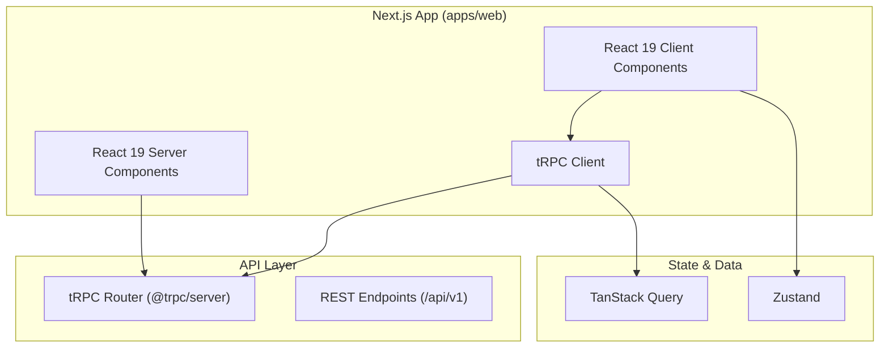
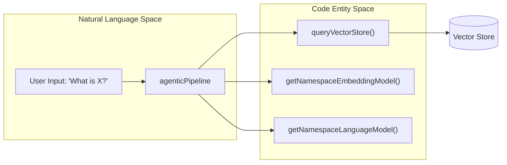
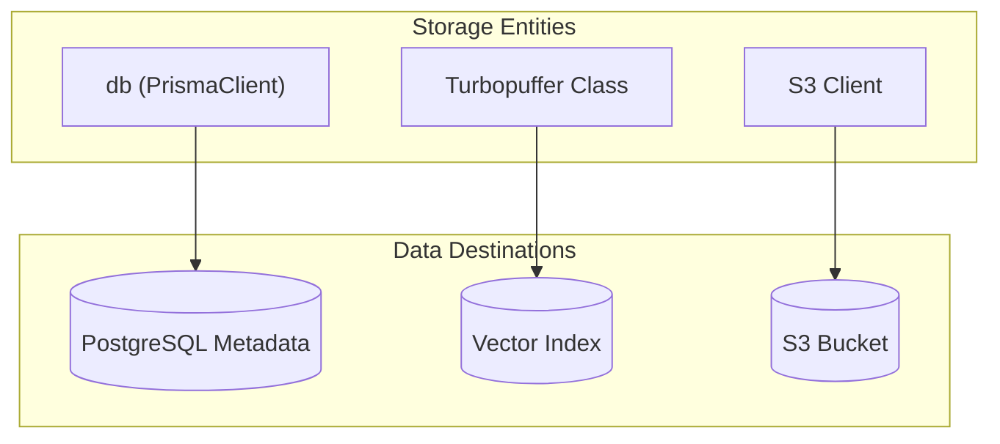

<!-- source: DeepWiki mcp.deepwiki.com · repo agentset-ai/agentset · page 1.3 Technology Stack · fetched 2026-10-26 -->

# Technology Stack

Relevant source files

The following files were used as context for generating this wiki page:

- [.env.example](.env.example)
- [apps/web/next.config.ts](apps/web/next.config.ts)
- [apps/web/package.json](apps/web/package.json)
- [apps/web/src/app/api/(internal-api)/chat/route.ts](apps/web/src/app/api/(internal-api)/chat/route.ts)
- [apps/web/src/app/api/(internal-api)/hosting-chat/route.ts](apps/web/src/app/api/(internal-api)/hosting-chat/route.ts)
- [apps/web/src/app/api/(internal-api)/hosting-search/route.ts](apps/web/src/app/api/(internal-api)/hosting-search/route.ts)
- [apps/web/src/app/api/(public-api)/v1/namespace/[namespaceId]/search/route.ts](apps/web/src/app/api/(public-api)/v1/namespace/[namespaceId]/search/route.ts)
- [apps/web/src/env.ts](apps/web/src/env.ts)
- [apps/web/src/instrumentation-client.ts](apps/web/src/instrumentation-client.ts)
- [apps/web/src/lib/agentic/index.ts](apps/web/src/lib/agentic/index.ts)
- [apps/web/src/lib/agentic/search.ts](apps/web/src/lib/agentic/search.ts)
- [apps/web/src/server/api/routers/search.ts](apps/web/src/server/api/routers/search.ts)
- [bun.lock](bun.lock)
- [package.json](package.json)
- [packages/db/package.json](packages/db/package.json)
- [packages/engine/package.json](packages/engine/package.json)
- [packages/engine/src/env.ts](packages/engine/src/env.ts)
- [packages/engine/src/vector-store/common/vector-store.ts](packages/engine/src/vector-store/common/vector-store.ts)
- [packages/engine/src/vector-store/index.ts](packages/engine/src/vector-store/index.ts)
- [packages/engine/src/vector-store/pinecone/index.ts](packages/engine/src/vector-store/pinecone/index.ts)
- [packages/engine/src/vector-store/query.ts](packages/engine/src/vector-store/query.ts)
- [packages/engine/src/vector-store/turbopuffer/index.ts](packages/engine/src/vector-store/turbopuffer/index.ts)
- [packages/jobs/package.json](packages/jobs/package.json)
- [packages/ui/package.json](packages/ui/package.json)
- [packages/ui/src/components/image-uploader.tsx](packages/ui/src/components/image-uploader.tsx)
- [packages/validation/src/vector-store/turbopuffer.ts](packages/validation/src/vector-store/turbopuffer.ts)
- [turbo.json](turbo.json)

This document provides a comprehensive overview of the technologies, frameworks, libraries, and external services used throughout the AgentSet codebase. It covers the monorepo structure, frontend and backend frameworks, AI/ML integrations, data persistence layers, and development tooling.

## Core Framework Stack

AgentSet is built on a modern TypeScript stack centered around **Next.js 15** as the full-stack framework. The application layer uses **React 19** for UI rendering, leveraging both Server and Client Components. Type safety is enforced through **TypeScript** across all packages.

| Technology | Version | Purpose |
|------------|---------|---------|
| Next.js | `^16.1.6` | Full-stack framework with App Router [apps/web/package.json:54]() |
| React | `19.2.3` | UI rendering library (Catalog) [package.json:60]() |
| TypeScript | `^5.9.3` | Type-safe language (Catalog) [package.json:46]() |
| Tailwind CSS | `^4.1.18` | Utility-first CSS framework [package.json:45]() |
| tRPC | `^11.7.2` | Type-safe API layer (Catalog) [package.json:53-55]() |
| TanStack Query | `^5.90.18` | Server state management (Catalog) [package.json:52]() |
| Zustand | `^5.0.10` | Client state management [apps/web/package.json:70]() |
| AI SDK | `^5.0.44` | Streaming AI responses and chat logic [package.json:51]() |

### Frontend & API Interaction
The frontend uses `@agentset/ui` as a shared component library built on **Radix UI** primitives and **Tailwind CSS**. The tRPC stack enables end-to-end type safety between the Next.js client and server components by inferring types from routers defined in the backend.

**Sources:** [apps/web/package.json:32-70](), [package.json:51-63]()

## AI and Machine Learning Stack

The AI stack is abstracted within the `@agentset/engine` package. It uses the **Vercel AI SDK** to provide a unified interface for multiple LLM providers.

### LLM Providers
AgentSet supports a wide array of models through specialized provider packages:
- **OpenAI**: `@ai-sdk/openai` [packages/engine/package.json:150]()
- **Anthropic**: `@ai-sdk/anthropic` [packages/engine/package.json:147]()
- **Google**: `@ai-sdk/google` [packages/engine/package.json:149]()
- **Azure**: `@ai-sdk/azure` [packages/engine/package.json:148]()

### RAG and Search Components
- **Reranking**: Integrated via `cohere-ai` [packages/engine/package.json:155]() and `zeroentropy` [packages/engine/package.json:157]().
- **Embedding**: Managed through abstractions in the engine, supporting providers like Voyage AI [packages/engine/package.json:156]().
- **Agentic Pipeline**: Implemented in `apps/web/src/lib/agentic/index.ts`, which uses `agenticSearch` to iteratively generate queries and evaluate results [apps/web/src/lib/agentic/index.ts:67-82]().

**Sources:** [apps/web/src/lib/agentic/index.ts:138-190](), [apps/web/src/app/api/(internal-api)/chat/route.ts:76-80]()

## Data Layer

AgentSet utilizes a multi-layered data architecture for metadata, vector embeddings, and caching.

### Relational Database
**Prisma** serves as the ORM, connecting to a **PostgreSQL** database. It uses the `@prisma/adapter-pg` for efficient connection handling [packages/db/package.json:27]().
- **Schema**: Defined in `packages/db/prisma/schema` [packages/db/package.json:32]().
- **Client**: A singleton `PrismaClient` is exported from `@agentset/db/client` [packages/db/package.json:9]().

### Vector Stores
The system supports multiple vector database backends through a common `VectorStore` interface [packages/engine/src/vector-store/common/vector-store.ts]():
- **Pinecone**: Standard vector storage implementation [packages/engine/package.json:152]().
- **Turbopuffer**: High-performance vector storage with hybrid search (BM25 + ANN) and Reciprocal Rank Fusion (RRF) [packages/engine/src/vector-store/turbopuffer/index.ts:61-78]().

### Caching and Rate Limiting
- **Upstash Redis**: Used for global state and temporary storage during ingestion [packages/jobs/package.json:32]().
- **Upstash Ratelimit**: Implements sliding window rate limiting for API protection [apps/web/package.json:43]().

**Sources:** [packages/db/src/client.ts](), [packages/engine/src/vector-store/turbopuffer/index.ts:28](), [packages/storage/package.json:205]()

## Job Orchestration

Background tasks such as document ingestion, embedding generation, and status updates are managed by **Trigger.dev**.

- **SDK**: `@trigger.dev/sdk` [packages/jobs/package.json:30]().
- **Execution**: Jobs are defined in the `packages/jobs` workspace and triggered via the Trigger.dev platform [packages/jobs/package.json:6-7]().
- **Context**: The `prismaExtension` for Trigger.dev ensures that database transactions and job contexts are correctly linked during execution.

**Sources:** [packages/jobs/package.json:1-47](), [turbo.json:60-63]()

## Infrastructure and Tooling

### Monorepo Management
The repository is managed using **Bun** workspaces and **TurboRepo** for task orchestration.
- **Bun**: Used as the package manager (`bun@1.3.6`) and test runner [package.json:4]().
- **Turbo**: Handles build caching and parallel execution of scripts like `build`, `lint`, and `typecheck` [package.json:9-27]().

### External Services
- **Authentication**: `better-auth` for session management and OAuth [apps/web/package.json:48]().
- **Billing**: `stripe` for subscription management and usage tracking [apps/web/package.json:26]().
- **Analytics**: `posthog-js` and `posthog-node` for client and server-side event tracking [apps/web/package.json:55-56]().
- **Emails**: `resend` for transactional email delivery [apps/web/package.json:59]().
- **File Storage**: AWS S3 (or compatible) via `@aws-sdk/client-s3` [packages/storage/package.json:205]().

**Sources:** [package.json:1-67](), [apps/web/package.json:19-71](), [turbo.json:73-120]()

---

