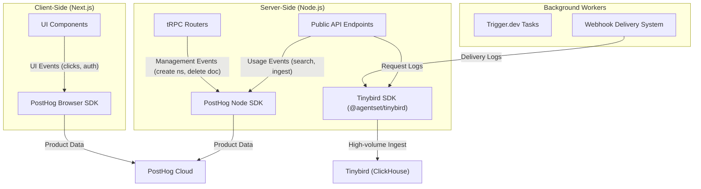

<!-- source: DeepWiki mcp.deepwiki.com · repo agentset-ai/agentset · page 10 Analytics and Events · fetched 2026-10-26 -->

# Analytics and Events

<details>
<summary>Relevant source files</summary>

The following files were used as context for generating this wiki page:

- [.gitignore](.gitignore)
- [apps/web/src/lib/code-examples/ingest.ts](apps/web/src/lib/code-examples/ingest.ts)
- [apps/web/src/openapi/v1/ingest-jobs/create-job.ts](apps/web/src/openapi/v1/ingest-jobs/create-job.ts)
- [apps/web/src/openapi/v1/ingest-jobs/reingest-job.ts](apps/web/src/openapi/v1/ingest-jobs/reingest-job.ts)
- [internal-docs/analytics-events.md](internal-docs/analytics-events.md)
- [packages/tinybird/README.md](packages/tinybird/README.md)
- [packages/tinybird/datasources/agentset_webhook_events.datasource](packages/tinybird/datasources/agentset_webhook_events.datasource)
- [packages/tinybird/package.json](packages/tinybird/package.json)
- [packages/tinybird/pipes/get_webhook_events.pipe](packages/tinybird/pipes/get_webhook_events.pipe)
- [packages/tinybird/src/client.ts](packages/tinybird/src/client.ts)
- [packages/tinybird/src/index.ts](packages/tinybird/src/index.ts)
- [packages/tinybird/src/webhook-events.ts](packages/tinybird/src/webhook-events.ts)
- [packages/utils/src/constants.ts](packages/utils/src/constants.ts)
- [packages/validation/src/ingest-payload/batch.ts](packages/validation/src/ingest-payload/batch.ts)
- [packages/validation/src/ingest-payload/crawl.ts](packages/validation/src/ingest-payload/crawl.ts)
- [packages/validation/src/ingest-payload/file.ts](packages/validation/src/ingest-payload/file.ts)
- [packages/validation/src/ingest-payload/managed-file.ts](packages/validation/src/ingest-payload/managed-file.ts)
- [packages/validation/src/ingest-payload/text.ts](packages/validation/src/ingest-payload/text.ts)
- [packages/validation/src/ingest-payload/utils.ts](packages/validation/src/ingest-payload/utils.ts)
- [packages/validation/src/ingest-payload/youtube.ts](packages/validation/src/ingest-payload/youtube.ts)
- [packages/validation/src/language.ts](packages/validation/src/language.ts)

</details>


This page documents the analytics and event tracking infrastructure of AgentSet. The system provides visibility into user behavior, system performance, and API usage through a combination of PostHog for product analytics and Tinybird for high-volume webhook and API event logging.

## Overview

AgentSet employs a dual-layered analytics strategy to balance detailed product insights with high-performance event logging:

| System | Primary Purpose | Key Technologies |
| :--- | :--- | :--- |
| **Product Analytics** | User journey tracking, feature adoption, and conversion | PostHog (Client & Server SDKs) |
| **Operational Analytics** | Webhook delivery logs, API request monitoring, and usage metering | Tinybird, ClickHouse |
| **Internal Events** | Inter-service communication and background job triggers | Trigger.dev, Webhooks |

### Event Flow Architecture



**Sources:** [internal-docs/analytics-events.md:1-240](), [packages/tinybird/src/webhook-events.ts:8-23]()

## PostHog Event Taxonomy

PostHog is used to track the lifecycle of users, organizations, and namespaces. Events are categorized by functional area to allow for granular funnel analysis.

### Core Event Categories

*   **Authentication:** Tracks login methods (Social vs. Magic Link) and session starts.
*   **Organization Management:** Monitors organization creation, updates, and team invitations.
*   **Namespace & Document Operations:** Captures the core value loop—creating namespaces, ingesting various document types (Text, File, URL, YouTube), and deletions.
*   **Chat & Search:** Tracks engagement in both the "Playground" and "Hosted" chat interfaces, including message length and usage of suggested actions.
*   **API Usage:** Server-side tracking of public API requests to monitor developer adoption and endpoint performance.

For a comprehensive list of event names and their specific JSON payloads, see [PostHog Event Tracking](#10.1).

**Sources:** [internal-docs/analytics-events.md:5-238]()

## Operational Analytics with Tinybird

While PostHog focuses on user behavior, Tinybird is utilized for high-frequency operational data that requires fast analytical queries, such as displaying webhook delivery logs to users in the dashboard.

### Webhook Event Logging

The `@agentset/tinybird` package defines the schema for recording webhook delivery attempts. This includes the request body sent to the user's endpoint and the response received.

[packages/tinybird/src/webhook-events.ts:8-18]()

```typescript
export const webhookEventSchemaTB = z.object({
  event_id: z.string(),
  webhook_id: z.string(),
  task_id: z.string(), // Trigger.dev task ID
  event: z.enum(WEBHOOK_TRIGGERS),
  url: z.string(),
  http_status: z.number(),
  request_body: z.string(),
  response_body: z.string(),
  timestamp: z.string(),
});
```

### Data Retrieval

AgentSet uses Tinybird "Pipes" to query these logs efficiently. For example, the `get_webhook_events` pipe allows the dashboard to fetch the last 100 delivery attempts for a specific webhook ID.

**Sources:** [packages/tinybird/src/webhook-events.ts:25-31](), [packages/tinybird/pipes/get_webhook_events.pipe:1-20]()

## Webhook System

The webhook system serves as the primary integration point for external applications to react to AgentSet events (e.g., `document.ingested`, `job.failed`).

### Execution and Reliability
Webhooks are dispatched via Trigger.dev tasks to ensure reliability through automatic retries and failure handling. Every attempt is logged to Tinybird to provide users with a transparent audit log of their integrations.

### Security
All outgoing webhook requests include an HMAC signature in the headers, allowing recipients to verify that the payload originated from AgentSet.

For details on event schemas and signature verification, see [Webhook System](#10.2).

**Sources:** [packages/tinybird/src/webhook-events.ts:1-23](), [apps/web/src/openapi/v1/ingest-jobs/create-job.ts:11-53]()

## Privacy and Data Handling

AgentSet adheres to a "privacy-first" approach for analytics:
1.  **PII Filtering:** Sensitive information like document content or raw chat messages is never sent to PostHog. Instead, metadata such as `messageLength` or `fileCount` is used.
2.  **Tenant Isolation:** Analytics events include `organizationId` or `tenantId` to allow for multi-tenant usage analysis while maintaining data boundaries.
3.  **Environment Separation:** Analytics are typically disabled or piped to different projects in development environments to prevent polluting production data.

**Sources:** [internal-docs/analytics-events.md:111-126](), [internal-docs/analytics-events.md:152-166]()

---

