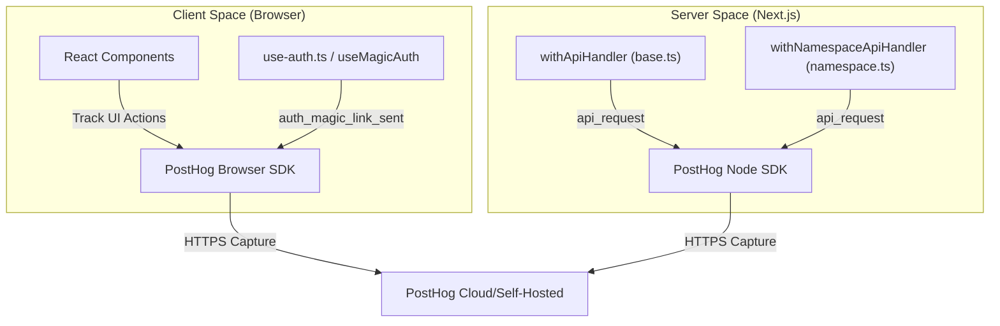
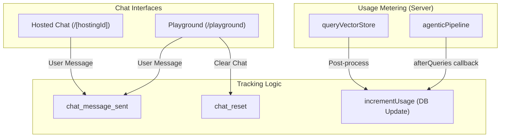

<!-- source: DeepWiki mcp.deepwiki.com · repo agentset-ai/agentset · page 10.1 PostHog Event Tracking · fetched 2026-10-26 -->

# PostHog Event Tracking

Relevant source files

The following files were used as context for generating this wiki page:

- [.env.example](.env.example)
- [apps/web/src/app/api/(internal-api)/chat/route.ts](apps/web/src/app/api/(internal-api)/chat/route.ts)
- [apps/web/src/app/api/(internal-api)/hosting-chat/route.ts](apps/web/src/app/api/(internal-api)/hosting-chat/route.ts)
- [apps/web/src/app/api/(internal-api)/hosting-search/route.ts](apps/web/src/app/api/(internal-api)/hosting-search/route.ts)
- [apps/web/src/app/api/(public-api)/v1/namespace/[namespaceId]/search/route.ts](apps/web/src/app/api/(public-api)/v1/namespace/[namespaceId]/search/route.ts)
- [apps/web/src/env.ts](apps/web/src/env.ts)
- [apps/web/src/instrumentation-client.ts](apps/web/src/instrumentation-client.ts)
- [apps/web/src/lib/agentic/index.ts](apps/web/src/lib/agentic/index.ts)
- [apps/web/src/lib/agentic/search.ts](apps/web/src/lib/agentic/search.ts)
- [apps/web/src/lib/code-examples/ingest.ts](apps/web/src/lib/code-examples/ingest.ts)
- [apps/web/src/openapi/v1/ingest-jobs/create-job.ts](apps/web/src/openapi/v1/ingest-jobs/create-job.ts)
- [apps/web/src/openapi/v1/ingest-jobs/reingest-job.ts](apps/web/src/openapi/v1/ingest-jobs/reingest-job.ts)
- [internal-docs/analytics-events.md](internal-docs/analytics-events.md)
- [packages/engine/package.json](packages/engine/package.json)
- [packages/engine/src/env.ts](packages/engine/src/env.ts)
- [packages/validation/src/ingest-payload/batch.ts](packages/validation/src/ingest-payload/batch.ts)
- [packages/validation/src/ingest-payload/crawl.ts](packages/validation/src/ingest-payload/crawl.ts)
- [packages/validation/src/ingest-payload/file.ts](packages/validation/src/ingest-payload/file.ts)
- [packages/validation/src/ingest-payload/managed-file.ts](packages/validation/src/ingest-payload/managed-file.ts)
- [packages/validation/src/ingest-payload/text.ts](packages/validation/src/ingest-payload/text.ts)
- [packages/validation/src/ingest-payload/utils.ts](packages/validation/src/ingest-payload/utils.ts)
- [packages/validation/src/ingest-payload/youtube.ts](packages/validation/src/ingest-payload/youtube.ts)
- [packages/validation/src/language.ts](packages/validation/src/language.ts)
- [turbo.json](turbo.json)

This page details the analytics infrastructure and event taxonomy used in AgentSet. AgentSet utilizes **PostHog** for product analytics, capturing user behavior across the dashboard, hosted chat interfaces, and public API usage.

## Overview and Implementation

AgentSet implements a hybrid tracking model where events are captured both on the client (browser) and the server (Next.js API routes). This ensures a complete picture of the user journey, from UI interactions to automated API consumption.

### Key Infrastructure Components

1.  **PostHog Client**: Initialized using `NEXT_PUBLIC_POSTHOG_KEY` defined in the environment configuration [apps/web/src/env.ts:22-22]().
2.  **Client-Side Tracking**: Used for UI interactions like button clicks, modal opens, and navigation.
3.  **Server-Side Tracking**: Integrated into API handlers to track resource consumption and programmatic access.
4.  **Middleware/Handlers**: Higher-order functions like `withApiHandler` and `withNamespaceApiHandler` automatically inject tracking logic into REST endpoints [internal-docs/analytics-events.md:216-231]().

### Data Flow Diagram: Event Ingestion

This diagram illustrates how events flow from different parts of the AgentSet "Code Entity Space" into PostHog.

"Event Ingestion Flow"

Sources: [internal-docs/analytics-events.md:7-33](), [internal-docs/analytics-events.md:216-236](), [apps/web/src/env.ts:22-23]()

---

## Event Taxonomy

### 1. Authentication & Organization
These events track the top of the funnel and workspace management.

| Event Name | Trigger Point | Key Properties |
| :--- | :--- | :--- |
| `auth_magic_link_sent` | `useMagicAuth` hook | `email` |
| `auth_social_login` | `useGoogleAuth`, `useGithubAuth` | `provider` ("google", "github") |
| `organization_created` | `create-org-form.tsx` | `slug`, `name` |
| `organization_updated` | `settings/page.client.tsx` | `id`, `nameChanged`, `slugChanged` |

Sources: [internal-docs/analytics-events.md:7-66]()

### 2. Namespace & Document Management
These events monitor the core RAG lifecycle: creating data silos and ingesting content.

| Event Name | Trigger Point | Key Properties |
| :--- | :--- | :--- |
| `namespace_created` | `create-namespace/index.tsx` | `name`, `embeddingModel`, `vectorStore` |
| `document_ingested` | Ingest Modals (Text/Upload/URLs) | `type`, `fileCount`, `chunkSize`, `hasMetadata` |
| `document_deleted` | `document-actions.tsx` | `documentId`, `namespaceId`, `status` |

Sources: [internal-docs/analytics-events.md:70-148]()

### 3. Chat & Search Usage
AgentSet distinguishes between internal testing (Playground) and end-user consumption (Hosted/API).

"Chat and Search Tracking Logic"

Sources: [apps/web/src/app/api/(internal-api)/chat/route.ts:33-52](), [apps/web/src/lib/agentic/index.ts:165-167](), [internal-docs/analytics-events.md:152-177]()

*   **`chat_message_sent`**: Captured in `chat-input.tsx`. Properties include `type` ("playground" | "hosted") and `messageLength` [internal-docs/analytics-events.md:152-166]().
*   **Usage Incrementing**: While PostHog tracks the *event*, the `db.namespace.update` call in `chat/route.ts` performs the actual billing/usage incrementing for `totalPlaygroundUsage` and `searchUsage` [apps/web/src/app/api/(internal-api)/chat/route.ts:33-52]().

### 4. Public API Tracking
API tracking is handled via server-side decorators to ensure every request is logged regardless of the client implementation.

*   **`api_request`**: Dispatched by `withApiHandler` [internal-docs/analytics-events.md:216-231]().
*   **Context Captured**:
    *   `routeName`: e.g., `POST /v1/namespace/[namespaceId]/search` [apps/web/src/app/api/(public-api)/v1/namespace/[namespaceId]/search/route.ts:109-109]().
    *   `statusCode`: The resulting HTTP response code.
    *   `tenantId` / `namespaceId`: Identifiers for the resource owner.

---

## Client vs. Server Tracking Split

AgentSet maintains a strict split to optimize performance and data accuracy.

### Client-Side (PostHog Browser SDK)
*   **Purpose**: User Experience (UX) analytics.
*   **Implementation**: Standard PostHog initialization in `apps/web/src/instrumentation-client.ts`.
*   **Examples**: `chat_suggested_action_clicked`, `team_invite_member_clicked` [internal-docs/analytics-events.md:185-256]().

### Server-Side (PostHog Node SDK)
*   **Purpose**: Reliable usage metrics and API monitoring.
*   **Implementation**: Injected into `withAuthApiHandler` and `withPublicApiHandler`.
*   **Why**: Client-side tracking can be blocked by ad-blockers; server-side tracking ensures that billing-relevant events (like API searches) are always recorded [apps/web/src/app/api/(public-api)/v1/namespace/[namespaceId]/search/route.ts:90-102]().

### Usage Metering vs. Analytics
It is important to note the distinction between **Analytics** (PostHog) and **Metering** (Database/Stripe).
*   **PostHog**: Tracks *that* a search happened for trend analysis.
*   **Prisma/DB**: Increments `searchUsage` in `db.organization` for enforcement of plan limits (e.g., `organization.searchLimit`) [apps/web/src/app/api/(public-api)/v1/namespace/[namespaceId]/search/route.ts:93-100]().

Sources: [apps/web/src/app/api/(public-api)/v1/namespace/[namespaceId]/search/route.ts:19-110](), [internal-docs/analytics-events.md:216-239]()

---

