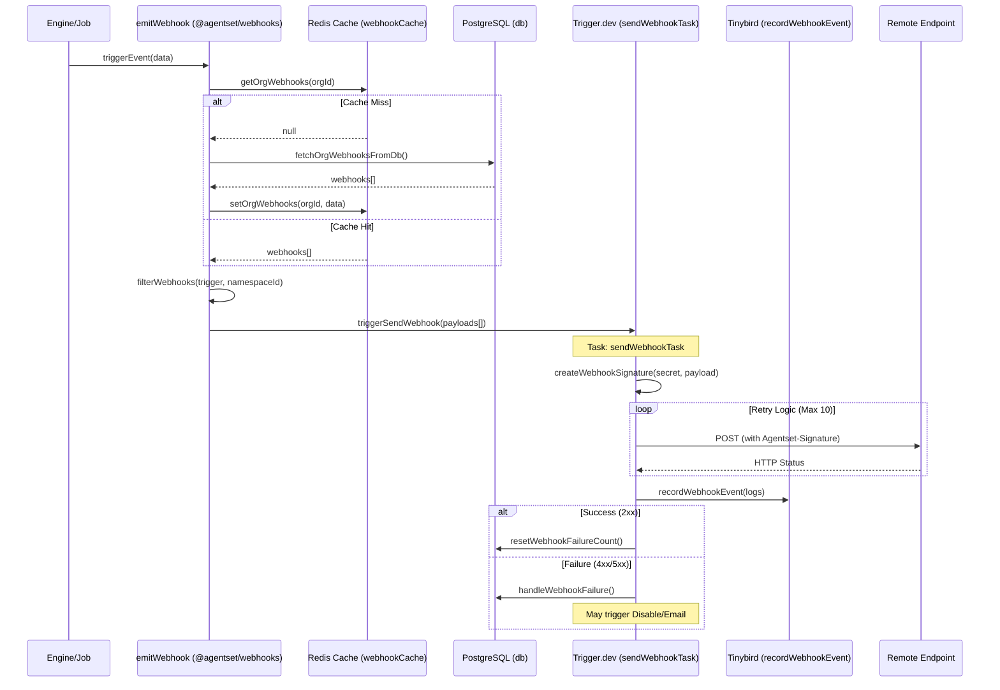
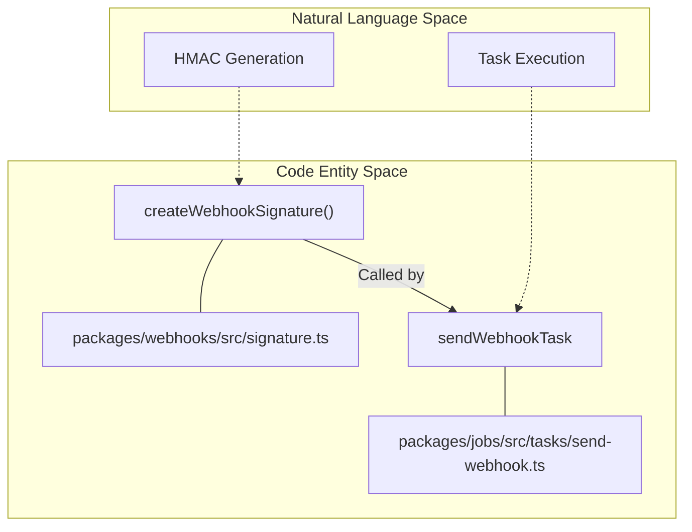

<!-- source: DeepWiki mcp.deepwiki.com · repo agentset-ai/agentset · page 10.2 Webhook System · fetched 2026-10-26 -->

# Webhook System

Relevant source files

The following files were used as context for generating this wiki page:

- [apps/web/src/app/app.agentset.ai/(dashboard)/[slug]/webhooks/[webhookId]/edit/page.tsx](apps/web/src/app/app.agentset.ai/(dashboard)/[slug]/webhooks/[webhookId]/edit/page.tsx)
- [apps/web/src/app/app.agentset.ai/(dashboard)/[slug]/webhooks/[webhookId]/layout.tsx](apps/web/src/app/app.agentset.ai/(dashboard)/[slug]/webhooks/[webhookId]/layout.tsx)
- [apps/web/src/app/app.agentset.ai/(dashboard)/[slug]/webhooks/[webhookId]/page.tsx](apps/web/src/app/app.agentset.ai/(dashboard)/[slug]/webhooks/[webhookId]/page.tsx)
- [apps/web/src/app/app.agentset.ai/(dashboard)/[slug]/webhooks/page.client.tsx](apps/web/src/app/app.agentset.ai/(dashboard)/[slug]/webhooks/page.client.tsx)
- [apps/web/src/components/delete-confirmation.tsx](apps/web/src/components/delete-confirmation.tsx)
- [apps/web/src/components/webhooks/add-edit-webhook-form.tsx](apps/web/src/components/webhooks/add-edit-webhook-form.tsx)
- [apps/web/src/components/webhooks/no-events-placeholder.tsx](apps/web/src/components/webhooks/no-events-placeholder.tsx)
- [apps/web/src/components/webhooks/send-test-webhook-modal.tsx](apps/web/src/components/webhooks/send-test-webhook-modal.tsx)
- [apps/web/src/components/webhooks/webhook-card.tsx](apps/web/src/components/webhooks/webhook-card.tsx)
- [apps/web/src/components/webhooks/webhook-events.tsx](apps/web/src/components/webhooks/webhook-events.tsx)
- [apps/web/src/components/webhooks/webhook-header.tsx](apps/web/src/components/webhooks/webhook-header.tsx)
- [apps/web/src/components/webhooks/webhook-status.tsx](apps/web/src/components/webhooks/webhook-status.tsx)
- [apps/web/src/lib/webhook/create-webhook.ts](apps/web/src/lib/webhook/create-webhook.ts)
- [apps/web/src/lib/webhook/emit.ts](apps/web/src/lib/webhook/emit.ts)
- [apps/web/src/lib/webhook/update-webhook.ts](apps/web/src/lib/webhook/update-webhook.ts)
- [apps/web/src/server/api/routers/webhooks.ts](apps/web/src/server/api/routers/webhooks.ts)
- [packages/jobs/src/tasks/send-webhook.ts](packages/jobs/src/tasks/send-webhook.ts)
- [packages/jobs/src/webhook.ts](packages/jobs/src/webhook.ts)
- [packages/webhooks/package.json](packages/webhooks/package.json)
- [packages/webhooks/src/cache.ts](packages/webhooks/src/cache.ts)
- [packages/webhooks/src/emit.ts](packages/webhooks/src/emit.ts)
- [packages/webhooks/src/failure.ts](packages/webhooks/src/failure.ts)
- [packages/webhooks/src/index.ts](packages/webhooks/src/index.ts)
- [packages/webhooks/src/schemas.ts](packages/webhooks/src/schemas.ts)
- [packages/webhooks/src/server.ts](packages/webhooks/src/server.ts)
- [packages/webhooks/src/types.ts](packages/webhooks/src/types.ts)

The Webhook System in AgentSet provides a robust infrastructure for delivering real-time notifications to external services regarding document processing and ingestion job lifecycles. It includes features for secure delivery via HMAC signatures, automated retry logic with exponential backoff, and failure management that protects the system from unresponsive endpoints.

## System Architecture

The webhook infrastructure is split between the `@agentset/webhooks` package (logic and schemas), the `packages/jobs` package (delivery execution), and the Tinybird integration (event logging).

### Delivery Flow
The following diagram illustrates the lifecycle of a webhook event from the moment a trigger occurs in the engine to the final delivery and logging.

**Webhook Delivery Lifecycle**

Sources: [packages/webhooks/src/emit.ts:79-119](), [packages/jobs/src/tasks/send-webhook.ts:25-155](), [packages/webhooks/src/cache.ts:1-50]()

## Event Schemas and Triggers

Webhooks are triggered by specific events in the document and ingestion lifecycles. The system uses Zod schemas to ensure type safety and consistent payloads.

### Supported Triggers
Triggers are categorized into two levels:
1.  **Document Level**: `document.queued`, `document.processing`, `document.ready`, `document.error`, `document.deleted` [packages/webhooks/src/constants.ts:7-13]().
2.  **Ingest Job Level**: `ingest_job.queued`, `ingest_job.processing`, `ingest_job.ready`, `ingest_job.error`, `ingest_job.deleted` [packages/webhooks/src/constants.ts:15-21]().

### Payload Structure
All webhook POST requests follow a standard wrapper defined by `webhookPayloadSchema` [packages/webhooks/src/schemas.ts:74-83]():

| Field | Type | Description |
| :--- | :--- | :--- |
| `id` | `string` | Unique event ID prefixed with `evt_` [packages/webhooks/src/constants.ts:3](). |
| `event` | `enum` | The specific trigger type. |
| `createdAt` | `string` | ISO timestamp of the event. |
| `data` | `object` | The event-specific data (Document or IngestJob details). |

Sources: [packages/webhooks/src/schemas.ts:13-60](), [packages/webhooks/src/emit.ts:101-106]()

## HMAC Signature Verification

To ensure security, AgentSet signs every webhook payload using a secret key shared with the user. The signature is sent in the `Agentset-Signature` HTTP header [packages/jobs/src/tasks/send-webhook.ts:47]().

The signature is a `hex` encoded HMAC-SHA256 hash of the JSON stringified payload [packages/webhooks/src/signature.ts:1-15]().

**Signature Implementation Mapping**

Sources: [packages/webhooks/src/signature.ts:1-15](), [packages/jobs/src/tasks/send-webhook.ts:36]()

## Delivery and Retry Logic

Webhook delivery is handled by `sendWebhookTask` via **Trigger.dev**.

### Retry Policy
The system implements a sophisticated retry strategy using exponential backoff to handle transient failures [packages/jobs/src/tasks/send-webhook.ts:52-65]():
*   **Max Attempts**: 10.
*   **Backoff Factor**: 12.
*   **Min Timeout**: 12 seconds.
*   **Max Timeout**: 24 hours.
*   **Trigger**: Any HTTP status between 300 and 599.

### Timeout
The initial fetch request has a hard timeout of 20 seconds [packages/jobs/src/tasks/send-webhook.ts:51]().

Sources: [packages/jobs/src/tasks/send-webhook.ts:23-66]()

## Failure Handling and Circuit Breaking

To prevent resource exhaustion on failing endpoints, the system tracks consecutive failures and automatically disables problematic webhooks.

### Failure Thresholds
*   **Threshold**: 20 consecutive failures [packages/webhooks/src/constants.ts:26]().
*   **Notification**: Organization owners receive an email notification when failures reach specific intervals (5, 10, 15) [packages/jobs/src/tasks/send-webhook.ts:113-128]().
*   **Auto-Disable**: Once the threshold is reached, `disableWebhook` is called, setting `disabledAt` in the database and sending a final notification [packages/jobs/src/tasks/send-webhook.ts:131-153]().

### State Management
The `handleWebhookFailure` function in `packages/webhooks/src/failure.ts` manages the incrementing of failure counts and determines if a webhook should be disabled [packages/jobs/src/tasks/send-webhook.ts:96-98](). Successes reset the `consecutiveFailures` counter to zero via `resetWebhookFailureCount` [packages/jobs/src/tasks/send-webhook.ts:91]().

Sources: [packages/jobs/src/tasks/send-webhook.ts:89-154](), [packages/webhooks/src/server.ts:1-20]()

## Tinybird Event Log

Every webhook attempt, regardless of success or failure, is logged to **Tinybird** for analytics and debugging purposes.

### Recorded Data
The `recordWebhookEvent` function captures the following metadata [packages/jobs/src/tasks/send-webhook.ts:78-87]():
*   `event_id`: The unique event identifier.
*   `webhook_id`: The ID of the target webhook.
*   `task_id`: The Trigger.dev run ID.
*   `http_status`: The status code returned by the endpoint.
*   `request_body`: The JSON payload sent.
*   `response_body`: The text response received from the remote server.

### User Interface
Users can view these logs in the dashboard via the `getEvents` tRPC procedure, which queries Tinybird and returns the history of deliveries for a specific webhook [apps/web/src/server/api/routers/webhooks.ts:112-141]().

Sources: [packages/jobs/src/tasks/send-webhook.ts:78-87](), [apps/web/src/server/api/routers/webhooks.ts:139]()

---

