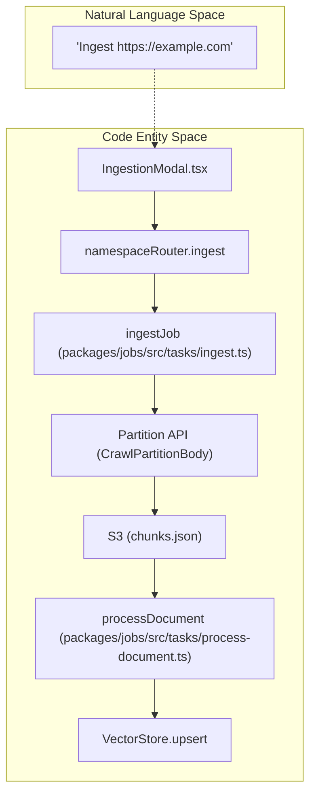
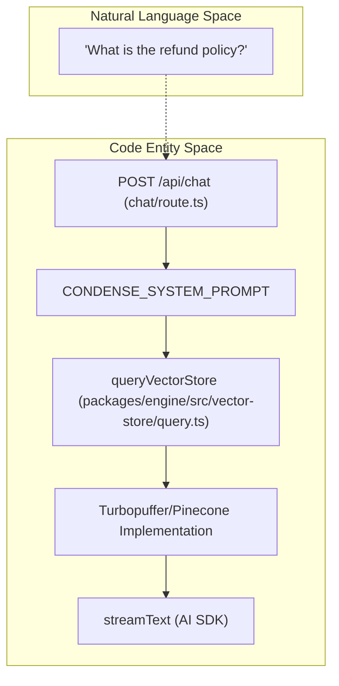

<!-- source: DeepWiki mcp.deepwiki.com · repo agentset-ai/agentset · page 11 Glossary · fetched 2026-10-26 -->

# Glossary

Relevant source files

The following files were used as context for generating this wiki page:

- [.env.example](.env.example)
- [.github/ISSUE_TEMPLATE/bug_report.md](.github/ISSUE_TEMPLATE/bug_report.md)
- [.github/ISSUE_TEMPLATE/feature_request.md](.github/ISSUE_TEMPLATE/feature_request.md)
- [.github/assets/.gitkeep](.github/assets/.gitkeep)
- [.github/assets/readme-cover.png](.github/assets/readme-cover.png)
- [.github/assets/screenshot.png](.github/assets/screenshot.png)
- [.github/assets/star-us.png](.github/assets/star-us.png)
- [LICENSE.md](LICENSE.md)
- [README.md](README.md)
- [apps/web/src/app/api/(internal-api)/chat/route.ts](apps/web/src/app/api/(internal-api)/chat/route.ts)
- [apps/web/src/app/api/(internal-api)/hosting-chat/route.ts](apps/web/src/app/api/(internal-api)/hosting-chat/route.ts)
- [apps/web/src/app/api/(internal-api)/hosting-search/route.ts](apps/web/src/app/api/(internal-api)/hosting-search/route.ts)
- [apps/web/src/app/api/(internal-api)/stripe/webhook/checkout-session-completed.ts](apps/web/src/app/api/(internal-api)/stripe/webhook/checkout-session-completed.ts)
- [apps/web/src/app/api/(internal-api)/stripe/webhook/customer-subscription-deleted.ts](apps/web/src/app/api/(internal-api)/stripe/webhook/customer-subscription-deleted.ts)
- [apps/web/src/app/api/(internal-api)/stripe/webhook/customer-subscription-updated.ts](apps/web/src/app/api/(internal-api)/stripe/webhook/customer-subscription-updated.ts)
- [apps/web/src/app/api/(internal-api)/stripe/webhook/utils.ts](apps/web/src/app/api/(internal-api)/stripe/webhook/utils.ts)
- [apps/web/src/app/api/(public-api)/v1/namespace/[namespaceId]/search/route.ts](apps/web/src/app/api/(public-api)/v1/namespace/[namespaceId]/search/route.ts)
- [apps/web/src/app/openapi.json/route.ts](apps/web/src/app/openapi.json/route.ts)
- [apps/web/src/env.ts](apps/web/src/env.ts)
- [apps/web/src/instrumentation-client.ts](apps/web/src/instrumentation-client.ts)
- [apps/web/src/lib/agentic/index.ts](apps/web/src/lib/agentic/index.ts)
- [apps/web/src/lib/agentic/search.ts](apps/web/src/lib/agentic/search.ts)
- [apps/web/src/openapi/index.ts](apps/web/src/openapi/index.ts)
- [apps/web/src/schemas/api/document.ts](apps/web/src/schemas/api/document.ts)
- [apps/web/src/schemas/api/ingest-job.ts](apps/web/src/schemas/api/ingest-job.ts)
- [apps/web/src/server/api/routers/search.ts](apps/web/src/server/api/routers/search.ts)
- [packages/db/src/schemas.ts](packages/db/src/schemas.ts)
- [packages/emails/src/env.ts](packages/emails/src/env.ts)
- [packages/engine/package.json](packages/engine/package.json)
- [packages/engine/src/env.ts](packages/engine/src/env.ts)
- [packages/engine/src/vector-store/common/vector-store.ts](packages/engine/src/vector-store/common/vector-store.ts)
- [packages/engine/src/vector-store/index.ts](packages/engine/src/vector-store/index.ts)
- [packages/engine/src/vector-store/pinecone/index.ts](packages/engine/src/vector-store/pinecone/index.ts)
- [packages/engine/src/vector-store/query.ts](packages/engine/src/vector-store/query.ts)
- [packages/engine/src/vector-store/turbopuffer/index.ts](packages/engine/src/vector-store/turbopuffer/index.ts)
- [packages/jobs/src/schema.ts](packages/jobs/src/schema.ts)
- [packages/jobs/src/tasks/delete-document.ts](packages/jobs/src/tasks/delete-document.ts)
- [packages/jobs/src/tasks/delete-ingest-job.ts](packages/jobs/src/tasks/delete-ingest-job.ts)
- [packages/jobs/src/tasks/delete-namespace.ts](packages/jobs/src/tasks/delete-namespace.ts)
- [packages/jobs/src/tasks/delete-org.ts](packages/jobs/src/tasks/delete-org.ts)
- [packages/jobs/src/tasks/ingest.ts](packages/jobs/src/tasks/ingest.ts)
- [packages/jobs/src/tasks/process-document.ts](packages/jobs/src/tasks/process-document.ts)
- [packages/jobs/src/tasks/re-ingest.ts](packages/jobs/src/tasks/re-ingest.ts)
- [packages/stripe/src/functions.ts](packages/stripe/src/functions.ts)
- [packages/stripe/src/plans.ts](packages/stripe/src/plans.ts)
- [packages/validation/src/ingest-payload/index.ts](packages/validation/src/ingest-payload/index.ts)
- [packages/validation/src/vector-store/turbopuffer.ts](packages/validation/src/vector-store/turbopuffer.ts)
- [turbo.json](turbo.json)

This page defines codebase-specific terms, domain concepts, and technical jargon used throughout the AgentSet platform. It provides a bridge between high-level RAG (Retrieval-Augmented Generation) concepts and their specific implementations in the code.

## Core Domain Entities

### Namespace
The primary unit of isolation and configuration. A Namespace defines how documents are embedded, where they are stored (Vector Store), and which LLM models are used for querying.
*   **Implementation:** Defined in the Prisma schema as a `Namespace` model [packages/db/src/schemas.ts:1]().
*   **Role:** Acts as a container for `Documents` and `IngestJobs`. It holds `embeddingConfig` and `vectorStoreConfig` [packages/jobs/src/tasks/ingest.ts:95-100]().

### Organization
The top-level multi-tenancy entity. Organizations own Namespaces and are tied to billing plans (FREE, STARTER, PRO).
*   **Implementation:** `Organization` model [packages/db/src/schemas.ts:1]().
*   **Role:** Manages usage limits like `pagesLimit` and `searchUsage` [packages/jobs/src/tasks/ingest.ts:180-183]().

### Tenant ID
An optional identifier used for sub-partitioning data within a single Namespace. This allows a single Namespace to serve multiple end-customers while keeping their data logically separated in the vector store.
*   **Implementation:** Passed through `chatSchema` [apps/web/src/app/api/(internal-api)/chat/route.ts:58]() and used to generate vector store namespace suffixes [packages/engine/src/vector-store/turbopuffer/index.ts:49]().

---

## Ingestion Concepts

### Ingest Job
A background process managed by [Trigger.dev](https://trigger.dev) that handles the transformation of raw data (URLs, Files, YouTube videos) into searchable vector embeddings.
*   **Implementation:** `ingestJob` task [packages/jobs/src/tasks/ingest.ts:33]().
*   **Flow:** 
    1.  `PRE_PROCESSING`: Validating inputs and calling the Partition API.
    2.  `QUEUED`: Creating `Document` records.
    3.  `PROCESSING`: Chunking and embedding.

### Partition API
An external service (defined by `PARTITION_API_URL`) responsible for heavy-duty document parsing, crawling, and initial text extraction.
*   **Usage:** Called within `ingestJob` for `CRAWL` and `YOUTUBE` types [packages/jobs/src/tasks/ingest.ts:160-167]().

### Chunking
The process of splitting a document into smaller text segments to fit LLM context windows and improve retrieval granularity.
*   **Implementation:** Options are defined in `IngestConfig` and processed during the embedding phase [packages/jobs/src/tasks/process-document.ts:152-155]().

### Data Flow: Natural Language to Code Entities (Ingestion)

This diagram shows how a user's request to "Ingest a Website" translates into backend code structures.

**Sources:** [packages/jobs/src/tasks/ingest.ts:33-170](), [packages/jobs/src/tasks/process-document.ts:72-174](), [packages/validation/src/ingest-payload/index.ts:71-80]()

---

## RAG & Search Concepts

### Agentic Mode
A multi-step retrieval strategy where an LLM evaluates the initial query, generates multiple sub-queries if needed, and iteratively searches until it has enough context to answer.
*   **Implementation:** `agenticPipeline` [apps/web/src/lib/agentic/index.ts:29]().
*   **Logic:** Uses `agenticSearch` to generate queries and `formatSources` to present context to the final answering LLM [apps/web/src/lib/agentic/index.ts:67-114]().

### Deep Research
An advanced RAG mode that performs extensive planning and recursive searching to answer complex, multi-faceted questions.
*   **Implementation:** `DeepResearchPipeline` [apps/web/src/app/api/(internal-api)/chat/route.ts:110]().

### Hybrid Search
A search method combining Semantic (Vector) search and Keyword (BM25) search, fused together using Reciprocal Rank Fusion (RRF).
*   **Implementation:** `Turbopuffer.query` with `hybrid` mode [packages/engine/src/vector-store/turbopuffer/index.ts:115-140]().

### Reciprocal Rank Fusion (RRF)
An algorithm used to combine multiple ranked result lists (e.g., from vector search and keyword search) into a single ranked list without needing to normalize scores.
*   **Implementation:** `reciprocalRankFusion` function [packages/engine/src/vector-store/turbopuffer/index.ts:61-78]().

### Data Flow: Query to Response (RAG)

This diagram maps the journey of a user's question through the retrieval and generation pipeline.

**Sources:** [apps/web/src/app/api/(internal-api)/chat/route.ts:57-235](), [packages/engine/src/vector-store/turbopuffer/index.ts:86-179](), [apps/web/src/lib/agentic/index.ts:29-136]()

---

## Infrastructure & Technical Jargon

| Term | Definition | Code Pointer |
| :--- | :--- | :--- |
| **Trigger.dev** | The background job orchestration platform used for ingestion and deletions. | [packages/jobs/src/tasks/ingest.ts:33]() |
| **Turbopuffer** | A high-performance, serverless vector database used for storing embeddings. | [packages/engine/src/vector-store/turbopuffer/index.ts:28]() |
| **Prisma** | The ORM used for PostgreSQL metadata management. | [packages/db/src/schemas.ts:1]() |
| **AI SDK** | Vercel's library for interacting with LLMs and managing chat streams. | [apps/web/src/app/api/(internal-api)/chat/route.ts:16-21]() |
| **Metered Usage** | Usage-based billing where searches or pages are reported to Stripe. | [packages/jobs/src/tasks/process-document.ts:19]() |
| **Reciprocity** | In `Turbopuffer`, the distance metric used is often `cosine_distance`. | [packages/engine/src/vector-store/turbopuffer/index.ts:199]() |

---

## Billing & Lifecycle Terms

### Overage
Occurs when an organization exceeds its plan limits (e.g., `pagesLimit`). Non-free plans typically allow overage via metered billing.
*   **Logic:** Checked during ingestion in `ingestJob` [packages/jobs/src/tasks/ingest.ts:185-200]().

### Revalidation
The process of clearing cached organization or API key data, typically triggered by Stripe webhooks when a subscription changes.
*   **Implementation:** `revalidateOrganizationCache` [apps/web/src/app/api/(internal-api)/stripe/webhook/utils.ts:57]().

### Webhook Emission
The system sends HTTP callbacks to external URLs when document or ingestion job statuses change (e.g., `document.processing`, `document.error`).
*   **Implementation:** `emitDocumentWebhook` [packages/jobs/src/tasks/process-document.ts:162]().

**Sources:** [apps/web/src/app/api/(internal-api)/stripe/webhook/utils.ts:78-158](), [packages/jobs/src/tasks/ingest.ts:180-200](), [packages/jobs/src/tasks/process-document.ts:82-129]()