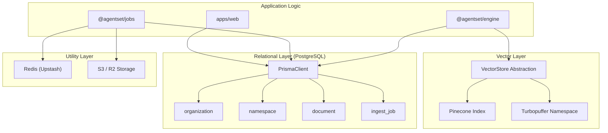
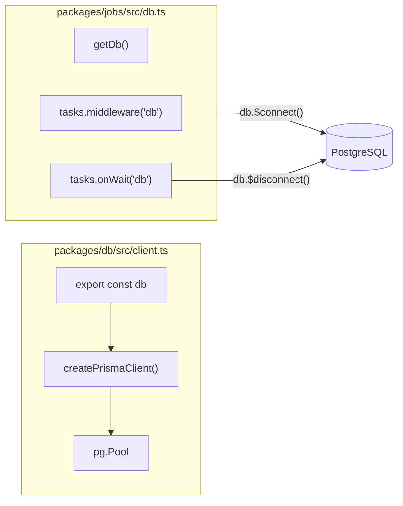

<!-- source: DeepWiki mcp.deepwiki.com · repo agentset-ai/agentset · page 2 Data Layer · fetched 2026-10-26 -->

# Data Layer

Relevant source files

The following files were used as context for generating this wiki page:

- [apps/web/scripts/populate-document-namespace-id.ts](apps/web/scripts/populate-document-namespace-id.ts)
- [packages/db/.gitignore](packages/db/.gitignore)
- [packages/db/prisma/migrations/20250413055012_add_limits_and_plans/migration.sql](packages/db/prisma/migrations/20250413055012_add_limits_and_plans/migration.sql)
- [packages/db/prisma/migrations/20250413055328_make_org_slug_required/migration.sql](packages/db/prisma/migrations/20250413055328_make_org_slug_required/migration.sql)
- [packages/db/prisma/migrations/20251202045758_update_auth_schema/migration.sql](packages/db/prisma/migrations/20251202045758_update_auth_schema/migration.sql)
- [packages/db/prisma/migrations/20260118061102_webhooks/migration.sql](packages/db/prisma/migrations/20260118061102_webhooks/migration.sql)
- [packages/db/prisma/migrations/20260118131244_add_webhook_enabled/migration.sql](packages/db/prisma/migrations/20260118131244_add_webhook_enabled/migration.sql)
- [packages/db/prisma/migrations/20260208232321_add_member_user_id_idx/migration.sql](packages/db/prisma/migrations/20260208232321_add_member_user_id_idx/migration.sql)
- [packages/db/prisma/schema/auth.prisma](packages/db/prisma/schema/auth.prisma)
- [packages/db/prisma/schema/namespace.prisma](packages/db/prisma/schema/namespace.prisma)
- [packages/db/prisma/schema/organization.prisma](packages/db/prisma/schema/organization.prisma)
- [packages/db/prisma/schema/schema.prisma](packages/db/prisma/schema/schema.prisma)
- [packages/db/prisma/schema/webhook.prisma](packages/db/prisma/schema/webhook.prisma)
- [packages/db/src/client.ts](packages/db/src/client.ts)
- [packages/db/src/index.ts](packages/db/src/index.ts)
- [packages/jobs/src/db.ts](packages/jobs/src/db.ts)
- [packages/jobs/trigger.config.ts](packages/jobs/trigger.config.ts)

## Purpose and Scope

The Data Layer encompasses all data persistence mechanisms in the AgentSet platform. This includes the primary PostgreSQL database (accessed via Prisma ORM) for relational metadata, vector databases for semantic search, Redis for temporary caching, and S3-compatible storage for files. This page provides a high-level overview of the data architecture and how these components interact to support multi-tenant RAG operations.

For detailed information about specific aspects of the data layer:
- **Database Schema**: Documenting the Prisma models, multi-tenant hierarchy, and status enums. See [Database Schema](#2.1).
- **Database Client Configuration**: Explaining the `PrismaClient` setup, connection pooling, and Trigger.dev integration. See [Database Client Configuration](#2.2).
- **Vector Store System**: Documenting the abstraction layer for Pinecone and Turbopuffer. See [Vector Store System](#2.3).

## Data Architecture Overview

The data layer follows a multi-store architecture where different types of data are stored in specialized systems optimized for their access patterns. PostgreSQL serves as the authoritative source of truth for configuration and metadata, while vector stores handle the high-dimensional embeddings required for retrieval.

### System Data Flow

The following diagram illustrates how the core application components interact with various data persistence layers.

**Diagram: Data Persistence Mapping**

**Sources:** [packages/db/src/client.ts:7-25](), [packages/db/prisma/schema/namespace.prisma:6-49](), [packages/jobs/src/db.ts:1-31]()

## PostgreSQL and Prisma Integration

PostgreSQL is the primary relational store. The project uses Prisma as an ORM with a modular schema design located in `packages/db/prisma/schema/`.

### Core Entity Hierarchy

The data model is built around a multi-tenant hierarchy designed to isolate data between organizations and projects (namespaces).

| Entity | Description | Key Code Reference |
| :--- | :--- | :--- |
| **Organization** | The top-level tenant. Owns members, billing, and namespaces. | [packages/db/prisma/schema/organization.prisma:6-48]() |
| **Namespace** | A logical container for a specific RAG project. Stores embedding and vector store configs. | [packages/db/prisma/schema/namespace.prisma:6-49]() |
| **Document** | Individual content units (files, text, URLs) belonging to a namespace. | [apps/web/scripts/populate-document-namespace-id.ts:16-23]() |
| **Hosting** | Configuration for public-facing chat interfaces linked to a namespace. | [packages/db/prisma/schema/namespace.prisma:51-91]() |

**Sources:** [packages/db/prisma/schema/organization.prisma:6-48](), [packages/db/prisma/schema/namespace.prisma:6-91]()

### Database Client and Lifecycle

The `PrismaClient` is managed as a singleton in the web application to prevent connection exhaustion. In the background job environment (`Trigger.dev`), a specialized lifecycle management pattern is used to handle task pauses and resumes.

**Diagram: Code Entity to Database Connection**

**Sources:** [packages/db/src/client.ts:7-25](), [packages/jobs/src/db.ts:12-30]()

## Vector and Keyword Stores

While metadata lives in PostgreSQL, document content is partitioned into vector stores for semantic retrieval. 

- **Vector Stores**: The system supports multiple providers (Pinecone, Turbopuffer). Configuration is stored as JSON in the `Namespace` model ([packages/db/prisma/schema/namespace.prisma:18-18]()).
- **Hybrid Search**: The `keywordEnabled` flag on the `Namespace` model indicates if hybrid (semantic + keyword) search is active ([packages/db/prisma/schema/namespace.prisma:36-36]()).

For details on the implementation of these search providers, see [Vector Store System](#2.3).

## Auxiliary Storage Layers

### Redis Caching
Redis is utilized primarily within the `@agentset/jobs` package for managing intermediate state during document ingestion and for rate-limiting. It acts as a high-speed buffer for data that does not require long-term persistence in PostgreSQL.

### S3 File Storage
S3-compatible storage is used for the physical persistence of uploaded files. The `Namespace` model tracks `fileStoreConfig` to determine where a specific project's raw assets are stored ([packages/db/prisma/schema/namespace.prisma:20-21]()).

**Sources:** [packages/db/prisma/schema/namespace.prisma:14-21](), [packages/jobs/trigger.config.ts:4-27]()

---

