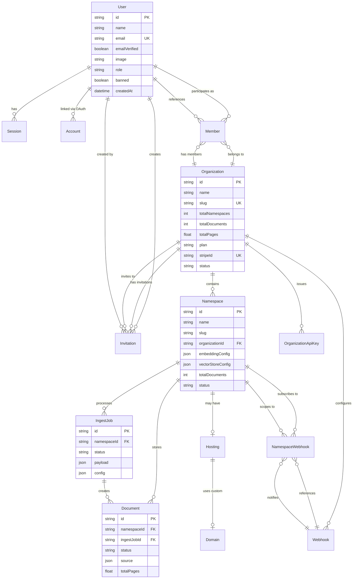
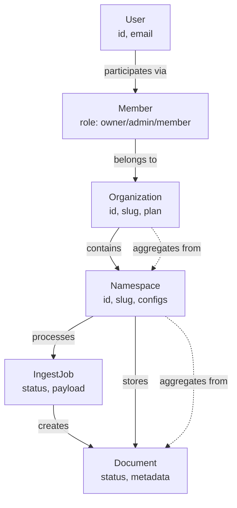

<!-- source: DeepWiki mcp.deepwiki.com · repo agentset-ai/agentset · page 2.1 Database Schema · fetched 2026-10-26 -->

# Database Schema

<details>
<summary>Relevant source files</summary>

The following files were used as context for generating this wiki page:

- [apps/web/scripts/populate-document-namespace-id.ts](apps/web/scripts/populate-document-namespace-id.ts)
- [packages/db/.gitignore](packages/db/.gitignore)
- [packages/db/prisma/migrations/20250413055012_add_limits_and_plans/migration.sql](packages/db/prisma/migrations/20250413055012_add_limits_and_plans/migration.sql)
- [packages/db/prisma/migrations/20250413055328_make_org_slug_required/migration.sql](packages/db/prisma/migrations/20250413055328_make_org_slug_required/migration.sql)
- [packages/db/prisma/migrations/20251202045758_update_auth_schema/migration.sql](packages/db/prisma/migrations/20251202045758_update_auth_schema/migration.sql)
- [packages/db/prisma/migrations/20260118061102_webhooks/migration.sql](packages/db/prisma/migrations/20260118061102_webhooks/migration.sql)
- [packages/db/prisma/migrations/20260118131244_add_webhook_enabled/migration.sql](packages/db/prisma/migrations/20260118131244_add_webhook_enabled/migration.sql)
- [packages/db/prisma/migrations/20260208232321_add_member_user_id_idx/migration.sql](packages/db/prisma/migrations/20260208232321_add_member_user_id_idx/migration.sql)
- [packages/db/prisma/schema/auth.prisma](packages/db/prisma/schema/auth.prisma)
- [packages/db/prisma/schema/document.prisma](packages/db/prisma/schema/document.prisma)
- [packages/db/prisma/schema/ingest-job.prisma](packages/db/prisma/schema/ingest-job.prisma)
- [packages/db/prisma/schema/namespace.prisma](packages/db/prisma/schema/namespace.prisma)
- [packages/db/prisma/schema/organization.prisma](packages/db/prisma/schema/organization.prisma)
- [packages/db/prisma/schema/schema.prisma](packages/db/prisma/schema/schema.prisma)
- [packages/db/prisma/schema/webhook.prisma](packages/db/prisma/schema/webhook.prisma)
- [packages/db/src/client.ts](packages/db/src/client.ts)
- [packages/db/src/index.ts](packages/db/src/index.ts)
- [packages/jobs/src/db.ts](packages/jobs/src/db.ts)
- [packages/jobs/trigger.config.ts](packages/jobs/trigger.config.ts)

</details>


## Purpose and Scope

This document provides a comprehensive reference for the AgentSet database schema implemented using Prisma ORM with PostgreSQL. It covers all models, relationships, enums, indexes, and constraints that define the platform's data layer. The schema implements a multi-tenant architecture with hierarchical resource organization and flexible JSON-based configuration.

For information about the database client configuration and connection management, see [Database Client Configuration](2.2). For vector store data management, see [Vector Store System](2.3).

## Overview

The AgentSet database schema is organized around a four-tier tenant hierarchy: `User` → `Organization` → `Namespace` → `Document`. This structure enables multi-tenancy with strong data isolation, role-based access control, and aggregate usage tracking for billing purposes.

### Core Characteristics

- **Multi-tenant architecture**: Organizations serve as the primary tenant boundary [packages/db/prisma/schema/organization.prisma:6-48]().
- **Flexible configuration**: JSON fields store provider-specific settings for embeddings, vector stores, and LLMs [packages/db/prisma/schema/namespace.prisma:14-21]().
- **Aggregate counters**: Denormalized metrics track usage (documents, pages, search usage) at multiple levels for performance [packages/db/prisma/schema/organization.prisma:20-28]().
- **Cascading deletes**: Foreign key constraints ensure referential integrity during deletion [packages/db/prisma/schema/namespace.prisma:12-12]().
- **Status tracking**: Enums manage entity lifecycle states (ACTIVE, DELETING, PROCESSING) [packages/db/prisma/schema/document.prisma:1-13]().

Sources: [packages/db/prisma/schema/namespace.prisma](), [packages/db/prisma/schema/organization.prisma](), [packages/db/prisma/schema/document.prisma](), [packages/db/prisma/schema/ingest-job.prisma]()

## Entity Relationship Diagram



Sources: [packages/db/prisma/schema/auth.prisma](), [packages/db/prisma/schema/organization.prisma](), [packages/db/prisma/schema/namespace.prisma](), [packages/db/prisma/schema/document.prisma](), [packages/db/prisma/schema/ingest-job.prisma]()

## Tenant Hierarchy and Multi-Tenancy

The schema implements a hierarchical multi-tenant model where data isolation occurs at the `Organization` level, with further segmentation into `Namespace` containers.

### Hierarchy Structure



**Hierarchy Levels:**

| Level | Model | Primary Key | Tenant Boundary | Access Control |
|-------|-------|-------------|-----------------|----------------|
| 1 | `User` | `id` (string) | N/A | Better-Auth sessions |
| 2 | `Member` | `id` (string) | N/A | Role-based: owner/admin/member |
| 3 | `Organization` | `id` (string) | ✓ Primary tenant | Via `Member` relationship |
| 4 | `Namespace` | `id` (string) | Sub-tenant | Via `organizationId` FK |
| 5 | `IngestJob` | `id` (string) | Inherits from Namespace | Via `namespaceId` FK |
| 6 | `Document` | `id` (string) | Inherits from Namespace | Via `namespaceId` FK |

**Unique Constraints:**
- `Organization.slug` must be globally unique [packages/db/prisma/schema/organization.prisma:44-44]().
- `Namespace.slug` must be unique within an organization: `@@unique([organizationId, slug])` [packages/db/prisma/schema/namespace.prisma:45-45]().
- `Document.externalId` must be unique within a namespace: `@@unique([namespaceId, externalId])` [packages/db/prisma/schema/document.prisma:56-56]().

Sources: [packages/db/prisma/schema/organization.prisma:1-92](), [packages/db/prisma/schema/namespace.prisma:6-49](), [packages/db/prisma/schema/document.prisma:56-56]()

## Ingestion Models

Data ingestion is tracked via `IngestJob` and `Document` models, both using comprehensive status enums to manage background processing states.

### Document Model

The `Document` model represents an individual piece of content (file, text, URL) within a namespace.

```prisma
model Document {
  id         String  @id @default(cuid())
  externalId String?
  status     DocumentStatus @default(BACKLOG)
  source     Json
  config     Json?
  namespaceId String
  namespace   Namespace @relation(fields: [namespaceId], references: [id], onDelete: Cascade)
  ingestJobId String
  ingestJob   IngestJob @relation(fields: [ingestJobId], references: [id], onDelete: Cascade)
  totalPages      Float @default(0.0)
  // ... timestamps and indexes
}
```

**DocumentStatus Enum:**
- `BACKLOG`, `QUEUED`, `PROCESSING`, `COMPLETED`, `FAILED`, `DELETING` [packages/db/prisma/schema/document.prisma:1-13]().

### IngestJob Model

The `IngestJob` groups documents created during a single ingestion request (e.g., a crawl resulting in multiple pages).

```prisma
model IngestJob {
  id String @id @default(cuid())
  namespaceId String
  status IngestJobStatus @default(BACKLOG)
  payload Json
  config  Json?
  documents Document[]
  // ... timestamps
}
```

Sources: [packages/db/prisma/schema/document.prisma:15-66](), [packages/db/prisma/schema/ingest-job.prisma:15-55]()

## Organization and Membership

Organizations are the primary tenant boundary. Users participate in organizations through the `Member` relationship.

### Organization Model

```prisma
model Organization {
  id   String  @id
  name String
  slug String
  totalNamespaces Int @default(0)
  totalDocuments  Int @default(0)
  totalPages Float @default(0.0)
  plan              String    @default("free")
  stripeId          String?   @unique
  status OrganizationStatus @default(ACTIVE)
  // ... limits and timestamps
}
```

**Aggregate Counters:**
- `totalDocuments`, `totalPages`: Rolled up from child entities to enforce plan limits [packages/db/prisma/schema/organization.prisma:20-25]().
- `searchUsage`: Incremented on search requests to track monthly volume [packages/db/prisma/schema/organization.prisma:27-27]().

Sources: [packages/db/prisma/schema/organization.prisma:1-48]()

### Member Model

The `Member` model implements the many-to-many relationship between users and organizations.

```prisma
model Member {
  id             String       @id
  organizationId String
  userId         String
  role           String       @default("member")
  // ... relations
}
```

Sources: [packages/db/prisma/schema/organization.prisma:63-75]()

## Namespace and Hosting

### Namespace Model

The `Namespace` model serves as an isolated data container with its own configuration.

```prisma
model Namespace {
  id   String @id @default(cuid())
  organizationId String
  embeddingConfig Json?
  vectorStoreConfig Json?
  fileStoreConfig Json?
  status NamespaceStatus @default(ACTIVE)
  hosting Hosting?
  // ... aggregate counts
}
```

**JSON Configuration:**
- `embeddingConfig`: Provider (OpenAI/Voyage), model, and dimensions [packages/db/prisma/schema/namespace.prisma:15-15]().
- `vectorStoreConfig`: Provider (Pinecone/Turbopuffer) and index details [packages/db/prisma/schema/namespace.prisma:18-18]().

Sources: [packages/db/prisma/schema/namespace.prisma:6-49]()

### Hosting and Domain

The `Hosting` model enables public chat interfaces for a namespace.

```prisma
model Hosting {
  id          String    @id @default(cuid())
  namespaceId String    @unique
  slug        String?   @unique
  systemPrompt String?  @db.Text
  llmConfig    Json?
  domain       Domain?
  // ... branding and access control
}
```

**Custom Domains:**
The `Domain` model tracks verified custom domains mapped to a hosted chat interface [packages/db/prisma/schema/namespace.prisma:93-107]().

Sources: [packages/db/prisma/schema/namespace.prisma:51-107]()

## Database Client Configuration

The `PrismaClient` is instantiated as a singleton and uses the `@prisma/adapter-pg` for connection pooling.

```typescript
const createPrismaClient = () => {
  const connectionString = process.env.DATABASE_URL!;
  const pool = new Pool({ connectionString });
  attachDatabasePool(pool);

  return new PrismaClient({
    adapter: new PrismaPg(pool),
    // ... log config
  });
};
```

**Trigger.dev Integration:**
In background jobs, the Prisma client is managed via middleware to ensure proper connection lifecycle during task execution [packages/jobs/src/db.ts:12-18]().

Sources: [packages/db/src/client.ts:7-19](), [packages/jobs/src/db.ts:1-31](), [packages/jobs/trigger.config.ts:19-25]()

## Indexes and Query Optimization

The schema includes strategic indexes for multi-tenant performance:

- **Namespace-centric Document Queries**: `@@index([namespaceId, status, createdAt(sort: Desc), id(sort: Desc)])` [packages/db/prisma/schema/document.prisma:59-59]().
- **Job-centric Document Queries**: `@@index([ingestJobId, status, createdAt(sort: Desc), id(sort: Desc)])` [packages/db/prisma/schema/document.prisma:63-63]().
- **Organization Status Filtering**: `@@index([status])` on `Organization` and `Namespace` [packages/db/prisma/schema/organization.prisma:46-46](), [packages/db/prisma/schema/namespace.prisma:46-46]().
- **Billing Polling**: `@@index(usageLastChecked(sort: Asc))` for efficient cron job selection [packages/db/prisma/schema/organization.prisma:45-45]().

Sources: [packages/db/prisma/schema/document.prisma:56-65](), [packages/db/prisma/schema/organization.prisma:44-47](), [packages/db/prisma/schema/namespace.prisma:45-48]()

---

