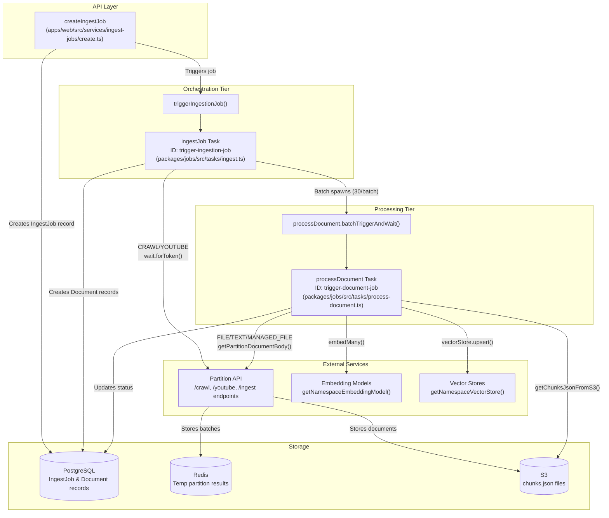
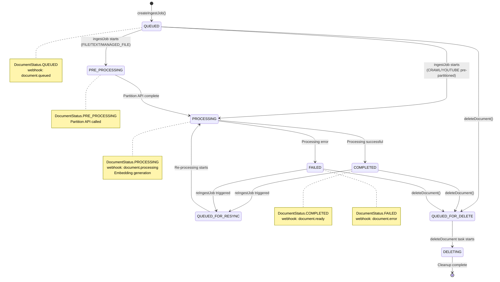
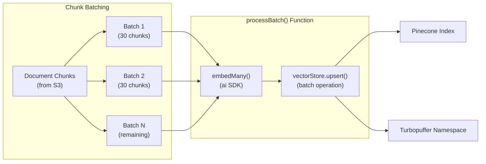

<!-- source: DeepWiki mcp.deepwiki.com · repo agentset-ai/agentset · page 3 Document Processing · fetched 2026-10-26 -->

# Document Processing

<details>
<summary>Relevant source files</summary>

The following files were used as context for generating this wiki page:

- [apps/web/src/app/api/(public-api)/v1/namespace/[namespaceId]/ingest-jobs/route.ts](apps/web/src/app/api/(public-api)/v1/namespace/[namespaceId]/ingest-jobs/route.ts)
- [apps/web/src/server/api/routers/ingest-jobs.ts](apps/web/src/server/api/routers/ingest-jobs.ts)
- [apps/web/src/services/documents/delete.ts](apps/web/src/services/documents/delete.ts)
- [apps/web/src/services/ingest-jobs/create.ts](apps/web/src/services/ingest-jobs/create.ts)
- [apps/web/src/services/ingest-jobs/delete.ts](apps/web/src/services/ingest-jobs/delete.ts)
- [packages/jobs/src/schema.ts](packages/jobs/src/schema.ts)
- [packages/jobs/src/tasks/delete-document.ts](packages/jobs/src/tasks/delete-document.ts)
- [packages/jobs/src/tasks/delete-ingest-job.ts](packages/jobs/src/tasks/delete-ingest-job.ts)
- [packages/jobs/src/tasks/delete-namespace.ts](packages/jobs/src/tasks/delete-namespace.ts)
- [packages/jobs/src/tasks/delete-org.ts](packages/jobs/src/tasks/delete-org.ts)
- [packages/jobs/src/tasks/ingest.ts](packages/jobs/src/tasks/ingest.ts)
- [packages/jobs/src/tasks/process-document.ts](packages/jobs/src/tasks/process-document.ts)
- [packages/jobs/src/tasks/re-ingest.ts](packages/jobs/src/tasks/re-ingest.ts)

</details>


The document processing system handles the ingestion, parsing, chunking, embedding, and storage of documents into vector databases. It supports multiple input types (files, text, URLs, YouTube videos) and implements a scalable two-tier job architecture for parallel processing. This system forms the foundation for retrieval operations in the RAG pipeline.

For information about the RAG search and retrieval system that queries these processed documents, see [RAG and Search System](#4). For details about the background job orchestration infrastructure, see [Background Job Processing](#3.2).

## System Purpose and Scope

The document processing system orchestrates the complete lifecycle of documents from initial ingestion through embedding generation and storage in vector databases. Key responsibilities include:

- **Multi-format ingestion**: Accept text, files, URLs (via crawling), and YouTube videos
- **Parallel processing**: Distribute document processing across concurrent background jobs
- **Chunking and embedding**: Transform documents into searchable vector representations
- **Metadata tracking**: Maintain status, metrics (pages, tokens, chunks), and error information
- **Resource cleanup**: Delete documents and their associated vectors when requested
- **Re-ingestion**: Reprocess existing documents with updated configurations

The system handles documents within the context of **IngestJobs**, which serve as containers for one or more related documents. Each IngestJob tracks configuration, status, and aggregate metrics across all its documents.

Sources: [packages/jobs/src/tasks/ingest.ts:33-600](), [packages/jobs/src/tasks/process-document.ts:72-422](), [apps/web/src/services/ingest-jobs/create.ts:14-192]()

## Document Types and Input Sources

The system supports six distinct document input types, each with specialized handling:

| Input Type | Payload Type | Description | Max Count per Job |
|------------|-------------|-------------|-------------------|
| Text | `TEXT` | Raw text content provided directly | Single document |
| File URL | `FILE` | Publicly accessible file URL | Single document |
| Managed File | `MANAGED_FILE` | Pre-uploaded file in S3 storage | Single document |
| Batch | `BATCH` | Multiple files/managed files | Multiple documents |
| Web Crawl | `CRAWL` | Website crawling with depth/path controls | Multiple documents |
| YouTube | `YOUTUBE` | YouTube video transcripts | Multiple documents |

**Single Document Types** (`TEXT`, `FILE`, `MANAGED_FILE`) create one document per IngestJob and are processed immediately after job creation.

**Multi-Document Types** (`BATCH`, `CRAWL`, `YOUTUBE`) undergo pre-processing where an external Partition API extracts content and generates multiple documents. These types support advanced configuration options like chunking parameters and metadata extraction.

The `BATCH` type allows combining multiple files into a single IngestJob for efficient processing, with automatic deduplication of file URLs and managed file keys [apps/web/src/services/ingest-jobs/create.ts:29-46]().

Sources: [apps/web/src/services/ingest-jobs/create.ts:27-103](), [packages/jobs/src/tasks/ingest.ts:135-445]()

## Two-Tier Job Architecture



**Diagram: Two-Tier Job Architecture with Task IDs**

The processing system implements a hierarchical job structure:

1. **Orchestration Tier (`ingestJob`)**: The `ingestJob` task [packages/jobs/src/tasks/ingest.ts:33-600]() coordinates the overall ingestion:
   - Validates the IngestJob configuration
   - Handles pre-processing for `CRAWL` and `YOUTUBE` types via Partition API
   - Creates Document records in PostgreSQL
   - Spawns multiple `processDocument` tasks in batches of 30

2. **Processing Tier (`processDocument`)**: Each `processDocument` task [packages/jobs/src/tasks/process-document.ts:72-422]() processes a single document:
   - Retrieves chunks from S3 [packages/jobs/src/tasks/process-document.ts:210-216]()
   - Generates embeddings in batches of 30 chunks [packages/jobs/src/tasks/process-document.ts:32-70]()
   - Upserts vectors to the configured vector store [packages/jobs/src/tasks/process-document.ts:67]()
   - Updates document status and metrics

This architecture enables **horizontal scaling** by processing up to 90 concurrent documents (per the queue concurrency limit) while maintaining transactional consistency for metadata in PostgreSQL.

Sources: [packages/jobs/src/tasks/ingest.ts:33-600](), [packages/jobs/src/tasks/process-document.ts:72-422](), [packages/jobs/src/schema.ts:19-32](), [packages/jobs/src/schema.ts:54-72]()

## Document Lifecycle and Status Transitions



**Diagram: Document Status State Machine with DocumentStatus Enum Values**

### Status Descriptions

| Status | Enum Value | Description | Webhook Event |
|--------|-----------|-------------|---------------|
| Queued | `QUEUED` | Document created, awaiting processing | `document.queued` |
| Pre-processing | `PRE_PROCESSING` | Partition API processing file (FILE/TEXT/MANAGED_FILE only) | None |
| Processing | `PROCESSING` | Generating embeddings and upserting to vector store | `document.processing` |
| Completed | `COMPLETED` | Successfully processed and stored | `document.ready` |
| Failed | `FAILED` | Processing error occurred | `document.error` |
| Queued for Resync | `QUEUED_FOR_RESYNC` | Marked for re-processing | `document.queued_for_resync` |
| Queued for Delete | `QUEUED_FOR_DELETE` | Marked for deletion | `document.queued_for_deletion` |
| Deleting | `DELETING` | Cleanup in progress | None |

The status field uses the `DocumentStatus` enum [packages/jobs/src/tasks/process-document.ts:11-16]() from the database schema. Each transition updates corresponding timestamp fields (`processingAt`, `failedAt`, `completedAt`) to track processing duration [packages/jobs/src/tasks/process-document.ts:134-140]().

**IngestJobs** follow a parallel lifecycle using `IngestJobStatus` with states like `QUEUED`, `PRE_PROCESSING`, `PROCESSING`, `COMPLETED`, `FAILED`, `QUEUED_FOR_RESYNC`, `QUEUED_FOR_DELETE`, `DELETING` [packages/jobs/src/tasks/ingest.ts:12-14]().

Sources: [packages/jobs/src/tasks/process-document.ts:130-169](), [packages/jobs/src/tasks/process-document.ts:82-128](), [packages/jobs/src/tasks/ingest.ts:33-124]()

## Partition API Integration

Documents requiring external parsing (files, crawled pages, YouTube videos) interact with the Partition API, a separate service responsible for extraction and chunking.

### Async Processing Flow

The Partition API uses an asynchronous callback pattern with Trigger.dev's `wait.forToken()` mechanism:

1. **Initiate request**: Post to `/crawl` or `/youtube` endpoint with `trigger_token_id` and `trigger_access_token` [packages/jobs/src/tasks/ingest.ts:160-172]().
2. **Receive call ID**: API returns `{ call_id: string }` immediately.
3. **Wait for callback**: Task suspends using `wait.forToken()` [packages/jobs/src/tasks/ingest.ts:173-175]().
4. **Resume on completion**: Partition API calls back to Trigger.dev with results.
5. **Process results**: Task continues with partition data to create document records [packages/jobs/src/tasks/ingest.ts:191-235]().

For multi-document types, the Partition API stores results in S3 as `chunks.json` files [packages/jobs/src/tasks/process-document.ts:210-216]().

Sources: [packages/jobs/src/tasks/ingest.ts:136-178](), [packages/jobs/src/tasks/process-document.ts:210-216]()

## Embedding Generation and Vector Storage

### Batch Processing Strategy

Document chunks are embedded and stored in batches to optimize throughput:



**Diagram: Embedding Batch Processing Pipeline**

The `processBatch` helper function [packages/jobs/src/tasks/process-document.ts:34-70]() handles each batch:

1. **Embed chunks**: Call `embedMany()` from the AI SDK with the configured embedding model [packages/jobs/src/tasks/process-document.ts:48-52]().
2. **Merge metadata**: Combine document-level and chunk-level metadata [packages/jobs/src/tasks/process-document.ts:54-63]().
3. **Upsert vectors**: Write vectors to the vector store [packages/jobs/src/tasks/process-document.ts:67]().

The `BATCH_SIZE` constant is set to 30 [packages/jobs/src/tasks/process-document.ts:32]() to balance API rate limits and processing speed.

### Rate Limiting for Pinecone

Pinecone imposes a limit of 5 requests per second per namespace. The system implements rate limiting for both document processing cleanup and deletion operations:

```typescript
// Rate limit for cleanup operations
await rateLimit(
  {
    queue: "process-document-cleanup",
    concurrencyKey: document.tenantId
      ? `${ingestJob.namespace.id}:${document.tenantId}`
      : ingestJob.namespace.id,
  },
  Ratelimit.tokenBucket(5, "1s", 5),
);
```

This ensures tenant-aware rate limiting [packages/jobs/src/tasks/process-document.ts:185-194]() when multi-tenancy is enabled, preventing throttling.

Sources: [packages/jobs/src/tasks/process-document.ts:34-70](), [packages/jobs/src/tasks/delete-document.ts:74-91]()

## Document Re-ingestion

The re-ingestion flow allows reprocessing existing documents with updated configurations or to recover from failures.

The `reIngestJob` task [packages/jobs/src/tasks/re-ingest.ts:13-220]() orchestrates re-processing:

1. **Fetch documents**: Retrieve all documents for the IngestJob [packages/jobs/src/tasks/re-ingest.ts:78-92]().
2. **Reset statuses**: Update all documents to `QUEUED_FOR_RESYNC` [packages/jobs/src/tasks/re-ingest.ts:108-119]().
3. **Trigger processing**: Call `processDocument.batchTriggerAndWait()` with `cleanup: true` flag [packages/jobs/src/tasks/re-ingest.ts:138-150]().
4. **Clean up vectors**: The `cleanup` flag causes `processDocument` to delete existing vectors before re-embedding [packages/jobs/src/tasks/process-document.ts:177-199]().

Sources: [packages/jobs/src/tasks/re-ingest.ts:13-220](), [packages/jobs/src/tasks/process-document.ts:177-199](), [apps/web/src/server/api/routers/ingest-jobs.ts:172-248]()

## Deletion and Cleanup Workflows

The system implements hierarchical deletion following the organization structure:

**Organization → Namespace → IngestJob → Document**

### Document Deletion

The `deleteDocument` task [packages/jobs/src/tasks/delete-document.ts:17-158]() performs comprehensive cleanup:

1. **Update status**: Set to `DELETING` [packages/jobs/src/tasks/delete-document.ts:64-70]().
2. **Rate limit**: Apply Pinecone rate limits if needed [packages/jobs/src/tasks/delete-document.ts:74-91]().
3. **Delete vectors**: Remove all chunks from vector store by document ID filter [packages/jobs/src/tasks/delete-document.ts:100-102]().
4. **Delete S3 objects**: 
   - `chunks.json` file [packages/jobs/src/tasks/delete-document.ts:105-112]().
   - Associated images [packages/jobs/src/tasks/delete-document.ts:115-116]().
   - Managed file if `source.type === "MANAGED_FILE"` [packages/jobs/src/tasks/delete-document.ts:119-122]().
5. **Delete database record**: Remove from PostgreSQL [packages/jobs/src/tasks/delete-document.ts:125-128]().

### IngestJob Deletion

The `deleteIngestJob` task [packages/jobs/src/tasks/delete-ingest-job.ts:13-163]() cascades to all documents:

1. Update status to `DELETING` [packages/jobs/src/tasks/delete-ingest-job.ts:53-59]().
2. Trigger `deleteDocument.batchTriggerAndWait()` in batches of 30 [packages/jobs/src/tasks/delete-ingest-job.ts:88-106]().
3. Aggregate deleted document and page counts.
4. Delete IngestJob record and decrement namespace/organization counters [packages/jobs/src/tasks/delete-ingest-job.ts:109-139]().

Sources: [packages/jobs/src/tasks/delete-document.ts:17-158](), [packages/jobs/src/tasks/delete-ingest-job.ts:13-163](), [packages/jobs/src/tasks/delete-namespace.ts:13-110]()

## Usage Metering and Billing

The system tracks resource usage at multiple levels. For Pro plan organizations, the `processDocument` task reports pages to Stripe via `meterIngestedPages` [packages/jobs/src/tasks/process-document.ts:19]().

### Metric Tracking

The system maintains real-time counters in PostgreSQL:

| Level | Metrics | Updated On |
|-------|---------|-----------|
| **Document** | `totalPages`, `totalTokens`, `totalChunks` | Processing completion |
| **Namespace** | `totalDocuments`, `totalPages`, `totalIngestJobs` | Creation/deletion |
| **Organization** | `totalDocuments`, `totalPages`, `totalIngestJobs` | Creation/deletion |

These counters enable fast limit checks [apps/web/src/server/api/routers/ingest-jobs.ts:118-126]().

Sources: [packages/jobs/src/tasks/process-document.ts:391-410](), [packages/jobs/src/tasks/ingest.ts:447-480]()

## Configuration and Validation

Configuration is validated at job creation [apps/web/src/services/ingest-jobs/create.ts:109-139]() and filtered based on payload type. Deprecated fields are automatically removed to maintain backwards compatibility [apps/web/src/services/ingest-jobs/create.ts:132-138]().

For detailed validation rules and configuration options, see [Ingestion Validation and Configuration](#3.3).

Sources: [apps/web/src/services/ingest-jobs/create.ts:109-139](), [packages/jobs/src/schema.ts:54-72]()

## Error Handling and Recovery

Both `ingestJob` and `processDocument` implement `onFailure` handlers that:

1. Extract error message from the exception [packages/jobs/src/tasks/process-document.ts:85-86]().
2. Update database status to `FAILED` [packages/jobs/src/tasks/process-document.ts:91-95]().
3. Emit error webhook (`ingest_job.error` or `document.error`) [packages/jobs/src/tasks/process-document.ts:112-118]().

Tasks are configured with `maxAttempts: 1` [packages/jobs/src/tasks/process-document.ts:79](), meaning no automatic retries, which prevents double-counting in billing metrics.

Sources: [packages/jobs/src/tasks/process-document.ts:82-128](), [packages/jobs/src/tasks/ingest.ts:43-85]()

---

