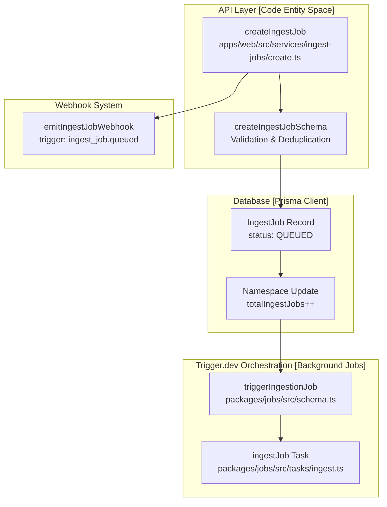
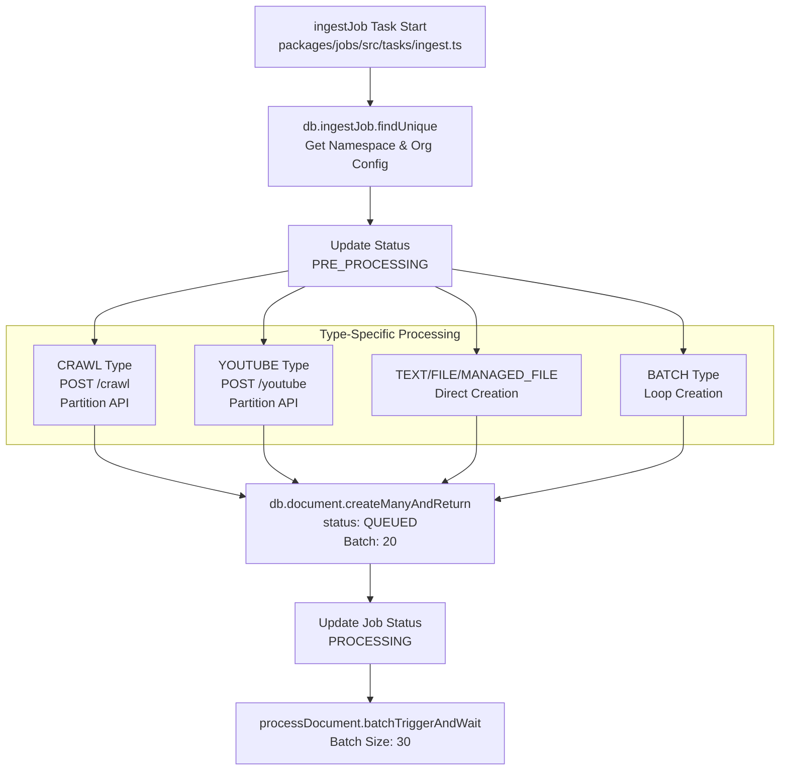
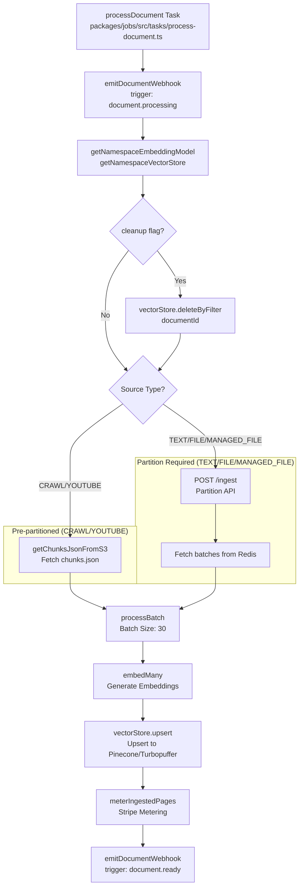

<!-- source: DeepWiki mcp.deepwiki.com · repo agentset-ai/agentset · page 3.1 Ingestion Workflow · fetched 2026-10-26 -->

# Ingestion Workflow

<details>
<summary>Relevant source files</summary>

The following files were used as context for generating this wiki page:

- [apps/web/src/app/api/(public-api)/v1/namespace/[namespaceId]/ingest-jobs/route.ts](apps/web/src/app/api/(public-api)/v1/namespace/[namespaceId]/ingest-jobs/route.ts)
- [apps/web/src/lib/redis.ts](apps/web/src/lib/redis.ts)
- [apps/web/src/server/api/routers/ingest-jobs.ts](apps/web/src/server/api/routers/ingest-jobs.ts)
- [apps/web/src/services/documents/delete.ts](apps/web/src/services/documents/delete.ts)
- [apps/web/src/services/ingest-jobs/create.ts](apps/web/src/services/ingest-jobs/create.ts)
- [apps/web/src/services/ingest-jobs/delete.ts](apps/web/src/services/ingest-jobs/delete.ts)
- [packages/jobs/src/schema.ts](packages/jobs/src/schema.ts)
- [packages/jobs/src/tasks/delete-document.ts](packages/jobs/src/tasks/delete-document.ts)
- [packages/jobs/src/tasks/delete-ingest-job.ts](packages/jobs/src/tasks/delete-ingest-job.ts)
- [packages/jobs/src/tasks/delete-namespace.ts](packages/jobs/src/tasks/delete-namespace.ts)
- [packages/jobs/src/tasks/delete-org.ts](packages/jobs/src/tasks/delete-org.ts)
- [packages/jobs/src/tasks/ingest.ts](packages/jobs/src/tasks/ingest.ts)
- [packages/jobs/src/tasks/process-document.ts](packages/jobs/src/tasks/process-document.ts)
- [packages/jobs/src/tasks/re-ingest.ts](packages/jobs/src/tasks/re-ingest.ts)

</details>


## Purpose and Scope

This document describes the end-to-end ingestion workflow that processes user-submitted content into searchable vector embeddings. It covers job creation, document type handling, the two-tier job architecture (`ingestJob` orchestrator and `processDocument` workers), partition API integration, and status lifecycle management.

For information about the Trigger.dev job processing implementation and error handling, see [Background Job Processing](#3.2). For validation schemas and configuration options, see [Ingestion Validation and Configuration](#3.3).

## Overview

The ingestion workflow implements a hierarchical job processing pattern where a parent `ingestJob` task orchestrates the creation and validation of documents, while child `processDocument` tasks handle the actual embedding generation and vector storage for each individual document. This architecture enables parallel processing of hundreds of documents while maintaining transactional consistency for metadata.

The workflow supports five primary document types:
- **TEXT**: Plain text content submitted directly.
- **FILE**: External file URLs.
- **MANAGED_FILE**: Files uploaded to AgentSet's S3 storage.
- **CRAWL**: Website crawling with depth/path filtering.
- **YOUTUBE**: YouTube video transcript extraction.
- **BATCH**: Multiple files or URLs in a single job.

## Ingestion Flow Diagram



**Sources**: [apps/web/src/services/ingest-jobs/create.ts:14-192](), [packages/jobs/src/schema.ts:19-32](), [packages/jobs/src/tasks/ingest.ts:33-42]()

## Job Creation

The ingestion workflow begins when a user submits content through the API or Dashboard. The `createIngestJob` service in the web application validates the request, creates database records, and triggers the background job.

### Validation and Preprocessing

The service performs several validation steps before creating the job:

| Validation Step | Purpose | Implementation |
|----------------|---------|----------------|
| Payload Type Validation | Ensures valid document type | [apps/web/src/services/ingest-jobs/create.ts:29-103]() |
| File Deduplication | Removes duplicate URLs/keys in BATCH | [apps/web/src/services/ingest-jobs/create.ts:33-46]() |
| File Existence Check | Verifies MANAGED_FILE keys exist in S3 | [apps/web/src/services/ingest-jobs/create.ts:50-63]() |
| Config Filtering | Removes unsupported fields per type | [apps/web/src/services/ingest-jobs/create.ts:109-138]() |

For `MANAGED_FILE` payloads, the service calls `checkFileExists` to ensure the key is present in storage [apps/web/src/services/ingest-jobs/create.ts:92-95](). For `BATCH` payloads, it iterates through items to deduplicate files and URLs [apps/web/src/services/ingest-jobs/create.ts:30-46]().

**Sources**: [apps/web/src/services/ingest-jobs/create.ts:14-139]()

### Database Transaction

Job creation executes a database transaction that creates the `IngestJob` record with `QUEUED` status and increments counters on the Namespace and Organization [apps/web/src/services/ingest-jobs/create.ts:140-164]().

```typescript
const [job] = await db.$transaction([
  db.ingestJob.create({
    data: {
      namespace: { connect: { id: namespaceId } },
      tenantId,
      status: IngestJobStatus.QUEUED,
      name: data.name,
      config: config,
      externalId: data.externalId,
      payload: finalPayload,
    },
  }),
  db.namespace.update({
    where: { id: namespaceId },
    data: {
      totalIngestJobs: { increment: 1 },
      organization: {
        update: { totalIngestJobs: { increment: 1 } },
      },
    },
  }),
]);
```

**Sources**: [apps/web/src/services/ingest-jobs/create.ts:140-164]()

### Trigger.dev Job Invocation

After database creation, the service triggers the background job using `triggerIngestionJob` [apps/web/src/services/ingest-jobs/create.ts:166-172](). The job priority is determined by the organization's plan (Enterprise, Pro, or Free) [packages/jobs/src/schema.ts:13-17](). Finally, it emits an `ingest_job.queued` webhook [apps/web/src/services/ingest-jobs/create.ts:181-189]().

**Sources**: [apps/web/src/services/ingest-jobs/create.ts:166-189](), [packages/jobs/src/schema.ts:13-32]()

## Document Type Handling

The `ingestJob` task (defined in `packages/jobs/src/tasks/ingest.ts`) handles different document types with specialized processing flows.

### Document Type Processing Flow



**Sources**: [packages/jobs/src/tasks/ingest.ts:88-530]()

### CRAWL and YOUTUBE Processing

Website crawling and YouTube ingestion utilize the Partition API:

1. **Token Creation**: Creates a wait token for async callback (2-hour timeout) [packages/jobs/src/tasks/ingest.ts:137]().
2. **API Call**: POSTs to `${env.PARTITION_API_URL}/crawl` or `/youtube` with `CrawlPartitionBody` or `YoutubePartitionBody` [packages/jobs/src/tasks/ingest.ts:160-167]().
3. **Wait for Result**: Uses `wait.forToken` to pause execution until the Partition API returns the results [packages/jobs/src/tasks/ingest.ts:173-175]().
4. **Limit Enforcement**: Checks organization page limits. Documents exceeding limits are marked `FAILED` with "Pages limit exceeded" [packages/jobs/src/tasks/ingest.ts:185-221]().

**Sources**: [packages/jobs/src/tasks/ingest.ts:136-338]()

### Single Document and BATCH Types

For `TEXT`, `FILE`, and `MANAGED_FILE`, the task creates a single document record [packages/jobs/src/tasks/ingest.ts:339-408](). For `BATCH`, it iterates through the items in chunks of 20 to create document records [packages/jobs/src/tasks/ingest.ts:409-444]().

**Sources**: [packages/jobs/src/tasks/ingest.ts:339-444]()

## Two-Tier Job Architecture

The ingestion system uses a parent-child task pattern to enable massive parallelism while maintaining coordination.

### Architecture Overview

- **Parent Task (`ingestJob`)**: Orchestrates the workflow, handles Partition API calls for crawling, creates `Document` records, and manages batching of child tasks [packages/jobs/src/tasks/ingest.ts:33-586]().
- **Child Task (`processDocument`)**: Handles the actual chunking (if not pre-chunked), embedding generation, and vector store upserts for a single document [packages/jobs/src/tasks/process-document.ts:72-421]().

### Batch Spawning Pattern

The `ingestJob` task spawns child tasks in batches of 30 using `processDocument.batchTriggerAndWait()` [packages/jobs/src/tasks/ingest.ts:494-511](). This pattern prevents overwhelming the queue while maintaining high throughput.

**Sources**: [packages/jobs/src/tasks/ingest.ts:491-528](), [packages/jobs/src/tasks/process-document.ts:72-81]()

## Document Processing Task

The `processDocument` task (defined in `packages/jobs/src/tasks/process-document.ts`) is responsible for the final steps of ingestion.

### Processing Flow



**Sources**: [packages/jobs/src/tasks/process-document.ts:130-421]()

### Embedding and Vector Storage

The `processBatch` function generates embeddings using `embedMany` and upserts them to the vector store [packages/jobs/src/tasks/process-document.ts:34-70]().

1. **Embeddings**: Calls the configured embedding model (e.g., OpenAI, Voyage) [packages/jobs/src/tasks/process-document.ts:48-52]().
2. **Metadata**: Merges chunk metadata with any extra metadata provided in the job config [packages/jobs/src/tasks/process-document.ts:54-62]().
3. **Upsert**: Calls `vectorStore.upsert` to store the chunks and embeddings [packages/jobs/src/tasks/process-document.ts:67]().

**Sources**: [packages/jobs/src/tasks/process-document.ts:34-70]()

### Cleanup and Re-processing

If the `cleanup` flag is true, the task calls `vectorStore.deleteByFilter` to remove existing vectors for the document before re-indexing [packages/jobs/src/tasks/process-document.ts:177-199](). For Pinecone providers, a rate limit of 5 requests per second is applied [packages/jobs/src/tasks/process-document.ts:180-194]().

**Sources**: [packages/jobs/src/tasks/process-document.ts:177-199]()

## Webhook Emissions

The ingestion workflow emits webhooks at key lifecycle events to enable external system integrations.

| Event Trigger | Description | Code Location |
|---------------|-------------|---------------|
| `ingest_job.queued` | Job record created and queued | [apps/web/src/services/ingest-jobs/create.ts:181-189]() |
| `ingest_job.processing` | Job starts processing documents | [packages/jobs/src/tasks/ingest.ts:482-489]() |
| `ingest_job.ready` | Job completed successfully | [packages/jobs/src/tasks/ingest.ts:553-560]() |
| `ingest_job.error` | Job failed | [packages/jobs/src/tasks/ingest.ts:68-75]() |
| `document.processing` | Document task starts | [packages/jobs/src/tasks/process-document.ts:162-168]() |
| `document.ready` | Document successfully indexed | [packages/jobs/src/tasks/process-document.ts:382-389]() |
| `document.error` | Document processing failed | [packages/jobs/src/tasks/process-document.ts:112-118]() |

**Sources**: [packages/jobs/src/tasks/ingest.ts:27-28](), [packages/jobs/src/tasks/process-document.ts:30]()

## Re-ingestion and Deletion

### Re-ingestion Flow
Users can trigger a re-ingestion via the `reIngest` mutation [apps/web/src/server/api/routers/ingest-jobs.ts:172-248](). This triggers the `reIngestJob` task, which resets document statuses and spawns `processDocument` tasks with the `cleanup` flag enabled [packages/jobs/src/tasks/re-ingest.ts:13-220]().

### Deletion Flow
- **Document Deletion**: The `deleteDocument` task removes vector chunks, `chunks.json` from S3, and any associated images [packages/jobs/src/tasks/delete-document.ts:17-158]().
- **Ingest Job Deletion**: The `deleteIngestJob` task batch triggers deletion for all documents associated with the job before deleting the job record itself [packages/jobs/src/tasks/delete-ingest-job.ts:13-163]().

**Sources**: [packages/jobs/src/tasks/re-ingest.ts:13-220](), [packages/jobs/src/tasks/delete-document.ts:17-158](), [packages/jobs/src/tasks/delete-ingest-job.ts:13-163]()

---

