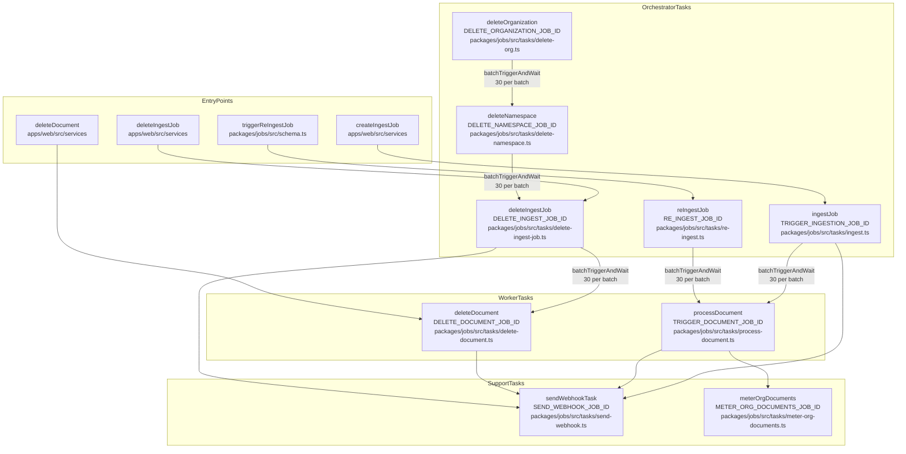
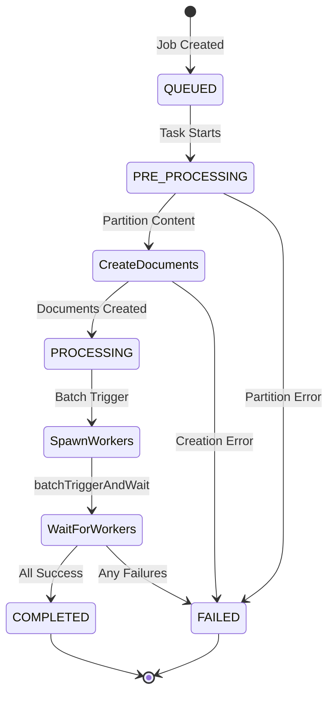
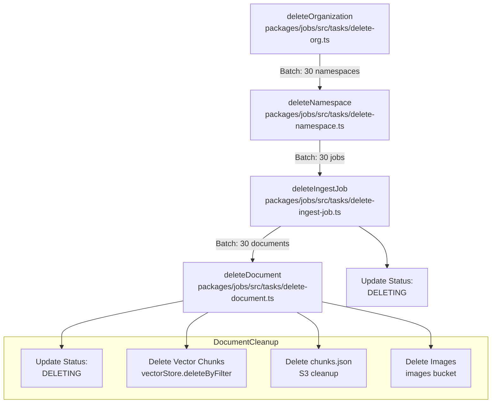

<!-- source: DeepWiki mcp.deepwiki.com · repo agentset-ai/agentset · page 3.2 Background Job Processing · fetched 2026-10-26 -->

# Background Job Processing

<details>
<summary>Relevant source files</summary>

The following files were used as context for generating this wiki page:

- [apps/web/src/app/api/(internal-api)/stripe/webhook/invoice-payment-succeeded.ts](apps/web/src/app/api/(internal-api)/stripe/webhook/invoice-payment-succeeded.ts)
- [apps/web/src/app/api/(internal-api)/stripe/webhook/route.ts](apps/web/src/app/api/(internal-api)/stripe/webhook/route.ts)
- [apps/web/src/lib/webhook/emit.ts](apps/web/src/lib/webhook/emit.ts)
- [packages/jobs/src/cron/usage.ts](packages/jobs/src/cron/usage.ts)
- [packages/jobs/src/schema.ts](packages/jobs/src/schema.ts)
- [packages/jobs/src/tasks/delete-document.ts](packages/jobs/src/tasks/delete-document.ts)
- [packages/jobs/src/tasks/delete-ingest-job.ts](packages/jobs/src/tasks/delete-ingest-job.ts)
- [packages/jobs/src/tasks/delete-namespace.ts](packages/jobs/src/tasks/delete-namespace.ts)
- [packages/jobs/src/tasks/delete-org.ts](packages/jobs/src/tasks/delete-org.ts)
- [packages/jobs/src/tasks/ingest.ts](packages/jobs/src/tasks/ingest.ts)
- [packages/jobs/src/tasks/meter-org-documents.ts](packages/jobs/src/tasks/meter-org-documents.ts)
- [packages/jobs/src/tasks/process-document.ts](packages/jobs/src/tasks/process-document.ts)
- [packages/jobs/src/tasks/re-ingest.ts](packages/jobs/src/tasks/re-ingest.ts)
- [packages/jobs/src/tasks/send-webhook.ts](packages/jobs/src/tasks/send-webhook.ts)
- [packages/jobs/src/webhook.ts](packages/jobs/src/webhook.ts)
- [packages/stripe/src/meters.ts](packages/stripe/src/meters.ts)
- [packages/webhooks/package.json](packages/webhooks/package.json)
- [packages/webhooks/src/emit.ts](packages/webhooks/src/emit.ts)
- [packages/webhooks/src/failure.ts](packages/webhooks/src/failure.ts)
- [packages/webhooks/src/index.ts](packages/webhooks/src/index.ts)
- [packages/webhooks/src/schemas.ts](packages/webhooks/src/schemas.ts)
- [packages/webhooks/src/server.ts](packages/webhooks/src/server.ts)
- [packages/webhooks/src/types.ts](packages/webhooks/src/types.ts)

</details>


## Purpose and Scope

This document describes the background job processing system built on Trigger.dev, which handles all asynchronous operations in AgentSet including document ingestion, processing, deletion, and re-ingestion workflows. The system is designed to handle high-concurrency tasks such as vector embedding generation and multi-tenant data cleanup while providing reliable status tracking and webhook notifications.

Sources: [packages/jobs/src/tasks/ingest.ts:1-33](), [packages/jobs/src/tasks/process-document.ts:1-72]()

## Trigger.dev Integration

AgentSet uses Trigger.dev as its job orchestration platform, providing reliable background job execution with automatic retries, concurrency management, and long-running task support.

### Configuration

The Trigger.dev configuration is defined in `trigger.config.ts` with the following settings:

| Setting | Value | Purpose |
|---------|-------|---------|
| Runtime | `node-22` | Node.js version 22 |
| Max Duration | 3600 seconds (1 hour) | Default task timeout |
| Retry Policy | Max 3 attempts, exponential backoff | Automatic failure recovery |
| Build Extensions | Prisma extension | Enables Prisma client generation |
| Task Directories | `./src/tasks`, `./src/cron`, `./src/queues` | Task discovery locations |

Sources: [packages/jobs/trigger.config.ts:1-28]()

### Task Definition Pattern

All tasks use the `schemaTask` pattern with Zod schema validation:

```typescript
export const taskName = schemaTask({
  id: "task-identifier",
  maxDuration: 60 * 60, // seconds
  queue: {
    concurrencyLimit: 90
  },
  retry: {
    maxAttempts: 1
  },
  schema: zodSchema,
  onFailure: async ({ payload, error }) => {
    // Failure handling
  },
  run: async (payload, context) => {
    // Task execution
  }
});
```

Sources: [packages/jobs/src/tasks/ingest.ts:33-87](), [packages/jobs/src/tasks/process-document.ts:72-129]()

## Task Architecture

### Task Registry

The job system implements multiple specialized tasks:

| Task ID | Purpose | Max Duration | Concurrency Limit |
|---------|---------|--------------|-------------------|
| `trigger-ingestion-job` | Orchestrates document ingestion | 12 hours | 90 |
| `trigger-document-job` | Processes individual documents | 3 hours | 90 |
| `delete-document-job` | Deletes single documents | 30 minutes | 90 |
| `delete-ingest-job` | Deletes ingest jobs and documents | 30 minutes | 50 |
| `delete-namespace-job` | Deletes namespaces and contents | 30 minutes | 50 |
| `delete-organization-job` | Deletes organizations and contents | 30 minutes | 50 |
| `re-ingest-job` | Re-processes existing documents | 12 hours | 90 |
| `send-webhook` | Sends webhook notifications | Default | 100 |
| `seed-demo-namespace` | Seeds demo content | Default | Default |
| `meter-org-documents-job` | Meters usage to Stripe | 30 minutes | 50 |

Sources: [packages/jobs/src/schema.ts:19-186](), [packages/jobs/src/tasks/send-webhook.ts:25-30]()

### Task Hierarchy and Orchestration



**Task Hierarchy and Orchestration**

The system implements a two-tier orchestration pattern where parent tasks spawn and wait for batches of child tasks. The `ingestJob` and `reIngestJob` tasks orchestrate multiple `processDocument` tasks, while deletion tasks follow a hierarchical cascade (Organization → Namespace → IngestJob → Document).

Sources: [packages/jobs/src/tasks/ingest.ts:491-528](), [packages/jobs/src/tasks/re-ingest.ts:134-172](), [packages/jobs/src/tasks/delete-ingest-job.ts:84-107](), [packages/jobs/src/tasks/delete-namespace.ts:58-75](), [packages/jobs/src/tasks/delete-org.ts:54-70]()

### Priority Queueing

Tasks are prioritized based on the organization's plan:

```typescript
const getPriorityByPlan = (plan: string) => {
  if (isEnterprisePlan(plan)) return; // Highest priority
  if (isProPlan(plan)) return 3600 * 24; // 24 hours
  return 3600 * 16; // 16 hours (Free plan)
};
```

Lower numeric values indicate higher priority. Enterprise plan jobs execute with default (highest) priority.

Sources: [packages/jobs/src/schema.ts:13-17]()

## Document Processing Pipeline

### IngestJob Task

The `ingestJob` task orchestrates the entire ingestion process:



**IngestJob Status Flow**

Sources: [packages/jobs/src/tasks/ingest.ts:88-131](), [packages/jobs/src/tasks/ingest.ts:546-584]()

### ProcessDocument Task

The `processDocument` task handles individual document processing:

**Processing Stages:**

1. **Status Update**: Document status set to `PROCESSING` [packages/jobs/src/tasks/process-document.ts:134-139]().
2. **Configuration Loading**: Retrieve embedding model and vector store for the namespace [packages/jobs/src/tasks/process-document.ts:170-174]().
3. **Cleanup (Optional)**: If `cleanup` is requested, existing chunks for the document are deleted from the vector store [packages/jobs/src/tasks/process-document.ts:177-199]().
4. **Content Processing**:
   - **Pre-partitioned** (CRAWLED_PAGE, YOUTUBE_VIDEO): Load pre-calculated chunks from S3 [packages/jobs/src/tasks/process-document.ts:205-256]().
   - **Other types**: Call Partition API, wait for result [packages/jobs/src/tasks/process-document.ts:258-356]().
5. **Embedding Generation**: Process chunks in batches of 30 using the `embedMany` function [packages/jobs/src/tasks/process-document.ts:34-52]().
6. **Vector Store Upsert**: Store embeddings and metadata in the configured vector store [packages/jobs/src/tasks/process-document.ts:66-67]().
7. **Status Finalization**: Update to `COMPLETED` or `FAILED` [packages/jobs/src/tasks/process-document.ts:358-380]().
8. **Usage Metering**: Log ingested pages to Stripe for Pro plans [packages/jobs/src/tasks/process-document.ts:392-410]().

Sources: [packages/jobs/src/tasks/process-document.ts:130-422]()

### Batch Processing Strategy

Documents are processed in batches using `batchTriggerAndWait` to manage concurrency and ensure the parent task waits for completion:

```typescript
const chunks = chunkArray(documentsIds, BATCH_SIZE);
for (const chunk of chunks) {
  const handles = await processDocument.batchTriggerAndWait(
    chunk.map((documentId) => ({
      payload: {
        documentId: documentId,
        ingestJob: ingestionJob,
      },
      options: {
        tags: [`doc_${documentId}`],
        priority: ctx.run.priority,
      },
    })),
  );
  // ... check handle status
}
```

The batch size is 30 documents per batch, allowing parallel processing while respecting concurrency limits.

Sources: [packages/jobs/src/tasks/ingest.ts:31](), [packages/jobs/src/tasks/ingest.ts:491-528]()

## Webhook Integration

### Event Emission

Webhooks are emitted at key lifecycle events for both ingest jobs and documents. The system uses the `emitDocumentWebhook` and `emitIngestJobWebhook` helpers which eventually trigger the `sendWebhookTask`.

**Key Webhook Triggers:**
- `document.processing`: Emitted when a document starts being processed [packages/jobs/src/tasks/process-document.ts:162-168]().
- `document.error`: Emitted if processing fails [packages/jobs/src/tasks/process-document.ts:112-118]().
- `ingest_job.error`: Emitted if the orchestration job fails [packages/jobs/src/tasks/ingest.ts:69-75]().
- `document.deleted`: Emitted after successful deletion [packages/jobs/src/tasks/delete-document.ts:132-149]().

Sources: [packages/jobs/src/webhook.ts:1-50](), [packages/jobs/src/tasks/send-webhook.ts:25-31]()

### Webhook Delivery and Retries

The `sendWebhookTask` handles the actual HTTP POST to user-defined URLs with signature verification and exponential backoff:

```typescript
retry: {
  byStatus: {
    "300-599": {
      strategy: "backoff",
      maxAttempts: MAX_RETRY_ATTEMPTS, // 10
      factor: 12,
      minTimeoutInMs: 12_000,
      maxTimeoutInMs: 86_400_000, // 24 hour cap
    },
  },
}
```

If a webhook consistently fails, it is disabled after reaching a threshold (configured via `WEBHOOK_FAILURE_DISABLE_THRESHOLD`), and the organization owner is notified via email.

Sources: [packages/jobs/src/tasks/send-webhook.ts:23-66](), [packages/jobs/src/tasks/send-webhook.ts:96-153]()

## Deletion Workflows

### Hierarchical Cascade

Deletion follows a strict parent-child pattern where parent tasks trigger and wait for all child tasks before completing their own cleanup.



Sources: [packages/jobs/src/tasks/delete-ingest-job.ts:84-107](), [packages/jobs/src/tasks/delete-document.ts:93-122]()

### Rate Limiting for Vector Stores

Pinecone has a limit of 5 requests per second per namespace. The system implements rate limiting using `Ratelimit.tokenBucket` to avoid provider throttling:

```typescript
if (
  vectorStoreProvider === "MANAGED_PINECONE" ||
  vectorStoreProvider === "PINECONE"
) {
  await rateLimit(
    {
      queue: "delete-document",
      concurrencyKey: document.tenantId
        ? `${namespace.id}:${document.tenantId}`
        : namespace.id,
    },
    Ratelimit.tokenBucket(5, "1s", 5),
  );
}
```

Sources: [packages/jobs/src/tasks/delete-document.ts:72-91](), [packages/jobs/src/tasks/process-document.ts:178-194]()

## Re-ingestion Workflow

The `reIngestJob` task allows re-processing existing documents, which is useful for schema changes or vector store migrations.

**Re-ingestion Process:**
1. Fetch all documents associated with the `ingestJobId` [packages/jobs/src/tasks/re-ingest.ts:78-92]().
2. Reset statuses to `QUEUED_FOR_RESYNC` in a database transaction [packages/jobs/src/tasks/re-ingest.ts:95-120]().
3. Batch trigger `processDocument` tasks with the `cleanup: true` flag enabled [packages/jobs/src/tasks/re-ingest.ts:138-150]().
4. Upon completion, update the namespace and organization page counts based on the `pagesDelta` returned by the workers [packages/jobs/src/tasks/re-ingest.ts:183-213]().

Sources: [packages/jobs/src/tasks/re-ingest.ts:1-220]()

## Usage Metering

Usage is metered to Stripe for organizations on paid plans. This happens both in real-time after document processing and via a recurring maintenance task.

### Real-time Metering
In `processDocument`, the system calls `meterIngestedPages` to report the total pages of a new document to Stripe [packages/jobs/src/tasks/process-document.ts:392-410]().

### Bulk Metering
The `meterOrgDocuments` task performs a full reconciliation of an organization's documents, iterating through all namespaces and documents in batches of 300 to ensure Stripe usage reflects the actual stored page counts [packages/jobs/src/tasks/meter-org-documents.ts:18-148]().

Sources: [packages/jobs/src/tasks/meter-org-documents.ts:16-148](), [packages/stripe/src/meters.ts:35-66]()

---

