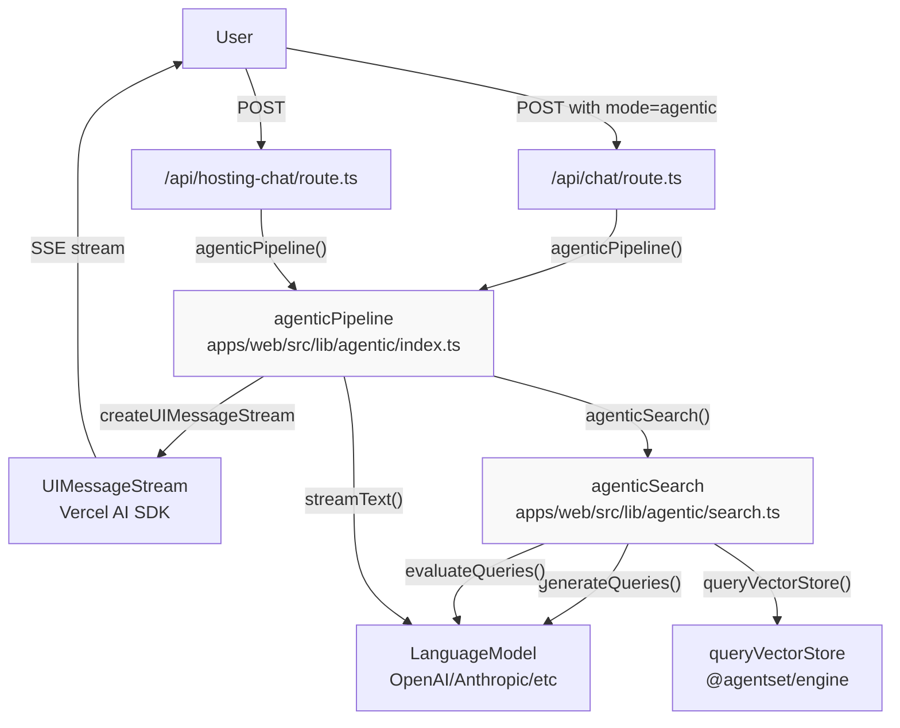
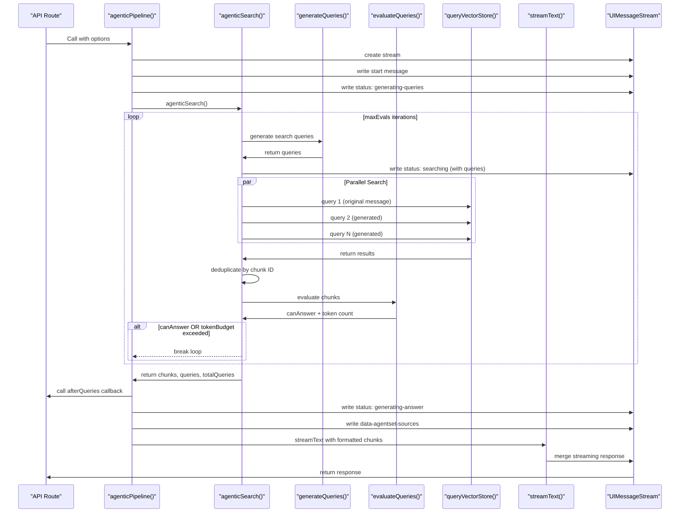
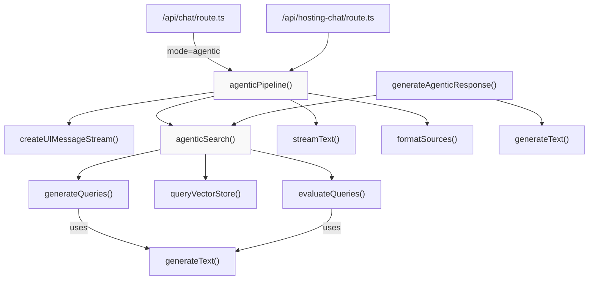

<!-- source: DeepWiki mcp.deepwiki.com · repo agentset-ai/agentset · page 4.2 Agentic Pipeline · fetched 2026-10-26 -->

# Agentic Pipeline

<details>
<summary>Relevant source files</summary>

The following files were used as context for generating this wiki page:

- [.env.example](.env.example)
- [apps/web/src/app/api/(internal-api)/chat/route.ts](apps/web/src/app/api/(internal-api)/chat/route.ts)
- [apps/web/src/app/api/(internal-api)/chat/schema.ts](apps/web/src/app/api/(internal-api)/chat/schema.ts)
- [apps/web/src/app/api/(internal-api)/hosting-chat/route.ts](apps/web/src/app/api/(internal-api)/hosting-chat/route.ts)
- [apps/web/src/app/api/(internal-api)/hosting-search/route.ts](apps/web/src/app/api/(internal-api)/hosting-search/route.ts)
- [apps/web/src/app/api/(public-api)/v1/namespace/[namespaceId]/search/route.ts](apps/web/src/app/api/(public-api)/v1/namespace/[namespaceId]/search/route.ts)
- [apps/web/src/env.ts](apps/web/src/env.ts)
- [apps/web/src/instrumentation-client.ts](apps/web/src/instrumentation-client.ts)
- [apps/web/src/lib/agentic/index.ts](apps/web/src/lib/agentic/index.ts)
- [apps/web/src/lib/agentic/prompts.ts](apps/web/src/lib/agentic/prompts.ts)
- [apps/web/src/lib/agentic/search.ts](apps/web/src/lib/agentic/search.ts)
- [apps/web/src/lib/agentic/utils.ts](apps/web/src/lib/agentic/utils.ts)
- [packages/engine/package.json](packages/engine/package.json)
- [packages/engine/src/env.ts](packages/engine/src/env.ts)
- [packages/validation/src/llm/index.ts](packages/validation/src/llm/index.ts)
- [packages/validation/src/re-ranker/index.ts](packages/validation/src/re-ranker/index.ts)
- [turbo.json](turbo.json)

</details>


## Purpose and Scope

The Agentic Pipeline implements an iterative multi-query retrieval and evaluation loop that enhances answer quality through:

- LLM-powered query generation producing multiple search queries (semantic and keyword types)
- Parallel vector search execution with optional reranking
- Result evaluation to determine information sufficiency
- Token budget management to control context size
- Streaming response generation with source attribution

The pipeline is invoked when processing mode is set to `"agentic"` in chat API endpoints. For direct single-query retrieval, see [Vector Search](4.1). For API integration, see [Chat and Search API Endpoints](4.3).

Sources: [apps/web/src/lib/agentic/index.ts:29-136](), [apps/web/src/lib/agentic/search.ts:12-102]()

## System Overview

The Agentic Pipeline is invoked by chat and search API endpoints when "agentic" mode is selected. It acts as an orchestrator between the user interface, language model, vector store, and keyword store.

### Diagram: Agentic Pipeline System Context



Sources: [apps/web/src/lib/agentic/index.ts:29-136](), [apps/web/src/app/api/(internal-api)/chat/route.ts:142-170](), [apps/web/src/app/api/(internal-api)/hosting-chat/route.ts:112-134]()

## Pipeline Workflow

The Agentic Pipeline executes an iterative search-evaluate-refine loop:

1. **Initialization**: A `UIMessageStream` is created with status annotations for progress tracking [apps/web/src/lib/agentic/index.ts:51-64]().
2. **Query Generation Phase**: The LLM generates multiple search queries (semantic/keyword types) via `generateQueries()` [apps/web/src/lib/agentic/search.ts:36-37]().
3. **Search Execution**: Queries are executed in parallel via `queryVectorStore()`, with the original user message also included in the first loop [apps/web/src/lib/agentic/search.ts:48-73]().
4. **Result Deduplication**: Chunks are deduplicated by ID across all search results [apps/web/src/lib/agentic/search.ts:80-83]().
5. **Evaluation Phase**: The LLM evaluates if retrieved chunks are sufficient via `evaluateQueries()` [apps/web/src/lib/agentic/search.ts:86-90]().
6. **Iteration**: If evaluation fails and budget allows, return to step 2 (up to `maxEvals` iterations) [apps/web/src/lib/agentic/search.ts:35-94]().
7. **Response Synthesis**: Retrieved chunks are formatted and passed to `streamText()` for final answer generation [apps/web/src/lib/agentic/index.ts:104-121]().

### Diagram: Agentic Pipeline Execution Flow



Sources: [apps/web/src/lib/agentic/index.ts:46-127](), [apps/web/src/lib/agentic/search.ts:12-102]()

## Implementation Details

### Core Functions and Types

The pipeline consists of two primary functions:

#### agenticPipeline()

The main orchestrator that manages streaming response generation. Located in [apps/web/src/lib/agentic/index.ts:29-136]().

| Parameter              | Type                                      | Description                                      |
|------------------------|-------------------------------------------|--------------------------------------------------|
| `model`                | `LanguageModel`                           | LLM for query generation and answer synthesis    |
| `queryOptions`         | `Omit<QueryVectorStoreOptions, "query">`  | Vector search options (embeddings, reranking)    |
| `systemPrompt`         | `string` (optional)                       | System prompt for final answer generation        |
| `messagesWithoutQuery` | `ModelMessage[]`                          | Chat history (excluding current query)           |
| `lastMessage`          | `string`                                  | Current user query                               |
| `afterQueries`         | `(totalQueries: number) => void` (optional) | Callback for usage tracking                    |
| `maxEvals`             | `number` (default: 2)                     | Maximum evaluation iterations                    |
| `tokenBudget`          | `number` (default: 4096)                  | Token limit for evaluation loop                  |

**Returns:** `Response` (streaming via Server-Sent Events)

#### generateAgenticResponse()

Non-streaming variant for programmatic use. Located in [apps/web/src/lib/agentic/index.ts:138-190]().

**Returns:** `{ answer: string, sources: QueryVectorStoreResult["results"] }`

#### Diagram: Function Call Graph



Sources: [apps/web/src/lib/agentic/index.ts:17-192](), [apps/web/src/lib/agentic/search.ts:12-102]()

### Iterative Search Process (agenticSearch)

The core search loop is implemented in [apps/web/src/lib/agentic/search.ts:12-102]().

#### Query Generation (`generateQueries`)

Located in [apps/web/src/lib/agentic/utils.ts:30-56](). It uses the `GENERATE_QUERIES_PROMPT` to ask the LLM for appropriate search queries based on chat history.

- Supports both semantic (vector) and keyword (BM25) search types.
- Uses a Zod schema to parse the LLM's JSON response [apps/web/src/lib/agentic/utils.ts:19-26]().

#### Result Evaluation (`evaluateQueries`)

Located in [apps/web/src/lib/agentic/utils.ts:62-85](). It uses the `EVALUATE_QUERIES_PROMPT` to determine if the retrieved sources are sufficient to answer the user's question.

#### Response Formatting (`formatSources`)

Located in [apps/web/src/lib/agentic/utils.ts:13-17](). Formats chunks into an XML-like structure:

```
<source_1>
...content...
</source_1>
```

Sources: [apps/web/src/lib/agentic/search.ts:12-102](), [apps/web/src/lib/agentic/utils.ts:1-85]()

## Deep Research Pipeline

The `DeepResearchPipeline` class provides a more intensive search mode. It is initialized with separate LLM configurations for JSON parsing, planning, summary, and answering [apps/web/src/app/api/(internal-api)/chat/route.ts:110-140]().

Unlike the standard agentic pipeline, `DeepResearchPipeline` is designed for complex, multi-step information gathering. It is invoked when `body.mode === "deepResearch"` in the chat API [apps/web/src/app/api/(internal-api)/chat/route.ts:109]().

Sources: [apps/web/src/app/api/(internal-api)/chat/route.ts:109-140](), [apps/web/src/lib/deep-research/index.ts]()

## Status Annotations and UI Integration

The pipeline emits structured status updates to enable real-time UI feedback.

| Status                | Emitted At                          | Data                                    |
|-----------------------|-------------------------------------|-----------------------------------------|
| `generating-queries`  | Beginning of search loop            | `{ value: "generating-queries" }`       |
| `searching`           | After each query generation         | `{ value: "searching", queries: string[] }` |
| `generating-answer`   | Before final response synthesis     | `{ value: "generating-answer" }`        |
| `data-agentset-sources` | After search completion           | `{ results: Chunk[], logs?: QueryLog[] }` |

Sources: [apps/web/src/lib/agentic/index.ts:61-102](), [apps/web/src/types/ai.ts:1-25]()

## Error Handling and Resilience

### Stream Error Handler

The `UIMessageStream` includes an `onError` callback that catches exceptions:

```typescript
onError(error) {
  console.error(error);
  return "An error occurred";
}
```

Located in [apps/web/src/lib/agentic/index.ts:129-132]().

### Token Budget Exhaustion

The loop tracks `totalTokens` consumed by LLM calls (query generation and evaluation). If `totalTokens >= tokenBudget`, the search loop breaks early to prevent excessive cost [apps/web/src/lib/agentic/search.ts:93]().

Sources: [apps/web/src/lib/agentic/index.ts:129-132](), [apps/web/src/lib/agentic/search.ts:91-94]()

## Performance Considerations

- **Parallel Search**: All queries generated in a single iteration are executed in parallel using `Promise.all` [apps/web/src/lib/agentic/search.ts:49-74]().
- **Deduplication**: Results are deduplicated by chunk ID across all iterations to ensure the final context window is efficient [apps/web/src/lib/agentic/search.ts:80-83]().
- **Streaming**: The response is streamed back to the client using `createUIMessageStreamResponse`, providing immediate feedback as the answer is synthesized [apps/web/src/lib/agentic/index.ts:135]().

Sources: [apps/web/src/lib/agentic/index.ts:135](), [apps/web/src/lib/agentic/search.ts:49-84]()

---

