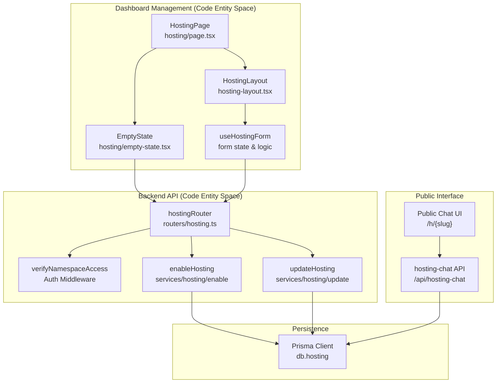
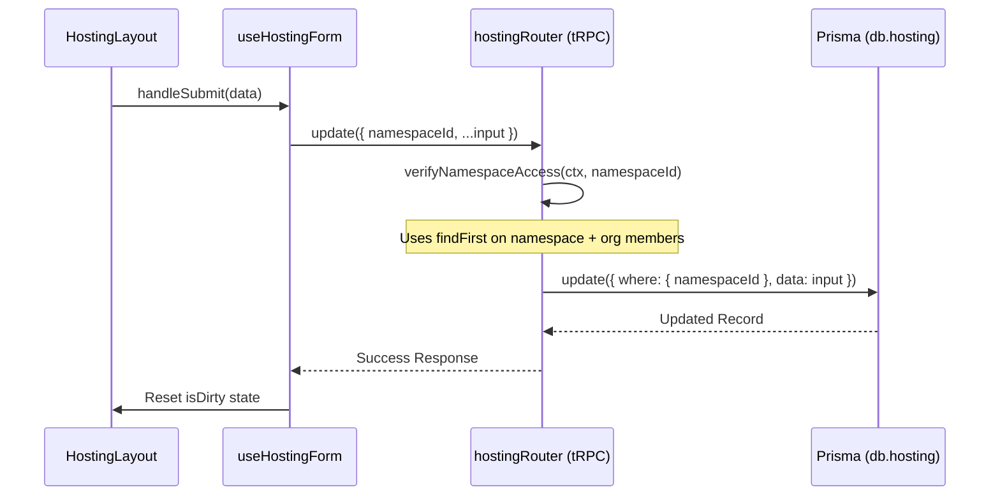

<!-- source: DeepWiki mcp.deepwiki.com · repo agentset-ai/agentset · page 5 Hosting System · fetched 2026-10-26 -->

# Hosting System

Relevant source files

The following files were used as context for generating this wiki page:

- [apps/web/src/app/app.agentset.ai/(dashboard)/[slug]/[namespaceSlug]/hosting/components/deployment-status-bar.tsx](apps/web/src/app/app.agentset.ai/(dashboard)/[slug]/[namespaceSlug]/hosting/components/deployment-status-bar.tsx)
- [apps/web/src/app/app.agentset.ai/(dashboard)/[slug]/[namespaceSlug]/hosting/components/hosting-layout.tsx](apps/web/src/app/app.agentset.ai/(dashboard)/[slug]/[namespaceSlug]/hosting/components/hosting-layout.tsx)
- [apps/web/src/app/app.agentset.ai/(dashboard)/[slug]/[namespaceSlug]/hosting/components/hosting-preview.tsx](apps/web/src/app/app.agentset.ai/(dashboard)/[slug]/[namespaceSlug]/hosting/components/hosting-preview.tsx)
- [apps/web/src/app/app.agentset.ai/(dashboard)/[slug]/[namespaceSlug]/hosting/components/hosting-tabs.tsx](apps/web/src/app/app.agentset.ai/(dashboard)/[slug]/[namespaceSlug]/hosting/components/hosting-tabs.tsx)
- [apps/web/src/app/app.agentset.ai/(dashboard)/[slug]/[namespaceSlug]/hosting/components/preview-action-buttons.tsx](apps/web/src/app/app.agentset.ai/(dashboard)/[slug]/[namespaceSlug]/hosting/components/preview-action-buttons.tsx)
- [apps/web/src/app/app.agentset.ai/(dashboard)/[slug]/[namespaceSlug]/hosting/components/sticky-action-bar.tsx](apps/web/src/app/app.agentset.ai/(dashboard)/[slug]/[namespaceSlug]/hosting/components/sticky-action-bar.tsx)
- [apps/web/src/app/app.agentset.ai/(dashboard)/[slug]/[namespaceSlug]/hosting/components/tabs/general-tab.tsx](apps/web/src/app/app.agentset.ai/(dashboard)/[slug]/[namespaceSlug]/hosting/components/tabs/general-tab.tsx)
- [apps/web/src/app/app.agentset.ai/(dashboard)/[slug]/[namespaceSlug]/hosting/components/tabs/opengraph-tab.tsx](apps/web/src/app/app.agentset.ai/(dashboard)/[slug]/[namespaceSlug]/hosting/components/tabs/opengraph-tab.tsx)
- [apps/web/src/app/app.agentset.ai/(dashboard)/[slug]/[namespaceSlug]/hosting/domain-card/dns-record.tsx](apps/web/src/app/app.agentset.ai/(dashboard)/[slug]/[namespaceSlug]/hosting/domain-card/dns-record.tsx)
- [apps/web/src/app/app.agentset.ai/(dashboard)/[slug]/[namespaceSlug]/hosting/domain-card/index.tsx](apps/web/src/app/app.agentset.ai/(dashboard)/[slug]/[namespaceSlug]/hosting/domain-card/index.tsx)
- [apps/web/src/app/app.agentset.ai/(dashboard)/[slug]/[namespaceSlug]/hosting/empty-state.tsx](apps/web/src/app/app.agentset.ai/(dashboard)/[slug]/[namespaceSlug]/hosting/empty-state.tsx)
- [apps/web/src/app/app.agentset.ai/(dashboard)/[slug]/[namespaceSlug]/hosting/page.client.tsx](apps/web/src/app/app.agentset.ai/(dashboard)/[slug]/[namespaceSlug]/hosting/page.client.tsx)
- [apps/web/src/app/app.agentset.ai/(dashboard)/[slug]/[namespaceSlug]/hosting/page.tsx](apps/web/src/app/app.agentset.ai/(dashboard)/[slug]/[namespaceSlug]/hosting/page.tsx)
- [apps/web/src/components/list-input.tsx](apps/web/src/components/list-input.tsx)
- [apps/web/src/components/search-chunk.tsx](apps/web/src/components/search-chunk.tsx)
- [apps/web/src/components/sortable-list.tsx](apps/web/src/components/sortable-list.tsx)
- [apps/web/src/server/api/routers/hosting.ts](apps/web/src/server/api/routers/hosting.ts)

## Purpose and Scope

The Hosting System enables namespaces to be deployed as standalone, customer-facing chat interfaces. When hosting is enabled for a namespace, Agentset generates a public URL where end users can interact with the AI assistant without accessing the main dashboard. This allows organizations to embed AI capabilities into their own workflows or share knowledge bases with external users via custom branding and domains.

For details on specific configuration fields like system prompts and LLM settings, see [Hosting Configuration](#5.1). For details on the UI architecture and preview system, see [Hosting UI Components](#5.2). For details on setting up custom DNS records, see [Domain Management](#5.3).

**Sources:** [apps/web/src/app/app.agentset.ai/(dashboard)/[slug]/[namespaceSlug]/hosting/empty-state.tsx:51-65](), [apps/web/src/app/app.agentset.ai/(dashboard)/[slug]/[namespaceSlug]/hosting/components/hosting-layout.tsx:17-84]()

## System Architecture

The hosting system creates a public interface layer on top of existing namespace resources. The dashboard provides a management interface that interacts with the `hostingRouter` to persist configurations.

### Hosting System Components

**Sources:** [apps/web/src/server/api/routers/hosting.ts:37-70](), [apps/web/src/app/app.agentset.ai/(dashboard)/[slug]/[namespaceSlug]/hosting/page.client.tsx:12-30](), [apps/web/src/app/app.agentset.ai/(dashboard)/[slug]/[namespaceSlug]/hosting/components/hosting-layout.tsx:17-52]()

## Lifecycle and State Management

### Enabling Hosting
If a namespace does not have hosting active, the `HostingPageClient` renders an `EmptyState` component [apps/web/src/app/app.agentset.ai/(dashboard)/[slug]/[namespaceSlug]/hosting/page.client.tsx:25-27](). Clicking "Enable" triggers the `hosting.enable` mutation [apps/web/src/app/app.agentset.ai/(dashboard)/[slug]/[namespaceSlug]/hosting/empty-state.tsx:44-48](), which creates a record in the database and updates the local cache.

### Configuration and Preview
Once enabled, the `HostingLayout` manages a multi-tab configuration form [apps/web/src/app/app.agentset.ai/(dashboard)/[slug]/[namespaceSlug]/hosting/components/hosting-tabs.tsx:28-49](). It features a split-pane view on desktop:
- **Left Pane:** Configuration tabs (Branding, AI Behavior, Security, etc.) [apps/web/src/app/app.agentset.ai/(dashboard)/[slug]/[namespaceSlug]/hosting/components/hosting-layout.tsx:55-59]().
- **Right Pane:** A real-time `HostingPreview` that reflects form state before saving [apps/web/src/app/app.agentset.ai/(dashboard)/[slug]/[namespaceSlug]/hosting/components/hosting-layout.tsx:62-76]().

### Unsaved Changes Protection
The system tracks the `isDirty` state of the form. If a user attempts to close the window with unsaved changes, a `beforeunload` listener triggers a confirmation browser dialog [apps/web/src/app/app.agentset.ai/(dashboard)/[slug]/[namespaceSlug]/hosting/components/hosting-layout.tsx:22-37]().

**Sources:** [apps/web/src/app/app.agentset.ai/(dashboard)/[slug]/[namespaceSlug]/hosting/components/hosting-layout.tsx:18-37](), [apps/web/src/app/app.agentset.ai/(dashboard)/[slug]/[namespaceSlug]/hosting/components/preview-action-buttons.tsx:12-41]()

## Key Feature Areas

### Branding and UI
Users can customize the visual identity of the chat interface, including the title, logo, and welcome messages. The system also supports Open Graph metadata configuration for social sharing [apps/web/src/app/app.agentset.ai/(dashboard)/[slug]/[namespaceSlug]/hosting/components/tabs/opengraph-tab.tsx:1-10]().
For details, see [Hosting UI Components](#5.2).

### AI Behavior and Security
The hosting configuration allows overriding the default system prompt, selecting specific LLM models, and defining example questions using a `SortableList` component [apps/web/src/components/sortable-list.tsx:40-50](). Security settings allow for password protection or email domain whitelisting.
For details, see [Hosting Configuration](#5.1).

### Domain and Connectivity
By default, deployments are hosted on a system subdomain (e.g., `app.agentset.ai/h/{slug}`). Organizations can connect custom apex domains or subdomains. The `useDomainStatus` hook polls the backend to verify DNS records like CNAME and A records [apps/web/src/app/app.agentset.ai/(dashboard)/[slug]/[namespaceSlug]/hosting/domain-card/index.tsx:28-47]().
For details, see [Domain Management](#5.3).

## Data Integration Flow

The following diagram illustrates how the frontend form data flows through the tRPC router into the Prisma database.

**Sources:** [apps/web/src/server/api/routers/hosting.ts:13-34](), [apps/web/src/server/api/routers/hosting.ts:51-60](), [apps/web/src/app/app.agentset.ai/(dashboard)/[slug]/[namespaceSlug]/hosting/components/hosting-layout.tsx:18-19]()

## Deployment Status
The `DeploymentStatusBar` provides immediate feedback on the live status of the deployment, offering a "Copy URL" utility and a "Visit" link to the public interface [apps/web/src/app/app.agentset.ai/(dashboard)/[slug]/[namespaceSlug]/hosting/components/deployment-status-bar.tsx:10-59]().

**Sources:** [apps/web/src/app/app.agentset.ai/(dashboard)/[slug]/[namespaceSlug]/hosting/components/deployment-status-bar.tsx:1-59]()

---

