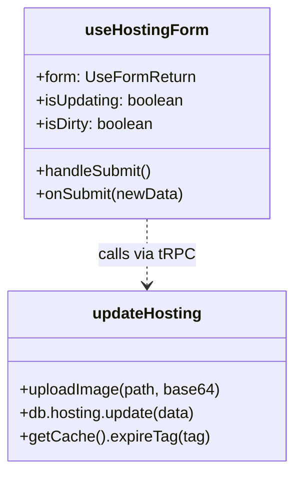

<!-- source: DeepWiki mcp.deepwiki.com · repo agentset-ai/agentset · page 5.1 Hosting Configuration · fetched 2026-10-26 -->

# Hosting Configuration

<details>
<summary>Relevant source files</summary>

The following files were used as context for generating this wiki page:

- [apps/web/src/app/api/(public-api)/v1/namespace/[namespaceId]/hosting/route.ts](apps/web/src/app/api/(public-api)/v1/namespace/[namespaceId]/hosting/route.ts)
- [apps/web/src/app/app.agentset.ai/(dashboard)/[slug]/[namespaceSlug]/hosting/components/social-share-card.tsx](apps/web/src/app/app.agentset.ai/(dashboard)/[slug]/[namespaceSlug]/hosting/components/social-share-card.tsx)
- [apps/web/src/app/app.agentset.ai/(dashboard)/[slug]/[namespaceSlug]/hosting/components/tabs/ai-engine-tab.tsx](apps/web/src/app/app.agentset.ai/(dashboard)/[slug]/[namespaceSlug]/hosting/components/tabs/ai-engine-tab.tsx)
- [apps/web/src/app/app.agentset.ai/(dashboard)/[slug]/[namespaceSlug]/hosting/components/tabs/connectivity-tab.tsx](apps/web/src/app/app.agentset.ai/(dashboard)/[slug]/[namespaceSlug]/hosting/components/tabs/connectivity-tab.tsx)
- [apps/web/src/app/app.agentset.ai/(dashboard)/[slug]/[namespaceSlug]/hosting/components/tabs/security-tab.tsx](apps/web/src/app/app.agentset.ai/(dashboard)/[slug]/[namespaceSlug]/hosting/components/tabs/security-tab.tsx)
- [apps/web/src/app/app.agentset.ai/(dashboard)/[slug]/[namespaceSlug]/hosting/domain-card/dns-record.tsx](apps/web/src/app/app.agentset.ai/(dashboard)/[slug]/[namespaceSlug]/hosting/domain-card/dns-record.tsx)
- [apps/web/src/app/app.agentset.ai/(dashboard)/[slug]/[namespaceSlug]/hosting/empty-state.tsx](apps/web/src/app/app.agentset.ai/(dashboard)/[slug]/[namespaceSlug]/hosting/empty-state.tsx)
- [apps/web/src/app/app.agentset.ai/(dashboard)/[slug]/[namespaceSlug]/hosting/page.client.tsx](apps/web/src/app/app.agentset.ai/(dashboard)/[slug]/[namespaceSlug]/hosting/page.client.tsx)
- [apps/web/src/app/app.agentset.ai/(dashboard)/[slug]/[namespaceSlug]/hosting/use-hosting-form.ts](apps/web/src/app/app.agentset.ai/(dashboard)/[slug]/[namespaceSlug]/hosting/use-hosting-form.ts)
- [apps/web/src/components/list-input.tsx](apps/web/src/components/list-input.tsx)
- [apps/web/src/components/search-chunk.tsx](apps/web/src/components/search-chunk.tsx)
- [apps/web/src/components/sortable-list.tsx](apps/web/src/components/sortable-list.tsx)
- [apps/web/src/schemas/api/hosting.ts](apps/web/src/schemas/api/hosting.ts)
- [apps/web/src/server/api/routers/hosting.ts](apps/web/src/server/api/routers/hosting.ts)
- [apps/web/src/server/api/trpc.ts](apps/web/src/server/api/trpc.ts)
- [apps/web/src/services/hosting/delete.ts](apps/web/src/services/hosting/delete.ts)
- [apps/web/src/services/hosting/enable.ts](apps/web/src/services/hosting/enable.ts)
- [apps/web/src/services/hosting/get.ts](apps/web/src/services/hosting/get.ts)
- [apps/web/src/services/hosting/update.ts](apps/web/src/services/hosting/update.ts)

</details>


This page documents the hosting configuration model and the user interface used to manage it. The hosting system allows a namespace to be deployed as a public-facing chat interface with custom branding, specific LLM/reranking parameters, and Open Graph metadata.

## Overview

The hosting configuration is managed through a multi-tab interface in the dashboard. It allows users to enable hosting for a namespace, which creates a `Hosting` record in the database. This record defines how the AI assistant behaves and appears on its public URL or custom domain.

The data flow for managing hosting configuration is as follows:

```mermaid
graph TD
    subgraph "Frontend (Next.js)"
        [HostingPageClient] -- "useQuery" --> [trpc.hosting.get]
        [HostingLayout] -- "useHostingForm" --> [HostingFormValues]
        [AIEngineTab] -- "Form Fields" --> [useHostingForm]
    end

    subgraph "Backend (tRPC Router)"
        [trpc.hosting.get] -- "calls" --> [getHosting]
        [trpc.hosting.update] -- "calls" --> [updateHosting]
    end

    subgraph "Services & DB"
        [getHosting] -- "SELECT" --> [db.hosting]
        [updateHosting] -- "UPDATE" --> [db.hosting]
        [updateHosting] -- "Uploads" --> [S3_Storage]
    end

    [HostingFormValues] -- "Mutation" --> [trpc.hosting.update]
```

**Sources:** [apps/web/src/app/app.agentset.ai/(dashboard)/[slug]/[namespaceSlug]/hosting/page.client.tsx:12-30](), [apps/web/src/server/api/routers/hosting.ts:37-70](), [apps/web/src/services/hosting/update.ts:13-19]()

## Configuration Data Model

The hosting configuration is governed by `HostingSchema`, which defines the structure of the hosted assistant's metadata and engine settings.

### Schema Fields

| Category | Field | Type | Description |
| :--- | :--- | :--- | :--- |
| **Branding** | `title` | `string` | The title displayed on the hosted interface. |
| | `slug` | `string` | Unique URL segment for the hosted page. |
| | `logo` | `url` | Custom logo image URL. |
| **AI Engine** | `systemPrompt` | `string` | Instructions defining the assistant's behavior. |
| | `llmConfig` | `JSON` | LLM model selection (e.g., GPT-4o). |
| | `rerankConfig` | `JSON` | Reranker model and document limit settings. |
| | `topK` | `number` | Number of documents retrieved from vector store. |
| **UI/UX** | `welcomeMessage` | `string` | Initial message shown to users. |
| | `exampleQuestions`| `string[]`| Suggested questions for the chat interface. |
| | `exampleSearchQueries`| `string[]`| Suggested queries for the search interface. |
| **Metadata** | `ogTitle` | `string` | Open Graph title for social sharing. |
| | `ogDescription` | `string` | Open Graph description for social sharing. |
| | `ogImage` | `url` | Open Graph image URL. |
| **Security** | `protected` | `boolean` | Whether authentication is required to access. |

**Sources:** [apps/web/src/schemas/api/hosting.ts:11-123]()

## AI and Retrieval Configuration

The `AIEngineTab` component provides the interface for fine-tuning the RAG pipeline for the hosted assistant.

### LLM and System Prompt
Users can select the specific LLM model used for generation. The `systemPrompt` is compiled and sent with every chat request to define the "personality" and constraints of the assistant.

### Retrieval and Reranking
The configuration allows control over the retrieval depth and precision:
*   **Top K**: The number of initial document chunks retrieved from the vector store (default 50). [apps/web/src/schemas/api/hosting.ts:101-102]()
*   **Reranker Model**: The model used to re-score retrieved chunks for relevance. [apps/web/src/app/app.agentset.ai/(dashboard)/[slug]/[namespaceSlug]/hosting/components/tabs/ai-engine-tab.tsx:99-115]()
*   **Rerank Limit**: The final number of chunks passed to the LLM after reranking (default 15). [apps/web/src/schemas/api/hosting.ts:83-84]()

### Citation Path
The `citationMetadataPath` allows users to specify which field in their document metadata should be used as the display name for citations (e.g., `title` or `source_url`). [apps/web/src/app/app.agentset.ai/(dashboard)/[slug]/[namespaceSlug]/hosting/components/tabs/ai-engine-tab.tsx:165-181]()

**Sources:** [apps/web/src/app/app.agentset.ai/(dashboard)/[slug]/[namespaceSlug]/hosting/components/tabs/ai-engine-tab.tsx:29-186](), [apps/web/src/schemas/api/hosting.ts:75-102]()

## Implementation Details

### Form Management
The configuration uses `react-hook-form` with a Zod resolver. The `useHostingForm` hook handles the complex logic of tracking dirty states, performing mutations via tRPC, and managing image uploads for logos and OG images.



### Image Uploads
When a user updates the logo or OG image, the `updateHosting` service detects if the input is a base64 string. If so, it uses `uploadImage` from `@agentset/storage` to persist the asset to S3 before updating the database record with the new URL. It also cleans up old assets using `deleteAsset`.

**Sources:** [apps/web/src/app/app.agentset.ai/(dashboard)/[slug]/[namespaceSlug]/hosting/use-hosting-form.ts:44-152](), [apps/web/src/services/hosting/update.ts:38-54](), [apps/web/src/services/hosting/update.ts:103-112]()

### API Access
Hosting configuration can also be managed via the Public REST API. The endpoints support standard CRUD operations and use the `withNamespaceApiHandler` middleware to ensure the API key has access to the requested namespace.

*   `GET /v1/namespace/[namespaceId]/hosting`: Retrieve current config.
*   `POST /v1/namespace/[namespaceId]/hosting`: Enable hosting.
*   `PATCH /v1/namespace/[namespaceId]/hosting`: Update configuration.
*   `DELETE /v1/namespace/[namespaceId]/hosting`: Disable hosting.

**Sources:** [apps/web/src/app/api/(public-api)/v1/namespace/[namespaceId]/hosting/route.ts:13-98]()

## Components Summary

*   **HostingLayout**: The main container that manages the sidebar tabs and the "Save Changes" footer logic.
*   **EmptyState**: Shown when hosting is not yet enabled for a namespace. It triggers the `enable` mutation. [apps/web/src/app/app.agentset.ai/(dashboard)/[slug]/[namespaceSlug]/hosting/empty-state.tsx:19-101]()
*   **SortableList**: A utility component using `@dnd-kit` to allow users to reorder example questions and search queries. [apps/web/src/components/sortable-list.tsx:40-171]()
*   **SocialShareCard**: A preview component that shows how the assistant will look when shared on social media using the configured OG metadata.

**Sources:** [apps/web/src/app/app.agentset.ai/(dashboard)/[slug]/[namespaceSlug]/hosting/page.client.tsx:25-29](), [apps/web/src/components/sortable-list.tsx:40-50]()

---

