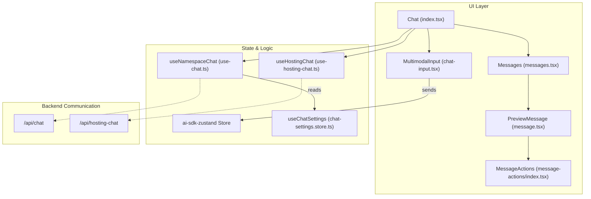
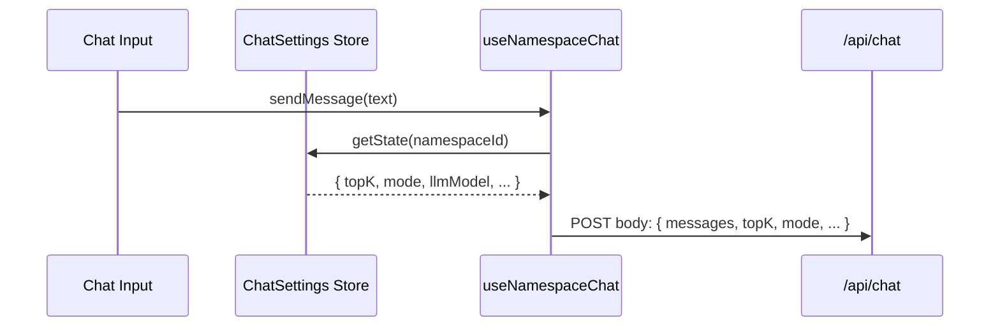

<!-- source: DeepWiki mcp.deepwiki.com · repo agentset-ai/agentset · page 6.4 Chat UI Components · fetched 2026-10-26 -->

# Chat UI Components

Relevant source files

The following files were used as context for generating this wiki page:

- [apps/web/src/app/[hostingId]/(defaultLayout)/header.tsx](apps/web/src/app/[hostingId]/(defaultLayout)/header.tsx)
- [apps/web/src/app/[hostingId]/(defaultLayout)/search/page.tsx](apps/web/src/app/[hostingId]/(defaultLayout)/search/page.tsx)
- [apps/web/src/app/app.agentset.ai/(dashboard)/[slug]/[namespaceSlug]/playground/chat-settings.tsx](apps/web/src/app/app.agentset.ai/(dashboard)/[slug]/[namespaceSlug]/playground/chat-settings.tsx)
- [apps/web/src/components/chat/chat-input-modes.tsx](apps/web/src/components/chat/chat-input-modes.tsx)
- [apps/web/src/components/chat/chat-input.tsx](apps/web/src/components/chat/chat-input.tsx)
- [apps/web/src/components/chat/chat-model.tsx](apps/web/src/components/chat/chat-model.tsx)
- [apps/web/src/components/chat/chat-settings.store.ts](apps/web/src/components/chat/chat-settings.store.ts)
- [apps/web/src/components/chat/citation-button.tsx](apps/web/src/components/chat/citation-button.tsx)
- [apps/web/src/components/chat/citation-modal.tsx](apps/web/src/components/chat/citation-modal.tsx)
- [apps/web/src/components/chat/index.tsx](apps/web/src/components/chat/index.tsx)
- [apps/web/src/components/chat/markdown.tsx](apps/web/src/components/chat/markdown.tsx)
- [apps/web/src/components/chat/message-actions/export-utils.ts](apps/web/src/components/chat/message-actions/export-utils.ts)
- [apps/web/src/components/chat/message-actions/export.tsx](apps/web/src/components/chat/message-actions/export.tsx)
- [apps/web/src/components/chat/message-actions/index.tsx](apps/web/src/components/chat/message-actions/index.tsx)
- [apps/web/src/components/chat/message-actions/logs.tsx](apps/web/src/components/chat/message-actions/logs.tsx)
- [apps/web/src/components/chat/message-editor.tsx](apps/web/src/components/chat/message-editor.tsx)
- [apps/web/src/components/chat/message-reasoning.tsx](apps/web/src/components/chat/message-reasoning.tsx)
- [apps/web/src/components/chat/message.tsx](apps/web/src/components/chat/message.tsx)
- [apps/web/src/components/chat/messages.tsx](apps/web/src/components/chat/messages.tsx)
- [apps/web/src/components/chat/overview.tsx](apps/web/src/components/chat/overview.tsx)
- [apps/web/src/components/chat/remark-citations.ts](apps/web/src/components/chat/remark-citations.ts)
- [apps/web/src/components/chat/suggested-actions.tsx](apps/web/src/components/chat/suggested-actions.tsx)
- [apps/web/src/components/chat/use-chat.ts](apps/web/src/components/chat/use-chat.ts)
- [apps/web/src/components/chat/use-hosting-chat.ts](apps/web/src/components/chat/use-hosting-chat.ts)
- [apps/web/src/components/llm-selector.tsx](apps/web/src/components/llm-selector.tsx)
- [apps/web/src/components/reranker-selector.tsx](apps/web/src/components/reranker-selector.tsx)
- [packages/ui/src/components/ai-elements/conversation.tsx](packages/ui/src/components/ai-elements/conversation.tsx)
- [packages/ui/src/components/ai-elements/model-selector.tsx](packages/ui/src/components/ai-elements/model-selector.tsx)
- [packages/ui/src/components/ai-elements/reasoning.tsx](packages/ui/src/components/ai-elements/reasoning.tsx)
- [packages/utils/src/string.ts](packages/utils/src/string.ts)

The Chat UI in AgentSet is a shared library of components used across both the internal Namespace Playground and the public-facing Hosted Chat interfaces. It leverages `ai-sdk-zustand` for state management and provides a rich set of features including markdown rendering with citations, message editing, and detailed execution logs.

## Core Architecture and Data Flow

The chat system is split into two primary entry points: `PlaygroundChat` and `HostingChat`, both encapsulated within the main `Chat` component [apps/web/src/components/chat/index.tsx:17-23](). While they share the same rendering logic for messages, they differ in how they initialize their respective chat hooks (`useNamespaceChat` vs `useHostingChat`) and how they handle initial states like "empty" views.

### Chat Implementation Diagram

This diagram illustrates the relationship between the UI components and the underlying state management/hooks.

**Sources:** [apps/web/src/components/chat/index.tsx:17-74](), [apps/web/src/components/chat/use-chat.ts:9-42](), [apps/web/src/components/chat/chat-settings.store.ts:59-114]()

---

## Message Rendering and Markdown

Messages are rendered via `PreviewMessage`, which handles both `user` and `assistant` roles [apps/web/src/components/chat/message.tsx:18-24]().

### Markdown with Citations
The `Markdown` component uses a custom `remarkCitations` plugin to detect citation patterns in the LLM response [apps/web/src/components/chat/markdown.tsx:15-16]().
- **Citations:** When a citation is detected, it renders a `CitationButton` [apps/web/src/components/chat/markdown.tsx:29-31]().
- **Citation Modal:** Clicking a citation opens the `CitationModal`, which displays the raw source text and a JSON view of the source metadata [apps/web/src/components/chat/citation-modal.tsx:58-131]().
- **Hosting Customization:** In hosted mode, citations can be mapped to specific metadata fields (e.g., a "filename" or "url") using `hosting.citationMetadataPath` [apps/web/src/components/chat/citation-modal.tsx:32-53]().

### Reasoning and Status
For agentic workflows, the UI supports:
- **MessageReasoning:** Displays the "thinking" process of the model [apps/web/src/components/chat/message.tsx:58-66]().
- **MessageStatus:** Shows the current state of the assistant's processing (e.g., searching, reranking) [apps/web/src/components/chat/message.tsx:49]().

**Sources:** [apps/web/src/components/chat/message.tsx:53-107](), [apps/web/src/components/chat/markdown.tsx:17-37](), [apps/web/src/components/chat/citation-modal.tsx:22-56]()

---

## Message Actions and Tools

Every assistant message includes a set of actions for interacting with the response.

| Action | Component / Function | Description |
| :--- | :--- | :--- |
| **Copy** | `handleCopy` | Extracts text from message parts and copies to clipboard [apps/web/src/components/chat/message-actions/index.tsx:31-41](). |
| **Regenerate** | `handleRegenerate` | Triggers the `regenerate` function from the chat store [apps/web/src/components/chat/message-actions/index.tsx:43-45](). |
| **Export** | `ExportAction` | Allows exporting the conversation [apps/web/src/components/chat/message-actions/index.tsx:61](). |
| **Logs** | `MessageLogs` | (Playground only) Shows internal execution logs, retrieved from the message metadata [apps/web/src/components/chat/message-actions/index.tsx:63-72](). |
| **Edit** | `MessageEditor` | Users can edit their own messages, which updates the chat history and triggers a re-submission [apps/web/src/components/chat/message.tsx:73-80](). |

**Sources:** [apps/web/src/components/chat/message-actions/index.tsx:18-84](), [apps/web/src/components/chat/message.tsx:97-104]()

---

## Chat Settings Store

The `useChatSettings` store manages the configuration for the chat playground. It is a persisted Zustand store that tracks settings per `namespaceId` [apps/web/src/components/chat/chat-settings.store.ts:59-60]().

### Configuration Schema
The `NamespaceState` interface defines the tunable parameters:
- `topK`: Number of initial vector matches to retrieve [apps/web/src/components/chat/chat-settings.store.ts:13]().
- `rerankLimit`: Number of results to keep after reranking [apps/web/src/components/chat/chat-settings.store.ts:14]().
- `mode`: Processing mode (`normal`, `agentic`, or `deepResearch`) [apps/web/src/components/chat/chat-settings.store.ts:17]().
- `llmModel` & `rerankModel`: Selected model identifiers [apps/web/src/components/chat/chat-settings.store.ts:18-19]().

### Request Integration
When a message is sent via `useNamespaceChat`, the hook pulls the current state from `useChatSettings.getState()` and injects these parameters into the request body sent to `/api/chat` [apps/web/src/components/chat/use-chat.ts:15-35]().

**Sources:** [apps/web/src/components/chat/chat-settings.store.ts:12-41](), [apps/web/src/components/chat/use-chat.ts:12-36]()

---

## Interactive Components

### Multimodal Input
The `MultimodalInput` (memoized as `PureMultimodalInput`) serves as the primary interface for user interaction. It handles:
- **Submission:** Dispatches the message to the chat store and logs a `chat_message_sent` event [apps/web/src/components/chat/chat-input.tsx:33-61]().
- **Streaming Control:** If the status is `streaming`, the submit button changes to a "stop" action that halts the LLM generation [apps/web/src/components/chat/chat-input.tsx:35-39]().
- **Tools:** In playground mode, it renders `ChatInputModes` and `ChatModel` selectors within the input footer [apps/web/src/components/chat/chat-input.tsx:75-79]().

### Suggested Actions
When a chat is empty, `SuggestedActions` renders clickable buttons based on the namespace's demo template or the hosting configuration [apps/web/src/components/chat/suggested-actions.tsx:12-54](). Clicking an action automatically sends the associated text as the first message [apps/web/src/components/chat/suggested-actions.tsx:35-43]().

**Sources:** [apps/web/src/components/chat/chat-input.tsx:23-94](), [apps/web/src/components/chat/suggested-actions.tsx:12-56](), [apps/web/src/components/chat/index.tsx:45-47]()

---

