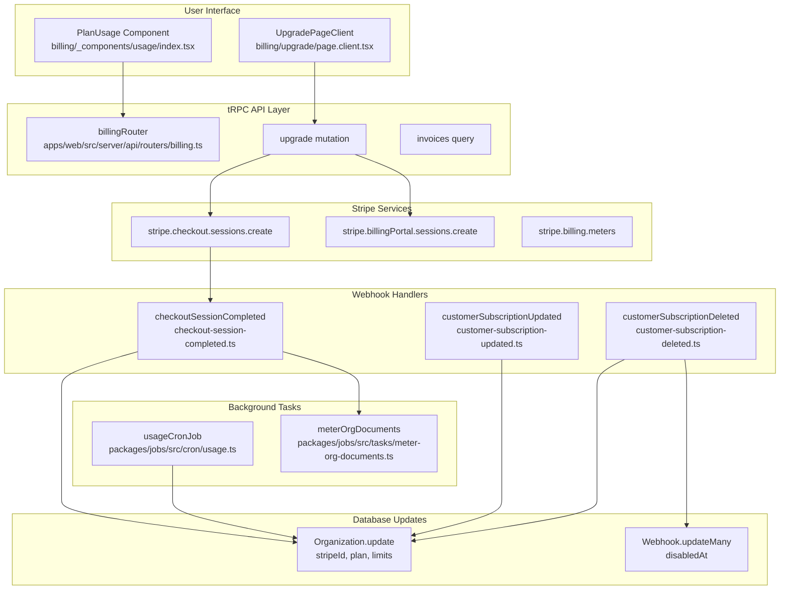
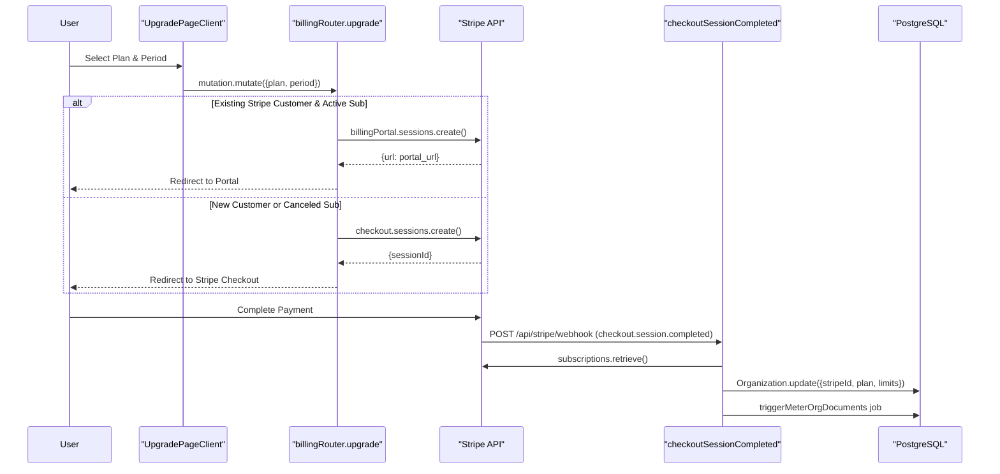

<!-- source: DeepWiki mcp.deepwiki.com · repo agentset-ai/agentset · page 7.2 Billing and Subscriptions · fetched 2026-10-26 -->

# Billing and Subscriptions

Relevant source files

The following files were used as context for generating this wiki page:

- [apps/web/src/app/api/(internal-api)/stripe/webhook/checkout-session-completed.ts](apps/web/src/app/api/(internal-api)/stripe/webhook/checkout-session-completed.ts)
- [apps/web/src/app/api/(internal-api)/stripe/webhook/customer-subscription-deleted.ts](apps/web/src/app/api/(internal-api)/stripe/webhook/customer-subscription-deleted.ts)
- [apps/web/src/app/api/(internal-api)/stripe/webhook/customer-subscription-updated.ts](apps/web/src/app/api/(internal-api)/stripe/webhook/customer-subscription-updated.ts)
- [apps/web/src/app/api/(internal-api)/stripe/webhook/invoice-payment-succeeded.ts](apps/web/src/app/api/(internal-api)/stripe/webhook/invoice-payment-succeeded.ts)
- [apps/web/src/app/api/(internal-api)/stripe/webhook/route.ts](apps/web/src/app/api/(internal-api)/stripe/webhook/route.ts)
- [apps/web/src/app/api/(internal-api)/stripe/webhook/utils.ts](apps/web/src/app/api/(internal-api)/stripe/webhook/utils.ts)
- [apps/web/src/app/app.agentset.ai/(dashboard)/[slug]/billing/_components/usage/index.tsx](apps/web/src/app/app.agentset.ai/(dashboard)/[slug]/billing/_components/usage/index.tsx)
- [apps/web/src/app/app.agentset.ai/(dashboard)/[slug]/billing/invoices/page.tsx](apps/web/src/app/app.agentset.ai/(dashboard)/[slug]/billing/invoices/page.tsx)
- [apps/web/src/app/app.agentset.ai/(dashboard)/[slug]/billing/upgrade/page.client.tsx](apps/web/src/app/app.agentset.ai/(dashboard)/[slug]/billing/upgrade/page.client.tsx)
- [apps/web/src/app/app.agentset.ai/(dashboard)/[slug]/billing/upgrade/page.tsx](apps/web/src/app/app.agentset.ai/(dashboard)/[slug]/billing/upgrade/page.tsx)
- [apps/web/src/hooks/use-organization.ts](apps/web/src/hooks/use-organization.ts)
- [apps/web/src/server/api/routers/billing.ts](apps/web/src/server/api/routers/billing.ts)
- [packages/jobs/src/cron/usage.ts](packages/jobs/src/cron/usage.ts)
- [packages/jobs/src/tasks/meter-org-documents.ts](packages/jobs/src/tasks/meter-org-documents.ts)
- [packages/stripe/src/functions.ts](packages/stripe/src/functions.ts)
- [packages/stripe/src/meters.ts](packages/stripe/src/meters.ts)
- [packages/stripe/src/plans.ts](packages/stripe/src/plans.ts)

This document describes the Stripe-based billing and subscription system in AgentSet. It covers subscription lifecycle management, plan tiers and limits, webhook event processing, usage metering, and the billing API.

For authentication and user management, see [7.1 Authentication System](). For resource limit enforcement and authorization checks, see [7.3 Authorization and Resource Limits]().

---

## Overview

AgentSet implements a subscription-based billing model using Stripe. Billing is organization-scoped, meaning subscriptions and payment methods are attached to organizations rather than individual users. The system supports three plan tiers (FREE, PRO, ENTERPRISE) with different resource limits and features. Stripe webhooks drive subscription lifecycle events, updating organization records in PostgreSQL and triggering email notifications.

**Key Components:**
- **Stripe Integration**: `packages/stripe` provides Stripe client configuration and plan definitions in `plans.ts`.
- **Webhook Handlers**: Process Stripe events (`checkout.session.completed`, `customer.subscription.updated`, etc.) located in `apps/web/src/app/api/(internal-api)/stripe/webhook/`.
- **Billing Router**: tRPC endpoints for subscription management (`billingRouter` at [apps/web/src/server/api/routers/billing.ts]()).
- **Usage Metering**: Tracks ingested pages via Stripe Metering API for Pro plan billing.
- **Email Notifications**: Sends confirmation emails for subscription changes and feedback requests for cancellations.

Sources: [apps/web/src/server/api/routers/billing.ts:50-248](), [packages/stripe/src/plans.ts:16-81]()

---

## Subscription Architecture

The billing system follows a webhook-driven architecture. User actions in the UI trigger Stripe API calls via tRPC mutations, which create Checkout Sessions or redirect to the Billing Portal. Stripe processes payments asynchronously and sends webhook events back to AgentSet, where dedicated handlers update organization records and trigger notifications.

Sources: [apps/web/src/server/api/routers/billing.ts:140-225](), [apps/web/src/app/api/(internal-api)/stripe/webhook/checkout-session-completed.ts:20-143]()

---

## Plan Tiers and Limits

AgentSet offers three subscription tiers defined in `packages/stripe/src/plans.ts`:

| Feature | FREE | PRO | ENTERPRISE |
|---------|------|-----|------------|
| **Pages Limit** | 1,000 | 10,000 | Unlimited |
| **Retrievals** | 10,000 /mo | Unlimited | Unlimited |
| **API Rate Limit** | 60 req/min | 600 req/min | Custom |
| **Webhooks** | ❌ | ✅ | ✅ |
| **Additional Pages** | ❌ | $0.01 /page | Custom |
| **Billing Model** | Free | Flat rate + Metered | Custom |

**Plan Implementation:**

Plans are defined in `PLANS` [packages/stripe/src/plans.ts:16-81](). The `PRO_PLAN_METERED` [packages/stripe/src/plans.ts:100-116]() handles usage-based billing for ingested pages beyond the base quota.

When a subscription is created or updated, the webhook handler calls `updateOrganizationPlan` which uses `planToOrganizationFields` to map plan definitions to database fields [apps/web/src/app/api/(internal-api)/stripe/webhook/utils.ts:78-158]().

Sources: [packages/stripe/src/plans.ts:16-116](), [apps/web/src/app/api/(internal-api)/stripe/webhook/utils.ts:78-158]()

---

## Stripe Checkout Flow

### Checkout Session Creation
The `upgrade` mutation [apps/web/src/server/api/routers/billing.ts:140-225]() handles:
1. **Subscription Updates**: If `stripeId` and an active subscription exist, it generates a Stripe Billing Portal URL for a `subscription_update` flow [apps/web/src/server/api/routers/billing.ts:167-179]().
2. **New Subscriptions**: Creates a Checkout Session. For the Pro plan, it adds the metered price ID as an additional line item [apps/web/src/server/api/routers/billing.ts:200-208]().

### Post-Checkout Processing
The `checkoutSessionCompleted` handler [apps/web/src/app/api/(internal-api)/stripe/webhook/checkout-session-completed.ts:20-143]():
- Retrieves the subscription to extract the `priceId`.
- Updates the `Organization` in the database with the `stripeId`, `billingCycleStart` (set to today's date), and plan data [apps/web/src/app/api/(internal-api)/stripe/webhook/checkout-session-completed.ts:82-108]().
- Sends an `UpgradeEmail` to organization members [apps/web/src/app/api/(internal-api)/stripe/webhook/checkout-session-completed.ts:113-131]().
- Triggers the `triggerMeterOrgDocuments` background job to sync existing page counts to Stripe [apps/web/src/app/api/(internal-api)/stripe/webhook/checkout-session-completed.ts:132-134]().

Sources: [apps/web/src/server/api/routers/billing.ts:140-225](), [apps/web/src/app/api/(internal-api)/stripe/webhook/checkout-session-completed.ts:20-143]()

---

## Webhook Event Handlers

### customer.subscription.updated
**Handler**: [apps/web/src/app/api/(internal-api)/stripe/webhook/customer-subscription-updated.ts:8-68]()
- Updates the organization's plan fields via `updateOrganizationPlan`.
- Detects if the subscription was set to cancel at the period end (`cancel_at_period_end`).
- If canceling, sends feedback request email via `sendCancellationFeedback` [apps/web/src/app/api/(internal-api)/stripe/webhook/customer-subscription-updated.ts:59-67]().

### customer.subscription.deleted
**Handler**: [apps/web/src/app/api/(internal-api)/stripe/webhook/customer-subscription-deleted.ts:16-111]()
- Checks if the customer has any other active subscriptions [apps/web/src/app/api/(internal-api)/stripe/webhook/customer-subscription-deleted.ts:60-75]().
- If none, downgrades the organization to the `FREE_PLAN` [apps/web/src/app/api/(internal-api)/stripe/webhook/customer-subscription-deleted.ts:80-89]().
- Disables all organization webhooks by setting `disabledAt` [apps/web/src/app/api/(internal-api)/stripe/webhook/customer-subscription-deleted.ts:91-98]().

### Shared Utilities (`utils.ts`)
- **`updateOrganizationPlan`**: Filters out metered items to find the base plan price, retrieves the plan definition, and updates the `Organization` record [apps/web/src/app/api/(internal-api)/stripe/webhook/utils.ts:78-158]().
- **`revalidateOrganizationCache`**: Uses `revalidateTag` to purge cached organization and API key data in Next.js [apps/web/src/app/api/(internal-api)/stripe/webhook/utils.ts:57-76]().

Sources: [apps/web/src/app/api/(internal-api)/stripe/webhook/customer-subscription-updated.ts:8-68](), [apps/web/src/app/api/(internal-api)/stripe/webhook/customer-subscription-deleted.ts:16-111](), [apps/web/src/app/api/(internal-api)/stripe/webhook/utils.ts:1-158]()

---

## Usage Metering and Tracking

AgentSet tracks usage (specifically ingested pages) and reports it to Stripe for the Pro plan.

### Reporting Usage to Stripe
- **`meterIngestedPages`**: Sends a single document's page count as a `meterEvent` to Stripe [packages/stripe/src/meters.ts:6-28](). It uses the document ID as an idempotency `identifier`.
- **`meterDocumentsPages`**: Batch reports multiple documents using `meterEventStream` [packages/stripe/src/meters.ts:35-66]().
- **`meterOrgDocuments` Task**: A Trigger.dev job that iterates through all documents in an organization and syncs their page counts to Stripe [packages/jobs/src/tasks/meter-org-documents.ts:18-148]().

### Usage Reset and Cron
The **`usageCronJob`** [packages/jobs/src/cron/usage.ts:8-122]() runs daily at noon UTC. It:
- Identifies organizations whose billing cycle resets today based on `billingCycleStart` [packages/jobs/src/cron/usage.ts:53-62]().
- Resets `searchUsage` to 0 for those organizations [packages/jobs/src/cron/usage.ts:68-79]().

### UI Tracking
The `PlanUsage` component [apps/web/src/app/app.agentset.ai/(dashboard)/[slug]/billing/_components/usage/index.tsx:27-118]() fetches tracked pages directly from Stripe via the `getTrackedPages` tRPC query [apps/web/src/server/api/routers/billing.ts:69-139](). This query lists `meterEventSummaries` for the current billing period to show "billed this cycle" in the UI [apps/web/src/server/api/routers/billing.ts:120-134]().

Sources: [packages/stripe/src/meters.ts:1-66](), [packages/jobs/src/tasks/meter-org-documents.ts:18-148](), [packages/jobs/src/cron/usage.ts:8-122](), [apps/web/src/server/api/routers/billing.ts:69-139]()

---

