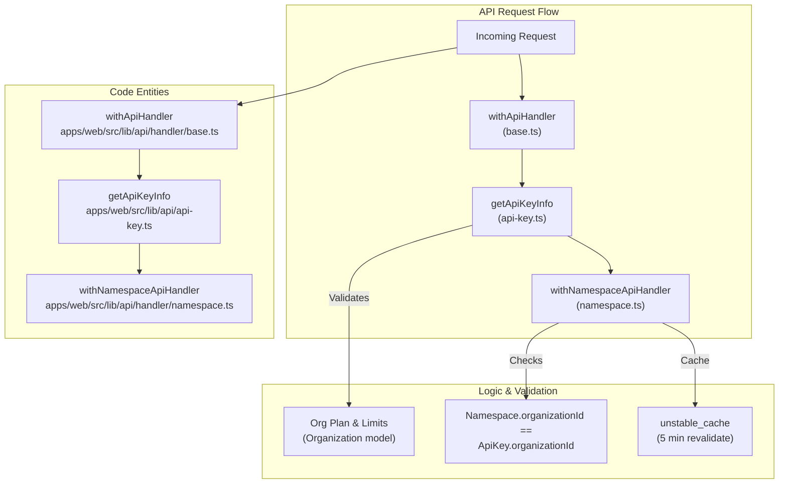
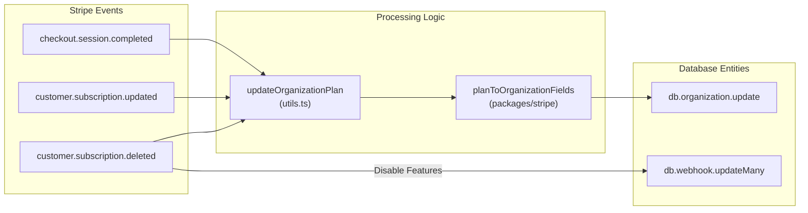

<!-- source: DeepWiki mcp.deepwiki.com · repo agentset-ai/agentset · page 7.3 Authorization and Resource Limits · fetched 2026-10-26 -->

# Authorization and Resource Limits

Relevant source files

The following files were used as context for generating this wiki page:

- [apps/web/src/app/api/(internal-api)/stripe/webhook/checkout-session-completed.ts](apps/web/src/app/api/(internal-api)/stripe/webhook/checkout-session-completed.ts)
- [apps/web/src/app/api/(internal-api)/stripe/webhook/customer-subscription-deleted.ts](apps/web/src/app/api/(internal-api)/stripe/webhook/customer-subscription-deleted.ts)
- [apps/web/src/app/api/(internal-api)/stripe/webhook/customer-subscription-updated.ts](apps/web/src/app/api/(internal-api)/stripe/webhook/customer-subscription-updated.ts)
- [apps/web/src/app/api/(internal-api)/stripe/webhook/utils.ts](apps/web/src/app/api/(internal-api)/stripe/webhook/utils.ts)
- [apps/web/src/app/api/(public-api)/v1/namespace/[namespaceId]/documents/[documentId]/route.ts](apps/web/src/app/api/(public-api)/v1/namespace/[namespaceId]/documents/[documentId]/route.ts)
- [apps/web/src/app/api/(public-api)/v1/namespace/[namespaceId]/documents/route.ts](apps/web/src/app/api/(public-api)/v1/namespace/[namespaceId]/documents/route.ts)
- [apps/web/src/app/api/(public-api)/v1/namespace/[namespaceId]/ingest-jobs/[jobId]/route.ts](apps/web/src/app/api/(public-api)/v1/namespace/[namespaceId]/ingest-jobs/[jobId]/route.ts)
- [apps/web/src/app/api/(public-api)/v1/namespace/[namespaceId]/route.ts](apps/web/src/app/api/(public-api)/v1/namespace/[namespaceId]/route.ts)
- [apps/web/src/app/api/(public-api)/v1/namespace/route.ts](apps/web/src/app/api/(public-api)/v1/namespace/route.ts)
- [apps/web/src/lib/api/api-key.ts](apps/web/src/lib/api/api-key.ts)
- [apps/web/src/lib/api/handler/base.ts](apps/web/src/lib/api/handler/base.ts)
- [apps/web/src/lib/api/handler/namespace.ts](apps/web/src/lib/api/handler/namespace.ts)
- [apps/web/src/services/pagination.ts](apps/web/src/services/pagination.ts)
- [packages/stripe/src/functions.ts](packages/stripe/src/functions.ts)
- [packages/stripe/src/plans.ts](packages/stripe/src/plans.ts)

This document describes the authorization system, resource limit enforcement, and billing integration in AgentSet. It covers the multi-tier authorization middleware used in both internal tRPC and public REST APIs, plan-based resource limits (pages, searches, API rate), and how Stripe webhooks synchronize subscription states with database limits.

---

## Authorization Middleware

AgentSet implements a robust authorization system that scales from internal dashboard actions to public API requests. The core logic resides in higher-order handlers that wrap route logic.

### Internal tRPC Middleware
For the dashboard, AgentSet uses tRPC middleware to verify sessions and organization membership.
*   **`protectedProcedure`**: Ensures a valid session exists via Better-Auth.
*   **`organizationMiddleware`**: Verifies the user is a member of the requested organization by checking the `Member` table [apps/web/src/server/api/routers/billing.ts:14-46]().

### Public API Handlers
For external integrations, AgentSet uses a specialized handler pattern that validates API keys and namespace access.

**Sources:**
- [apps/web/src/lib/api/handler/namespace.ts:50-103]()
- [apps/web/src/lib/api/api-key.ts:5-37]()
- [apps/web/src/lib/api/handler/base.ts:1-20]()

### Namespace Access Verification
The `withNamespaceApiHandler` is the primary guard for resource-specific routes. It performs a lookup on the `Namespace` table, ensuring the status is `ACTIVE` and it belongs to the authenticated organization [apps/web/src/lib/api/handler/namespace.ts:25-48]().

---

## Resource Limits by Plan

Resource limits are defined in `packages/stripe/src/plans.ts` and enforced via the `Organization` model fields.

### Plan Definitions
The system supports three tiers: **Free**, **Pro**, and **Enterprise**.

| Resource | Free Plan | Pro Plan | Enterprise |
| :--- | :--- | :--- | :--- |
| **Pages** | 1,000 | 10,000 | Unlimited |
| **Retrievals** | 10,000 | Unlimited | Unlimited |
| **API Rate Limit** | 60/min | 600/min | Custom |
| **Webhooks** | Disabled | Enabled | Enabled |

**Sources:**
- [packages/stripe/src/plans.ts:16-81]()
- [packages/stripe/src/plans.ts:83-98]()

### Database Enforcement Fields
The `Organization` model tracks both the hard limits and current usage:
*   `pagesLimit` vs `totalPages` [apps/web/src/lib/api/api-key.ts:22-23]()
*   `searchLimit` vs `searchUsage` [apps/web/src/lib/api/api-key.ts:20-21]()
*   `apiRatelimit` [apps/web/src/lib/api/api-key.ts:19]()

---

## Billing and Subscription Lifecycle

AgentSet uses Stripe webhooks to keep the local database in sync with the user's subscription state.

### Webhook Handling Flow

**Sources:**
- [apps/web/src/app/api/(internal-api)/stripe/webhook/utils.ts:78-158]()
- [apps/web/src/app/api/(internal-api)/stripe/webhook/checkout-session-completed.ts:20-143]()
- [apps/web/src/app/api/(internal-api)/stripe/webhook/customer-subscription-deleted.ts:16-111]()

### Plan Transitions
1.  **Upgrade**: When `checkoutSessionCompleted` is received, the `stripeId` is stored, and `planToOrganizationFields` maps the Stripe price ID to database limits like `pagesLimit` and `apiRatelimit` [apps/web/src/app/api/(internal-api)/stripe/webhook/checkout-session-completed.ts:82-91]().
2.  **Downgrade/Cancellation**: If a subscription is deleted, the organization is reset to the `FREE_PLAN` defaults [apps/web/src/app/api/(internal-api)/stripe/webhook/customer-subscription-deleted.ts:80-89]().
3.  **Feature Gating**: If an organization moves to a plan that doesn't support webhooks (e.g., Free), all existing webhooks are automatically disabled by setting `disabledAt` [apps/web/src/app/api/(internal-api)/stripe/webhook/utils.ts:136-147]().

---

## Usage Metering and Caching

### Page Metering
For Pro plans, AgentSet utilizes metered billing. Upon successful checkout, the system triggers a job to report the current document count to Stripe via `triggerMeterOrgDocuments` [apps/web/src/app/api/(internal-api)/stripe/webhook/checkout-session-completed.ts:132-134]().

### Cache Invalidation
To ensure limit changes are reflected immediately across the distributed edge environment, the system uses Next.js `revalidateTag`.
*   **Organization Cache**: Tagged as `org:${organizationId}` [apps/web/src/app/api/(internal-api)/stripe/webhook/utils.ts:60]().
*   **API Key Cache**: Tagged as `apiKey:${apiKey.key}` [apps/web/src/app/api/(internal-api)/stripe/webhook/utils.ts:72]().

**Sources:**
- [apps/web/src/app/api/(internal-api)/stripe/webhook/utils.ts:57-76]()
- [apps/web/src/lib/api/api-key.ts:31-36]()

---

