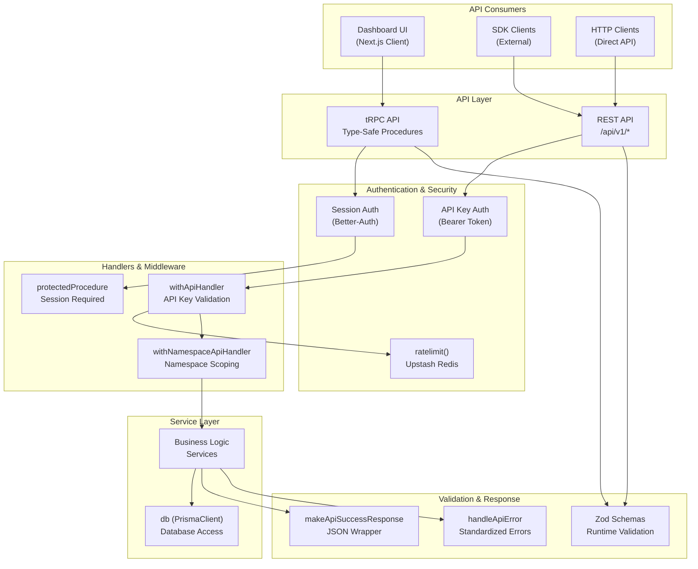

<!-- source: DeepWiki mcp.deepwiki.com · repo agentset-ai/agentset · page 8 API Architecture · fetched 2026-10-26 -->

# API Architecture

Relevant source files

The following files were used as context for generating this wiki page:

- [apps/web/src/app/api/(public-api)/v1/namespace/[namespaceId]/documents/[documentId]/route.ts](apps/web/src/app/api/(public-api)/v1/namespace/[namespaceId]/documents/[documentId]/route.ts)
- [apps/web/src/app/api/(public-api)/v1/namespace/[namespaceId]/documents/route.ts](apps/web/src/app/api/(public-api)/v1/namespace/[namespaceId]/documents/route.ts)
- [apps/web/src/app/api/(public-api)/v1/namespace/[namespaceId]/ingest-jobs/[jobId]/route.ts](apps/web/src/app/api/(public-api)/v1/namespace/[namespaceId]/ingest-jobs/[jobId]/route.ts)
- [apps/web/src/app/api/(public-api)/v1/namespace/[namespaceId]/route.ts](apps/web/src/app/api/(public-api)/v1/namespace/[namespaceId]/route.ts)
- [apps/web/src/app/api/(public-api)/v1/namespace/route.ts](apps/web/src/app/api/(public-api)/v1/namespace/route.ts)
- [apps/web/src/lib/api/api-key.ts](apps/web/src/lib/api/api-key.ts)
- [apps/web/src/lib/api/errors.ts](apps/web/src/lib/api/errors.ts)
- [apps/web/src/lib/api/handler/base.ts](apps/web/src/lib/api/handler/base.ts)
- [apps/web/src/lib/api/handler/namespace.ts](apps/web/src/lib/api/handler/namespace.ts)
- [apps/web/src/schemas/api/query.ts](apps/web/src/schemas/api/query.ts)
- [apps/web/turbo.json](apps/web/turbo.json)

This document describes the API layer of AgentSet, covering both the internal type-safe tRPC API used by the web dashboard and the public REST API used by external consumers. The architecture implements a dual-API pattern: tRPC provides compile-time type safety for internal operations, while REST endpoints with OpenAPI documentation serve external integrations.

For information about specific API endpoints and their usage patterns, see [tRPC Routers](#8.1), [Internal API Routes](#8.2), and [Public API and OpenAPI](#8.3). For authentication mechanisms, see [Authentication System](#7.1) and [Authorization and Resource Limits](#7.3).

## API Architecture Overview

AgentSet implements a dual API architecture to serve different consumer needs. The internal dashboard uses tRPC for type-safe, procedure-based communication, while external integrations consume a REST API with OpenAPI documentation.

### API Consumption Flow

**Sources:** [apps/web/src/lib/api/handler/base.ts:32-132](), [apps/web/src/lib/api/handler/namespace.ts:50-103](), [apps/web/src/lib/api/errors.ts:129-180]()

### Dual API Pattern

| Aspect | tRPC API | REST API |
|--------|----------|----------|
| **Primary Consumer** | Internal dashboard (Next.js) | External integrations, SDKs |
| **Type Safety** | Compile-time + runtime | Runtime only (via Zod) |
| **Authentication** | Session-based (cookies) | API key (Bearer token) |
| **Base Wrapper** | `protectedProcedure` | `withApiHandler` |
| **Namespace Scoping** | `verifyNamespaceAccess` | `withNamespaceApiHandler` |
| **Error Format** | tRPC error codes | `AgentsetApiError` (JSON) |
| **Rate Limiting** | Session-based limits | `ratelimit` (API key based) |

**Sources:** [apps/web/src/lib/api/handler/base.ts:59-92](), [apps/web/src/lib/api/handler/namespace.ts:54-79](), [apps/web/src/lib/api/errors.ts:80-97]()

## Public REST API (v1)

The public API is built using Next.js Route Handlers and a custom higher-order function pattern to ensure consistent authentication, rate limiting, and error handling.

### Handler Pattern

Public endpoints are wrapped in `withApiHandler` or `withNamespaceApiHandler`. These wrappers perform several critical tasks:
1. **API Key Validation**: Retrieves and caches API key info via `getApiKeyInfo` [apps/web/src/lib/api/api-key.ts:5-37]().
2. **Rate Limiting**: Enforces limits using Upstash Redis via the `ratelimit` utility [apps/web/src/lib/api/handler/base.ts:75-92]().
3. **Namespace Resolution**: `withNamespaceApiHandler` automatically validates that the requested `namespaceId` belongs to the authenticated organization [apps/web/src/lib/api/handler/namespace.ts:64-74]().
4. **Analytics**: Logs server events for API requests via `logServerEvent` [apps/web/src/lib/api/handler/base.ts:113-122]().

**Sources:** [apps/web/src/lib/api/handler/base.ts:32-132](), [apps/web/src/lib/api/handler/namespace.ts:50-103]()

### Standardized Responses and Errors

All REST endpoints return a standardized JSON structure. Success responses are generated via `makeApiSuccessResponse`, while errors are processed by `handleApiError`.

**Error Handling Logic:**
The system maps internal errors to HTTP status codes using the `AgentsetApiError` class [apps/web/src/lib/api/errors.ts:80-97]().
- **400 Bad Request**: Validation failures or malformed IDs.
- **401 Unauthorized**: Invalid or missing API keys.
- **404 Not Found**: Resource missing or out of scope.
- **422 Unprocessable Entity**: Zod validation errors [apps/web/src/lib/api/errors.ts:135-140]().
- **429 Rate Limit Exceeded**: Organization has exceeded its API quota.

**Sources:** [apps/web/src/lib/api/errors.ts:24-40](), [apps/web/src/lib/api/errors.ts:129-180]()

## Validation and Schemas

AgentSet uses Zod for runtime validation across all API layers. Schemas are categorized into Request (Input) and Response (Output) schemas.

### Key API Schemas

| Category | Schema Name | Purpose |
|----------|-------------|---------|
| **Namespace** | `createNamespaceSchema` | Validates vector store and embedding configs [apps/web/src/app/api/(public-api)/v1/namespace/route.ts:46-48](). |
| **Document** | `getDocumentsSchema` | Handles pagination and status filtering for document lists [apps/web/src/app/api/(public-api)/v1/namespace/[namespaceId]/documents/route.ts:11-21](). |
| **Query** | `queryVectorStoreSchema` | Validates search parameters like `topK`, `rerank`, and `minScore` [apps/web/src/schemas/api/query.ts:5-76](). |
| **Ingest** | `IngestJobSchema` | Defines the response structure for background ingestion tasks [apps/web/src/app/api/(public-api)/v1/namespace/[namespaceId]/ingest-jobs/[jobId]/route.ts:36-40](). |

**Sources:** [apps/web/src/schemas/api/query.ts:5-76](), [apps/web/src/app/api/(public-api)/v1/namespace/[namespaceId]/documents/route.ts:9-55]()

## Child Pages

For deep technical details on specific API components, refer to the following sub-pages:

*   **[tRPC Routers](#8.1)**: Detailed documentation of internal procedure-based APIs, middleware patterns, and the `namespaceRouter`.
*   **[Internal API Routes](#8.2)**: Coverage of non-public endpoints including webhooks (Stripe), Redis integrations, and background job triggers.
*   **[Public API and OpenAPI](#8.3)**: Comprehensive guide to the REST API, including OpenAPI specification generation, authentication scopes, and SDK examples.

---

