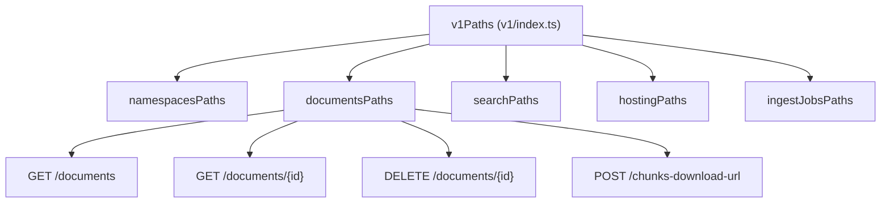
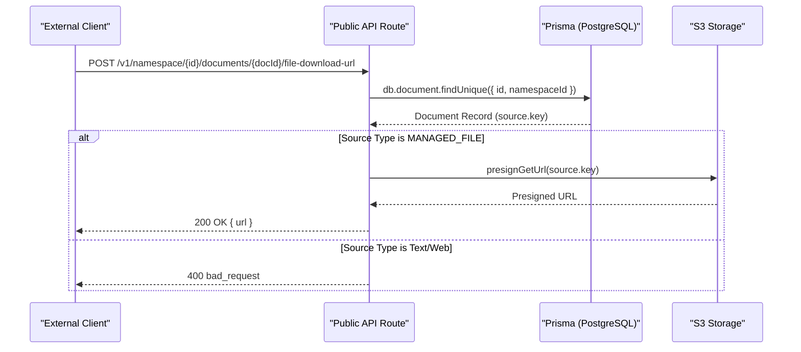

<!-- source: DeepWiki mcp.deepwiki.com · repo agentset-ai/agentset · page 8.3 Public API and OpenAPI · fetched 2026-10-26 -->

# Public API and OpenAPI

<details>
<summary>Relevant source files</summary>

The following files were used as context for generating this wiki page:

- [apps/web/src/app/api/(public-api)/v1/namespace/[namespaceId]/documents/[documentId]/chunks-download-url/route.ts](apps/web/src/app/api/(public-api)/v1/namespace/[namespaceId]/documents/[documentId]/chunks-download-url/route.ts)
- [apps/web/src/app/api/(public-api)/v1/namespace/[namespaceId]/documents/[documentId]/file-download-url/route.ts](apps/web/src/app/api/(public-api)/v1/namespace/[namespaceId]/documents/[documentId]/file-download-url/route.ts)
- [apps/web/src/app/api/(public-api)/v1/namespace/[namespaceId]/warm-up/route.ts](apps/web/src/app/api/(public-api)/v1/namespace/[namespaceId]/warm-up/route.ts)
- [apps/web/src/lib/api/errors.ts](apps/web/src/lib/api/errors.ts)
- [apps/web/src/openapi/v1/code-samples.ts](apps/web/src/openapi/v1/code-samples.ts)
- [apps/web/src/openapi/v1/documents/get-chunks-download-url.ts](apps/web/src/openapi/v1/documents/get-chunks-download-url.ts)
- [apps/web/src/openapi/v1/documents/get-document.ts](apps/web/src/openapi/v1/documents/get-document.ts)
- [apps/web/src/openapi/v1/documents/get-file-download-url.ts](apps/web/src/openapi/v1/documents/get-file-download-url.ts)
- [apps/web/src/openapi/v1/documents/index.ts](apps/web/src/openapi/v1/documents/index.ts)
- [apps/web/src/openapi/v1/documents/list-documents.ts](apps/web/src/openapi/v1/documents/list-documents.ts)
- [apps/web/src/openapi/v1/hosting/delete-hosting.ts](apps/web/src/openapi/v1/hosting/delete-hosting.ts)
- [apps/web/src/openapi/v1/hosting/enable-hosting.ts](apps/web/src/openapi/v1/hosting/enable-hosting.ts)
- [apps/web/src/openapi/v1/hosting/get-hosting.ts](apps/web/src/openapi/v1/hosting/get-hosting.ts)
- [apps/web/src/openapi/v1/hosting/index.ts](apps/web/src/openapi/v1/hosting/index.ts)
- [apps/web/src/openapi/v1/hosting/update-hosting.ts](apps/web/src/openapi/v1/hosting/update-hosting.ts)
- [apps/web/src/openapi/v1/index.ts](apps/web/src/openapi/v1/index.ts)
- [apps/web/src/openapi/v1/warm-up.ts](apps/web/src/openapi/v1/warm-up.ts)
- [apps/web/src/schemas/api/query.ts](apps/web/src/schemas/api/query.ts)
- [apps/web/turbo.json](apps/web/turbo.json)

</details>


This document covers the public-facing REST API for the Agentset platform. It details the OpenAPI specification generation, namespace and document management endpoints, authentication mechanisms, and provide technical implementation details for developers integrating with the platform.

---

## Overview

Agentset provides a comprehensive REST API for programmatic interaction with namespaces, documents, and search capabilities. The API is designed for high performance, with routes typically colocated in the `iad1` region to minimize latency with the primary PostgreSQL database.

| Category | Description | Primary Endpoints |
|----------|-------------|-------------------|
| **Namespaces** | Manage knowledge containers | `/v1/namespaces`, `/v1/namespace/{id}` |
| **Documents** | Ingest and manage source files/text | `/v1/namespace/{id}/documents` |
| **Search** | Query the vector and keyword stores | `/v1/namespace/{id}/search` |
| **Hosting** | Configure public chat interfaces | `/v1/namespace/{id}/hosting` |

**Sources:** [apps/web/src/openapi/v1/index.ts:11-19](), [apps/web/src/app/api/(public-api)/v1/namespace/[namespaceId]/search/route.ts:19]()

---

## OpenAPI Specification

The platform uses `zod-openapi` to generate a type-safe OpenAPI 3.0 specification directly from Zod schemas. This ensures that the documentation and the runtime validation remain in sync.

### Specification Structure
The specification is composed of modular path objects defined in `apps/web/src/openapi/v1`.



**Sources:** [apps/web/src/openapi/v1/index.ts:1-19](), [apps/web/src/openapi/v1/documents/index.ts:9-23]()

---

## Authentication and Error Handling

### Authentication
Public endpoints are protected via API Key authentication. The key must be provided in the `Authorization` header as a Bearer token. Internally, the `withNamespaceApiHandler` and `withPublicApiHandler` utilities extract and verify these tokens against the `Organization` and `ApiKey` tables.

**Sources:** [apps/web/src/openapi/v1/documents/get-file-download-url.ts:27](), [apps/web/src/app/api/(public-api)/v1/namespace/[namespaceId]/warm-up/route.ts:7-8]()

### Error Handling
Errors are standardized using the `AgentsetApiError` class and the `handleApiError` utility. Errors return a `success: false` payload with a specific `ErrorCode`.

| Error Code | HTTP Status | Description |
|------------|-------------|-------------|
| `bad_request` | 400 | Invalid input or unsupported operation |
| `unauthorized` | 401 | Missing or invalid API key |
| `not_found` | 404 | Resource (Namespace/Document) does not exist |
| `unprocessable_entity`| 422 | Zod validation failure |
| `rate_limit_exceeded` | 429 | Usage limits reached for the plan |

**Sources:** [apps/web/src/lib/api/errors.ts:8-36](), [apps/web/src/lib/api/errors.ts:129-180]()

---

## Document Management Endpoints

The API provides granular control over document lifecycles within a namespace.

### Retrieval and Downloads
Beyond basic metadata retrieval, the API supports generating presigned URLs for raw source files and processed chunks.

1.  **File Download:** `POST /v1/namespace/{id}/documents/{docId}/file-download-url`
    *   Only available for `MANAGED_FILE` source types.
    *   Uses `presignGetUrl` from `@agentset/storage`.
2.  **Chunks Download:** `POST /v1/namespace/{id}/documents/{docId}/chunks-download-url`
    *   Only available for documents with `DocumentStatus.COMPLETED`.
    *   Provides access to the JSON-serialized vector chunks stored in S3.

**Sources:** [apps/web/src/app/api/(public-api)/v1/namespace/[namespaceId]/documents/[documentId]/file-download-url/route.ts:9-49](), [apps/web/src/app/api/(public-api)/v1/namespace/[namespaceId]/documents/[documentId]/chunks-download-url/route.ts:10-54]()

### Warm-up API
For vector stores that support caching (e.g., specific Pinecone configurations), the `warm-up` endpoint triggers a cache pre-fill to reduce first-query latency.

**Route:** `POST /v1/namespace/[namespaceId]/warm-up`
**Implementation:** [apps/web/src/app/api/(public-api)/v1/namespace/[namespaceId]/warm-up/route.ts:7-23]()

---

## Search and Query Configuration

The search API uses a sophisticated schema to control retrieval behavior, including semantic similarity, keyword filtering, and reranking.

### Query Schema
The `queryVectorStoreSchema` defines the parameters for the `/search` endpoint:

| Parameter | Type | Default | Description |
|-----------|------|---------|-------------|
| `query` | string | - | The search string |
| `topK` | number | 10 | Number of raw results to fetch |
| `mode` | enum | "semantic"| "semantic" or "keyword" |
| `rerank` | boolean| true | Enable/disable reranking |
| `rerankModel`| string | - | Model for reranking (e.g., Cohere) |
| `minScore` | number | - | Minimum similarity threshold (0-1) |

**Sources:** [apps/web/src/schemas/api/query.ts:5-59](), [apps/web/src/schemas/api/query.ts:61-76]()

---

## SDK Integration Examples

Agentset generates SDK code samples for the OpenAPI documentation to facilitate developer onboarding.

### TypeScript Example: Downloading a Document
```typescript
const { url } = await ns.documents.getFileDownloadUrl("doc_123");
const file = await fetch(url);
fs.writeFileSync("file.pdf", Buffer.from(await file.arrayBuffer()));
```

### TypeScript Example: Updating Hosting
```typescript
const updatedHosting = await ns.hosting.update({
  title: "My Knowledge Base",
  welcomeMessage: "Welcome!",
  searchEnabled: true,
});
```

**Sources:** [apps/web/src/openapi/v1/documents/get-file-download-url.ts:28-32](), [apps/web/src/openapi/v1/hosting/update-hosting.ts:36-43]()

---

## Data Flow: Document Metadata Retrieval



**Sources:** [apps/web/src/app/api/(public-api)/v1/namespace/[namespaceId]/documents/[documentId]/file-download-url/route.ts:19-48](), [apps/web/src/lib/api/errors.ts:129-152]()

---

