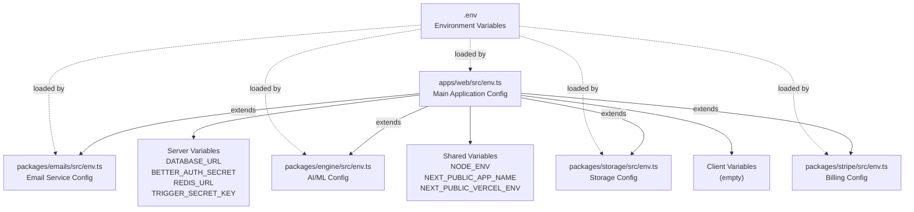
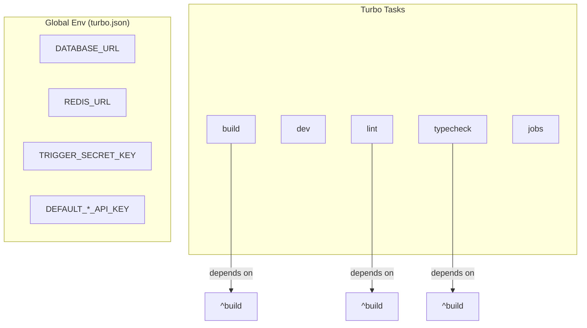
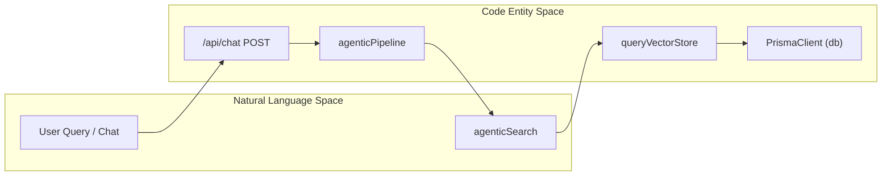

<!-- source: DeepWiki mcp.deepwiki.com · repo agentset-ai/agentset · page 9 Infrastructure and Configuration · fetched 2026-10-26 -->

# Infrastructure and Configuration

Relevant source files

The following files were used as context for generating this wiki page:

- [.env.example](.env.example)
- [apps/web/src/app/api/(internal-api)/chat/route.ts](apps/web/src/app/api/(internal-api)/chat/route.ts)
- [apps/web/src/app/api/(internal-api)/hosting-chat/route.ts](apps/web/src/app/api/(internal-api)/hosting-chat/route.ts)
- [apps/web/src/app/api/(internal-api)/hosting-search/route.ts](apps/web/src/app/api/(internal-api)/hosting-search/route.ts)
- [apps/web/src/app/api/(public-api)/v1/namespace/[namespaceId]/search/route.ts](apps/web/src/app/api/(public-api)/v1/namespace/[namespaceId]/search/route.ts)
- [apps/web/src/env.ts](apps/web/src/env.ts)
- [apps/web/src/instrumentation-client.ts](apps/web/src/instrumentation-client.ts)
- [apps/web/src/lib/agentic/index.ts](apps/web/src/lib/agentic/index.ts)
- [apps/web/src/lib/agentic/search.ts](apps/web/src/lib/agentic/search.ts)
- [apps/web/src/lib/redis.ts](apps/web/src/lib/redis.ts)
- [packages/engine/package.json](packages/engine/package.json)
- [packages/engine/src/env.ts](packages/engine/src/env.ts)
- [turbo.json](turbo.json)

This document covers the infrastructure setup, environment configuration system, and external service integrations for the AgentSet platform. It explains how environment variables are managed across packages, how the monorepo build system is configured, and how external services are integrated into the application. For information about specific job orchestration with Trigger.dev, see [Job Orchestration with Trigger.dev](#9.2). For details on individual external service implementations, see [External Service Integration](#9.3).

## Environment Configuration Architecture

AgentSet uses `@t3-oss/env-nextjs` to provide type-safe environment variable validation with Zod schemas. The system implements a hierarchical configuration pattern where the main web application extends environment configurations from multiple packages.

### Configuration Hierarchy

**Environment Configuration Layers**

Sources: [apps/web/src/env.ts:9-90]()

The main application environment configuration at [apps/web/src/env.ts:9-10]() extends configurations from specialized packages using the `extends` property. For example, the engine package defines specific AI and vector store variables at [packages/engine/src/env.ts:4-43]().

### Environment Variable Categories

AgentSet organizes environment variables into three categories:

| Category | Purpose | Access | Example Variables |
|----------|---------|--------|-------------------|
| **shared** | Available on both server and client | Both contexts | `NODE_ENV`, `NEXT_PUBLIC_APP_NAME`, `NEXT_PUBLIC_POSTHOG_KEY` |
| **server** | Server-side only, never exposed to client | Server only | `DATABASE_URL`, `BETTER_AUTH_SECRET`, `REDIS_URL`, `TRIGGER_SECRET_KEY` |
| **client** | Client-side, exposed in browser bundle | Client only | (currently empty in web app) |

Sources: [apps/web/src/env.ts:11-52]()

### Core Environment Variables

The web application requires these environment variables at [apps/web/src/env.ts:24-51]():

**Authentication & Authorization:**
- `BETTER_AUTH_SECRET`: Secret key for Better-Auth session signing [apps/web/src/env.ts:27]()
- `BETTER_AUTH_URL`: Base URL for authentication callbacks [apps/web/src/env.ts:28]()
- `GITHUB_CLIENT_ID`, `GITHUB_CLIENT_SECRET`: GitHub OAuth credentials [apps/web/src/env.ts:30-31]()
- `GOOGLE_CLIENT_ID`, `GOOGLE_CLIENT_SECRET`: Google OAuth credentials [apps/web/src/env.ts:33-34]()

**Data Layer:**
- `DATABASE_URL`: PostgreSQL connection string [apps/web/src/env.ts:25]()
- `REDIS_URL`, `REDIS_TOKEN`: Upstash Redis connection details [apps/web/src/env.ts:36-37]()

**External Services:**
- `STRIPE_WEBHOOK_SECRET`: Stripe webhook signature verification [apps/web/src/env.ts:39]()
- `TRIGGER_SECRET_KEY`: Trigger.dev API authentication [apps/web/src/env.ts:46]()
- `VERCEL_PROJECT_ID`, `VERCEL_TEAM_ID`, `VERCEL_API_TOKEN`: Vercel API access [apps/web/src/env.ts:48-50]()

**AI & Ingestion (via Engine):**
- `DEFAULT_PINECONE_API_KEY`, `DEFAULT_TURBOPUFFER_API_KEY`: Managed vector stores [packages/engine/src/env.ts:6-12]()
- `PARTITION_API_URL`, `PARTITION_API_KEY`: Document partitioning service [packages/engine/src/env.ts:20-21]()

## Monorepo Structure and Build System

AgentSet uses a monorepo architecture managed by Bun workspaces with Turbo for build orchestration.

### Workspace Organization

The root configuration defines workspace patterns for applications, packages, and tooling. Turbo manages task execution and caching for the entire monorepo.

**Turbo Task Orchestration**

Sources: [turbo.json:4-72](), [turbo.json:73-120]()

Turbo is configured to track global environment variables at [turbo.json:73-120](), ensuring that cache hits are invalidated when sensitive infrastructure configurations change.

### Dependency Management

AgentSet uses Bun's workspace catalog feature to centralize version management for shared dependencies across the monorepo. For example, `@agentset/engine` utilizes the catalog for core AI and environment utilities [packages/engine/package.json:30-35]().

## External Services Integration

AgentSet integrates with multiple external services to provide RAG and agentic capabilities.

### AI and Vector Infrastructure

The platform supports multiple LLM and vector database providers, abstracted through the `@agentset/engine` package.

**Query Execution Flow**

Sources: [apps/web/src/app/api/(internal-api)/chat/route.ts:57-171](), [apps/web/src/lib/agentic/index.ts:29-136](), [apps/web/src/lib/agentic/search.ts:12-102]()

The system integrates the following core infrastructure:

1.  **Vector Databases**: Support for Pinecone and Turbopuffer [packages/engine/package.json:29-31]().
2.  **LLM Providers**: Integration with OpenAI, Anthropic, Google, and Azure [packages/engine/package.json:24-27]().
3.  **Reranking**: Support for Cohere and ZeroEntropy [packages/engine/package.json:32-34]().
4.  **Analytics**: PostHog is initialized on the client for event tracking [apps/web/src/instrumentation-client.ts:1-11]().
5.  **Caching**: Upstash Redis is used for rate limiting and temporary data storage [apps/web/src/env.ts:36-37]().

### Chat and Search Endpoints

The infrastructure supports several specialized chat and search routes:

-   **Internal Chat**: `/api/chat` handles authenticated playground interactions, supporting `agentic` and `deepResearch` modes [apps/web/src/app/api/(internal-api)/chat/route.ts:83-140]().
-   **Hosted Chat**: `/api/hosting-chat` powers public-facing namespace deployments [apps/web/src/app/api/(internal-api)/hosting-chat/route.ts:68-136]().
-   **Public Search**: `/api/v1/namespace/[namespaceId]/search` provides REST access to vector retrieval [apps/web/src/app/api/(public-api)/v1/namespace/[namespaceId]/search/route.ts:19-110]().

For details on specific integrations, see [External Service Integration](#9.3).

---

