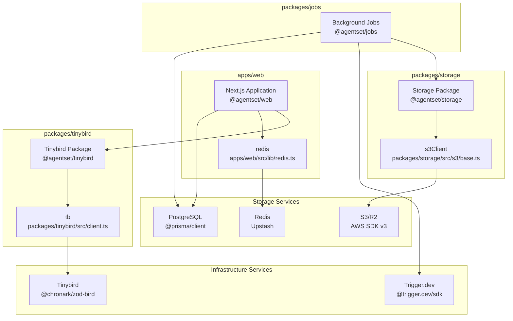
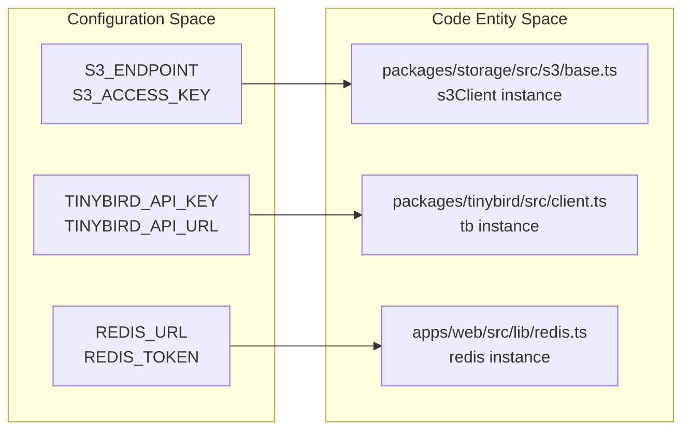

<!-- source: DeepWiki mcp.deepwiki.com · repo agentset-ai/agentset · page 9.3 External Service Integration · fetched 2026-10-26 -->

# External Service Integration

Relevant source files

The following files were used as context for generating this wiki page:

- [.gitignore](.gitignore)
- [apps/web/src/lib/redis.ts](apps/web/src/lib/redis.ts)
- [packages/storage/src/s3/base.ts](packages/storage/src/s3/base.ts)
- [packages/storage/src/s3/document.ts](packages/storage/src/s3/document.ts)
- [packages/tinybird/README.md](packages/tinybird/README.md)
- [packages/tinybird/datasources/agentset_webhook_events.datasource](packages/tinybird/datasources/agentset_webhook_events.datasource)
- [packages/tinybird/package.json](packages/tinybird/package.json)
- [packages/tinybird/pipes/get_webhook_events.pipe](packages/tinybird/pipes/get_webhook_events.pipe)
- [packages/tinybird/src/client.ts](packages/tinybird/src/client.ts)
- [packages/tinybird/src/index.ts](packages/tinybird/src/index.ts)
- [packages/tinybird/src/webhook-events.ts](packages/tinybird/src/webhook-events.ts)
- [packages/utils/src/constants.ts](packages/utils/src/constants.ts)

This page catalogs all external service integrations in the AgentSet platform, documenting how services are configured, instantiated, and used across the codebase. For environment configuration details, see [Environment Configuration](#9.1). For job orchestration specifics, see [Job Orchestration with Trigger.dev](#9.2).

## Overview

AgentSet integrates with a comprehensive ecosystem of external services across four primary categories:

| Category | Services |
|----------|----------|
| **AI/ML** | OpenAI, Anthropic, Google AI, Azure OpenAI, Voyage AI, Cohere, ZeroEntropy |
| **Storage** | PostgreSQL (Supabase/Neon), Redis (Upstash), S3 (Cloudflare R2/AWS), Pinecone, Turbopuffer |
| **Infrastructure** | Vercel, Trigger.dev, Stripe, Resend, PostHog, Tinybird |
| **Authentication** | GitHub OAuth, Google OAuth, Better-Auth |

These integrations are distributed across packages based on functional boundaries, with the web application and job workers acting as primary consumers.

Sources: `apps/web/src/lib/redis.ts:1-8`(), `packages/storage/src/s3/base.ts:1-25`(), `packages/tinybird/src/client.ts:1-7`()

## Service Dependency Architecture

Sources: `apps/web/src/lib/redis.ts:1-7`(), `packages/storage/src/s3/base.ts:18-25`(), `packages/tinybird/src/client.ts:1-7`()

## AI/ML Service Integration

### Embedding and LLM Providers
AgentSet supports multiple embedding and LLM providers through the Vercel AI SDK. Configuration is typically stored per-namespace in the `embeddingConfig` JSON field.

### Reranking Services
Reranking providers improve search result quality through semantic reordering. Supported providers include Cohere and ZeroEntropy, integrated within the engine package.

## Vector Store Integration

Vector stores are the core storage mechanism for document embeddings. AgentSet supports two vector databases with a unified abstraction layer.

### Pinecone Integration
The Pinecone integration provides semantic search capabilities. The namespace format follows a specific pattern: `agentset:${namespaceId}:${tenantId}`.

### Turbopuffer Integration
The Turbopuffer integration provides hybrid semantic + keyword search. It uses a specific schema for full-text search capabilities on the `text` field.

Sources: `packages/validation/src/vector-store/turbopuffer.ts:3-18`()

## Storage Services

### Object Storage (S3/R2)

Object storage is abstracted in the `@agentset/storage` package using AWS SDK v3. It supports any S3-compatible API, including Cloudflare R2.

**Implementation**:
The `s3Client` is initialized in `packages/storage/src/s3/base.ts` [18-25]() using `S3_ENDPOINT`, `S3_ACCESS_KEY`, and `S3_SECRET_KEY`.

**Key Operations**:
- **Presigned URLs**: Used for secure client-side uploads and downloads [packages/storage/src/s3/base.ts:35-55]().
- **Chunk Management**: Specific utilities for managing document chunks in S3, such as `getChunksJsonFromS3` [packages/storage/src/s3/document.ts:50-66]().
- **Cleanup**: `deleteObjectsByPrefix` allows for recursive deletion of document-related assets (images, chunks) [packages/storage/src/s3/base.ts:254-267]().

Sources: `packages/storage/src/s3/base.ts:1-278`(), `packages/storage/src/s3/document.ts:1-66`()

### Redis Cache

Redis is used for session management, rate limiting, and temporary job data.

**Implementation**:
The application uses `@upstash/redis` for HTTP-based Redis access, initialized in `apps/web/src/lib/redis.ts` [1-7]().

Sources: `apps/web/src/lib/redis.ts:1-7`()

## Infrastructure and Analytics

### Tinybird Analytics

Tinybird is used to store and query high-volume event data, specifically for webhook logging and analytics.

**Data Flow**:
1. **Ingestion**: Events are recorded via `recordWebhookEvent`, which targets the `agentset_webhook_events` datasource [packages/tinybird/src/webhook-events.ts:20-23]().
2. **Storage**: Data is stored in a `MergeTree` engine, partitioned by month [packages/tinybird/datasources/agentset_webhook_events.datasource:15-17]().
3. **Consumption**: The `get_webhook_events` pipe provides an endpoint to retrieve logs for specific webhooks [packages/tinybird/pipes/get_webhook_events.pipe:4-20]().

**Schema**:
The `webhookEventSchemaTB` defines the structure, including `event_id`, `webhook_id`, `task_id` (from Trigger.dev), and HTTP status codes [packages/tinybird/src/webhook-events.ts:8-18]().

Sources: `packages/tinybird/src/client.ts:1-7`(), `packages/tinybird/src/webhook-events.ts:1-32`(), `packages/tinybird/datasources/agentset_webhook_events.datasource:1-17`(), `packages/tinybird/pipes/get_webhook_events.pipe:1-20`()

### Trigger.dev Job Orchestration
Trigger.dev handles long-running background tasks like document ingestion and vector upserts. It provides the `task_id` used in analytics to correlate background processing with system events.

Sources: `packages/tinybird/src/webhook-events.ts:11`()

## Configuration Management

### Environment Variable Pattern

All external service integrations follow a consistent configuration pattern using `@t3-oss/env-nextjs`. Each package (web, engine, storage) maintains its own `env.ts` file to validate required variables for its specific integrations.

Sources: `packages/storage/src/s3/base.ts:16-25`(), `packages/tinybird/src/client.ts:1-7`(), `apps/web/src/lib/redis.ts:1-7`()

---

